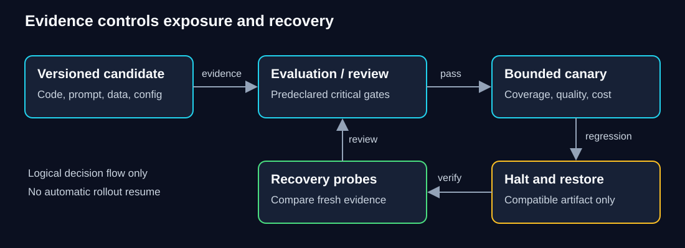

# SG-OPS-00 — From model lifecycle to application operations

How can an AI service look healthy while its users receive less useful work?

> **Your goal:** Connect the ML lifecycle to application artifacts, evaluation, monitoring and incident ownership. 
> **You need:** [SG-ML-01 — evaluation](../ml-foundations/docs/01-baselines-metrics-and-leakage.md), [W-LLM-EVAL-01 — versioned evaluation](../../workbooks/llm/eval-harness/README.md) and [W-ENG-DELIVERY-01 — delivery](../../workbooks/delivery/README.md). 
> **Estimated effort:** 40–50 minutes reading and questions; estimates, not pilot observations 
> **You will produce:** An operations note explaining denominators, release dependencies and recovery limits.

**Status: Draft.** Detailed starting-state, environment and verification limits remain below.

**QuickCart context:** this fictional support-drafting service can become faster while delivering fewer useful drafts. Operations must connect infrastructure health, outcome counts and delayed review labels rather than relying on one latency or quality graph.

**Study route:** trace the lifecycle and versioned artifacts, calculate the denominators, then defend the incident/release decision. No provider, cloud account or paid call is needed for this conceptual guide. The companion workbook supplies a separate synthetic operational replay.

Unit details, prerequisites and verification record

> **Capability:** AI-OPS-01 · **Status:** Draft, unpiloted 
> **Audience:** Experienced backend engineers new to AI operations 
> **Central question:** How can an AI service be healthy while its users receive less useful work? 
> **Prerequisites:** [ML evaluation](../ml-foundations/docs/01-baselines-metrics-and-leakage.md), [versioned application evaluation](../../workbooks/llm/eval-harness/README.md), and [engineering delivery](../../workbooks/delivery/README.md). 
> **Effort:** 40–50 minutes reading and questions; estimates, not pilot observations 
> **Outcome / artifact:** Explain the lifecycle, calculate monitoring denominators, and defend a release/incident decision in a one-page operations note 
> **Acceptance:** Distinguish infrastructure health from useful completion; identify versioned dependencies, missing labels, critical gates and a recovery owner 
> **Verification:** 2026-10-15; companion offline implementation tested separately. No live inference or production deployment

## 1. The system that looks better after it breaks

QuickCart prepares refund replies for a support agent to review. The application never issues refunds. A team reduces its request timeout from 1,200 to 500 milliseconds to improve responsiveness. The next dashboard shows faster responses and every returned draft is correct. Has the release improved the service?

Pause and predict: what information could reverse that conclusion?

Reveal the reasoning

Count requests that never produced a draft, requests intentionally escalated, and requests with no review label. A ratio restricted to returned answers can improve simply because harder cases disappeared.

Backend engineers already know that HTTP health is incomplete evidence of business health. AI adds another gap: a structurally valid answer can be wrong, and correctness often requires delayed human judgment.

**MLOps** means engineering the repeatable lifecycle of systems whose behavior depends on learned models and data. **Application LLMOps** applies that discipline to an application using a language model, including its prompts, retrieved context, tools, evaluations and operation. It does not require training a model. QuickCart consumes a provider model; its immediate responsibilities are safe execution, evidence-based changes and recovery.

## 2. The lifecycle foundation

Think of a restaurant recipe: ingredients, recipe, preparation and tasting all affect the meal. Recording only the oven version will not reproduce it. The analogy has limits: people can often inspect ingredients directly, whereas model behavior and provider updates may remain partially opaque. Version records improve diagnosis without guaranteeing identical generations.

The ML lifecycle begins with a business question and a measurable target. Data collection, permission checks and labeling establish what examples mean. Splits preserve a fair comparison; training fits parameters on training data; validation selects designs; held-out evaluation challenges the chosen design. A release packages the selected model and serving contract. Monitoring asks whether useful behavior persists, and incidents feed corrections into data, evaluation and implementation. Retraining is one possible response, not the default response to every failure.

For a hosted-model application, the corresponding changes might be a prompt revision, retrieval policy, dataset correction, tool schema or timeout. The team still needs provenance (where an artifact came from), reproducibility (enough information to rerun the comparison), and ownership (who can act when evidence fails). Fine-tuning and advanced training are selective extensions. They do not repair a wrongly shortened deadline or missing tenant authorization.

**Diagram walkthrough:** Follow the arrows as decision/evidence flow, not network traffic. A candidate names its dependencies. Offline evaluation precedes a bounded canary, a limited exposure used to detect release problems. Monitoring can halt further exposure and select the previous compatible artifact. Recovery evidence returns to review rather than directly resuming rollout. The invariant is that recovery does not erase the failed decision. Authentication, queues, cloud routing and durable business side effects are omitted; the companion implements local files and synthetic probes only.

## 3. What needs a version?

A release record should identify application source/build, prompt, provider/model identifier, decoding and execution configuration, output/tool schema, data/retrieval snapshot and permissions policy, evaluation dataset/label policy, and pricing assumptions. Hashes detect changes; readable version names explain them. A hash does not confer approval or prove origin. Keep an authorized registry and immutable evidence in a real deployment.

The [evaluation harness](../../workbooks/llm/eval-harness/README.md) already teaches fixed splits, thresholds and held-out review. Reuse its approach. A release gate is a decision rule established before observing a candidate. Critical gates such as unauthorized retrieval or an unsafe consequential action cannot be averaged away by good latency. Offline evidence supports a bounded release decision within its data scope, not a guarantee about all future traffic.

Separate two stores conceptually: a release registry that identifies approved artifacts, and an evidence store that identifies what was measured. The reference lab keeps a content-addressed manifest registry and versioned reports, but its fixed application implementation is not an archived container. Use the earlier delivery workbook to preserve actual executable bundles. A hosted provider may not let you restore old weights; record that limitation and retain an abstention/review route.

## 4. Monitoring with honest denominators

**Coverage** is the fraction of requests that receive a ready draft. **Conditional quality** is the fraction of reviewed ready drafts judged correct and safe. Neither proves the other. Report the review fraction, unreviewed count, abstentions and failures alongside them. Answerable coverage from the earlier harness additionally requires a reviewed expectation of whether each request should have been answered; online telemetry rarely supplies that label immediately.

In the lab's stable ten-request window, eight requests receive ready drafts and two correctly abstain. All eight drafts are reviewed and good. Coverage is 8/10 = 80%; conditional quality is 8/8 = 100%; review fraction is 8/8 = 100%. Two slow answerable requests and two slow abstaining requests take 900 ms. Six requests take 400 ms.

After the timeout change, only six drafts return. Four requests fail at 500 ms. Quality is still 6/6 = 100%, coverage is 6/10 = 60%, failure fraction is 4/10 = 40%. The nearest-rank p95 is the tenth sorted observation, now 500 ms instead of 900 ms. A faster p95 has accompanied lost useful work. Separate successful and failed latency distributions in a live dashboard; this small lab retains counts and slices to expose the effect. Google's [monitoring chapter](https://sre.google/sre-book/monitoring-distributed-systems/) explains why error latency and user-visible errors require distinct attention.

Assume each request costs a hypothetical $0.002 including failed attempts. Both windows cost $0.020 total and $0.002 per request. Cost per good ready draft rises from $0.020/8 = $0.0025 to $0.020/6 ≈ $0.00333. Token charges are only part of ownership cost: cloud resources, retries, evidence review and human escalation capacity matter. These values are authored measurements for reasoning, not provider prices or a live benchmark.

Small samples cannot establish stable population rates. The lab minimum of eight requests is deliberately a mechanics threshold, not a statistical justification. Compare representative, time-bounded windows and report traffic mix. A changing language mix can lower average quality without a code release; an unchanged aggregate can hide a harmed subgroup. Missing reviews should yield insufficient evidence, not assumed correctness. Avoid sending raw user identifiers or arbitrary strings as metric labels.

## 5. Safe telemetry is a designed boundary

Logs and traces are data exports. A prompt can contain customer details; a tool response can contain credentials; an exception can echo an entire request. Removing one field named `password` does not address nested content. The lab projects only approved numeric measurements, boolean review labels and finite outcome/slice enums before storage. Raw prompts, headers, tool results, free-form exceptions and user IDs never enter the serialized event.

This sacrifices debugging detail intentionally. An allowlist still needs trusted measurement producers: a provider or model cannot assign its own correctness label. Reviewers and trusted application logic supply those labels; missing judgment stays missing. Real systems need authenticated collectors, restrictive writer/reader permissions, monitored export, encrypted storage and explicit ownership. [OWASP's logging guidance](https://cheatsheetseries.owasp.org/cheatsheets/Logging_Cheat_Sheet.html) discusses excluded data, access protection and disposal.

The workbook chooses seven days of event retention as a local teaching assumption, with deletion at the exact expiry boundary. It is not a legal recommendation. Deleting SQLite rows proves logical expiry only; pages, backups, copied reports and remote collectors need their own disposal policy. A caller-supplied `oncall` string is not authentication. The role test exercises an interface contract within a trusted local process; filesystem readers can bypass it. Do not expose this CLI as a shared service.

## 6. Detect, contain, diagnose, recover

Detection identifies a user-visible symptom. Diagnosis establishes a causal explanation. In this incident the only manifest difference is the timeout, failures concentrate in the slow slice, and restoring the old configuration recovers the same probes. Those three facts support the synthetic diagnosis. A coincident release timestamp alone would not prove causation.

The application on-call owns containment: halt rollout, preserve the failed artifact and evidence, and keep affected work in review rather than declaring fallback a success. A release engineer restores a compatible artifact. A reviewer checks recovery and decides whether a new rollout can be proposed. One learner can simulate these roles but should distinguish their decisions. Google's [incident response chapter](https://sre.google/workbook/incident-response/) supplies the broader coordination model.

Rollback is a dependency decision. Old code may not read a migrated schema; old retrieval indexes may restore deleted information; a provider outage affects both old and new configurations. Do not blindly restore obsolete permissions or replay consequential actions. Halt, disable the affected capability, reconcile durable side effects and use the known manual route when rollback cannot safely recover. The lab has no external effects or schema migration, so restoring its complete manifest is safe within that scope.

## 7. Check your reasoning

**Prediction:** Eight ready drafts exist, but only two have review labels and both are correct. May you report 100% quality and release?

Show answer and explanation

You can report observed reviewed quality 2/2, with review fraction 2/8 = 25%, but cannot infer quality for all eight. The lab halts on incomplete review. A real review sampling design needs representative selection, uncertainty and a predeclared acceptable evidence threshold.

**Design challenge:** A provider outage causes every version to time out. State the owner, containment action, recovery evidence and stakeholder message.

Show one reasonable solution

Application-oncall halts exposure and routes work to bounded human review, explicitly counting capacity and failures. Restoring an old prompt alone cannot restore an unavailable provider. Use bounded probes after provider recovery, check queue age and duplicate effects, and require fresh semantic review before resuming. Tell support what tasks are affected, what manual route exists and when the next update is due; do not claim recovered service based only on an HTTP health probe.

Revision vocabulary: **drift** is a change in data or behavior over time; it is a signal to investigate, not proof that retraining is needed. **Regression** is worse behavior relative to a defined baseline. **Canary** is bounded release exposure. **Artifact** is a versioned unit used to reproduce or restore behavior. **Runbook** is an actionable response procedure with an owner and verification.

Write your one-page note: name one metric that could mislead, its missing denominator, the artifacts needed to investigate, the containment owner and a limitation of your recovery test. W-OPS-01's independent task asks you to detect a regression hidden by an aggregate.

## Sources and maintenance

All links are Reference, free web reading, no account; checked by page access 2026-10-15, not verification of a cloud implementation. No required external reading; the explanations above suffice for the lab.

| Title / author | Focus, purpose and optional effort | Prerequisite / version |
|---|---|---|
| [Monitoring Distributed Systems — Rob Ewaschuk, Google SRE](https://sre.google/sre-book/monitoring-distributed-systems/) | Symptoms versus causes, four golden signals; monitoring limits; 10 min | Backend service operations; online chapter |
| [Incident Response — Google SRE Workbook](https://sre.google/workbook/incident-response/) | Incident coordination and learning; 15 min | Incident vocabulary above; online chapter |
| [Logging Cheat Sheet — OWASP](https://cheatsheetseries.owasp.org/cheatsheets/Logging_Cheat_Sheet.html) | Data to exclude, protection and disposal; 10 min | Telemetry boundary above; online living document |

Application-operations maintainer: repository maintainer until an owner is assigned. Weekly correction/broken-lab review, monthly runtime/source checks, quarterly threshold/outcome review. Threshold changes require new evidence; do not overwrite an active cohort's baseline.

[Previous: W-AWS-01 — Bedrock worker](../../workbooks/aws/bedrock-worker/README.md) · [Course map](../../README.md) · [Next: operational workbook](../../workbooks/operations/release-watch/README.md)

The companion [application-governance exercise](../../workbooks/operations/release-watch/application-governance.md) turns these ownership and data boundaries into one private evidence record. Link exercised checks or gaps for every surface; a proposed owner, local role string or retention assumption is not an organizational approval. The additional 45-75 minutes is workbook effort, separate from this guide's reading estimate.

## Completion checkpoint

**Show it:** a one-page operations note with metric numerators/denominators, missing-label handling, versioned dependencies, release/stop criteria and a named recovery responsibility. Distinguish an illustrative target from measured operational evidence.

**You can now:** explain the lifecycle, a misleading metric and the owner/evidence needed to recover safely. Support that explanation with this module's actual acceptance checks and disclose any unexecuted route.

**Next:** [run the monitoring and incident workbook](../../workbooks/operations/release-watch/README.md). Use the root capability prerequisites when deciding whether to proceed.
