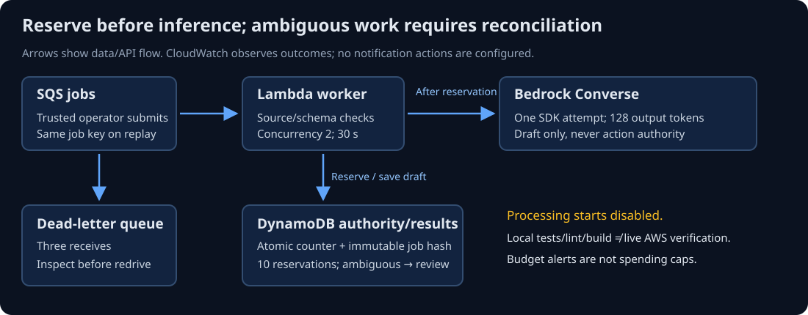

# SG-AWS-00 — Deliver a bounded Bedrock draft worker

A successful cloud invocation is only one part of delivering a bounded AI application.

> **Your goal:** Reason about the identity, queue, storage, cost and recovery boundaries of one Bedrock delivery path. 
> **You need:** [SG-GRAPH-00 — state and recovery](../stateful-orchestration/README.md), [SG-REL-00 — reliable model calls](../llm-reliability/docs/00-reliable-model-calls.md) and [W-ENG-DELIVERY-01](../../workbooks/delivery/README.md) packaging. 
> **Estimated effort:** 40–55 min reading, estimated 
> **You will produce:** An explained deployment/control design and a route into the companion worker lab.

**Status: Draft.** Detailed starting-state, environment and verification limits remain below.

**QuickCart context:** the fictional support team can wait for an internal draft, so this route studies queue admission, bounded inference and human review rather than a synchronous public chat service.

**Study route:** trace identity and admission before inference, then consider ambiguous completion, observation, cost and teardown. No AWS account, deployment or paid call is needed to read this conceptual guide. The companion workbook separates offline checks from a separately authorized, budgeted live run.

Unit details, prerequisites and verification record

> **Capability:** AI-AWS-01 | **Status:** Draft; local checks only, live checks pending 
> **Prerequisites:** [state/recovery](../stateful-orchestration/README.md), [reliability](../llm-reliability/docs/00-reliable-model-calls.md), Python packaging. 
> **Effort:** 40–55 min reading, estimated 
> **Question:** What survives if inference completes but the worker dies before recording its result? 
> **Outcomes/artifact:** Explain AWS identity, queue/storage boundaries, admission limits, ambiguous outcomes and a safe deployment/teardown decision.

## Begin with the requirement

QuickCart wants internal support drafts. Traffic is bursty and people can wait for a queued result; it does not need a synchronous public chat endpoint. An authorized operator submits synthetic jobs to SQS. Lambda reads one message, reserves a model attempt in DynamoDB, calls Bedrock and stores a draft for human review. No model may authorize a refund or send a message.

Think of a work-ticket rack: accepting a ticket is not completing its work. The analogy stops at retries and crashes, because the rack needs durable identity and explicit handling of an outcome nobody can confirm.

**Predict:** The model may have generated a draft, but Lambda timed out before saving it. Is replaying the same job automatically safe?

Reasoning

Not necessarily. Replay can create another billed inference. The reference reserves one attempt before calling the model. An ambiguous job remains REVIEW_REQUIRED and goes to reconciliation rather than silently retrying paid work. This trades availability for a conservative call bound.

## Identity and least privilege

**Diagram walkthrough:** Follow the queue-to-worker arrow, then the worker's reservation/storage path. Inference is permitted only after the reservation succeeds. A failed record follows the queue's redrive policy into the DLQ. The diagram separates application progress from the model response: storing a draft does not complete human review. CloudWatch observes status/error categories, while processing remains disabled until explicitly enabled.

Bedrock is a managed inference API, not an authorization engine for your business. The deployment role creates approved infrastructure; the operator role submits to the specific queue and inspects permitted evidence; the Lambda execution role reads/deletes only that queue, updates only its results table, writes its log group and invokes one selected foundation-model ARN.

IAM grants are separate from model availability, region eligibility, provider terms and service quotas. The lab uses an eligible single-region on-demand foundation model supporting Converse. Cross-region inference profiles, provisioned throughput and automatic marketplace subscription are not taught through a wildcard permission. Confirm current model access/terms in the intended account before any live call; do not assume a model enabled elsewhere is enabled here.

Input cannot choose tenant, model ID, queue, table or credential. The function verifies the SQS source ARN and accepts only job_id/text; model/table configuration comes from deployment state. This is a single synthetic tenant, not a general multi-tenant application. AWS CLI/operator access is the ingestion boundary; no public API authentication is implied.

## Queueing changes the failure contract

SQS standard delivery can repeat. Message delivery, model execution and result persistence are distinct facts. The consumer returns failed message IDs using partial-batch response configuration; a failed record is retried/redriven rather than causing an unrelated completed record to run again.

The template uses batch size one, worker concurrency two, a 30-second function timeout, 180-second visibility and three receives before dead-letter routing. Three receives is a bounded classroom choice, not a universal production recommendation. Queue capacity absorbs bursts; it does not remove review staffing limits or guarantee latency. Consult [queue-based load leveling](../cloud-architecture-patterns/scalability-patterns/docs/04-queue-based-load-leveling.md) and [competing consumers](../cloud-architecture-patterns/scalability-patterns/docs/05-competing-consumers.md) when those constraints appear.

## Durable admission and ambiguity

One DynamoDB transaction increments a ten-attempt deployment counter and creates the unique job row. If either condition fails, no model call begins. The AWS SDK uses one total attempt for each call; there is no hidden inference retry loop. Failed or interrupted work retains REVIEW_REQUIRED. Completed drafts become DRAFT_FOR_REVIEW, which still does not mean factual correctness or a resolved support ticket.

If a duplicate has identical content and a completed draft, it is acknowledged without another inference. If its content differs, it is rejected as an identity conflict. If its prior attempt is ambiguous, it remains failed for DLQ/reconciliation. A concurrent loser in the admission transaction may temporarily fail; a later delivery can observe the winner's result. Do not delete job/counter rows to make a redrive appear successful.

This is deliberately not a lease/retry workflow. A production policy allowing another paid attempt needs a new explicit, budgeted decision and durable attempt version. Checkpoints and external service calls cannot be made atomic merely by using a database transaction.

## Bounds, observation and cost

Input is limited to 1,000 text characters and 4,096 body characters, output request to 128 tokens, one model attempt per admitted job and ten reserved attempts per stack. Character and token units differ. A rejected/ambiguous attempt can still consume the reservation and real provider charges.

Application limits are not a total AWS spending cap. SQS retries, Lambda execution, DynamoDB requests/storage, logs, custom metrics/alarms and deployment artifacts may incur charges. Budget alerts can lag and do not guarantee stopping spending. For selected prices, estimate inference as attempts × (measured input tokens × input price + output tokens × output price), using consistent price units, then add infrastructure and storage. Record the selected model/region/pricing date before approval.

Observe queue depth and oldest age, DLQ messages, Lambda duration/throttles, custom job-failed metrics, durable status counts and actual Bedrock usage. Lambda may report success while returning partial batch failures, so Lambda Errors alone is insufficient. Logs contain only outcome/error categories; do not log raw tickets, drafts or credentials. The example alarm has no notification action: it demonstrates an observable alarm state without sending messages.

## Deployment and recovery judgment

**Pause and decide:** a job has a reserved inference attempt but no saved draft after a worker timeout. Would deleting its row and redriving it restore the original evidence?

Compare the recovery decision

No. Deletion removes the record needed to distinguish an unstarted job from an ambiguous billed attempt. Preserve the original identity/status and reconcile the outcome. A new paid attempt needs its own explicit decision and remaining-budget accounting; a successful replay cannot rewrite the earlier uncertainty.

CloudFormation/SAM expresses one inspectable deployment. Processing is disabled by default. Review the change set and IAM before enabling the mapping, and submit one synthetic event first. A local build or schema-stubbed SDK call does not prove model access, IAM effectiveness, real quality, scaling or cloud cleanup.

Teardown stops admission/polling, lets in-flight work settle, exports required evidence, deletes the dedicated stack and verifies deletion. The separate packaging bucket/prefix and local artifacts need their own cleanup. Deleting storage is not a rollback strategy for unknown model outcomes; reconcile before destroying evidence.

Practice with [W-AWS-01](../../workbooks/aws/bedrock-worker/README.md). Independently add an operator-owned reconciliation decision for ambiguous jobs, preserving the original attempt and remaining budget. Explain when a simpler synchronous worker would suffice and when queueing earns its operational cost.

Reflect before moving on: which failure in this design would you be least able to detect from the queue's metrics alone, and what record would you add so an operator could tell "never ran" from "ran, result lost"?

## Sources

Checked 2026-10-14. **Reference**, optional, free, AWS/Python prerequisite, 10–15 min per relevant section: AWS [Converse](https://docs.aws.amazon.com/boto3/latest/reference/services/bedrock-runtime/client/converse.html), request/response contract; [model access](https://docs.aws.amazon.com/bedrock/latest/userguide/model-access.html), account/provider access; [SQS error handling](https://docs.aws.amazon.com/lambda/latest/dg/services-sqs-errorhandling.html), partial batches; [SQS mapping configuration](https://docs.aws.amazon.com/lambda/latest/dg/services-sqs-configure.html), timing and permissions. The concepts above are self-contained; real account access remains unverified.

## Completion checkpoint

**Show it:** a deployment/control sketch identifying trusted identities, attempt reservation, ambiguous status, human-review handoff and cleanup surfaces. Mark offline-only evidence and all pending live checks explicitly; a diagram or local build does not establish AWS permissions, model access or teardown.

**You can now:** locate trust, admission, storage and cleanup responsibilities without equating invocation with useful delivery. Support that explanation with this module's actual acceptance checks and disclose any unexecuted route.

**Next:** [package the bounded worker](../../workbooks/aws/bedrock-worker/README.md). Use the root capability prerequisites when deciding whether to proceed.
