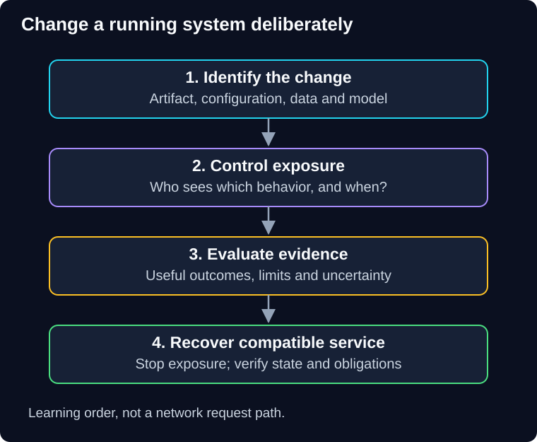

# Deployment and Production Testing Patterns

QuickCart has a new checkout version. Its tests pass, but replacing every running instance could interrupt payments. Replacing only one could still corrupt the shared database. Keeping the old version available helps only if it can read the state the new version writes.

This guide teaches you to **change a running system, limit customer exposure, collect useful evidence, and recover when the change is wrong**.

> **Audience:** Experienced backend engineers learning production AI engineering.<br>
> **You need:** HTTP services, load balancing, database transactions and background jobs. Use [scalability foundations](../scalability-patterns/docs/00-foundations.md) and [reliability foundations](../reliability-patterns/docs/00-foundations.md) as optional refreshers.<br>
> **Effort:** 4 hours 40 minutes–6 hours 10 minutes reading and short checks; 90–120 minutes independent design practice. Estimates, not measured learner timings.<br>
> **Artifact:** A release decision record, exposure plan, compatibility matrix, experiment design and recovery runbook.<br>
> **Scope:** Optional conceptual reference for **AI-DELIVER-01** and **AI-OPS-01**. Paper exercises, with no cloud account, installation, paid calls or live fault injection required.

**Start with [00 — Foundations](docs/00-foundations.md).** The chapters develop one QuickCart case; later visits can focus on the pattern relevant to your change.



**Diagram walkthrough:** Enter at the top. Arrows represent learning order, not network calls. First identify the artifact and its state assumptions, then choose how customers encounter it. Evidence informs promotion or stopping; recovery must restore correct service, not merely the old process. The invariant is that exposure increases only under a declared decision policy. Specific platforms and deployment commands are omitted.

| Unit | Chapter and question | Reading + short checks | Evidence to keep |
|---|---|---|---|
| SG-DEP-00 | [Foundations](docs/00-foundations.md): what exactly are we changing? | 25–35 min | Release identity and acceptance contract |
| SG-DEP-01 | [Rolling deployment](docs/01-rolling-deployment.md): can the remaining fleet carry the load? | 35–45 min | Capacity calculation and drain sequence |
| SG-DEP-02 | [Blue-green deployment](docs/02-blue-green-deployment.md): can we safely switch and switch back? | 35–45 min | Routing, state and retention plan |
| SG-DEP-03 | [Canary releases](docs/03-canary-releases.md): what evidence permits more exposure? | 40–50 min | Cohorts, denominators and release gates |
| SG-DEP-04 | [A/B testing](docs/04-ab-testing.md): does the change improve a useful outcome? | 35–45 min | Assignment and analysis plan |
| SG-DEP-05 | [Production verification and shadow testing](docs/05-production-verification.md): what do the probes actually prove? | 30–40 min | Test ladder and shadow safety boundary |
| SG-DEP-06 | [Chaos engineering](docs/06-chaos-engineering.md): does the system withstand a specified fault? | 35–45 min | Bounded experiment card and recovery checks |
| SG-DEP-07 | [Compatible changes and recovery](docs/07-compatible-changes-and-recovery.md): can old and new coexist? | 30–40 min | Migration and rollback matrix |
| SG-DEP-08 | [Case study, challenges and revision](docs/08-case-study-and-revision.md): can you defend the decision? | 15–25 min + 90–120 min practice | Independent design and changed-requirement response |

## How to use the guide

Predict before opening an answer. Trace the same request through deployment, release, failure and recovery. For each diagram, identify the shared resource that the drawing does not isolate. Treat thresholds and costs as illustrative design inputs unless explicitly described otherwise.

The supplied online-course transcript provides the topic outline. This guide uses original QuickCart explanations, examples and diagrams and adds qualifications checked against [primary technical references](docs/sources.md). You do not need the transcript or external readings to complete the exercises.

Keep a private evidence record:

```text
Lesson / starting assumptions:
Artifact and version:
Prediction / verification result (paper or executed):
Independent attempt and help used:
Decision: promote, hold, stop or recover:
Remaining uncertainty:
Exact next action:
```

**Completion checkpoint:** You can select a deployment strategy, calculate capacity and exposure, distinguish canary safety from product experimentation, and explain why switching traffic cannot undo every state change. The final chapter supplies self-check criteria; reading and a copied design are not independently verified competence.

**Course continuation:** Return to the [authoritative course map](../../../README.md#ordered-capability-map). The existing [delivery workbook](../../../workbooks/delivery/README.md) and [release monitoring workbook](../../../workbooks/operations/release-watch/README.md) provide separate practical routes with their own starting states and evidence limits. This reference adds no compulsory project or production-testing entitlement.
