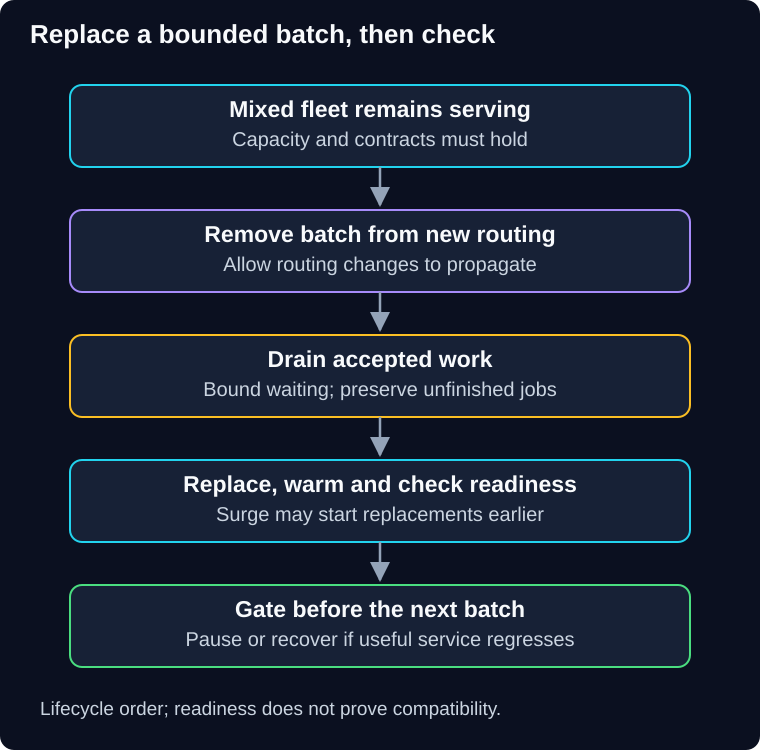

# 01 — Rolling deployment

QuickCart has ten checkout instances. Replacing all ten at once would stop service. Replacing them gradually sounds safer, but only if the remaining instances can carry demand and the old and new versions can work together.

> **Unit:** SG-DEP-01 · **Capability:** AI-DELIVER-01 (Reference).<br>
> **Outcome:** Calculate rollout capacity and trace readiness, draining and mixed-version behavior.<br>
> **Prerequisite:** [Release foundations](00-foundations.md).<br>
> **Effort:** 35–45 minutes.<br>
> **Artifact:** A batch-size decision and shutdown/recovery sequence.<br>
> **Central question:** Can service remain correct while some instances are replaced?

## 1. Intuition: renovate a shop one aisle at a time

Closing one aisle keeps the shop open, but crowds move into the remaining aisles. If every aisle already operates at its limit, partial renovation creates congestion. The analogy's limit is compatibility: customers may visit old and new service instances during one workflow, and those instances can write the same database.

A **rolling deployment** replaces instances in batches while others serve. It can use existing capacity or temporarily add **surge capacity**. Batch size controls replacement speed and the amount of capacity or behavior changing at once. It does not automatically control the exact fraction of user requests reaching the new version.

**Predict:** If two of ten equally loaded instances become unavailable, does each survivor receive 20% more work?

<details>
<summary>Reveal the calculation</summary>

No. With unchanged total traffic and equal balancing, load per survivor increases by 10 / 8 = 1.25, or **25%**. Twenty percent is the lost capacity fraction, not the survivor's load increase.

</details>

## 2. Replacement is a lifecycle



**Diagram walkthrough:** Begin with the mixed fleet. The downward arrows show lifecycle order for one batch, not a request path. Removing an instance from routing prevents new work only after routing changes propagate. Draining handles existing work before replacement. Readiness and a release gate precede the next batch. The invariant is that terminating an instance must not silently discard accepted work. Load-balancer propagation, persistent connections and database compatibility remain outside this simplified sequence.

In a remove-first rollout, stop assigning new work, allow bounded draining, replace the process, verify startup/readiness, then restore routing. In a surge rollout, start and validate replacement capacity before retiring old instances. Either approach needs a timeout and a defined outcome when draining cannot finish.

For HTTP, long-lived connections and streams may outlast the drain window. Clients need supported reconnect behavior. For workers, stop fetching, finish or safely release leased work, and rely on durable progress and idempotency for redelivery. Sending a termination signal is not proof that the job finished.

## 3. Worked capacity calculation

Assume ten instances, each sustainably serving 100 requests/second at the target latency, and 720 requests/second offered. Before rollout, load is 72 requests/second per instance. Removing two leaves nominal capacity of 800 requests/second: utilization is 720 / 800 = **90%**. That is far tighter than the original 72%.

If the team requires utilization no higher than 80% at this measured per-instance capacity, it needs:

```text
required healthy instances = ceil(720 / (100 × 0.80)) = 9
```

Only one instance can be unavailable under those assumptions. If one additional failure must be tolerated, keep at least ten healthy instances before that failure, which may require surge capacity or reduced admitted demand during rollout. Shared database limits, skewed routing and slower candidate instances invalidate the simple estimate.

Kubernetes exposes rolling-update controls such as `maxUnavailable` and `maxSurge`; these bound rollout behavior, not business correctness. Its [Deployment documentation](https://kubernetes.io/docs/concepts/workloads/controllers/deployment/) also describes progress reporting. A stalled rollout does not inherently mean an automatic rollback has repaired it. This guide does not require Kubernetes or supply an executable configuration.

## 4. Mixed versions are the central constraint

Old and new instances must agree sufficiently on API requests, session formats, database records, cache entries and events. A new checkout writing an enum value that the old version rejects can break the old fleet even when the new instances are only a small fraction.

Use compatible intermediate changes and delay destructive schema cleanup until the compatibility window has closed; [chapter 07](07-compatible-changes-and-recovery.md) develops this. Sticky sessions can reduce version switching for some requests but do not protect shared state or asynchronous consumers.

## 5. Failure, repair and decision

**Failure scenario:** New instances pass a shallow health check but execute a slow query. Their traffic times out and shifts to the old instances, which overload. Inspect per-version latency, pool occupancy, database load, effective routing and retry amplification. Pause replacement, cap admission and restore compatible capacity. Reversing instance order alone cannot undo changed data.

Keep version and rollout-step dimensions in telemetry without unbounded labels. Observe useful completion, readiness, active/draining instances, errors, queue age and dependency saturation. The release operator owns the batch policy; the service owner owns readiness semantics and shutdown correctness.

Rolling deployment is useful for compatible stateless services and often avoids maintaining a full second fleet. It is unsuitable as a casual solution for incompatible shared-state changes or a single instance with no tolerable interruption. Extra surge resources, warm-up, storage and overlap can still cost money. Neither zero additional cost nor zero downtime is guaranteed.

## 6. Practice and quiz

**Guided task:** Recalculate the example at 850 requests/second with the same 80% target. Identify whether the original ten-instance fleet is sufficient even before replacement. **Independent task:** add a two-minute stream to a thirty-second drain policy; define what callers experience and how recovery is verified.

1. Does one new instance out of ten prove exactly 10% of users see it?
2. Can readiness success replace a compatibility test?

<details>
<summary>Show answers and explanations</summary>

The capacity calculation requires ceil(850 / 80) = **11 instances**. More capacity or lower admitted demand is needed before rollout. A long stream needs an explicit reconnect/termination contract or a longer supported drain; waiting forever is not a policy.

1. No. Traffic weights, connection reuse, session affinity and workload skew change exposure.
2. No. A ready process can still write records that other versions cannot read.

</details>

**Reflect:** Which accepted operation could be lost during shutdown in a service you know?

**You can now:** defend a batch size and describe the residual mixed-version risk. **Next:** [02 — Blue-green deployment](02-blue-green-deployment.md) keeps a second application environment ready for a controlled switch.

[Previous](00-foundations.md) · [Guide overview](../README.md) · [Course map](../../../../README.md#ordered-capability-map)
