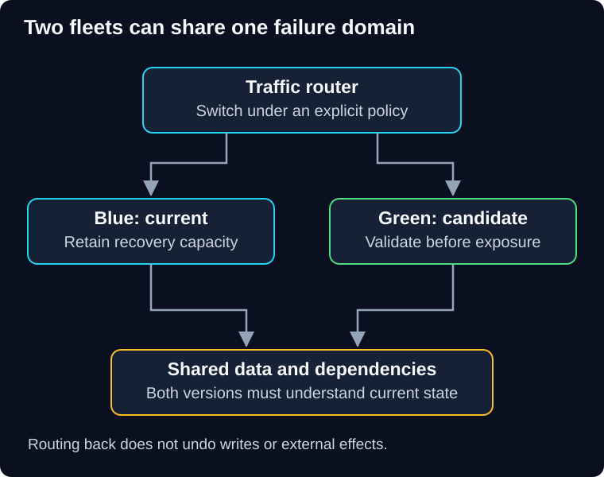

# 02 — Blue-green deployment

QuickCart wants to validate a complete candidate fleet before moving customer traffic. It also wants the previous fleet available if the candidate fails. That is the appeal of blue-green deployment—but the two fleets may still share the same fragile database.

> **Unit:** SG-DEP-02 · **Capability:** AI-DELIVER-01 (Reference).<br>
> **Outcome:** Design a traffic switch with state, capacity and rollback constraints.<br>
> **Prerequisite:** [Rolling deployment](01-rolling-deployment.md).<br>
> **Effort:** 35–45 minutes.<br>
> **Artifact:** A switchback checklist and overlap-cost estimate.<br>
> **Central question:** What must remain compatible for switching back to be safe?

## 1. Intuition: prepare another checkout hall

A shop prepares a second checkout hall, tests the tills, then directs customers to it. The original hall stays available briefly. The analogy breaks when both halls update the same inventory and payment records: opening the old hall does not undo transactions from the new one.

In **blue-green deployment**, two application environments represent current and candidate versions. Names are labels; after promotion their operational roles change. You can switch at a router, load balancer or another supported entry boundary. The [AWS blue-green overview](https://docs.aws.amazon.com/whitepapers/latest/blue-green-deployments/welcome.html) describes traffic shifting between environments and calls out the data tier as a separate consideration.

**Predict:** The candidate creates records that the current version cannot parse. Does retaining the old fleet give a safe one-click rollback?

<details>
<summary>Reveal the reasoning</summary>

No. Old compute is available, but old behavior is no longer compatible with current state. You need a compatible migration plan, a forward repair or another explicit recovery path.

</details>

## 2. Two compute environments, possibly one failure domain



**Diagram walkthrough:** Enter at the router. Its branch arrows show possible routing paths, not a requirement to send every request to both pools. Blue and green each have downward data-access arrows into the same store. That shared store is the key risk boundary. The invariant is that both versions must safely interpret the state they can encounter. Routing propagation, background workers and separate-database alternatives are omitted.

Prepare the candidate with the reviewed artifact, configuration, identity and network access. Verify representative read and controlled write paths using synthetic fixtures with cleanup. Confirm capacity and warm caches within dependency limits. Then switch according to the routing system's actual semantics, observe, and keep the previous environment for a declared recovery interval.

A router update is not globally instantaneous. In-flight requests, WebSockets, DNS caches and connection pools can prolong old traffic. A DNS switch can have different propagation and caching behavior from a load-balancer update. Old and new versions may coexist during transition and rollback, so compatibility still matters.

## 3. Database and worker choices

A shared database avoids copying every write between two stores but exposes both versions to schema and data changes. Separate stores improve some isolation but create replication, cutover consistency and reconciliation problems. If writes go to both sides, define conflict ownership; if only one side writes, prevent stale writers after cutover. “Copy the database, then switch” is incomplete while customers keep placing orders.

Background consumers need their own activation policy. Starting green while blue still consumes the same jobs may process work with both versions or duplicate effects. A scheduled task can run twice even if green receives no HTTP traffic. Disable or partition candidate side effects until the intended handover, and preserve idempotency across versions.

## 4. Worked overlap cost and capacity

Assume the normal application fleet has eight instances. An equally sized candidate runs for 45 minutes. At a fictional rate of 0.20 currency units per instance-hour, **extra compute** is:

```text
8 × (45 / 60) × 0.20 = 1.20 currency units
```

This is not a provider quote or the total bill. Include temporary storage, network, load-balancing, evaluation calls and any duplicated licensed service. If both fleets warm up by querying the same database at once, the data tier can saturate before the traffic switch.

The previous fleet must still handle the rollback demand. If you shrink it after the switch, scaling it back takes time and may hit quotas. Keep its configuration, secrets access and dependencies valid for the declared recovery interval. Retaining vulnerable old software indefinitely is also a cost and security decision.

## 5. Diagnose, repair and clean up

**Failure scenario:** Green returns errors; traffic is switched back, but failures continue. Inspect whether old connections still hit green, whether blue has enough ready capacity, and whether green changed shared state or exhausted shared quotas. Do not repeatedly flip traffic without identifying the failure path.

A switchback plan names the last compatible artifact, routing authority, drain behavior, data assumptions, worker ownership and verification probes. After routing back, reconcile accepted orders and uncertain effects. A traffic dashboard alone cannot prove they completed correctly.

Once the recovery interval and evidence gates are satisfied, remove inactive compute, temporary routes, synthetic records and excess permissions. Preserve approved artifact and evidence records according to retention policy. Service and data owners must agree on the actual rollback boundary; the router operator cannot decide data reversibility alone.

## 6. Practice and quiz

**Guided task:** Fill in a blue-green checklist: candidate capacity, shared-state compatibility, worker activation, routing propagation, stop conditions, recovery interval and cleanup owner.

**Independent change:** Blue uses an older event parser and green emits a new schema. Describe a safe intermediate release before the switch.

1. Does blue-green require separate databases?
2. Does green's lack of user traffic prove it cannot create side effects?

<details>
<summary>Show answers and explanations</summary>

1. No. Shared and separate data tiers have different risks. Neither eliminates compatibility or reconciliation work.
2. No. Startup hooks, scheduled jobs and queue consumers can act without routed HTTP traffic. For the schema task, first deploy readers able to accept both versions, retain compatible producers, then change production after reader coverage is established. Retire old support only after delayed events and rollback needs are addressed.

</details>

**Reflect:** What is the first irreversible step in your switch plan?

**You can now:** distinguish routing recovery from state recovery. **Next:** [03 — Canary releases](03-canary-releases.md) asks how limited exposure can generate evidence before full promotion.

[Previous](01-rolling-deployment.md) · [Guide overview](../README.md) · [Course map](../../../../README.md#ordered-capability-map)
