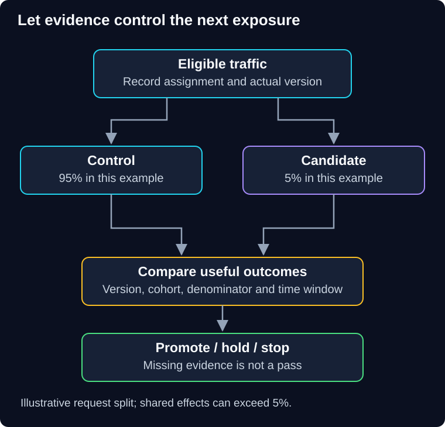

# 03 — Canary releases

QuickCart's new checkout passes staging tests but mishandles one merchant's currency rules. Exposing everybody immediately makes that missed case expensive. A canary limits initial exposure while the team compares real outcomes with the current version.

> **Unit:** SG-DEP-03 · **Capability:** AI-DELIVER-01 (Reference).<br>
> **Outcome:** Define cohorts, exposure limits and evidence-based promotion/stop gates.<br>
> **Prerequisites:** [Release foundations](00-foundations.md), [blue-green boundaries](02-blue-green-deployment.md).<br>
> **Effort:** 40–50 minutes.<br>
> **Artifact:** A canary decision policy with denominator, sample and recovery requirements.<br>
> **Central question:** What evidence justifies exposing more customers?

## 1. Intuition: test one water outlet before reopening a building

Testing one outlet can reveal a problem while limiting exposure. It cannot prove that every floor has the same pipes. Similarly, a small cohort teaches you about the traffic it represents, not automatically every tenant, region or rare operation.

A **canary release** evaluates a candidate on a limited portion of service before broader rollout. It can use additional instances, a subset of existing capacity, or a feature rule. Canary is an exposure-and-evaluation strategy, not a mandatory hardware layout. Google's [Canarying Releases](https://sre.google/workbook/canarying-releases/) describes partial, time-limited deployment and comparison with a control.

**Predict:** Internal employees successfully place 200 test orders. Is this enough to promote a change affecting external merchants with different payment methods?

<details>
<summary>Reveal the reasoning</summary>

No. Employee traffic is useful for an initial check but may miss important data and behavior. The next stage needs permitted representative coverage and explicit evidence gaps. More time with the same narrow traffic does not solve sampling bias.

</details>

## 2. Route and compare deliberately



**Diagram walkthrough:** Start with eligible traffic. Branch arrows assign requests or stable cohorts to versions; they do not duplicate requests. Both versions emit outcome evidence to the gate. Its decision controls the next exposure step. The invariant is that missing evidence produces a hold or stop, not automatic promotion. Shared dependencies, detailed assignment logic and delayed human labels are omitted.

Choose the **assignment unit**: request, user, tenant, session or job. Request-level routing may be appropriate for compatible stateless reads. A multi-step checkout may need a stable cohort so one workflow does not alternate incompatible behavior. Use trusted identity and controlled configuration; a user-supplied “beta” header must not grant privileged access.

Record intended assignment, actual served version and eligibility. Percentage of instances, requests, users and revenue are different exposure measures. A 1% tenant cohort might include the largest merchant and carry 40% of revenue. Shared database writes can affect control users too; a canary bounds direct exposure, not necessarily all damage.

## 3. Worked detection window

Assume 200 eligible requests/second, 5% routed to the candidate, and a ten-minute observation window:

```text
candidate rate = 200 × 0.05 = 10 requests/second
candidate observations = 10 × 600 = 6,000 requests
```

Suppose 120 candidate requests fail and 570 of 114,000 control requests fail. Candidate failure rate is **2%**; control is **0.5%**. The difference is **1.5 percentage points**, or four times the control rate. Those ratios are descriptive; attribution still requires checking workload mix and shared incidents.

If the gate, fixed beforehand, stops at more than 1% candidate failures or a difference above 0.5 percentage points after adequate observations, this candidate stops. A critical permission leak stops immediately without waiting for the minimum sample. Numerical thresholds here are illustrative, not universal production advice.

With zero observed failures in 100 independent representative trials, the rough 95% upper bound is about 3/100 = **3%**, using the rule-of-three approximation. Real traffic is often correlated, so that shortcut can be optimistic. “Zero seen” is not “zero possible.” Rare paths may need targeted synthetic tests and longer justified observation.

## 4. A gate needs more than an error chart

Specify the baseline/control, eligible denominator, minimum observation count, duration, relevant slices, absolute service target, permitted regression and critical invariants. Include telemetry freshness and a maximum hold duration so an unattended canary does not linger indefinitely.

Check useful completion, latency distributions, overload rejection, retries, queue age, database saturation and cost per useful operation. For AI changes, also check supported answers, permission isolation, abstention and review burden. An answer-quality measure with delayed labels cannot be replaced by immediate HTTP success.

Compare versions during the same time window where possible. A historical baseline may differ because of a sale or weekday mix. A control is also not automatically healthy: both versions can fail because they share an overloaded dependency. Use absolute service objectives as well as relative comparisons.

Promotion can follow a schedule such as 1% → 5% → 25% → 100%, but each transition needs evidence and capacity, not merely elapsed minutes. At full scale, cache misses or shared quota contention may appear that a tiny cohort could not reveal. Keep monitoring and recovery available after promotion.

## 5. Failure, repair and ownership

**Failure scenario:** The overall failure rate looks unchanged, but mobile checkout failures doubled. Inspect version-by-client slices and verify comparable denominators. Pause exposure, repair the affected path, add a representative regression case and restart the relevant gate. Do not average a broken critical slice away with unaffected traffic.

The service owner defines operational gates; product/domain owners define useful outcomes; the release operator owns routing and the stop mechanism. Keep decisions auditable and traffic-control permissions narrow. A rollback or flag disable still requires compatibility and reconciliation of already accepted work.

Canaries are useful when failure can be detected early and limited exposure has value. They are weaker for extremely low traffic, rare delayed failures, destructive shared-state changes and changes that affect every tenant indirectly. No deployment strategy is universally safest or risk-free.

## 6. Practice and quiz

**Guided task:** Write a canary gate for the 6,000-request example, including two critical stop conditions and a missing-telemetry policy. **Independent change:** candidate traffic is only two requests/hour and the failure occurs during monthly billing. Explain why a ten-minute canary gives little evidence and choose additional checks.

1. Should a candidate outperforming a failing control automatically promote?
2. Does 5% routed traffic guarantee at most 5% customer impact?

<details>
<summary>Show answers and explanations</summary>

1. No. It must satisfy absolute service and critical correctness gates too.
2. No. Shared-state corruption, dependency saturation or skewed business value can affect more. For the monthly task, use compatible-state tests, representative replay with suppressed effects, scheduled-cycle validation and a longer bounded observation plan. Hold when evidence remains insufficient.

</details>

**Reflect:** Which failure would your release dashboard detect only after customers report it?

**You can now:** defend promote, hold or stop using explicit evidence. **Next:** [04 — A/B testing](04-ab-testing.md) separates release safety from estimating product improvement.

[Previous](02-blue-green-deployment.md) · [Guide overview](../README.md) · [Course map](../../../../README.md#ordered-capability-map)
