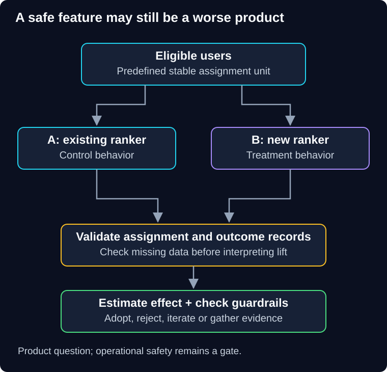

# 04 — A/B testing: measure a useful difference

QuickCart's new recommendation algorithm is operationally healthy. That does not tell the product team whether it helps customers find suitable items. A faster system can still recommend worse products or create more returns.

> **Unit:** SG-DEP-04 · **Capability:** AI-OPS-01 (Reference).<br>
> **Outcome:** Define a product hypothesis, stable assignment, trustworthy measurement and decision limits.<br>
> **Prerequisite:** [Canary evidence and exposure](03-canary-releases.md).<br>
> **Effort:** 35–45 minutes.<br>
> **Artifact:** An experiment plan with primary outcome, guardrails and analysis unit.<br>
> **Central question:** Does the change cause a meaningful improvement for the intended users?

## 1. Intuition: compare two shelf arrangements

Two shop layouts may both be safe, but one may make shopping easier. Comparing them requires similar customers and a clear measure of success. If the new layout is shown only during a festival sale, revenue changes cannot be attributed to the layout alone.

An **A/B experiment** assigns eligible units to control and treatment to estimate a change's effect. Randomized assignment helps balance other causes on average; it does not correct missing outcomes, interference or a poorly chosen metric. The analogy's limit is that online users may have many sessions, share accounts or influence one another.

**Predict:** Variant B receives returning customers while A receives first-time visitors. B converts better. Can the team conclude B caused the improvement?

<details>
<summary>Reveal the reasoning</summary>

No. Customer history is confounded with the variant. Assignment, eligibility and analysis need to support the causal question.

</details>

## 2. Canary and A/B share machinery, not the decision

A canary asks whether a release is safe enough to expand. An A/B experiment asks whether a behavior improves an outcome. Both can route traffic and compare groups, but may use different cohorts, observation periods and analysis requirements.

An experiment need not occupy a separate server fleet: a feature flag can choose behavior within one deployed artifact. Likewise, finishing an experiment does not require always restoring the old behavior. The decision may be adopt, reject, iterate or gather more evidence. Preserve the approved recovery route throughout.



**Diagram walkthrough:** Enter with eligible users and a predefined assignment unit. Branch arrows show stable variant allocation. Both groups feed outcome records into the analysis, using the same measurement definitions. The invariant is that assignment and missing outcomes must be checked before interpreting differences. Identity resolution, experiment interactions and statistical implementation are omitted.

## 3. Specify the experiment before reading results

QuickCart might hypothesize: “The new ranker increases the proportion of eligible users completing a useful purchase within seven days, without increasing cancellations or latency beyond declared limits.” Define “useful” and the observation window; clicks alone are not the business outcome.

Choose an assignment unit that matches the mechanism. User-level assignment avoids switching a person between variants each request. Tenant-level assignment may be necessary for shared workflows, but yields fewer independent units than request counts suggest. Do not analyze thousands of requests as independent people when they come from a handful of merchants.

Record eligibility, assignment, actual exposure and outcomes. Use a predetermined primary analysis population; dropping users who failed before rendering the treatment can hide a treatment failure. Plan secondary exposure analysis explicitly. If the expected split is 50/50 but observed counts are far off, diagnose assignment or logging before trusting the comparison. Microsoft's [sample ratio mismatch discussion](https://www.microsoft.com/en-us/research/articles/diagnosing-sample-ratio-mismatch-in-a-b-testing/) explains why missing or unevenly counted units can invalidate conclusions.

Predefine the primary metric, guardrails, minimum effect worth detecting, duration and uncertainty method. Repeatedly checking ordinary significance tests and stopping at the first favorable result increases false-positive risk. Use a fixed analysis plan or a valid sequential method. Multiple variants and metrics need a plan for multiple comparisons. This chapter teaches interpretation; it is not a complete statistical analysis course.

## 4. Worked comparison with uncertainty

Assume a simple hypothetical experiment with 10,000 independently assigned eligible users per group and complete outcome collection. Control has 800 conversions; treatment has 880:

```text
Control:   800 / 10,000 = 8.0%
Treatment: 880 / 10,000 = 8.8%
Absolute difference = 0.8 percentage points
Relative lift = (8.8 - 8.0) / 8.0 = 10%
```

A rough unpooled standard error for the difference of these proportions is:

```text
sqrt((0.08 × 0.92 / 10,000) + (0.088 × 0.912 / 10,000))
≈ 0.00392, or 0.392 percentage points
Approximate 95% interval: 0.8 ± 1.96 × 0.392
≈ 0.03 to 1.57 percentage points
```

This illustrative normal approximation assumes independent units, large counts and the planned comparison. Clustering, repeated looks, missing data and selection can invalidate it. The lower bound is close to zero; the estimate does not establish a guaranteed 10% lift. Decide whether the plausible benefit justifies cost and whether returns, fairness, latency and other guardrails pass. A critical authorization defect is not acceptable in exchange for higher conversion.

## 5. Product and AI boundaries

For an AI assistant, more messages or longer sessions may indicate confusion rather than value. Consider supported resolution, required human edits and later corrections. Keep human scoring criteria stable, label a bounded sample independently when possible, and investigate disagreement. A model judge needs calibration against people before its score drives consequential decisions.

Experiment design must respect the product's data-use permissions, privacy obligations and applicable review process. Concealing assignment is not a universal requirement. Use only eligible populations and approved data handling, with appropriate disclosures or consent where required. Do not experiment by weakening authorization or exposing unapproved provider paths.

## 6. Practice, failure and quiz

**Failure scenario:** B shows higher conversion because mobile failures are missing from its logs. Compare assignment counts, exposure records and end-to-end outcomes; repair instrumentation and rerun a valid experiment. A healthier-looking metric is not evidence if its denominator changed.

**Guided task:** Design the ranker experiment with one primary outcome and three guardrails. **Independent change:** merchants share inventory, so one variant's sales reduce stock available to the other. Explain interference and a suitable revised assignment or interpretation.

1. Is 0.8 percentage points the same as 0.8% relative lift?
2. Must every A/B experiment end by reverting treatment?

<details>
<summary>Show answers and explanations</summary>

1. No. In the example the relative lift is 10%; units matter.
2. No. The evidence and approved decision determine adoption or removal. For shared inventory, consider grouping by sufficiently independent market/merchant units or an appropriately designed time-based comparison. Each changes assumptions and required analysis; do not claim independent user effects when groups affect each other.

</details>

**Reflect:** Which engagement metric could improve while the customer's actual outcome worsens?

**You can now:** distinguish safe operation from a defensible product improvement claim. **Next:** [05 — Production verification](05-production-verification.md) examines tests that collect evidence without treating all live traffic as an experiment.

[Previous](03-canary-releases.md) · [Guide overview](../README.md) · [Course map](../../../../README.md#ordered-capability-map)
