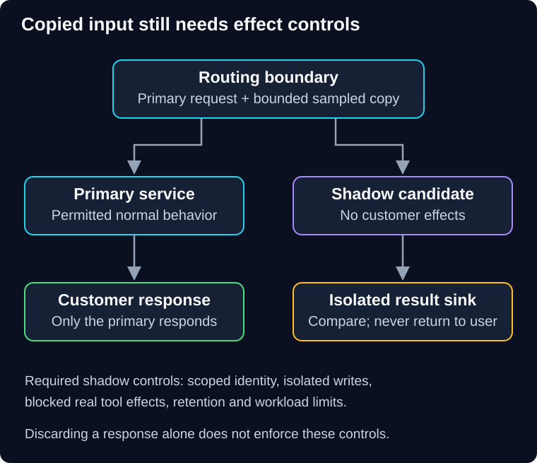

# 05 — Production verification and shadow testing

QuickCart's candidate passes unit tests, but its production identity cannot read the required policy store. A synthetic probe catches that. Later, mirrored requests reveal a parser difference—but the shadow service accidentally sends duplicate notifications. Each test needs a clear evidence and side-effect boundary.

> **Unit:** SG-DEP-05 · **Capability:** AI-OPS-01 (Reference). 
> **Outcome:** Choose verification techniques and prevent shadow traffic from changing customer state. 
> **Prerequisites:** [Release foundations](00-foundations.md), [canary gates](03-canary-releases.md). 
> **Effort:** 30–40 minutes. 
> **Artifact:** A test ladder with observable outcomes, limits and cleanup. 
> **Central question:** What does each test prove, and what can it accidentally change?

## 1. Intuition: rehearsal, sound check and live performance

A rehearsal checks the script; a sound check verifies equipment in the venue; a live performance reveals audience and operating conditions. They complement each other. A sound check is not a reason to skip rehearsal.

The analogy's limit is that production requests carry real identities, data and effects. Copying them is not automatically harmless. Start with the lowest-risk environment that can answer the question; production evidence should address remaining uncertainties, not replace known pre-release checks.

## 2. Build an evidence ladder

| Technique | Useful evidence | Important limit |
|---|---|---|
| Unit and property checks | Local rules and invariants | Do not exercise production wiring |
| Contract/integration tests | API, event and data compatibility | Fixtures may miss real distributions |
| Staging workload test | Capacity, overload and recovery under stated conditions | Environment and traffic may differ |
| Deployment smoke | Essential path with deployed identity/configuration | Narrow sample, not broad quality proof |
| Synthetic production transaction | Repeated controlled end-to-end behavior | Requires isolation, effect control and cleanup |
| Shadow/mirrored traffic | Candidate behavior on sampled real-shaped input | No direct user-response evidence; copied work can cause effects |
| Canary | Limited real exposure and customer outcomes | Limited coverage and shared failure domains |

Synthetic monitoring uses known inputs and expected properties. Passive monitoring observes real workload. Both need accurate identifiers, timestamps and labels so test traffic does not distort customer-outcome metrics.

## 3. Shadow traffic is a copy, not a safe sandbox

**Predict:** The router discards a shadow response. Does that prevent a mirrored checkout from charging a card?

Reveal the reasoning

No. Discarding the response says nothing about what the shadow service did. It can still write, send, bill or call a tool. Prevent effects at trusted application and infrastructure boundaries.

**Diagram walkthrough:** Start at the routing boundary. The primary branch serves the user; the sampled-copy branch reaches the candidate. Only comparison evidence leaves the shadow branch toward analysis, never a customer response. The candidate's effect boundary must block real writes and consequential tool calls. The invariant is that copied traffic cannot create customer effects. The diagram shows required controls, not an implemented sandbox; retention, credentials and dependency quotas are omitted.

Traffic mirroring can be asynchronous, with mirrored responses discarded; [Istio's mirroring documentation](https://istio.io/latest/docs/tasks/traffic-management/mirroring/) illustrates that routing behavior. Such routing does not itself supply application-level safety, privacy approval or equivalent timing.

Use scoped credentials, isolated sinks, restricted outbound access and synthetic external-effect adapters where needed. A code flag named `dry_run` is insufficient if an overlooked branch can still send email. A shadow copy must retain necessary tenant boundaries without gaining access to broader data. Do not send production content to a new model provider merely because users will not see its response.

## 4. Compare meaningful behavior

Record paired operation IDs, versions, input eligibility and comparison outcomes while minimizing sensitive payload storage. Deterministic services can compare normalized values. AI output often requires criteria such as groundedness, permitted sources, schema validity and task usefulness rather than exact text equality.

A shadow candidate may see different cache state, timing or mutable data than the primary. A mismatch is a diagnostic lead, not proof that one implementation is wrong. Missing shadow results and sampling biases belong in the report. Sampled reads cannot establish write correctness, and suppressed side effects cannot establish actual downstream integration.

**Worked cost:** At 100 primary requests/second, mirroring 10% adds 10 candidate requests/second. If each calls a model once at a fictional cost of 0.002 currency units, a thirty-minute run adds 10 × 1,800 × 0.002 = **36 currency units**, before retries and infrastructure. Primary and shadow calls may share a quota. Reserve budget, limit concurrency and stop shadowing before it harms useful traffic.

## 5. Failure drill and ownership

**Scenario:** Shadow testing increases primary p95 latency. Inspect shared provider quotas, CPU, connection pools and telemetry volume. Stop the shadow feed, verify recovery, then reduce sampling or isolate resources. Adding a larger candidate fleet cannot fix a shared provider quota.

A production verification plan names allowed targets, synthetic identities, effect limits, time and spend bounds, abort authority, cleanup and evidence retention. Operators need permission for the affected environment; this guide's paper exercises authorize no live production changes. Test identities must not become backdoors into real customer data.

## 6. Practice and quiz

**Guided task:** Select one test for bad deployment credentials, one for incompatible events and one for realistic input distribution. State what each does not establish.

**Independent change:** The candidate is an AI tool-using assistant. Design a shadow route that can compare proposed tool arguments without executing refunds or emails.

1. Does a successful smoke test prove the canary should promote?
2. Can shadow latency be compared directly when it runs on half the resources?

Show answers and explanations

1. No. It is a small prerequisite signal; representative outcome gates remain.
2. Not without accounting for resource and workload differences. For the tool task, record validated proposals into an isolated sink, deny real effect credentials/network paths, retain authorization checks, and test a deliberate attempted side effect. That evaluates proposals and controls, not actual refund integration.

**Reflect:** Which test result could your team accidentally describe more broadly than its scope supports?

**You can now:** select a verification method and state its evidence boundary. **Next:** [06 — Chaos engineering](06-chaos-engineering.md) tests a specific failure hypothesis under controlled conditions.

[Previous](04-ab-testing.md) · [Guide overview](../README.md) · [Course map](../../../../README.md#ordered-capability-map)
