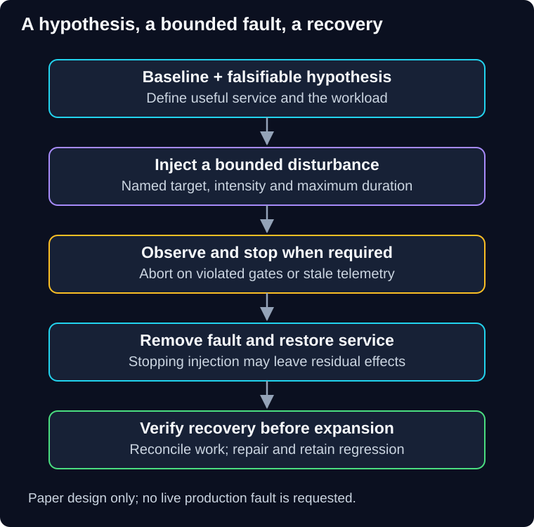

# 06 — Chaos engineering: test a bounded hypothesis

QuickCart has retries, a circuit breaker and multiple instances. The architecture diagram looks resilient. But when the recommendation provider becomes slow, retries occupy the same connections checkout needs. A controlled experiment can expose that assumption before a larger incident does.

> **Unit:** SG-DEP-06 · **Capability:** AI-OPS-01 (Reference). 
> **Outcome:** Design a measurable resilience experiment with bounded targets, abort rules and recovery evidence. 
> **Prerequisites:** [Production verification](05-production-verification.md); [isolation and degradation](../../reliability-patterns/docs/04-isolation-and-degradation.md) as a targeted reference. 
> **Effort:** 35–45 minutes. 
> **Artifact:** A paper experiment card and failure/repair analysis. 
> **Central question:** Does the system preserve a specified useful behavior under a specified disturbance?

## 1. Intuition: a fire drill with a question

A useful drill asks whether people can reach an exit within a target time, with observers and a safe stop process. Randomly blocking corridors without a plan is not a better drill.

**Chaos engineering** investigates system behavior through controlled experiments. Define a measurable **steady state**, state a falsifiable hypothesis, introduce a relevant disturbance and look for evidence that contradicts the hypothesis. The [Principles of Chaos Engineering](https://principlesofchaos.org/) describes this experimental approach and emphasizes limiting blast radius.

Random selection can help explore a population of targets, but randomness is not required. Deterministic latency injection against one bounded dependency may answer a clearer question. Automation improves repeatability; it does not eliminate design bias or responsibility. The analogy's limit is persistent effects: stopping a fault does not undo lost records or duplicate payments.

## 2. Start where the question can be answered safely

Develop the experiment with synthetic data and local or staging controls first. Production may reveal wiring, scale and dependency behavior unavailable elsewhere, but requires explicit authorization, monitoring, recovery capability and an acceptable impact bound. A failed staging experiment is a reason to repair before widening scope, not a reason to try it on customers.

This guide contains **paper experiments only**. No instruction here asks you to kill a production instance, fill a real disk, disable a region or manipulate customer traffic.

**Diagram walkthrough:** Begin with the baseline and hypothesis. Arrows represent experiment stages. Injection is bounded by target, duration and intensity; the observation stage can stop the experiment before its scheduled end. Restoration is followed by a separate verification step. The invariant is that further exposure is blocked until useful service and affected work are checked. Detailed fault tooling and organizational approvals are omitted.

## 3. A concrete experiment card

QuickCart wants to test this fictional hypothesis: “Adding 800 ms of latency to recommendation calls from one isolated application instance for at most sixty seconds will not reduce checkout's useful completion below 99% in the defined test workload, and optional recommendations will degrade explicitly.”

The card should specify:

- **Baseline:** workload, environment, eligible operations, normal completion/latency and available capacity.
- **Target and fault:** one named instance and only its recommendation calls; fixed delay, bounded duration and no real payment effects.
- **Observation:** per-branch completion, connection occupancy, retries, fallback, queue age and telemetry freshness.
- **Stop rule:** any unauthorized access or duplicate effect; checkout completion below its bound; stale telemetry; or experiment duration reached.
- **Authority and controls:** one experiment owner, an independent operator able to stop it, a verified target list and least-privilege fault permissions.
- **Recovery:** remove injection, confirm normal routing and limits, reconcile pending work and prove sustained useful recovery.

Stop rules need windows, denominators and enough volume to interpret them. “Completion below 99%” over one request is not the same signal as the same percentage over thousands. Critical correctness failures do not need a statistical wait.

## 4. Worked blast-radius estimate

Assume the selected instance handles at most 12 eligible requests/second. If fault removal is guaranteed within sixty seconds, directly exposed requests are at most **720** under that rate ceiling. If sixty seconds is only the scheduled stop point and detection/stopping can take another ten seconds, plan for as many as 12 × 70 = **840**. To keep the original sixty-second hard limit in that second design, initiate stopping early enough to cover its delay.

This estimate is not a guarantee about total impact. Shared resources, queued work, retries and faults that persist after injection can expand the effect. Constrain dependency calls and pending jobs too. A latency fault can be more revealing than terminating a process because it keeps resources occupied while callers wait.

Suppose a service's request-based objective allows 0.1% unsuccessful eligible operations across one million operations: the allowance is **1,000**. If 750 have already failed, 250 remain. An experiment plausibly risking 300 more failures is incompatible with that remaining allowance even before reserving capacity for unrelated incidents. An error budget is not blanket permission to harm customers, and a percentage of time cannot be substituted for a percentage of requests.

## 5. Stop is not restore

Fault tools can offer automated stop conditions. For example, [AWS FIS stop conditions](https://docs.aws.amazon.com/fis/latest/userguide/stop-conditions.html) use specified CloudWatch alarms to stop an experiment. That does not establish that every action is reversible or that customer obligations have recovered. Alarm delay, missing metrics and action semantics still matter.

Know what the fault actually does. Removing an injected network delay can restore traffic; terminating a process may require replacement and job reconciliation; deleting data is not repaired by ending the experiment. Prefer the least destructive disturbance that answers the question. A region-wide exercise is selective advanced work requiring its own case and preparation.

Avoid overlapping releases or unrelated experiments when they would make attribution unclear. If a real incident starts, the experiment plan must state who stops testing and who owns incident response. Missing telemetry means you have lost the observation boundary, not that the system is healthy.

## 6. Failure, repair and regression

**Observed paper result:** Checkout completion falls to 96%, recommendation retries grow, and the shared pool fills. The hypothesis is disproved. That is useful evidence, not an excuse to relabel 96% as acceptable after the fact.

Stop the fault, restore the service and check pending work. Diagnose resource sharing and retry bounds. Repair with appropriate [bulkheads and bounded retries](../../reliability-patterns/README.md), then repeat the same bounded scenario to check the repair. Record environment and workload changes so improved results are interpretable. Retain a regression case and revise the runbook.

## 7. Practice and quiz

**Guided task:** Complete the card above with an exact monitoring interval and a maximum telemetry-age rule. **Independent change:** the stop controller depends on the very network path being disrupted. Design an independent control path or reject the experiment until stopping is credible.

1. Must chaos experiments be random and run in production?
2. Is ending injection enough to declare success?

Show answers and explanations

1. No. A specific hypothesis may be best tested deterministically outside production first. Production access needs its own authorization and controls.
2. No. Check useful recovery, pending operations, lingering resource effects and cleanup. If stopping depends on the failed path, use an independently available mechanism and bounded action expiry; demonstrate that mechanism before the experiment. Otherwise do not widen exposure.

**Reflect:** Which architectural assumption would you most want to disprove before customers encounter it?

**You can now:** distinguish a controlled experiment from arbitrary disruption. **Next:** [07 — Compatible changes and recovery](07-compatible-changes-and-recovery.md) examines the state that survives deployment and fault injection.

[Previous](05-production-verification.md) · [Guide overview](../README.md) · [Course map](../../../../README.md#ordered-capability-map)
