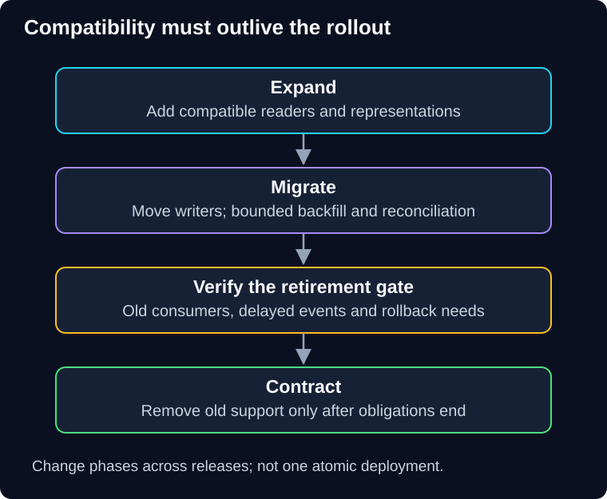

# 07 — Compatible changes and recovery

QuickCart renames an order field and deploys new code gradually. Half the fleet still writes the old field. Then the new release is rolled back, but its records remain. Traffic control cannot repair this contract mismatch.

> **Unit:** SG-DEP-07 · **Capability:** AI-DELIVER-01 (Reference). 
> **Outcome:** Plan mixed-version compatibility, schema migration and verified recovery. 
> **Prerequisites:** [Rolling deployment](01-rolling-deployment.md), [blue-green deployment](02-blue-green-deployment.md). 
> **Effort:** 30–40 minutes. 
> **Artifact:** A reader/writer matrix and migration/recovery decision record. 
> **Central question:** Can every active or recoverable version understand the state it may encounter?

## 1. Intuition: change an address while forwarding still works

When an office moves, it keeps forwarding from the old address while clients learn the new one. Removing forwarding immediately strands late arrivals. In software, old binaries, delayed events, cached data and external clients are those late arrivals.

The analogy's limit is simultaneous writes. Supporting two representations requires one clear authority and consistency rules, not merely accepting mail at two places.

**Predict:** All HTTP instances run the new release. Can the old event schema be removed immediately?

Reveal the reasoning

No. Older workers, delayed messages, replay queues and rollback artifacts may still require it. Inventory readers, writers and retained work before removing compatibility.

## 2. Expand, migrate, contract

**Expand-and-contract** introduces compatible support, migrates usage and data, then removes the old representation only when it is no longer needed. Danilo Sato's [Parallel Change](https://martinfowler.com/bliki/ParallelChange.html) describes these phases for interface evolution.

**Diagram walkthrough:** Enter at expansion. Downward arrows represent change phases across releases, not necessarily one deployment. Migration moves readers/writers under verification. The gate before contraction checks old consumers, retained work and rollback requirements. The invariant is that destructive removal happens only after compatibility obligations end. Concrete SQL, locking behavior and cross-store replication are omitted.

Consider adding `delivery_window` while old clients use `delivery_date`. First introduce an optional field and readers with a defined fallback. Keep the old field authoritative while old writers remain; otherwise a later old write can make the new field stale. Then move writers, backfill idempotently in bounded batches and reconcile inconsistencies. Only after all consumers and the recovery policy permit it should you make the new representation authoritative and eventually remove old support.

This is a conceptual example, not a complete migration algorithm. A time window may contain more meaning than a date; the team must define a valid conversion and reverse-compatibility rule. If information is lost in conversion, an unrestricted rollback promise is false.

## 3. The compatibility matrix

| Reader or process | Old state | Expanded state with defaults | New-only state after contraction |
|---|---|---|---|
| Original application | Expected | Must be demonstrated, not assumed | Usually unsafe if required old fields are gone |
| Bridge application supporting both | Expected | Expected after verification | Depends on the explicitly supported contract |
| New application | Needs fallback or migration | Expected after verification | Expected after verification |
| Delayed worker/replay consumer | Depends on event and storage contract | Must be tested with old events | Needs an upgrade, adapter or explicit rejection path |

Populate this matrix with actual release identifiers before execution. “Expected” is a design claim requiring tests. Add cache keys, session encodings, enum values, event schemas and model/tool output contracts where they matter. Shared idempotency records must survive version changes or be reconciled before repeating effects.

## 4. Backfills and migrations consume resources

Assume a hypothetical backfill of 1.2 million records at a safe **measured** rate of 200 records/second under the stated workload. Minimum scan/update time is 1,200,000 / 200 = **6,000 seconds**, or 100 minutes, before pauses, retries and validation. This number is a design input here, not a benchmark produced by the guide.

Limit batch size and resource use; monitor database locks, transaction duration, replication lag and live latency. Save durable progress and make repetition safe. A backfill must handle concurrent updates instead of overwriting newer data with an old snapshot. “Add a column” can have provider- and version-specific locking or rewrite costs; verify the actual engine before claiming an online migration.

## 5. Choose recovery from the state you have

**Stop exposure** prevents further use of a failing path. **Rollback** restores an older compatible artifact/configuration. **Roll forward** repairs the current path with a new compatible change. **Restore** rebuilds data from a recovery point. **Compensation** creates an authorized business action addressing an earlier effect. They are different tools.

Rolling back a binary does not undo a payment, email, external API call or migration. Restoring yesterday's database may lose today's legitimate orders and idempotency records. Before consequential replay, reconcile external effects using durable identities. See the [reliability recovery case](../../reliability-patterns/docs/06-recovery-and-case-study.md) for that boundary.

For AI systems, reverting a prompt may still leave a new retrieval index, changed permissions, a newer model alias or modified tool schema. Recover a compatible set of artifacts, not just one prompt string. When the previous provider model is unavailable, use a separately evaluated alternative or a defined reduced-service outcome; do not claim an unexercised model rollback.

## 6. Failure, practice and quiz

**Failure scenario:** Blue is restored after green wrote a new enum. Blue now crashes reading those records. Stop unsafe retries, identify affected state and choose a bridge/forward repair or a justified data correction. Verify legitimate records and uncertain effects before resuming. Do not restore an entire database blindly to make a dashboard green.

**Guided task:** Fill the matrix for a new optional field, then identify the first step that makes the original binary unsafe. **Independent change:** a replay queue retains events for seven days but rollback support is removed after one day. Define whether to retain a compatible consumer, transform with an audited adapter or reject incompatible work into owned reconciliation.

1. Is a feature kill switch a database rollback?
2. Who should approve contraction: only the deployment operator?

Show answers and explanations

1. No. It controls future behavior; persisted and external effects remain.
2. No. Data, service and consumer owners need evidence that compatibility obligations have ended. For the replay mismatch, preserve the ability to process or explicitly reconcile retained work. Queue retention is part of the compatibility window.

**Reflect:** What recovery option disappears at your first destructive migration step?

**You can now:** defend a compatibility window and explain when rollback is unavailable. **Next:** combine these decisions in [08 — Case study, challenges and revision](08-case-study-and-revision.md).

[Previous](06-chaos-engineering.md) · [Guide overview](../README.md) · [Course map](../../../../README.md#ordered-capability-map)
