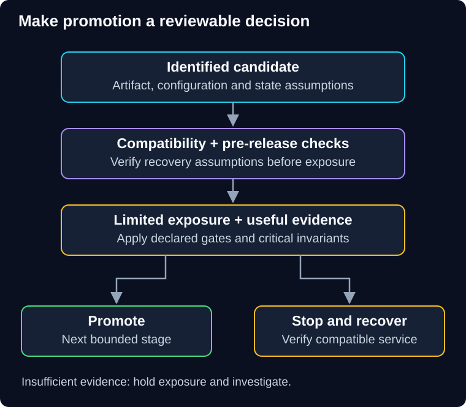

# 08 — Case study, challenges and revision

QuickCart wants a new recommendation ranker and an updated checkout event format. The product team also wants to know whether the ranker improves useful purchases. Shipping both changes as one unexamined “10% rollout” mixes compatibility, safety and product questions.

> **Unit:** SG-DEP-08 · **Capabilities:** AI-DELIVER-01 / AI-OPS-01 (Reference).<br>
> **Outcome:** Defend a deployment, experiment and recovery plan under changed constraints.<br>
> **Prerequisites:** [Chapters 00–07](../README.md).<br>
> **Effort:** 15–25 minutes revision; 90–120 minutes independent design practice.<br>
> **Artifact:** Release decision record, architecture sketch, capacity/gate calculations and recovery runbook.<br>
> **Central question:** Can you explain why each increase in exposure is justified?

## 1. Worked integrated case

These are fictional requirements and decisions, not executed production evidence. QuickCart has ten instances with sustainable capacity of 100 requests/second each under its test workload. Demand is 720 requests/second. Checkout must preserve authorization, durable acceptance and one effect per payment intent. Recommendations are optional.

First deploy readers compatible with both event formats. Keep producers on the existing format until reader coverage is verified. Build and identify a bridge artifact, run contract and rollback-compatibility tests, and use bounded staging workload checks. A maintenance window remains an option if the real compatibility requirements cannot be met safely.

Roll the compatible application one instance at a time at the 80% utilization target from chapter 01; use additional capacity or reduced admission if another failure must also be tolerated. Drain work explicitly. Candidate recommendation behavior stays disabled, but startup and shared-resource effects still receive verification.

Next, shadow a small approved sample with isolated effect sinks and a provider budget. Compare permitted-source and output properties. Then use a limited representative canary with operational, security and answer-quality gates. If evidence passes, expand deliberately. Run the product A/B experiment as a separately defined decision with stable users, a primary useful-outcome metric and guardrails.

Schedule the resilience experiment separately when baseline service is stable and stopping/recovery have been rehearsed. Inject bounded recommendation latency in the authorized environment; test that checkout isolation and fallback behave as expected. Any disproved hypothesis becomes a repair and regression task before scope expands.



**Diagram walkthrough:** Start with the identified candidate. Arrows mean evidence-driven progression: compatibility checks, limited exposure, then a decision. The stop branch leads to compatible recovery and verification; the promote branch increases exposure only under the next gate. The invariant is that critical safety failures cannot be compensated by a favorable business metric. Statistical details, actual routers and deployment automation are omitted.

## 2. A decision record another engineer can use

```text
Change and customer problem:
Artifact/configuration/model/data identities:
Invariants and supported mixed-version states:
Strategy and rejected alternative:
Assignment unit and exposure ceiling:
Capacity and dependency budget:
Success metrics, denominators, windows and critical stops:
Missing/delayed evidence policy:
Recovery action and point beyond which rollback is unsafe:
Operator, data owner and abort authority:
Cleanup and retained evidence:
Executed evidence versus design assumptions:
```

For the worked case, rolling replacement is a reasonable choice because compatible mixed versions are deliberately supported and full duplicate compute is not necessary. Blue-green remains an alternative if faster compute switchback justifies overlap cost; neither approach makes incompatible event writes safe.

## 3. Challenge A — The fleet shrinks during rollout (30–40 minutes)

You have twelve instances, each sustaining 80 requests/second at the required latency. Demand is 660 requests/second. The planning target is at most 75% utilization. You want to replace two instances at once without surge capacity.

Calculate required healthy capacity. Decide whether the plan holds, including one additional failure. Specify drain behavior, gate signals and what customers see if capacity is insufficient. Draw the request path and the shared bottleneck your diagram leaves unresolved.

<details>
<summary>Hint</summary>

Compute capacity per healthy instance at the planning target, not its full nominal maximum. Reserve capacity for the failure assumption separately.

</details>

<details>
<summary>One reasonable answer</summary>

Each instance contributes 80 × 0.75 = 60 requests/second at the target. Required healthy count is ceil(660 / 60) = **11**. Removing two leaves ten, so utilization is 660 / 800 = **82.5%**, above target. Removing one leaves eleven but no room for another lost instance at that target.

For two planned unavailable instances plus one additional loss, at least **14 total** instances are needed under this simplified model: fourteen minus three leaves eleven. Alternatives are smaller batches, reduced admitted demand or a different verified performance envelope. Shared databases and uneven traffic can require more headroom. Bound draining, preserve durable jobs and report explicit overload rejection rather than silently losing accepted work.

</details>

## 4. Challenge B — A healthy average hides a broken tenant (30–40 minutes)

A canary receives 5,000 requests. Overall useful completion is 99.4%, matching control. One important tenant has 100 candidate requests with ten failures. Candidate telemetry is missing for some mobile sessions. Meanwhile, the candidate writes a field the old version cannot read.

Decide promote, hold or stop. Explain what must be repaired, what evidence is invalid, and why routing everything back may be unsafe. Draft a short update for a fictional customer-support lead that separates confirmed impact from unknown impact.

<details>
<summary>Hint</summary>

Use critical slices, telemetry completeness and compatibility as separate gates. Do not let an aggregate percentage erase them.

</details>

<details>
<summary>One reasonable answer</summary>

Stop further exposure and investigate the tenant's **10% failure rate**. Missing mobile outcomes undermine the aggregate denominator. Identify the impact window from assignment and served-version records rather than claiming every unlogged request succeeded.

Before routing back, inspect records the candidate wrote and whether a compatible bridge exists. Restrict unsafe paths and choose a compatible recovery or forward repair. Reconcile affected business operations, repair the tenant case and instrumentation, and rerun the relevant checks before a fresh canary. Tell support the confirmed tenant failures, the mobile uncertainty and the next verification action; do not fabricate customer acceptance.

</details>

## 5. Transfer challenge — A model migration (30–40 minutes)

The provider will remove QuickCart's current model in two weeks. The candidate is cheaper and faster but may change tool arguments. User traffic is too low to evaluate rare unsafe actions through a short canary. The old model will not remain a rollback option.

Design a plan covering fixed offline evaluation, human-label calibration, permitted shadow comparison, tool-effect blocking, safe action tests, bounded canary and a recovery route after removal. Include token/cost budgets and explain why refusal or review may be preferable to an unsupported action. Do not treat a hosted-model response as deterministic evidence.

<details>
<summary>Review criteria after your attempt</summary>

Strong plans preserve trusted authorization and schema/business validation independent of the model. They test rare unsafe proposals explicitly, compare representative task quality with consistent human criteria, and keep consequential effects out of shadow traffic. They state sample limits, delayed labels and the unavailable rollback option. Recovery uses an already evaluated supported alternative, approved deterministic behavior or bounded review/abstention. Provider migration alone does not authorize sharing data with a different unapproved service.

</details>

## 6. Self-check and revision

Score each dimension **0** if absent, **1** if plausible but missing assumptions, or **2** if supported by a trace, calculation or concrete verification plan:

- Customer contract, artifact identity and diagnosis.
- Capacity, assignment and bounded exposure.
- Evidence quality, denominators and uncertainty.
- Compatibility, authorization and effect-safe recovery.
- Operational ownership, cleanup and changed-requirement reasoning.

The ten-point total is a learning aid, not a certification. **Critical repair gates:** authorization bypass, duplicate consequential effects, silent loss of accepted work, unbounded fault exposure or fabricated evidence require repair regardless of score. A paper plan does not establish deployed behavior; a copied worked answer does not establish independent competence.

| Pattern | Main question | Typical blind spot |
|---|---|---|
| Rolling | Can mixed versions and reduced capacity keep serving? | Shared state and draining |
| Blue-green | Can a prepared fleet take traffic and switch back? | Data compatibility and background workers |
| Canary | Is limited release evidence strong enough to expand? | Unrepresented slices and shared impact |
| A/B | Does treatment improve a defined outcome? | Assignment, missing data and interference |
| Shadow | How does a candidate handle copied input? | Effects, privacy, duplicated load and timing differences |
| Chaos | Does a specific resilience hypothesis survive a fault? | Stop capability and residual effects |
| Expand-and-contract | Can consumers migrate without a broken interval? | Delayed readers, replay and destructive cleanup |

**Mixed quiz:** (1) Why is 20% lost capacity a 25% load increase for survivors? (2) Can good A/B conversion override a permission leak? (3) What if canary metrics disappear? (4) Does stopping a fault undo its effects?

<details>
<summary>Answers and reasoning</summary>

1. Unchanged work is divided by 80% of the original capacity: 1 / 0.8 = 1.25.
2. No. Critical invariants are non-compensable.
3. Hold or stop under the declared missing-evidence policy; silence is not health.
4. No. Restore and reconcile, then verify useful outcomes and cleanup.

</details>

## 7. Glossary

| Term | Plain meaning and QuickCart consequence |
|---|---|
| Assignment unit | Entity receiving a variant; a stable merchant cohort may span many requests |
| Blast radius | Scope of possible harm, including shared dependencies and state |
| Control / treatment | Existing comparison behavior / candidate behavior in an experiment |
| Drain | Stop new work and resolve in-flight work before replacement |
| Exposure | Users, requests or business value encountering a change; specify the unit |
| Guardrail | A measure or invariant that blocks an otherwise attractive decision |
| Hold | Do not expand because evidence is insufficient or incomplete |
| Readiness | Whether an instance should receive work now |
| Sample ratio mismatch | Observed group proportions differ unexpectedly from assignment expectations |
| Shadow traffic | Copied input evaluated separately from the user-visible response |
| Steady state | Measurable normal behavior against which a fault hypothesis is tested |
| Surge capacity | Temporary extra instances supporting replacement |
| Switchback | Route to the previous environment; not automatic reversal of state |

**Reflect:** Which pattern did you reject, and what new requirement would make it worth the complexity?

**You can now:** defend a release and production-testing plan with explicit uncertainty, compatibility and recovery limits. **Next course action:** return to [AI-DELIVER-01 or AI-OPS-01 in the course map](../../../../README.md#ordered-capability-map). Use the [delivery workbook](../../../../workbooks/delivery/README.md) or [release monitoring workbook](../../../../workbooks/operations/release-watch/README.md) at its declared starting state; neither claims to implement every live production pattern in this reference.

[Previous](07-compatible-changes-and-recovery.md) · [Guide overview](../README.md) · [Sources](sources.md)
