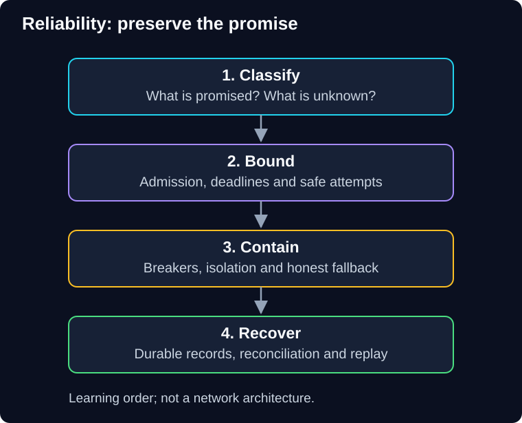

# Reliability, Error Handling and Recoverability Patterns

QuickCart accepts an order, the payment response disappears, and the customer presses **Pay** again. Meanwhile, a slow recommendation service is using every connection, and one malformed shipping event keeps crashing a worker. Adding retries everywhere can make all three problems worse.

This guide teaches you to decide **what to protect, what to retry, what to stop, and how to recover without losing or repeating business work**.

> **Audience:** Backend engineers learning cloud and AI application reliability.<br>
> **Prerequisites:** Familiarity with HTTP requests, database transactions and background jobs. For a refresher, use [scalability foundations](../scalability-patterns/docs/00-foundations.md) and [queue-based load leveling](../scalability-patterns/docs/04-queue-based-load-leveling.md) as Reference reading.<br>
> **Effort:** 4 hours 40 minutes–6 hours reading and short checks; 90–120 minutes for independent design practice. Estimates, not measured learner timings.<br>
> **Artifact:** A QuickCart failure-policy sheet, request timeline, recovery runbook and defended design.<br>
> **Scope:** Optional architecture reference for **AI-RELIABLE-01**, with connections to AWS and operations. Paper exercises; no account, installation or paid calls. This is not an additional compulsory project or deployment assessment.

**Start with [00 — Foundations](docs/00-foundations.md).** Follow the chapters in order on your first visit; later, return to the pattern matching your failure.



**Diagram walkthrough:** Start at the top. Arrows mean learning order, not network traffic. Classification establishes the business invariant; admission and deadlines bound resource use; containment prevents one fault from spreading; recovery resolves unfinished work. The invariant throughout is that a fast response must not pretend that an unconfirmed business action succeeded. Provider APIs and deployment topology are omitted.

| Unit | Chapter and central question | Reading + short checks | Evidence to keep |
|---|---|---|---|
| SG-CREL-00 | [Foundations](docs/00-foundations.md): what does reliable mean to the customer? | 25–35 min | Failure classification and success definition |
| SG-CREL-01 | [Throttling and rate limiting](docs/01-throttling-and-rate-limiting.md): which work should enter? | 40–50 min | Admission and overload policy |
| SG-CREL-02 | [Timeouts, retries and idempotency](docs/02-timeouts-retries-and-idempotency.md): when is another attempt safe? | 50–60 min | Deadline calculation and duplicate-effect analysis |
| SG-CREL-03 | [Circuit breakers](docs/03-circuit-breakers.md): when should calls stop? | 35–45 min | State transitions and probe policy |
| SG-CREL-04 | [Isolation and graceful degradation](docs/04-isolation-and-degradation.md): what can remain useful? | 30–40 min | Resource partition and fallback contract |
| SG-CREL-05 | [Dead-letter queues and safe replay](docs/05-dead-letter-queues-and-replay.md): who owns unfinished work? | 50–60 min | Quarantine, reconciliation and replay plan |
| SG-CREL-06 | [Recovery and integrated case study](docs/06-recovery-and-case-study.md): how do we restore correct service? | 35–45 min | Failure drill and recovery runbook |
| SG-CREL-07 | [Challenges, revision and glossary](docs/07-challenges-and-revision.md): can you defend the design? | 15–25 min + 90–120 min practice | Independent and transfer answers |

The four central patterns come from the supplied reliability notes: throttling, retry, circuit breaker and DLQ. The guide develops original QuickCart examples and adds the safety mechanisms needed to reason about them together. [Sources and reading choices](docs/sources.md) identify official technical references and the limits of the supplied notes; external reading is optional.

## How to study

Predict before opening an answer. Draw the failure path as well as the successful path. Write down the exact point where a request becomes durable business work. For each policy, name a counterexample that would make it unsafe.

Keep this record privately; paper analysis and executed evidence are different:

```text
Lesson / starting state:
Artifact and invariant:
Prediction / verification result (paper trace or actual execution):
Independent attempt:
Help used:
Remaining uncertainty:
Exact next action:
```

**Completion checkpoint:** You can trace a timed-out payment, a dependency outage and a poison message without inventing success, losing accepted work, or retrying without bounds. The final chapter supplies self-check criteria; self-assessment is not independent certification.

**Course continuation:** Return to your current step in the [authoritative course map](../../../README.md#ordered-capability-map). For AI-specific application, the existing [reliable model calls guide](../../llm-reliability/docs/00-reliable-model-calls.md) and [offline controls workbook](../../../workbooks/reliability/offline-controls/README.md) distinguish simulation from implementation evidence.
