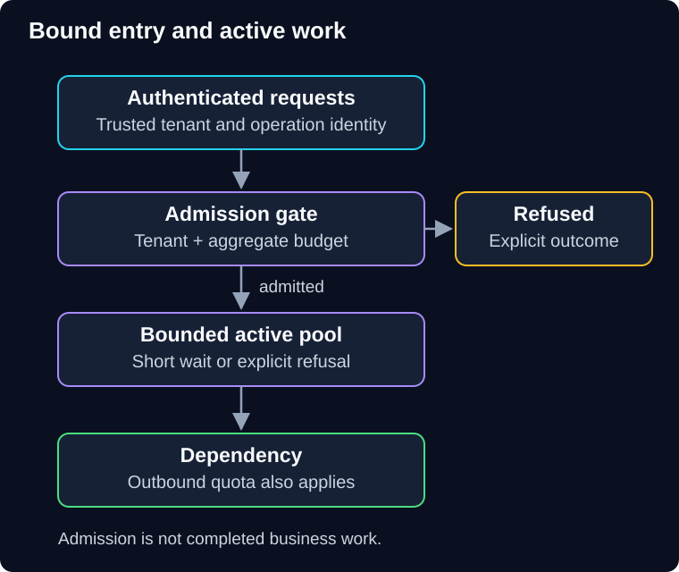

# 01 — Throttling and rate limiting

One QuickCart merchant sends a large import during a sale. The API scales out, but the shared database and paid model quota do not. Everyone else becomes slower while the bill grows.

> **Unit:** SG-CREL-01 · **Capability:** AI-RELIABLE-01 (Reference). 
> **Outcome:** Choose admission limits, calculate burst behavior and explain rejected versus deferred work. 
> **Prerequisite:** [Failure classification](00-foundations.md). 
> **Effort:** 40–50 minutes reading and practice. 
> **Artifact:** A policy covering global, tenant and dependency limits. 
> **Central question:** Which work should enter when demand exceeds safe capacity?

## 1. Intuition: tickets and seats

A venue limits how many tickets it issues each minute, but also counts how many people are inside. Those are different controls. Fast ticket sales can be safe when visitors leave quickly and unsafe when everyone stays all day.

**Rate limiting** controls admission per time interval. **Concurrency limiting** controls active work. **Throttling** is the wider response to excess demand: rejection, pacing or a deliberately reduced service. Terminology varies across platforms; state your actual behavior.

The analogy's limit is that requests consume unequal amounts of CPU, bytes, model tokens and downstream calls. One import can cost more than a thousand small reads.

**Predict:** A limit permits 20 requests/second. Dependency latency rises from 0.1 seconds to 5 seconds. Does the rate limit alone preserve the previous number of active calls?

Reveal the calculation

Under a stable average workload, in-flight work is approximately arrival rate × average time: 20 × 0.1 = 2 calls before; 20 × 5 = 100 after. This uses Little's law as a steady-state approximation, not a guarantee during an unbounded growing queue. Add a concurrency limit and bounded waiting.

## 2. Protect the entry point and the dependency

**Diagram walkthrough:** Requests enter at the top with identity established by trusted authentication. The gate applies tenant and aggregate budgets. Its downward arrow admits work to a bounded pool; its side arrow represents a rejection response, not silent deletion. The pool protects the dependency from too many simultaneous calls. The invariant is that rejected work has not been promised as accepted business work. Distributed limiter storage and durable deferred jobs are omitted.

**Server-side limiting** protects your service from callers. **Client-side limiting** paces your outbound calls to protect a dependency quota or budget. QuickCart needs both: a tenant allowance at ingress and a shared provider allowance across workers. Local limits on ten replicas can permit ten times the intended fleet traffic unless coordination or partitioned quota allocation accounts for that.

A per-tenant limit improves isolation but cannot bound the sum across all tenants. A global limit protects total capacity but can be monopolized. Combine them with a scheduling policy when fairness matters. Derive tenant identity from authenticated context; do not trust an arbitrary request header. An IP address is not a reliable customer identity when users share networks.

## 3. Choose a counting mechanism

| Mechanism | Intuition | Main trade-off |
|---|---|---|
| Fixed window | Count requests in each clock interval | Simple, but bursts fit on both sides of a boundary |
| Sliding window | Count over the recent interval | Smoother boundary behavior; exact logs need more storage, counters approximate |
| Token bucket | Tokens refill at a rate, up to a capacity | Explicit burst allowance plus long-run rate |
| Leaky-bucket pacing | Release queued work at a steady rate | Smooths departures but adds waiting; the queue must be bounded |

**Worked token-bucket example:** Assume capacity 40 tokens, refill 10 tokens/second, initially full, one token per request and an atomic decision. Sixty requests arrive at the same instant. Forty enter and twenty are refused or deferred under a separate contract. After two idle seconds, twenty tokens are available. A 25-request burst then admits twenty and refuses five.

This bucket does **not** promise “at most ten requests in every second.” It deliberately allows a burst. For a fixed window allowing 100 requests/minute, 100 at 12:00:59.9 and 100 at 12:01:00.1 can both pass. The boundary sees 200 requests in 0.2 seconds.

For variable cost, use weights: an import batch can consume more units than a read. For model work, reserve a conservative token/spend allowance before dispatch, then reconcile actual usage. A request-rate limit alone is not a money cap. Unknown outcomes and delayed usage reporting require conservative accounting rather than assuming that timed-out calls were free.

## 4. Reject, defer or degrade deliberately

An HTTP **429 Too Many Requests** communicates rate limiting; it can include `Retry-After`. The protocol does not define your counting algorithm or tenant identity. See [RFC 6585, section 4](https://www.rfc-editor.org/rfc/rfc6585#section-4).

Rejection is often best for interactive work that will become stale. Give callers a bounded retry policy and a clear explanation. General service overload may instead use a contractually defined unavailable response; do not label every outage as a customer's quota violation.

Defer only when the product permits waiting. A durable import job can return an accepted state and a job identifier **after durable recording**. Bound queue depth, payload size, job age and per-tenant occupancy. Cancellation and expiration need explicit terminal states. Holding an HTTP connection indefinitely is not durable acceptance.

Degradation can omit optional recommendations or reduce a permitted media resolution. It cannot weaken payment checks or authorization. Never execute a stale consequential command merely because it was once queued; revalidate its business preconditions.

Client-side pacing can prevent avoidable downstream throttling; Microsoft's [rate-limiting pattern](https://learn.microsoft.com/en-us/azure/architecture/patterns/rate-limiting-pattern) explains this outbound use. Here, the specific limits and costs are hypothetical QuickCart choices.

## 5. Failure, diagnosis and repair

Suppose eight replicas each allow 50 provider calls/second against a shared 100-call/second allowance. The configured total is 400. More replicas can worsen throttling.

Inspect fleet-wide attempts, retries, quota scope and limiter configuration before increasing capacity. Repair with coordinated admission or deliberately allocated per-replica shares that account for membership changes. Test simultaneous callers across replicas, not just one instance. Strong coordination adds latency and creates a dependency; local approximate limits can overshoot. Document the allowed overshoot.

If the limiter store fails, choose the failure policy by operation. A small local emergency allowance might preserve product reads. Paid or consequential work may need to stop. Neither “always fail open” nor “always fail closed” is universally correct. Keep the local concurrency ceiling even if the global store is unavailable.

Observe admitted/refused requests by reason, useful completions, active calls, queue age, tenant share and actual usage. Avoid unbounded tenant labels in metrics; protected structured records can support detailed investigation. The platform owner owns shared admission; service owners own dependency limits and product-specific rejection behavior.

## 6. Practice and quiz

**Guided task:** Add global, tenant and dependency rows to your policy sheet. For each, specify units, scope, burst, active-call ceiling and refusal behavior.

**Independent task:** An import operation fans out to 30 provider calls. Explain why a 10-request/second ingress limit can still produce 300 outbound calls/second before retries. Choose a control at the resource actually consumed.

1. Does per-tenant throttling guarantee an aggregate spending limit?
2. A queue grows by 15 jobs/second for two minutes. How many additional jobs wait, assuming no expiration or rejection?

Show answers and reasoning

1. No. Tenant count, work cost and retries change total spend. Apply aggregate reservations and dependency controls too.
2. 15 × 120 = 1,800 jobs. A queue buffers the mismatch; it does not remove it. Once bounded storage or useful job age is exhausted, admission must change.

**Reflect:** Which limit should protect customers from each other, and which protects the shared provider?

**You can now:** explain a burst, a concurrency surge and a fleet quota violation. **Next:** decide whether refused or failed work deserves another attempt in [02 — Timeouts, retries and idempotency](02-timeouts-retries-and-idempotency.md).

[Previous](00-foundations.md) · [Guide overview](../README.md) · [Course map](../../../../README.md#ordered-capability-map)
