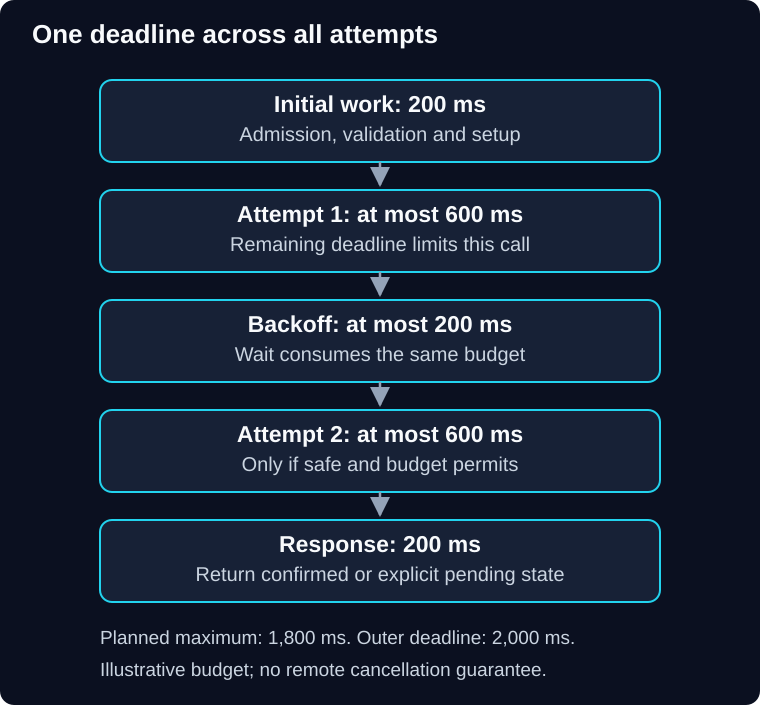

# 02 — Timeouts, retries and idempotency

QuickCart's payment provider creates a charge, but its response is lost. The customer sees a timeout. Retrying with a new payment identity creates a second charge. The network recovered; the business outcome became worse.

> **Unit:** SG-CREL-02 · **Capability:** AI-RELIABLE-01 (Reference).<br>
> **Outcome:** Budget attempts and delays, diagnose amplification, and defend retry safety.<br>
> **Prerequisite:** [Admission and resource limits](01-throttling-and-rate-limiting.md).<br>
> **Effort:** 50–60 minutes reading and practice.<br>
> **Artifact:** One deadline timeline and an idempotency contract.<br>
> **Central question:** When can another attempt improve the outcome without repeating an effect?

## 1. Intuition: asking for a receipt twice

If a cashier does not hear you ask for a receipt, asking again helps. If the cashier has already charged you, repeating “charge me” is dangerous. The useful distinction is the **business intent**, not whether you received a reply.

The analogy's limit is concurrency: two servers can receive duplicate requests at the same time. A memory of the last receipt on one server cannot protect a distributed payment system.

**Predict:** The application, client library and proxy each allow three total attempts. With failures at every level, how many calls can reach the final dependency for one original request?

<details>
<summary>Reveal the reasoning</summary>

Up to 3 × 3 × 3 = 27 under this nested retry structure. “Three total attempts” means the first attempt plus two retries. Independent policies multiply unless ownership and a shared budget constrain them.

</details>

## 2. Timeouts need an outer deadline

A **timeout** limits waiting for one operation or stage. A **deadline** bounds the whole customer operation, including admission, connection setup, attempts, backoff and response handling. Starting a fresh full timeout at every layer can make a nominally short request last much longer.



**Diagram walkthrough:** Read downward from request entry. Arrows represent elapsed sequence, not data movement. The two attempt boxes have individual caps; the outer budget covers them and the waiting between them. The final box reserves response time. The invariant is that starting a retry cannot reset the outer deadline. Parallel branches and remote work that continues after local cancellation are omitted.

**Worked budget:** Assume a 2,000 ms deadline, 200 ms initial work, two attempts capped at 600 ms each, at most 200 ms backoff, and 200 ms final response handling:

```text
200 + (2 × 600) + 200 + 200 = 1,800 ms
Remaining planning margin = 200 ms
```

This is a budget, not a measured latency result. If connection setup, pool waiting or serialization falls outside those caps, the calculation is incomplete. At every stage, derive the next limit from the remaining budget. Use monotonic elapsed time locally; cross-service deadline propagation needs a clock-skew-aware contract or remaining-budget protocol.

Choose per-attempt limits from observed latency and the product's waiting allowance. A timeout shorter than ordinary service time creates unnecessary retries. A very long timeout retains resources during failure. AWS's [timeouts, retries and backoff discussion](https://aws.amazon.com/builders-library/timeouts-retries-and-backoff-with-jitter/) covers these risks and the value of jitter.

Cancellation must stop local retry timers, release acquired slots and propagate where supported. It does not prove that a remote payment was undone or that a model stopped generating billable tokens. Record ambiguous operations for reconciliation.

## 3. Retry only when three conditions hold

First, repeating must have a plausible benefit: a short transport fault or temporary unavailability may clear; an unchanged invalid payload will not. Second, repetition must be safe under the operation contract. Third, the remaining time, attempt, concurrency and spending budgets must allow it.

| Failure | Default reasoning |
|---|---|
| Validation or permission rejection | Stop and correct the cause; no blind retry |
| Short connection failure on a read | Consider a bounded retry |
| Rate-limit response | Pace according to provider contract, if time remains |
| Ambiguous side effect | Reuse a supported idempotency contract or query status; otherwise reconcile |
| Open circuit | Fail fast or defer under contract; do not hot-loop retries |
| Invalid model answer | Diagnose semantic/schema failure; any repair attempt needs its own bound and evaluation |

If `Retry-After` asks for five seconds but only one second remains, stop or use an explicitly asynchronous contract. Do not shorten the server's requested wait to squeeze a retry into the deadline.

## 4. Backoff, jitter and retry budgets

**Backoff** spaces attempts. Fixed waits are simple but can synchronize clients. Linear waits increase gradually. Exponential waits increase quickly and need a cap. **Jitter** randomizes waits so callers do not all return together.

One illustrative full-jitter policy for retry index `k`, starting at zero:

```text
ceiling(k) = min(800 ms, 100 ms × 2^k)
delay(k) = a uniform random value from 0 to ceiling(k)
```

The first three ceilings are 100, 200 and 400 ms. Their expected waits are 50, 100 and 200 ms, but a deadline calculation must allow the actual sampled values, not assume the average. This policy spreads attempts; it does not reduce their maximum count or guarantee recovery.

A **retry budget** caps extra attempts across traffic. Suppose QuickCart admits 100 original calls/second and allows at most 10 extra retry calls/second. Offered traffic is bounded at 110 calls/second by this policy, before other sources of traffic. Without that shared budget, allowing two retries per request could offer up to 300 calls/second. Spare dependency capacity still matters; 110 can be too many.

Do not hold a scarce provider-call slot while sleeping between attempts. Reacquire admission for the next attempt. Bound pending logical requests separately so backoff timers themselves do not accumulate indefinitely.

## 5. Idempotency is a durable contract

**Idempotency** means repeating the same logical operation does not create an additional intended effect. It does not mean the network delivered once or the response bytes never change.

A useful payment contract binds a stable operation key to the authenticated tenant, operation type and validated payload fingerprint. The same key with changed amount or recipient must be rejected. A duplicate completed request can return its recorded result; an in-progress duplicate needs a defined pending or conflict response.

For a local database effect, claim the operation key, apply the business change and record the result in one atomic transaction, backed by a uniqueness constraint. “Check whether key exists, then insert later” races under concurrent callers. AWS's [idempotent API discussion](https://aws.amazon.com/builders-library/making-retries-safe-with-idempotent-APIs/) explains caller-provided identities, atomic recording and changed-intent handling.

An external payment cannot usually join that database transaction. Use the provider's supported idempotency identity, record local intent durably and reconcile after uncertain outcomes. If the provider lacks a suitable contract, automatic replay of ambiguous charges is unsafe. A local “done” flag alone cannot close the crash window between an external charge and recording its result.

Key retention must cover the permitted retry/replay horizon, or old requests must be refused and reconciled after expiry. Recheck current access before returning a stored result. Operation IDs are not authorization tokens.

> [!IMPORTANT]
> A timeout means the caller stopped waiting. It does not mean the dependency stopped working, the charge failed, or a retry is safe.

## 6. Placement, diagnosis and repair

A shared library can apply consistent classification and budgets close to business intent. An [ambassador or sidecar](../../software-extensibility-patterns/docs/02-ambassador.md) can centralize transport policy across languages. The proxy cannot infer that a charge is safe to repeat merely from an HTTP method. Document the owner of retry policy and account for SDK, proxy and application attempts together.

**Failure drill on paper:** A deployment changes the SDK to three attempts while application retries remain at three. Provider traffic rises during a fault. Inspect attempt identifiers under one operation ID, retry owners, timeout boundaries and cost. Repair by assigning one owner or enforcing one shared budget. Regression evidence should assert a maximum dependency-call count, preserved key, no retry after cancellation and no duplicate effect after a lost response.

Track attempts per operation, retry success after initial failure, exhausted budgets, unknown outcomes and cost per useful completion. High retry success can hide poor initial reliability; report both.

## 7. Practice and quiz

**Guided task:** Annotate the 2,000 ms timeline with the remaining budget before each attempt. Then change the first attempt to consume 1,200 ms and explain which original assumptions no longer hold.

**Independent task:** The provider remembers idempotency keys for one day; operators replay jobs up to seven days later. Design a safe path for day-three jobs without inventing provider guarantees.

1. Is a random new key on each retry useful duplicate protection?
2. Does jitter make an unsafe payment retry safe?
3. A retry waits 800 ms, but only 700 ms remain before response reservation. What should happen?

<details>
<summary>Show answers and reasoning</summary>

1. No. It describes new intents. Preserve identity across attempts of the same operation.
2. No. Jitter spreads load; idempotency and reconciliation protect effects.
3. Do not start that retry. Return the appropriate failed or pending outcome; a timer must not outlive the request budget. For the day-three task, consult durable local and provider records, quarantine ambiguity, and permit a new effect only after resolving the original intent. Retention mismatch is not fixed by generating another key.

</details>

**Reflect:** Which layer currently owns retries in a service you know, and how would you prove that?

**You can now:** defend a bounded retry timeline and explain the external-effect crash window. **Next:** stop repeatedly calling a failing dependency in [03 — Circuit breakers](03-circuit-breakers.md).

[Previous](01-throttling-and-rate-limiting.md) · [Guide overview](../README.md) · [Course map](../../../../README.md#ordered-capability-map)
