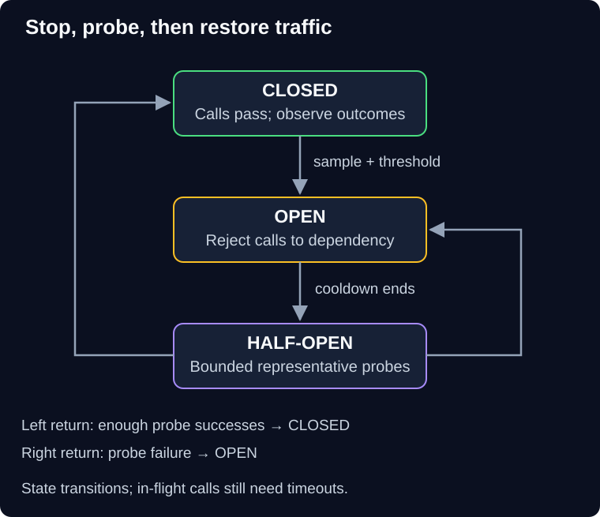

# 03 — Circuit breakers

QuickCart's image service has been failing for several minutes. Every product-page request still waits for the image timeout. Customers pay the same waiting cost even though recent calls strongly suggest the next call will fail.

> **Unit:** SG-CREL-03 · **Capability:** AI-RELIABLE-01 (Reference). 
> **Outcome:** Trace breaker states, select a failure signal and design bounded recovery probes. 
> **Prerequisite:** [Bounded retries and deadlines](02-timeouts-retries-and-idempotency.md). 
> **Effort:** 35–45 minutes reading and practice. 
> **Artifact:** A breaker policy with thresholds, sample size, scope and user outcome. 
> **Central question:** When should we stop spending resources on calls likely to fail?

## 1. Intuition: a temporary road closure

After repeated reports of a blocked road, a dispatcher stops sending delivery vans down it. Later, a small controlled probe checks whether traffic can pass again. The dispatcher does not repair the road; it prevents more vans joining the blockage.

A **circuit breaker** uses recent outcomes to decide whether to permit calls. The analogy's limit is that one successful probe cannot prove capacity for a full fleet. Recovery requires cautious traffic restoration too.

**Predict:** A dependency's health endpoint returns 200, but its payment operation cannot access the database. Should that health response alone reopen payment traffic?

Reveal the reasoning

No. The probe did not exercise the failed path. A representative, safe operation probe is stronger evidence, but even that does not establish full-load capacity. Real payment probes must not create uncontrolled charges.

## 2. The three states

**Diagram walkthrough:** Begin in **closed**, where eligible calls pass and outcomes are measured. The first downward arrow trips to **open** when the configured sample and threshold are met. The next arrow moves to **half-open** after cooldown. The left return path closes after sufficient successful probes; the right path reopens on a failed probe. Arrows are state transitions, not application requests. The invariant is that open-state calls do not reach the dependency. In-flight calls and distributed state coordination are omitted.

“Closed” can be confusing: it means the circuit conducts, so traffic passes. **Open** fails fast. **Half-open** allows a bounded sample while other callers still fail fast or receive an allowed fallback. Microsoft's [circuit-breaker pattern](https://learn.microsoft.com/en-us/azure/architecture/patterns/circuit-breaker) describes this state-based containment mechanism.

## 3. Worked policy and its limits

Consider this illustrative image-service policy:

- Observe eligible dependency attempts over the last 30 seconds.
- Require at least 20 observed attempts before evaluating a failure fraction.
- Open when at least 50% are qualifying failures.
- Stay open for 15 seconds, then allow one probe in flight at a time.
- Close after three consecutive successful probes; reopen immediately if a probe fails.

With 12 failures in 24 attempts, the failure fraction is 50%, so the breaker opens. With two failures in two attempts, this policy does not open because the sample minimum is unmet. That is a trade-off: small samples are noisy, but low-volume failures still need deadlines and monitoring. A separate consecutive-failure rule may be justified; define and test it explicitly.

Count the failures that indicate dependency health. A caller's invalid input or permission denial normally should not open a shared breaker. Tenant-specific throttling should not automatically block unrelated tenants. A slow-call signal can help with a dependency that returns success too late, but thresholds must match the service promise.

Specify whether the breaker observes each attempt or one final logical outcome. If it sees attempts, retries change its sample. If it sees only final outcomes, retries may hide distress. Either choice requires consistent metrics and tests.

## 4. Scope and recovery behavior

Use separate breaker state for independent failure domains. QuickCart's image failure should not open its payment breaker. Within a provider, regions, credentials or operations may fail separately. Too broad a scope blocks healthy work; too narrow a scope creates excessive state and fails to contain shared faults.

Breakers commonly live in each caller process. Ten replicas allowing one probe each can still send ten probes at once. Jitter cooldowns, bound the aggregate probe load and decide whether coordination is worth its cost. Circuit-breaker state itself must not become a new fragile global dependency without a clear reason.

Health checks are an alternative probe signal when they represent the needed operation. They must be authenticated where necessary, inexpensive, rate-bounded and safe. A generic “process alive” check is insufficient. Restarting the caller may also reset its breaker and cause a fresh surge; test startup behavior.

## 5. Combine with retries without a loop

In one reasonable policy, a logical request's retry controller asks the breaker for permission before each attempt. An open-circuit refusal stops synchronous retries. A permitted attempt still passes concurrency and outbound quota checks. Record only the selected dependency outcomes in breaker health statistics, not local admission refusals.

The breaker does not cancel already running calls or guarantee capacity. Timeouts and isolation remain necessary. Conversely, retries address a request that might succeed after a brief fault; a breaker reduces repeated exposure across requests. Neither can determine whether an ambiguous payment completed.

When open, optional images can become placeholders. Payment submission must return unavailable or pending according to its actual state. Shipping work already accepted durably remains tracked for later recovery. An ordinary diagnostic log is not a durable work queue.

## 6. Failure drill, practice and quiz

**Diagnosis:** Product pages remain in fallback after the image service recovers. Inspect state transitions, cooldown time, representative probe outcomes and whether any traffic can trigger a probe. Repair a permanently open state or an irrelevant probe, then test open → half-open → closed and half-open → open. Do not simply disable the breaker during an outage.

Track state duration, qualifying failures, blocked calls, probe traffic and fallback outcomes. The dependency owner diagnoses service recovery; the calling-service owner owns the breaker and its customer-visible behavior. Excessively aggressive thresholds can cost more useful requests than they protect.

**Guided task:** Trace the sample policy through 24 calls with 12 failures, cooldown, two successful probes and one failed probe. Record state and permitted traffic after each step.

**Independent task:** Only one tenant has exhausted its provider quota. Propose a narrower control without creating unlimited breaker state for arbitrary untrusted tenant IDs.

1. Does opening the breaker repair the dependency?
2. With five replicas and one half-open probe per replica, is the fleet probe maximum one?

Show answers and reasoning

1. No. It reduces exposure and load. Repair still requires the dependency owner. In the guided trace the failed third probe returns the circuit to open and starts another cooldown.
2. No. Up to five probes can be in flight under those assumptions. For the tenant task, use authenticated, bounded tenant/quota partitions or a quota-aware limiter; do not classify one tenant's exhaustion as a provider-wide outage.

**Reflect:** What evidence would persuade you that reopening is safer than remaining in fallback?

**You can now:** trace both recovery and failed-probe transitions. **Next:** protect unrelated work even before a breaker opens in [04 — Isolation and graceful degradation](04-isolation-and-degradation.md).

[Previous](02-timeouts-retries-and-idempotency.md) · [Guide overview](../README.md) · [Course map](../../../../README.md#ordered-capability-map)
