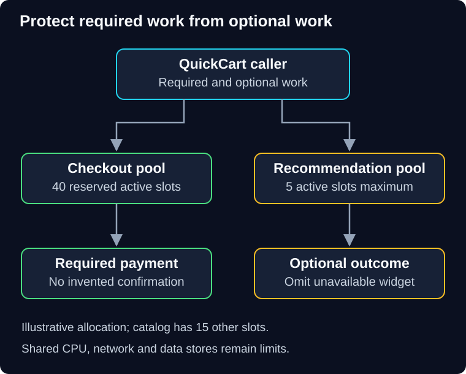

# 04 — Isolation and graceful degradation

The recommendation service becomes slow. Checkout does not require recommendations, yet checkout also stops working: both features share the same exhausted outbound connection pool.

> **Unit:** SG-CREL-04 · **Capability:** AI-RELIABLE-01 (Reference). 
> **Outcome:** Partition resources and define a safe, visible fallback. 
> **Prerequisite:** [Circuit breakers](03-circuit-breakers.md). 
> **Effort:** 30–40 minutes reading and practice. 
> **Artifact:** A resource partition and fallback decision table. 
> **Central question:** What can stay useful while one dependency fails?

## 1. Intuition: compartments in a ship

Partitions can keep flooding in one compartment from filling the entire hull. A software **bulkhead** similarly separates resource pools so one workload cannot consume everything. It might partition connections, worker slots, queues, memory allowances or service instances.

The analogy has a limit: separate connection pools may still share CPU, a database, a host or a provider account. Draw the shared resources that remain. Microsoft's [bulkhead pattern](https://learn.microsoft.com/en-us/azure/architecture/patterns/bulkhead) describes isolation of pools and consumers.

**Predict:** Will two separate queues isolate checkout if the same worker pool always drains recommendation jobs first?

Reveal the reasoning

No. Queue separation alone does not reserve execution capacity. Worker allocation or scheduling must enforce the intended protection, and shared downstream limits still apply.

## 2. Partition the scarce resource

**Diagram walkthrough:** Start at QuickCart. Branch arrows route two types of work into independent admission pools. Each pool owns a fixed active-call allowance. The recommendation branch can return an omitted-widget outcome when unavailable; it does not borrow checkout's reserved slots. The invariant is resource separation at this boundary. The diagram omits shared CPU, database and network capacity, so it does not claim complete failure independence.

**Worked example:** An illustrative caller has 60 outbound slots: 40 reserved for checkout, 15 for catalog reads and 5 for optional recommendations. If recommendation calls hang, that branch consumes at most five slots. The other 55 remain available to their assigned branches. This is a capacity reservation, not proof that 40 checkout calls will meet latency targets.

The cost is underutilization: idle recommendation slots do not automatically help checkout. Controlled borrowing can improve use, but requires priorities and reclaim rules. Start with simple isolation if predictability matters more than maximal utilization. A separate process or service gives stronger isolation at greater operational cost.

## 3. Degrade the feature, preserve the promise

**Graceful degradation** means returning a smaller but still valid service. **Fallback** is the alternative used. Neither means “catch every exception and return success.”

| QuickCart capability | Possible fallback | Boundary that must hold |
|---|---|---|
| Product image | Placeholder | Product identity and price remain correct |
| Recommendations | Omit optional widget | State that recommendations are unavailable if relevant |
| Cached policy text | Last approved version, if permitted | Enforce freshness limit, tenant access and deletion rules |
| Payment | Unavailable or pending reconciliation | Never fabricate payment confirmation |
| AI support draft | Approved template or human review | No invented policy; review queue has bounded capacity |

A cache can improve availability but can retain revoked permissions or deleted data. Validate who may read it and whether it is fresh enough for this operation. If those checks cannot be performed safely, abstain. An alternative model or provider also needs permission, privacy, quality and budget approval; it is not a transparent replacement simply because it returns text.

## 4. Human review is also a queue

Assume an outage sends 30 cases/minute to people who can resolve 12 cases/minute. The backlog grows by 18 cases/minute. After 20 minutes, 360 extra cases wait, ignoring abandonment and other arrivals. “Send to a human” has shifted the bottleneck.

Limit new deferred work, prioritize by a justified policy, disclose waiting expectations and define an expiration/escalation outcome. Report separately: automatic success, fallback, pending review, rejected and failed. A fallback can be appropriate without meeting the original task-success definition.

## 5. Diagnose, repair and verify

**Failure:** Checkout latency rises even though its breaker is closed. Inspect pool occupancy by dependency, pending waiters, acquisition timeout and shared worker use. If recommendations occupy the pool, introduce bounded isolation and short acquisition deadlines. A regression scenario should saturate the optional branch while checking checkout's useful completion and rejection behavior under a stated workload.

Circuit breakers act on observed health; bulkheads bound damage even before enough failures have been observed. Timeouts free local waiting resources; fallback decides what customers receive. Each solves a different part of the incident.

Service owners should monitor pool wait time, utilization, rejections and useful completion per branch. Product owners define what reduced service is acceptable. Record fallback activation and audit access without logging sensitive prompts or customer content by default.

## 6. Practice and quiz

**Guided task:** Allocate 60 slots across three QuickCart workloads. State the minimum protected capability and the shared bottleneck you have not isolated.

**Independent task:** A cached policy was valid yesterday but a merchant revoked access today. Explain whether it can serve as fallback during an authorization-store outage.

1. Is an optional template response equivalent to a successful model-generated answer?
2. Why can a bulkhead reduce maximum resource utilization?

Show answers and reasoning

1. Only if the task contract defines it as an equivalent useful outcome and evidence supports that. Otherwise record fallback separately. Transport success does not prove task success.
2. Reserved capacity may sit idle while another partition is busy. That is the price of protection. For the revoked-policy task, do not serve data without sufficient current authorization evidence; availability must not bypass access control.

**Reflect:** Which “optional” dependency in your architecture shares a required resource?

**You can now:** identify an isolation boundary and reject an unsafe fallback. **Next:** recover the work that cannot complete now in [05 — Dead-letter queues and safe replay](05-dead-letter-queues-and-replay.md).

[Previous](03-circuit-breakers.md) · [Guide overview](../README.md) · [Course map](../../../../README.md#ordered-capability-map)
