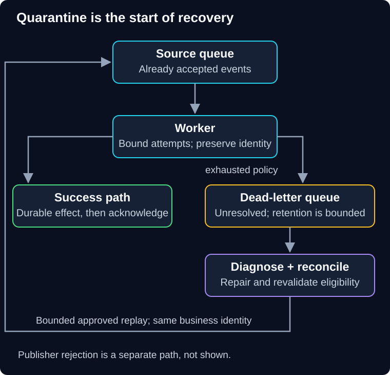

# 05 — Dead-letter queues and safe replay

QuickCart deploys a shipping worker that cannot read an older event schema. The same event returns repeatedly, crashes processing, and delays other orders. Moving it aside helps the live pipeline, but the customer still expects a shipment.

> **Unit:** SG-CREL-05 · **Capability:** AI-RELIABLE-01 (Reference).<br>
> **Outcome:** Distinguish publish and processing failures, design quarantine and defend replay safety.<br>
> **Prerequisites:** [Idempotency](02-timeouts-retries-and-idempotency.md) and [bounded isolation](04-isolation-and-degradation.md); [queue refresher](../../scalability-patterns/docs/04-queue-based-load-leveling.md) as needed.<br>
> **Effort:** 50–60 minutes reading and practice.<br>
> **Artifact:** A quarantine record and a replay runbook with explicit stop conditions.<br>
> **Central question:** How can we preserve failed work without letting it block healthy work?

## 1. Intuition: a parcel exception shelf

A warehouse sets aside parcels with unreadable labels so other parcels keep moving. Someone must still inspect each exception, repair the address where justified, and record delivery or rejection. The shelf is a holding area, not a repair mechanism.

A **dead-letter queue (DLQ)** is a separate destination for messages that cannot progress under the configured delivery or processing policy. A **poison message** repeatedly fails unchanged processing. Its cause might be malformed input, an unsupported schema or a software bug.

The analogy's limit is duplicates and retention. A message can already have caused an effect before its acknowledgement was lost. A DLQ can also expire data; it is not an indefinite archive.

**Predict:** The publisher sends to a nonexistent queue and receives an error. Must the source queue's DLQ contain that message?

<details>
<summary>Reveal the reasoning</summary>

No. The broker may never have accepted the message into the source queue. Producer rejection and consumer failure are different paths. A publisher must handle failed sends and preserve accepted business intent independently.

</details>

## 2. Follow the accepted-message path



**Diagram walkthrough:** Start with an event already accepted by the source queue. Its downward arrow delivers to the worker. The successful branch records the effect durably before acknowledgement; the failure branch eventually reaches the DLQ under the selected policy. The lower review step diagnoses and checks eligibility, then the return arrow redrives approved work at a bounded rate. Arrows show delivery and recovery flow. The invariant is that a redriven message keeps its original business identity. Publisher rejection, exact broker transfer internals and external-effect atomicity are omitted.

Some brokers redrive after a receive-count threshold, others dead-letter for rejection or expiration, and some require an application-managed path. Do not assume identical behavior. For **Amazon SQS**, a source-queue redrive policy uses `maxReceiveCount`; a DLQ is not a universal catch-all for failed publish API calls. Moving FIFO work aside can break application ordering. See [SQS dead-letter queue documentation](https://docs.aws.amazon.com/AWSSimpleQueueService/latest/SQSDeveloperGuide/sqs-dead-letter-queues.html).

A receive count is not exactly a business-attempt count. A worker may crash after receipt but before calling the dependency, or retry several dependency calls within one delivery. Set bounds at both levels.

## 3. Acknowledgement and crash windows

With acknowledgement-based delivery, a message generally remains eligible for redelivery unless successfully acknowledged under the broker's contract. A visibility timeout or lease temporarily hides assigned work; it is not proof that only one worker can ever act on it.

Consider a worker that creates a shipping label, then crashes before acknowledging. Redelivery can create another label unless the shipping operation is idempotent or reconciled. Acknowledging before the effect avoids that duplicate but can lose work if the process crashes next. The correct repair is durable effect handling and duplicate protection, not simply moving the acknowledgement earlier.

For a local database change, an **inbox** or processed-event record can share the transaction with the effect. For an external shipping API, preserve its supported operation identity and handle uncertain outcomes as in the payment chapter. Broker delivery guarantees alone do not establish exactly-once external business effects.

If the application manually copies to a DLQ and then acknowledges the source, a crash between those actions can duplicate the quarantine record. Acknowledging first can lose it. Use broker-supported transfer semantics where available, or a durable, idempotent transfer design with explicit crash recovery. Do not conceal this gap in two lines of pseudocode.

## 4. Protect the publisher with an outbox

QuickCart writes an order to its database and then publishes a shipping event. If the process crashes between them, the order exists but shipping never hears about it. A DLQ cannot recover an event that was never published.

A **transactional outbox** writes the order and a pending event record in the same database transaction. A separate relay publishes the event and records progress. If it crashes after sending but before recording completion, it can publish again; consumers must handle duplicates. The atomic boundary is the database transaction, not the database plus broker plus shipping provider. See the [AWS transactional outbox pattern](https://docs.aws.amazon.com/prescriptive-guidance/latest/cloud-design-patterns/transactional-outbox.html).

Use this pattern when the dual-write gap threatens accepted work. It adds relay operations, retention, lag monitoring and duplicate handling. A simple read-only request does not need an outbox. A broker outage still stops publication; the outbox preserves intent until bounded recovery, and its own storage capacity needs admission protection.

## 5. Quarantine needs an owner and usable evidence

Keep the original event ID, business operation ID, tenant scope, schema version, creation time, first/last failure time, receive/attempt counts, sanitized error category and trace reference. Record whether an external effect might already have occurred. Preserve original evidence when applying a correction; link a corrected record rather than silently changing history.

DLQ contents can contain customer data. Restrict read and redrive permissions, encrypt as required, minimize payloads and define retention/deletion across the queue, backups, logs and copied diagnostic files. An operator's ability to replay does not authorize arbitrary business actions.

Alert on arrival rate, oldest unresolved business-event age, remaining retention and customer impact. A growing DLQ may reflect a bug, an outage, a bad lease setting or invalid data; inspect before blaming the producer. Provider age metrics may measure time in a particular queue rather than total business age. Keep your own event timestamps for that distinction.

The order-service owner handles missing publication; the worker owner handles processing defects; an explicitly assigned incident owner tracks affected customers through terminal outcomes. A dashboard without an owner does not recover work.

## 6. Worked replay plan

Suppose 1,200 events await review after a schema repair. In this illustrative model, measured sustainable worker capacity is 50 jobs/second, live arrivals consume 35 jobs/second, and operators reserve another 5 jobs/second of headroom. Allocate at most 10 jobs/second to replay:

```text
50 - 35 - 5 = 10 replay jobs/second
1,200 / 10 = 120 seconds minimum nominal drain time
```

That estimate assumes replay jobs cost the same as live jobs, all are eligible, and no retries occur. It is not a recovery guarantee. Additional inspection, failures and external quotas extend it.

Use this sequence:

1. Stop the damaging behavior; keep live and replay capacity separate.
2. Diagnose and repair the cause using representative synthetic cases.
3. Reconcile possible completed effects before repeating them.
4. Revalidate current authorization, cancellation, expiry, schema and ordering requirements.
5. Redrive a small approved sample with the original operation identities.
6. Check useful completion, duplicate effects and live latency; stop if any critical invariant fails.
7. Increase within the budget, then reconcile every affected operation to completed, cancelled, rejected or still-owned pending work.

If an earlier event is quarantined while later events proceed, replay may violate sequence. Use entity versions/preconditions, pause that entity's stream when necessary, or reconcile its current state. “FIFO queue” does not excuse replaying an old state transition over a newer cancellation.

## 7. Practice, deliberate failure and quiz

**Guided task:** Create an exception record for a shipping label that may already exist. Name the provider query and local records you would need before replay.

**Deliberate failure:** An operator redrives all 1,200 messages before deploying the schema fix. Predict repeated quarantine and extra dependency load. Repair by stopping redrive, correcting the consumer and checking a sample. The regression must include old-schema input and a crash after the effect but before acknowledgement.

**Independent task:** A message says “ship order,” but the customer cancelled yesterday. Define the terminal outcome and audit record instead of blindly executing it.

1. Does an empty DLQ prove all accepted jobs completed?
2. Does moving a message into a DLQ preserve its original place in an ordered business sequence?
3. Is an application log a sufficient replacement for a durable outbox?

<details>
<summary>Show answers and reasoning</summary>

1. No. Messages may never have been published, may still be queued, may have expired or may have been wrongly acknowledged. Reconcile accepted operations with terminal records.
2. No. Later events may already have changed the state. Revalidate current preconditions or pause the affected ordered stream.
3. Usually no. Logs lack the required atomicity with business acceptance, delivery tracking and reliable replay contract. For the cancelled order, record an appropriate cancelled/rejected outcome after checking actual shipping state; if it already shipped, route to a defined compensating process.

</details>

**Reflect:** Who can demonstrate that the customer obligation is resolved after the DLQ is drained?

**You can now:** trace publisher failure, worker crash and stale replay separately. **Next:** combine the controls into a recovery plan in [06 — Recovery and integrated case study](06-recovery-and-case-study.md).

[Previous](04-isolation-and-degradation.md) · [Guide overview](../README.md) · [Course map](../../../../README.md#ordered-capability-map)
