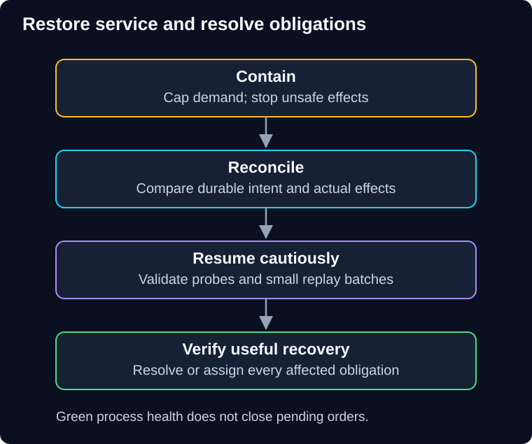

# 06 — Recover correct service, not just healthy processes

QuickCart's dashboards turn green after a rollback. Yet some customers were charged without receiving an order confirmation, and old shipping events remain unresolved. The incident is not finished.

> **Unit:** SG-CREL-06 · **Capability:** AI-RELIABLE-01 (Reference; connections to AI-AWS-01 and AI-OPS-01). 
> **Outcome:** Compose reliability controls and define evidence for recovery. 
> **Prerequisites:** [Retries](02-timeouts-retries-and-idempotency.md), [breakers](03-circuit-breakers.md), [isolation](04-isolation-and-degradation.md), [durable replay](05-dead-letter-queues-and-replay.md). 
> **Effort:** 35–45 minutes reading and practice. 
> **Artifact:** A one-page decision record and incident runbook. 
> **Central question:** Which state and customer obligations must be reconciled before declaring recovery?

## 1. Intuition: reopening after a power cut

A shop can turn the lights back on before it knows which card payments completed during the outage. Reopening the doors restores service availability; checking receipts and outstanding orders restores business correctness.

The analogy's limit is that external systems may continue operating while your application is down. Restoring your database to an earlier time does not restore a payment provider to that same time.

**Predict:** A backup is restored successfully. Can you immediately replay every payment submitted after its timestamp?

Reveal the reasoning

No. Some payments may already exist externally while their local records were lost. Fence unsafe writes, preserve evidence and reconcile operation identities before resuming consequential effects.

## 2. Give each control a distinct job

QuickCart's illustrative design accepts a checkout only after validated, authorized intent is durably recorded. Payment and shipping have explicit pending states. Optional recommendations cannot consume checkout's reserved capacity.

| Boundary | Control | What it does not establish |
|---|---|---|
| API entry | Tenant/global admission, input validation | Permission or business correctness by itself |
| Logical request | Deadline and cancellation | Cancellation of an already committed external effect |
| Dependency attempt | Quota, concurrency and breaker permission | Safe duplicate effects |
| Retry owner | Bounded attempts, backoff and stable identity | Recovery from unchanged invalid input |
| Order transaction | Intent plus outbox record | Broker delivery or provider execution |
| Worker | Idempotency, preconditions, bounded retries | Infinite retention or unlimited recovery capacity |
| Recovery path | Quarantine, reconciliation and controlled replay | Automatic repair of the original defect |

Place checks before the resources or effects they protect. Avoid a rigid universal middleware order: authentication might need a coarse unauthenticated abuse limit before it, while tenant limits require established identity. Whatever the composition, every new dependency attempt consumes the appropriate budget and cannot bypass authorization.

## 3. A concrete incident timeline

These times and observations are a fictional paper exercise, not production measurements.

At 10:00 a sale increases demand. Admission refuses excess work explicitly; accepted jobs remain bounded. At 10:02 the payment provider becomes slow. Attempt deadlines release local waiting; ambiguous outcomes stay pending. At 10:03 qualifying failures open the payment breaker. New synchronous payment attempts stop, while status reads and optional browsing use their own protected resources.

At 10:05 a shipping deployment rejects old schemas. A bounded failure policy quarantines those events. The team pauses redrive and rolls back to a compatible consumer after checking that the old version can read newly written state. A rollback that cannot read the current schema is not a safe recovery.

At 10:10 payment probes succeed. Traffic ramps up within quotas rather than opening the floodgates. Operators reconcile pending payment identities, then redrive eligible shipping work in small batches. Customer support receives accurate pending/completed states, not a blanket “everything succeeded.”

**Diagram walkthrough:** Start with containment at the top. Arrows mean operator-controlled progression. Preserve and reconcile durable facts before permitting replay. The final box requires useful outcomes under restored traffic and resolution or explicit ownership of affected work. The invariant is that a green process-health check cannot skip reconciliation. Region topology, backup tooling and live dashboards are omitted.

## 4. Recovery techniques and their limits

**Rollback** restores an earlier application/configuration version. It does not reverse database writes or external charges. Check schema compatibility and in-flight work before switching versions.

**Failover** moves service to a standby. Replication lag can lose recently acknowledged data; stale writers can create conflicting effects. A single-writer/fencing mechanism prevents an old leader from continuing writes after ownership changes. More replicas do not automatically solve state ownership.

**Backup restore** reconstructs stored state from a recovery point. Test data integrity, access controls and reconciliation against events and external effects after that point. Backups need access restrictions and deletion/retention policy too.

**Checkpoint/resume** restarts a workflow from a durable progress record. Recheck whether the step after the checkpoint already happened before repeating it. **Compensation** is a new business action that addresses an earlier completed action, such as a refund after a confirmed charge. It is not a database rollback, can fail, may have fees, and needs authorization and idempotency of its own.

Use these only when the failure and recovery objective justify their cost. A single service with a tested restore may be sufficient; this guide does not prescribe multi-region deployment.

## 5. Worked recovery objectives

**Recovery time objective (RTO)** is the target time to restore a defined usable service. **Recovery point objective (RPO)** is the maximum tolerable data-loss interval. They are targets, not guarantees from owning a backup.

Assume QuickCart defines an RTO of 20 minutes from incident onset and an RPO of five minutes for order records. A simulated drill spends two minutes detecting, three minutes containing, eight minutes restoring and four minutes validating: 17 minutes total. It meets that drill's time target. A snapshot from eight minutes before the incident misses the five-minute RPO unless additional logs can recover the gap.

Define what the RTO includes. Restoring new checkout service while historical orders remain pending can meet a narrowly defined availability objective, but not an objective that includes complete backlog reconciliation. Record both restoration time and time to resolve affected obligations. One drill does not establish future guarantees.

## 6. Runbook and evidence

Write these as actions with named roles, rather than “monitor the system”:

1. **Incident lead:** identify affected operations, impact window and decision authority.
2. **Service owner:** cap admission, stop unsafe side effects and preserve operation records.
3. **Dependency owner:** diagnose representative failures and establish recovery evidence.
4. **Data/workflow owner:** reconcile pending effects, expired events and compatible state.
5. **Replay operator:** run a bounded sample, with authorization and a recorded stop condition.
6. **Incident lead:** validate useful outcomes, communicate remaining pending work and close only against the declared recovery criteria.

Capture original requests, attempts, admitted/rejected/pending outcomes, useful completions, duplicate effects, oldest unresolved work, latency, retry cost and recovery duration. Use consistent operation IDs while redacting sensitive content. Audit who changed admission, triggered replay or approved a compensation.

**AI-specific boundary:** A provider fallback can restore response throughput while reducing answer quality or violating data-location assumptions. Re-evaluate the permitted model on the same task-quality criteria; keep human-review throughput bounded. A transport recovery drill does not establish real-model quality.

## 7. Practice and knowledge checks

**Guided task:** For the timeline above, write one invariant, one evidence source and one stop condition for each recovery step. Example: stop shipping redrive if a cancelled order creates a new label.

**Independent task:** The standby contains orders but has lost a recent segment of the idempotency ledger. Decide whether consequential writes can resume; name the reconciliation needed and explain the delay to a fictional customer-support lead.

1. Why can a rollback worsen an incident?
2. Does a 17-minute drill establish a 20-minute RTO for every future incident?

Show answers and reasoning

1. An older application may misread current schemas or replay already completed effects. Compatibility and durable state matter, not just the executable version.
2. No. It is evidence for the exercised scenario, data volume and environment. The lost-ledger task requires fencing/restricting risky operations and reconstructing enough intent/effect history to prevent duplication. Restored order rows alone do not prove retry safety.

**Reflect:** What would “incident resolved” mean to an affected customer whose order is still pending?

**You can now:** distinguish restored availability from resolved business obligations. **Next:** defend an independent design in [07 — Challenges, revision and glossary](07-challenges-and-revision.md).

[Previous](05-dead-letter-queues-and-replay.md) · [Guide overview](../README.md) · [Course map](../../../../README.md#ordered-capability-map)
