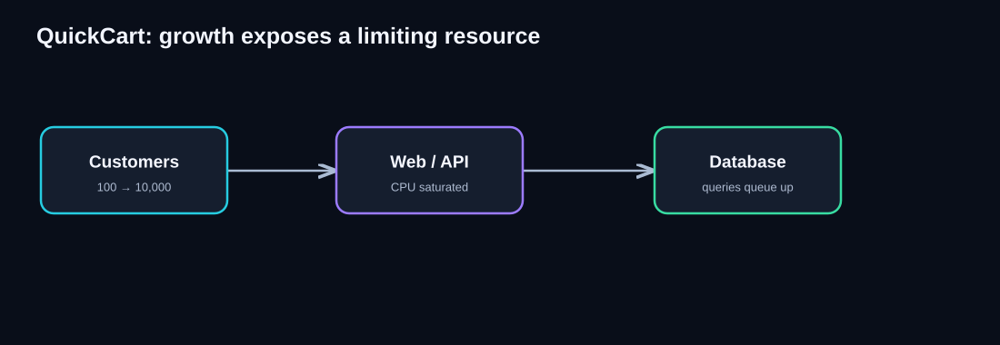
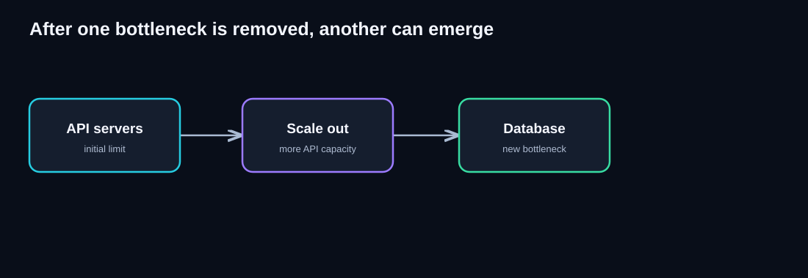
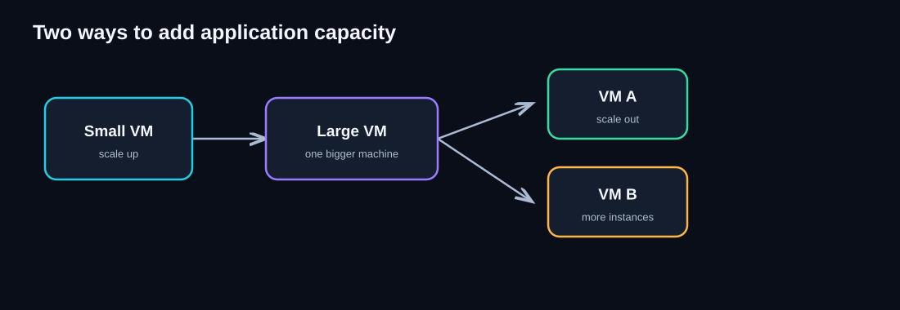
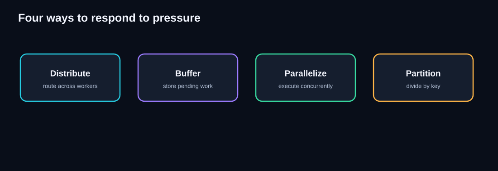
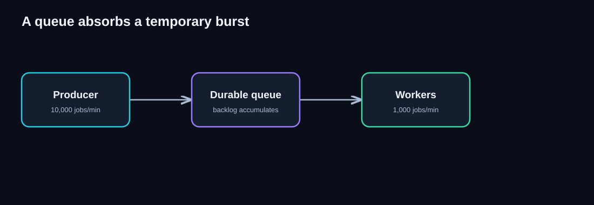

# Foundations of Cloud Scalability

> **Unit ID:** SG-SCALE-00 · **Capability:** AI-AWS-01 · [Course map](../../../../README.md#ordered-capability-map)

[Learning contract and transfer check](learning-contract.md) · [Course map](../../../../README.md)

> **Series status:** Draft for chapters 00–13. Substantive conceptual material exists; current publication checks are not established. This is an authoring-state declaration, not a claim of executed implementation or deployment.

> **Chapter 00 · Self-study guide · Estimated study time: 45–60 minutes**
>
> **Running example:** QuickCart, a fictional online shopping platform.
>
> **Big idea:** Do not begin with a pattern name. First ask what is growing, where the bottleneck is, and what architectural change addresses it.
>
> **You need:** Backend request lifecycle experience.
>
> **You will produce:** One calculation with units/assumptions and a measurement plan; distinguish nominal capacity from useful throughput.

## Learning objectives

By the end of this chapter, you should be able to:

- Explain scalability in plain language and distinguish it from elasticity and availability.
- Identify growth in requests, users, data, jobs, tenants, and geographic reach.
- Interpret latency, throughput, concurrency, utilization, saturation, and backlog.
- Recognize why a bottleneck can move after an architectural improvement.
- Compare vertical and horizontal scaling.
- Explain four responses to pressure: distribute, buffer, parallelize, and partition.
- Ask useful diagnostic questions before selecting a scalability pattern.

## 1. Start with intuition: a supermarket

Imagine a supermarket with one checkout counter. When only five shoppers arrive, everyone finishes quickly. During a festival sale, hundreds arrive. The line grows.

Possible solutions sound simple: hire another cashier, add checkout counters, let shoppers leave their baskets for later pickup, or open separate counters for different types of orders. But these solutions solve **different problems**. Adding cashiers cannot help if the only card-payment terminal is failing.

A cloud architect faces the same challenge. The goal is not merely to add machines. The goal is to identify **the resource limiting useful work** and improve that part of the system.

**Definition:** Scalability is a system's ability to handle increasing workload while maintaining acceptable service levels, typically by adding or reorganizing resources.

“Acceptable” must be measurable: for example, 95% of product searches complete within 300 milliseconds under a stated workload. More servers are a possible means, not the definition.

## 2. The QuickCart problem

QuickCart starts with a single web/API server and one database. It works for 100 users. During a flash sale, 10,000 users arrive, response times rise, and some requests fail.

**Read the diagram from left to right:**

1. **Customers** use the website or mobile application. They generate requests such as “search for shoes” and “place an order.”
2. **Web/API** receives those requests, runs business logic, and calls the database. Its CPU or request-handling capacity may become saturated.
3. **Database** stores products, carts, and orders. More API requests can generate more database queries.
4. The arrows show dependencies, **not proof of which box is slow**. We need measurements to identify the actual bottleneck.

**Think before reading on:** If the database is already overloaded, will adding ten API servers solve the problem?

Reveal the reasoning

Not necessarily. More API servers can create even more database connections and queries. We must measure the limiting resource before changing the design.

## 3. What exactly can grow?

| Growth dimension | Meaning | QuickCart example | Possible pressure |
|---|---|---|---|
| **Requests** | Operations arriving per second | Product searches jump from 100 to 5,000 requests/second | API CPU, network, database reads |
| **Users** | People using the service; distinguish registered from concurrently active users | One million registered customers; 30,000 shopping simultaneously | Sessions, authentication, concurrent connections |
| **Data** | Amount of stored or indexed information | Orders increase from 1 million to 500 million rows | Storage, indexes, query time, backups |
| **Jobs** | Units of work processed, often in the background | 200,000 confirmation emails queued after a sale | Queue backlog, worker capacity, provider rate limits |
| **Tenants** | Separate customers or organizations sharing a platform | QuickCart expands into a marketplace serving 500 sellers | Noisy-neighbor effects, tenant isolation |
| **Geographic reach** | Users or workloads spread across more regions | Customers in India, Europe, and North America | Network latency, data residency, regional capacity |

### Three distinctions that matter

- **Registered users ≠ concurrent users.** Ten million accounts do not imply ten million simultaneous requests.
- **Requests ≠ jobs.** A customer may receive an immediate “order accepted” response while email and fulfillment jobs run later.
- **Data volume ≠ request rate.** A database can grow huge with low traffic, or receive intense traffic with relatively little stored data.

**Example:** A user uploads a product video. That is one HTTP request, but it may trigger several jobs: virus scan, thumbnail generation, transcoding, and metadata extraction.

## 4. Metrics architects should know

| Metric | Plain-English meaning | Example | Why it matters |
|---|---|---|---|
| **Throughput** | Work successfully completed per unit time | 2,000 orders/minute | Measures delivered processing capacity |
| **Arrival rate** | Work entering the system per unit time | 5,000 orders/minute | Compare with sustainable throughput |
| **Latency** | Time one operation takes from start to finish | Search takes 250 ms | Directly affects user experience |
| **Concurrency** | Operations active or in progress at the same time | 600 in-flight requests | Drives connection and memory pressure |
| **Utilization** | Fraction of available capacity currently used | CPU at 85% | High sustained usage can indicate limited headroom |
| **Saturation** | Work waiting because a resource cannot keep up | DB connection pool queue grows | Strong evidence of a bottleneck |
| **Error rate** | Fraction of requests that fail | 2% HTTP 5xx | Reliability can degrade before throughput collapses |
| **Backlog / queue depth** | Work accepted but not yet processed | 20,000 pending emails | Indicates deferred work and potential delay |
| **Oldest-message age** | How long the oldest queued item has waited | Oldest email waits 8 minutes | Often more informative than queue depth alone |
| **p95 latency** | 95% of measured operations finish at or below this time | p95 = 400 ms | Exposes slower user experiences hidden by averages |

**Example: average vs p95.** If most searches complete in 100 ms but some take several seconds, the average may look acceptable while real users experience noticeable delays. Track tail percentiles such as p95 and p99.

### Useful relationship: Little's Law

For a stable system under suitable steady-state assumptions:

**Average in-flight work ≈ throughput × average time in system**

If QuickCart completes 100 requests/second and each takes 0.2 seconds on average, it has approximately **20 in-flight requests**.

This is a useful estimate, not a universal sizing rule: changing traffic patterns, queues, retries, and overload require more careful analysis.

## 5. How to locate the bottleneck

A **bottleneck** is the resource or constraint currently limiting the system's ability to deliver more useful work.

Follow this diagnostic sequence:

1. **State the symptom.** “Search p95 latency rose from 200 ms to 1.5 seconds.”
2. **Identify what changed.** Request rate? Number of concurrent users? Data size? Job arrival rate?
3. **Trace the request path.** Client → API → cache → database → external provider, as applicable.
4. **Inspect evidence at each dependency.** CPU, memory, disk I/O, DB query latency, pool waits, network, queue age, and error rate.
5. **Form a hypothesis.** “Database connections are exhausted during checkout peaks.”
6. **Test one targeted change.** Adjust a pool, optimize a query, or add measured capacity; compare before and after.
7. **Recheck the whole system.** The limiting resource may have moved.

**Do not diagnose from CPU alone.** An API server with low CPU can still be slow because it waits on a database or external service.

**Diagram walkthrough:**

- Initially, application servers are the limiting resource.
- Scaling out adds more API processing capacity.
- More API instances can issue more requests to the same database.
- The database may now become the limiting resource.
- The next decision must be based on **new measurements**, not on repeating the previous scaling action.

**Production question:** What happens to the payment provider, database, or shared cache when API capacity doubles?

## 6. Scale up vs scale out

**Diagram walkthrough:**

- On the left, a small VM becomes a larger VM. This is **vertical scaling**, or *scaling up*: adding CPU, memory, or other resources to an existing machine.
- On the right, we add more VM instances. This is **horizontal scaling**, or *scaling out*: adding independently running instances.
- Horizontal scaling usually requires routing traffic between instances, plus a design that avoids dependence on one instance's local session state.
- The diagram is conceptual: it does not show a load balancer, shared storage, or failover mechanisms, all of which may be necessary in production.

| Question | Scale up | Scale out |
|---|---|---|
| What changes? | Size of an instance | Number of instances |
| Main advantage | Often simpler initially | Potentially larger aggregate capacity and failure isolation |
| Main limit | Maximum practical machine size | Coordination, shared dependencies, and distributed-system complexity |
| Example | Increase database VM memory | Add stateless API replicas |
| Watch for | Cost jumps, restart requirements, single failure boundary | Session state, load balancing, shared-store pressure |

**Important:** Neither approach is universally better. Some workloads benefit from larger machines, others from more machines, and many systems use both.

## 7. Four architectural responses to pressure

**Diagram walkthrough:** Each box is a *different kind of response* to a different problem. These are not four mandatory steps.

### A. Distribute

**Meaning:** Spread incoming requests across available resources.

**Example:** A load balancer routes each new QuickCart API request to a healthy instance.

**Best when:** Multiple interchangeable workers can serve requests.

**Watch for:** A common downstream database can still limit the system.

### B. Buffer

**Meaning:** Store work temporarily so it can be processed later at a safe rate.

**Example:** QuickCart accepts an order and queues an email notification instead of making the customer wait for email delivery.

**Diagram walkthrough:**

1. The producer submits 10,000 jobs/minute during a burst.
2. A durable queue holds jobs waiting for processing.
3. Workers complete 1,000 jobs/minute in this simplified example.
4. While those rates persist, the backlog grows by approximately **9,000 jobs/minute** (assuming no drops or other changes).
5. A queue **buys time**; it does not magically increase sustainable processing capacity.

**Watch for:** Backlog age, storage limits, retries, duplicate delivery, and eventual completion time.

### C. Parallelize

**Meaning:** Execute independent work concurrently.

**Example:** Several workers process different queued emails, or a search request queries multiple independent search partitions at once.

**Best when:** Work can be divided without unsafe shared-state conflicts.

**Watch for:** Ordering, duplicate processing, slowest-branch latency, and downstream limits.

### D. Partition

**Meaning:** Divide a dataset or workload into subsets and route each key to the correct subset.

**Example:** Orders are distributed across database shards based on customer ID.

**Best when:** A single data or processing boundary cannot handle the workload.

**Watch for:** Hot keys, uneven distribution, cross-shard queries, and rebalancing.

### Choose the response from the symptom

| Symptom | First architectural question | Candidate response |
|---|---|---|
| One API instance is overloaded | Can another instance handle the same request? | Distribute / scale out |
| Bursty jobs overwhelm a provider | Can the work wait safely? | Buffer |
| One background worker cannot keep up | Can independent workers process separate jobs? | Parallelize |
| One database cannot grow enough | Can data be divided by a suitable key? | Partition |

These are **candidates**, not automatic prescriptions. Verify the actual bottleneck first.

## 8. Scalability, elasticity, availability, and performance

| Term | Meaning | Example |
|---|---|---|
| **Scalability** | Ability to handle growth while meeting service objectives | Add API capacity as traffic grows |
| **Elasticity** | Ability to adjust capacity with changing demand | Autoscaler adds instances at peak and removes them later |
| **Availability** | Ability to remain accessible and functioning when needed | A failed API instance does not take down the whole service |
| **Performance** | Speed and efficiency for a defined workload | Search p95 latency is 180 ms at 500 requests/second |
| **Reliability** | Ability to behave correctly over time under expected conditions | Accepted orders are not silently lost |

A service can be scalable but unavailable during a regional failure. It can be highly available but slow. Autoscaling improves elasticity but does not guarantee that every downstream dependency can scale.

## 9. Production mindset: the architect's checklist

Before adding a scalability pattern, ask:

- **Workload:** What grows? What are average, peak, and burst rates?
- **Service objectives:** What latency, throughput, error rate, and data correctness are required?
- **Bottleneck:** Which measured resource is limiting progress?
- **Dependencies:** What shared database, cache, API, or provider might become the next limit?
- **State:** Does each request depend on information held only by one instance?
- **Failure:** What happens when an instance, network call, or region fails?
- **Data correctness:** Can retries create duplicate orders, charges, or messages?
- **Operations:** Can we observe queue age, p95 latency, saturation, and failure rates?
- **Economics:** What does the design cost at normal traffic and at peak?
- **Validation:** Can load tests and controlled experiments demonstrate improvement?

**Production example:** An autoscaler adds 20 API instances during a sale. The API error rate still rises. Investigation reveals the payment provider allows only 1,000 requests/minute. More API instances increase the pressure on the same provider. A safer design may require controlled concurrency, rate limiting, and buffering suitable asynchronous work—while ensuring payment and order correctness.

## 10. Knowledge checks

Try to answer each question before expanding the explanation.

### Quiz 1 — Users versus requests

QuickCart has two million registered customers, but only 8,000 are active at the same time. Which number is more immediately useful for sizing concurrent request handling?

Show answer

The **8,000 concurrently active users** are usually more directly relevant, but they are still not enough on their own. We also need each user's request rate, request duration, and workload mix. Registered accounts matter more for storage and account-management capacity.

### Quiz 2 — More API servers?

The API CPU is 25%, but database query waits are rising rapidly. Should we first add API instances?

Show answer

Probably not. The evidence suggests the API is waiting on the database. Investigate slow queries, indexing, connection limits, locks, and database capacity before adding application servers.

### Quiz 3 — Queue mathematics

A queue receives 600 jobs/minute while workers complete 400 jobs/minute. Assuming the rates remain constant and no jobs are discarded, how fast does the backlog grow?

Show answer

**200 jobs/minute.** After 10 minutes the backlog would grow by approximately 2,000 jobs. The queue is buffering work, but the system is not keeping up sustainably.

### Quiz 4 — Pick a response

A reporting request needs results from four independent datasets. What kind of architectural response might reduce total waiting time?

Show answer

**Parallelize** the independent searches, then combine their results. This leads toward the **Scatter-Gather** pattern. The slowest required branch and aggregation overhead still affect latency.

### Quiz 5 — Identify a hotspot

An application shards orders by country, but 75% of requests belong to one country. What could go wrong?

Show answer

The shard for that country may become a **hotspot**, meaning it receives disproportionately high traffic. A better partition key or a more granular partitioning strategy may be needed.

### Quiz 6 — Scalability vs elasticity

A service can run on 100 instances but always keeps all 100 running, even at night. Is it scalable? Is it elastic?

Show answer

It may be **scalable** if it can use those instances effectively as workload increases. It is **not necessarily elastic** because it does not automatically adjust its provisioned capacity to changing demand.

## 11. Mini architecture challenge

**Scenario:** QuickCart launches a flash sale. Product search becomes slow, order confirmation emails are delayed, and the database shows rising read latency.

**Your task:**

1. Name **three separate symptoms** rather than assuming one cause.
2. Identify the metric you would inspect for each symptom.
3. Propose one candidate architectural change for each.
4. Name one new bottleneck each change could create.

Show a sample architectural response

| Symptom | Measure | Candidate response | New risk |
|---|---|---|---|
| Search is slow | Search p95 latency, API CPU, DB query waits | Optimize queries/cache reads; scale API only if API tier is limiting | Cache misses or database load |
| Emails are delayed | Queue age, backlog, worker throughput | Queue notifications and add workers within provider limits | Email provider rate limit |
| DB reads slow | Query latency, CPU, I/O, locks, connection waits | Optimize indexes/queries; consider read scaling if appropriate | Replication lag or added operational complexity |

These are hypotheses, not guaranteed fixes. Test them with workload measurements.

## 12. Quick revision notes

| Architect's question | Remember |
|---|---|
| What is scalability? | Handle more work while maintaining acceptable service |
| What can grow? | Requests, users, data, jobs, tenants, geographic reach |
| What is a bottleneck? | The current limiting resource or constraint |
| What is throughput? | Completed work per unit time |
| What is latency? | Time an operation takes |
| What is saturation? | Work waiting because capacity is insufficient |
| Scale up? | Make a resource larger |
| Scale out? | Add more resources or instances |
| Distribute? | Route work across capacity |
| Buffer? | Hold work for later processing |
| Parallelize? | Execute independent work concurrently |
| Partition? | Divide work or data into subsets |
| Biggest production lesson? | Improving one layer can expose another bottleneck |

### Five questions to carry into every architecture review

1. **What exactly is growing?**
2. **What evidence shows where the bottleneck is?**
3. **What is the smallest change that addresses that limit?**
4. **What correctness, latency, cost, or operational trade-off does that change introduce?**
5. **What might become the next bottleneck?**

## 13. What's next: Stateless Services

Suppose QuickCart adds more API servers. Alice logs in through Server A, which stores her shopping cart only in its local memory. Her next request reaches Server B. Server B does not know about her cart.

**Architectural question:** Can any healthy instance serve Alice's next request?

This leads directly to the **Stateless Service Pattern**: keep durable or cross-request state outside individual service instances so the instances can be interchangeable.

**Next chapter:** [SG-SCALE-01 — 01 — Stateless Services](01-stateless-services.md)

## Completion checkpoint

**You can now:** explain growth, latency, throughput and saturation without choosing a tool first.

**Show it:** One calculation with units/assumptions and a measurement plan; distinguish nominal capacity from useful throughput. Then attempt chapter 00's unfamiliar transfer check in the [learning contract](learning-contract.md).

**Next:** [SG-SCALE-01 — 01 — Stateless Service Pattern](01-stateless-services.md).

---

*This guide uses illustrative workloads and simplified architecture diagrams for teaching. Real systems require workload-specific measurements and validation.*
