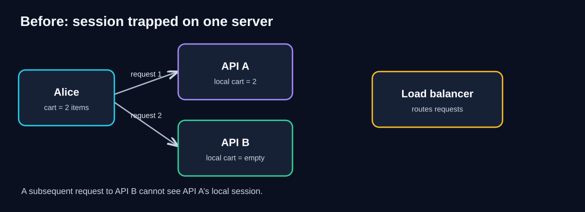
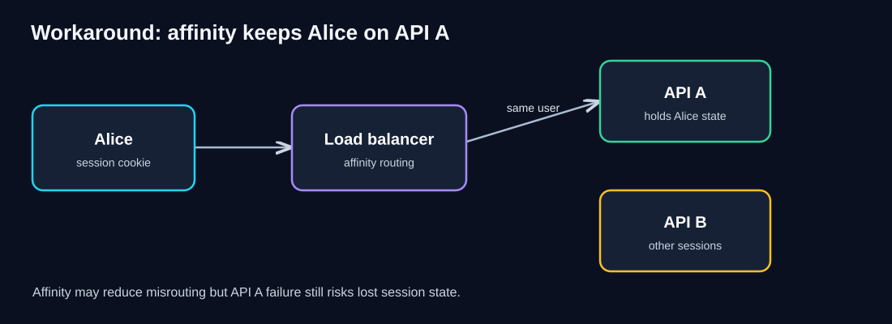
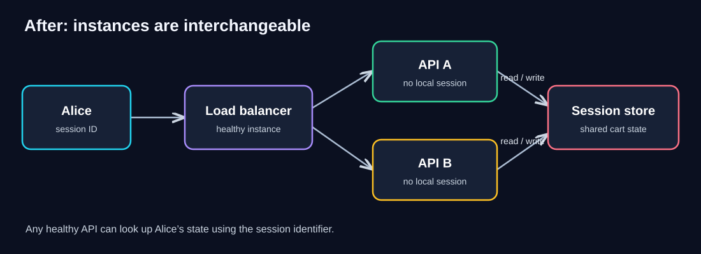
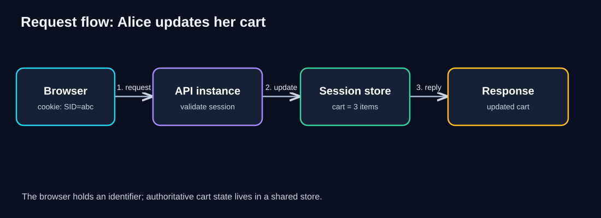
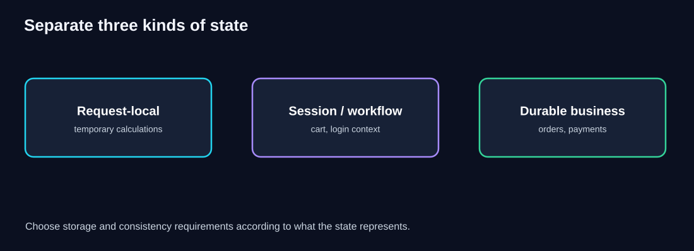
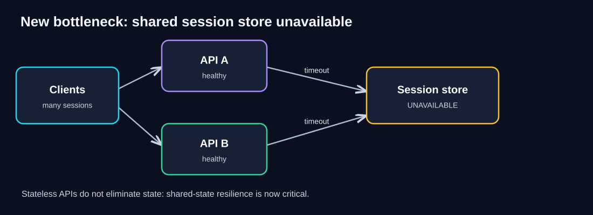

# 01 — Stateless Service Pattern

> **Unit ID:** SG-SCALE-01 · **Capability:** AI-STATE-01 · [Course map](../../../../README.md#ordered-capability-map)

[Learning contract and transfer check](learning-contract.md) · [Course map](../../../../README.md)

> **Study time:** 50–70 minutes · **Prerequisite:** [SG-SCALE-00 — 00 — Foundations](00-foundations.md)<br>
> **Central question:** Can *any healthy service instance* handle the next request?  
> **You will produce:** State-ownership sketch and failover prediction; do not put mutable payment state in a client token.<br>
> **Running example:** QuickCart, our fictional e-commerce application.

## Learning objectives

After this chapter, you should be able to:

1. Explain the difference between a *stateless service* and an application that has *no state anywhere*.
2. Diagnose why Alice's shopping cart disappears when requests reach different API instances.
3. Compare sticky sessions, a shared session store, and token-based authentication.
4. Trace the request flow through a load balancer, API replicas, and an external state store.
5. Identify security, consistency, failure, and cost trade-offs.
6. Design production checks and recognize when statelessness is useful or unnecessary.

## 1. Intuition: interchangeable checkout counters

Imagine a supermarket where a customer must always return to the **same cashier**, because only that cashier remembers the customer's shopping list. If that cashier leaves, the customer must start over.

Now imagine the shopping list is stored in a shared system. Any cashier can scan the customer's membership code and retrieve the current list. The cashiers become **interchangeable**.

That is the intuition behind the Stateless Service Pattern.

**Definition:** A stateless service instance does not depend on unique, locally retained *cross-request state* to handle a subsequent request. Information needed across requests is carried with the request or obtained from a shared, durable, or otherwise accessible source.

**Important nuance:** Stateless does **not** mean the program uses no memory. Every request may use variables, CPU, temporary buffers, and caches. It means the next request does not require returning to the same particular instance to recover essential state.

## 2. The problem: Alice's cart disappears

QuickCart begins with one API server. When Alice adds shoes to her cart, the server stores her cart in its own process memory.

Later QuickCart adds a second server and a load balancer. Alice's next request goes to Server B. Server B has no knowledge of the cart stored in Server A.



### Explain the diagram

- **Alice** is the customer. She expects her shopping cart to persist between requests.
- **API A** holds two cart items in its *local memory*. That memory is not automatically shared with API B.
- **API B** has no copy of Alice's cart. If her next request lands here, it cannot reconstruct the cart from local memory alone.
- **Request arrows** show that successive requests may reach different replicas. The diagram simplifies routing to highlight the problem; a real deployment commonly has a load balancer in the path.
- **Load balancer** is shown as a system component, but routing alone cannot synchronize server memory.

**Root cause:** The API instance has become the *unique owner* of information required by future requests.

### Pause and predict

**Question:** Would adding five more API instances make Alice's cart problem better?

<details><summary>Reveal answer</summary>

No. It can make the problem more visible: more replicas mean more possible destinations, but Alice's cart remains on only one. More instances do not automatically replicate state.

</details>

## 3. First attempted fix: sticky sessions

A team might configure the load balancer to route Alice's requests back to API A. This is called **session affinity**, or *sticky sessions*.



### Explain the diagram

1. Alice sends requests containing an identifier or cookie used by the load balancer for affinity.
2. The load balancer attempts to route Alice repeatedly to **API A**.
3. API A continues to hold her cart in local memory.
4. API B serves other users.
5. If API A crashes, is replaced, or is drained for maintenance, Alice's state may be lost unless it was separately persisted or replicated.

### Why affinity is not the same as statelessness

| Question | Sticky session | Stateless API with external state |
|---|---|---|
| Can any instance handle the next request? | Not reliably without transferring/rebuilding state | Usually yes, if shared dependencies are available |
| What happens when one instance fails? | Its local session may disappear | Another instance can retrieve shared state |
| Does the load balancer need user affinity? | Often yes | Usually no for session correctness |
| Does it solve uneven session distribution? | Not necessarily | Easier to redistribute requests |
| Is it always wrong? | No; useful in some legacy and connection-oriented systems | Often preferred for elastic HTTP APIs |

**Architect's lesson:** Affinity can be a tactical workaround, but it is not equivalent to making service instances interchangeable.

## 4. Discover the pattern: move shared state out of the instance

Instead of making Alice return to one server, let *any* server retrieve the cart from a shared state store.



### Explain the diagram carefully

1. **Alice** sends a request with a session identifier, usually in a cookie.
2. The **load balancer** selects a healthy API instance using its routing policy.
3. **API A or API B** validates the request and obtains the session identifier.
4. The chosen API reads or updates Alice's cart in the **shared session store**.
5. The API sends the response. A later request can reach a different instance and still find the same cart.
6. If API A is terminated, API B can continue serving requests *as long as the shared dependencies remain available*.

**Key design shift:** Instances become replaceable workers rather than unique owners of user state.

### What can the shared state store be?

- **Redis or another distributed cache:** Fast access to short-lived sessions or cart state; configure persistence, replication, TTL, and eviction according to business requirements.
- **Relational or document database:** Useful when stronger durability, querying, or transaction semantics are needed.
- **Managed session service:** May simplify operations, but still requires availability, cost, and security review.
- **Client-carried signed token:** Can carry some authenticated claims without a server-side lookup, but is not a general replacement for mutable cart, payment, or order data.

> **Critical distinction:** A session store is not necessarily the authoritative order database. Losing a cart may be inconvenient; losing a paid order is a much more serious correctness failure. Store each kind of state according to its durability and consistency needs.

## 5. Step-by-step request flow



### Explain the diagram

1. **Browser:** Alice adds a third item to her cart. The browser sends an HTTP request, normally including a secure session cookie.
2. **API instance:** The load balancer has routed the request to an available instance. The API authenticates/authorizes the operation and determines which cart is associated with Alice.
3. **Session store:** The API updates the shared cart record. In production, the update must handle concurrent requests and failures correctly.
4. **Response:** The API confirms the result after the required state change succeeds.
5. **Next request:** Another API instance can retrieve the same cart, because the cart is not tied to the previous instance.

**What the arrows mean:** The simplified diagram follows the logical sequence. It does not show every network return path or the load balancer, which was shown in the preceding diagram.

### A simple implementation sketch (pseudocode)

```text
POST /cart/items
  session_id = validate_session_cookie(request)
  cart = shared_store.get("cart:" + session_id)
  updated_cart = add_item_safely(cart, request.item)
  shared_store.save_with_concurrency_control(session_id, updated_cart)
  return success(updated_cart)
```

This is conceptual pseudocode, not production-ready authentication or transaction logic. A real implementation must handle authorization, expiration, atomic updates, errors, and retries.

## 6. Three different kinds of state



### Explain the diagram

- **Request-local state:** Temporary values used while processing one request (for example, a subtotal calculation). Keeping these in instance memory is normal.
- **Session/workflow state:** Data needed across requests (for example, a shopping cart, login context, or workflow progress). If another instance must continue the work, the state must be accessible to it.
- **Durable business state:** Records such as confirmed orders, payments, and inventory reservations. These need storage and correctness guarantees appropriate to the business.

**Takeaway:** Stateless service design is about *where essential state lives and who can access it*, not about pretending the application has no state.

## 7. Sessions, cookies, and tokens: what architects must know

| Term | Simple explanation | Design consideration |
|---|---|---|
| **Cookie** | Small value the browser can send with HTTP requests | Use `Secure`, `HttpOnly`, appropriate `SameSite`, and CSRF protection where needed |
| **Session ID** | An opaque identifier used to find server-side session data | Generate securely; rotate when appropriate; expire and revoke |
| **Session store** | Shared place holding session records | Availability, latency, TTL, eviction, and protection of sensitive data |
| **JWT** | Signed token containing claims | Validate signature, issuer, audience, expiry, and allowed algorithms |
| **Access token** | Credential used to authorize API access | Short lifetime and scope; secure storage and transport |
| **Refresh token** | Credential used to obtain new access tokens | Stronger storage and rotation/revocation controls |
| **TTL** | Time to live before data expires | Choose based on session and business requirements |
| **Idempotency** | Repeating an operation does not produce additional unintended effects | Especially important for order/payment requests and retries |

### Stateless authentication is not the same as stateless business processing

A signed token may allow an API to verify some authentication claims without a session lookup. But that does **not** mean the shopping cart, inventory, or order records should be placed inside a token.

**Why not put the entire cart in a JWT?**

- Tokens may become large and stale.
- Updating cart contents requires issuing a new token.
- Revocation and concurrent updates become more difficult.
- Signed tokens are not necessarily encrypted; their contents should not be assumed confidential.
- Cart and inventory data may require authoritative server-side checks.

**Architectural decision:** Use a token for appropriate identity/authorization claims, and use a shared data store for mutable business state when needed.

## 8. Concurrency and consistency: the less obvious problem

Externalizing state solves *instance affinity*, but not every data correctness problem.

Suppose Alice opens QuickCart on her laptop and phone. Both devices read a cart containing two items. Both add a different product at nearly the same time.

If each request overwrites the cart using an old copy, one update may be lost.

Possible solutions include:

- **Atomic operations:** Apply individual changes safely within the store.
- **Optimistic concurrency:** Update only if the record version is unchanged; retry or return a conflict otherwise.
- **Database transactions:** Group related updates where atomicity is required.
- **Domain-specific merge rules:** Merge cart additions carefully, rather than overwriting entire snapshots.

**Important:** Choosing Redis versus a database does not automatically settle the consistency model. The required behavior must be designed and tested.

## 9. New bottleneck: shared-state dependency



### Explain the diagram

1. Clients can send requests to **API A** and **API B**.
2. Both API instances are healthy and can accept traffic.
3. Both need the same shared session store to retrieve or modify session state.
4. If that store becomes unavailable, the APIs may fail or slow down despite having plenty of CPU.
5. The shared store is now a **critical dependency** and may become the new bottleneck.

**This is the recurring scalability lesson:** Moving state out of API instances improves replaceability, but introduces network access and dependency-management responsibilities.

### How to reduce the risk

- Use a highly available store and understand its failover behavior.
- Configure reasonable timeouts and connection pools.
- Avoid unbounded retries that amplify an outage.
- Use backoff with jitter where retries are appropriate.
- Define which operations can degrade gracefully and which must fail safely.
- Monitor store latency, errors, memory, eviction, replication health, and connection saturation.
- Verify disaster recovery and session expiration behavior.

**Be careful:** “Fail open” is not a universal strategy. Security-sensitive actions must not bypass authentication or authorization when the session store is unavailable.

## 10. When to use — and when not to use — this pattern

### Strong candidates

- HTTP APIs behind a load balancer.
- Services that autoscale or are frequently replaced.
- Container and Kubernetes workloads with rolling deployments.
- Systems that must tolerate individual application-instance failure.
- Multi-region designs where requests may be routed between locations, with appropriate data replication and consistency design.

### Situations needing additional thought

- **Long-lived WebSocket connections:** Connection state is tied to a live connection; application state can still be externalized, but reconnection and routing need explicit design.
- **In-memory streaming or specialized compute:** Local state may be necessary for performance; checkpointing and recovery may be more appropriate than forcing every operation through a remote store.
- **Small single-instance applications:** A shared session service may be unnecessary complexity if scale and availability requirements are modest.
- **Strict latency workloads:** Extra network calls can be expensive; cache locality and consistency trade-offs require measurement.

### Common misconceptions

| Misconception | More accurate understanding |
|---|---|
| “Stateless means no memory.” | Temporary request-local memory is normal. |
| “Stateless means no database.” | Most stateless APIs depend on databases or other shared stores. |
| “JWT makes my whole application stateless.” | It may reduce authentication lookups; business state remains. |
| “Sticky sessions are always wrong.” | They can be useful, but create affinity and recovery trade-offs. |
| “Any instance can serve a request even if the shared store fails.” | Only if the operation can proceed safely without that dependency. |
| “Externalizing state automatically prevents lost updates.” | Concurrent writes still need correctness controls. |

## 11. Production mindset: observability and operational readiness

### Metrics worth tracking

| Signal | Why it matters | Possible symptom |
|---|---|---|
| API p95/p99 latency | User-perceived tail performance | Remote state lookups add delay |
| API error rate | Reliability | Store timeouts lead to failures |
| Session-store read/write latency | Dependency performance | Store is saturated |
| Session-store availability | Critical dependency health | Broad session failures |
| Cache hit/miss and eviction rates | State retention behavior | Unexpected session loss |
| Connection pool utilization | Shared-resource pressure | Requests wait for connections |
| Authentication/session rejection rate | Security and usability | Invalid/expired sessions |
| Cart update conflicts | Data consistency | Concurrent device updates |

### Deployment and resilience checklist

- [ ] No required session state lives only in an API process.
- [ ] API instances can be restarted without losing committed session state.
- [ ] Sessions expire and can be revoked according to policy.
- [ ] Sensitive cookies and tokens are protected.
- [ ] Shared state has a documented availability and backup/recovery strategy.
- [ ] Concurrent updates have defined behavior.
- [ ] Timeouts, retries, and circuit-breaking are appropriate for the operation.
- [ ] Rolling deployments do not require keeping a user on an old instance.
- [ ] Load tests include state-store throughput, not only API CPU.
- [ ] Logs and traces correlate a request across API and store without exposing secrets.

### Cost and capacity example

Assume QuickCart handles **2,000 requests/second**, and each request makes **two session-store operations** on average.

The session store must support roughly **4,000 operations/second** from this workload, before accounting for retries, background work, or peak headroom.

If API capacity doubles while session-store capacity stays fixed, the store may become the next bottleneck.

**Architect's question:** Can we reduce unnecessary state reads, improve caching safely, or scale the shared store while preserving correctness?

## 12. Worked example: instance failure during checkout

**Scenario:** Alice adds three items to her cart. API A processes the request, then crashes. Alice clicks “Checkout,” and API B receives the request.

**Stateful-local design:** API B may not have Alice's cart. The user may need to restart, unless state was separately persisted.

**Stateless API with external cart store:** API B looks up the cart and continues. This works only if the cart update was successfully committed and the shared store is available.

**But checkout adds more requirements:** Confirming an order may require inventory reservation, payment authorization, and durable order creation. The stateless pattern does not replace transaction design or idempotency.

**Lesson:** Statelessness improves service replaceability; it does not guarantee end-to-end business correctness on its own.

## 13. Knowledge checks (expand the answers)

### Quiz 1 — Define the pattern

Does a stateless API instance use zero memory?

<details><summary>Show answer and explanation</summary>

**No.** It can use memory for temporary calculations, request handling, and caches. The essential distinction is that a future request does not depend on state uniquely retained by that particular instance.

</details>

### Quiz 2 — The load balancer

Alice's first request goes to API A and her second to API B. What must be true for the second request to continue successfully?

<details><summary>Show answer and explanation</summary>

API B must have access to the required information, either through the request or through a shared data source. If Alice's cart exists only in API A's memory, the second request cannot recover it.

</details>

### Quiz 3 — Sticky sessions

Do sticky sessions make an API stateless?

<details><summary>Show answer and explanation</summary>

**No.** Sticky sessions keep a user associated with an instance, which can hide the dependence on local state. The dependence remains, especially during instance failure or replacement.

</details>

### Quiz 4 — JWT versus cart state

Should QuickCart store its entire mutable shopping cart in an access token?

<details><summary>Show answer and explanation</summary>

Usually **no**. The token may become large or stale, updates become awkward, and token signing does not imply confidentiality. A server-side authoritative cart store is generally more suitable for mutable cart data.

</details>

### Quiz 5 — New bottleneck

The API layer scales from 4 to 40 instances, but shared session-store latency rises sharply. What should the architect investigate?

<details><summary>Show answer and explanation</summary>

Investigate session-store capacity, operation rates, connection pools, hot keys, slow operations, network latency, and retry amplification. Adding more API instances may increase pressure on the same store.

</details>

### Quiz 6 — Concurrent updates

Two devices update the same cart simultaneously. Does externalizing state automatically prevent lost updates?

<details><summary>Show answer and explanation</summary>

**No.** The system needs atomic operations, version checks, transactions, or another appropriate concurrency strategy.

</details>

### Quiz 7 — Production failure

The shared session store is unavailable. Should QuickCart bypass session validation so customers can continue checking out?

<details><summary>Show answer and explanation</summary>

**No.** Bypassing security checks is unsafe. The application should fail safely for operations requiring verified identity, while allowing only explicitly designed, safe degraded behavior.

</details>

## 14. Architecture challenge: redesign QuickCart

### Problem

QuickCart has:

- Three API instances behind a load balancer.
- Cart data stored in each API instance's local memory.
- An autoscaler that adds instances during flash sales.
- Customers reporting missing carts after scale-out and deployments.

### Your task

1. Identify the root cause.
2. Propose a revised architecture.
3. Explain what the browser should send on each request.
4. Choose where cart state should live, and justify your choice.
5. Describe what happens if one API instance fails.
6. Name **two new production risks** and how to monitor them.

<details><summary>Show one reasonable solution</summary>

1. **Root cause:** Required cross-request cart state is tied to individual API instances.
2. **Architecture:** Browser → load balancer → any stateless API → shared cart store. Durable orders remain in an authoritative business database.
3. **Browser:** Send a secure session cookie or other appropriate authenticated credential; avoid trusting arbitrary client-supplied cart totals.
4. **Storage:** A shared database or suitably configured distributed store, selected according to cart durability, performance, and consistency needs.
5. **API failure:** Another healthy instance retrieves the committed cart and continues.
6. **New risks:** (a) Shared store outage: monitor availability, timeouts, and error rates; design failover. (b) Concurrent cart updates: monitor conflicts and test atomic/versioned updates.

**Trade-off:** More flexible scaling and deployment, but extra network calls and a shared dependency.

</details>

## 15. Quick revision notes

| Question | Answer to remember |
|---|---|
| What is the problem? | Cross-request state exists only on one service instance. |
| What is the pattern? | Keep essential cross-request state outside individual instances, or provide it safely with requests. |
| Why does it help? | Any healthy instance can handle the next request. |
| Does it eliminate all state? | No. It changes state ownership and access. |
| Why are sticky sessions limited? | They retain affinity and local-state failure risk. |
| Where can sessions live? | Shared cache, database, managed session store, or appropriate client-carried claims. |
| Is a JWT the same as cart storage? | No. Authentication claims and mutable business state have different needs. |
| What new bottleneck appears? | Shared state store, its network, or connection pool. |
| What correctness risk remains? | Concurrent writes, retries, and lost updates. |
| Production must-haves? | Secure sessions, HA state store, observability, timeouts, and concurrency control. |

### Five architect questions

1. **What state must survive across requests?**
2. **Who owns that state, and can every healthy instance access it?**
3. **What happens when an instance is replaced or a shared dependency fails?**
4. **What consistency and security guarantees does the state require?**
5. **What becomes the next bottleneck after we scale the API tier?**

## 16. Connection to the next pattern

Now QuickCart has interchangeable API instances. But how should an incoming request choose among them? And how should traffic avoid an unhealthy instance?

That leads to **[SG-SCALE-02 — 02 — Load Balancing](02-load-balancing.md)**.

## Completion checkpoint

**You can now:** explain interchangeability while preserving session/business correctness.

**Show it:** State-ownership sketch and failover prediction; do not put mutable payment state in a client token. Then attempt chapter 01's unfamiliar transfer check in the [learning contract](learning-contract.md).

**Next:** [SG-SCALE-02 — Pattern 02 — Load Balancing](02-load-balancing.md).

---

*Teaching note: Diagrams simplify real systems to emphasize the architectural decision. Product-specific behavior and production guarantees depend on actual implementation and configuration.*
