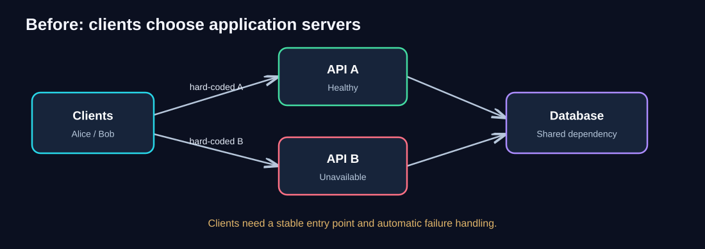
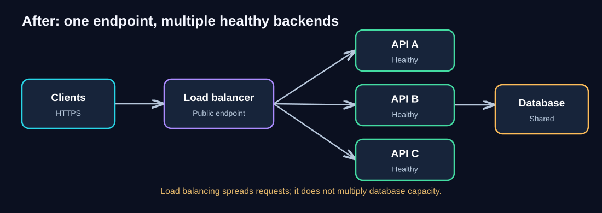
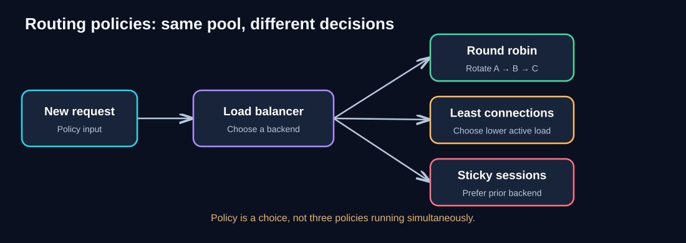
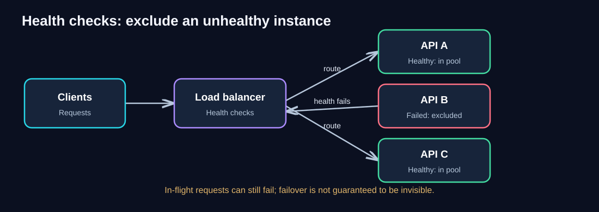
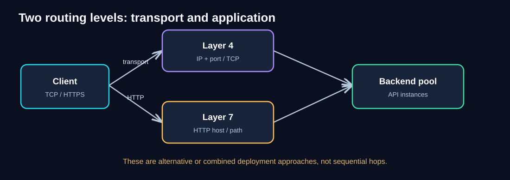
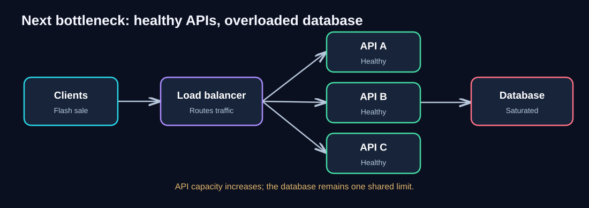

# Pattern 02 — Load Balancing

> **Unit ID:** SG-SCALE-02 · **Capability:** AI-AWS-01 · [Course map](../../../../README.md#ordered-capability-map)

[Learning contract and transfer check](learning-contract.md) · [Course map](../../../../README.md)

> **Platform boundary, checked 2026-10-14:** Excluding unhealthy targets is a conceptual routing policy, not a universal provider guarantee. AWS Application Load Balancer can fail open and route to unhealthy targets when all registered targets are unhealthy. Inspect the [official health-check behavior](https://docs.aws.amazon.com/elasticloadbalancing/latest/application/target-group-health-checks.html) before applying this picture to AWS; health checks are not authorization or proof of business correctness.

> **Complete self-study chapter · Estimated study time: 60–75 minutes**
>
> **Prerequisite:** [SG-SCALE-00 — Foundations](00-foundations.md) and [SG-SCALE-01 — Stateless Services](01-stateless-services.md)
>
> **Central question:** How do we route incoming requests to healthy application instances without forcing clients to know or select individual servers?
>
> **You will produce:** Route/health diagram and failure policy; distinguish health detection from guaranteed successful requests.

## 1. Learning objectives

After this chapter, you should be able to:

- Explain *why* a load balancer is needed, using a simple analogy and a concrete failure scenario.
- Read an architecture diagram showing clients, a load balancer, API replicas, and a shared database.
- Distinguish load balancing from autoscaling, high availability, and database scaling.
- Compare round robin, least connections, and sticky sessions, including their limitations.
- Explain health checks, readiness, graceful draining, retries, and connection behavior.
- Recognize the difference between Layer 4 and Layer 7 routing.
- Design a practical load-balanced QuickCart API and identify its next bottleneck.
- Choose meaningful production metrics and explain common failure modes.

## 2. Intuition: a restaurant host

Imagine a restaurant with three service counters. If guests must select a specific counter before arriving, one line may become extremely long while another counter sits idle. If one counter closes, guests who chose it are stuck.

A host at the entrance can direct each arriving guest toward an available counter. The host needs to know which counters are open and how busy they are.

**A load balancer plays the host's role for incoming network traffic.** It accepts traffic at a stable endpoint and routes connections or requests to a set of backends according to configured rules.

The analogy has limits: requests can have very different processing costs; existing connections may remain open; and a healthy-looking server may still be slow because of a shared database.

**Memory hook:** *Load balancing decides **where** a request goes. Autoscaling decides **how many** instances should exist.*

## 3. The problem: clients choose individual servers

QuickCart has two API servers. Alice's app calls Server A directly; Bob's app calls Server B directly. The server addresses are built into client configuration.

### Diagram walkthrough

1. **Clients** send requests directly to an API address they already know.
2. **API A** is healthy, so clients pointing at A can proceed.
3. **API B** becomes unavailable. Clients still pointing at B may fail even though A has capacity.
4. Both servers access the **shared database**, which is a separate dependency.
5. The arrows from clients to individual APIs show why this arrangement creates fragile client-side routing and makes adding or removing instances difficult.

### Think like an architect

Before reading the solution, answer:

- How can QuickCart expose **one stable address** even when the number of servers changes?
- How will it stop sending **new traffic** to a failed server?
- If three servers are available, who decides which one receives the next request?
- If the client previously used Server A, does its next request truly need to return to A?

Reveal the architectural direction

Place a traffic-routing component in front of the API pool. It exposes a stable endpoint, selects backends, and excludes backends that fail configured health checks. Design the API instances to be interchangeable where possible; see the Stateless Services chapter.

## 4. The Load Balancing pattern

**Definition:** Load balancing is the distribution of incoming network connections or application requests across multiple backend targets according to a routing policy.

The pattern typically has four roles:

| Component | Responsibility | QuickCart example |
|---|---|---|
| Client | Initiates requests | Browser or mobile app |
| Load balancer | Accepts traffic, chooses a backend, checks target health | Public `api.quickcart.example` endpoint |
| Backend pool | Runs application logic | API A, API B, API C |
| Shared dependencies | Support application operations | Database, cache, payment provider |

### Detailed diagram walkthrough

1. **Clients → Load balancer.** Customers call one stable hostname. DNS resolution and the public network endpoint are simplified in this diagram.
2. **Load balancer → API A/B/C.** The load balancer chooses a backend using a routing policy. The diagram's three arrows indicate *possible routes*, not that every request is broadcast to all three servers.
3. **API instances.** Each backend should be able to process requests independently, subject to shared dependencies. A stateless design makes this easier.
4. **API → Database.** The application instances still use the database. More API capacity does **not** automatically increase database capacity.
5. **Response path.** In common reverse-proxy designs, the response returns through the load balancer to the client. Some network architectures handle return traffic differently.

### Example request sequence

1. Alice requests `GET /products/123`.
2. The load balancer selects healthy API B.
3. API B reads product data from the database or cache.
4. API B returns the product response through the routing path.
5. Alice's next request might go to API A. If cross-request state is externalized, this is usually fine.

**Important distinction:** A load balancer can distribute traffic among existing instances. It does not necessarily create instances, increase their capacity, or fix overloaded downstream services.

## 5. Why statelessness and load balancing work together

Suppose Alice adds shoes to her cart while API A holds the cart **only in its local memory**. Her next request goes to API B. B cannot find the cart.

This is **not a failure of the load-balancing algorithm**. It is an application state-management problem.

Common approaches:

| Approach | How it works | Trade-off |
|---|---|---|
| External session store | All APIs read/write session state in Redis or a database | Adds shared dependency, latency, and consistency concerns |
| Database-backed cart | Cart is persisted under Alice's customer ID | Durable, but requires careful database scaling |
| Client-held token | Client sends signed claims needed for authorization | Token size, expiry, revocation, and data sensitivity require care |
| Sticky session | Requests from one client tend to reach the same backend | Reduces flexibility and complicates failover; local state can still be lost |

**Stateless service ≠ no state anywhere.** It means the instance does not rely on private, persistent cross-request state to handle the next request.

## 6. Routing policies: how is a backend selected?

### Diagram walkthrough

- The **new request** arrives at a load balancer.
- The load balancer uses a **configured policy** to choose a backend.
- The three boxes are **alternative policy choices**, not three stages of one request.
- Each policy has assumptions; none is optimal for every workload.

| Policy | Simple explanation | Useful when | Limitation |
|---|---|---|---|
| **Round robin** | Send successive requests to A, B, C, then repeat | Requests are similar in cost and backends have similar capacity | A slow, long-running request may occupy one backend much longer |
| **Weighted round robin** | Give stronger backends proportionally more traffic | Backend capacities differ | Weights require calibration |
| **Least connections** | Prefer the backend with fewer active connections | Connection duration varies and connection count reflects work reasonably well | One connection may be far more expensive than another; HTTP multiplexing complicates interpretation |
| **Sticky sessions / affinity** | Prefer a previously chosen backend for a client | Temporary compatibility with session-local designs | Uneven load, failure complications, and reduced flexibility |
| **Hash-based routing** | Use a stable key to choose a target | Some cache-locality or affinity needs | Hot keys and membership changes can skew distribution |

### Worked example: round robin

With three healthy equal-capacity APIs and six sequential requests:

| Request | Backend |
|---|---|
| R1 | A |
| R2 | B |
| R3 | C |
| R4 | A |
| R5 | B |
| R6 | C |

This is a **conceptual example**. Actual implementations may route at the connection level, apply weights, reuse persistent connections, or use other balancing rules.

### Which policy benefits most from stateless services?

**Round robin and other flexible per-request distribution policies** become easier to use when each API can handle any request. Sticky sessions are less necessary.

## 7. Health checks, failure detection, and draining

A backend can exist but still be unfit to receive new requests.

### Diagram walkthrough

1. The load balancer has a pool of three registered backends.
2. **API A and API C** pass the configured checks and remain eligible for new traffic.
3. **API B** fails its health check and is excluded after the relevant thresholds are reached.
4. New requests are routed to A or C while B is unhealthy.
5. **Existing in-flight requests to B may still fail.** Health checking reduces impact; it does not guarantee uninterrupted execution.

### Liveness versus readiness

- **Liveness:** Is the process running or able to recover? Used by some orchestration systems to decide whether to restart a container.
- **Readiness:** Can this instance safely accept *new* requests now? A service might be alive but not ready because it is warming caches, migrating, or overloaded.
- **Load balancer health check:** A configured probe used to decide whether a target is eligible. Its semantics depend on the platform and application.

Avoid a health endpoint that always returns `200 OK` regardless of whether the instance can do useful work. Equally, avoid making every transient downstream glitch mark *all* backends unhealthy simultaneously without a deliberate policy.

### Graceful draining

When deploying a new version or removing an instance:

1. Mark the instance as **not accepting new work**.
2. Stop routing new connections or requests to it.
3. Allow existing work to complete within a configured drain period.
4. Shut down safely; unfinished work needs explicit recovery handling.

### Retries require care

Retrying a failed **GET** is often safer than blindly retrying an order or payment **POST**. Use idempotency keys and appropriate retry rules for operations that could have side effects.

## 8. Layer 4 versus Layer 7 load balancing

### Diagram walkthrough

1. A client initiates network communication.
2. **Layer 4 routing** makes decisions using transport-level information such as IP addresses, ports, and TCP/UDP connection details.
3. **Layer 7 routing** understands application-level protocols such as HTTP and may route based on hostname, path, headers, or other application attributes.
4. Both approaches can lead to a backend pool.
5. The diagram shows **alternative or potentially combined approaches**, not necessarily a chain in which every request must pass through both boxes.

| Feature | Layer 4 | Layer 7 |
|---|---|---|
| Main information | Transport/network details | Application protocol details |
| Typical routing unit | Connection or flow | HTTP request or stream, depending on implementation |
| HTTP path routing | Not inherently available | Commonly supported |
| TLS termination | Depends on product/design | Common, but not universal |
| Example use | Generic TCP service | `/api` and `/images` routed to different pools |

**Example:** QuickCart could send `/api/orders` to an orders service and `/api/catalog` to a catalog service using an HTTP-aware Layer 7 proxy.

**Important:** Layer 7 is not automatically “better.” Choose based on protocol requirements, operational needs, security, latency, and cost.

## 9. Worked example: capacity and limits

Assume the following **illustrative** conditions:

- One API instance sustainably handles **200 requests/second** at the required latency.
- Three equivalent API instances are healthy.
- The load balancer itself is adequately provisioned.
- The database and other dependencies have enough spare capacity.

Then a simple upper-bound estimate is:

**3 × 200 = 600 requests/second of API processing capacity.**

This is **not a guaranteed end-to-end throughput**. Real performance depends on request mix, connection limits, database capacity, retries, traffic skew, and resource headroom.

If the database supports only **350 requests/second worth of the required database work**, the system may saturate around that shared constraint even though the API tier could theoretically handle 600.

### What happens if one API fails?

With two remaining equivalent instances, the simplified API capacity estimate becomes **2 × 200 = 400 requests/second**. If arrival rate remains 550 requests/second, the remaining instances may overload.

**Design lesson:** Availability during failure requires enough **spare capacity**, not just a load balancer and multiple replicas.

## 10. New bottleneck: the shared database

### Diagram walkthrough

1. QuickCart experiences a flash-sale traffic surge.
2. The load balancer spreads requests across three healthy API servers.
3. The APIs can process incoming application logic, but all issue queries to the same database.
4. The database becomes saturated; query waits increase.
5. Users still see slow responses even though the API servers appear healthy.

**Next architectural question:** Is the database slow because of inefficient queries, lock contention, missing indexes, too many connections, or a genuine capacity limit?

Possible responses include query optimization, caching appropriate reads, managing connection pools, or changing the data architecture. **Sharding is not the first response to every slow database.**

## 11. Production design decisions and trade-offs

### Avoid a single load-balancer failure boundary

A lone self-managed load balancer can become a single point of failure. Managed services often provide redundant infrastructure, but their guarantees, limits, and failure domains still need review.

### Plan for deployment and topology

- Decide whether the load balancer is **public-facing** or **internal**.
- Choose the correct **network and security boundaries**.
- Place backend instances across failure domains where appropriate.
- Configure **TLS certificates**, termination, and encryption to backends as required.
- Understand **DNS**, endpoint failover, and client caching behavior.
- Configure timeouts for clients, proxies, applications, and dependencies coherently.
- Protect against traffic surges with rate limiting, admission control, and capacity planning.

### Common mistakes

| Mistake | Why it is risky | Better approach |
|---|---|---|
| “Three servers means triple capacity” | Shared dependencies may saturate | Load-test end-to-end |
| “Health check passes, so service is fine” | Health probe may not represent real work | Observe errors, latency, and readiness |
| “Sticky sessions solve state management” | Local state disappears when instance fails | Externalize necessary cross-request state |
| “More backends fix all slowness” | Database/provider may be limiting | Trace and measure the request path |
| “Retry every failed request” | Can duplicate payments/orders | Use bounded retries and idempotency |
| “Load balancer ensures high availability” | Load balancer, zone, or shared store may still fail | Engineer and test redundancy across failure boundaries |

## 12. Monitoring and observability

| Layer | What to watch | What it tells you |
|---|---|---|
| Load balancer | Incoming request rate, active connections | Traffic volume and connection pressure |
| Load balancer | Healthy/unhealthy target count | Backend availability |
| Load balancer | Routing errors, 5xx responses, rejected connections | Traffic-routing failures or target failures |
| Load balancer | Target response time / latency | Backend delay as seen by the proxy |
| API instances | CPU, memory, thread/event-loop pressure, concurrency | Instance-level saturation |
| API instances | p50/p95/p99 latency and error rate | Customer experience and tail latency |
| Dependencies | DB query latency, pool waits, cache misses | Downstream bottlenecks |
| Deployments | Draining time, connection termination, request failures | Safe scale-in and release behavior |

**Observability tip:** Propagate request or trace IDs across the load balancer, application, and dependencies. This helps distinguish routing delay from application or database delay.

### Suggested alerting questions

- Are healthy targets dropping below the minimum needed for expected traffic?
- Is p95 latency increasing while API CPU remains low?
- Are backend 5xx errors concentrated on one instance?
- Are connection pool waits increasing after a scale-out event?
- Are retries amplifying an already overloaded dependency?

Thresholds must be chosen from real service objectives and baseline traffic, not copied blindly from another system.

## 13. When to use — and when not to use — this pattern

**Use load balancing when:**

- Multiple backend instances can serve the same category of requests.
- You need one stable endpoint for a changing backend pool.
- You want to stop sending new traffic to unhealthy targets.
- You need controlled routing during scaling and deployments.

**A separate load balancer may be unnecessary when:**

- The workload is tiny and a single instance meets reliability and performance needs.
- A platform already provides equivalent routing and health management.
- The service is a single-instance specialized workload with no interchangeable backends.

**What it does not solve:**

- Database saturation or provider rate limits.
- Cross-request state tied to one instance.
- Lack of spare capacity during failure.
- Data correctness and retry safety.
- Every possible network, region, or dependency failure.

## 14. Knowledge checks (expandable answers)

### Quiz 1 — What is the load balancer responsible for?

Does a load balancer decide how many API instances should exist?

Show answer

**Not usually.** The load balancer selects a target from an available pool. Autoscaling or orchestration controls the number of instances. Some managed platforms integrate both functions, but they remain distinct architectural responsibilities.

### Quiz 2 — Sticky sessions

Alice's cart exists only in API A memory. Sticky sessions route her back to A. Is the architecture now resilient to API A failing?

Show answer

**No.** Affinity may hide the problem during normal operation, but local cart state may disappear when A fails or restarts. Persist cart state outside the instance if it must survive these events.

### Quiz 3 — Round robin

API A processes requests in 50 ms; API B needs 3 seconds for the same request type. Is simple round robin necessarily ideal?

Show answer

**No.** It can keep sending similar numbers of requests to a slow backend. Investigate the cause of B's slowness and consider routing policies that account for observed load or latency, if supported. Health checks alone may not classify a merely slow instance as unhealthy.

### Quiz 4 — Health checks

A backend passes `/health` but all checkout requests fail because the database connection pool is exhausted. What does this reveal?

Show answer

The health check is too narrow to represent checkout readiness, or a shared downstream problem is affecting the service. Use service-level metrics and deliberate readiness semantics; avoid naive checks that make all instances fail at once during a transient shared dependency incident.

### Quiz 5 — Layer 7

You want `/catalog/*` routed to a catalog service and `/orders/*` to an orders service. Which routing level is a natural fit?

Show answer

**Layer 7**, because the route depends on the HTTP request path. A Layer 4 load balancer does not inherently inspect URL paths.

### Quiz 6 — Failure capacity

Three API servers each support 200 requests/second under the stated assumptions. Traffic is 500 requests/second. What happens if one server fails?

Show answer

The simplified remaining capacity is **400 requests/second**, below the 500 requests/second arrival rate. Without spare capacity, shedding, or other mitigation, latency and errors may increase. A load balancer can redirect traffic, but cannot create missing capacity.

### Quiz 7 — New bottleneck

After increasing API replicas from two to eight, API CPU decreases but checkout p95 latency increases. Name a plausible cause.

Show answer

The database or another shared dependency may be overloaded by increased concurrency, or connection pools may be contending. Check traces, database wait time, query latency, and connection counts before making further changes.

### Quiz 8 — Retry safety

A payment request times out after the server processes the charge but before the client receives the response. Should the load balancer blindly retry the request?

Show answer

**No.** The retry could create a duplicate charge. Payment operations need carefully designed idempotency keys, result lookup, and bounded retry behavior across clients, proxies, and services.

## 15. Architecture challenge: QuickCart flash sale

**Scenario:** QuickCart has four API instances behind a load balancer. A flash sale increases traffic. One instance fails, another becomes slow, and the database reaches its connection limit. Some users report missing carts after requests reach different instances.

### Your tasks

1. Identify **four distinct problems**.
2. Explain what the load balancer can directly improve.
3. Recommend a change to the cart-state design.
4. Recommend two measurements to determine whether the database is now the limiting resource.
5. Explain what should happen when an instance is removed for deployment.

Reveal a sample solution

| Problem | Response |
|---|---|
| Failed API instance | Exclude it from new routing after health-check thresholds; ensure adequate remaining capacity |
| Slow API instance | Investigate per-target latency and saturation; adjust routing/health policy only with evidence |
| Missing cart after backend switch | Store cart state in a shared durable store keyed by user/cart ID |
| Database connection exhaustion | Inspect pool wait time, active connections, query latency, and application connection settings |
| Deployment removes an instance | Mark unready, drain existing traffic, then terminate safely |

**Architectural reasoning:** A load balancer improves routing and failure handling, but state management, shared-database capacity, and safe deployments need separate design choices.

## 16. Quick revision notes

| Question | Quick answer |
|---|---|
| What does load balancing do? | Routes connections or requests across backend targets |
| What problem does it solve? | Clients should not select individual server addresses; traffic should use available capacity |
| What does a health check do? | Determines whether a target is eligible for traffic |
| Round robin? | Rotate through eligible targets |
| Least connections? | Prefer targets with fewer active connections |
| Sticky sessions? | Prefer the same target for a client; not a substitute for durable state |
| Layer 4? | Transport-aware routing |
| Layer 7? | Application-aware routing, such as HTTP path rules |
| What enables flexible routing? | Interchangeable, preferably stateless application instances |
| What does load balancing *not* do? | Automatically fix database, provider, or data-consistency bottlenecks |
| Biggest operational risk? | Assuming healthy routing implies healthy end-to-end performance |
| What comes next? | Horizontal scaling and autoscaling |

### Five questions for a design review

1. **Where is the stable public or internal entry point?**
2. **Which targets are eligible, and how do we know they are healthy?**
3. **Can any target serve any request without losing user state?**
4. **How does the system behave during target failure, scale-in, and deployment?**
5. **What shared dependency becomes the next bottleneck as traffic increases?**

## 17. Transition: Horizontal Scaling & Autoscaling

A load balancer can route traffic among three APIs. But what if the flash sale requires ten instances for two hours and only two at night?

The next architectural question is:

> **How many instances should exist, and when should that number change?**

That leads to [SG-SCALE-03 — 03 — Horizontal Scaling & Autoscaling](03-autoscaling.md).

## Completion checkpoint

**You can now:** explain routing versus state ownership.

**Show it:** Route/health diagram and failure policy; distinguish health detection from guaranteed successful requests. Then attempt chapter 02's unfamiliar transfer check in the [learning contract](learning-contract.md).

**Next:** [SG-SCALE-03 — Horizontal Scaling & Autoscaling](03-autoscaling.md).

---

*All capacity numbers are teaching examples, not measured QuickCart production values. Actual routing features and health-check behavior depend on the chosen platform.*
