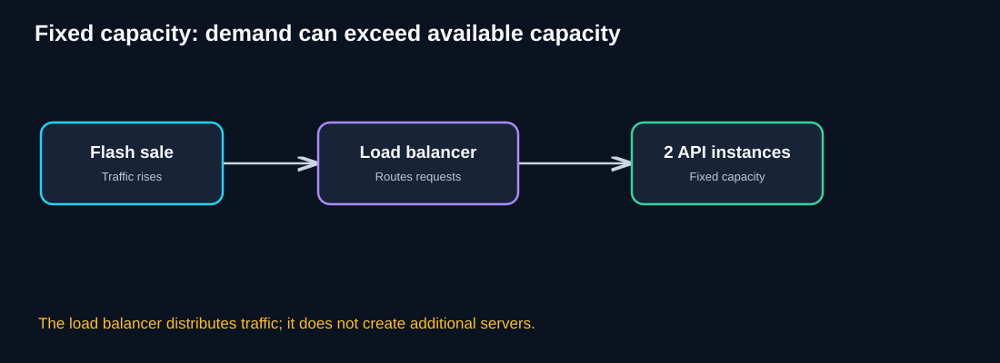
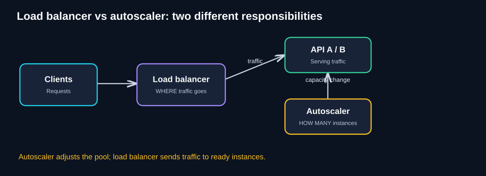
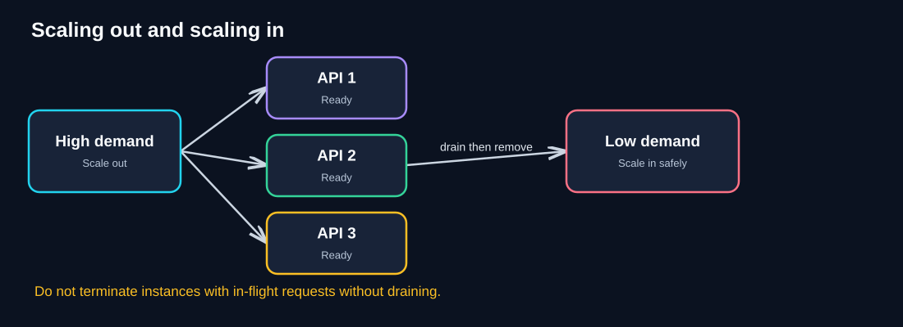
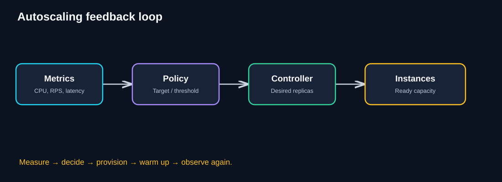
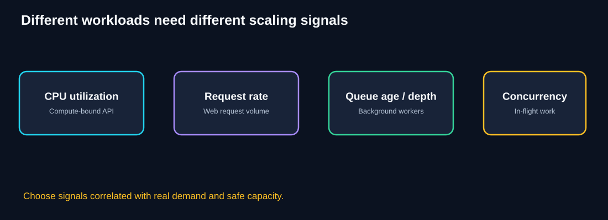
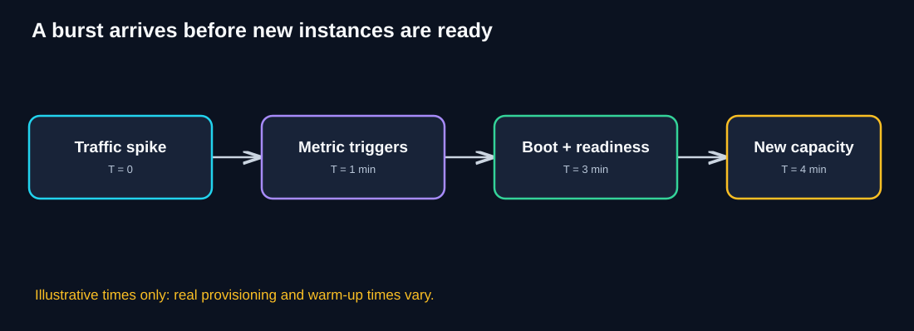
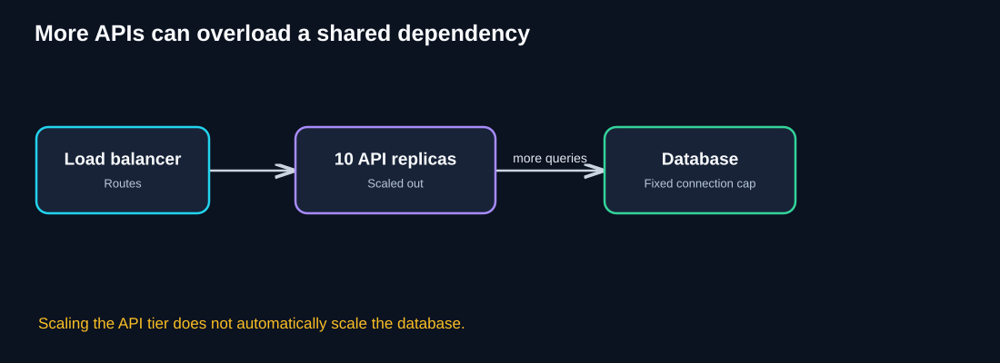

# Chapter 03 — Horizontal Scaling & Autoscaling

> **Unit ID:** SG-SCALE-03 · **Capability:** AI-AWS-01 · [Course map](../../../../README.md#ordered-capability-map)

[Learning contract and transfer check](learning-contract.md) · [Course map](../../../../README.md)

> **Self-study guide · Estimated study time: 60–80 minutes**
>
> **Running case study:** QuickCart, a fictional e-commerce platform.
>
> **Core question:** A load balancer decides **where** a request goes. Who decides **how many** application instances should exist?
>
> **You need:** SG-SCALE-00 to SG-SCALE-02.
>
> **You will produce:** Replica calculation, downstream cap and rollback signal; state assumptions.

[SG-SCALE-02 — ← Previous: Load Balancing](02-load-balancing.md) · [SG-SCALE-00 — Foundations](00-foundations.md)

## 1. Learning objectives

After this chapter, you should be able to:

- Distinguish horizontal scaling, vertical scaling, elasticity, and autoscaling.
- Explain how a load balancer and an autoscaler cooperate without confusing their responsibilities.
- Describe the autoscaling feedback loop and the difference between desired, running, and **ready** capacity.
- Compare manual, scheduled, reactive, and predictive scaling.
- Choose sensible signals such as CPU, request rate, concurrency, or queue age.
- Explain scale-out delays, cooldowns, hysteresis, safe scale-in, and downstream constraints.
- Estimate capacity using clearly stated assumptions.
- Design a practical autoscaling policy and evaluate it in production.

## 2. Intuition: checkout counters at a supermarket

A supermarket manager has six checkout counters but opens only two on a quiet morning. As the line grows, the manager opens more counters. When the rush ends, the manager closes counters **after** customers already being served have finished.

There are two separate jobs:

1. **The greeter** directs each arriving shopper to an available counter — like a **load balancer**.
2. **The manager** decides how many counters to open — like an **autoscaler**.

Opening a counter takes time: a cashier must arrive, sign in, and prepare the equipment. Cloud instances also need time to start and become ready.

**Key insight:** Autoscaling changes capacity in response to demand; load balancing distributes traffic over the capacity that is available.

## 3. QuickCart's problem: a flash sale

QuickCart runs two healthy API instances behind a load balancer. During normal traffic, both respond quickly. During a flash sale, incoming requests grow sharply. Each instance approaches its safe capacity; latency and errors rise.



**Diagram walkthrough**

1. Customers generate a surge of product searches, cart updates, and checkout requests.
2. The load balancer spreads requests across the **existing** API instances.
3. The two instances remain the same size and count unless another system changes them.
4. Load balancing alone cannot create capacity. If both instances are saturated, requests may queue, time out, or fail.
5. **Before adding replicas**, measure whether the API tier is truly limiting or whether it is waiting on the database or another dependency.

### Think like an architect

What should happen if QuickCart needs six instances during a sale but only two at night? Keeping six online permanently might work but could waste money. A better design may adjust capacity safely as demand changes.

<details>
<summary>Reveal the candidate solution</summary>

Use **horizontal autoscaling**: observe relevant demand or capacity signals, calculate a desired replica count, provision additional instances, wait for them to become healthy/ready, and route traffic to them. Scale down carefully when demand falls.

</details>

## 4. The pattern explained

**Horizontal scaling** adds or removes instances that can share a workload. **Autoscaling** is the automated control mechanism that adjusts capacity using configured policies and measurements.

- **Scale out:** Add instances, pods, or workers.
- **Scale in:** Remove instances after demand falls and work can be transferred or drained safely.
- **Vertical scaling:** Give an existing instance more CPU, memory, or another resource. Some platforms can automate vertical adjustments, but this chapter focuses on horizontal autoscaling.
- **Elasticity:** Ability to match provisioned capacity to changing demand, within platform and architectural limits.

**Autoscaling is not infinite capacity.** Quotas, budgets, startup time, dependency limits, data consistency, and workload design still matter.

### Load balancing vs autoscaling



**Diagram walkthrough**

1. Clients send requests to a stable endpoint.
2. The **load balancer** routes each request to a suitable **ready** API instance.
3. The **autoscaler** monitors demand/capacity and changes the desired instance count.
4. Newly provisioned instances must pass startup and readiness checks before receiving traffic.
5. When capacity is reduced, instances should stop receiving new requests and finish or safely hand off in-flight work before termination.
6. The autoscaler typically controls a deployment or instance group; it does **not** route individual user requests.

| Responsibility | Load balancer | Autoscaler |
|---|---|---|
| Core question | Where should this request go? | How many instances are needed? |
| Main input | Healthy/ready endpoints, routing rules | Metrics, targets, constraints |
| Main action | Selects a backend | Adjusts desired capacity |
| Failure concern | No healthy backends | Too little or too much capacity |
| Common pairing | Stateless service replicas | Replicas that can be started and stopped safely |

## 5. Scale-out and scale-in lifecycle



**Diagram walkthrough**

1. High demand triggers a decision to **scale out**.
2. Additional API instances start, load configuration, establish connections, and warm caches as needed.
3. Only **ready** instances enter the serving pool.
4. When demand falls, the system may **scale in**, but it must choose instances for removal carefully.
5. Connection draining and termination grace periods help existing requests complete.
6. In-flight requests, WebSockets, long-running jobs, and session state require special treatment.

### Three different capacity numbers

- **Desired replicas:** What the controller is requesting.
- **Running replicas:** Instances or pods that have started.
- **Ready replicas:** Instances that can safely receive traffic.

These numbers can differ during deployment, failure, or warm-up. The difference matters during a traffic spike.

## 6. How an autoscaler makes decisions



**Diagram walkthrough**

1. **Observe:** Collect a metric such as CPU utilization, requests per second, or queue age.
2. **Evaluate:** Compare the observation with a configured target or policy.
3. **Decide:** Calculate desired capacity while respecting minimums, maximums, and rate limits.
4. **Act:** Ask the platform to add or remove replicas.
5. **Wait and verify:** Instances provision, become ready, and begin serving work.
6. **Repeat:** Re-evaluate because demand and actual capacity change over time.

### Autoscaling approaches

| Approach | How it works | Best fit | Limitation |
|---|---|---|---|
| Manual | Operator changes capacity | Rare or planned events | Slow and human-dependent |
| Scheduled | Add capacity before known periods | Daily peak or planned sale | Does not adapt well to unexpected spikes |
| Reactive / metric-based | Adjust after observed demand changes | Variable traffic with useful metrics | Reacts after demand appears |
| Predictive | Forecast future demand and prepare capacity | Repeatable traffic patterns | Forecasts can be wrong; needs safeguards |

A production system can combine scheduled preparation for known events with reactive scaling for surprises.

## 7. Choosing the right scaling signal



**Diagram walkthrough**

- **CPU utilization** can work for compute-bound services, where CPU demand rises with useful work.
- **Request rate** can represent web traffic, but requests vary in cost: a product lookup and a complex checkout are not equal.
- **Queue depth or age** can indicate background-work pressure. Queue depth alone is insufficient when jobs vary in duration.
- **Concurrency** measures active work and can be useful when workers have a safe in-flight request limit.

### Metric selection guide

| Workload | Candidate signal | Why it helps | Caveat |
|---|---|---|---|
| CPU-heavy API | CPU utilization | Tracks compute pressure | May miss I/O-bound slowness |
| Predictable-cost API | Requests per second per instance | Closely tied to workload | Must account for request mix |
| Async worker | Queue age, backlog per worker, processing rate | Tracks unfinished work | Provider caps can prevent useful scaling |
| Connection-heavy service | Active connections / concurrency | Tracks resource occupancy | Connections differ in resource use |
| Database-dependent API | DB wait time, pool saturation **for diagnosis** | Reveals downstream pressure | Adding APIs may worsen it |

**Important distinction:** Some metrics are best used to **trigger scaling**, while others are better used as **safety guardrails** or **diagnostic signals**.

### Why CPU alone is not universal

Suppose an API spends most of its time waiting on a payment provider. Its CPU can remain at 20% while users wait several seconds. CPU-based scaling may not react, and adding replicas may violate the provider's rate limit anyway.

## 8. Worked capacity example

Assume QuickCart's measured safe sustained capacity is **250 requests/second per ready API instance** for the expected request mix. Peak demand is forecast at **1,200 requests/second**.

**Minimum replicas for that steady load:**

`ceil(1,200 / 250) = 5 replicas`

If the architecture team wants about **25% spare capacity relative to the planned demand**, a simple planning calculation is:

`ceil((1,200 × 1.25) / 250) = 6 replicas`

This is an illustrative sizing estimate, **not** an autoscaler configuration formula. Validate using load tests, tail latency, dependencies, traffic distribution, and failure scenarios.

### What if one replica fails?

At 1,200 requests/second, five replicas each rated at 250 requests/second have only 1,250 requests/second of aggregate nominal capacity. Losing one leaves about 1,000 requests/second. That is insufficient for the assumed peak.

Six replicas leave five after one fails: approximately 1,250 requests/second, assuming balanced traffic and that all five remain healthy. Real systems need further headroom for uneven load and operational uncertainty.

## 9. Scaling delay and why spikes are difficult



**Diagram walkthrough**

1. **T = 0:** Demand jumps sharply.
2. **T = 1 minute:** A metric crosses a threshold and triggers a scale-out decision.
3. **T = 3 minutes:** New capacity is still starting, warming, or passing readiness checks.
4. **T = 4 minutes:** The additional instances finally begin serving requests.
5. These timings are **illustrative**, not guaranteed cloud-platform timings.
6. The service must survive the interval before capacity becomes ready.

### Techniques that reduce scaling risk

- Keep a minimum baseline capacity appropriate to normal demand.
- Pre-scale for announced flash sales or predictable peaks.
- Use readiness probes so unprepared instances do not receive traffic.
- Consider warm pools or pre-provisioned capacity where supported and justified.
- Apply admission control, rate limiting, and backpressure when safe capacity is exhausted.
- Use queues only for work that can legitimately complete asynchronously; a queue does not make an interactive checkout instantly complete.

## 10. Avoiding scaling oscillation

A naive policy can repeatedly add and remove instances around one threshold, causing **flapping**.

### Terms to understand

- **Hysteresis:** Use different conditions for scaling out and scaling in, reducing rapid reversals.
- **Cooldown / stabilization:** Wait or evaluate over a window before making another disruptive change.
- **Scale-out rate limit:** Maximum increase per evaluation period.
- **Scale-in rate limit:** Maximum decrease per evaluation period.
- **Minimum replicas:** Capacity kept online even at low traffic.
- **Maximum replicas:** A hard upper bound, often for budget, quotas, or dependency protection.

**Example policy (illustrative, not vendor syntax):**

```yaml
service: quickcart-api
min_replicas: 3
max_replicas: 12
target_cpu_utilization_percent: 60
scale_out_stabilization_seconds: 30
scale_in_stabilization_seconds: 300
max_scale_in_replicas_per_step: 1
```

This demonstrates policy concepts only. Actual semantics and available controls differ across Kubernetes, cloud VM autoscaling groups, and managed platforms.

### Why scale-in deserves extra care

Scaling out is usually less disruptive than removing a server. During scale-in:

1. Mark an instance as draining or otherwise remove it from new traffic.
2. Allow current requests to finish within a bounded grace period.
3. Make long-running work resumable or safely transferable.
4. Release resources and terminate the instance.
5. Confirm error rate and latency did not rise.

Stateless services make this much easier, which is why **Chapter 01** comes before autoscaling.

## 11. The next bottleneck: shared dependencies



**Diagram walkthrough**

1. The load balancer now has ten ready API replicas.
2. All ten call the same database.
3. Aggregate API throughput may increase, but so can database query volume and concurrent connections.
4. The database can become the new limiting resource.
5. The correct next step might be query optimization, caching, connection management, read scaling, or another targeted architectural change — **not automatically more API replicas**.

### Other shared limits

- External payment or email API rate limits.
- Database connection pools and write throughput.
- Shared session stores and caches.
- Cloud quotas and subnet IP capacity.
- Network bandwidth and egress cost.
- Lock contention or a globally serialized critical section.

**Architect's rule:** Every scaling plan should name its expected **next bottleneck**.

## 12. Production implementation patterns

### A. VM / instance-group autoscaling

A managed instance group or autoscaling group changes the number of virtual machines based on configured policies. Instances typically register with a load balancer once healthy.

**Watch for:** VM startup time, immutable images, configuration drift, connection draining, and instance replacement.

### B. Container / Kubernetes autoscaling

A Horizontal Pod Autoscaler (HPA) can adjust a workload's desired pod replicas using supported resource or custom/external metrics. Additional pods still need scheduling capacity; node-level autoscaling may be necessary if the cluster lacks resources.

**Watch for:** CPU/memory requests, readiness probes, startup behavior, pending pods, stabilization policies, and node provisioning delays.

### C. Worker autoscaling

Background workers can scale using queue-related signals. A useful target might be maintaining acceptable oldest-message age rather than merely minimizing queue depth.

**Watch for:** Retry storms, poison messages, duplicate delivery, idempotency, and downstream API limits.

### Platform mapping (examples, not requirements)

| Environment | Common capability | Related concept |
|---|---|---|
| AWS | EC2 Auto Scaling | VM replica count |
| Azure | Virtual Machine Scale Sets autoscale | VM replica count |
| Google Cloud | Managed Instance Group autoscaling | VM replica count |
| Kubernetes | Horizontal Pod Autoscaler | Pod replica count |

Vendor features and policy behavior evolve; consult current platform documentation when implementing.

## 13. Monitoring, observability, and SLOs

**Suggested dashboard panels:**

| Signal | Question it answers |
|---|---|
| Request rate and workload mix | How much demand is arriving? |
| p50, p95, p99 latency | Are users experiencing slow responses? |
| Error rate / timeouts | Is scaling failing to preserve service quality? |
| Desired, running, and ready replicas | Is requested capacity actually available? |
| CPU, memory, concurrency per replica | Is work distributed and capacity saturated? |
| Provisioning and readiness time | How long until a new instance can serve? |
| Scaling events and policy decisions | Why did replica count change? |
| Database waits and provider throttling | Is the bottleneck downstream? |
| Cost per hour and cost per completed request | Is elasticity economically useful? |

### Sample service objectives

For illustration, QuickCart might target **99% of product-search requests under 500 ms**, measured over a defined reporting window and workload scope. Autoscaling should help maintain the objective, but success must be measured by user-facing behavior — not simply replica count.

### Testing plan

1. **Steady-state test:** Can the baseline instance count handle normal demand?
2. **Ramp test:** As load rises, does the policy add ready instances in time?
3. **Spike test:** What happens before new capacity becomes ready?
4. **Failure test:** What happens when an instance disappears at peak traffic?
5. **Scale-in test:** Are active requests drained safely?
6. **Dependency test:** Does the database or payment provider throttle before the API tier saturates?
7. **Cost test:** Does scale-in actually reduce idle spending without excessive oscillation?

## 14. Common misconceptions

| Misconception | More accurate understanding |
|---|---|
| “Load balancing automatically scales servers.” | Load balancing routes traffic; an autoscaler or operator changes capacity. |
| “CPU is always the right metric.” | The best signal depends on the actual workload and bottleneck. |
| “Autoscaling responds instantly.” | Monitoring, decisions, provisioning, warm-up, and readiness all take time. |
| “More API instances always mean more throughput.” | Shared dependencies and rate limits can cap useful throughput. |
| “Scale-in is just the reverse of scale-out.” | Scale-in requires draining, state handling, and safe termination. |
| “Autoscaling guarantees high availability.” | Availability also requires redundancy, healthy dependencies, and failure-aware design. |
| “Set maximum replicas very high to be safe.” | Unbounded scaling can increase cost and overload downstream services. |

## 15. Knowledge checks

Try each question before expanding its answer.

### Q1. What is the difference between a load balancer and an autoscaler?

<details>
<summary>Reveal answer</summary>

A **load balancer** chooses a backend for incoming traffic. An **autoscaler** changes the number of instances available to serve traffic. They work together but solve different problems.

</details>

### Q2. QuickCart's API CPU is 15%, but payment latency is 4 seconds. Should CPU-based autoscaling fix this?

<details>
<summary>Reveal answer</summary>

No. Low CPU suggests the API may be waiting on an external dependency. Investigate payment-provider latency, concurrency, timeouts, and rate limits. Adding instances could increase pressure on the provider.

</details>

### Q3. Each ready instance safely handles 200 requests/second. How many instances are needed for 900 requests/second without additional headroom?

<details>
<summary>Reveal answer</summary>

`ceil(900 / 200) = 5` instances. Production planning should also account for failures, request mix, and spare capacity.

</details>

### Q4. Why can a flash sale cause errors even when autoscaling is enabled?

<details>
<summary>Reveal answer</summary>

Autoscaling takes time to detect load, provision instances, warm them, and pass readiness checks. Demand can exceed current capacity before new capacity is ready.

</details>

### Q5. Why might queue age be better than CPU for background email workers?

<details>
<summary>Reveal answer</summary>

Queue age measures how long work waits and can align more closely with completion-delay objectives. CPU may be low if workers spend time waiting for network calls. Provider rate limits must still be respected.

</details>

### Q6. What is scaling flapping?

<details>
<summary>Reveal answer</summary>

Repeated rapid scaling out and in around a threshold. Stabilization windows, hysteresis, and rate limits can reduce oscillation.

</details>

### Q7. What must happen before terminating an API instance during scale-in?

<details>
<summary>Reveal answer</summary>

Stop routing new requests to it, allow in-flight work to finish or transfer safely, and use appropriate termination grace periods. Long-running connections or jobs need explicit handling.

</details>

### Q8. Ten API replicas all call one overloaded database. Should QuickCart increase to twenty?

<details>
<summary>Reveal answer</summary>

Not as the first response. The database is the limiting resource. More replicas may increase connection pressure and query volume. Investigate the database bottleneck and optimize or scale that dependency appropriately.

</details>

## 16. Architecture challenge: QuickCart flash sale

**Scenario**

- Normal traffic: 300 requests/second.
- Flash-sale peak: 1,500 requests/second.
- Each ready API instance sustains 250 requests/second at the required latency.
- Current replicas: 2.
- New instances take approximately 3 minutes to become ready.
- Database connections begin saturating when the API tier sends more than 1,200 requests/second worth of its current query mix.

**Your tasks**

1. Calculate the theoretical minimum API replica count for peak traffic.
2. Explain why purely reactive autoscaling may fail at the start of the sale.
3. Propose minimum and maximum replica bounds and a pre-scaling strategy.
4. Identify the next bottleneck.
5. Suggest monitoring and a safe fallback when capacity is exhausted.

<details>
<summary>Reveal sample solution</summary>

1. API capacity requires `ceil(1,500 / 250) = 6` ready instances, **before failure headroom**.
2. A three-minute readiness delay means existing replicas can be overloaded before new ones arrive.
3. A possible plan is to pre-scale to at least six ready replicas **before** the announced sale, plus appropriate failure headroom, while using reactive policies for unexpected demand. The exact minimum/maximum bounds depend on costs, reliability targets, and dependency capacity.
4. The database becomes the likely next bottleneck around 1,200 requests/second under the stated assumptions. Merely reaching six API replicas is not sufficient to safely sustain 1,500 requests/second end to end.
5. Monitor search/checkout p95, errors, desired/running/ready replicas, DB waits, and throttling. Consider database/query optimization, caching appropriate reads, and admission control/backpressure where needed. Avoid silently dropping accepted orders.

**Key architectural conclusion:** End-to-end capacity is limited by the weakest critical dependency, not by the sum of API instance capacity alone.

</details>

## 17. Production checklist

- [ ] Service is safe to run on multiple interchangeable instances.
- [ ] Readiness and liveness checks have appropriate semantics.
- [ ] Scaling metric correlates with useful work or resource pressure.
- [ ] Minimum and maximum capacity are justified.
- [ ] Startup and warm-up time have been measured.
- [ ] Known peak events have pre-scaling plans.
- [ ] Scale-in drains in-flight work safely.
- [ ] Autoscaler events, replica states, and SLOs are observable.
- [ ] Database, cache, and external-provider limits have been tested.
- [ ] Cost, quotas, and failure headroom have been reviewed.
- [ ] Load tests validate the policy under ramps, spikes, and failures.

## 18. Quick revision notes

| Concept | Remember |
|---|---|
| Horizontal scaling | Add or remove instances |
| Autoscaling | Automatically adjust desired capacity |
| Load balancing | Choose where requests go |
| Scale out | Increase instance count |
| Scale in | Reduce instance count safely |
| Ready replicas | Capacity actually available to serve |
| Reactive scaling | Responds after metrics change |
| Scheduled scaling | Prepares for known demand |
| Scaling delay | Detection + provisioning + warm-up + readiness |
| Hysteresis / stabilization | Reduce rapid scaling reversals |
| Good metric | Closely reflects workload and useful capacity |
| Production trap | More APIs can overload a shared dependency |

### Five architect's questions

1. **What resource is actually saturated?**
2. **Which metric best predicts or represents safe capacity?**
3. **How long does new capacity take to become ready?**
4. **How will we scale in without interrupting work?**
5. **What becomes the next bottleneck after we scale out?**

## 19. Connection to the next pattern

QuickCart can now add API instances automatically. But a flash sale creates **10,000 order-confirmation jobs per minute**, while an external provider can safely handle only **1,000 per minute**.

Adding more workers could exceed the provider's limit. What if QuickCart could accept the work, store it durably, and process it at a controlled rate?

That is the motivation for **Queue-Based Load Leveling**.

## Completion checkpoint

**You can now:** calculate demand/headroom and scaling delay.

**Show it:** Replica calculation, downstream cap and rollback signal; state assumptions. Then attempt chapter 03's unfamiliar transfer check in the [learning contract](learning-contract.md).

**Next:** [SG-SCALE-04 — Queue-Based Load Leveling](04-queue-based-load-leveling.md).

---

*The numbers, policies, and timings in this chapter are illustrative teaching examples. Production decisions require platform-specific validation, testing, and measured service objectives.*
