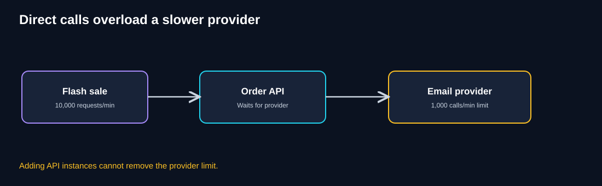
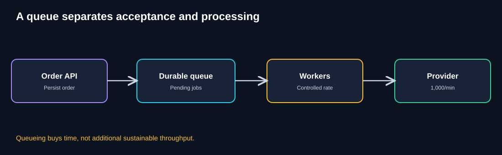
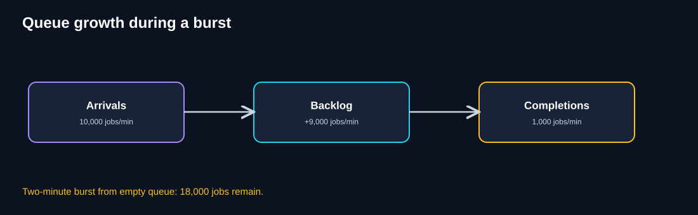
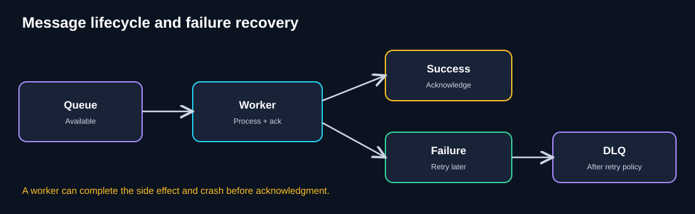
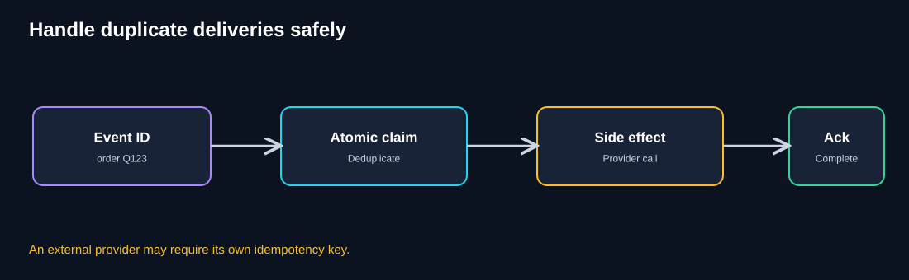
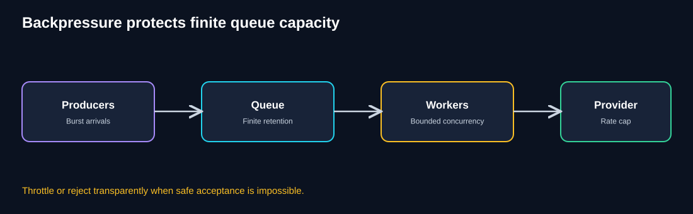
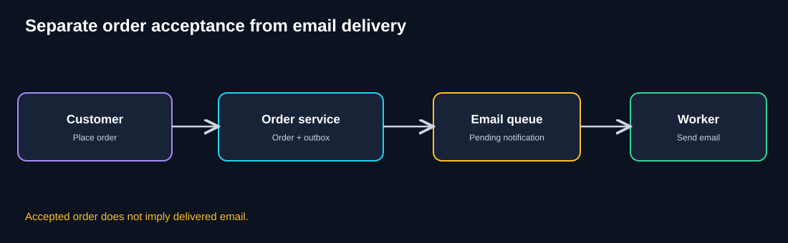

# Chapter 04 — Queue-Based Load Leveling

> **Standalone self-study chapter · Estimated study time: 70–90 minutes**  
> **Running case study:** QuickCart, a fictional e-commerce platform.  
> **Key idea:** A queue is a **time buffer**, not a speed booster.

[← Previous: Autoscaling](03-autoscaling.md) · [Foundations](00-foundations.md)

## 1. Learning objectives

By the end of this chapter, you should be able to:

- Explain why bursts overwhelm slower dependencies.
- Describe producer → durable queue → consumer and the difference between accepting and completing work.
- Calculate backlog growth and drain time.
- Explain acknowledgments, leases/visibility timeouts, retries, dead-letter queues, and delivery guarantees.
- Design consumers to tolerate duplicate delivery.
- Identify rate limits, backpressure, queue retention, and production monitoring requirements.
- Decide when asynchronous work is appropriate and when it is not.

## 2. Intuition: a restaurant ticket rail

Imagine a restaurant that receives 80 meal orders in five minutes while the kitchen can prepare only 20. Waiters place order tickets on a rail so the kitchen can work through them without blocking the dining room.

The rail does **not** make the kitchen cook faster. It separates when work **arrives** from when work **finishes**. If orders keep arriving faster than meals are prepared, the rail fills up and customers wait longer.

That is the intuition behind Queue-Based Load Leveling.

## 3. QuickCart's problem

During a flash sale, QuickCart generates **10,000 order-notification jobs per minute**. Its external email provider safely accepts only **1,000 calls per minute**.

A naive synchronous API calls the provider during each customer request.



**Diagram explanation**

1. Customers create a burst of order activity.
2. The Order API makes synchronous calls to the email provider.
3. The provider has a much lower safe rate than incoming demand.
4. Timeouts, throttling, and failed requests can occur.
5. Adding API replicas can make the downstream overload worse.

**Think like an architect:** Does a customer need the email to be delivered before receiving a truthful acknowledgment that the order was durably accepted?

<details><summary>Reveal answer</summary>

Usually not. QuickCart can durably accept the order and arrange for the notification to be sent later. But if a business operation requires a confirmed result before claiming success—such as a completed payment—that correctness requirement cannot simply be deferred without changing the business contract.

</details>

## 4. The pattern explained

**Queue-Based Load Leveling** places a queue between a producer and one or more consumers so temporary bursts can be buffered and processed at a controlled rate.



**Diagram explanation**

1. **Order API:** Validates and durably records the order or notification intent.
2. **Durable queue:** Stores messages pending processing, subject to the broker's retention and durability guarantees.
3. **Workers:** Retrieve jobs when they have capacity.
4. **Provider:** Receives calls at a controlled rate within its safe limit.
5. The arrows represent asynchronous handoff: the customer's HTTP request need not remain open until the email is sent.
6. A queue smooths a short burst; it cannot solve a permanent deficit in processing capacity.

### Important terminology

| Term | Meaning |
|---|---|
| Producer | Component that publishes work |
| Message / job | Data describing a unit of work |
| Queue / broker | System that holds and delivers pending messages |
| Consumer / worker | Component that processes messages |
| Acknowledgment (ack) | Signal that processing completed successfully |
| Retry | Another attempt after failure |
| Dead-letter queue (DLQ) | Place to isolate repeatedly failing messages |
| Backlog | Accepted work not yet completed |
| Idempotency | Repeating a logical operation does not cause unintended extra effects |
| Backpressure | Restricting incoming work when capacity is insufficient |

## 5. Synchronous versus asynchronous processing

| Aspect | Synchronous | Asynchronous with queue |
|---|---|---|
| Caller waits for final operation | Typically yes | Usually no |
| Coupled to provider speed | Yes | Less directly |
| Temporary burst handling | Limited | Queue can absorb within limits |
| Status tracking | Sometimes | Usually necessary |
| Example | Validate inventory before confirmation | Send confirmation email after order acceptance |
| Main trade-off | Higher immediate latency | Eventual completion and operational complexity |

A useful asynchronous status lifecycle is:

`ACCEPTED → QUEUED → PROCESSING → SUCCEEDED`

Failures may produce `RETRYING`, `FAILED`, or `CANCELLED`.

**Never confuse “queued” with “completed.”** The response must describe what has actually happened.

## 6. Backlog mathematics

Assume an initially empty queue, steady rates, one job per arrival, and no retries or losses.

- Arrival rate: **10,000 jobs/minute**
- Completion rate: **1,000 jobs/minute**
- Net backlog growth: **9,000 jobs/minute**



**Diagram explanation**

1. The left box is incoming work.
2. The middle box represents pending jobs accumulating in the queue.
3. The right box is the sustainable completion rate.
4. The difference between incoming and completed jobs determines backlog growth.
5. The queue protects the provider during a short burst but creates delayed work that must later drain.

| Elapsed burst time | Arrived | Completed | Pending backlog |
|---|---:|---:|---:|
| 1 minute | 10,000 | 1,000 | 9,000 |
| 2 minutes | 20,000 | 2,000 | 18,000 |
| 3 minutes | 30,000 | 3,000 | 27,000 |
| 5 minutes | 50,000 | 5,000 | 45,000 |

### Drain time

If the burst ends after two minutes and **no new jobs arrive**, the remaining 18,000 jobs take approximately:

`18,000 ÷ 1,000 = 18 minutes`

If normal arrivals continue at **400 jobs/minute**, net draining capacity is:

`1,000 − 400 = 600 jobs/minute`

So the same backlog takes approximately:

`18,000 ÷ 600 = 30 minutes`

**Production lesson:** Queue depth is not enough. Track **oldest-message age** and processing rate to understand actual waiting time.

## 7. Acknowledgments, retries, and dead-letter queues



**Diagram explanation**

1. The queue delivers a message to a worker.
2. The worker attempts the operation.
3. On success, the worker acknowledges the message.
4. On failure or crash, the broker may make the message available again after a visibility timeout or lease expiry.
5. Transient failures can be retried with bounded exponential backoff and jitter.
6. Messages that repeatedly fail can be isolated in a DLQ according to policy.
7. A DLQ is a recovery mechanism, not a substitute for investigating failures.

| Failure | Typical response | Caution |
|---|---|---|
| Network timeout | Bounded retry with backoff | Avoid retry storms |
| Provider HTTP 429 | Honor retry guidance; reduce aggregate call rate | More workers can worsen throttling |
| Invalid message | Validate and isolate | Repeating a bad request will not fix it |
| Worker crash | Redelivery after lease expires | Duplicate work possible |
| Long provider outage | Pause/reduce consumption, alert, preserve backlog | Queue retention and storage limits apply |
| Poison message | DLQ, inspect, repair, replay | Do not silently discard business work |

### Visibility timeout

Some brokers hide a delivered message temporarily while a worker processes it. If the worker does not acknowledge within that window, the message may become available to another worker.

- Too short: duplicate concurrent processing may occur.
- Too long: recovery after a worker crash is delayed.
- Long-running jobs may require lease renewal.

Broker semantics vary; verify the guarantees of the chosen platform.

## 8. Delivery guarantees and duplicate processing

**At-most-once:** Work may be lost but is not redelivered by the queue under the defined delivery model.

**At-least-once:** The broker may redeliver until successful acknowledgment; duplicates are possible.

**Exactly-once:** Some platforms offer specific exactly-once capabilities within narrow boundaries. Do not assume exactly-once **business effects** across a queue, database, and external provider.

### Why duplicates happen

A worker sends an email successfully, then crashes before acknowledging the message. The broker cannot know whether the email was sent, so it may deliver the message again.



**Diagram explanation**

1. Each logical event has a stable identifier, such as `order-Q123-email-confirmation`.
2. The consumer uses an atomic claim or unique constraint to prevent two workers from independently claiming the same work.
3. It performs the business side effect.
4. It records completion and acknowledges the message.
5. The difficult gap is **between external success and local completion recording**. A provider-supported idempotency key or reconciliation may be needed.

**Important:** A simple “check if sent, then send” operation is not automatically safe: two workers can race, and a crash can occur between sending and recording success.

### Conceptual pseudocode

```python
def process(message):
    key = message["event_id"]
    claim = store.atomic_claim(key)

    if claim == "completed":
        return "ack"
    if claim == "owned_elsewhere":
        return "retry_later"

    provider.send_email(
        to=message["email"],
        idempotency_key=key,  # Only if provider supports it
    )
    store.mark_completed(key)
    return "ack"
```

This illustrates the idea but is **not by itself an end-to-end exactly-once guarantee**. Crash recovery and provider behavior still matter.

## 9. Reliable publication: the transactional outbox

Consider a dangerous failure:

1. QuickCart commits the order to its database.
2. The application crashes before publishing the email event.
3. The order exists, but the notification job is missing.

A **transactional outbox** can address this:

- Save the order and an outbox event in the **same database transaction**.
- A separate publisher reads pending outbox events and publishes them to the queue.
- The publisher marks events as published, retrying after failures.
- Duplicate publication remains possible, so consumers must be idempotent.

The outbox is one possible reliable-handoff pattern; other solutions may be appropriate depending on system guarantees.

## 10. Backpressure and finite queue capacity

Queues are not infinite. Storage, retention, message size, costs, and acceptable completion delay all impose limits.



**Diagram explanation**

1. Producers submit work.
2. The queue holds pending jobs but has finite safe capacity.
3. Workers process with bounded concurrency.
4. The provider has a fixed safe call rate.
5. If backlog age or depth breaches a limit, the system must respond explicitly: throttle, reject new optional work, or degrade gracefully.
6. **Never acknowledge acceptance of work that was not durably accepted.**

Useful controls include rate limiting, admission control, retry backoff, circuit breakers, worker concurrency limits, priority queues, and load shedding for noncritical jobs.

## 11. Complete QuickCart order-notification flow



**Diagram explanation**

1. A customer places an order.
2. The order service durably saves the order and notification intent.
3. A reliable publisher places a notification job on the queue.
4. The email worker processes the job later.
5. The customer may receive “Order received” before email delivery, if this is consistent with the business contract.
6. Notification status can be tracked separately from order acceptance.

**Production scenarios to test:**

- Order saved, event publish fails.
- Worker crashes before acknowledgment.
- Provider succeeds but worker crashes before recording completion.
- Provider is unavailable for two hours.
- Queue reaches retention or capacity limits.
- A replay causes duplicate delivery.

## 12. Queue-Based Load Leveling versus Competing Consumers

| Dimension | Queue-Based Load Leveling | Competing Consumers |
|---|---|---|
| Main goal | Absorb temporary rate mismatch | Process more independent jobs concurrently |
| Primary mechanism | Buffering | Multiple consumers sharing queued work |
| Can use one worker? | Yes | Not a multi-consumer design |
| Main concern | Backlog and completion delay | Concurrency, duplicates, ordering, downstream limits |
| QuickCart example | Store pending email notifications | Run several email workers |

The two patterns often appear together, but adding consumers helps only if processing and downstream capacity can safely increase.

## 13. When to use and when to avoid

### Use when

- Work can safely finish after an accurate acceptance response.
- Incoming demand is bursty.
- Consumers or downstream providers have limited processing rates.
- Durability, retry, and recovery are valuable.
- Completion-time expectations can be defined and monitored.

### Avoid or redesign when

- The caller must know the final result immediately.
- Delayed work violates the business contract.
- Duplicates or uncertain completion cannot be handled safely.
- Incoming rate persistently exceeds completion rate without a capacity plan.
- Queue retention or operational complexity is unjustified.

## 14. Production observability

| Metric | What it reveals |
|---|---|
| Enqueue rate | Work entering the queue |
| Completion rate | Useful throughput |
| Queue depth | Pending work volume |
| Oldest-message age | How long work is waiting |
| Worker processing p95/p99 | Slow jobs and dependencies |
| Retry count and rate | Instability or provider errors |
| DLQ count | Work needing investigation |
| Provider 429s/timeouts | Downstream overload |
| In-flight jobs | Worker concurrency |
| Retention remaining | Risk of message expiration |
| Cost per completed job | Operational efficiency |

**Example SLO:** “99% of accepted notification jobs are successfully handed to the email provider within 15 minutes under the stated operating conditions.”

Provider acceptance is not necessarily delivery to the recipient's inbox.

### Production checklist

- [ ] Business acceptance and job completion are distinguished.
- [ ] Publication is durable and recoverable.
- [ ] Message retention and queue capacity are understood.
- [ ] Consumers tolerate duplicates.
- [ ] Retries are bounded and use backoff.
- [ ] DLQ investigation and replay procedures exist.
- [ ] Provider rate limits are respected across all workers.
- [ ] Queue age, depth, and error rates are monitored.
- [ ] Failure injection includes broker outage and worker crash.
- [ ] Backlog drain time has been estimated.

## 15. Common misconceptions

| Misconception | Correction |
|---|---|
| “A queue makes processing faster.” | It buffers work; consumer capacity determines throughput. |
| “Enqueued means completed.” | Enqueued means accepted for later processing. |
| “Durable means impossible to lose.” | Durability depends on broker guarantees, configuration, and retention. |
| “Messages arrive exactly once.” | Duplicate delivery and side effects are possible. |
| “Retries always help.” | Unbounded retries can amplify outages. |
| “More workers always solve backlog.” | Shared dependencies and rate limits may prevent gains. |
| “A DLQ fixes failed jobs.” | It isolates them for investigation and recovery. |

## 16. Knowledge checks

### Q1. Why does a queue help during a short burst?

<details><summary>Show answer</summary>

It separates work arrival from work completion. Producers can durably submit jobs while consumers process them at a sustainable rate.

</details>

### Q2. Arrival rate is 5,000/minute and completion rate is 2,000/minute. How fast does backlog grow?

<details><summary>Show answer</summary>

`5,000 − 2,000 = 3,000 jobs/minute`, assuming no drops or retries.

</details>

### Q3. A queue contains 12,000 jobs and workers complete 1,500/minute. With no new arrivals, how long to drain?

<details><summary>Show answer</summary>

`12,000 ÷ 1,500 = 8 minutes`, assuming constant completion rate.

</details>

### Q4. Can QuickCart say “Email delivered” immediately after enqueueing?

<details><summary>Show answer</summary>

No. It can truthfully say “Notification scheduled” or “Notification queued.” Delivery has not yet happened.

</details>

### Q5. Why might a message be delivered twice?

<details><summary>Show answer</summary>

A worker may complete the external operation but crash before acknowledging the message. The broker can then redeliver it.

</details>

### Q6. What should workers do after repeated HTTP 429 responses?

<details><summary>Show answer</summary>

Reduce aggregate call rate, honor retry guidance when available, and use bounded backoff. Increasing workers can worsen throttling.

</details>

### Q7. What is a DLQ?

<details><summary>Show answer</summary>

A place to isolate messages that repeatedly fail or cannot be processed so operators can investigate, repair, and replay them safely.

</details>

### Q8. Does adding ten workers remove a provider's 1,000/minute rate limit?

<details><summary>Show answer</summary>

No. The provider remains the constraint. Extra workers must collectively respect the limit.

</details>

### Q9. Why is oldest-message age important?

<details><summary>Show answer</summary>

It helps show how long work has waited and can align more closely with customer completion-time objectives than queue depth alone.

</details>

## 17. Architecture challenge: QuickCart flash sale

**Scenario**

- Flash sale lasts **3 minutes**.
- Arrival rate during sale: **10,000 notification jobs/minute**.
- Sustainable completion rate: **1,000 jobs/minute**.
- Queue begins empty.
- After the sale, normal arrivals continue at **200 jobs/minute**.

**Your tasks**

1. Calculate the backlog after the sale.
2. Estimate how long the backlog takes to drain.
3. Identify the bottleneck.
4. Suggest three production safeguards.
5. Explain what QuickCart can truthfully tell customers immediately.

<details><summary>Reveal worked solution</summary>

**1. Backlog:** `(10,000 − 1,000) × 3 = 27,000 jobs`.

**2. Drain time:** After the sale, net drain capacity is `1,000 − 200 = 800 jobs/minute`. So `27,000 ÷ 800 = 33.75 minutes` (approximately **34 minutes**).

**3. Bottleneck:** The provider's 1,000 calls/minute capacity.

**4. Safeguards:** Examples include idempotent consumers, retry backoff, DLQ handling, oldest-message-age alerts, transactional outbox, and admission control.

**5. Customer promise:** “Order received; confirmation notification pending,” provided the order and notification intent were durably accepted.

</details>

## 18. Quick revision notes

| Architect's question | Remember |
|---|---|
| What problem does the pattern solve? | Temporary mismatch between arrival and processing rates |
| What does a queue do? | Buffers work |
| What does it not do? | Automatically increase sustainable throughput |
| How does backlog grow? | Arrival rate minus completion rate when positive |
| What is an acknowledgment? | Worker confirms processing success |
| Why might duplicates happen? | Side effect can succeed before acknowledgment |
| What is idempotency? | Repeated logical work avoids unintended extra effects |
| What is a DLQ? | Isolation for failed messages |
| What is backpressure? | Slow or reject work to protect limited capacity |
| What should we monitor? | Queue age, depth, throughput, retries, provider limits |

### Five architect's questions

1. **Can this work safely complete later?**
2. **What exactly does “accepted” mean?**
3. **How fast will the backlog grow and drain?**
4. **What happens on retry, duplicate delivery, or worker crash?**
5. **What is the true downstream processing limit?**

## 19. What's next: Competing Consumers

QuickCart can now buffer work. But suppose a single worker handles only 100 jobs/minute and the downstream provider has spare capacity. Can several workers process different queued messages in parallel?

That leads to **Competing Consumers**.

[Next: 05 — Competing Consumers](05-competing-consumers.md).

---

*The numbers and architectural sketches are illustrative. Validate broker guarantees, rate limits, retention, and business correctness in production.*
