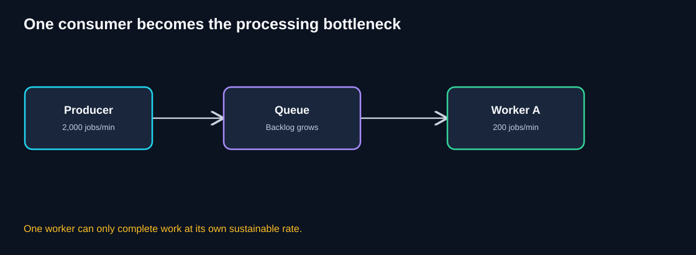
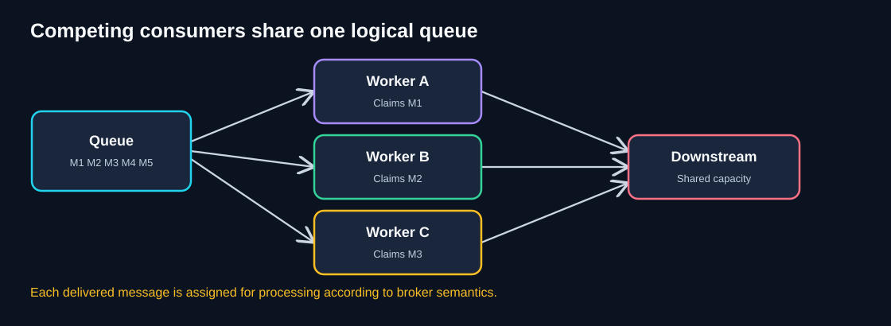
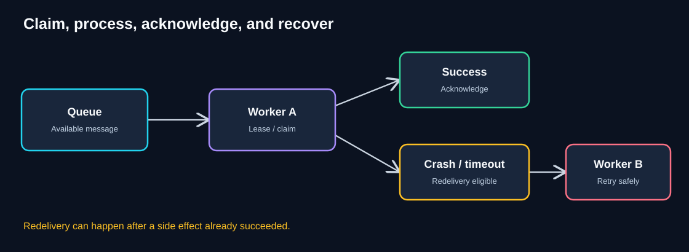
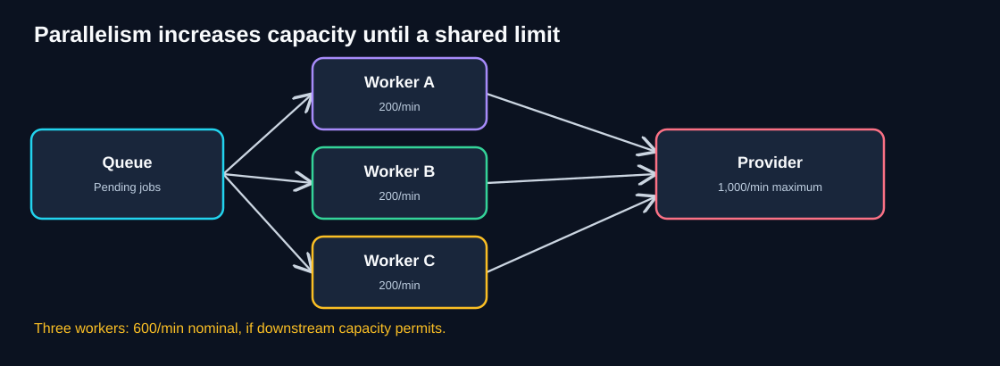
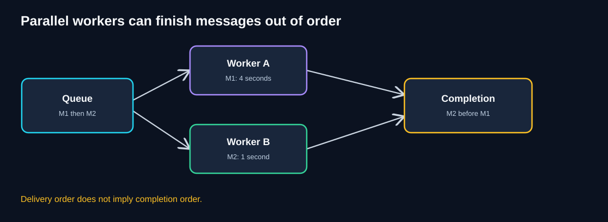
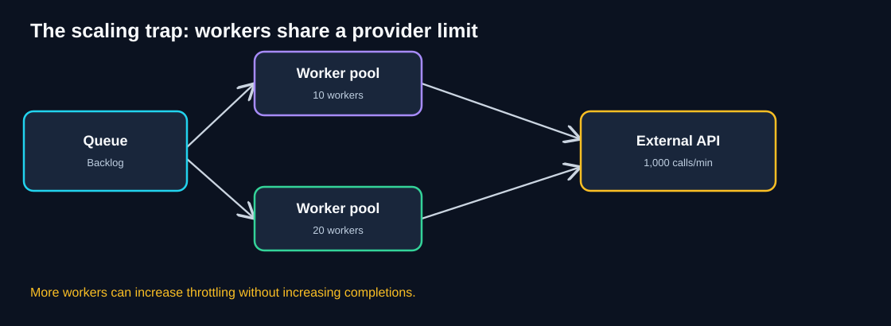
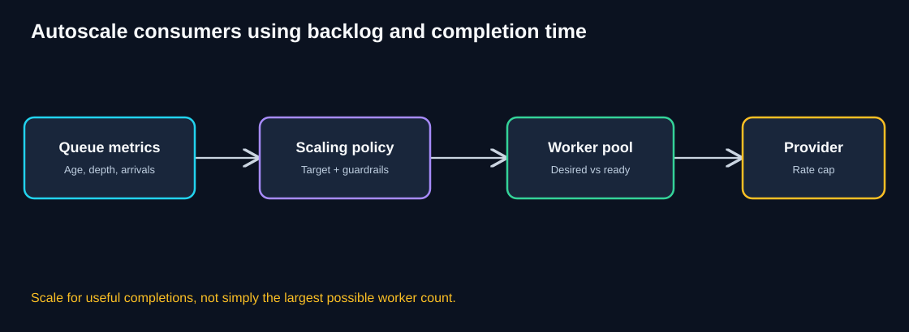

# Chapter 05 — Competing Consumers

> **Unit ID:** SG-SCALE-05 · **Capability:** AI-AWS-01 · [Course map](../../../../README.md#ordered-capability-map)

[Learning contract and transfer check](learning-contract.md) · [Course map](../../../../README.md)

> **Standalone study guide · Estimated study time: 70–90 minutes**
>
> **Running case study:** QuickCart, a fictional e-commerce platform.
>
> **Core idea:** Multiple workers can process independent messages from a shared queue in parallel, but throughput, ordering, correctness, and downstream limits still matter.
>
> **You need:** SG-SCALE-04.
>
> **You will produce:** Worker/provider bound, duplicate-effect reasoning and regression scenario.

[SG-SCALE-04 — ← Previous: Queue-Based Load Leveling](04-queue-based-load-leveling.md) · [SG-SCALE-00 — Foundations](00-foundations.md)

## 1. Learning objectives

After studying this chapter, you should be able to:

- Explain why a single consumer becomes a bottleneck.
- Describe how multiple workers compete to receive messages from a shared logical queue.
- Distinguish message delivery, processing, acknowledgment, and completion.
- Estimate throughput and worker count with realistic assumptions.
- Explain redelivery, duplicate processing, idempotency, and poison-message recovery.
- Identify ordering and shared-resource constraints.
- Design worker autoscaling and production observability.
- Decide when competing consumers are appropriate and when adding workers will not help.

## 2. Intuition: several cashiers processing tickets

Imagine a restaurant where one employee handles every takeaway order. Even if the order tickets are neatly queued, that employee can process only so many orders per minute.

Now add three trained employees. Each takes a different available ticket and prepares it. More orders can be handled concurrently.

But there are two important catches:

1. If all employees depend on the **same oven**, the oven may become the bottleneck.
2. A simple order may finish before an earlier complicated order. **Completion order can differ from arrival order.**

That is the intuition behind **Competing Consumers**.

## 3. QuickCart: the single-worker problem

In the previous chapter, QuickCart introduced a durable queue to buffer notification jobs during a flash sale.

Suppose:

- The queue receives **2,000 jobs/minute**.
- One worker sustainably completes **200 jobs/minute**.
- Jobs are independent and can be processed concurrently.



**Diagram walkthrough**

1. The **producer** adds jobs to the queue at 2,000 per minute.
2. The **queue** safely buffers pending work within its configured limits.
3. **Worker A** completes 200 jobs per minute.
4. Under these simplified rates, the backlog grows by **1,800 jobs/minute**.
5. Adding a queue protects acceptance from a temporary burst, but one worker remains the processing bottleneck.

### Think like an architect

If the downstream provider has spare capacity, could several independent workers process different messages at once?

<details>
<summary>Reveal the reasoning</summary>

Yes. Run multiple consumer instances against the same logical queue, so each can receive a different message for processing. This is the **Competing Consumers** pattern. But first verify the work is safely parallelizable and the downstream system can support the combined throughput.

</details>

## 4. The pattern explained

**Competing Consumers** is an architectural pattern in which multiple worker instances receive messages from the same logical queue or consumer group, with the messaging system coordinating delivery so work can be distributed across them.



**Diagram walkthrough**

1. The queue contains messages M1, M2, M3, M4, and M5.
2. Worker A receives M1, Worker B receives M2, and Worker C receives M3 in this illustrative snapshot.
3. Each worker processes its assigned message independently.
4. After successful processing, each worker acknowledges completion according to broker semantics.
5. More messages become available as workers finish.
6. All workers may depend on the **same downstream system**; its capacity still constrains aggregate throughput.

**Important nuance:** The broker typically aims to prevent simultaneous delivery of the same unexpired claim under normal conditions, but **at-least-once delivery and lease expiration can cause duplicates or concurrent processing**. Do not assume perfect exclusivity under all failures.

### Main components

| Component | Responsibility | Important consideration |
|---|---|---|
| Producer | Publishes work | Reliable publication and meaningful message IDs |
| Queue / broker | Stores and delivers messages | Retention, partitions, visibility, acknowledgment |
| Consumer group / worker pool | Processes messages in parallel | Concurrency, failures, idempotency |
| Downstream service | Performs external or shared work | Rate limits, saturation, timeouts |
| DLQ / recovery process | Isolates failed messages | Investigation, replay, audit trail |
| Autoscaler | Changes worker count | Queue age, processing rate, safe maximum |

## 5. Queue-Based Load Leveling vs Competing Consumers

These patterns complement one another but solve different primary problems.

| Dimension | Queue-Based Load Leveling | Competing Consumers |
|---|---|---|
| Primary purpose | Buffer bursts and decouple rates | Increase processing parallelism |
| Main mechanism | Durable pending-work queue | Multiple workers share queued work |
| Can use a single worker? | Yes | A single worker does not provide multi-consumer parallelism |
| Main operational concern | Backlog and completion delay | Concurrency, duplicates, ordering, shared limits |
| QuickCart example | Store notification jobs | Run multiple notification workers |

**Mental model:** The queue provides a waiting room; competing consumers add service counters.

## 6. How claiming, processing, and acknowledgment work



**Diagram walkthrough**

1. A message is available in the queue.
2. Worker A receives it and may hold a temporary **visibility lease** or broker assignment.
3. If processing succeeds, Worker A acknowledges the message.
4. If Worker A crashes or its lease expires, the message may become eligible for redelivery.
5. Worker B may receive the message and try again.
6. If Worker A already performed the external side effect before crashing, Worker B's retry can cause a duplicate unless processing is idempotent.

### Terms to know

- **Claim / receive:** Worker obtains a message for processing.
- **Visibility timeout / lease:** Temporary period during which another worker normally does not receive the message.
- **Acknowledgment:** Worker signals successful processing.
- **Redelivery:** Broker makes a message available again after a failed or unacknowledged attempt.
- **At-least-once delivery:** A message may be delivered multiple times until acknowledged.
- **Poison message:** A message that repeatedly fails processing.
- **Idempotency:** Repeated processing does not create unintended extra business effects.

**Broker-specific caveat:** Some systems use visibility timeouts, others use consumer-group assignments, offsets, or explicit acknowledgments. The concepts are similar, but exact guarantees differ.

## 7. Worked example: parallel throughput

Assume each worker completes **200 jobs/minute**, all jobs have a similar processing cost, and workers do not contend for shared resources.

Then theoretical aggregate throughput is:

`number of workers × 200 jobs/minute`



**Diagram walkthrough**

1. The queue holds pending jobs.
2. Three workers consume distinct jobs concurrently.
3. Each worker completes approximately 200 jobs/minute.
4. Combined nominal throughput is **600 jobs/minute**.
5. The provider in this example can handle up to 1,000 jobs/minute.
6. Adding workers beyond the provider's safe capacity cannot keep increasing completed work.

| Workers | Nominal worker capacity | Effective capacity with 1,000/min provider cap |
|---:|---:|---:|
| 1 | 200/min | 200/min |
| 3 | 600/min | 600/min |
| 5 | 1,000/min | 1,000/min |
| 8 | 1,600/min | At most 1,000/min |
| 12 | 2,400/min | At most 1,000/min |

These are **illustrative upper bounds**, not guaranteed real-world performance. Coordination, retries, message sizes, provider throttling, and uneven job duration reduce achievable throughput.

### How many workers do we need?

If the desired sustainable processing rate is **900 jobs/minute**, each worker handles **200/minute**, and the provider supports at least 900/minute:

`ceil(900 / 200) = 5 workers`

If the provider supports only **600/minute**, five workers cannot produce 900 successful provider calls per minute. The downstream dependency must change, or demand must be managed.

### Backlog-drain example

A queue contains **12,000 jobs**. New arrivals continue at **400/minute**. Five workers can sustainably complete **1,000/minute** in total.

Net drain capacity:

`1,000 − 400 = 600 jobs/minute`

Approximate drain time:

`12,000 / 600 = 20 minutes`

Assumptions: constant rates, no retry overhead, no loss, and a provider capable of 1,000/minute.

## 8. Parallelism is not the same as guaranteed speedup

Why might eight workers not be eight times faster than one?

- Workers may compete for the same database locks.
- An external API may enforce a shared rate limit.
- Message handling may be uneven: some jobs take much longer.
- The queue may have too few partitions or assignments to keep all workers busy.
- Network connections, memory, or CPU may be exhausted.
- Retries and failures can consume capacity without producing successful completions.

**Architect's rule:** Measure **completed useful work**, not just active worker count.

## 9. Ordering: an important trade-off



**Diagram walkthrough**

1. The queue contains M1 followed by M2.
2. Worker A receives M1 and needs four seconds to process it.
3. Worker B receives M2 and finishes in one second.
4. M2 completes **before** M1 even though M1 arrived first.
5. This is acceptable for many independent jobs, but dangerous when operations must happen in order.

### When ordering matters

Imagine QuickCart processes these account events:

1. `Set shipping address to A`
2. `Set shipping address to B`

If the second update completes first and the first completes afterward, the account may end up with stale address A.

### Common approaches

- Route events for the same entity (such as `customerId`) to the same ordered partition or message group.
- Process one message at a time per ordering key where required.
- Use versions or optimistic concurrency checks so stale events cannot overwrite newer state.
- Design operations to be commutative where possible.
- Accept reduced concurrency **within a key** while retaining parallelism **across keys**.

**Important:** Global ordering is costly and often unnecessary. Define exactly **which entity or business operation** requires ordering.

## 10. Idempotency and duplicate delivery

Suppose Worker A sends an order email successfully but crashes before acknowledging. The broker redelivers the message to Worker B.

Without protection, the customer may receive two emails.

### Practical design

1. Give each logical operation a stable event or business identifier.
2. Use an atomic unique constraint or claim to coordinate local processing.
3. Prefer provider-supported idempotency keys for external side effects.
4. Record completion and support reconciliation after uncertain outcomes.
5. Acknowledge only when the operation's success criteria are satisfied.

### Conceptual pseudocode

```python
def process_notification(message):
    event_id = message["event_id"]
    claim = event_store.try_claim_atomically(event_id)

    if claim == "completed":
        return "ack"
    if claim == "owned_elsewhere":
        return "retry_later"

    email_provider.send(
        to=message["email"],
        idempotency_key=event_id,  # Only if supported
    )
    event_store.mark_completed(event_id)
    return "ack"
```

This is **not** a complete crash-safe implementation. If the provider sends the email but the worker crashes before recording completion, a retry may send again unless the provider deduplicates or the system reconciles the uncertain result.

**Never assume exactly-once business effects solely because the broker advertises an exactly-once feature.** Check its guarantee boundaries.

## 11. Failure handling and poison messages

| Failure scenario | Typical response | What to avoid |
|---|---|---|
| Worker crashes | Redeliver after lease/assignment recovery | Assuming processing never happened |
| Temporary network error | Bounded retry with exponential backoff and jitter | Immediate infinite retries |
| Provider returns HTTP 429 | Respect throttling and reduce aggregate rate | Adding workers blindly |
| Invalid message payload | Validate, isolate, investigate | Repeating the same invalid operation forever |
| Message exceeds lease duration | Extend lease or design resumable processing | Concurrent duplicate execution |
| Worker deployment | Drain in-flight jobs or allow safe redelivery | Killing work without recovery plan |
| Poison message | Send to DLQ under defined policy | Silently deleting critical business work |

### Dead-letter queue (DLQ)

A DLQ is a place to isolate repeatedly failing messages. Operators need procedures to:

- Inspect the reason for failure.
- Repair code or message data when appropriate.
- Decide whether replay is safe.
- Track whether the original business action eventually completed.

A DLQ is **not** a guarantee that failures are resolved.

## 12. The scaling trap: downstream rate limits



**Diagram walkthrough**

1. The queue contains many pending jobs.
2. One worker pool has ten consumers; another illustration has twenty.
3. Both pools call the same external API.
4. The provider accepts at most **1,000 requests/minute**.
5. Adding workers may increase attempted calls, timeouts, and HTTP 429 responses without improving successful throughput.
6. A **global rate limiter** or coordinated concurrency limit may be necessary across all workers.

### Example

- 10 workers attempt 100 calls/minute each → 1,000 attempts/minute.
- 20 workers attempt 100 calls/minute each → 2,000 attempts/minute.
- Provider limit → 1,000 successful calls/minute at most under the stated assumptions.

The extra 1,000 attempts may be throttled and retried, potentially increasing load further.

**Production lesson:** Optimize for **successful completions per minute**, not total attempted requests.

## 13. Autoscaling the worker pool



**Diagram walkthrough**

1. The queue emits signals such as backlog depth, oldest-message age, and arrival rate.
2. A scaling policy estimates how much processing capacity is needed.
3. The platform changes the desired worker count.
4. Workers start, become ready, and process available jobs.
5. The provider rate limit caps useful aggregate throughput.
6. The controller should avoid rapid scale-in/out oscillation and should respect maximum safe concurrency.

### Choosing a scaling signal

| Signal | Useful for | Limitation |
|---|---|---|
| Queue depth | Volume of pending work | Ignores variation in job duration |
| Oldest-message age | Delay experienced by waiting jobs | May be affected by poison messages |
| Arrival rate | Incoming demand | Does not directly indicate completion capacity |
| Completion rate per worker | Capacity estimation | May change with workload mix |
| CPU utilization | Compute-heavy consumers | Misleading for I/O-bound jobs |
| Provider 429s | Detecting external throttling | A guardrail, not a reason to add workers |

### Scaling formula (simplified)

If backlog is `B` jobs, target clearance time is `T` minutes, new arrivals are `λ` jobs/minute, and one worker sustainably completes `μ` jobs/minute, a rough target is:

`required workers ≈ ceil((λ + B / T) / μ)`

**Example:** 6,000 pending jobs, 30-minute target, 300 new jobs/minute, and 100 jobs/minute per worker:

`ceil((300 + 6,000 / 30) / 100) = ceil(500 / 100) = 5 workers`

This estimate assumes stable rates, independent jobs, and enough downstream capacity. Real policies require safety margins, startup-time allowances, and failure handling.

## 14. When to use — and when not to use

### Good fit

- Jobs are independent or can be safely partitioned.
- A shared queue already exists or provides meaningful decoupling.
- Processing capacity can increase by adding workers.
- Duplicate delivery can be handled.
- Strict global completion order is unnecessary.
- Downstream dependencies have headroom.

### Poor fit or requires redesign

- Work must execute in strict global order.
- Every job requires a single exclusive global lock.
- An external provider is already at a hard throughput limit.
- Side effects cannot be made safe under retry or uncertain completion.
- Queue partitioning or broker limits prevent more consumers from being active.
- The operational complexity outweighs the benefit.

## 15. Production observability

| Metric | What it tells us |
|---|---|
| Queue depth | How much work remains |
| Oldest-message age | How long work has waited |
| Incoming messages/sec | Producer pressure |
| Successful completions/sec | Actual useful throughput |
| Active and ready workers | Available processing capacity |
| In-flight messages | Concurrent processing load |
| Job processing p95/p99 | Slow or uneven work |
| Retry count and rate | Instability or transient failure |
| DLQ count | Work needing investigation |
| Duplicate detection count | Redelivery and idempotency activity |
| Provider throttling / 429s | Downstream saturation |
| Cost per completed job | Economic efficiency |

### Suggested production tests

1. **Scale-out:** Add workers and measure successful throughput.
2. **Worker crash:** Kill a worker mid-job; confirm safe redelivery.
3. **Duplicate delivery:** Deliver the same logical event twice; verify business correctness.
4. **Ordering:** Run conflicting updates for the same entity; verify version or partition handling.
5. **Provider throttling:** Enforce a lower provider limit; confirm aggregate rate control.
6. **Poison message:** Inject an invalid job; verify DLQ behavior.
7. **Scale-in:** Remove workers while jobs are running; verify draining or recovery.

## 16. Common misconceptions

| Misconception | Correction |
|---|---|
| “One message is always processed exactly once.” | Redelivery and duplicate side effects are possible. |
| “Ten workers means ten times the throughput.” | Shared dependencies and contention limit scaling. |
| “A queue guarantees completion order.” | Concurrent workers can finish out of order. |
| “More workers always reduce backlog.” | They help only if useful capacity actually increases. |
| “A DLQ fixes failed messages.” | It isolates them for diagnosis and recovery. |
| “CPU alone is enough for worker scaling.” | Queue delay and completion throughput often matter more. |
| “The broker makes all business operations idempotent.” | Idempotency must be designed at the application boundary. |

## 17. Knowledge checks

### Q1. What is the main purpose of Competing Consumers?

<details><summary>Reveal answer</summary>

To process independent queued messages concurrently using multiple worker instances, increasing useful processing capacity when dependencies allow it.

</details>

### Q2. One worker processes 150 jobs/minute. What is the nominal capacity of four independent workers?

<details><summary>Reveal answer</summary>

`4 × 150 = 600 jobs/minute`, assuming no shared bottleneck or coordination overhead.

</details>

### Q3. Why can message M2 finish before M1?

<details><summary>Reveal answer</summary>

Different workers can process messages concurrently, and job durations can differ. Delivery order does not necessarily determine completion order.

</details>

### Q4. A worker sends an email and crashes before acknowledgment. What is the risk?

<details><summary>Reveal answer</summary>

The message may be redelivered and the email may be sent again. Use idempotency or reconciliation for the external side effect.

</details>

### Q5. The provider is limited to 1,000/minute. Workers attempt 1,800/minute. Will more workers help?

<details><summary>Reveal answer</summary>

Not above the provider's limit. More attempts can increase throttling and retries. Coordinate the aggregate rate across workers.

</details>

### Q6. What is a poison message?

<details><summary>Reveal answer</summary>

A message that repeatedly fails processing, perhaps because of invalid data or a persistent code defect. It may require isolation in a DLQ and manual or automated remediation.

</details>

### Q7. Why is queue age useful for autoscaling?

<details><summary>Reveal answer</summary>

It measures waiting time and can align with a completion-delay objective. Depth alone cannot reveal whether work is waiting too long.

</details>

### Q8. How can we preserve ordering for updates to one customer?

<details><summary>Reveal answer</summary>

Route updates for the same customer to a common ordered partition or message group and process them sequentially for that key, or use version checks to reject stale updates. Parallelism can still occur across customers.

</details>

### Q9. What is the difference between the two queue patterns?

<details><summary>Reveal answer</summary>

**Queue-Based Load Leveling** buffers a mismatch between arrivals and processing. **Competing Consumers** adds parallel processing capacity using multiple workers. They are often combined.

</details>

## 18. QuickCart architecture challenge

**Scenario**

- Incoming jobs: **1,200/minute** for 10 minutes.
- One worker completes **200/minute**.
- External provider can safely handle **1,000/minute**.
- Queue starts empty.
- After the burst, normal arrivals fall to **200/minute**.
- You may run up to **8 workers**.

**Tasks**

1. What is the maximum useful worker count at the provider's rate limit?
2. With five workers, what backlog accumulates over the 10-minute burst?
3. How long does it take to drain the backlog after the burst with five workers?
4. What happens if you add all eight workers?
5. Name three correctness or production safeguards.

<details><summary>Reveal worked solution</summary>

**1. Useful workers:** `1,000 / 200 = 5 workers` reach the provider cap under the simplified assumptions.

**2. Burst backlog:** Five workers complete 1,000/minute while 1,200/minute arrive. Net growth = 200/minute. After 10 minutes: **2,000 pending jobs**.

**3. Drain time:** After the burst, arrivals fall to 200/minute. Net drain capacity = `1,000 − 200 = 800/minute`. Drain time = `2,000 / 800 = 2.5 minutes`.

**4. Eight workers:** Nominal worker capacity becomes 1,600/minute, but the provider still caps useful throughput at 1,000/minute. Without coordinated rate limiting, extra workers may cause 429s and retries.

**5. Safeguards:** Idempotency, bounded retries with backoff, DLQ, provider-aware rate limiting, queue-age alerts, safe worker draining, and ordering per business key where needed.

**Architectural lesson:** Add workers only until another shared resource becomes the bottleneck.

</details>

## 19. Production checklist

- [ ] Jobs are independent or have a defined partition/ordering key.
- [ ] Broker delivery and acknowledgment semantics are understood.
- [ ] Worker crashes and message redelivery are handled safely.
- [ ] Consumers tolerate duplicate delivery and uncertain outcomes.
- [ ] External provider rate limits are enforced across all workers.
- [ ] Retry policy uses bounded backoff and jitter.
- [ ] Poison messages have a DLQ and recovery process.
- [ ] Queue age, completion throughput, and errors are observable.
- [ ] Worker scale-out and scale-in are tested.
- [ ] Cost and safe maximum worker count are documented.

## 20. Quick revision notes

| Question | Remember |
|---|---|
| What is Competing Consumers? | Multiple workers process distinct queued jobs concurrently |
| Why use it? | Increase processing parallelism |
| Does it guarantee linear speedup? | No |
| Can completion order change? | Yes |
| Can messages be delivered twice? | Yes, under common delivery models |
| What protects side effects? | Idempotency and reconciliation |
| What happens on worker crash? | Unacknowledged work may be redelivered |
| What is the scaling trap? | A shared downstream rate limit |
| What should be monitored? | Queue age, successful throughput, retries, DLQ, throttling |
| How should workers scale? | According to useful demand and safe dependency capacity |

### Five architect's questions

1. **Can the jobs safely run in parallel?**
2. **Which operations require ordering?**
3. **What happens if a message is delivered twice?**
4. **What shared dependency caps useful throughput?**
5. **How do we know adding workers actually improves completion time?**

## 21. Connection to the next pattern

QuickCart can now process queued jobs with multiple workers. But imagine that **all API instances and workers depend on one increasingly large database**. The database becomes the bottleneck even though application processing is parallel.

Can the data itself be divided into independent subsets?

That leads to **Partitioning and Sharding**.

[SG-SCALE-06 — Next: 06 — Partitioning and Sharding](06-partitioning-sharding.md).

## Completion checkpoint

**You can now:** explain concurrency, retries, ordering and idempotency.

**Show it:** Worker/provider bound, duplicate-effect reasoning and regression scenario. Then attempt chapter 05's unfamiliar transfer check in the [learning contract](learning-contract.md).

**Next:** [SG-SCALE-06 — Partitioning & Sharding](06-partitioning-sharding.md).

---

*All capacities and rates are illustrative. Actual broker semantics, downstream limits, job duration, and failure behavior must be verified in production.*
