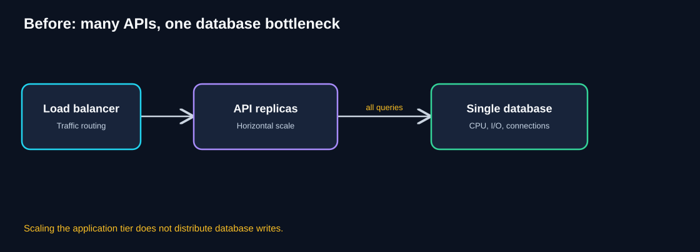
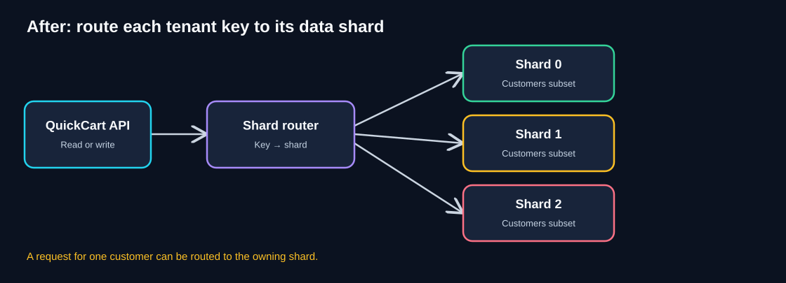
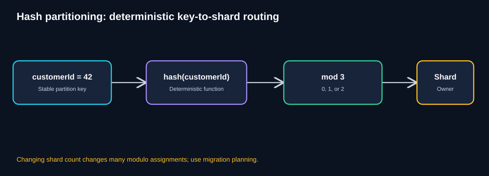
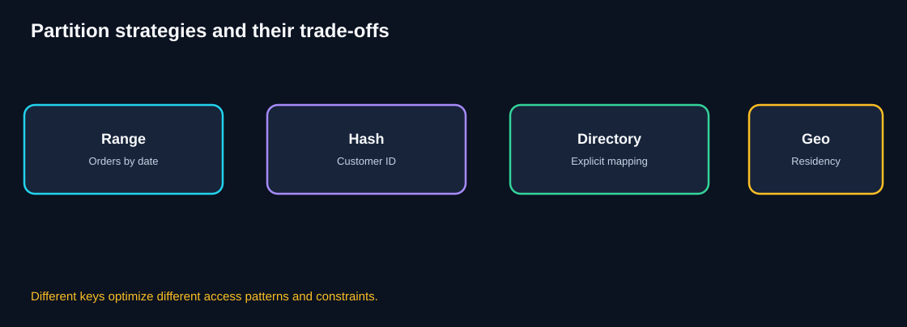
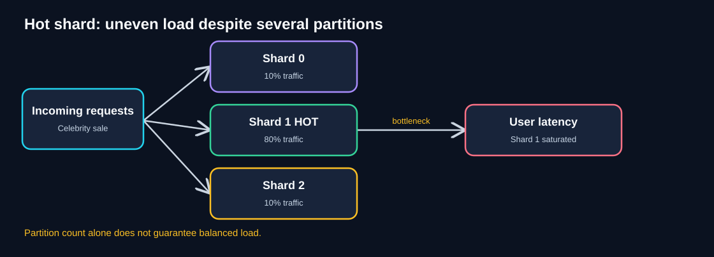
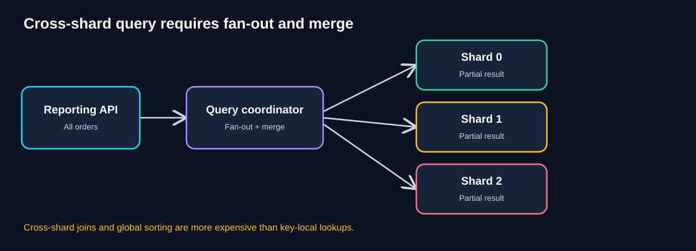
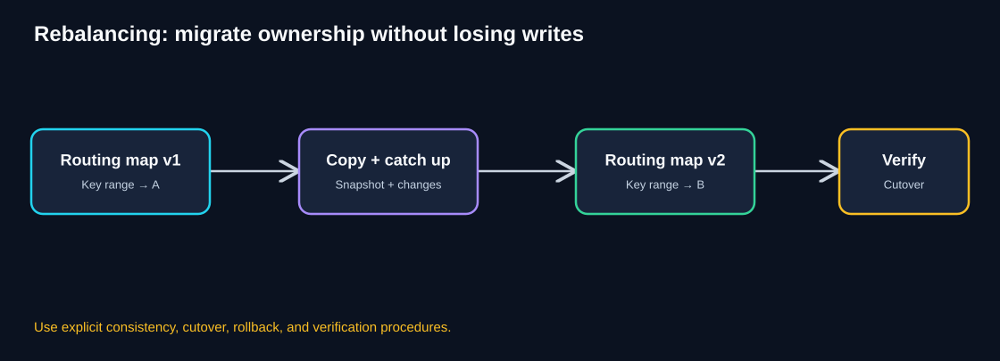
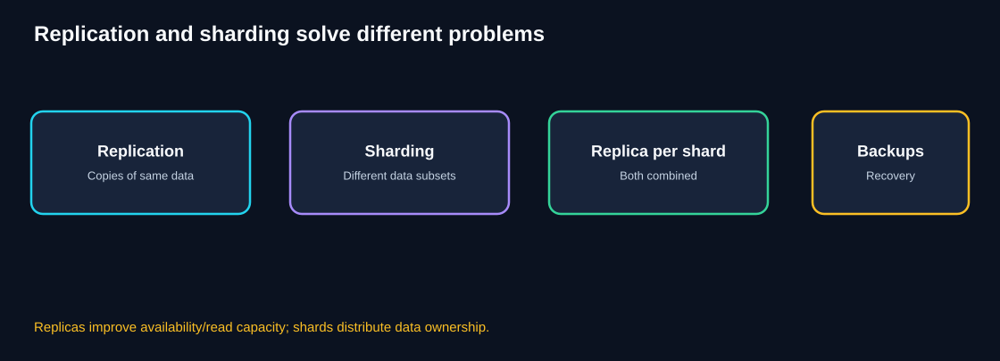

# Chapter 06 — Partitioning & Sharding

> **Standalone self-study guide · Estimated study time: 80–100 minutes**
>
> **Running example:** QuickCart, a fictional e-commerce platform.
>
> **Core question:** How can we split a growing dataset and its workload across multiple partitions while preserving correct reads, writes, and operational control?

[← Previous: Competing Consumers](05-competing-consumers.md) · [Foundations](00-foundations.md)

## 1. Learning objectives

By the end of this chapter, you should be able to:

- Explain partitioning and sharding in simple terms.
- Distinguish partitioning from replication, caching, and read replicas.
- Diagnose a database bottleneck before introducing shards.
- Choose a partition key based on query locality, distribution, and growth.
- Explain hash, range, directory-based, and geographic placement.
- Route a QuickCart customer request to the correct shard.
- Identify hotspots, cross-shard operations, consistency risks, and rebalancing challenges.
- Plan a staged migration and production monitoring strategy.
- Calculate rough per-shard storage and traffic, recognizing that averages hide skew.

## 2. Intuition: a library with multiple rooms

Imagine a library that has grown too large for one room. Instead of storing every book in one crowded room, the library divides its collection:

- Room A: books with authors A–H.
- Room B: authors I–P.
- Room C: authors Q–Z.

A catalog tells readers where to go. Finding a book is easy when you know the author. But finding **all books published this month** may require checking every room.

That is the core trade-off of **partitioning**: local operations can become more manageable, while global operations can become harder.

**Sharding** usually means distributing partitions of data across separate database nodes or independent database instances. Exact terminology varies by database product.

## 3. QuickCart's problem: application scaling exposes database limits

QuickCart already has stateless API replicas, a load balancer, autoscaling, and workers. Yet product searches, order lookups, and customer updates all reach the same database.

**Diagram walkthrough**

1. A load balancer distributes incoming requests across API replicas.
2. API replicas scale horizontally to serve more traffic.
3. Every replica sends queries to the same database.
4. Database CPU, storage I/O, lock contention, write throughput, or connection capacity may become saturated.
5. Adding more API replicas may increase database pressure without improving user experience.

### Think like an architect

Before proposing shards, ask:

1. Is the bottleneck actually the database? Which measured resource is saturated?
2. Are queries indexed correctly? Can the data model or query plan be improved?
3. Can caching, read replicas, batching, or connection pooling solve the immediate issue?
4. Is the workload naturally divisible by **customer**, **merchant**, **region**, or **time**?
5. Which queries must operate across all customers?

Reveal architectural reasoning

Sharding is a major complexity increase. First verify the limiting resource and consider smaller changes. Shard when distributing data ownership or write load is justified and the application can tolerate cross-shard complexity.

## 4. What is partitioning? What is sharding?

**Partitioning:** Dividing a dataset into smaller subsets called **partitions** according to a rule.

**Sharding:** A form of horizontal data partitioning where subsets are distributed across independent database nodes or logical shards, often to scale storage and workload.

### Horizontal vs vertical data partitioning

- **Horizontal partitioning:** Split rows. Example: customers 1–1,000 in one partition, customers 1,001–2,000 in another.
- **Vertical partitioning:** Split columns or groups of fields. Example: frequently accessed customer profile fields separated from large audit or preference payloads.
- **Sharding:** Typically horizontal partitioning across nodes, although implementation details differ.

### What changes in the application?

The system needs a **routing rule** that maps each operation to the correct shard. It also needs a plan for queries involving multiple shards.

## 5. The solution: shard-aware routing

**Diagram walkthrough**

1. The QuickCart API receives a request for a specific customer.
2. A router identifies the partition key, for example `customerId`.
3. The routing rule maps the key to Shard 0, 1, or 2.
4. Each shard owns a distinct subset of customer-related records.
5. Requests that can be answered within one shard avoid touching the others.
6. Shard metadata and routing must be consistent across API instances; otherwise requests may reach the wrong owner.

### A sample data placement model

| Record | Candidate partition key | Reason |
|---|---|---|
| Customer profile | `customerId` | Usually accessed for one customer |
| Shopping cart | `customerId` | Cart reads and writes are customer-local |
| Orders | `customerId` | Customer order history is often customer-local |
| Product catalog | Possibly `productId`, merchant, or separate service | Access pattern differs from customer records |
| Global sales report | No single customer key | Likely requires aggregation or a reporting system |

**Important:** One partition key does not have to fit every dataset. The correct boundary follows real access patterns.

## 6. Choosing a partition key

A good key usually has four properties:

1. **High cardinality:** Many distinct values.
2. **Balanced distribution:** Data volume and request traffic are reasonably spread.
3. **Query locality:** Frequent operations can use one shard.
4. **Stability:** The key does not change often.

A poor key can create a **hot shard** or force frequent cross-shard queries.

### Candidate keys for QuickCart

| Key | Advantage | Risk |
|---|---|---|
| `customerId` | Customer data and order history can be colocated | Large customers or celebrity accounts may be hot |
| `orderId` | Often distributes individual orders | Customer history requires cross-shard lookups or an index |
| `merchantId` | Merchant-local inventory and reporting | Very large merchants can dominate a shard |
| Order date | Efficient time-window retention and scans | Recent partitions receive most writes |
| Region | Supports residency and geographic locality | Unequal regions and cross-region queries |

**Architect's rule:** Choose the key for the **most important access pattern**, not just the prettiest distribution chart.

## 7. Hash-based sharding

A simple educational routing rule is:

`shardIndex = hash(customerId) mod numberOfShards`

**Diagram walkthrough**

1. The API extracts a stable `customerId`.
2. A deterministic hash function converts it to a numeric value.
3. Modulo by the shard count selects an index such as 0, 1, or 2.
4. The request goes to the selected shard.
5. The same key maps to the same shard **as long as the algorithm and shard count stay unchanged**.
6. Changing from three to four shards changes many assignments under naive modulo hashing, creating a migration problem.

### Worked example

For illustration, suppose a deliberately simplified hash function returns `42` for customer 42.

`42 mod 3 = 0`

Customer 42 belongs to Shard 0.

For customer 43, assume hash result 43:

`43 mod 3 = 1`

Customer 43 belongs to Shard 1.

**Caveat:** Real systems should use a stable, specified hash algorithm; a language runtime's default hash may vary across processes or versions. The examples above use identity-like hash values purely to teach modulo routing.

### Why not simply change the shard count?

If routing changes from `hash(key) mod 3` to `hash(key) mod 4`, many keys change owners. Their data does **not** move automatically. A safe migration must move data, handle concurrent writes, update routing, and verify correctness.

## 8. Alternative partitioning strategies

**Diagram walkthrough**

1. **Range:** Each shard owns a contiguous interval such as order dates.
2. **Hash:** A stable hash distributes keys among buckets.
3. **Directory:** A lookup table maps tenant or key to an owning shard.
4. **Geographic:** Data placement follows region or residency constraints.
5. The best approach depends on access patterns, balancing needs, compliance, and operational control.

| Strategy | Strength | Main trade-off |
|---|---|---|
| Hash partitioning | Often spreads diverse keys well | Range scans and reshuffling can be difficult |
| Range partitioning | Efficient contiguous scans and time-based retention | Hot recent ranges; uneven growth |
| Directory-based | Explicit placement, useful for large tenants | Mapping service becomes critical infrastructure |
| Geographic partitioning | Locality and data residency | Cross-region operations and uneven demand |
| Consistent hashing / virtual buckets | Can reduce remapping and ease gradual movement | More metadata and operational complexity |

### Consistent hashing and virtual shards

Instead of tying keys directly to three physical databases, a system can map keys to many **logical buckets** and then assign buckets to physical nodes. Rebalancing may move selected buckets rather than rehashing every key against a new physical node count.

This is an architectural option, not a universal solution; implementations and guarantees vary.

## 9. Hot partitions: the uneven-load problem

**Diagram walkthrough**

1. Traffic arrives for many customer or merchant keys.
2. A small number of keys may generate disproportionate demand.
3. Shard 1 receives 80% of traffic in this illustrative example.
4. Shards 0 and 2 remain lightly used.
5. Overall latency is poor even though total database capacity looks ample.
6. More shards alone may not fix one indivisible hot key.

### Common causes

- A very popular merchant, customer, or product.
- Time-based partitioning where all new writes target today's partition.
- Unequal tenant sizes.
- A low-cardinality key, such as a boolean or small status set.
- A routing bug or skewed hash distribution.

### Possible mitigations

- Identify hot keys using per-shard and per-key metrics.
- Cache appropriate reads and invalidate carefully.
- Split large tenants or hot entities where business invariants permit.
- Use virtual buckets or directory mapping to move load.
- Separate read-heavy and write-heavy access paths.
- Apply rate limiting or workload isolation where justified.

**Trade-off:** Splitting one logical entity across shards can make its transactions and queries much harder.

## 10. Cross-shard queries, joins, and transactions

**Diagram walkthrough**

1. A reporting API requests total orders across all customers.
2. The query coordinator sends work to Shards 0, 1, and 2.
3. Each shard returns partial results.
4. The coordinator combines them.
5. Global sorting, pagination, joins, and consistency can be more expensive than single-shard lookups.
6. A slow or unavailable shard can delay or invalidate the result, depending on the query's correctness requirements.

### Why cross-shard queries are hard

**Aggregation:** For total revenue, each shard can calculate a subtotal, then the coordinator sums them. But a global median, top-N query, or complex join may require more data movement.

**Pagination:** An offset-based query across shards may be costly or inconsistent as data changes. Cursor-based approaches and stable ordering keys can help.

**Transactions:** Moving money or inventory across shard boundaries can require distributed transactions, a carefully designed saga, or an alternate ownership model.

**Consistency:** A report assembled from multiple shards may observe different points in time unless the system provides an appropriate snapshot mechanism.

### Practical architectural alternatives

- Keep strongly related records on the same shard.
- Maintain a separate search or analytics index for global queries.
- Build materialized views using change streams.
- Use asynchronous reporting with explicit freshness guarantees.
- Reserve distributed transactions for cases where their cost and operational complexity are justified.

**Never silently return a partial result** for a financial or inventory query that requires completeness.

## 11. Rebalancing and adding shards

When one shard becomes too large or hot, the team may need to move data to a new owner.

**Diagram walkthrough**

1. Routing map v1 says a particular key range belongs to Shard A.
2. A migration copies the relevant data to Shard B.
3. Ongoing changes must be captured or otherwise reconciled during the copy.
4. A cutover changes routing to the new owner.
5. The system verifies that reads and writes remain correct.
6. A rollback or recovery plan is required if cutover fails.

### Example migration runbook

1. **Measure:** Identify the hot shard, candidate keys, storage, and query rate.
2. **Plan:** Define source, destination, ownership version, and rollback strategy.
3. **Copy:** Move a consistent snapshot of the target data.
4. **Catch up:** Replicate or replay changes made during the copy.
5. **Quiesce or coordinate writes:** Use a defined consistency mechanism during cutover.
6. **Switch routing:** Update the authoritative mapping safely.
7. **Verify:** Compare record counts, checksums, invariants, and sampled queries.
8. **Observe:** Watch error rates, latency, and data divergence.
9. **Retire old ownership:** Only after validation and rollback window.

**Critical issue:** Dual writes to old and new shards without a coordination design can produce divergent records. Rebalancing is a correctness-sensitive operation.

## 12. Sharding versus replication

**Diagram walkthrough**

1. **Replication** maintains copies of the same logical data, typically for availability and/or read capacity.
2. **Sharding** divides ownership of different subsets of data.
3. A production architecture may combine them by having replicas for each shard.
4. **Backups** serve recovery needs and are not interchangeable with replication.
5. Replication alone does not necessarily distribute primary write ownership across distinct subsets.

| Technique | Main benefit | Does it split data ownership? |
|---|---|---|
| Read replica | Scale reads; potentially improve availability | No |
| Cache | Reduce repeated expensive reads | No |
| Sharding | Distribute storage and workload by key | Yes |
| Partitioned tables on one node | Manage large tables and some query efficiency | Not across nodes by itself |
| Backup | Recover from data loss or corruption | No |

## 13. Capacity planning example

Assume QuickCart stores **900 million customer-related records** and receives **90,000 customer-scoped queries per second**.

With three equally loaded shards, the simple average is:

- `900 million / 3 = 300 million records per shard`
- `90,000 / 3 = 30,000 queries/sec per shard`

These are **averages, not guaranteed distributions**.

If one shard gets 60% of traffic, it receives:

`90,000 × 0.60 = 54,000 queries/sec`

That may exceed its safe capacity even though the average is only 30,000.

### Planning questions

- What is the maximum measured safe QPS per shard for the real query mix?
- How much storage headroom is needed for growth and rebalancing?
- What happens when one shard or replica is unavailable?
- Are backups, restore time, and data validation tested per shard?
- Can routing and operational tooling handle more shards later?

## 14. Failure modes and recovery

| Failure | Impact | Design response |
|---|---|---|
| One shard unavailable | A subset of customers cannot be served | Replication/failover, honest partial-availability policy |
| Routing metadata stale | Requests go to wrong owner | Versioned authoritative mapping, safe refresh |
| Hot shard | High tail latency for some keys | Per-shard metrics, isolation, rebalancing |
| Rebalance interrupted | Split or inconsistent ownership risk | Checkpointed migration and recovery |
| Cross-shard transaction failure | Partial business operation | Distributed transaction or explicit saga/reconciliation |
| Backup missing for one shard | Incomplete recovery | Per-shard backup and restore testing |
| Schema versions differ | Query failures or inconsistent behavior | Coordinated rolling migrations |
| Global report missing shard | Incorrect total | Fail closed or label partial result when permitted |

## 15. Production observability

| Signal | Why it matters |
|---|---|
| Query rate by shard | Detects skew |
| p95/p99 latency by shard | Reveals local saturation |
| CPU, I/O, memory, storage by shard | Identifies limiting resources |
| Connection usage and lock waits | Reveals contention |
| Hot key / tenant concentration | Explains skew |
| Routing errors and mapping versions | Detects incorrect placement |
| Cross-shard query rate and cost | Measures distributed-query overhead |
| Replication lag | Reveals stale replicas |
| Rebalancing progress and divergence | Tracks migration correctness |
| Backup/restore success | Supports disaster recovery |
| Cost per shard | Tracks scaling economics |

### Example service objectives

- Customer-local order lookup: **99% under 300 ms**, measured over a defined window.
- Routing correctness: no acknowledged writes sent to a non-owning shard.
- Rebalance correctness: zero unreconciled missing or duplicate business records after cutover.

The exact targets are illustrative; choose them from product requirements and measurements.

## 16. Governance, security, and cost

**Security:** Enforce authorization before and after routing; a shard key is not proof of access rights. Encrypt data in transit and at rest, and protect routing metadata.

**Data residency:** Geographic partitioning may help with regulatory requirements, but backups, replicas, logs, and cross-region queries must also be considered.

**Privacy:** Customer deletion requests must find all relevant records, including derived stores and archives, according to policy.

**Cost:** More shards mean more database nodes, monitoring, backups, connection pools, deployment coordination, and operational work. Sharding can be the right investment but is not free capacity.

## 17. Common misconceptions

| Misconception | Correction |
|---|---|
| “Sharding is always the first database scaling step.” | Optimize queries, indexing, caching, and reads first where appropriate. |
| “Three shards mean three times the throughput.” | Skew and shared dependencies limit speedup. |
| “Hashing guarantees perfect balance.” | Hot keys and unequal workload costs still create skew. |
| “Replication and sharding are the same.” | Replication copies data; sharding divides ownership. |
| “Adding a shard is easy.” | Data migration, routing, and consistency are difficult. |
| “Cross-shard joins work like local joins.” | Network fan-out and coordination increase complexity. |
| “Every dataset must use customerId.” | Partition keys should follow each dataset's access pattern. |

## 18. Knowledge checks

### Q1. What is the main purpose of sharding?

Reveal answer

To distribute subsets of data and their associated workload across separate shards, increasing storage and processing capacity where the workload can be divided.

### Q2. What is the difference between sharding and replication?

Reveal answer

Sharding divides data ownership into subsets; replication maintains copies of the same logical data for availability or read scaling.

### Q3. What does `hash(customerId) mod 3` do?

Reveal answer

It deterministically chooses one of three shard indices, assuming a stable hash function and fixed shard count. The data must already reside at that owner.

### Q4. Why can changing from three to four modulo shards be dangerous?

Reveal answer

Many keys map to different shard indices, but their records do not move automatically. A coordinated migration is required.

### Q5. What is a hot shard?

Reveal answer

A shard receiving disproportionately high traffic or storage load, often because of a hot key, large tenant, or poor partition strategy.

### Q6. Why are global reports harder after sharding?

Reveal answer

The query may need to contact multiple shards, collect partial results, and merge them. Failures and inconsistent snapshots can affect completeness and correctness.

### Q7. Is `customerId` always the right partition key?

Reveal answer

No. It may be good for customer-local orders and carts, but product search, merchant inventory, and global reporting have different access patterns.

### Q8. What must be verified during rebalancing?

Reveal answer

Correct ownership mapping, complete data transfer, ongoing write reconciliation, business invariants, routing cutover, and rollback readiness.

### Q9. Can a cache replace sharding?

Reveal answer

Sometimes caching removes enough read pressure to avoid sharding for a long time. But it does not inherently distribute the authoritative write dataset or solve every storage limit.

### Q10. What happens when one shard fails?

Reveal answer

The keys owned by that shard may become unavailable or degraded, depending on its replicas and failover strategy. Other shards may continue serving their keys.

## 19. Architecture challenge: QuickCart customer data

**Scenario**

- QuickCart has **12 million customers**.
- A single database is nearing its measured safe write limit.
- Most requests are customer-local: carts, customer profiles, and order history.
- A few large merchants generate disproportionate product traffic.
- Finance requires accurate daily revenue totals across all customers.
- The team plans **three customer-data shards**.

**Your tasks**

1. Propose a partition key for customer carts and order history.
2. Explain how a request for customer 42 reaches the correct shard.
3. Describe how finance can generate a complete global revenue report.
4. Explain how to detect and handle a hot shard.
5. Outline a safe strategy to add a fourth shard later.
6. Identify two production risks.

Reveal model solution

**1. Partition key:** `customerId` is a reasonable starting point for customer-local records, provided real traffic and data-size measurements support it.

**2. Routing:** Use a stable hash or directory mapping. For example, under a simplified illustrative hash, `42 mod 3 = 0`, so customer 42 maps to Shard 0. Every API instance must use the same authoritative mapping.

**3. Finance reporting:** Query each shard with a consistent reporting boundary and merge validated subtotals, or build a separate analytics pipeline with explicit freshness and reconciliation guarantees. Do not silently omit a failed shard.

**4. Hot shard:** Monitor per-shard query rate, p95/p99 latency, CPU, lock waits, and large tenants. Consider caching, isolation, splitting hot entities, or rebalancing depending on the cause.

**5. Fourth shard:** Plan ownership changes, copy a consistent snapshot, capture concurrent changes, coordinate cutover, verify data and routing, and retain rollback capability. Do not simply change modulo from 3 to 4.

**6. Risks:** Cross-shard transactions, routing metadata inconsistency, data loss during migration, incomplete backups, skew, and compliance requirements.

**Key conclusion:** Sharding succeeds when the partition key, query model, and migration operations are designed together.

## 20. Production checklist

- [ ] The database bottleneck is measured and understood.
- [ ] Simpler optimizations have been evaluated.
- [ ] Partition key reflects real access patterns.
- [ ] Distribution and hot-key risk are measured.
- [ ] Routing uses a stable and authoritative mapping.
- [ ] Cross-shard queries and consistency requirements are documented.
- [ ] Failure and recovery are designed per shard.
- [ ] Rebalancing has a tested migration and rollback plan.
- [ ] Schema migrations work across shard versions.
- [ ] Monitoring identifies per-shard skew and errors.
- [ ] Backup and restore are tested for all shards.
- [ ] Security, data residency, and deletion requirements are addressed.

## 21. Quick revision notes

| Concept | Remember |
|---|---|
| Partitioning | Split a dataset into subsets |
| Sharding | Distribute subsets across nodes or logical owners |
| Partition key | Attribute that determines data ownership |
| Hash routing | Deterministic key-to-shard assignment |
| Range partitioning | Split contiguous key ranges |
| Directory mapping | Explicit key/tenant-to-shard lookup |
| Hot shard | One shard receives disproportionate load |
| Cross-shard query | Query spanning multiple owners |
| Rebalancing | Move data and update ownership safely |
| Replication | Copies of the same logical data |
| Sharding trap | Complexity of routing, migration, and distributed correctness |

### Five architect's questions

1. **Which database resource is actually limiting us?**
2. **Which key keeps common operations local?**
3. **What happens when one key or shard becomes hot?**
4. **How will global queries and transactions stay correct?**
5. **How will we add or move shards without losing data?**

## 22. Connection to the next pattern

QuickCart now stores customer data across several shards. But the search page must find matching products across **all relevant partitions** and return a single useful result.

How can the application query several independent services or shards in parallel, gather their responses, and handle a slow participant?

That leads to **Scatter–Gather**.

[Next: 07 — Scatter–Gather](07-scatter-gather.md).

---

*Numbers and architectures are illustrative teaching examples. Validate database-specific guarantees, operational costs, and consistency requirements before implementing sharding.*
