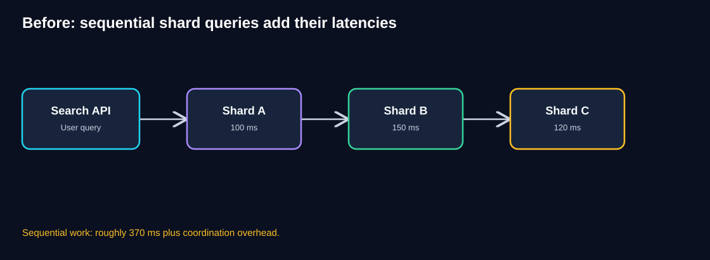
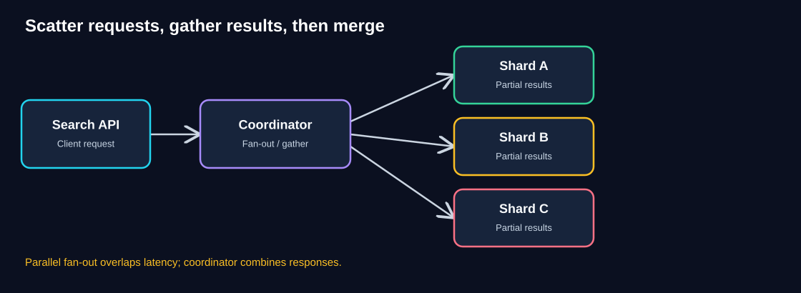
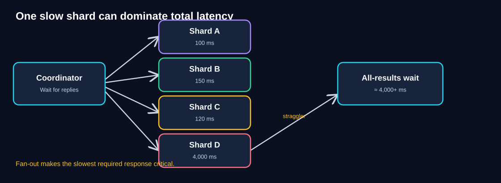
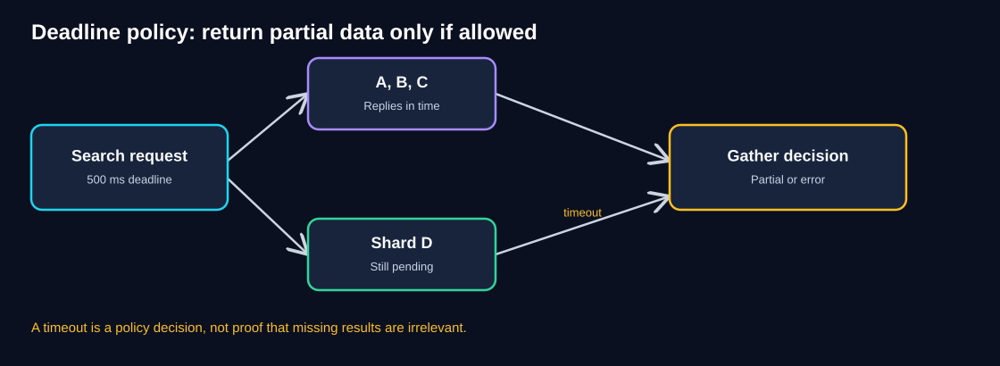
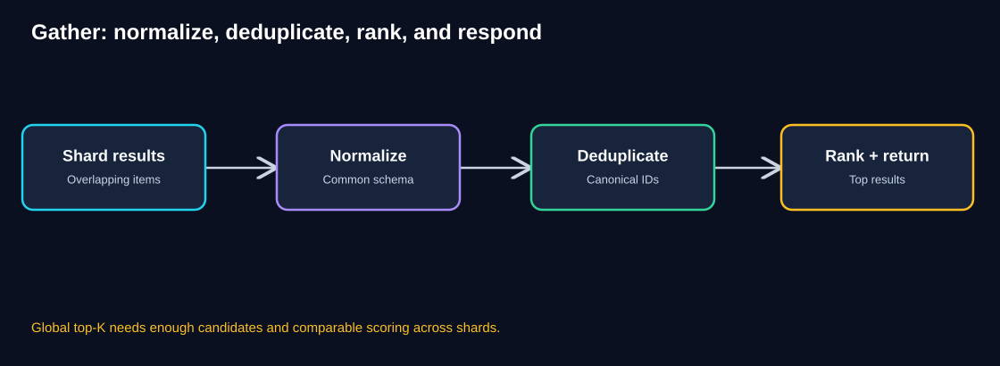
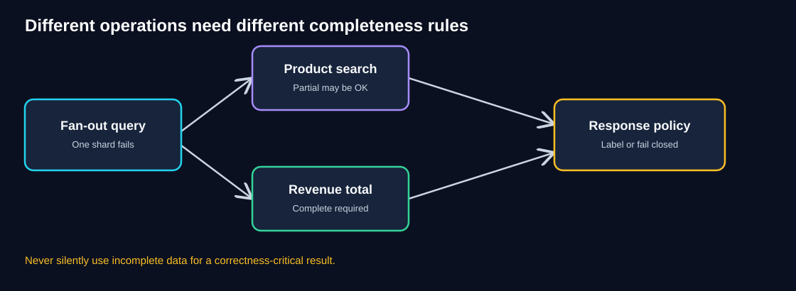
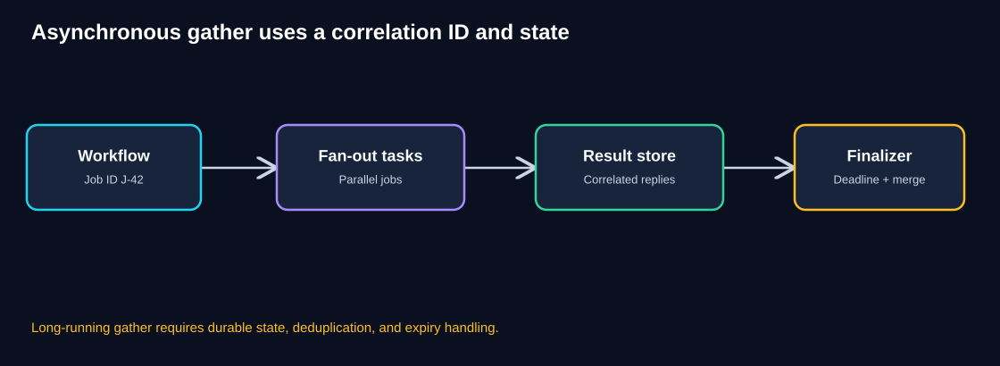
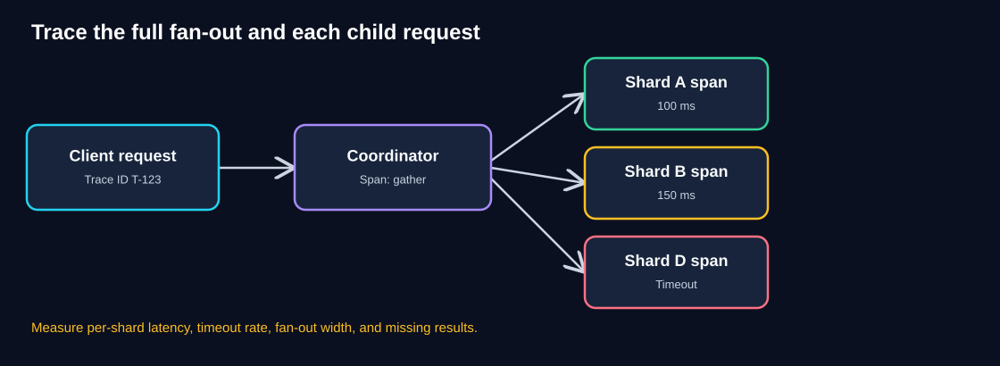

# Chapter 07 — Scatter–Gather

> **Standalone study guide · Estimated study time: 75–95 minutes**
>
> **Running example:** QuickCart, a fictional e-commerce platform.
>
> **Core idea:** Send independent subrequests concurrently (**scatter**), collect their outcomes (**gather**), then combine them according to an explicit deadline and correctness policy.

[← Previous: Partitioning & Sharding](06-partitioning-sharding.md) · [Foundations](00-foundations.md)

## 1. Learning objectives

After this chapter, you should be able to:

- Explain Scatter–Gather and distinguish it from simple load balancing.
- Identify a workload that can be decomposed into independent subqueries.
- Compare sequential versus parallel latency.
- Explain why a slow participant dominates an all-results request.
- Design deadlines, cancellation, retries, concurrency limits, and partial-result policies.
- Merge, deduplicate, and rank results safely.
- Differentiate synchronous and asynchronous Scatter–Gather.
- Monitor fan-out width, per-shard latency, error rate, and completeness.
- Decide when Scatter–Gather is appropriate and when it is unnecessarily expensive.

## 2. Intuition: asking several librarians at once

Imagine a library with four separate rooms. You need every book matching “cloud architecture.”

**Sequential approach:** Visit Room A, wait for its search, then B, then C, then D.

**Scatter–Gather approach:** Ask four librarians at the same time. Each searches their room, and one coordinator collects and combines the answers.

Parallel work can reduce the time spent waiting, but it introduces a difficult question: **What if one librarian takes an hour?**

If you must find *every* matching book, you may have to wait or report that the search is incomplete. If you are merely suggesting books to browse, showing the first three rooms' results with a clear incomplete-results notice may be acceptable.

That choice is a **business correctness decision**, not just a timeout setting.

## 3. QuickCart's problem after sharding

In Chapter 06, QuickCart split its data across shards. Customer-specific requests can usually reach one shard. But product search might need information from several independent indexes or shards.

Suppose three shards respond in:

- Shard A: 100 ms
- Shard B: 150 ms
- Shard C: 120 ms

A naive sequential coordinator queries them one after another.

**Diagram walkthrough**

1. A customer searches QuickCart for “wireless headphones.”
2. The Search API calls Shard A and waits 100 ms.
3. It then calls Shard B and waits 150 ms.
4. It then calls Shard C and waits 120 ms.
5. Ignoring network and coordinator overhead, total sequential waiting is roughly **370 ms**.
6. The shards are independent, so this waiting is avoidable.

### Think like an architect

Can we issue all three searches at once and combine their answers?

Reveal the pattern

Yes. Scatter the same logical search to all relevant shards concurrently, gather their responses, then merge and rank the results. Ideal parallel waiting is closer to the **slowest required response** than to the sum of response times, though coordination and network overhead remain.

## 4. The pattern explained

**Scatter–Gather** is a coordination pattern:

1. **Receive:** Accept one logical request.
2. **Plan:** Identify independent targets or subtasks.
3. **Scatter:** Dispatch subrequests concurrently.
4. **Wait:** Gather responses until a completion condition or deadline is reached.
5. **Merge:** Normalize, deduplicate, aggregate, or rank.
6. **Respond:** Return a result that accurately reflects completeness and failures.

**Diagram walkthrough**

1. The Search API receives one customer request.
2. A coordinator identifies the relevant shards.
3. It issues requests to Shards A, B, and C concurrently.
4. Each shard returns partial search results.
5. The coordinator combines them using defined merge and ranking rules.
6. The API responds when the required completion condition is satisfied or the deadline expires.

### Roles and responsibilities

| Component | Responsibility | Production concern |
|---|---|---|
| Client | Requests one logical result | Latency and completeness |
| Coordinator | Plans fan-out, deadlines, merge | Saturation and failure amplification |
| Shards/services | Process independent subrequests | Tail latency, capacity, consistency |
| Aggregator | Merge and rank partial results | Duplicates, global ordering, correctness |
| Tracing system | Connect parent and child requests | Missing/slow participants |

**Not the same as load balancing:** A load balancer normally selects a backend to handle a request. Scatter–Gather sends work to **multiple** backends for the same logical operation and combines their results.

## 5. Latency mathematics: sequential vs parallel

For independent subrequests with durations `t1, t2, ..., tn`:

- **Sequential wait:** approximately `t1 + t2 + ... + tn`
- **Parallel all-results wait:** approximately `max(t1, t2, ..., tn)`

Both formulas omit dispatch, serialization, network, scheduling, and merge overhead.

### Worked example

| Shard | Response time |
|---|---:|
| A | 100 ms |
| B | 150 ms |
| C | 120 ms |

Sequential waiting: `100 + 150 + 120 = 370 ms`

Parallel all-results waiting: `max(100, 150, 120) = 150 ms`

Illustrative improvement in waiting time: `370 − 150 = 220 ms`.

**Important:** This is not a guarantee that end-to-end response time falls by exactly 220 ms. Fan-out has costs and can increase backend load.

## 6. Tail latency: the straggler problem

Now QuickCart searches four shards:

- A = 100 ms
- B = 150 ms
- C = 120 ms
- D = **4,000 ms**

**Diagram walkthrough**

1. The coordinator sends four requests concurrently.
2. A, B, and C finish within 150 ms.
3. Shard D takes 4,000 ms.
4. If the business rule requires all four responses, the coordinator waits roughly **4,000 ms plus overhead**.
5. The three fast shards do not eliminate the slowest required dependency.
6. A timeout can bound waiting, but then the application must decide what an incomplete result means.

### Why fan-out increases tail risk

If each independent shard request has a 1% chance of exceeding a latency threshold, then with 20 shards the chance that **at least one** exceeds it is:

`1 − (0.99 ^ 20) ≈ 18.2%`

This calculation assumes independent identical probabilities. Real shard latencies may be correlated, especially during shared network or infrastructure incidents.

**Architect's lesson:** Even when average shard latency is good, a wide fan-out can make slow overall responses more frequent.

## 7. Deadlines, timeouts, and partial results

Suppose the product-search API has a **500 ms deadline**.

**Diagram walkthrough**

1. The coordinator receives a search request with a 500 ms overall deadline.
2. It scatters subrequests to four shards.
3. Shards A, B, and C respond before the deadline.
4. Shard D is still pending when time expires.
5. The coordinator applies an explicit response policy: partial search results, a retryable error, or another defined fallback.
6. If it returns partial results, it should **mark the response incomplete** and expose appropriate missing-shard metadata internally.

### Completion policies

| Policy | Behavior | Suitable example |
|---|---|---|
| All responses required | Return only after all succeed, or fail on deadline | Exact revenue total |
| Partial responses allowed | Return available results with completeness metadata | Exploratory product search |
| Quorum / threshold | Complete after a defined number of valid responses | Specialized replicated reads with correct quorum semantics |
| First acceptable result | Finish when one qualifying result arrives | Independent alternative providers |
| Asynchronous completion | Return a job ID and finish later | Long-running global report |

**Quorum warning:** A majority of arbitrary search shards does not make the search complete. Quorum semantics are appropriate only when the data model and consistency protocol justify them.

### Deadline propagation

An overall 500 ms deadline should be propagated to child calls. Do not give each of ten sequential retries its own full 500 ms timeout.

A practical request budget includes:

- Planning and authorization.
- Network dispatch.
- Shard processing.
- Aggregation.
- Response serialization.

Cancel or stop unnecessary child work after the deadline where supported. Cancellation is best-effort; it does not undo already committed side effects.

## 8. Merge, deduplication, and ranking

Gathering responses is more than concatenating arrays.

**Diagram walkthrough**

1. Each shard returns candidate products.
2. The coordinator normalizes fields into a common response schema.
3. Duplicate product IDs are removed or reconciled according to the business model.
4. Results are ranked using comparable scores and a stable tie-breaker.
5. The coordinator returns the requested top results.
6. A missing shard may mean a result is not globally complete, even if the visible list looks reasonable.

### Example

- Shard A returns products `[P1, P2]`.
- Shard B returns `[P2, P3]`.
- Shard C returns `[P4]`.

Naively concatenating produces `[P1, P2, P2, P3, P4]`.

Deduplicating by canonical product ID produces `[P1, P2, P3, P4]` before ranking.

### The global top-K problem

If each shard returns only its local top 2 results, can the coordinator always find the global top 10? **No.** It has at most 2 candidates per shard, and important candidates may be omitted.

Correct top-K design depends on score comparability, shard-local candidate depth, and the merge algorithm. For some workloads, each shard can return its top K under a consistent global ranking function; more complex ranking or filtering may need over-fetching and additional passes.

### Global pagination

Pagination across shards needs a stable ordering rule and usually cursor or snapshot semantics. Offset-based pagination can become expensive and inconsistent when results change during browsing.

## 9. Correctness: when partial results are dangerous

**Diagram walkthrough**

1. A coordinator fans out to several data owners.
2. One owner fails or times out.
3. A product-search experience may still provide useful suggestions from healthy shards.
4. An exact revenue report cannot safely claim a complete total with one shard missing.
5. The coordinator must choose a policy based on the business contract.
6. Completeness must be explicit in the response and observable internally.

### Examples

**Product discovery:** Partial results may be acceptable if clearly labeled and the product experience supports them.

**Inventory availability:** Missing a shard could lead to misleading stock claims. Return unknown/unavailable or use an authoritative inventory check.

**Financial totals:** A missing shard makes an exact total incomplete. Fail closed, retry asynchronously, or mark the report as incomplete; never silently undercount.

**Security or fraud checks:** Missing a critical dependency may require denying or delaying an action, depending on risk policy.

## 10. Failure handling, retries, and hedging

| Failure | Possible response | Risk |
|---|---|---|
| One shard times out | Apply deadline and completeness policy | Partial results may be misleading |
| Temporary connection error | Bounded retry within remaining deadline | Retry amplification |
| Many shards slow together | Limit fan-out and apply admission control | Coordinator exhaustion |
| One shard persistently unhealthy | Circuit breaker or fail-fast | Incomplete coverage |
| One request unusually slow | Carefully designed hedged request | Extra backend load |
| Merge fails | Fail or return explicitly degraded response | Incorrect ranking or duplicates |
| Client disconnects | Cancel unnecessary work where possible | Wasted compute |

### Retry budgets

Retries must fit inside the **overall deadline** and should be bounded. Retrying every failed child independently can multiply total backend traffic during an outage.

### Hedged requests

A **hedged request** sends a second copy of a slow read to an equivalent replica after a delay, then uses the first valid response. It can reduce tail latency when replica reads are interchangeable and the extra load is affordable.

Do not casually hedge non-idempotent writes or requests that would produce duplicate business effects.

### Bulkheads and concurrency limits

If one client request fans out to 50 shards, then 1,000 simultaneous client requests could create up to **50,000 child requests** before retries.

Bound fan-out concurrency, protect connection pools, and use backpressure or admission control. Scatter–Gather can amplify load dramatically.

## 11. Synchronous vs asynchronous Scatter–Gather

### Synchronous

The coordinator fans out and gathers while the original HTTP request remains open.

Best for interactive searches with bounded latency and a defined completeness policy.

### Asynchronous

The coordinator creates a durable job, fans out tasks, stores correlated results, and finalizes later.

**Diagram walkthrough**

1. A client submits a long-running report request.
2. The system creates a job and assigns correlation ID `J-42`.
3. Subtasks run independently, often through a queue or workflow engine.
4. Responses are stored under the same job ID, with deduplication for retries.
5. A finalizer checks whether required responses arrived or the deadline expired.
6. The client polls or receives a callback when the report is complete or explicitly failed.

### Asynchronous design requirements

- Durable job state and a correlation identifier.
- Expected participant set and completion conditions.
- Idempotent result ingestion.
- Retry, timeout, expiry, and cancellation policies.
- Handling of late or duplicate responses.
- Storage cleanup and retention.
- Clear status such as `PENDING`, `RUNNING`, `SUCCEEDED`, `PARTIAL`, or `FAILED`.

**Distinction from Competing Consumers:** Competing Consumers distribute *different jobs* across workers. Scatter–Gather divides *one logical job* into subtasks and combines their outcomes. They can be used together.

## 12. Tracing and observability

**Diagram walkthrough**

1. The client request receives a trace ID.
2. The coordinator creates a parent span for fan-out and gathering.
3. Each shard request receives a child span or linked context.
4. Shard A and B finish quickly.
5. Shard D times out, making the missing participant visible in the trace.
6. Engineers can distinguish slow shard execution from coordinator merge overhead.

### Production dashboard

| Metric | Question it answers |
|---|---|
| Overall p50/p95/p99 latency | Are users waiting too long? |
| Per-shard p95/p99 | Which participant is slow? |
| Fan-out width | How many child requests per client request? |
| Deadline/timeout rate | How often does gathering end early? |
| Partial-result rate | How often is coverage incomplete? |
| Missing shard count | Which data owners fail most often? |
| Merge duration | Is aggregation itself expensive? |
| Child requests per second | Is fan-out overloading backends? |
| Retry/hedge rate | Is resilience generating extra load? |
| Result quality/completeness | Is the user experience still useful and truthful? |

### Example service objective

“99% of interactive product-search requests finish within 600 ms, and fewer than 0.5% of responses are marked incomplete during normal operations.”

These are illustrative objectives; actual targets should come from user experience, capacity, and business requirements.

## 13. Cost, security, and governance

**Cost:** A single user request can trigger many database or service requests. Fan-out width, retries, and data transfer increase cost. Cache suitable results and route only to relevant shards where possible.

**Security:** Propagate identity and authorization context to child requests securely. Never assume that a shard-level API may bypass tenant isolation just because the coordinator called it.

**Privacy:** Global searches must respect regional restrictions and data residency. Logs and traces should avoid exposing sensitive query payloads unnecessarily.

**Reliability:** Coordinators need redundancy, bounded resource use, and clearly documented degradation policies.

## 14. When to use — and when not to use

### Good fit

- A logical query can be decomposed into independent subqueries.
- Several shards or services own relevant data.
- Parallel execution meaningfully reduces latency.
- Results can be combined deterministically.
- The business defines what to do when a participant is missing.
- Backends have enough capacity for the fan-out.

### Poor fit or requires redesign

- Subtasks are inherently sequential.
- A single authoritative service can answer more efficiently.
- Fan-out cost exceeds the latency benefit.
- Global consistency is required but not provided.
- Partial results would be unsafe and required participants are unreliable.
- Coordinator resource limits or shared dependencies make fan-out dangerous.

## 15. Common misconceptions

| Misconception | Correction |
|---|---|
| “Scatter–Gather is just load balancing.” | It invokes multiple backends and combines responses. |
| “Parallel requests always make the API fast.” | The slowest required response can dominate. |
| “A timeout makes partial results correct.” | Completeness is a business rule. |
| “Three of four shard replies are always enough.” | Only if the data and business semantics allow it. |
| “Gather means concatenate arrays.” | Normalization, deduplication, ranking, and consistency may be needed. |
| “Retries are free.” | They increase load and consume deadline budget. |
| “One request means one backend call.” | Fan-out can multiply downstream traffic. |
| “A missing shard is invisible to users.” | It can remove relevant products or corrupt totals. |

## 16. Knowledge checks

### Q1. What is Scatter–Gather?

Reveal answer

A pattern that dispatches independent subtasks concurrently, collects their outcomes, and combines them into one logical result.

### Q2. Three shard calls take 100, 150, and 120 ms. What are idealized sequential and parallel waits?

Reveal answer

Sequential: **370 ms**. Parallel all-results: **150 ms**. Both exclude coordination and network overhead.

### Q3. Why can one 4,000 ms shard dominate a four-shard search?

Reveal answer

If all responses are required, the coordinator must wait for the slowest required participant.

### Q4. Is returning three of four shards safe for an exact revenue total?

Reveal answer

No. The result is incomplete. The system should fail, wait, retry asynchronously, or explicitly mark incompleteness rather than present a false total.

### Q5. What does an overall deadline control?

Reveal answer

The total time budget for the logical operation, including child calls, retries, and aggregation. Child requests should respect the remaining budget.

### Q6. Why might global top-K search require more than concatenating local results?

Reveal answer

Results may overlap, scores may not be comparable, and local candidate limits can omit globally relevant items. The coordinator needs correct merge and ranking semantics.

### Q7. What is the danger of wide fan-out?

Reveal answer

It multiplies downstream calls, resource use, and the chance of encountering a slow or failed participant. Concurrency limits and backpressure help.

### Q8. When would asynchronous Scatter–Gather be preferable?

Reveal answer

For long-running operations such as global reports that exceed an interactive request deadline and need durable progress tracking and correlation IDs.

### Q9. What should tracing record?

Reveal answer

The parent request and each child request, including duration, failures, deadlines, and which shard responded or timed out.

### Q10. Is hedging safe for all requests?

Reveal answer

No. It may be useful for interchangeable idempotent reads, but duplicate non-idempotent writes can create unintended effects.

## 17. Architecture challenge: QuickCart global search

**Scenario**

QuickCart product search fans out to four shards:

| Shard | Response time |
|---|---:|
| A | 100 ms |
| B | 150 ms |
| C | 120 ms |
| D | 4,000 ms |

The interactive search deadline is **500 ms**. The product team permits incomplete recommendations **only if the response clearly indicates partial coverage**. Finance, however, requires complete revenue totals.

**Your tasks**

1. Estimate idealized sequential waiting time.
2. Estimate all-results parallel waiting time.
3. Identify which shards can contribute before the 500 ms deadline.
4. Propose the correct behavior for product search.
5. Propose the correct behavior for a financial total.
6. List three production metrics and two overload protections.

Reveal worked solution

**1. Sequential:** `100 + 150 + 120 + 4,000 = 4,370 ms`, excluding overhead.

**2. Parallel all-results:** `max(100, 150, 120, 4,000) = 4,000 ms`, excluding overhead.

**3. Deadline:** A, B, and C finish before 500 ms; D does not.

**4. Product search:** Return results from A, B, and C if the business contract allows it, with an explicit `partial=true` or equivalent indication and internal metadata identifying missing coverage. Cancel outstanding work when appropriate.

**5. Finance:** Do not return an exact total missing D. Return an error, schedule an asynchronous complete report, or otherwise follow an explicitly correct failure policy.

**6. Metrics:** Overall p95/p99, per-shard latency, partial-result rate, deadline rate, fan-out width, merge duration. **Protections:** bounded fan-out concurrency, deadline propagation, admission control, bounded retries, circuit breakers.

**Architectural lesson:** Scatter–Gather improves concurrency, but the completeness policy determines whether the final result is correct.

## 18. Production checklist

- [ ] Subtasks are independent and worth running concurrently.
- [ ] Fan-out targets and maximum fan-out width are bounded.
- [ ] Overall deadline is defined and propagated.
- [ ] Partial-result behavior is approved by the business.
- [ ] Missing participants are visible, not silently ignored.
- [ ] Merge, deduplication, ranking, and pagination are correct.
- [ ] Retries and hedging are bounded and safe.
- [ ] Per-shard and coordinator resource usage are monitored.
- [ ] Traces connect the parent request to child requests.
- [ ] Load tests include slow shards and correlated failures.
- [ ] Security context and data residency are respected.
- [ ] Async workflows use durable correlation and completion state when needed.

## 19. Quick revision notes

| Concept | Remember |
|---|---|
| Scatter | Dispatch subrequests concurrently |
| Gather | Collect and combine results |
| Sequential wait | Approximately sum of child durations |
| Parallel all-results wait | Approximately maximum child duration |
| Straggler | Slow participant delaying completion |
| Deadline | Total time budget for the logical request |
| Partial result | Incomplete answer allowed only by policy |
| Fan-out amplification | One request creates many backend calls |
| Global top-K | Requires correct cross-shard ranking |
| Correlation ID | Connects asynchronous subtask results |
| Tail latency | Slowest required participant can dominate |
| Core production rule | Make completeness explicit |

### Five architect's questions

1. **Can the work truly run independently?**
2. **How many child calls will each request generate?**
3. **What happens when one participant is slow or unavailable?**
4. **Is a partial answer acceptable and clearly labeled?**
5. **How will we combine results correctly and observe missing data?**

## 20. Connection to the next pattern

QuickCart can now query multiple data sources in parallel. But consider another kind of workload: processing a newly uploaded product video.

The video must be validated, resized, encoded, thumbnailed, and analyzed. Each step transforms the output of the previous step, and different stages need different resources.

That leads to **Pipes & Filters** — a pattern for composing processing stages into a reusable pipeline.

[Next: 08 — Pipes & Filters](08-pipes-and-filters.md).

---

*Numbers and timing examples are illustrative. Validate platform-specific guarantees, fan-out limits, and business completeness requirements before production use.*
