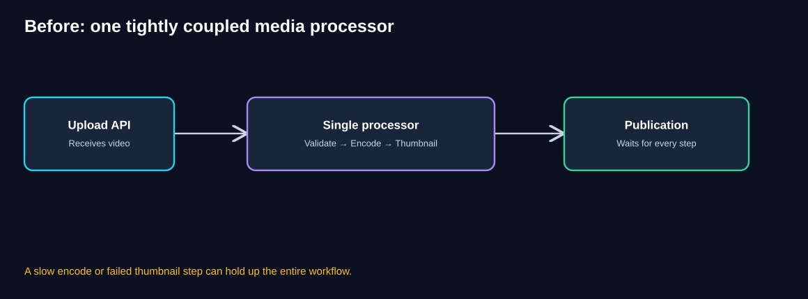
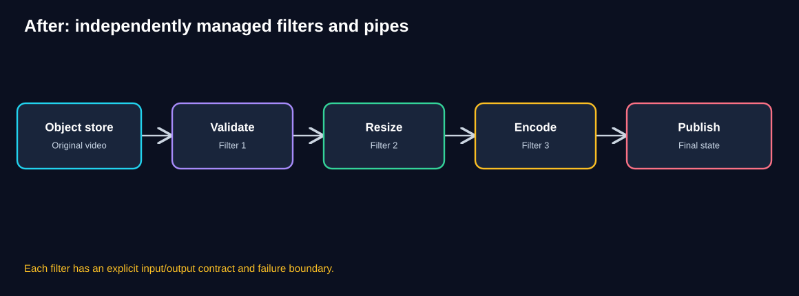
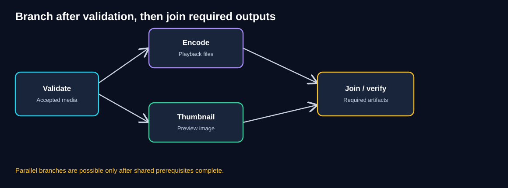
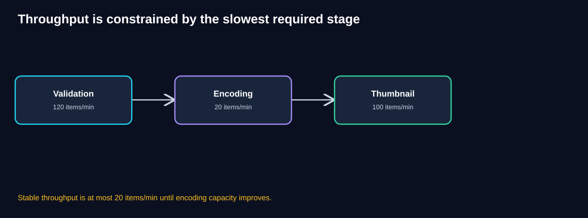
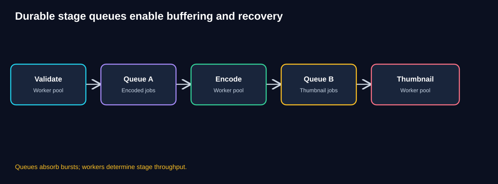
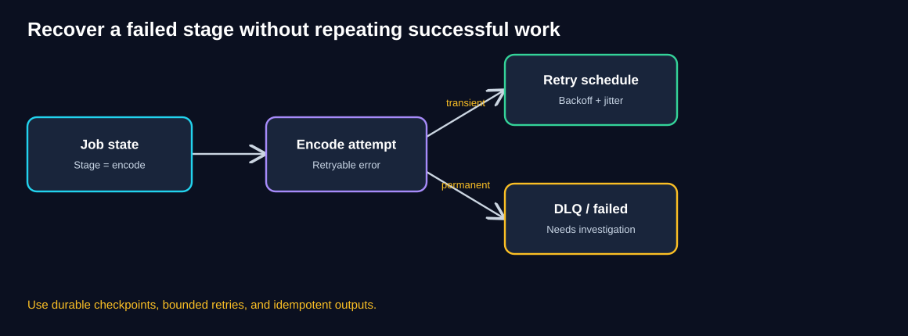
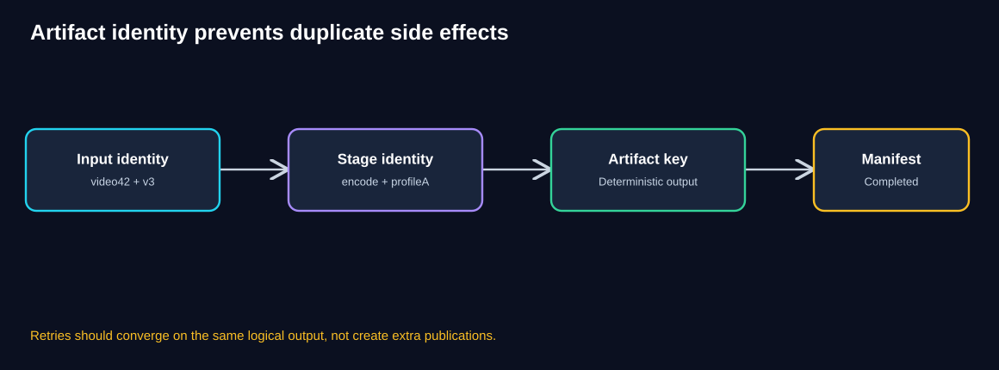
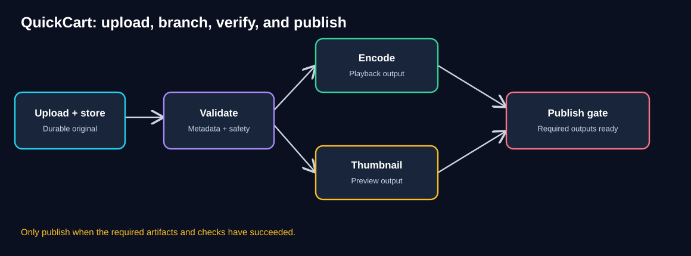
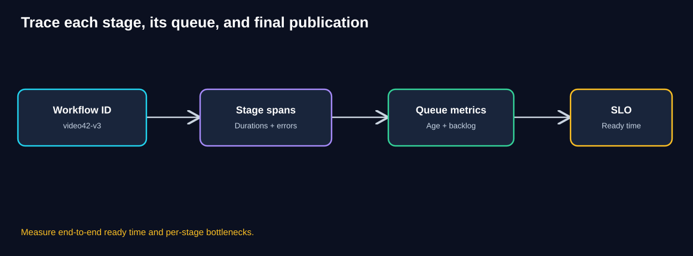

# Chapter 08 — Pipes & Filters

> **Unit ID:** SG-SCALE-08 · **Capability:** AI-AWS-01 · [Course map](../../../../README.md#ordered-capability-map)

[Learning contract and transfer check](learning-contract.md) · [Course map](../../../../README.md)

> **Standalone self-study chapter · Estimated study time: 80–100 minutes**
>
> **Running case study:** QuickCart, a fictional e-commerce platform.
>
> **Core idea:** Split a complex transformation into well-defined stages (filters), connect them with explicit data handoffs (pipes), and manage each stage independently.
>
> **You need:** SG-SCALE-04 to SG-SCALE-05.
>
> **You will produce:** Stage/ownership contract, bottleneck calculation and stale-version rejection rule.

[SG-SCALE-07 — ← Previous: Scatter–Gather](07-scatter-gather.md) · [SG-SCALE-00 — Foundations](00-foundations.md)

## 1. Learning objectives

By the end of this chapter, you should be able to:

- Explain Pipes & Filters with an everyday analogy.
- Distinguish a filter, a pipe, and a workflow coordinator.
- Break QuickCart's product-video processing into independent stages.
- Recognize sequential dependencies and opportunities for parallel branches.
- Estimate pipeline throughput and identify the bottleneck stage.
- Design stage-specific scaling, buffering, retries, checkpoints, and idempotency.
- Explain why a durable object store often works better than sending large video bytes through every queue.
- Plan publication correctness, monitoring, security, and cost controls.
- Distinguish Pipes & Filters from Scatter–Gather, queues, and competing consumers.

## 2. Intuition: an assembly line

Imagine a factory assembling bicycles:

1. Inspect incoming parts.
2. Build the frame.
3. Install the wheels.
4. Test the brakes.
5. Package the bicycle.

Each station performs a focused task and passes its output to the next station.

If the wheel station is slow, unfinished bicycles accumulate before it. Adding workers to the packaging station will not fix the wheel bottleneck.

Now imagine that painting the frame and assembling the wheels can happen independently after inspection. Those two branches may run in parallel, but the final assembly must wait until both are ready.

That is the intuition behind **Pipes & Filters**.

## 3. QuickCart's problem: a growing media workload

Merchants upload videos showing their products. Before a video can appear on QuickCart, the platform needs to:

- Validate the uploaded file and metadata.
- Resize or normalize it when required.
- Encode playable versions.
- Generate a thumbnail.
- Run content or quality analysis.
- Publish only after required outputs pass checks.

Initially, a single application performs everything inside one tightly coupled processing flow.



**Diagram walkthrough**

1. A merchant uploads a video through the API.
2. The same processor validates, encodes, and generates a thumbnail.
3. A slow encoding step blocks the rest of the flow.
4. A failure near the end may require repeating earlier work if there are no checkpoints.
5. Scaling the processor duplicates resources for every stage, even when only encoding is overloaded.
6. Publication is coupled to the health and completion time of the entire processor.

### Think like an architect

What if each transformation had a clear input, output, and independent execution boundary?

<details><summary>Reveal the pattern</summary>

Split the workflow into filters. Connect filters with pipes that transfer data or references. Each stage can then be monitored, retried, deployed, and scaled according to its needs. Preserve the dependencies and business rules between stages.

</details>

## 4. Pattern definition

**Pipes & Filters** organizes processing as a series or graph of independent transformations.

- A **filter** receives input, performs one focused operation, and produces output.
- A **pipe** carries output from one filter to another.
- A **workflow coordinator** may track progress, dependencies, failures, and completion, especially in asynchronous pipelines.



**Diagram walkthrough**

1. The original video is durably stored.
2. The validation filter checks whether the media is acceptable.
3. The resize filter normalizes dimensions or format where required.
4. The encoding filter creates a playable rendition.
5. The publication stage makes approved output visible.
6. Each stage has a contract defining expected input, output, failure conditions, and version.

**Important:** Pipes can be in-memory streams, function calls, files, object-store references, or messages. A queue is a common implementation choice for asynchronous pipelines, **not a requirement of the pattern**.

### Why independent stages help

| Property | Benefit | Trade-off |
|---|---|---|
| Single responsibility | Easier testing and reasoning | More components |
| Reusable filters | Share transformations across workflows | Contract management |
| Independent scaling | Add capacity only to slow stages | Operational complexity |
| Explicit handoffs | Better observability and recovery | Serialization and storage costs |
| Stage checkpoints | Avoid unnecessary repeated work | State and cleanup requirements |
| Separate deployments | Smaller changes per component | Version compatibility concerns |

## 5. From a chain to a directed processing graph

Not every step needs to run sequentially.

After validation, QuickCart may encode the video and generate its thumbnail concurrently. A publication gate waits for both required outputs.



**Diagram walkthrough**

1. Validation is a prerequisite shared by both branches.
2. Encoding creates playable video files.
3. Thumbnail generation creates a preview image.
4. These two branches can run in parallel if they do not depend on one another's output.
5. A join step verifies that all **required** artifacts exist and passed checks.
6. Publication occurs only after the defined completion rule is satisfied.

### When is branching safe?

Branching is useful when transformations consume the same stable input and produce independent outputs.

For example, thumbnail generation can often read the original or normalized media without waiting for final encoding. But if a thumbnail generator requires a specific encoded rendition, it must wait for that dependency.

**Architect's rule:** Parallelize only tasks whose dependencies genuinely permit it.

## 6. Throughput mathematics: find the slowest stage

Assume a simple sequential pipeline where each item must pass through three stages, with one processing unit at each stage:

| Stage | Sustainable capacity |
|---|---:|
| Validation | 120 items/minute |
| Encoding | 20 items/minute |
| Thumbnail | 100 items/minute |



**Diagram walkthrough**

1. Validation can process up to 120 items per minute.
2. Encoding can process only 20 items per minute.
3. Thumbnail generation can process up to 100 items per minute.
4. Every item must pass through encoding.
5. Therefore, steady-state pipeline throughput is at most **20 completed items/minute** under these assumptions.
6. Increasing validation or thumbnail capacity alone will not increase final throughput.

For a serial pipeline with required stages, a useful simplified upper bound is:

`pipeline throughput ≤ min(stage capacities)`

This ignores resource contention, retries, batching, and other overhead.

### Worked capacity example

Suppose QuickCart receives **80 videos/minute**.

- Arrival rate: 80/minute.
- Encoding completion capacity: 20/minute.
- Backlog before encoding grows at roughly **60 videos/minute**.

After 10 minutes, assuming an initially empty backlog and constant rates:

`(80 − 20) × 10 = 600 videos waiting`

If one encoder instance handles 20/minute and capacity scales approximately linearly:

| Encoder instances | Nominal encoding capacity |
|---:|---:|
| 1 | 20/min |
| 2 | 40/min |
| 3 | 60/min |
| 4 | 80/min |
| 5 | 100/min |

Four instances match the arrival rate but provide no headroom for clearing existing backlog. Five instances provide a nominal net drain capacity of `100 − 80 = 20/minute`, so a 600-item backlog would take roughly **30 minutes** to drain while new arrivals continue.

These are illustrative calculations. Video duration, resolution, codec, GPU contention, and retries can change per-item processing time dramatically.

## 7. Pipeline latency versus throughput

A pipeline can improve throughput by overlapping different items, even when a single item still passes through stages in sequence.

For one video with stage times:

- Validate: 1 minute.
- Resize: 2 minutes.
- Encode: 5 minutes.
- Thumbnail: 1 minute.

A fully sequential execution takes roughly **9 minutes**, excluding queueing and overhead.

If thumbnail generation can run alongside encoding after resize, the critical path becomes:

`1 + 2 + max(5, 1) = 8 minutes`

**Do not confuse:**

- **Latency:** Time for one video to become ready.
- **Throughput:** Number of videos completed per unit time.
- **Queueing delay:** Time waiting for a stage to become available.

A pipeline may increase overall throughput while an overloaded stage still causes very high end-to-end latency.

## 8. Durable queues between stages

An asynchronous pipeline often uses queues to buffer work between filters.



**Diagram walkthrough**

1. Validation workers complete the first stage.
2. They durably publish the next-stage work to Queue A.
3. Encoding workers consume from Queue A at their sustainable rate.
4. Successful encoding makes work available to Queue B.
5. Thumbnail workers process the next stage.
6. Each queue exposes backlog and waiting-time metrics that help locate bottlenecks.

This diagram illustrates a **sequential** workflow. The branching workflow in Section 5 is an alternative when encoding and thumbnail generation are independent.

### Queue-Based Load Leveling versus Pipes & Filters

- **Queue-Based Load Leveling:** Buffers a mismatch between arrival and processing rates.
- **Pipes & Filters:** Structures a transformation into stages.
- **Competing Consumers:** Runs multiple workers for a stage in parallel.

These patterns can work together:

`Validation workers → Queue → Encoding worker pool → Queue → Publication worker`

A queue does not automatically increase stage capacity, and extra workers do not help when a shared GPU pool or third-party provider is saturated.

## 9. Data contracts and artifact handoffs

A good filter has an explicit contract.

### Example encoding input

```json
{
  "workflowId": "video42-v3",
  "stage": "encode",
  "sourceObject": "uploads/video42/original",
  "sourceVersion": "v3",
  "encodingProfile": "mobile-720p",
  "attempt": 1
}
```

### Example encoding output

```json
{
  "workflowId": "video42-v3",
  "stage": "encode",
  "status": "SUCCEEDED",
  "artifactObject": "processed/video42/v3/mobile-720p.mp4",
  "artifactVersion": "v1"
}
```

The keys and statuses are illustrative, not a required industry standard.

### Why pass object references instead of video bytes?

Large videos can exceed message-size limits and create unnecessary copying. A common architecture stores source and intermediate artifacts in object storage and sends **small messages containing references**.

Benefits include:

- Lower queue payload sizes.
- Easier retries without retransmitting large media.
- Durable stage outputs.
- Better auditability and versioning.

But this requires secure object access, lifecycle cleanup, retention policies, and coordination between artifact writes and workflow state.

## 10. Failure recovery and checkpoints

Imagine encoding succeeds, but thumbnail generation fails.

Without checkpoints, QuickCart may need to repeat validation, resizing, and encoding. With durable stage outputs, it can retry only the failed stage when the dependencies remain valid.



**Diagram walkthrough**

1. Workflow state records which stage is pending or running.
2. The encoding worker attempts its transformation.
3. A transient error can trigger a bounded retry with backoff and jitter.
4. A permanent or repeatedly failing job can be isolated for investigation.
5. Previously successful stages remain complete if their artifacts are valid.
6. The system must not publish an incomplete or unverified artifact set.

### Failure matrix

| Failure | Response | Risk to avoid |
|---|---|---|
| Invalid input file | Reject or quarantine | Infinite retries of invalid media |
| Worker crashes | Retry stage from checkpoint | Duplicate artifacts or side effects |
| GPU unavailable | Backoff and reschedule | Retry storm |
| Output write succeeds but ack fails | Idempotent retry / reconcile | Duplicate outputs |
| One branch fails | Hold publication; retry required branch | Publishing incomplete media |
| Object-store outage | Pause, retry, alert | Claiming success without durable output |
| Old workflow completes late | Version-aware publication gate | Overwriting a newer upload |
| Poison message | DLQ and investigation | Silent loss of a required workflow |

### State transitions

A stage might follow:

`PENDING → RUNNING → SUCCEEDED`

or

`PENDING → RUNNING → RETRYING → FAILED`

A workflow might be:

`RECEIVED → VALIDATING → PROCESSING → READY → PUBLISHED`

Do not infer final workflow success solely because one stage succeeded.

## 11. Idempotency and versioning

At-least-once message delivery means the same stage may run again. A retry should not create duplicate publication events or overwrite a newer upload.



**Diagram walkthrough**

1. A stable workflow identity includes the media ID and upload version.
2. A stage identity includes the operation and configuration, such as encoding profile.
3. The output artifact is associated with this logical identity.
4. Retries can detect or reuse a verified completed output.
5. A manifest records which stage artifacts have succeeded.
6. Publication checks the expected workflow version so a late older job cannot replace a newer video.

### Example idempotency key

`video42:v3:encode:mobile-720p:config7`

If the same logical job is retried, the system can reconcile it against the existing artifact and completion record.

**Important:** A deterministic filename alone does not guarantee safe concurrent writes. Use conditional writes, unique constraints, leases, or other coordination mechanisms appropriate to the storage platform.

### Handling an updated upload

Suppose the merchant uploads version 4 while version 3 is still encoding.

- Version 3 may finish late.
- Version 4 should remain the current intended version.
- The publication gate should compare versions and reject stale promotion.

This is a correctness problem, not just a performance optimization.

## 12. Publication as an explicit business gate

For QuickCart, a video becomes visible only after its **required** processing outputs and checks succeed.



**Diagram walkthrough**

1. The Upload API durably stores the original file.
2. Validation checks metadata, format, limits, and relevant policy requirements.
3. Encoding and thumbnail generation run in parallel when their dependencies permit.
4. Each branch records its artifact and success state.
5. The publication gate verifies all required artifacts, workflow version, and policy checks.
6. Only then is the video made visible in the product catalog.

Optional stages can follow a different policy. For example, noncritical analytics may complete after publication **if the business and governance rules allow it**. Mandatory safety or compliance checks must not be silently treated as optional.

## 13. How to scale each stage

| Stage | Typical bottleneck | Possible scaling response |
|---|---|---|
| Validation | CPU, file reads, external scanning | Parallel stateless validators, bounded concurrency |
| Resize | CPU/GPU, memory | Scale resize workers; tune media profiles |
| Encoding | CPU/GPU, hardware encoders | Dedicated encoder pool, job-size-aware scheduling |
| Thumbnail | CPU and I/O | Independent thumbnail worker pool |
| Content analysis | Model inference capacity | Batch where appropriate; model-serving autoscaling |
| Publication | Database writes and metadata consistency | Transactional state changes, efficient indexing |

### Worker scaling formula

If a stage receives `λ` jobs/minute and each worker sustainably completes `μ` jobs/minute, then a rough minimum to keep up is:

`workers ≥ ceil(λ / μ)`

To drain backlog `B` over `T` minutes while new work continues:

`workers ≈ ceil((λ + B / T) / μ)`

Use measured processing rates, not only averages. A 10-second clip and a 90-minute video may differ dramatically in resource consumption.

### Job-size-aware scheduling

One large video can monopolize an encoder. Options include:

- Separate queues for small and large jobs.
- Resource classes based on video duration/resolution.
- Weighted scheduling and quotas.
- Fairness limits per merchant.
- Admission control during overload.

## 14. Observability: see every stage



**Diagram walkthrough**

1. Every upload receives a stable workflow ID.
2. Each stage emits trace spans and completion records.
3. Queues expose backlog depth and oldest-message age.
4. Operators identify whether delays arise from waiting or execution.
5. The end-to-end service objective measures time from accepted upload to ready-to-publish.
6. Failures are attributed to specific stages and versions.

### Recommended metrics

| Metric | Why it matters |
|---|---|
| Upload acceptance rate | Incoming workload |
| Completed videos/minute | Useful end-to-end throughput |
| End-to-end p50/p95/p99 ready time | Merchant experience |
| Per-stage processing p95/p99 | Slow transformations |
| Per-stage queue age and depth | Waiting-time bottlenecks |
| Retry and DLQ rates | Reliability problems |
| GPU/CPU/memory utilization | Capacity constraints |
| Artifact write failures | Storage reliability |
| Stale-version publication rejections | Correctness protection |
| Cost per completed video | Efficiency and ROI |
| Publication failure rate | Final business outcome |

**Illustrative SLO:** “95% of supported short-form videos become ready for publication within 10 minutes under normal operating conditions.”

The SLO must specify supported video sizes, acceptable processing profiles, and whether required analysis is included.

## 15. Cost, security, and governance

**Cost:** Video encoding and inference can be expensive. Scale only the stages that need capacity. Monitor cost per completed video, GPU utilization, intermediate artifact storage, and unnecessary retries.

**Security:** Validate file types and sizes, isolate untrusted media processing, use least-privilege object access, protect credentials, and avoid exposing raw internal object URLs publicly.

**Privacy:** Define retention and deletion rules for original videos, intermediate outputs, thumbnails, and model-generated metadata.

**Governance:** If content analysis determines whether media may be published, define who owns the policy, how false positives are reviewed, and what happens when the analysis service is unavailable.

**Change management:** Version filter implementations and input/output contracts. A new encoder version may produce different artifacts, requiring controlled reprocessing or rollback.

## 16. Design patterns that work alongside Pipes & Filters

| Pattern | Relationship |
|---|---|
| Stateless Services | Helps filters run on interchangeable workers |
| Load Balancing | Distributes incoming uploads or filter requests |
| Autoscaling | Adjusts worker capacity by stage |
| Queue-Based Load Leveling | Buffers jobs between stages |
| Competing Consumers | Parallelizes work within one stage |
| Partitioning / Sharding | Distributes large workflow metadata or artifacts |
| Scatter–Gather | Runs independent branches and combines their outcomes |
| Pipes & Filters | Defines the transformation stages and their handoffs |

**Difference from Scatter–Gather:** Scatter–Gather primarily fans out independent work and merges responses for one logical operation. Pipes & Filters primarily transforms data through a sequence or graph of stages. A pipeline can contain a Scatter–Gather branch.

## 17. When to use — and when not to use

### Good fit

- A complex transformation can be divided into cohesive stages.
- Different stages need different compute resources.
- Intermediate results can be represented by clear contracts.
- Failures should be retried locally.
- Stages can be reused across workflows.
- Operational visibility by stage is valuable.

### Poor fit or needs redesign

- The task is tiny and splitting it creates more overhead than value.
- Transformations are inseparable because of shared mutable state.
- Network and serialization overhead dominate actual work.
- End-to-end transactions require strict atomicity across all steps and no compensating design exists.
- The team cannot support the added orchestration and operational complexity.

A simple in-process chain can still be Pipes & Filters; microservices and queues are optional implementation choices.

## 18. Common misconceptions

| Misconception | Correction |
|---|---|
| “Every filter must be a microservice.” | Filters can run in one process, separate processes, or distributed services. |
| “Every pipe must be a queue.” | Pipes can be streams, calls, files, or messages. |
| “More stages always improve speed.” | Stage boundaries add overhead and can create bottlenecks. |
| “All filters run in parallel.” | Dependencies determine safe parallelism. |
| “Adding workers to any stage helps throughput.” | The slowest required stage limits steady-state throughput. |
| “Retries are harmless.” | Duplicate execution and artifacts need idempotency. |
| “One successful filter means the workflow succeeded.” | Final publication requires the defined completion conditions. |
| “The newest completed workflow should publish.” | Publication must respect the latest intended upload version. |

## 19. Knowledge checks

### Q1. What is a filter?

<details><summary>Reveal answer</summary>

A component that receives input, performs a focused transformation, and produces output under a defined contract.

</details>

### Q2. What is a pipe?

<details><summary>Reveal answer</summary>

A handoff mechanism carrying data or references between filters. It can be an in-memory stream, file, API call, queue, or other suitable mechanism.

</details>

### Q3. Stage capacities are 120, 20, and 100 items/minute. What limits the pipeline?

<details><summary>Reveal answer</summary>

The 20-items/minute stage, assuming every item must pass through all three stages and there are no other constraints.

</details>

### Q4. Why might encoding and thumbnail generation run in parallel?

<details><summary>Reveal answer</summary>

If both depend only on a validated stable input and not on each other's output, they can execute independently and join before publication.

</details>

### Q5. Does placing a queue before encoding make encoding faster?

<details><summary>Reveal answer</summary>

No. The queue buffers pending work. Encoding throughput depends on available encoder capacity and workload characteristics.

</details>

### Q6. Why use an object reference in a job message?

<details><summary>Reveal answer</summary>

Large media files are better stored durably in object storage. Small messages containing references reduce queue payloads and unnecessary copying.

</details>

### Q7. Encoding succeeds, but the worker crashes before acknowledgment. What can happen?

<details><summary>Reveal answer</summary>

The job may be retried. Idempotent artifact handling and completion reconciliation are needed to prevent unintended duplicate effects.

</details>

### Q8. Why is a workflow version important?

<details><summary>Reveal answer</summary>

A late result from an older upload must not overwrite or publish in place of a newer intended version.

</details>

### Q9. Which metric best captures merchant waiting time?

<details><summary>Reveal answer</summary>

End-to-end time from accepted upload to ready/published state, usually tracked as a latency distribution such as p95 or p99.

</details>

### Q10. What is the difference between Pipes & Filters and Competing Consumers?

<details><summary>Reveal answer</summary>

Pipes & Filters structures the transformations; Competing Consumers runs multiple workers in parallel for a given stage or queue.

</details>

## 20. Architecture challenge: QuickCart video uploads

**Scenario**

QuickCart accepts **60 videos/minute** for a 10-minute promotional period.

The pipeline requires validation, encoding, and thumbnail generation. Assume:

| Stage | Capacity |
|---|---:|
| Validation | 120 videos/min |
| Encoding | 20 videos/min per encoder |
| Thumbnail | 100 videos/min |

Other assumptions:

- Initially one encoder.
- All videos require all three stages.
- New arrivals fall to **10/minute** after the promotion.
- All rates are steady, with no retries or shared-resource contention.

**Your tasks**

1. Identify the bottleneck.
2. Calculate backlog accumulated before encoding after 10 minutes with one encoder.
3. How many encoders are needed to keep up with 60/minute?
4. With four encoders after the promotion, how long would the 400-video backlog take to drain?
5. Design a failure-safe publication rule.
6. Suggest four production safeguards.

<details><summary>Reveal worked solution</summary>

**1. Bottleneck:** Encoding at 20 videos/minute.

**2. Backlog:** `(60 − 20) × 10 = 400 videos`, assuming the other stages keep up.

**3. Keep up:** `ceil(60 / 20) = 3 encoders` in the idealized model. This leaves no encoding headroom during the promotion.

**4. Drain with four encoders:** Four encoders complete 80/minute. After the promotion, arrivals are 10/minute, so net drain capacity is 70/minute. `400 / 70 ≈ 5.71 minutes` — approximately **5 minutes 43 seconds**.

**5. Publication rule:** Publish only if validation and all required artifacts have succeeded, policy checks are complete, and the workflow version matches the currently intended upload. Use a conditional or transactional state transition where appropriate.

**6. Safeguards:** Durable source storage, stage checkpoints, idempotent artifacts, bounded retries with backoff, DLQ handling, per-stage queue-age alerts, worker isolation, secure media processing, and version-aware publication.

**Architectural lesson:** Independent stages allow precise scaling and recovery, but correctness depends on explicit contracts and completion rules.

</details>

## 21. Production checklist

- [ ] Each filter has a documented input/output contract.
- [ ] Dependencies and parallel branches are explicitly modeled.
- [ ] Large artifacts are durably stored and referenced safely.
- [ ] Each stage has a measured throughput and latency profile.
- [ ] Stage queues have capacity, retention, and backpressure policies.
- [ ] Workers can recover from crashes and duplicate messages.
- [ ] Intermediate artifacts are versioned and idempotent.
- [ ] Required stage outputs are verified before publication.
- [ ] Late older workflows cannot overwrite newer uploads.
- [ ] Per-stage queue age, errors, and retries are monitored.
- [ ] End-to-end ready time and cost per completed item are tracked.
- [ ] Security, retention, and governance checks are included.

## 22. Quick revision notes

| Architect's question | Remember |
|---|---|
| What is Pipes & Filters? | A sequence or graph of focused transformations |
| What is a filter? | A processing stage |
| What is a pipe? | The handoff between stages |
| Must stages be microservices? | No |
| Can branches run in parallel? | Yes, when dependencies permit |
| What determines steady-state throughput? | The slowest required stage, under simple assumptions |
| Why stage queues? | Buffering and decoupling |
| Why checkpoints? | Recover without repeating successful work |
| Why idempotency? | Retries and redelivery can repeat execution |
| Why versioning? | Prevent stale results from publishing |
| What is the final business gate? | Required outputs and checks completed correctly |

### Five architect's questions

1. **What transformations are genuinely separate responsibilities?**
2. **Which stages depend on which earlier outputs?**
3. **Where is the actual throughput bottleneck?**
4. **How will a failed stage recover without corrupting or repeating completed work?**
5. **What must be true before the final result is published?**

## 23. Final synthesis: all eight patterns in QuickCart

| Pattern | Main problem it addresses | QuickCart example |
|---|---|---|
| 01 — Stateless Services | Instance-local state blocks safe scale-out | Shared cart/session state |
| 02 — Load Balancing | Traffic needs routing across healthy replicas | Distribute API requests |
| 03 — Horizontal Scaling & Autoscaling | Service capacity must change with demand | Add/remove API replicas |
| 04 — Queue-Based Load Leveling | Bursts exceed immediate processing capacity | Buffer email jobs |
| 05 — Competing Consumers | One worker limits queued-job throughput | Parallel notification workers |
| 06 — Partitioning & Sharding | One data owner becomes a storage/workload bottleneck | Split customer records |
| 07 — Scatter–Gather | One query needs results from several owners | Search across product shards |
| 08 — Pipes & Filters | Complex processing needs modular stages | Video-processing pipeline |

**The unifying architectural principle:**

> Identify the current limiting resource. Choose the smallest appropriate pattern to distribute, buffer, parallelize, or partition work. Then measure what becomes the next bottleneck.

### Final reflection

A production system rarely uses one pattern in isolation. QuickCart may use stateless APIs behind a load balancer, autoscale worker pools, queue media jobs, process them through a pipeline, store metadata in shards, and scatter queries across indexes.

The goal is not to use every pattern. The goal is to apply the right pattern to a measured problem while preserving correctness, operability, and cost control.  

[SG-SCALE-09 — Next: 09 — Architecture Case Study](09-architecture-case-study.md).

## Completion checkpoint

**You can now:** explain immutable artifacts and publish conditions.

**Show it:** Stage/ownership contract, bottleneck calculation and stale-version rejection rule. Then attempt chapter 08's unfamiliar transfer check in the [learning contract](learning-contract.md).

**Next:** [SG-SCALE-09 — Integrated QuickCart Architecture Case Study](09-architecture-case-study.md).

---

*All numbers, contracts, and architecture sketches are illustrative. Validate platform-specific guarantees, business rules, and capacity assumptions before production deployment.*
