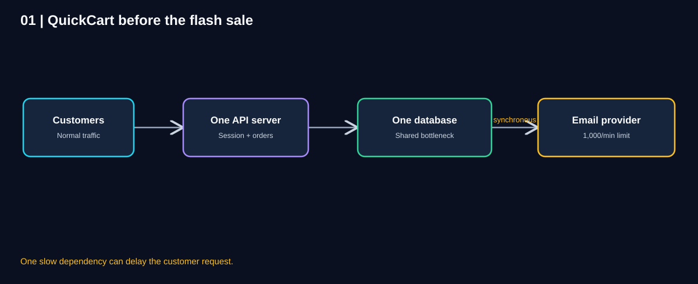
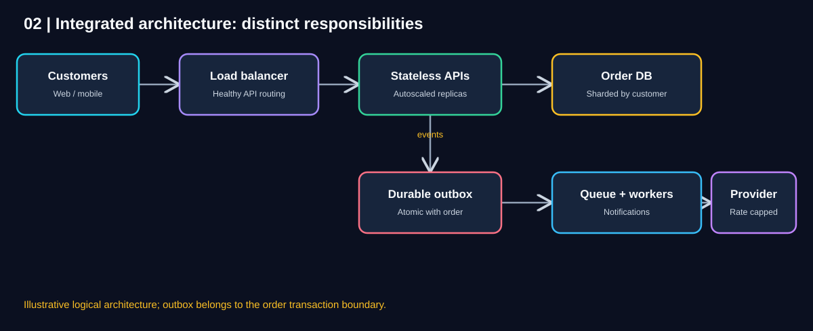
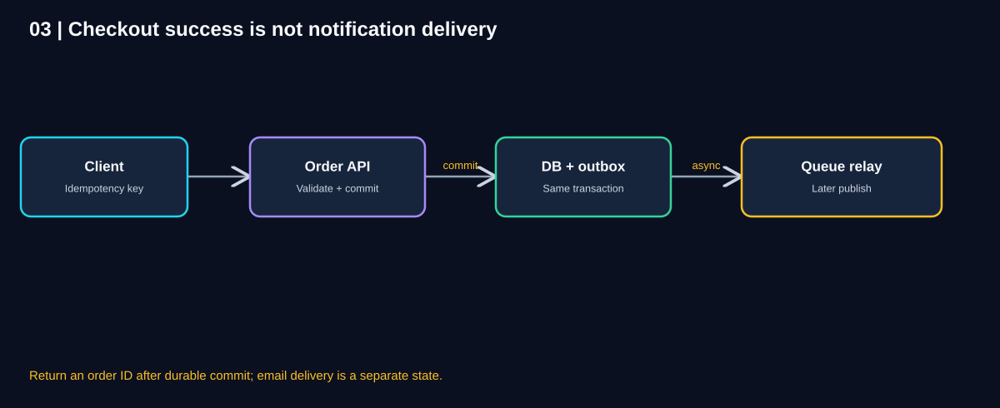
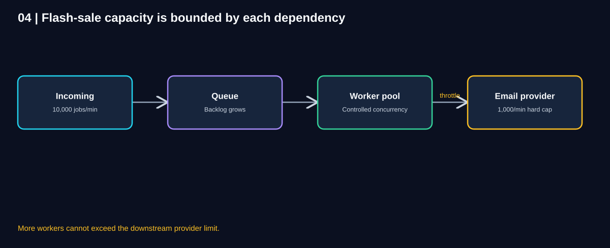
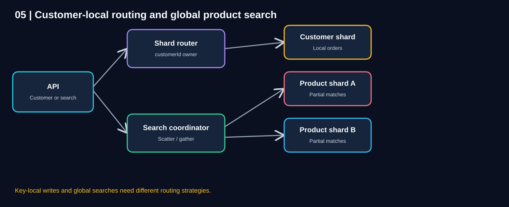
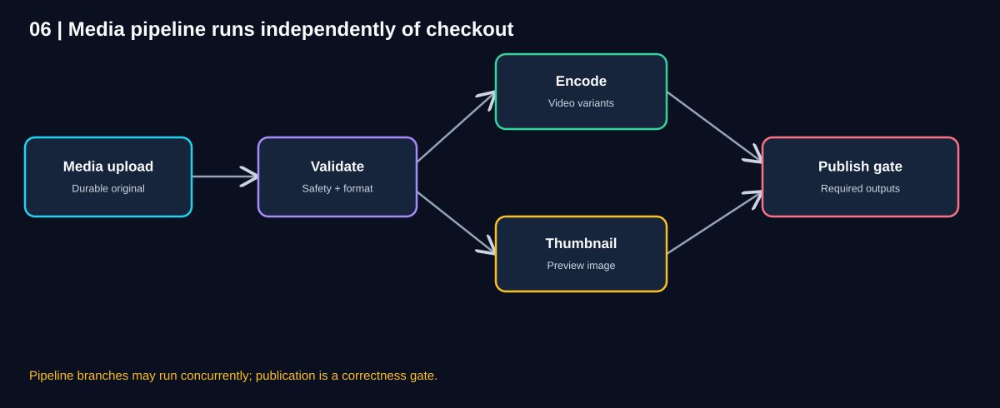
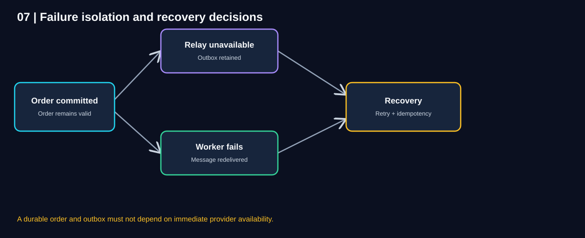
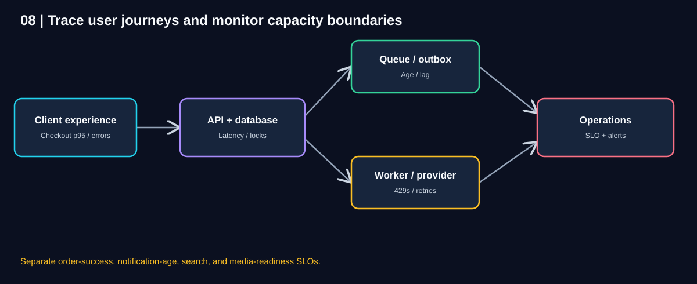
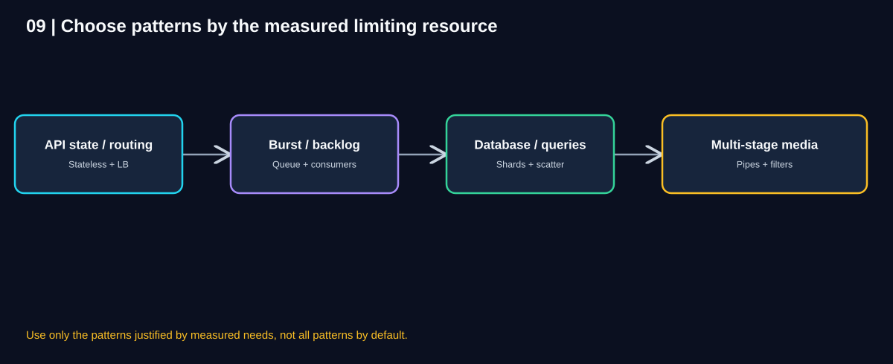

# Chapter 09 — Integrated QuickCart Architecture Case Study

> **Unit ID:** SG-SCALE-09 · **Capability:** AI-OPS-01 · [Course map](../../../../README.md#ordered-capability-map)

[Learning contract and transfer check](learning-contract.md) · [Course map](../../../../README.md)

> **Independent study guide · Estimated study time: 90–120 minutes**
>
> **Scenario:** QuickCart, a fictional e-commerce platform, must survive a flash sale without losing acknowledged orders, overloading its notification provider, or making search and media processing unreliable.
>
> **Learning approach:** Follow the symptoms, identify the limiting resource, select a pattern, calculate its impact, and decide what becomes the next bottleneck.
>
> **You need:** SG-SCALE-01 to SG-SCALE-08.
>
> **You will produce:** ADR, failure timeline, useful business metrics, security/cost assumptions and incident owner.

[SG-SCALE-08 — ← Previous: Pipes & Filters](08-pipes-and-filters.md) · [SG-SCALE-00 — Foundations](00-foundations.md)

## 1. Learning objectives

By the end of this chapter, you should be able to:

1. Explain how all eight scalability patterns fit into one business system.
2. Separate business correctness requirements from performance goals.
3. Draw an end-to-end architecture for checkout, notifications, search, and media.
4. Trace a request through load balancing, stateless APIs, databases, and queues.
5. Use the transactional outbox to avoid a dangerous database/message dual write.
6. Estimate backlog growth, drain time, and API capacity with stated assumptions.
7. Recognize when autoscaling or adding consumers will **not** solve the bottleneck.
8. Define failure behavior, observability, security, cost, and a phased implementation roadmap.
9. Defend architecture choices and alternatives in an interview or design review.

## 2. The business brief

QuickCart is preparing for a highly advertised flash sale. Customers will browse products, place orders, and expect timely confirmation. Merchants also upload product videos that require processing.

### Business outcomes

- **Correct checkout:** Never acknowledge an order as placed unless it is durably committed.
- **No lost acknowledged orders:** Recover from API, worker, and message-system failures without silently losing a committed order.
- **Responsive experience:** Keep browsing and checkout usable under peak demand.
- **Controlled notifications:** Never exceed the email provider's published limit.
- **Useful product search:** Search across distributed product indexes with an explicit completeness policy.
- **Reliable media publication:** Publish only approved, fully processed product media.
- **Cost discipline:** Add capacity where measurements justify it; avoid blindly multiplying infrastructure.

### Fictional planning assumptions

These are **exercise inputs**, not measured vendor guarantees:

| Input | Assumption |
|---|---:|
| Normal incoming notification jobs | 500/minute |
| Flash-sale notification jobs | 10,000/minute |
| Flash-sale duration | 5 minutes |
| Email provider sustainable limit | 1,000/minute |
| API replica tested safe throughput | 250 requests/second |
| Peak checkout/API demand for sizing exercise | 1,500 requests/second |
| Desired API headroom | 25% above calculated minimum |
| Search shard A/B/C/D response times | 100/150/120/4,000 ms |
| Interactive search deadline | 500 ms |

**Clarification:** The notification rate and the API request rate represent different workloads. Do not equate 10,000 notification jobs/minute with 1,500 API requests/second without a measured relationship.

## 3. Where QuickCart starts

At the beginning, the architecture is straightforward:

`Customers → One API server → One database → Email provider`



**Diagram walkthrough**

1. All customer requests enter one application server.
2. The application holds session or cart state locally.
3. Every checkout writes to one database.
4. The checkout path synchronously calls an email provider.
5. When the provider slows down or throttles, API requests wait or fail.
6. Scaling one component may simply move the bottleneck to the next dependency.

### Symptoms during the first flash-sale rehearsal

- Customers intermittently lose their cart when traffic shifts between servers.
- API latency rises sharply when traffic spikes.
- Database connections and lock waits increase.
- Email requests time out when the provider rate limit is reached.
- Retrying a timed-out checkout risks duplicate orders unless the API is idempotent.
- Search across multiple product shards becomes slow when one shard stalls.

### Think like an architect

Before buying more servers, ask:

- Is the request slow because of CPU, database waits, a remote call, or queueing?
- Which operation **must** finish before checkout can be acknowledged?
- Which operations can happen later?
- Where can work be distributed without breaking consistency?
- What does “success” mean to the customer?

<details><summary>Reveal the first architectural conclusion</summary>

Checkout correctness and notification delivery must be separated. Durable order creation is critical; email sending can usually be asynchronous. At the same time, stateless APIs, load balancing, and measured capacity are needed to absorb increased interactive traffic.

</details>

## 4. Translate business needs into service contracts

An architecture cannot be evaluated without specifying what each user-facing operation promises.

| Operation | User-visible success | Must be synchronous? | Example failure response |
|---|---|---|---|
| Add to cart | Cart state persisted according to contract | Usually yes | Retryable error; no false confirmation |
| Place order | Order durably committed and identifiable | Yes, for order acceptance | Unknown/pending if commit outcome cannot be determined |
| Send confirmation email | Provider accepted/delivered message per defined state | No | Retry asynchronously; report notification status separately |
| Search products | Relevant results within deadline | Yes, for interactive search | Partial results only when explicitly permitted |
| Upload video | Original durably accepted | Usually yes for upload acceptance | Upload failed; no false “ready” status |
| Publish video | Required processing and policy checks passed | No, may be asynchronous | Remain processing/failed; do not publish |

**Important distinction:** An HTTP `202 Accepted` for an asynchronous operation means the request was accepted for processing, **not** that every downstream business action succeeded. An order API may instead return a successful committed order with an order ID while the notification remains pending.

## 5. The integrated target architecture



**Diagram walkthrough**

1. Customers enter through a load balancer, which selects healthy API replicas.
2. API replicas are stateless with respect to instance-local business sessions; shared state is externalized as appropriate.
3. Autoscaling adjusts API replica count based on safe capacity signals.
4. The order API routes customer-owned records to the appropriate database shard.
5. A durable **outbox record is written in the same database transaction** as the order.
6. An outbox relay publishes notification work to a durable queue.
7. Competing worker instances consume jobs while respecting the downstream provider's **global** rate limit.
8. Search and media processing are separate workloads with their own scaling and correctness policies.

**Diagram scope:** This is a logical view of checkout and notifications. Search and media are shown separately later. The “DB + outbox” boundary is important: each order and its outbox entry must be committed atomically in the owning transactional datastore.

### Eight patterns, eight distinct jobs

| Pattern | QuickCart usage | What it does **not** guarantee |
|---|---|---|
| 01 Stateless Services | API replicas can handle requests interchangeably | Shared database can still saturate |
| 02 Load Balancing | Routes requests to healthy replicas | Does not add replica capacity |
| 03 Horizontal Scaling & Autoscaling | Adds/removes API and worker capacity | Does not bypass downstream hard limits |
| 04 Queue-Based Load Leveling | Buffers notification bursts | Does not make provider throughput infinite |
| 05 Competing Consumers | Parallelizes queued work | Does not ensure exactly-once side effects |
| 06 Partitioning & Sharding | Distributes customer data ownership | Makes cross-shard work more complex |
| 07 Scatter–Gather | Queries distributed search shards concurrently | Slowest required shard can dominate |
| 08 Pipes & Filters | Processes media through independent stages | Requires stage contracts and recovery |

## 6. Walkthrough A: successful checkout

This is the most important request flow because it changes business state.



**Diagram walkthrough**

1. A customer sends `POST /orders` with a stable idempotency key.
2. The load balancer routes the request to a healthy stateless API replica.
3. The API authenticates the customer, validates the request, and resolves the owning customer/order shard.
4. Within one transaction, the service commits the order and an outbox event.
5. The API returns the committed order ID and order state. It does **not** claim the email has been delivered.
6. Later, the relay reads the outbox entry and publishes a notification job to the queue.
7. A worker sends the notification while honoring provider throttling.
8. Delivery status is tracked separately; failures are retried or escalated.

### Example API contract

```http
POST /orders
Idempotency-Key: customer42-cart889-v1
```

Illustrative successful response:

```json
{
  "orderId": "ORD-1042",
  "orderStatus": "PLACED",
  "notificationStatus": "PENDING"
}
```

### What if the client times out?

The API might have committed the order but failed to return the response. The client should retry with the **same idempotency key**. The server must look up the prior result or reconcile the in-progress request rather than creating another order.

Idempotency-key records need appropriate scope, retention, uniqueness, and concurrency control. A key alone is not enough if two requests race and both commit.

## 7. Why the transactional outbox matters

A tempting implementation is:

1. Write the order to the database.
2. Publish an `OrderPlaced` event to the queue.

But the process may crash **between** these two steps.

### Dual-write failure window

- Database commit succeeds.
- Queue publish fails.
- The order exists, but the notification event is missing.

Reversing the order also creates a problem: the queue may receive an event for an order whose database transaction later fails.

### Outbox solution

Store an outbox row **inside the same database transaction** as the order. A relay subsequently publishes it and records progress.

Conceptual schema:

```text
orders:
  order_id | customer_id | status | idempotency_key

outbox:
  event_id | aggregate_id | event_type | payload | created_at | published_at
```

### Relay reliability rules

- Publish events with stable event IDs.
- Expect possible duplicate publication if a relay crashes after publish but before marking progress.
- Make consumers idempotent.
- Track outbox age and unprocessed counts.
- Reconcile stuck events.
- Define ordering needs explicitly; global ordering across shards is not automatic.

**Sharding nuance:** The order and its outbox record must be written in the **same transactional shard**. If the business operation spans multiple shards, the simple local outbox is not a substitute for distributed transaction or saga design.

## 8. Walkthrough B: a 20× notification burst

The notification provider accepts at most **1,000 messages/minute** in this exercise.



**Diagram walkthrough**

1. Flash-sale events arrive at a rate of 10,000 notification jobs/minute.
2. A durable queue accepts pending jobs without requiring immediate email delivery.
3. Multiple competing consumers process messages concurrently.
4. A **shared** rate limiter constrains the total provider send rate to 1,000/minute.
5. While arrivals exceed sustainable completions, backlog increases.
6. Increasing workers beyond the provider limit cannot reduce that backlog faster.

### Backlog calculation

Given:

- Arrival rate `λ = 10,000/min`.
- Completion capacity `μ = 1,000/min`.
- Duration `t = 5 min`.

Backlog growth:

`(λ − μ) × t = (10,000 − 1,000) × 5 = 45,000 jobs`

This assumes a zero initial backlog, stable rates, and all jobs needing one provider send.

**If arrivals stop completely** after five minutes, drain time is:

`45,000 / 1,000 = 45 minutes`

**If normal arrivals resume at 500/min**, net drain capacity is:

`1,000 − 500 = 500/min`

Drain time becomes:

`45,000 / 500 = 90 minutes`

These are idealized lower-bound-style estimates that ignore retries, pauses, provider variability, and priority scheduling.

### What can the business change?

- Negotiate a higher provider quota.
- Send fewer nonessential notifications.
- Prioritize critical confirmations.
- Add alternative providers only if contracts, routing, and compliance allow.
- Accept a realistic delivery-delay SLO during bursts.
- Avoid promising instant delivery when math proves it impossible.

**Architecture truth:** A queue converts immediate overload into a backlog-management problem. It does not eliminate the underlying capacity limit.

## 9. Competing consumers: concurrency with guardrails

Worker pools are useful when each worker can process a distinct message.

### Safe worker flow

1. Claim a message using the broker's delivery/visibility semantics.
2. Validate schema and authorization context.
3. Check an idempotency record or delivery state.
4. Obtain capacity from the **global** provider rate limiter.
5. Send the notification.
6. Persist the outcome or reconciliation state.
7. Acknowledge only after the defined durable completion condition.
8. Retry transient failures with bounded exponential backoff and jitter.
9. Isolate poison messages in a dead-letter queue after policy-defined attempts.

### Why duplicates still happen

A provider may accept a message, but the worker may crash before recording success. The broker redelivers the job, and another worker attempts it.

Use provider-supported idempotency keys where available, plus a durable delivery ledger and reconciliation. If the provider does not offer deduplication, **perfect end-to-end exactly-once delivery may not be achievable**; define acceptable duplicate handling.

### Scaling signals

Worker count can respond to queue age, backlog, processing time, and available downstream quota. Queue depth alone is insufficient if jobs vary greatly in cost.

## 10. Walkthrough C: API scaling without moving the bottleneck

Suppose peak API demand is **1,500 requests/second** and one API replica safely handles **250 requests/second** under the relevant load-test mix.

The arithmetic minimum is:

`ceil(1,500 / 250) = 6 replicas`

For **25% headroom above the minimum**:

`ceil(6 × 1.25) = 8 replicas`

This defines the headroom convention explicitly. A different convention, such as limiting utilization to 75%, produces a different result.

### Autoscaling design

- Maintain a sensible minimum replica count before the event.
- Scale on metrics linked to saturation, such as request concurrency, CPU, or latency-aware custom metrics.
- Account for startup and readiness delay.
- Warm capacity ahead of predictable promotions.
- Scale in conservatively, draining in-flight requests.
- Protect databases and downstream services with connection pools, timeouts, and admission control.

### Why more API replicas may fail

If the database saturates at a lower workload, 8 API replicas may generate even more concurrent queries. The system needs measured database capacity, indexing, query optimization, and potentially sharding—not just more front-end instances.

## 11. Walkthrough D: customer data sharding

QuickCart keeps customer-local carts and order histories together when that fits measured access patterns.



**Diagram walkthrough**

1. The API receives a customer-scoped request or a product-search request.
2. For a customer-scoped operation, the shard router uses `customerId` or an authoritative directory to find the owner.
3. The order and local outbox transaction occur on that owning shard.
4. Product search follows a different path because matching products may exist on several search shards.
5. The search coordinator fans out to relevant indexes.
6. It gathers, deduplicates, and ranks the results according to a completeness policy.

### Why not shard every dataset the same way?

- Customer orders are often accessed by customer.
- Product catalog data may be searched by category, keywords, or merchant.
- Inventory updates need a clear authority for stock counts.
- Finance needs global reporting and reconciliation.

**A good partition key follows the workload.** It is not chosen merely because hashing is easy.

### Production safeguards

- Versioned, authoritative shard mapping.
- Per-shard latency, lock, CPU, and storage monitoring.
- Hot-tenant detection.
- Backup and restore tests for every shard.
- Controlled rebalancing with write reconciliation and rollback.
- Explicit cross-shard transaction and reporting policies.

## 12. Walkthrough E: Scatter–Gather product search

Assume four search shards take:

| Shard | Duration |
|---|---:|
| A | 100 ms |
| B | 150 ms |
| C | 120 ms |
| D | 4,000 ms |

Sequential wait:

`100 + 150 + 120 + 4,000 = 4,370 ms`

Parallel **all-results** wait:

`max(100, 150, 120, 4,000) = 4,000 ms`

Both omit network and coordinator overhead.

### The 500 ms search deadline

A, B, and C finish in time; D does not.

If product discovery permits partial results, QuickCart can return the available matches with a clear incomplete-results indicator. It must not silently imply full catalog coverage.

For an **exact financial total**, the same missing shard is unacceptable. The system must wait, fail, or complete the report asynchronously with an explicit correctness guarantee.

### Search design considerations

- Propagate the overall deadline to child calls.
- Bound fan-out concurrency.
- Use safe retry budgets and avoid retry storms.
- Normalize and deduplicate product IDs.
- Ensure scores are comparable for global ranking.
- Monitor per-shard p95/p99, missing-shard rate, and merge duration.
- Do not treat “three out of four” as a meaningful quorum unless the data model specifically supports quorum semantics.

## 13. Walkthrough F: the media-processing pipeline

Product videos have a different scaling profile from checkout. They can take seconds or minutes, use CPU/GPU resources, and should not block interactive requests.



**Diagram walkthrough**

1. A merchant uploads a video, which is stored durably.
2. Validation checks format, limits, and required safety policies.
3. Encoding and thumbnail generation run as independent branches when both can use the validated source.
4. Each branch writes versioned artifacts and records stage completion.
5. A publication gate verifies that all mandatory outputs and checks passed.
6. The correct current upload version is published; late results from older versions cannot overwrite it.

### Pattern composition

- **Pipes & Filters** defines the stages.
- **Queue-Based Load Leveling** buffers stage jobs.
- **Competing Consumers** parallelizes a slow stage.
- **Autoscaling** adjusts encoding workers.
- **Stateless Services** makes filter workers replaceable.
- **Scatter–Gather-like join** combines required branch outcomes.

**Correctness rule:** A successfully accepted upload is not yet a successfully processed or published video.

## 14. Failure scenarios: what should still work?



**Diagram walkthrough**

1. A customer order is already durably committed.
2. If the outbox relay is unavailable, its event remains pending for later publication.
3. If a notification worker crashes, broker redelivery may cause a retry.
4. Idempotency and delivery-state reconciliation reduce duplicate effects.
5. Checkout success is not retroactively invalidated by email failure.
6. Alerts and recovery procedures target the failing subsystem.

### Failure-injection table

| Injected failure | Expected behavior | What to test |
|---|---|---|
| API replica crashes mid-request | Another replica handles retries; no duplicate order | Idempotency under concurrent retries |
| DB commit succeeds but response lost | Client can recover committed result | Read by idempotency key |
| DB unavailable before commit | No success acknowledgment | Safe error or pending response |
| Relay crashes after queue publish | Duplicate event possible, not missing event | Consumer deduplication |
| Provider returns rate-limit error | Workers back off; queue grows visibly | Global quota enforcement |
| Worker repeatedly fails one message | DLQ after policy limit | Poison-message isolation |
| One shard unavailable | Affected keys degrade; no false success | Failover and clear errors |
| Search shard exceeds deadline | Partial only if allowed | Completeness metadata |
| Media encoder fails | Retry stage; preserve prior valid artifacts | Checkpoint recovery |
| Old video workflow finishes late | Newer intended version stays current | Version-aware publication |

### Recovery priorities

1. Protect correctness and durable state.
2. Prevent cascading overload.
3. Restore the most critical user journeys.
4. Reconcile asynchronous side effects.
5. Drain backlogs safely.
6. Investigate root causes and update runbooks.

## 15. Observability: one dashboard is not enough



**Diagram walkthrough**

1. The customer journey is measured by checkout latency, error rate, and committed-order success.
2. API and database telemetry reveals saturation and lock contention.
3. Outbox and queue metrics show event-publication lag and oldest-job age.
4. Worker and provider telemetry exposes throttling, retries, and delivery outcomes.
5. Operations evaluates each workflow against its own service objective.
6. Distributed traces and correlation IDs connect the steps without conflating their success states.

### Example SLOs for discussion

These are **illustrative targets** requiring stakeholder validation:

| Journey | Proposed SLO | Primary signals |
|---|---|---|
| Checkout | 99% of eligible requests complete in 800 ms | p99 latency, commit errors, idempotency conflicts |
| Order durability | No acknowledged order missing after recovery | Commit reconciliation, audit invariants |
| Notification | 95% of accepted jobs delivered/accepted by provider within 60 min under defined load | Oldest age, success rate, provider throttles |
| Product search | 99% within 600 ms; partial results separately tracked | p99, incomplete rate, shard timeouts |
| Video readiness | 95% of supported short videos ready within 10 min | Stage age, failures, end-to-end time |

**Consistency warning:** “Delivered” may mean different things: submitted to provider, accepted by provider, or confirmed delivered to an inbox. Choose one definition and label it accurately.

### Alerting strategy

- Page on checkout failure rate or database unavailability.
- Alert on outbox events stuck beyond a threshold.
- Alert on queue **age**, not only queue depth.
- Alert on provider 429s, sustained DLQ growth, and retry storms.
- Track per-shard skew and p99 latency.
- Track media-stage failure and publication-gate rejections.

## 16. Security, privacy, and governance

A scalable architecture that mishandles sensitive data is not successful.

### Checkout and payments

- Use authenticated, authorized APIs.
- Never treat an idempotency key as authorization.
- Avoid putting raw cardholder data in queues or outbox payloads.
- Follow applicable payment-processing requirements through approved payment systems.
- Maintain audit trails for order state transitions.

### Messaging and storage

- Encrypt traffic and stored sensitive data.
- Use least-privilege permissions for queues, databases, and object storage.
- Minimize personally identifiable information in messages and logs.
- Define retention, replay, and deletion procedures.
- Protect dead-letter queues; they may contain sensitive business metadata.

### Search and media

- Enforce tenant authorization on each relevant data path.
- Respect data residency and privacy policies across shards, replicas, and analytics.
- Isolate untrusted media transformations.
- Make mandatory moderation or safety checks explicit before publication.

### Human oversight

Define who can approve emergency rate-limit changes, replay DLQs, initiate shard rebalancing, and override media-publication holds. Operational permissions should be auditable.

## 17. Cost and ROI: evaluate value, not pattern count

Architecture choices have costs: more replicas, databases, queues, observability, GPU workers, and operational complexity.

### Cost drivers

| Decision | Cost increases | Potential benefit |
|---|---|---|
| API autoscaling | Compute during peak | Fewer lost or slow checkouts |
| Durable queue and outbox | Broker, storage, relay operations | Reliable asynchronous processing |
| More consumers | Worker compute | Faster backlog drain if downstream permits |
| Sharding | Database instances and migration tooling | More storage and write capacity |
| Scatter–Gather | More child requests and merge work | Faster multi-shard search |
| Media pipeline | Stage infrastructure and artifact storage | Better resource utilization and recovery |

### Simple illustrative ROI calculation

Assume:

- 200,000 checkout attempts during a campaign.
- Baseline successful checkout rate: 96%.
- Improved rate: 98%.
- Contribution margin per additional completed order: $8.
- Incremental architecture and campaign operating cost: $18,000.

Additional successful orders:

`200,000 × (0.98 − 0.96) = 4,000`

Incremental contribution:

`4,000 × $8 = $32,000`

Net estimated value:

`$32,000 − $18,000 = $14,000`

Illustrative ROI on incremental cost:

`$14,000 / $18,000 ≈ 77.8%`

**This is a scenario calculation, not a forecast.** The conversion improvement, attribution, contribution margin, campaign volume, and costs must be validated. Include engineering effort, on-call burden, compliance, and ongoing maintenance in a real business case.

## 18. A phased implementation roadmap

A mature architecture should evolve through measured milestones, not one enormous rewrite.

| Phase | Scope | Exit criteria |
|---|---|---|
| 0. Baseline | Instrument checkout, DB, provider, and media | Load profile and limiting resources understood |
| 1. Correctness | Order idempotency, clear success semantics, transaction boundaries | No duplicate acknowledged orders under retry tests |
| 2. Decoupling | Outbox, relay, durable queue, worker retry/DLQ | Provider outage does not lose committed orders |
| 3. Front-end elasticity | Stateless APIs, load balancing, autoscaling | Peak API traffic passes load tests with headroom |
| 4. Worker control | Competing consumers, global rate limiter, backlog SLO | Provider cap respected; recovery behavior verified |
| 5. Data scale | Query tuning, caching, then sharding if justified | Per-shard capacity and migration tested |
| 6. Search | Scatter–Gather with deadlines and merge policy | Correct completeness behavior under slow shard |
| 7. Media | Pipes & Filters with checkpoints and publication gate | Failed stage recovery without stale publication |
| 8. Operations | Chaos tests, runbooks, security review, cost review | Defined SLOs and incident response demonstrated |

### Why this order?

Correctness comes before aggressive scaling. There is little value in serving more requests per second if they can create duplicate orders or lose committed events.

Sharding comes only after simpler database improvements are assessed. It may not be necessary at all for a given deployment.

## 19. Architecture decision record (ADR) example

**ADR-009: Decouple order notifications from checkout**

**Context:** A synchronous email call slows checkout and fails when provider capacity is exhausted.

**Decision:** Commit the order and outbox record atomically, then publish events through a relay to a durable queue. Process notifications asynchronously with competing consumers and a global provider rate limiter.

**Alternatives considered:**

- Increase HTTP timeout: does not solve provider quota or failure coupling.
- Add more API replicas: does not bypass provider limit.
- Direct DB write followed by queue publish: creates a dual-write failure window.
- Skip notifications under overload: violates the notification delivery requirement.

**Consequences:**

- Checkout no longer waits for email delivery.
- Eventual notification delay must be communicated and monitored.
- Duplicate events and retries require idempotent handling.
- Queue, relay, and worker infrastructure add operational cost.
- Queue age can grow during a burst even when the system is operating correctly.

**Success measures:** No lost committed-order events in failure tests, checkout latency within SLO, provider quota respected, notification-age SLO tracked.

## 20. Decision guide: which pattern next?



**Diagram walkthrough**

1. Diagnose the current symptom with measurements.
2. If instance-local state prevents interchangeability, address statelessness and shared state.
3. If API traffic needs routing and more capacity, use load balancing and scale-out.
4. If bursts exceed processing capacity, buffer work; if one worker limits processing, add competing consumers.
5. If one database owner is the limiting resource, evaluate query improvements and then partitioning/sharding.
6. If one query needs many owners, consider Scatter–Gather with explicit completeness.
7. If one job needs many transformations, consider Pipes & Filters.
8. After each change, remeasure to identify the next limiting resource.

### Symptom → investigation → likely pattern

| Symptom | Verify first | Candidate change |
|---|---|---|
| Cart disappears after switching API instance | Session state locality | Stateless Services |
| Some API replicas overloaded, others idle | Routing and health checks | Load Balancing |
| API CPU saturated during promotions | Per-replica throughput, startup time | Horizontal Scaling & Autoscaling |
| Email requests slow checkout | Synchronous coupling and provider cap | Queue-Based Load Leveling |
| Queue age grows despite available provider capacity | Worker throughput and concurrency | Competing Consumers |
| DB write throughput saturated | Query plans, locks, storage, partitionability | Partitioning/Sharding |
| Global search waits for serial shard calls | Independence of shard queries | Scatter–Gather |
| Video processing hard to scale/retry | Stage dependencies and outputs | Pipes & Filters |

## 21. Knowledge checks

### Q1. Why should checkout not wait for the email provider?

<details><summary>Reveal answer</summary>

Email delivery is generally not required to establish that an order was durably committed. Decoupling protects checkout latency and availability from provider failures, while the notification workflow remains separately observable and recoverable.

</details>

### Q2. What failure does the transactional outbox address?

<details><summary>Reveal answer</summary>

The dual-write gap between committing a business record and publishing its event. Writing the outbox row in the same transaction ensures the event intent is durably recorded with the order.

</details>

### Q3. A flash sale produces 10,000 notification jobs/min for 5 minutes; capacity is 1,000/min. What backlog forms?

<details><summary>Reveal answer</summary>

`(10,000 − 1,000) × 5 = 45,000 jobs`, assuming no initial backlog and steady rates.

</details>

### Q4. Why will ten times more workers not overcome a hard provider limit?

<details><summary>Reveal answer</summary>

The provider remains the limiting resource. Workers must share a global rate limit; otherwise they simply generate throttling and retries.

</details>

### Q5. What should happen if the API commits an order but the response is lost?

<details><summary>Reveal answer</summary>

A retry with the same idempotency key should return or reconcile the existing committed order, not create a duplicate.

</details>

### Q6. Which pattern routes requests among healthy API replicas, and which changes replica count?

<details><summary>Reveal answer</summary>

Load Balancing routes requests. Horizontal Scaling & Autoscaling changes how many replicas exist.

</details>

### Q7. Why might product search allow a partial result while finance cannot?

<details><summary>Reveal answer</summary>

Product discovery can sometimes provide useful incomplete suggestions if clearly labeled. An exact financial total is incorrect when a shard is missing.

</details>

### Q8. What protects against an older media workflow publishing late?

<details><summary>Reveal answer</summary>

Version-aware publication checks and conditional state transitions that verify the currently intended upload version.

</details>

### Q9. Which metric best detects growing customer-visible notification delays?

<details><summary>Reveal answer</summary>

Oldest unprocessed message age or end-to-end notification age, alongside queue depth, completion rate, and provider throttling.

</details>

### Q10. Why should sharding be delayed until justified?

<details><summary>Reveal answer</summary>

It adds routing, migration, distributed query, transaction, and operational complexity. Query optimization, caching, or replicas may solve the measured problem more simply.

</details>

### Q11. Does `202 Accepted` mean the entire workflow succeeded?

<details><summary>Reveal answer</summary>

No. It indicates acceptance for processing under the API contract. The client needs a status mechanism or later notification to learn the final outcome.

</details>

### Q12. What is the overarching rule for selecting scalability patterns?

<details><summary>Reveal answer</summary>

Measure the current limiting resource, choose the smallest appropriate intervention, preserve correctness, and remeasure the next bottleneck.

</details>

## 22. Architecture challenge: defend your design

**Scenario:** A new QuickCart campaign is expected to generate:

- 1,500 API requests/second.
- 10,000 notification jobs/minute for 5 minutes.
- Email provider limit: 1,000/minute.
- API replica safe throughput: 250 requests/second.
- Product search across four shards, one occasionally taking 4 seconds.
- Merchant video uploads continuing during the campaign.
- No loss of acknowledged orders.

**Tasks**

1. Draw the main components and label all eight patterns.
2. Calculate API replicas with 25% headroom above the arithmetic minimum.
3. Calculate notification backlog after the five-minute burst.
4. Calculate drain time if normal notification arrivals resume at 500/minute.
5. Explain how an order survives a relay outage.
6. Describe the behavior when one search shard misses the 500 ms deadline.
7. Explain how to prevent an old video version from being published.
8. Choose five production alerts.
9. Identify two expensive components that should not scale blindly.
10. Explain which architecture changes you would implement first and why.

<details><summary>Reveal model solution</summary>

**1. Components:** Customers → LB → stateless autoscaled APIs → customer-owned DB shards. The order transaction includes an outbox entry. Relay → durable queue → competing notification workers → globally rate-limited provider. Search coordinator fans out to product shards. Media upload → validation → encoding/thumbnail branches → publication gate.

**2. API:** `ceil(1,500 / 250) = 6` minimum. With 25% additional headroom, `ceil(6 × 1.25) = 8 replicas`.

**3. Backlog:** `(10,000 − 1,000) × 5 = 45,000`.

**4. Drain:** With 500/minute continuing arrivals, net capacity is 500/minute; `45,000 / 500 = 90 minutes`.

**5. Relay outage:** The order and outbox row are already committed atomically. Relay resumes and publishes pending entries. Consumers handle duplicates safely.

**6. Search:** If the product team permits partial results, return healthy-shard results clearly marked incomplete. Exact reports must not use incomplete totals.

**7. Video:** Record upload version in stage artifacts and require the publication gate to compare against the currently intended version.

**8. Alerts:** Checkout commit errors, API p99, outbox age, oldest queue message age, provider throttling, DLQ growth, search partial-result rate, media-stage failures, and per-shard saturation are good candidates.

**9. Cost controls:** Avoid overscaling worker pools beyond provider quota. Avoid increasing all media-stage workers when only encoding is saturated. Also avoid premature sharding.

**10. Sequence:** Instrument first, then enforce order idempotency and transaction correctness, decouple notifications with an outbox, test stateless API scale-out and provider limits, and address database/search/media bottlenecks according to measurements.

**Key conclusion:** The correct design is a collection of carefully bounded responsibilities, not a collection of fashionable components.

</details>

## 23. Review checklist for an architecture interview

- [ ] Business success and failure semantics are explicit.
- [ ] All numerical assumptions are labeled and internally consistent.
- [ ] Checkout idempotency is implemented under concurrency.
- [ ] Order and outbox are committed atomically.
- [ ] Duplicate messages and provider side effects are addressed.
- [ ] Queue backlog growth and drain time are calculated.
- [ ] Provider rate limiting is global across workers.
- [ ] API scale-out includes startup delay and database capacity.
- [ ] Partition keys follow real access patterns.
- [ ] Search deadlines and completeness policies are defined.
- [ ] Media publication requires all mandatory outputs and current version.
- [ ] Per-service SLOs, alerts, and traces exist.
- [ ] Backups, failover, DLQ replay, and rollback are tested.
- [ ] Security, privacy, and compliance boundaries are documented.
- [ ] Incremental cost and expected business benefit are estimated.

## 24. Quick revision: the entire case in one minute

**The problem:** QuickCart faces a flash sale, a provider quota, database pressure, distributed search, and media-processing demand.

**The design:**

1. Stateless APIs let instances be interchangeable.
2. A load balancer routes to healthy replicas.
3. Autoscaling adjusts capacity, within downstream limits.
4. A durable queue buffers notification bursts.
5. Competing consumers process queued work with a shared rate limit.
6. Sharding distributes customer-owned data when needed.
7. Scatter–Gather searches multiple indexes concurrently with explicit deadlines.
8. Pipes & Filters makes media processing modular, scalable, and recoverable.

**The critical extra design:** Idempotent checkout plus a transactional outbox protects order/event consistency. This is not one of the eight course patterns, but it is necessary for the stated business guarantee.

**The calculation to remember:** A 10,000/minute arrival burst against a 1,000/minute provider produces a 9,000/minute backlog growth. Over five minutes that is 45,000 pending jobs.

**The operating principle:**

> Find the current bottleneck. Choose the smallest change that addresses it. Define failure behavior. Measure the new bottleneck.

## 25. What to study next

With the eight core patterns and the integrated QuickCart case complete, the natural next learning artifact is a **Pattern Comparison & Selection Guide**. It should contrast the patterns by symptom, design intent, benefits, trade-offs, failure modes, and the questions an architect should ask before choosing.

[SG-SCALE-10 — Next: 10 — Pattern Comparison & Selection Guide](10-pattern-comparison.md).

## Completion checkpoint

**You can now:** defend a phased QuickCart design.

**Show it:** ADR, failure timeline, useful business metrics, security/cost assumptions and incident owner. Then attempt chapter 09's unfamiliar transfer check in the [learning contract](learning-contract.md).

**Next:** [SG-SCALE-10 — Pattern Comparison & Selection Guide](10-pattern-comparison.md).

---

*QuickCart, all capacities, service objectives, costs, and ROI figures in this chapter are fictional educational examples. Validate assumptions, platform guarantees, and business requirements before using any architecture in production.*
