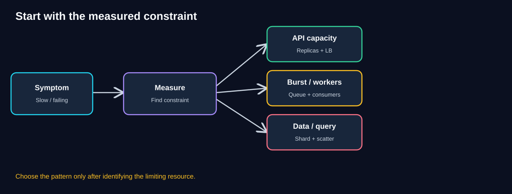
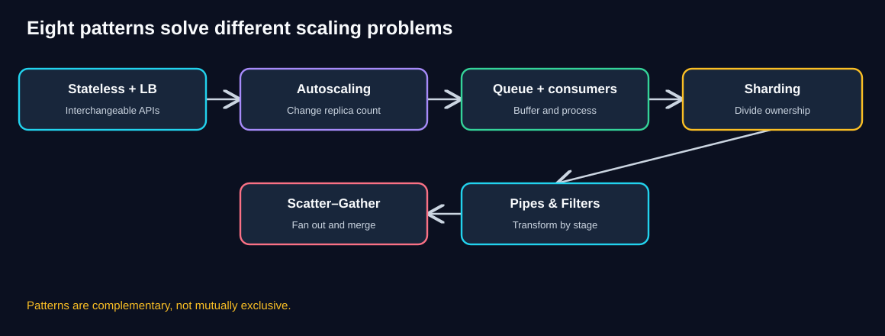
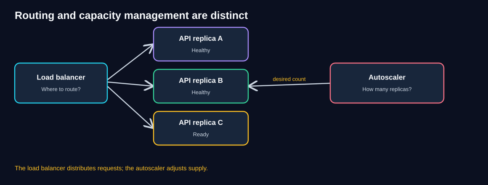
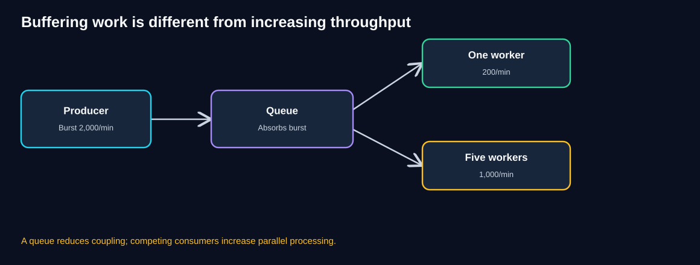
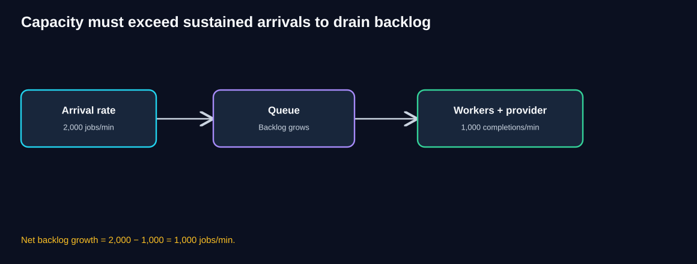
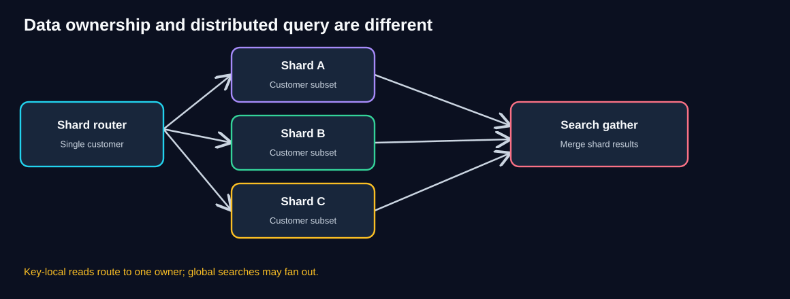
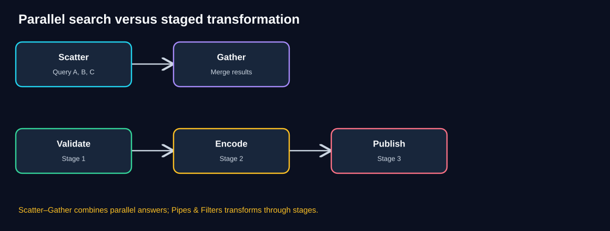
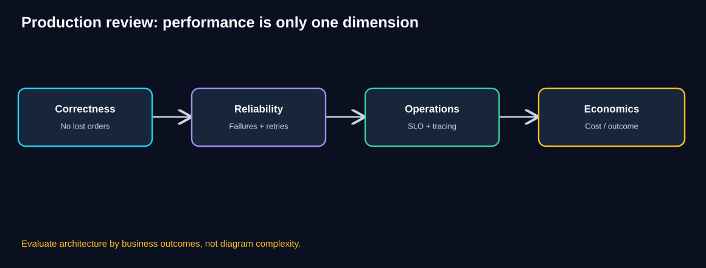
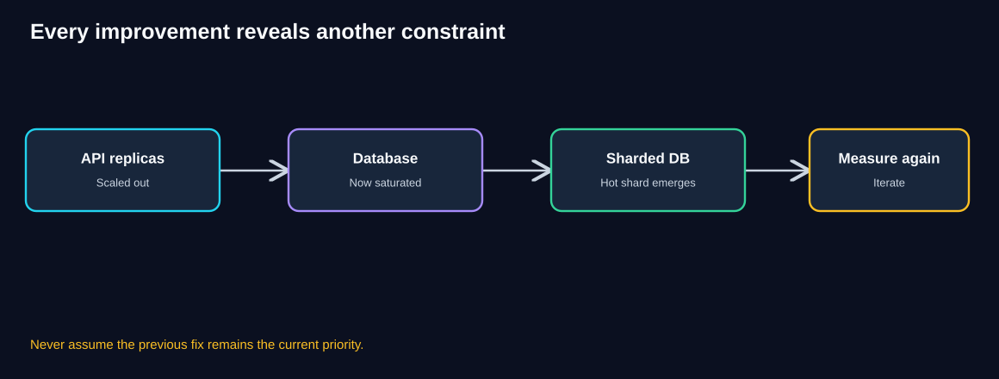

# Chapter 10 — Pattern Comparison & Selection Guide

> **Unit ID:** SG-SCALE-10 · **Capability:** AI-OPS-01 · [Course map](../../../../README.md#ordered-capability-map)

[Learning contract and transfer check](learning-contract.md) · [Course map](../../../../README.md)

> **Standalone study guide · Estimated study time: 90–110 minutes**
>
> **Running case study:** QuickCart, a fictional e-commerce platform.
>
> **Core lesson:** Measure the limiting resource, choose the smallest pattern that addresses it, protect correctness, and observe the next bottleneck.
>
> **You need:** SG-SCALE-01 to SG-SCALE-09.
>
> **You will produce:** Decision matrix with an unsuitable alternative and measured trigger to revisit.

[SG-SCALE-09 — ← Previous: Integrated Architecture Case Study](09-architecture-case-study.md) · [SG-SCALE-00 — Foundations](00-foundations.md)

## 1. Learning objectives

After completing this chapter, you should be able to:

- Compare all eight scalability patterns using the same criteria.
- Diagnose a performance symptom without jumping to a fashionable technology.
- Distinguish patterns that route, scale, buffer, parallelize, partition, aggregate, and transform.
- Select combinations of patterns for real QuickCart scenarios.
- Estimate capacity, backlog growth, drain time, and latency.
- Recognize hidden costs: duplicate messages, hot keys, cross-shard queries, retries, and coordination.
- Communicate trade-offs and success metrics in an architecture review.
- Answer scenario-based architecture interview questions.

## 2. Start with the bottleneck, not the pattern

Imagine QuickCart's checkout latency suddenly increases during a flash sale. A teammate says, “Let's add Kubernetes autoscaling.” Another says, “Let's shard the database.” A third suggests a queue.

All three proposals might be useful in the right situation. None is justified by the symptom **“checkout is slow”** alone.

The architect first asks:

1. What exactly is slow: the API, database, provider, queue, or a dependency?
2. Is the problem temporary burst pressure or sustained insufficient capacity?
3. Are requests independent, or must they preserve ordering or atomicity?
4. Can the proposed pattern actually increase the **limiting** resource's capacity?
5. What happens to reliability, correctness, latency, cost, and security afterward?

**Diagram walkthrough**

1. Start with an observable symptom such as errors or high latency.
2. Measure throughput, resource saturation, queue age, and dependency timing.
3. If application replicas are the limit, consider statelessness, load balancing, and scaling.
4. If bursts exceed worker processing, consider buffering and consumer parallelism.
5. If data ownership or cross-shard query work dominates, consider sharding or Scatter–Gather.
6. Re-measure after each change; a new bottleneck may emerge.

### Think like an architect

QuickCart's API CPU is only 25%, but database write latency and lock waits spike. Would doubling API replicas fix the issue?

Reveal the reasoning

Probably not. The application is not the measured limiting resource. More replicas may issue more database writes and worsen contention. Investigate query plans, indexes, transactions, write hot spots, and database capacity first. Consider sharding only when data ownership and workload can be safely divided and simpler remedies are insufficient.

## 3. One-page comparison of all eight patterns

| Pattern | Primary question | Main mechanism | Key trade-off |
|---|---|---|---|
| **01 Stateless Services** | Can any replica handle the next request? | Externalize durable/shared state | Shared-store dependency; session and concurrency design |
| **02 Load Balancing** | Which healthy replica should receive traffic? | Distribute requests across backends | Health checks, routing policy, LB availability |
| **03 Horizontal Scaling & Autoscaling** | How many instances should run? | Add/remove capacity based on demand | Startup delay, oscillation, downstream pressure |
| **04 Queue-Based Load Leveling** | Can work wait safely when demand spikes? | Durable buffer between producer and consumer | Eventual completion, backlog, retries |
| **05 Competing Consumers** | Can independent queued jobs run in parallel? | Multiple workers share pending work | Duplicates, ordering, provider limits |
| **06 Partitioning & Sharding** | Can data and writes be divided among owners? | Split datasets by partition key | Hot shards, migrations, cross-shard transactions |
| **07 Scatter–Gather** | Can one query ask several owners in parallel? | Fan-out, collect, merge | Tail latency, fan-out cost, incomplete results |
| **08 Pipes & Filters** | Can processing be split into focused stages? | Transform data through stage contracts | Orchestration, intermediate state, stage bottlenecks |

**Diagram walkthrough**

1. Stateless APIs make replicas interchangeable.
2. Load balancing distributes traffic, while autoscaling changes replica count.
3. Queues buffer bursts and competing consumers increase processing parallelism.
4. Sharding divides authoritative data ownership.
5. Scatter–Gather combines results across distributed owners.
6. Pipes & Filters structures multi-stage transformations; other patterns can support each stage.

**Important:** These are complementary design tools, not eight competing products.

## 4. Compare the patterns by scaling dimension

| Scaling dimension | Most relevant patterns | What they do **not** guarantee |
|---|---|---|
| Request routing | Load Balancing | More backend capacity |
| Application compute capacity | Stateless + Horizontal Scaling | More database throughput |
| Burst absorption | Queue-Based Load Leveling | Faster completion |
| Background-job parallelism | Competing Consumers | Higher downstream provider quota |
| Storage and write distribution | Partitioning/Sharding | Cheap global joins |
| Distributed read aggregation | Scatter–Gather | Correct partial results by default |
| Processing modularity | Pipes & Filters | Faster bottleneck stage automatically |
| Elastic response to demand | Autoscaling | Instant scale-out |

A useful classification:

- **Distribute requests:** Load Balancing.
- **Make compute interchangeable:** Stateless Services.
- **Change capacity:** Horizontal Scaling & Autoscaling.
- **Buffer demand:** Queue-Based Load Leveling.
- **Parallelize independent work:** Competing Consumers.
- **Divide ownership:** Partitioning & Sharding.
- **Combine parallel answers:** Scatter–Gather.
- **Decompose transformations:** Pipes & Filters.

## 5. Stateless Services vs Load Balancing vs Autoscaling

These three patterns are often confused because they frequently appear together.

**Diagram walkthrough**

1. The load balancer receives traffic.
2. It chooses among healthy, ready API replicas.
3. An autoscaler measures demand and changes the desired replica count.
4. New replicas become useful only after starting and passing readiness checks.
5. Statelessness allows requests to reach different replicas without losing server-local session state.
6. A shared database, session store, or provider may still become the limiting dependency.

### QuickCart example

A customer adds a product to a cart using API A, then the next request reaches API B.

- **Stateless Services** addresses cart/session dependence on API A.
- **Load Balancing** routes the request to API B.
- **Autoscaling** determines whether QuickCart should run three, six, or twelve API replicas.

### Worked sizing example

Suppose measured sustainable capacity is **250 requests/second per ready API replica**, and the expected peak is **1,200 requests/second**.

`ceil(1,200 / 250) = 5 replicas`

For an illustrative 25% capacity margin:

`ceil(1,200 × 1.25 / 250) = 6 replicas`

This is a rough sizing estimate. Real capacity depends on request mix, tail latency, startup time, and shared dependencies.

**Decision rule:** Statelessness enables safe interchangeability; the load balancer chooses **where**; the autoscaler chooses **how many**.

## 6. Queue-Based Load Leveling vs Competing Consumers

These patterns are related but not equivalent.

**Diagram walkthrough**

1. QuickCart produces notification jobs faster than they can be sent.
2. The queue accepts pending jobs without requiring the email provider to finish immediately.
3. One worker can process only 200 jobs/minute.
4. Five independent workers have nominal capacity of 1,000 jobs/minute.
5. If the provider accepts only 1,000/minute, more workers cannot increase successful sends beyond that limit.
6. Queue age and successful completions reveal whether scaling is actually helping.

### Numerical example: a flash-sale burst

Assume:

- Incoming notifications: **2,000/minute** for 5 minutes.
- Worker capacity: **200/minute**.
- Provider maximum: **1,000/minute**.
- Five workers are active throughout.
- Queue starts empty.

Successful completion capacity is `min(5 × 200, 1,000) = 1,000/minute`.

Backlog growth is `2,000 − 1,000 = 1,000/minute`.

After 5 minutes: **5,000 queued jobs**.

If arrivals drop to **200/minute**, net drain capacity is `1,000 − 200 = 800/minute`.

Drain time is `5,000 / 800 = 6.25 minutes`, assuming stable rates and no retry overhead.

**Diagram walkthrough**

1. Producer arrivals exceed sustainable completions.
2. The queue buffers the difference.
3. Worker and provider capacities jointly limit useful throughput.
4. Backlog grows while arrivals exceed completions.
5. After arrivals fall, the backlog drains only if completion capacity exceeds new arrivals.
6. A provider rate limit remains binding regardless of how many workers are added.

**Critical correctness concerns:** At-least-once delivery can create duplicates; use idempotency, bounded retries, a DLQ, and coordinated provider rate limiting. Accepting a queued job is not the same as completing the business action.

## 7. Sharding vs Scatter–Gather

Sharding divides **where data lives**. Scatter–Gather coordinates **how a query combines answers** from several owners.

**Diagram walkthrough**

1. A customer-specific request uses a partition key such as `customerId`.
2. The shard router selects the owning data shard.
3. That key-local request usually needs only one shard.
4. A global search may need results from several shards.
5. Scatter–Gather sends requests concurrently and merges their responses.
6. The merge must handle duplicates, ranking, timeouts, and completeness.

### Worked latency example

Four shards respond in **100 ms, 150 ms, 120 ms, and 4,000 ms**.

- Sequential wait: `100 + 150 + 120 + 4,000 = 4,370 ms`.
- Parallel wait for **all**: approximately `4,000 ms`, excluding overhead.
- With a **500 ms deadline**, only the first three results are available in time.

For product discovery, QuickCart might return clearly labeled **partial** results if the business permits. For an exact revenue total, missing the fourth shard means the total is incomplete: fail, wait, or run a complete asynchronous report.

**Decision rule:** Sharding can solve storage and write-distribution problems; Scatter–Gather can solve distributed query coordination. One does not automatically solve the other's problem.

## 8. Scatter–Gather vs Pipes & Filters

Both can involve multiple processing components, but the dataflow differs.

**Diagram walkthrough**

1. Scatter–Gather sends independent requests to several targets.
2. A gather step combines the resulting answers.
3. Pipes & Filters passes a transformed artifact from one stage to the next.
4. Later stages depend on earlier stage outputs unless branches are explicitly independent.
5. A pipeline may contain a parallel Scatter–Gather branch.
6. Both patterns need completion rules, timeouts, and observability, but for different reasons.

### QuickCart examples

**Scatter–Gather:** Search four product shards, collect matching products, deduplicate, rank, and return results.

**Pipes & Filters:** Validate a product video, normalize it, encode playback formats, generate a thumbnail, and publish after required checks.

**Useful distinction:** Scatter–Gather primarily combines **parallel answers**. Pipes & Filters primarily performs **staged transformations**.

## 9. Decision tree: choose by the symptom

Use the following diagnostic sequence, not as an automatic technology selector but as a guide to the next investigation.

| Measured symptom | First investigate | Candidate pattern |
|---|---|---|
| Requests fail when routed to another API replica | Local session/cart state | Stateless Services |
| Healthy replicas exist but traffic is uneven | Routing and health checks | Load Balancing |
| API CPU or request concurrency saturates | Replica capacity and startup delay | Horizontal Scaling |
| Short bursts overwhelm slow work | Buffer durability and completion expectations | Queue-Based Load Leveling |
| Queue backlog grows; workers saturated | Per-worker completion rate, provider limits | Competing Consumers |
| Database write/storage limit reached | Query/index optimization, hot keys, access locality | Partitioning/Sharding |
| One logical search needs multiple data owners | Query decomposition and completeness | Scatter–Gather |
| Media workflow is tightly coupled and hard to recover | Stage boundaries and artifacts | Pipes & Filters |
| Provider is already at hard quota | Throttling, demand shaping, commercial quota | **None alone** increases quota |
| One global lock serializes all work | Data model and contention | Redesign shared critical section |

### A useful non-pattern answer

Sometimes the right response is **not** to add one of the eight patterns. It may be to fix a missing index, cache an expensive read, shorten a transaction, adjust a provider quota, or reduce unnecessary work.

The purpose of pattern literacy is better decisions, not maximal pattern usage.

## 10. How patterns combine in QuickCart

A plausible integrated architecture is:

1. **Stateless API replicas** receive requests through a **load balancer**.
2. **Autoscaling** changes API replica count based on safe demand signals.
3. Checkout commits authoritative order state before acknowledging success.
4. A **transactional outbox** or equivalent reliable publication mechanism makes notification work available without losing events after an order commit.
5. A **queue** buffers notification bursts.
6. **Competing consumers** send notifications, respecting a shared provider rate limit.
7. Customer data may be **sharded** if measured workload and access patterns justify it.
8. Product search may **scatter** to relevant shards and **gather** results.
9. Media processing may use **Pipes & Filters**, with queues and stage-specific workers.

**Order correctness matters:** A queued email job should not be treated as the authoritative record of an order. The committed order state is authoritative, and notification completion can be eventual.

### Production ownership

| Component | Primary responsibility | Failure question |
|---|---|---|
| API tier | Validate requests and enforce authorization | Can another replica safely handle retries? |
| Order database | Authoritative order state | Can a retry create a duplicate order? |
| Outbox publisher | Reliable event handoff | Can committed orders lose notifications? |
| Notification queue | Durable pending work | What happens when backlog grows? |
| Worker pool | Process independent jobs | Can duplicates cause extra side effects? |
| Shard router | Correct data ownership | What if routing metadata is stale? |
| Search coordinator | Merge distributed results | Is a partial answer acceptable? |
| Media orchestrator | Track required artifacts | Can a stale upload publish? |

## 11. Trade-off comparison: latency, throughput, reliability, complexity

The entries below describe **typical tendencies**, not guaranteed outcomes.

| Pattern | Potential latency effect | Potential throughput effect | Key operational risk |
|---|---|---|---|
| Stateless | More consistent routing; shared-store latency possible | Enables replica scale-out | Shared state store becomes critical |
| Load Balancing | Can reduce overloaded-replica latency | Uses available replica capacity | Incorrect health/routing |
| Autoscaling | Helps after capacity arrives | Adds service capacity | Scale-out lag, oscillation |
| Queue | May increase completion latency | Smooths bursts; no direct processing gain | Backlog and delayed business completion |
| Consumers | More parallel job completions | Can increase until next bottleneck | Duplicates, ordering, throttling |
| Sharding | Faster local operations possible | Distributes data and writes | Migration and cross-shard complexity |
| Scatter–Gather | Can overlap child latency | Adds parallel work, not free capacity | Tail latency, fan-out amplification |
| Pipes & Filters | Can reduce critical path with safe branching | Stage-level pipelining/scaling | Checkpoints and orchestration |

### Business impact view

Assess each option against:

- Customer-visible latency or task completion time.
- Error rate and business correctness.
- Revenue protected during peak demand.
- Engineering and infrastructure cost.
- Operational burden and on-call risk.
- Data privacy, security, and compliance needs.

## 12. Failure modes that change the recommendation

| Scenario | Naive idea | Better architectural reasoning |
|---|---|---|
| API retries create duplicate orders | Add more replicas | Add idempotent order creation and correct transaction boundaries |
| Email provider throttles | Add 20 workers | Coordinate global rate, back off, and manage backlog |
| One shard is hot | Add random shards | Find hot keys and evaluate targeted splitting or relocation |
| Product search has a 4-second straggler | Increase global timeout | Define deadline and partial-result correctness |
| Video thumbnail fails after encoding succeeds | Restart whole job | Checkpoint successful stages; retry failed stage |
| New replicas fail readiness for 60 seconds | Scale only when CPU reaches 100% | Use earlier signals, headroom, and startup-aware policy |
| Queue depth is zero but checkout slow | Add consumers | Queue is not the bottleneck; inspect synchronous checkout path |

## 13. A realistic ROI and impact framework

Scalability investments should be justified by measurable business outcomes.

### Example: reducing flash-sale order failures

**Illustrative assumptions, not QuickCart historical data:**

- 100,000 attempted orders in a promotional event.
- Failure rate before improvements: 3%.
- Failure rate after improvements: 0.5%.
- Contribution margin per successfully recovered order: $8.
- Incremental infrastructure and operating cost for the event: $4,000.
- Engineering investment for the change: $20,000.

Potential additional successful orders:

`100,000 × (0.03 − 0.005) = 2,500 orders`

Illustrative contribution benefit:

`2,500 × $8 = $20,000`

Event-level contribution after incremental operating cost:

`$20,000 − $4,000 = $16,000`

This **does not** imply immediate payback on the $20,000 engineering investment. If comparable events recur, estimate frequency and persistence of benefits, then account for ongoing costs, implementation risk, and alternative investments.

### What to measure

| Business objective | Engineering metric | Business metric |
|---|---|---|
| Fewer lost checkouts | Error rate, p99 latency, duplicate-order rate | Completed orders, margin retained |
| Timely notifications | Queue age, success rate, DLQ | Customer communication delay |
| Better product discovery | Search latency, incomplete-result rate | Search conversion |
| Faster merchant publishing | Video ready-time p95 | Time to listing |
| Lower cost | CPU/GPU utilization, cost per request/job | Contribution after infrastructure cost |

## 14. Monitoring: prove the pattern solved the problem

**Diagram walkthrough**

1. **Correctness:** No lost orders, duplicate charges, or misleading totals.
2. **Reliability:** Failures recover within defined objectives.
3. **Operations:** Teams can trace, alert, and diagnose the system.
4. **Economics:** The improvement justifies its infrastructure and engineering cost.
5. Review all dimensions together rather than celebrating a throughput chart alone.

### Minimum useful dashboard

- API RPS, error rate, p95/p99, ready replicas, and autoscaling events.
- Database CPU, I/O, locks, p99 queries, and per-shard distribution.
- Queue depth, oldest-message age, completion rate, retries, and DLQ.
- Provider throttling, successful notification rate, and global concurrency.
- Search fan-out width, per-shard latency, and partial-result rate.
- Pipeline stage latency, queue age, failure rate, and end-to-end ready time.
- Cost per completed business operation.

**SLO caution:** An API may respond quickly with `202 Accepted` while work remains queued. Track **end-to-end completion objectives** separately from acceptance latency.

## 15. Governance and security review

The patterns introduce different risk surfaces:

- **Stateless APIs:** Session token security, shared-store access, and authorization consistency.
- **Load balancers:** TLS handling, forwarded identity headers, and correct health endpoints.
- **Autoscaling:** Least-privilege scaling permissions and safe upper bounds.
- **Queues and consumers:** Encryption, access controls, sensitive payload minimization, retention, and replay authorization.
- **Sharding:** Tenant isolation, routing authorization, residency, and deletion across shards.
- **Scatter–Gather:** Identity propagation, cross-tenant leakage prevention, and safe incomplete-response semantics.
- **Pipes & Filters:** Untrusted media isolation, artifact access, versioning, and mandatory publication checks.

**Key rule:** A scalability change is not complete until the security, recovery, and operational ownership implications are understood.

## 16. Pattern-selection architecture decision record

Use this template for QuickCart or a real project.

| ADR field | Example |
|---|---|
| Decision title | Scale notification processing during flash sales |
| Observed problem | Queue oldest age exceeds target during 10× burst |
| Evidence | Arrival 2,000/min, completion 200/min, provider cap 1,000/min |
| Options | One worker; five workers; higher provider quota; demand shaping |
| Selected change | Five consumers with global rate limiter |
| Why | Raises useful capacity up to measured provider limit |
| Correctness controls | Idempotency, retry budget, DLQ, outbox |
| Operational controls | Queue age, 429s, completion rate, worker readiness |
| Cost assumption | Additional worker runtime and monitoring |
| Success criteria | Completion delay under agreed SLO |
| Rollback | Reduce concurrency safely; preserve queued work |

This structure prevents architectural discussions from becoming technology preference contests.

## 17. Common misconceptions

| Misconception | Correction |
|---|---|
| “More replicas always increase throughput.” | Shared dependencies may remain saturated. |
| “Load balancing automatically autos-scales.” | Routing and capacity control are separate. |
| “Queues make background work faster.” | Queues buffer; workers do the processing. |
| “Five workers guarantee fivefold throughput.” | Shared caps, locks, and retries limit speedup. |
| “Sharding means every query becomes faster.” | Cross-shard queries may become harder. |
| “Parallel search guarantees low latency.” | Slow required shards dominate. |
| “Pipelines require microservices.” | Filters can run in-process or distributed. |
| “Exactly-once delivery guarantees exactly-once business effects.” | External side effects need application-level protection. |
| “An accepted request is a completed order.” | Acceptance and business completion are different states. |
| “The most scalable design is the most complex design.” | Prefer the smallest measured, operable change. |

## 18. Knowledge checks

### Q1. API A holds the cart in local memory; API B cannot see it. Which pattern comes first?

Reveal answer

**Stateless Services:** move durable/shared cart state outside individual API instances or otherwise remove replica affinity requirements. Load balancing alone does not fix missing state.

### Q2. There are five healthy replicas, but one receives almost all requests. Which component should you inspect?

Reveal answer

The **load balancer** and routing policy, including health and stickiness configuration.

### Q3. What does an autoscaler do that a load balancer does not?

Reveal answer

It changes desired service capacity by adding or removing instances. The load balancer routes among available healthy instances.

### Q4. A queue receives 1,500 jobs/minute; workers complete 1,000/minute. How fast does backlog grow?

Reveal answer

`1,500 − 1,000 = 500 jobs/minute`, assuming steady rates and no loss or retry effects.

### Q5. Provider cap is 800/minute, and workers can attempt 1,600/minute. What is the maximum useful throughput?

Reveal answer

At most **800 successful provider operations/minute** under the stated cap. More attempts can trigger throttling.

### Q6. Why might `customerId` be a good sharding key for carts?

Reveal answer

Cart reads and writes are often customer-local, so routing by `customerId` can keep related operations on one shard. Validate traffic skew and access patterns first.

### Q7. Why might global search need Scatter–Gather after sharding?

Reveal answer

Relevant results may be owned by several shards. The coordinator queries them concurrently and combines results.

### Q8. Is a partial search result acceptable for an exact financial total?

Reveal answer

No. The total would be incomplete. Follow an explicit correctness policy such as failing or producing a complete asynchronous report.

### Q9. A media pipeline's stage capacities are 50, 10, and 40 items/minute. Which stage limits throughput?

Reveal answer

The stage with **10 items/minute**, assuming every item must pass through all three stages.

### Q10. Which pattern makes it easier to retry only failed video encoding rather than restarting the whole workflow?

Reveal answer

**Pipes & Filters** with durable stage outputs, checkpoints, and idempotent retries.

### Q11. Why should queue age be monitored alongside queue depth?

Reveal answer

Depth indicates volume; oldest-message age indicates how long work has waited. A small queue can still contain one very old, stuck job.

### Q12. What is the best first action when a scaled system becomes slow again?

Reveal answer

**Measure the current bottleneck.** The original limiting resource may have moved to the database, a provider, a hot shard, or another dependency.

## 19. Architecture interview challenge A: flash-sale checkout

**Scenario**

QuickCart has 1,200 requests/second during a sale. Each ready API replica sustainably handles 250 requests/second. The order database is already at 90% of its measured safe write capacity. A notification provider supports 1,000 emails/minute, while new orders may create 2,000 email jobs/minute.

**Questions**

1. How many API replicas are needed at a minimum?
2. Would doubling API replicas fix the database bottleneck?
3. How should order creation and notification be separated?
4. What prevents duplicate orders and duplicate emails?
5. What should the operations dashboard show?

Reveal worked solution

1. `ceil(1,200 / 250) = 5` ready replicas as a nominal minimum, with additional headroom based on policy.
2. No. Database write saturation must be addressed through measured query/transaction optimization, contention reduction, capacity improvements, or justified partitioning.
3. Commit authoritative order state first and use a reliable event handoff, such as a transactional outbox, to enqueue notifications.
4. Use idempotent order creation and consumer/provider-side deduplication or reconciliation. A queue alone does not guarantee exactly-once effects.
5. Track checkout success and p99, database write latency and locks, queue age, successful email rate, provider 429s, retry/DLQ rate, and business completion metrics.

## 20. Architecture interview challenge B: global search

**Scenario**

Product search fans out to four shards. Response times are A=100 ms, B=150 ms, C=120 ms, D=4,000 ms. The customer-facing deadline is 500 ms.

**Questions**

1. What is the approximate all-results parallel wait?
2. What is the approximate sequential wait?
3. Can QuickCart return results from A, B, and C?
4. What happens if the same query is an exact inventory reconciliation?

Reveal worked solution

1. Parallel all-results wait: roughly **4,000 ms**, plus overhead.
2. Sequential wait: **4,370 ms**, plus overhead.
3. For exploratory product search, possibly yes, **only** if the product contract allows partial results and they are labeled incomplete.
4. An exact inventory reconciliation cannot silently omit D. It must use an appropriate complete-data or failure policy.

## 21. Architecture interview challenge C: video pipeline

**Scenario**

QuickCart's validation, encoding, and thumbnail stages can process 120, 20, and 100 videos/minute respectively. Incoming demand is 80 videos/minute for ten minutes.

**Questions**

1. Which stage is the bottleneck?
2. How much backlog builds before it with one encoder?
3. What happens if encoding capacity increases to 100/minute?
4. Which controls prevent stale or incomplete video publication?

Reveal worked solution

1. Encoding, at 20/minute.
2. `(80 − 20) × 10 = 600` videos, assuming the upstream stage keeps up.
3. Encoding would no longer be the bottleneck at 80/minute arrivals, provided other shared resources support it. Validation and thumbnail capacities are each above 80/minute in this simplified model.
4. Use durable stage checkpoints, versioned artifacts, idempotent retries, and a publication gate requiring all mandatory outputs and checks for the current upload version.

## 22. The next-bottleneck principle

**Diagram walkthrough**

1. QuickCart adds stateless API replicas and scales them out.
2. More API traffic exposes database write contention.
3. Data distribution improves some workloads, but a hot shard emerges.
4. Each intervention changes the system's constraints.
5. The architect measures again rather than repeating the previous solution.
6. This loop continues throughout the product lifecycle.

### A practical five-step loop

1. **Observe:** Establish a baseline and identify the limiting resource.
2. **Hypothesize:** Choose the smallest change expected to help.
3. **Protect:** Define correctness, security, rollback, and failure behavior.
4. **Validate:** Run a controlled load or failure test.
5. **Measure again:** Compare business outcomes, cost, and the new bottleneck.

## 23. Production review checklist

- [ ] We can name the measured bottleneck.
- [ ] We considered a simpler fix before adding distributed complexity.
- [ ] The selected pattern addresses that bottleneck directly.
- [ ] We documented latency, throughput, correctness, and cost trade-offs.
- [ ] Requests and events have appropriate idempotency protection.
- [ ] Shared dependency and provider limits are respected.
- [ ] Queued acceptance is distinguished from completed business work.
- [ ] Cross-shard completeness and consistency policies are explicit.
- [ ] Scale-in, crash recovery, and retries have been tested.
- [ ] Per-component and end-to-end metrics are observable.
- [ ] Security, privacy, and data residency are covered.
- [ ] The change has an owner, success criteria, and rollback plan.

## 24. Quick revision: the pattern selection cheat sheet

| If you hear... | Think... |
|---|---|
| “Requests break when they hit a different server.” | Stateless Services |
| “Traffic is uneven across healthy servers.” | Load Balancing |
| “We need more replicas during peak demand.” | Horizontal Scaling & Autoscaling |
| “Traffic bursts faster than jobs can finish.” | Queue-Based Load Leveling |
| “One worker cannot drain the queue.” | Competing Consumers |
| “One database owns too much data/write load.” | Partitioning & Sharding |
| “One query needs results from several shards.” | Scatter–Gather |
| “One workflow has many transformation steps.” | Pipes & Filters |
| “More workers cause 429s.” | Shared provider rate limit, not necessarily a new pattern |
| “We scaled, but it's slow again.” | Measure the **new** bottleneck |

### Five final architect's questions

1. **What is the limiting resource right now?**
2. **Is the problem routing, capacity, burst buffering, parallelism, ownership, aggregation, or staged transformation?**
3. **Which correctness guarantee must survive failures and retries?**
4. **What operational and economic cost does the solution introduce?**
5. **What becomes the next bottleneck after this change?**

## 25. Connection to the next chapter

Knowing pattern definitions is only the beginning. Architectural judgment improves when you practice ambiguous scenarios, explain trade-offs, and defend decisions under constraints.

The next chapter turns these comparisons into **Architecture Challenges**, including bottleneck diagnosis, capacity calculations, failure injection, and production design reviews.

[SG-SCALE-11 — Next: 11 — Architecture Challenges](11-architecture-challenges.md).

## Completion checkpoint

**You can now:** compare alternatives and next constraints.

**Show it:** Decision matrix with an unsuitable alternative and measured trigger to revisit. Then attempt chapter 10's unfamiliar transfer check in the [learning contract](learning-contract.md).

**Next:** [SG-SCALE-11 — Architecture Challenges Workbook](11-architecture-challenges.md).

---

*All calculations and QuickCart scenarios are illustrative teaching examples. Validate real workload measurements, platform guarantees, and business requirements before production use.*
