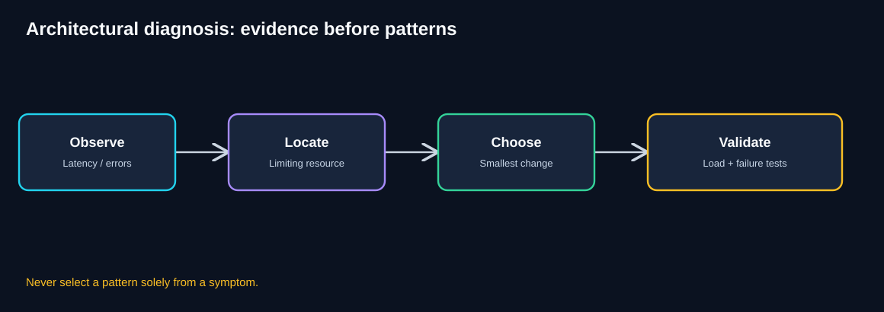
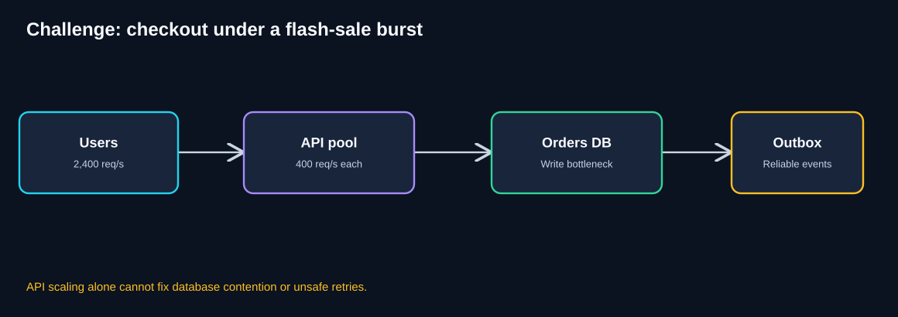
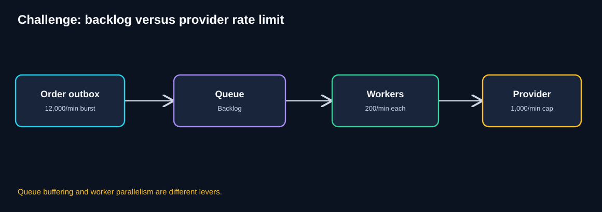
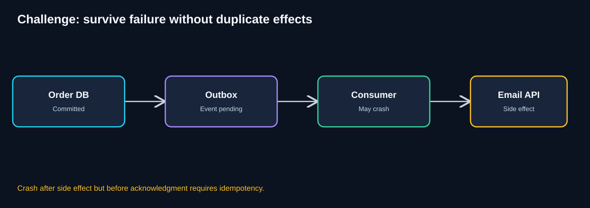
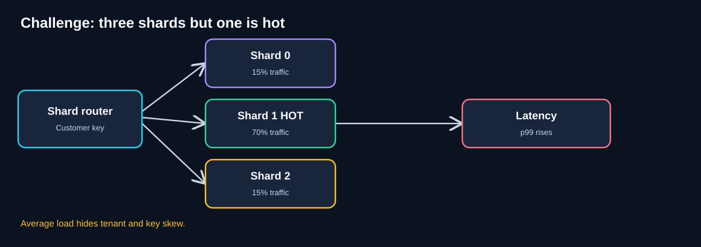
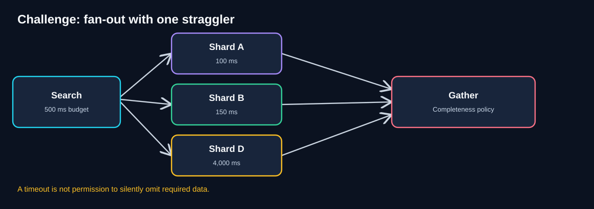
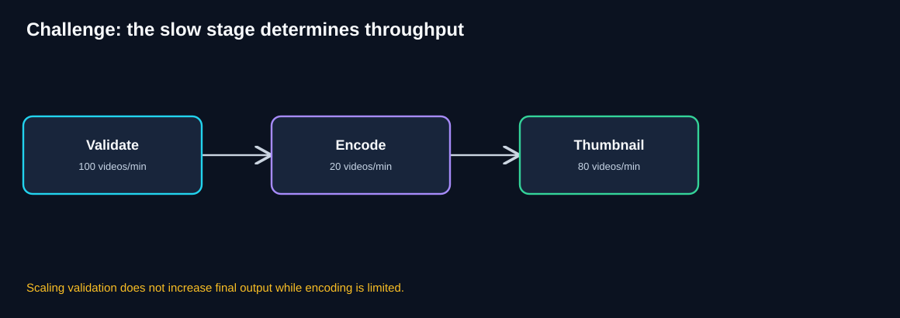
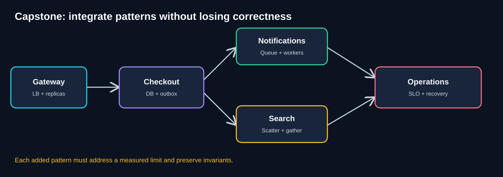

# Chapter 11 — Architecture Challenges Workbook

> **Unit ID:** SG-SCALE-11 · **Capability:** AI-DEFEND-01 · [Course map](../../../../README.md#ordered-capability-map)

[Learning contract and transfer check](learning-contract.md) · [Course map](../../../../README.md)

> **Standalone practice chapter · Estimated study time: 2–3 hours**
>
> **Running case study:** QuickCart, a fictional e-commerce platform.
>
> **Purpose:** Turn the eight scalability patterns into practical diagnostic and design skills. The worked answers are **examples**, not the only valid architectures.
>
> **You need:** SG-SCALE-01 to SG-SCALE-10.
>
> **You will produce:** Attempt the existing public rubric before solutions; preserve failure evidence and repair critical correctness gaps.

[SG-SCALE-10 — ← Previous: Pattern Comparison](10-pattern-comparison.md) · [SG-SCALE-09 — Integrated Case Study](09-architecture-case-study.md)

## 1. How to use this workbook

This is a **practice-first** chapter. For each challenge:

1. Read the scenario and write down the business objective.
2. Identify the **measured** limiting resource, not just the visible symptom.
3. State assumptions, constraints, and business invariants.
4. Choose the smallest suitable architectural change.
5. Calculate capacity or latency where enough data is supplied.
6. Explain failure handling, monitoring, security, and cost.
7. Open the worked answer only after attempting your own design.

You can complete one challenge per study session or treat the entire chapter as a mock architecture interview. Use the rubric in Section 4 to score your answers.

## 2. The QuickCart architecture decision method



**Diagram walkthrough**

1. Observe the symptom: latency, error rate, backlog, cost, or failed business outcomes.
2. Locate the limiting resource using metrics and traces.
3. Check whether a small fix (index, caching, connection pooling, backpressure) is sufficient.
4. Choose a pattern that directly addresses the bottleneck.
5. Validate the change with realistic load and failure tests.
6. Repeat the process because the next bottleneck may move elsewhere.

**Use this answer structure for every challenge:**

| Field | What to write |
|---|---|
| Business objective | What must users or operators achieve? |
| Evidence | Which metric proves the bottleneck? |
| Invariants | What must never go wrong? |
| Pattern | Which architectural change and why? |
| Sizing | Capacity, backlog, latency, and assumptions |
| Failure response | Retries, failover, idempotency, consistency |
| Observability | How to know it works in production |
| Trade-offs | Cost, complexity, and the next likely bottleneck |

## 3. Pattern reference card

| Pattern | Primary lever | QuickCart use |
|---|---|---|
| Stateless Services | Remove instance-local state | Interchangeable API replicas |
| Load Balancing | Distribute requests | Route to healthy APIs |
| Horizontal Scaling & Autoscaling | Change replica capacity | Handle changing traffic |
| Queue-Based Load Leveling | Buffer work | Smooth notification bursts |
| Competing Consumers | Parallelize queued jobs | Increase worker throughput |
| Partitioning & Sharding | Divide data ownership | Scale customer data |
| Scatter–Gather | Parallel fan-out and merge | Search several shards |
| Pipes & Filters | Decompose transformations | Process product videos |

## 4. Self-assessment scoring rubric

Score each challenge out of **10 points**:

| Criterion | Points |
|---|---:|
| Correct bottleneck and evidence | 2 |
| Appropriate pattern and justification | 2 |
| Correct calculations and assumptions | 2 |
| Failure and correctness safeguards | 2 |
| Monitoring, trade-offs, and next bottleneck | 2 |

**Interpretation:** 0–3 = revisit fundamentals; 4–6 = developing; 7–8 = strong; 9–10 = production-aware. This is a learning rubric, not a certification.

---

# Part I — Foundation Challenges

## 5. Challenge 1 — The disappearing shopping cart

**Difficulty:** Beginner · **Focus:** Stateless Services

QuickCart runs two API instances, A and B. Customers add products to their carts on A, but after a load balancer sends the next request to B, some carts appear empty. Each API stores cart state in local memory.

**Your tasks**

1. Diagnose the failure.
2. Propose the smallest safe architectural change.
3. Compare shared session/cart storage with sticky sessions.
4. Identify two new failure risks and three useful metrics.

<details><summary>Reveal worked answer</summary>

**Diagnosis:** Application instances are stateful. The next request may land on a different instance with no copy of the cart.

**Design:** Store authoritative cart state in a shared, durable-enough store accessible by all API replicas. Keep APIs interchangeable. Use a suitable session mechanism for authentication; do not assume a JWT replaces the shopping-cart data store.

**Sticky sessions:** Can reduce symptoms temporarily but do not solve instance loss, uneven load, or independent autoscaling. They are not the preferred primary correctness mechanism.

**Risks:** Shared-store outage, stale reads, concurrent cart updates, expiration/TTL mistakes.

**Metrics:** Cart read/write error rate, shared-store latency, missing-cart incidents, replica-to-replica consistency, cart update conflicts.

**Next bottleneck:** Shared cart store throughput and availability.

</details>

## 6. Challenge 2 — A healthy server that serves no traffic

**Difficulty:** Beginner · **Focus:** Load Balancing

QuickCart has three healthy API replicas, each able to serve **300 requests/second** for the current workload. Traffic is routed directly to one replica, which is overloaded at **650 requests/second**. The other two replicas are mostly idle.

**Your tasks**

1. Estimate nominal combined capacity.
2. Explain why the current design is slow.
3. Propose routing and health-check behavior.
4. Explain why a load balancer alone may not solve every bottleneck.

<details><summary>Reveal worked answer</summary>

**Capacity:** `3 × 300 = 900 requests/second`, ignoring coordination overhead and shared dependencies.

**Problem:** One replica receives 650 requests/second, more than its 300/second measured capacity, while other capacity is idle.

**Design:** Introduce a load balancer that routes to healthy, ready replicas. Use suitable routing (round-robin, least-connections, or another policy) and readiness/health checks. Handle draining during deployment.

**Caveat:** If all replicas use a saturated database, routing more evenly will not eliminate database saturation.

**Monitor:** Per-instance request rate, p95 latency, error rate, readiness, active connections, and backend saturation.

</details>

## 7. Challenge 3 — How many API replicas?

**Difficulty:** Beginner · **Focus:** Horizontal Scaling & Autoscaling

A flash sale is expected to drive **2,400 requests/second**. Each API replica has a measured sustainable capacity of **400 requests/second** at the target latency. The team wants **25% spare capacity relative to forecast demand**.



**Diagram walkthrough**

1. The customer load reaches the API pool.
2. Each API replica has a measured safe rate.
3. API replicas still depend on a shared orders database.
4. Order creation must preserve correctness despite retries.
5. An outbox can reliably hand off post-order events after the order transaction.
6. Scaling API replicas without checking database limits can move the bottleneck downstream.

**Your tasks**

1. Calculate the minimum replicas without headroom.
2. Calculate the target with 25% capacity headroom.
3. Explain what the autoscaler should monitor.
4. Explain what happens if the database can process only 1,500 order writes/second.

<details><summary>Reveal worked answer</summary>

**Without headroom:** `ceil(2,400 / 400) = 6 replicas`.

**With 25% extra capacity relative to demand:** `ceil((2,400 × 1.25) / 400) = ceil(7.5) = 8 replicas`.

**Autoscaling:** Use meaningful demand and saturation signals such as requests per second per ready replica, CPU, in-flight requests, and latency. Account for warm-up, cooldown, and scale-in draining.

**Database constraint:** Eight API replicas do not make a database with a 1,500-write/second limit support 2,400 writes/second. If every request writes an order, the architecture needs admission control, database optimization/capacity changes, or a carefully designed business workflow. Do not claim accepted orders succeeded unless they were durably committed.

**Next bottleneck:** Database writes or external checkout dependencies.

</details>

---

# Part II — Queueing and Parallel Processing

## 8. Challenge 4 — A notification backlog grows

**Difficulty:** Intermediate · **Focus:** Queue-Based Load Leveling

QuickCart produces **12,000 notification jobs/minute** for five minutes. A notification provider accepts at most **1,000 successful requests/minute**. The queue starts empty, and all notifications are assumed independent.



**Diagram walkthrough**

1. Committed orders create notification work.
2. The queue accepts the burst, subject to capacity and retention limits.
3. Workers take jobs from the queue.
4. The provider imposes a shared 1,000/minute cap.
5. The backlog grows when arrivals exceed successful completions.
6. More workers cannot raise throughput beyond the provider cap.

**Your tasks**

1. Calculate the backlog after the five-minute burst, assuming processing reaches 1,000/minute.
2. Calculate drain time if new arrivals stop after the burst.
3. Calculate drain time if normal arrivals continue at 200/minute.
4. Explain acceptance versus completion.
5. Define two queue-related alerts.

<details><summary>Reveal worked answer</summary>

**Backlog:** `(12,000 − 1,000) × 5 = 55,000 jobs`.

**Drain with zero new arrivals:** `55,000 / 1,000 = 55 minutes`.

**Drain with 200 new jobs/minute:** Net drain rate = `1,000 − 200 = 800/minute`; time = `55,000 / 800 = 68.75 minutes`.

**Acceptance versus completion:** A successfully queued job is accepted for asynchronous processing, not necessarily delivered to the customer. Expose status and avoid falsely reporting completion.

**Alerts:** Oldest-message age above an SLO threshold; backlog projected to exceed retention or drain-time limits. Also monitor DLQ growth, retries, and provider 429s.

**Safeguards:** Durable publication, bounded retries, idempotency, and backpressure when queue capacity is threatened.

</details>

## 9. Challenge 5 — Should we add ten workers?

**Difficulty:** Intermediate · **Focus:** Competing Consumers

Each notification worker can process **200 jobs/minute** when unconstrained. The provider allows **1,000 successful notifications/minute**. The team proposes 10 workers to eliminate a backlog.

**Your tasks**

1. Compare nominal throughput at 1, 3, 5, and 10 workers.
2. Find the worker count that first reaches the provider cap.
3. Explain the risk of ten uncoordinated workers.
4. Design duplicate-safe retry behavior.
5. Choose a scaling metric.

<details><summary>Reveal worked answer</summary>

| Workers | Nominal capacity | Useful capacity under provider cap |
|---:|---:|---:|
| 1 | 200/min | 200/min |
| 3 | 600/min | 600/min |
| 5 | 1,000/min | At most 1,000/min |
| 10 | 2,000/min | At most 1,000/min |

Five workers first reach the cap in this simplified model.

Ten uncoordinated workers may generate throttling, retries, and wasted cost. Use a **global rate limiter** or shared concurrency budget, not merely a per-worker limit.

For duplicate safety, use stable event IDs, atomic processing state where appropriate, provider idempotency keys if supported, and reconciliation of uncertain side effects. A crash after sending but before acknowledgment can cause redelivery.

Scale against oldest-message age and measured successful completion rate, with a maximum worker count constrained by downstream capacity.

</details>

## 10. Challenge 6 — Orders and emails disagree

**Difficulty:** Intermediate · **Focus:** Reliability across boundaries

QuickCart's checkout flow writes an order, then publishes an `OrderPlaced` event to a queue. Sometimes the database commit succeeds but the queue publish fails. Sometimes the consumer sends an email and crashes before acknowledging.



**Diagram walkthrough**

1. The order database commits the authoritative business action.
2. The outbox records the event as part of the same local transaction.
3. A publisher later delivers the event to messaging infrastructure.
4. A consumer may crash during processing.
5. The email provider may have completed the side effect even if the consumer has not acknowledged.
6. Recovery must handle both missed publication and duplicate delivery.

**Your tasks**

1. Identify both failure windows.
2. Explain how a transactional outbox helps.
3. Explain why the outbox alone does not prevent duplicate emails.
4. Design a reconciliation process.

<details><summary>Reveal worked answer</summary>

**Window 1:** Order commit succeeds, queue publish fails. Without a durable event record, the notification can be lost.

**Outbox:** Write the order and its event to an outbox in the **same database transaction**. A separate publisher retries sending events. This prevents the application from depending on a single nontransactional commit-then-publish sequence.

**Window 2:** Email provider sends successfully, but consumer crashes before acknowledgment. Broker redelivery may repeat the side effect.

**Correctness:** Use a stable business event ID, provider-supported idempotency where available, durable processing state, and a process for uncertain provider outcomes. Exactly-once end-to-end email delivery cannot be assumed.

**Reconciliation:** Compare committed orders, outbox publication status, consumer processing records, and provider receipts; investigate gaps and retry only when safe.

</details>

---

# Part III — Data Distribution and Search

## 11. Challenge 7 — Three shards, one hotspot

**Difficulty:** Intermediate · **Focus:** Partitioning & Sharding

QuickCart has three database shards. Traffic distribution is:

- Shard 0: 15%.
- Shard 1: 70%.
- Shard 2: 15%.

Total incoming customer queries: **30,000/second**. Each shard's safe measured capacity is **10,000 queries/second**.



**Diagram walkthrough**

1. The router maps customer keys to shards.
2. Shard 0 receives a small share of traffic.
3. Shard 1 receives most traffic and becomes hot.
4. Shard 2 remains lightly loaded.
5. High latency on Shard 1 affects its customers even though aggregate capacity appears sufficient.
6. Moving or splitting hot data may be more effective than adding an arbitrary shard.

**Your tasks**

1. Calculate per-shard query rates.
2. Identify which shard exceeds its safe capacity.
3. Explain why adding a fourth shard may not solve the problem.
4. Propose a measured mitigation and safe migration plan.
5. Explain the difference between sharding and replication.

<details><summary>Reveal worked answer</summary>

**Traffic:** Shard 0 = `30,000 × 0.15 = 4,500/s`; Shard 1 = `30,000 × 0.70 = 21,000/s`; Shard 2 = `4,500/s`.

**Overload:** Shard 1 exceeds its 10,000/s measured safe capacity by **11,000/s**.

**Why a fourth shard may fail:** A single hot key or very large tenant might remain on one shard. A naive modulo change can also remap many keys without migrating their data.

**Mitigation:** Identify hot keys and query types; optimize indexes and cache suitable reads; consider moving a large tenant via directory mapping or splitting data where correctness permits. For migration: snapshot, capture ongoing changes, coordinate ownership cutover, verify, and retain rollback.

**Replication:** Creates copies of the same logical data for availability/read scaling. **Sharding:** Distributes distinct data subsets and ownership.

</details>

## 12. Challenge 8 — Search across four shards

**Difficulty:** Intermediate · **Focus:** Scatter–Gather

QuickCart searches four independent product shards:

| Shard | Response time |
|---|---:|
| A | 100 ms |
| B | 150 ms |
| C | 120 ms |
| D | 4,000 ms |

The interactive search deadline is **500 ms**. Product discovery permits partial results **if clearly marked**. An exact financial report does not.



**Diagram walkthrough**

1. The search request has one overall 500 ms deadline.
2. Subrequests fan out concurrently.
3. A and B return quickly; C is also assumed to finish before the deadline.
4. D takes four seconds and becomes the straggler.
5. The coordinator must apply the correct completeness policy.
6. The final response must not silently present an incomplete answer as complete.

**Your tasks**

1. Compute idealized sequential and parallel all-results waiting times.
2. Identify results available before the deadline.
3. Specify product-search behavior.
4. Specify financial-report behavior.
5. Describe two safeguards against fan-out overload.

<details><summary>Reveal worked answer</summary>

**Sequential:** `100 + 150 + 120 + 4,000 = 4,370 ms`, excluding overhead.

**Parallel all-results:** `max(100, 150, 120, 4,000) = 4,000 ms`, excluding overhead.

**Before 500 ms:** A, B, and C.

**Product search:** Return an explicitly incomplete result from A/B/C if permitted, with internal missing-shard metadata and stable deduplication/ranking. Cancel unnecessary outstanding work where possible.

**Financial report:** Fail or continue asynchronously until complete; do not silently omit Shard D.

**Overload controls:** Limit fan-out concurrency, propagate deadlines, bound retries, use circuit breakers and admission control. Track per-shard p95/p99 and partial-result rate.

</details>

## 13. Challenge 9 — A top-ten search ranking bug

**Difficulty:** Advanced · **Focus:** Correct aggregation

QuickCart's coordinator asks each of three shards for its **top two** products and then claims to return the **global top ten**.

**Your tasks**

1. Identify the obvious correctness problem.
2. Explain why merging results requires more than concatenation.
3. Describe a sounder approach for globally ranked results.
4. Explain the effect of missing shards.

<details><summary>Reveal worked answer</summary>

**Problem:** Three shards returning two products each provide at most **six candidates**, so the coordinator cannot produce a genuine top ten.

**Merge requirements:** Normalize scores, deduplicate canonical product IDs, use stable tie-breaking, and ensure the shard-local retrieval strategy is sufficient for the global ranking semantics.

**Approach:** Under a shared globally comparable score and correct local top-K retrieval, ask each shard for enough candidates (often top K per shard) and merge globally. More complex ranking or filtering may require over-fetching, iterative retrieval, or a dedicated search index.

**Missing shard:** Even a well-ranked visible list may be incomplete if a relevant shard failed. Return explicit completeness metadata or fail, according to the business contract.

</details>

---

# Part IV — Processing Pipelines and Failure Engineering

## 14. Challenge 10 — Video encoding is too slow

**Difficulty:** Intermediate · **Focus:** Pipes & Filters

QuickCart's video pipeline has these sustainable capacities:

| Stage | Capacity |
|---|---:|
| Validate | 100 videos/min |
| Encode | 20 videos/min |
| Thumbnail | 80 videos/min |

New arrivals run at **60 videos/minute** for 10 minutes, then fall to **10/minute**. Initially there is one encoder, and the pipeline is otherwise unconstrained.



**Diagram walkthrough**

1. Validation accepts work faster than the encoding stage can process it.
2. Encoding is the slowest required stage.
3. Thumbnail capacity is above encoding capacity.
4. A queue before encoding can hold pending videos.
5. Additional encoding capacity can improve throughput if shared resources permit.
6. Monitor end-to-end completion, not just successful validation.

**Your tasks**

1. Identify the bottleneck.
2. Calculate backlog after 10 minutes.
3. Calculate how many encoder instances are needed to keep up with 60/minute.
4. With four encoders after the burst, calculate backlog drain time.
5. Define an idempotent publication gate.

<details><summary>Reveal worked answer</summary>

**Bottleneck:** Encoding at 20/minute.

**Backlog:** `(60 − 20) × 10 = 400 videos`.

**Keep up:** `ceil(60 / 20) = 3 encoders`, with no spare capacity under the simplified model.

**Drain with four encoders:** Capacity = `4 × 20 = 80/minute`; net drain = `80 − 10 = 70/minute`; time = `400 / 70 ≈ 5.71 minutes` (about 5 minutes 43 seconds).

**Publication gate:** Require successful validation, verified required artifacts, required policy checks, and matching current upload version. Use conditional state transitions to prevent late older jobs from overwriting newer versions.

**Monitor:** Stage queue age, processing p95, retry/DLQ rates, ready time, GPU utilization, and cost per completed video.

</details>

## 15. Challenge 11 — A poison message blocks the workflow

**Difficulty:** Advanced · **Focus:** Retries and recovery

A malformed encoding job repeatedly fails. The worker retries immediately, causing high CPU usage and starving healthy jobs. Operators consider deleting the message.

**Your tasks**

1. Explain why unlimited retries are dangerous.
2. Design a retry and DLQ policy.
3. Explain what must be recorded before replay.
4. Describe how to preserve customer-visible correctness.

<details><summary>Reveal worked answer</summary>

**Problem:** Immediate unlimited retries consume capacity without progress, increase costs, and may repeatedly trigger the same defect.

**Design:** Validate messages early; classify transient versus permanent failures; use bounded retries with exponential backoff and jitter; isolate persistent failures in a DLQ. Add alerts and an investigation workflow.

**Replay controls:** Preserve workflow ID, stage, artifact version, error reason, attempts, and original payload reference. Ensure replay is idempotent and the current upload version is still eligible for processing.

**Customer correctness:** Keep the video in an accurate `PROCESSING` or `FAILED` state; never mark it published when required stages are incomplete. Provide a recoverable user-facing status when appropriate.

</details>

## 16. Challenge 12 — A worker finishes after the user uploads a new version

**Difficulty:** Advanced · **Focus:** Versioning and consistency

A merchant uploads video **v3**, then quickly uploads **v4**. Encoding for v3 finishes after v4 is already published. The old worker attempts to update the product's current video.

**Your tasks**

1. Identify the race.
2. Propose a safe publication condition.
3. Explain why a deterministic filename alone is insufficient.
4. Define a production alert or audit event.

<details><summary>Reveal worked answer</summary>

**Race:** A late result from an older workflow may overwrite the intended current version.

**Guard:** Use a version-aware conditional update: publish the artifact only if the product's current intended upload version still matches the completed workflow's version and all required checks passed.

**Filename:** A deterministic artifact name can help idempotency, but it does not by itself protect against concurrent writes or stale publication. Use transactional/conditional state updates and stable artifact identities.

**Observability:** Count rejected stale-version publication attempts; trace workflow ID, upload version, artifact version, and current product version. Investigate unexpected spikes.

</details>

---

# Part V — Integrated Architecture Capstone

## 17. Challenge 13 — Design QuickCart's flash-sale architecture

**Difficulty:** Advanced · **Focus:** Integrating all eight patterns

QuickCart expects a major flash sale. Requirements:

- **2,400 API requests/second** during peak traffic.
- Each API replica safely handles **400 requests/second** for the measured workload.
- The target is **25% spare API capacity relative to forecast demand**.
- Order creation must not be silently lost or duplicated under client retries.
- Notification arrivals can reach **12,000/minute** for five minutes.
- Email provider capacity is **1,000 successful sends/minute**.
- Product search queries four shards with uneven response times.
- Merchants upload videos requiring validation, encoding, and thumbnails.
- Business leadership wants a design that can be operated and measured.



**Diagram walkthrough**

1. A gateway or load balancer routes requests to stateless API replicas.
2. Checkout uses an authoritative order database and reliable event handoff.
3. Notification workers process queued events at a provider-safe rate.
4. Search coordinates queries across relevant shards and merges responses.
5. Operational controls measure performance, correctness, and cost.
6. The media-processing pipeline can be added as a separate workflow with its own stage-level scaling.

### Deliverable A — Architecture

Draw or describe the main components and data flows. Label which of the eight patterns applies at each boundary.

### Deliverable B — Capacity

Calculate API replicas with headroom, notification backlog after the burst, and notification drain time with 200 new messages/minute afterward.

### Deliverable C — Correctness

Explain how checkout handles repeated client requests, order/event atomicity, consumer redelivery, and search incompleteness.

### Deliverable D — Operations

Propose five alerts, three failure-injection tests, and a staged rollout.

<details><summary>Reveal reference architecture and worked solution</summary>

**API tier:** Stateless API replicas behind a health-aware load balancer, with autoscaling. Required replicas = `ceil(2,400 × 1.25 / 400) = 8`. Validate shared database capacity before assuming end-to-end throughput.

**Checkout:** Use an idempotency key for order submission, enforce uniqueness/business constraints in the authoritative order database, and commit an `OrderPlaced` outbox record with the order in the same local transaction.

**Notifications:** Outbox publisher sends events to a durable queue. Competing consumers process them, subject to a global provider rate limiter. Use stable event IDs, bounded retries, DLQ, and reconciliation for uncertain email outcomes.

**Backlog:** `(12,000 − 1,000) × 5 = 55,000 notifications`.

**Drain with 200/minute continuing arrivals:** `55,000 / (1,000 − 200) = 68.75 minutes`, assuming full provider utilization and no failures.

**Data:** Partition or shard customer data only when justified by measured database limits. Choose keys based on locality and skew; document cross-shard consistency.

**Search:** Scatter requests to relevant shards concurrently, gather and deduplicate results, enforce an overall deadline, and label partial product-search results if permitted. Exact financial reports must not silently omit shards.

**Media:** Pipes & Filters pipeline with durable artifacts, stage queues, independently scaled workers, idempotent checkpoints, and version-aware publication.

**Alerts:** API p99/error rate; database saturation; queue oldest-message age; DLQ growth; provider 429 rate; search partial-result rate; video ready-time SLO.

**Failure tests:** Crash consumer after external side effect; disable one shard during search; stop encoder workers mid-stage; simulate DB failover and outbox replay.

**Rollout:** Start with instrumentation and load tests, introduce changes behind feature flags or limited traffic, validate invariants, progressively increase load, and document rollback procedures.

**Next bottleneck:** May be database writes, shared caches, provider quotas, search fan-out, or GPU encoding capacity. Measure rather than guess.

</details>

## 18. Challenge 14 — Defend the architecture to a review board

**Difficulty:** Advanced · **Focus:** Trade-offs and communication

A review board asks:

1. “Why not just buy a larger database?”
2. “Why do we need queues if autoscaling exists?”
3. “Why not add 100 notification workers?”
4. “Can search return three of four shard results?”
5. “Why not process all videos in one function?”
6. “How do we know the architecture is worth its cost?”

Prepare a two-minute response for each question.

<details><summary>Reveal model talking points</summary>

**Larger database:** Vertical scaling may be the best short-term choice. Sharding is justified only when measured limits, growth, and access patterns warrant its operational complexity.

**Queues versus autoscaling:** Queues buffer arrival spikes and decouple producers from consumers. Autoscaling changes processing capacity but cannot instantly absorb unlimited bursts or override external limits.

**100 workers:** Worker count does not exceed the provider's 1,000/minute quota. Uncoordinated workers increase throttling and retries.

**Partial search:** Allowed only under the product's explicit completeness policy. Exact financial or inventory results may require all shards.

**One video function:** A simple pipeline may be fine at low scale. Separate stages become useful when they need different resources, recovery, and independent scaling.

**ROI:** Compare measured baseline and new performance, reliability, engineering time, cloud cost, incident cost, and user impact. Use a bounded pilot and verify assumptions before claiming savings.

</details>

## 19. Challenge 15 — Cost and ROI sanity check

**Difficulty:** Advanced · **Focus:** Business impact

QuickCart is considering a queue and worker redesign.

Illustrative monthly assumptions:

- Current incident-related operational effort: **120 hours**.
- Expected effort after redesign: **40 hours**.
- Loaded engineering cost: **$60/hour**.
- Additional cloud and messaging cost: **$1,200/month**.
- One-time implementation cost: **$18,000**.
- Ignore discounting, taxes, and other benefits for this simplified exercise.

**Your tasks**

1. Calculate monthly labor savings.
2. Calculate net monthly benefit after incremental cloud cost.
3. Calculate simple payback period.
4. Name three unmodeled risks or benefits.
5. Explain how to validate the estimate.

<details><summary>Reveal worked answer</summary>

**Labor savings:** `(120 − 40) × $60 = $4,800/month`.

**Net monthly benefit:** `$4,800 − $1,200 = $3,600/month`.

**Simple payback:** `$18,000 / $3,600 = 5 months`.

This is a **hypothetical forecast**, not measured ROI. It excludes outage losses, training, migration risk, on-call burden, maintenance, customer experience, and cloud variability.

**Validation:** Run a POC or phased rollout; measure incident hours, queue age, failed notifications, successful throughput, cloud cost, and support tickets against a baseline. Revisit the model after actual usage.

</details>

## 20. Challenge 16 — Incident response simulation

**Difficulty:** Advanced · **Focus:** Observability and prioritization

During a flash sale:

- API CPU averages 35%.
- API p99 latency rises from 250 ms to 3 seconds.
- Database lock waits increase sharply.
- Notification queue depth grows.
- Provider HTTP 429 responses increase.
- Product-search partial results also rise.

**Your tasks**

1. Rank the likely limiting resources.
2. Identify which symptom is **not** fixed by adding API replicas.
3. Propose immediate mitigation versus longer-term remediation.
4. Choose a customer-facing communication strategy.

<details><summary>Reveal worked answer</summary>

**Diagnosis:** Database lock contention is a strong candidate for the checkout latency bottleneck; provider throttling is a separate notification bottleneck; search partial results require shard-level investigation. Queue growth is a symptom, not necessarily a defect.

**Avoid:** Blindly scaling API replicas when CPU is low and the database is contended. That can increase lock pressure.

**Immediate:** Protect checkout with admission control or rate limits if necessary, identify expensive/contending transactions, preserve order correctness, enforce provider-safe sending, and clearly report degraded search coverage where allowed.

**Longer term:** Optimize DB transactions and indexes, test capacity, isolate workloads, review partitioning if justified, tune consumer rate control, and address search stragglers.

**Communication:** Distinguish accepted orders from completed notifications; do not falsely claim checkout or search completeness. Publish accurate incident status and recovery updates.

</details>

---

# Part VI — Interview and Production Readiness

## 21. Rapid-fire architecture questions

Try answering each in **30 seconds** before expanding the answer.

### Q1. A load balancer is healthy, but cart state disappears between requests. Which pattern?

<details><summary>Reveal answer</summary>

Stateless Services, with shared or appropriately externalized state. A load balancer alone cannot fix instance-local cart state.

</details>

### Q2. The API handles traffic but an email provider cannot keep up. Which first lever?

<details><summary>Reveal answer</summary>

Queue-Based Load Leveling to buffer bursts, with explicit retention and backpressure. Add Competing Consumers only up to the provider's safe capacity.

</details>

### Q3. More workers cause more HTTP 429s but no throughput gain. Why?

<details><summary>Reveal answer</summary>

A shared downstream provider limit is the bottleneck. Coordinate aggregate rate and concurrency.

</details>

### Q4. One customer causes most database load despite many shards. What is the issue?

<details><summary>Reveal answer</summary>

A hot key or hot shard. Investigate access patterns, caching, isolation, or partition redesign.

</details>

### Q5. Search becomes slow only when one shard is slow. What concept matters?

<details><summary>Reveal answer</summary>

Scatter–Gather tail latency: the slowest required participant dominates all-results completion.

</details>

### Q6. A thumbnail worker crashes after writing an artifact. What protection matters?

<details><summary>Reveal answer</summary>

Idempotent stage execution, durable checkpoints, and reconciliation of artifact state before retrying.

</details>

### Q7. Is a queued job the same as a completed business action?

<details><summary>Reveal answer</summary>

No. Queued means accepted for asynchronous processing. Completion requires successful processing and appropriate acknowledgment or business-state transition.

</details>

### Q8. Does adding shards guarantee linear database throughput?

<details><summary>Reveal answer</summary>

No. Hot keys, cross-shard work, shared dependencies, and routing/migration overhead limit scaling.

</details>

### Q9. Can a product search return partial results?

<details><summary>Reveal answer</summary>

Only if the product's completeness policy allows it and the response accurately indicates incomplete coverage.

</details>

### Q10. What is the architect's first question?

<details><summary>Reveal answer</summary>

“What resource is limiting the system right now, and what evidence supports that conclusion?”

</details>

## 22. Common interview mistakes

| Mistake | Stronger answer |
|---|---|
| “Use microservices and Kubernetes.” | Identify the bottleneck and justify the smallest change. |
| “Scale every component.” | Scale only the limiting component while checking shared dependencies. |
| “The queue guarantees no lost work.” | Discuss durability, retention, publication, retries, and recovery. |
| “Exactly once is guaranteed.” | Define delivery semantics and business-side idempotency boundaries. |
| “More shards solve database load.” | Consider hot keys, query locality, and rebalancing. |
| “A 500 ms timeout solves slow search.” | Define correctness of partial or failed results. |
| “The diagram is the architecture.” | Include invariants, SLOs, operations, security, and cost. |
| “ROI is obvious.” | State assumptions, baselines, and how benefits will be measured. |

## 23. Production design-review checklist

### Requirements and business impact

- [ ] User journey and business objective are clear.
- [ ] Peak and steady-state demand are defined.
- [ ] Success metrics and failure budgets are measurable.
- [ ] Data loss, duplication, and consistency requirements are explicit.

### Architecture and capacity

- [ ] Bottleneck is supported by metrics.
- [ ] Chosen pattern directly addresses it.
- [ ] Capacity calculations state assumptions and headroom.
- [ ] Shared dependency limits are checked.
- [ ] Next likely bottleneck is documented.

### Reliability and correctness

- [ ] Retry, timeout, and cancellation policies are bounded.
- [ ] Idempotency covers uncertain side effects.
- [ ] Queues have retention, DLQ, and recovery procedures.
- [ ] Partial-result policies are approved.
- [ ] Versioning and ownership transitions are safe.
- [ ] Backups and disaster recovery are tested.

### Operations, security, and cost

- [ ] End-to-end traces and component metrics are available.
- [ ] Alerts map to user-impacting symptoms.
- [ ] Load tests include failure and overload scenarios.
- [ ] Authorization and least privilege are enforced.
- [ ] Sensitive data handling and retention are defined.
- [ ] Cost and ROI assumptions can be measured.
- [ ] Rollout and rollback plans exist.

## 24. Reusable architecture answer template

Copy this structure when practicing a new scenario:

```text
Scenario:
Business objective:
User journey:
Peak / normal workload:
Measured bottleneck:
Key assumptions:
Correctness invariants:
Selected pattern(s):
Why this choice:
Alternatives considered:
Capacity calculations:
Failure handling:
Observability and SLOs:
Security and governance:
Cost / ROI:
Rollout and rollback:
Next likely bottleneck:
```

### Example one-paragraph answer

“QuickCart's notification delay is caused by a provider cap of 1,000 successful sends per minute, not insufficient API capacity. I would durably buffer notification events using a queue, process them with a provider-aware worker pool, and enforce a global rate limit. I would use stable event IDs and idempotency where available, bounded retries, and a DLQ. Success would be measured through oldest-message age, completed sends, provider 429s, and cost per delivered notification. The main trade-off is delayed delivery during bursts; the next bottleneck is the provider's hard quota.”

## 25. Final capstone: your architecture defense

Without opening any worked answer, take **20 minutes** and produce a one-page design for a new QuickCart feature:

> A merchant launches a product with a live video. Ten thousand customers may arrive simultaneously, search for the product, add it to a cart, purchase it, and receive an email. The merchant can upload replacement videos while older versions are still processing.

Your answer should cover:

1. Request routing and statelessness.
2. API and database capacity.
3. Reliable order creation and event publication.
4. Notification queueing, rate limits, and idempotency.
5. Search across distributed data.
6. Video-processing stages and publication versioning.
7. Monitoring, failure testing, cost, and rollout.

<details><summary>Reveal a compact model architecture</summary>

Use stateless API replicas behind a health-aware load balancer with autoscaling based on measured demand and readiness. Keep cart state external to API instances. Commit orders idempotently in an authoritative database, with a transactional outbox for reliable notification events. Buffer notifications in a durable queue; use competing consumers with global provider-aware rate limiting, bounded retries, and duplicate-safe side effects.

Partition customer data only when measured limits justify it, and select keys that keep frequent operations local. Scatter product-search queries to relevant shards, gather and rank results, and follow an explicit partial-result policy. Process videos through versioned validation, encoding, thumbnail, and analysis filters, with durable artifact references and a publication gate that rejects stale upload versions.

Measure checkout success, API p99, database contention, queue age, provider 429s, search completeness, video ready time, and cost. Test worker crashes, provider outages, slow shards, hot partitions, and late workflow completions. Roll out gradually with a rollback plan.

The architecture is successful only when user-facing correctness and performance improve under the measured workload.

</details>

## 26. Quick revision: the pattern-selection reflex

When a system is slow, don't begin by naming technologies.

Ask:

1. **Is the bottleneck request routing?** Consider Load Balancing.
2. **Is instance-local state blocking scale-out?** Consider Stateless Services.
3. **Is service capacity insufficient?** Consider Horizontal Scaling & Autoscaling.
4. **Is work arriving faster than it can be processed temporarily?** Consider Queue-Based Load Leveling.
5. **Can independent queued jobs run concurrently?** Consider Competing Consumers.
6. **Is one data owner saturated?** Consider Partitioning & Sharding, after simpler fixes.
7. **Must one query consult multiple owners?** Consider Scatter–Gather.
8. **Can a complex transformation be decomposed into stages?** Consider Pipes & Filters.

**Final principle:** Every pattern moves complexity somewhere. A strong architect explains both **what becomes easier** and **what becomes harder**.  

[SG-SCALE-12 — Next: 12 — Summary of Scalability Design Patterns](12-quick-revision.md).

## Completion checkpoint

**You can now:** diagnose, calculate and explain a design.

**Show it:** Attempt the existing public rubric before solutions; preserve failure evidence and repair critical correctness gaps. Then attempt chapter 11's unfamiliar transfer check in the [learning contract](learning-contract.md).

**Next:** [SG-SCALE-12 — Quick Revision & Final Self-Assessment](12-quick-revision.md).

---

*All rates, capacities, and financial values in this workbook are illustrative. They are designed for practice, not as production performance guarantees.*
