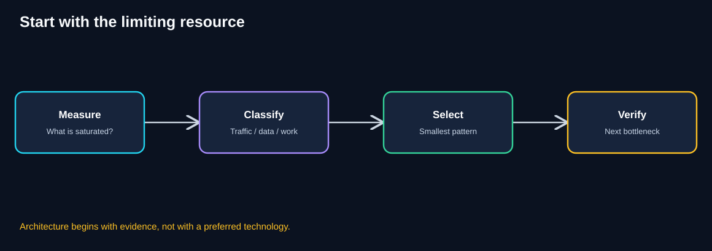
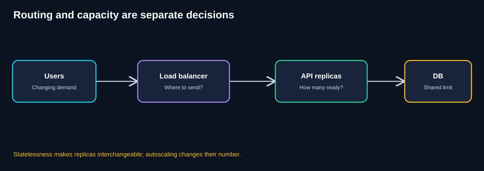
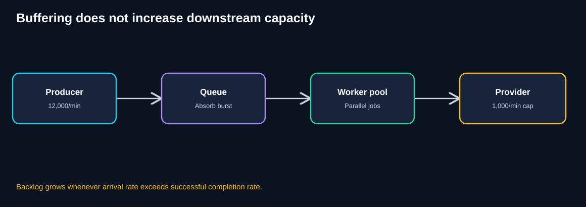
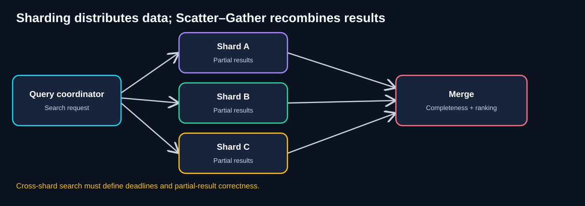
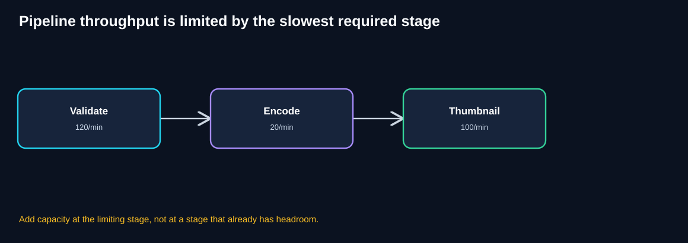
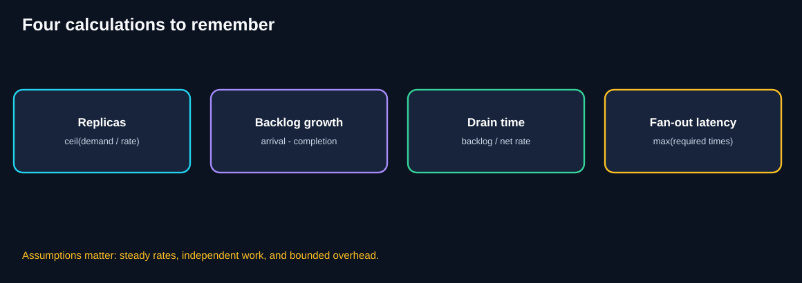
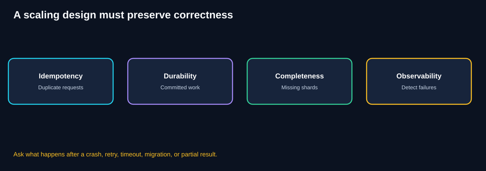

# Chapter 12 — Quick Revision & Final Self-Assessment

> **Unit ID:** SG-SCALE-12 · **Capability:** AI-DEFEND-01 · [Course map](../../../../README.md#ordered-capability-map)

[Learning contract and transfer check](learning-contract.md) · [Course map](../../../../README.md)

> **Fast-reference study chapter · 30–45 minutes to revise · 60–90 minutes with all exercises**
>
> **Running example:** QuickCart, a fictional e-commerce platform.
>
> **Purpose:** Review the eight scalability patterns, rehearse the important formulas, and test whether you can make architectural decisions without relying on memorized buzzwords.
>
> **Your goal:** Retrieve the reasoning and formulas from chapters 00–11 without relying on pattern names.
>
> **You need:** an attempt at SG-SCALE-00 to SG-SCALE-11.
>
> **You will produce:** Completed recall/numerical checks plus weak-topic repair list; self-score is not certification.

[SG-SCALE-11 — ← Previous: Architecture Challenges](11-architecture-challenges.md) · [SG-SCALE-09 — Integrated Case Study](09-architecture-case-study.md) · [SG-SCALE-10 — Pattern Comparison](10-pattern-comparison.md)

## 1. How to use this chapter

Use this as a **revision companion**, not as a replacement for Chapters 00–11.

**10-minute review:** Read Sections 2–5 and the formulas in Section 8.

**30-minute review:** Add the diagram walkthroughs, mistakes, and flashcards.

**60–90-minute review:** Attempt the numerical questions and final architecture assessment **before** opening the answers.

The central habit to practice is:

> **Find the limiting resource. Choose the smallest useful architectural change. Protect correctness. Measure the next bottleneck.**

## 2. The eight patterns on one page

| # | Pattern | Question it answers | QuickCart example | Watch out for |
|---|---|---|---|---|
| 01 | Stateless Services | Can any healthy instance handle the next request? | Externalize cart/session state | Shared-state availability and consistency |
| 02 | Load Balancing | Where should a request go? | Route traffic to healthy API replicas | Health checks and shared downstream limits |
| 03 | Horizontal Scaling & Autoscaling | How many instances are needed? | Add/remove API replicas with demand | Warm-up delays, cooldown, DB limits |
| 04 | Queue-Based Load Leveling | Can work wait safely during a burst? | Buffer order notification jobs | Backlog, retention, admission control |
| 05 | Competing Consumers | Can queued jobs be processed in parallel? | Multiple notification workers | Duplicates, ordering, provider limits |
| 06 | Partitioning & Sharding | Can we divide data ownership and load? | Customer records across shards | Hot keys, migrations, cross-shard transactions |
| 07 | Scatter–Gather | Must one request consult several owners? | Search across product shards | Stragglers, completeness, global ranking |
| 08 | Pipes & Filters | Can a transformation be split into stages? | Video validation, encoding, thumbnails | Stage bottlenecks, checkpoints, versioning |

### One-sentence distinctions

- **Load Balancing chooses where; Autoscaling chooses how many.**
- **Queues absorb bursts; consumers process queued work.**
- **Sharding separates data; Scatter–Gather brings results together.**
- **Scatter–Gather parallelizes independent subrequests; Pipes & Filters organizes transformations and their dependencies.**
- **Replication makes copies; sharding distributes distinct ownership.**

## 3. The pattern-selection reflex

**Diagram walkthrough**

1. Measure what users experience: errors, latency, stale results, or delays.
2. Find the saturated or failing resource using traces and metrics.
3. Classify the problem: request routing, insufficient capacity, burst absorption, worker throughput, data ownership, fan-out, or transformation workflow.
4. Choose the smallest change that addresses that specific problem.
5. Validate correctness, latency, throughput, and cost.
6. Look for the next bottleneck rather than assuming the system is now infinitely scalable.

### Symptom-to-pattern quick lookup

| Symptom | First questions | Possible direction |
|---|---|---|
| Cart disappears when requests switch servers | Is cart state stored in API memory? | Stateless Services |
| One API overloaded, other APIs idle | How is traffic routed? | Load Balancing |
| Every API overloaded at peak | Can we add healthy replicas? | Autoscaling |
| Email provider is slow during a burst | Can notification work be delayed safely? | Queue-Based Load Leveling |
| Queue grows with one busy worker | Can jobs run independently? | Competing Consumers |
| Database writes or storage hit a node limit | Can simpler DB optimizations help first? | Partitioning & Sharding |
| Search needs all data partitions | Can subqueries run in parallel? | Scatter–Gather |
| Media job has many different transformations | Can stages be isolated and checkpointed? | Pipes & Filters |

**Caution:** Symptoms alone do not prove a diagnosis. For example, high API latency may originate in a saturated database rather than an insufficient number of API replicas.

## 4. Routing versus capacity

**Diagram walkthrough**

1. Customers generate demand.
2. The load balancer distributes requests among healthy, ready replicas.
3. Statelessness lets requests move between replicas without losing instance-local business state.
4. Autoscaling adjusts the number of available replicas based on measured signals.
5. All replicas may still share a database, cache, or provider.
6. That shared dependency can become the next bottleneck.

### Remember

A load balancer does **not** create capacity by itself. An autoscaler does **not** instantly make new replicas ready. And more replicas do **not** remove a database write limit.

## 5. Queues versus consumers

**Diagram walkthrough**

1. The producer generates notification jobs during a sale.
2. A durable queue holds work when arrivals exceed completions.
3. Multiple consumers can process independent jobs in parallel.
4. The provider's hard rate limit still bounds successful sends.
5. Adding consumers above the provider limit may increase throttling and retries.
6. Queue age, successful completion rate, and DLQ volume reveal whether the system is healthy.

**Key invariant:** “Accepted into a queue” is **not** the same as “notification delivered.”

## 6. Sharding versus Scatter–Gather

**Diagram walkthrough**

1. Customer or product records are divided among data owners.
2. A customer-local lookup may route directly to one shard.
3. A global search may require queries to multiple shards.
4. Scatter–Gather sends independent queries concurrently.
5. The coordinator merges, deduplicates, and ranks responses.
6. If a shard fails, the system follows an explicit completeness policy.

**Key invariant:** A financial total missing one shard must not be presented as an exact complete total.

## 7. Pipes & Filters: the bottleneck rule

**Diagram walkthrough**

1. Validation can handle 120 videos/minute.
2. Encoding handles only 20 videos/minute.
3. Thumbnail generation can handle 100 videos/minute.
4. All videos must pass through encoding.
5. The pipeline therefore cannot sustainably finish more than 20 videos/minute under these simplified assumptions.
6. Scaling validation will not improve completed throughput while encoding remains limiting.

**Key invariant:** A video is published only when its required artifacts and checks are complete, and the workflow version is still current.

## 8. Essential formulas cheat sheet

**Diagram walkthrough**

1. Size replicas using forecast demand and measured per-replica capacity.
2. Estimate queue growth from arrivals minus successful completions.
3. Estimate drain time using the backlog and net processing capacity.
4. Estimate idealized all-results fan-out waiting time using the slowest required response.
5. State the assumptions behind every calculation.
6. Revisit the result if retries, shared limits, or uneven workloads change.

| Formula | When to use it | Caveat |
|---|---|---|
| `replicas = ceil(demand / per-replica capacity)` | Initial API sizing | Assumes measured sustainable capacity |
| `replicas with headroom = ceil(demand × (1 + h) / capacity)` | Capacity headroom as a fraction of demand | Define what “headroom” means |
| `backlog growth rate = arrivals − completions` | Overloaded queue | Applies while arrivals exceed completions |
| `backlog after T = growth rate × T` | Constant-rate burst | Assumes initially empty backlog unless stated |
| `drain time = backlog / (completion rate − new arrivals)` | Recovery after burst | Denominator must be positive |
| `worker count = ceil(arrival rate / per-worker rate)` | Consumer or stage sizing | Shared provider caps may dominate |
| `sequential wait ≈ sum(child times)` | Sequential independent calls | Excludes coordination overhead |
| `parallel all-results wait ≈ max(child times)` | Concurrent independent calls | Excludes fan-out and merge overhead |
| `pipeline throughput ≤ min(required stage capacities)` | Serial pipeline | Assumes all items pass through all stages |
| `Little's Law: L = λW` | Stable systems: concurrency/in-flight work | Requires a meaningful steady-state boundary |

### A note on 25% headroom

Two common definitions are different:

- **25% capacity above demand:** `required capacity = demand × 1.25`.
- **25% of total capacity kept unused:** `required capacity = demand / 0.75`.

Always state which definition you use.

## 9. Quick numerical examples

### Example A — API replicas

Peak demand: 2,400 requests/second.

Measured capacity: 400 requests/second per replica.

25% **extra capacity relative to demand**:

`ceil((2,400 × 1.25) / 400) = ceil(7.5) = 8 replicas`

Without headroom: 6 replicas.

### Example B — Notification burst

Arrival rate: 12,000 jobs/minute for 5 minutes.

Provider completion limit: 1,000/minute.

Backlog: `(12,000 − 1,000) × 5 = 55,000 jobs`.

If normal arrivals continue at 200/minute, net drain is `1,000 − 200 = 800/minute`.

Drain time: `55,000 / 800 = 68.75 minutes`.

### Example C — Search fan-out

Shard times: 100, 150, 120, and 4,000 ms.

Sequential waiting: `4,370 ms`.

Parallel all-results waiting: `4,000 ms`.

A 500 ms deadline allows A, B, and C to return, but **not D**. Partial results are safe only if the business explicitly allows them.

### Example D — Media pipeline

Validation = 120/minute, encoding = 20/minute, thumbnail = 100/minute.

Maximum steady-state throughput is at most 20 completed videos/minute if all stages are required.

## 10. Reliability is not optional

**Diagram walkthrough**

1. Idempotency protects against repeated client requests, message redelivery, and retried stages.
2. Durability protects committed orders and accepted work from loss.
3. Completeness ensures missing shards or stages do not silently corrupt results.
4. Observability reveals failed or delayed operations.
5. Every design needs a response to crashes, timeouts, and dependency outages.
6. Recovery should preserve business invariants, not merely restore service uptime.

### Four correctness questions

**Can a request be repeated?** Use appropriate idempotency keys and authoritative constraints.

**Can work be lost between a database commit and message publication?** Consider a transactional outbox.

**Can a side effect happen before acknowledgment?** Expect possible redelivery and reconcile uncertain outcomes.

**Can a missing shard or failed stage produce an incorrect “success”?** Make completeness and publication gates explicit.

## 11. Production metrics to remember

| Layer | Useful signals |
|---|---|
| API | p95/p99 latency, request rate, errors, ready replicas |
| Load balancer | Healthy targets, routing failures, connection pressure |
| Autoscaler | Desired/running/ready replicas, scale lag, cooldown events |
| Queue | Oldest-message age, backlog, retries, DLQ |
| Consumers | Successful completions, worker utilization, provider 429s |
| Database shards | Per-shard CPU/I/O, lock waits, p99, hot keys |
| Scatter–Gather | Fan-out width, child latency, deadline rate, partial-result rate |
| Pipeline | Stage duration, queue age, ready time, artifact errors |
| Business | Checkout success, notification completion, search correctness, publication success |
| Cost | Cost per order, notification, search, or completed video |

**Monitoring principle:** Track **user-visible outcomes** alongside component health. A healthy queue can still contain a backlog that violates the delivery SLO.

## 12. Twelve architecture flashcards

### Flashcard 1 — Load Balancing versus Autoscaling

Reveal answer

Load Balancing decides **where** requests go. Autoscaling decides **how many** instances should run. Statelessness helps make those instances interchangeable.

### Flashcard 2 — Queue-Based Load Leveling versus Competing Consumers

Reveal answer

A queue buffers excess work. Competing Consumers increase parallel processing capacity for independent jobs, but cannot override a downstream provider cap.

### Flashcard 3 — Sharding versus replication

Reveal answer

Sharding divides data ownership into subsets. Replication maintains copies of the same logical data for availability and/or read scaling.

### Flashcard 4 — Scatter–Gather versus Pipes & Filters

Reveal answer

Scatter–Gather fans out independent subrequests and combines results. Pipes & Filters structures a transformation into stages, which may be sequential or branched.

### Flashcard 5 — Why not store carts in API memory?

Reveal answer

A later request may reach a different replica or the original replica may fail. Shared or appropriately externalized cart state supports interchangeable APIs.

### Flashcard 6 — Why is queue age important?

Reveal answer

A queue can hold many jobs without losing them while customers still wait too long. Oldest-message age captures the delay that backlog depth alone may hide.

### Flashcard 7 — Why do retries require idempotency?

Reveal answer

A request or job can succeed and still be retried because its acknowledgment was lost. Repeated execution must not cause unintended duplicate business effects.

### Flashcard 8 — Why can a hot shard remain hot after adding shards?

Reveal answer

A single hot key or large tenant may remain assigned to one owner. Extra shards do not automatically split an indivisible workload.

### Flashcard 9 — What is a straggler?

Reveal answer

A slow required participant that delays the entire Scatter–Gather response.

### Flashcard 10 — What is a pipeline checkpoint?

Reveal answer

A durable record or artifact that proves a stage completed, allowing later failures to recover without unnecessarily repeating successful transformations.

### Flashcard 11 — What is the transactional outbox for?

Reveal answer

To record a business database change and the event that represents it in the same local transaction, enabling reliable later publication.

### Flashcard 12 — What question should come before selecting a pattern?

Reveal answer

“What is the measured limiting resource right now, and what evidence supports that diagnosis?”

## 13. Ten common exam and interview traps

| Trap | Better answer |
|---|---|
| “More servers always make a system faster.” | Check shared dependencies and bottlenecks. |
| “Load balancing and autoscaling are the same.” | Routing and replica count are different. |
| “A queue makes processing faster.” | A queue buffers work; workers determine processing rate. |
| “Ten workers can beat a provider limit of 1,000/minute.” | They cannot exceed the external cap without changing the constraint. |
| “Hashing guarantees evenly loaded shards.” | Hot keys and uneven workload cost can create skew. |
| “Changing `hash(key) % 3` to `% 4` is easy.” | Keys change owners; data migration is required. |
| “A timeout makes partial search results correct.” | Completeness depends on the business contract. |
| “Exactly-once side effects are automatic.” | Delivery and business idempotency must be designed. |
| “Every filter needs its own microservice.” | Filters can be in-process or distributed. |
| “A nice architecture diagram proves readiness.” | SLOs, failure tests, security, and cost are also needed. |

## 14. Mini-quiz: choose the pattern

Try answering without opening the worked answers.

**Q1.** A cart disappears when a customer switches API replicas.

Answer

**Stateless Services:** Externalize cart state; use interchangeable API replicas.

**Q2.** Three API replicas are healthy, but all traffic goes to one.

Answer

**Load Balancing:** Route requests across healthy replicas.

**Q3.** Every API replica is busy during a predictable sale.

Answer

**Horizontal Scaling & Autoscaling:** Add measured capacity, while checking downstream limits.

**Q4.** Notification jobs arrive faster than the provider can accept them for five minutes.

Answer

**Queue-Based Load Leveling:** Buffer jobs durably with a clear delay and backpressure policy.

**Q5.** A queue grows because only one worker processes independent jobs.

Answer

**Competing Consumers:** Add workers up to the capacity of downstream dependencies.

**Q6.** One database node cannot sustain the growing write workload.

Answer

After query/index optimization and simpler options, consider **Partitioning & Sharding** if the workload can be divided by an appropriate key.

**Q7.** Search must query four shards and merge matching products.

Answer

**Scatter–Gather:** Fan out, gather, deduplicate, rank, and apply an explicit completeness policy.

**Q8.** Uploaded videos must be validated, encoded, thumbnailed, and published.

Answer

**Pipes & Filters:** Define stage contracts, dependencies, checkpoints, and publication rules.

## 15. Final numerical self-assessment

Attempt all five before revealing the worked solutions.

### Problem 1 — API sizing

Peak demand is 1,800 requests/second. Each replica safely handles 300 requests/second. You want 20% extra capacity **relative to demand**. How many replicas?

Worked answer

`ceil((1,800 × 1.20) / 300) = ceil(7.2) = 8 replicas`.

Without headroom, six replicas would exactly match forecast demand.

### Problem 2 — Queue growth

A queue starts empty. Arrivals are 5,000/minute for 4 minutes, while consumers complete 1,000/minute. What is the backlog?

Worked answer

`(5,000 − 1,000) × 4 = 16,000 jobs`.

### Problem 3 — Backlog drain

The backlog is 16,000 jobs. Completion capacity is 1,000/minute, and 200 new jobs/minute continue to arrive. How long to drain?

Worked answer

Net drain = `1,000 − 200 = 800/minute`.

Time = `16,000 / 800 = 20 minutes`.

### Problem 4 — Parallel search

Four shard requests take 80, 130, 95, and 900 ms. What are the idealized sequential and parallel all-results waiting times?

Worked answer

Sequential = `80 + 130 + 95 + 900 = 1,205 ms`.

Parallel all-results = `max(80, 130, 95, 900) = 900 ms`.

Both exclude coordination and network overhead.

### Problem 5 — Pipeline scaling

Validation handles 90 videos/minute, encoding handles 15 videos/minute per worker, and thumbnail generation handles 80 videos/minute. How many encoder workers are needed to keep up with 60 videos/minute, assuming linear scaling and no shared limits?

Worked answer

`ceil(60 / 15) = 4 encoder workers`.

Validation and thumbnail stages each exceed 60/minute, so they are not the immediate bottleneck under these assumptions.

## 16. Final architecture challenge: 15-minute design

QuickCart announces a flash sale. Requirements:

- API traffic rises from 300 to 2,400 requests/second.
- Cart state must survive API failover.
- Orders must not be silently duplicated under retries.
- Notification bursts exceed a provider's rate limit.
- Search spans multiple product shards.
- Merchants may replace product videos while processing is still running.

**Your assignment:** Write a short design that identifies the patterns, explains how orders and notifications stay correct, and names the top five metrics you would monitor.

Reveal a model answer

Use stateless API replicas with external cart state behind a health-aware load balancer. Autoscale based on measured demand and readiness, while verifying database write capacity. Make checkout idempotent using an authoritative order record and uniqueness constraints. Commit an outbox event with the order and publish it asynchronously to a durable queue.

Use competing notification consumers under a shared provider rate limit, with bounded retries, DLQ handling, and duplicate-safe side effects. Shard customer or product data only where measured database limits justify it. For search, use Scatter–Gather with bounded fan-out, a deadline, and an approved partial-result policy. For videos, use a versioned Pipes & Filters workflow and a publication gate that rejects stale uploads.

Monitor **checkout success and latency, database saturation, queue oldest-message age, notification completion/429s, and search completeness**. Add video ready-time and stale-publication metrics as dedicated media signals.

## 17. Final scorecard

Use this to assess your readiness:

| Skill | Check yourself |
|---|---|
| Pattern recognition | Can I name the right pattern from a real bottleneck? |
| Capacity reasoning | Can I size replicas and calculate backlog? |
| Correctness | Can I explain retries, idempotency, and completeness? |
| Distributed data | Can I explain hot shards and cross-shard queries? |
| Pipelines | Can I find the slow stage and design recovery? |
| Operations | Can I name useful SLOs and failure tests? |
| Trade-offs | Can I explain what becomes harder after the change? |

**Suggested readiness guide:** If you can solve the five numerical problems and defend the final architecture without opening answers, you are ready to attempt unfamiliar scalability scenarios.

## 18. Your one-minute revision script

> Stateless Services make API replicas interchangeable. Load Balancing routes requests; Autoscaling changes replica count. Queues buffer bursts; Competing Consumers increase parallel job throughput until a downstream limit is reached. Sharding divides data ownership; Scatter–Gather queries multiple owners and combines results. Pipes & Filters splits transformations into independently manageable stages. Every pattern introduces trade-offs, so I begin with the measured bottleneck, protect correctness, and monitor the next constraint.

## 19. What's next?

You have now covered:

- Foundations and the eight core patterns.
- An integrated QuickCart architecture case study.
- A side-by-side pattern comparison.
- A hands-on architecture challenges workbook.
- This quick revision and self-assessment chapter.

A useful final reference artifact is a **glossary** defining key terms such as throughput, latency, concurrency, backpressure, idempotency, partition key, tail latency, and SLO.

[SG-SCALE-13 — Next: Glossary](13-glossary.md).

## Completion checkpoint

**You can now:** explain distinctions and formula limits.

**Show it:** Completed recall/numerical checks plus weak-topic repair list; self-score is not certification. Then attempt chapter 12's unfamiliar transfer check in the [learning contract](learning-contract.md).

**Next:** [SG-SCALE-13 — Glossary of Scalability & Distributed Systems](13-glossary.md).

---

*The examples and calculations are illustrative. Validate assumptions, data consistency, operational limits, and platform-specific guarantees before production use.*
