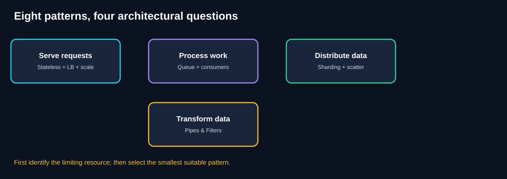
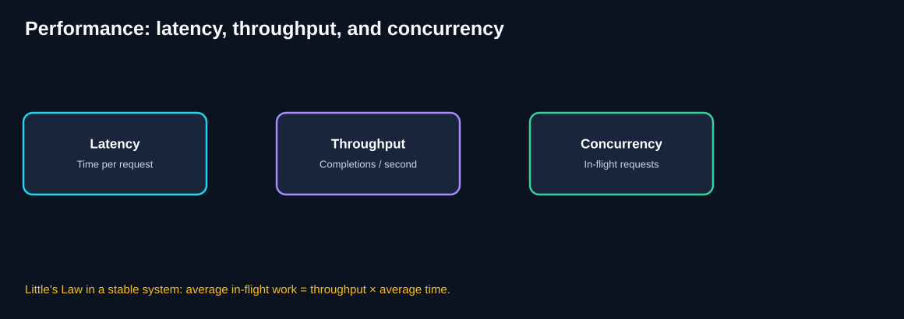
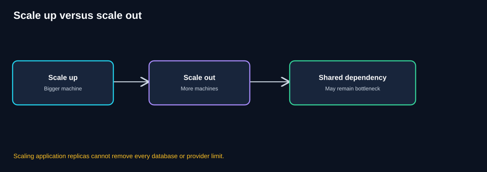
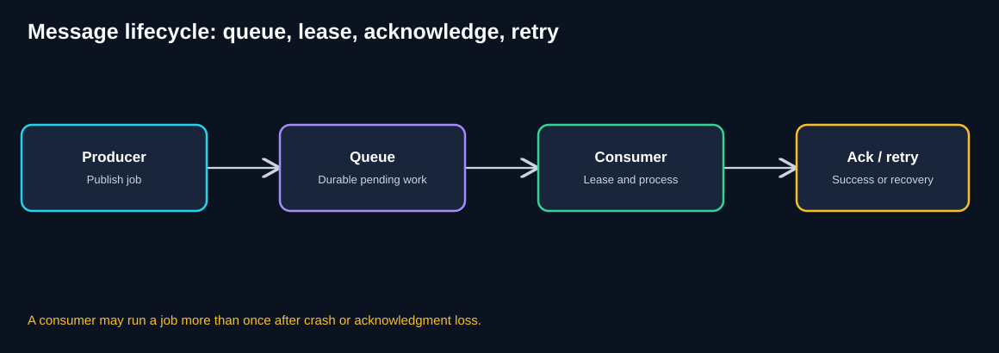
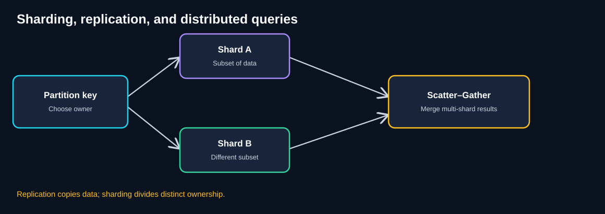
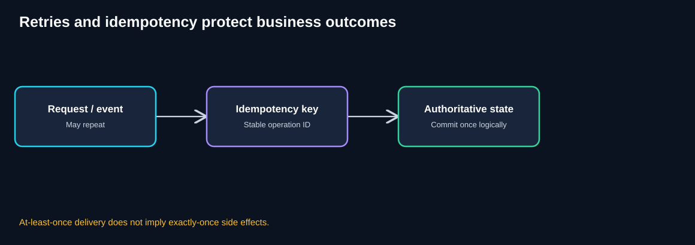
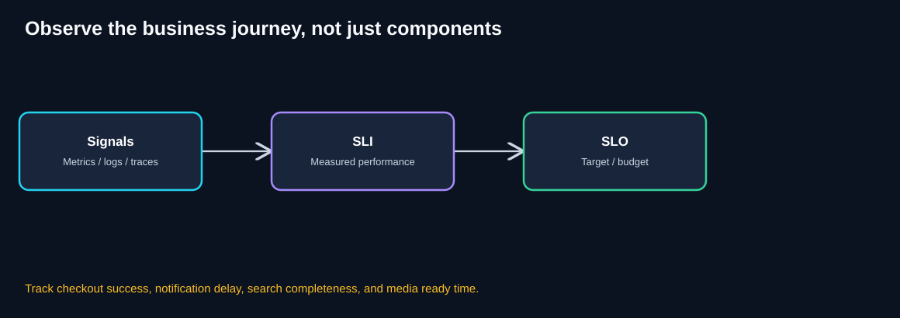

# Chapter 13 — Glossary of Scalability & Distributed Systems

> **Unit ID:** SG-SCALE-13 · **Capability:** AI-AWS-01 · [Course map](../../../../README.md#ordered-capability-map)

[Learning contract and transfer check](learning-contract.md) · [Course map](../../../../README.md)

> **Standalone reference chapter · QuickCart study guide**
>
> **How to use:** Search this Markdown file with **Ctrl+F / Cmd+F**, or jump from the alphabetical index and topic sections below. Each term has a plain-English meaning and a QuickCart example.
>
> **Your goal:** Explain a term with its QuickCart consequence and its limit, without introducing a new prerequisite.
>
> **Effort:** 20–30 minutes for a first review, then on demand (estimate).
>
> **You need:** Nothing beyond the chapter that taught the term.
>
> **You will produce:** Three term/contrast explanations pointing to taught concepts; no new prerequisite is introduced.

[SG-SCALE-12 — ← Previous: Quick Revision](12-quick-revision.md) · [SG-SCALE-10 — Pattern Comparison](10-pattern-comparison.md) · [SG-SCALE-11 — Architecture Challenges](11-architecture-challenges.md)

## 1. What this glossary covers

This chapter defines the vocabulary used throughout the QuickCart scalability course: performance, scaling, queues, delivery semantics, distributed data, search, processing pipelines, reliability, observability, and governance.

**Important:** These definitions describe common architectural usage. Exact guarantees depend on the platform, workload, and implementation. In particular, words such as *durable*, *exactly once*, *available*, and *consistent* need explicit operational definitions.

## 2. A one-minute mental map

**Diagram walkthrough**

1. Serving requests involves Stateless Services, Load Balancing, and Autoscaling.
2. Processing bursts involves queues and Competing Consumers.
3. Distributing data involves Sharding; retrieving from multiple owners involves Scatter–Gather.
4. Transforming media or other data involves Pipes & Filters.
5. These patterns can be combined without becoming interchangeable.
6. Select patterns from measured constraints rather than technology preference.

## 3. Alphabetical index

The entries are grouped by topic below. Use the links to jump to the section containing each term.

**A:** [Acknowledgment (ack)](#acknowledgment-ack) · [Admission control](#admission-control) · [Alert](#alert) · [Artifact](#artifact) · [At-least-once delivery](#at-least-once-delivery) · [At-most-once delivery](#at-most-once-delivery) · [Autoscaling](#autoscaling) · [Availability](#availability)

**B:** [Backlog](#backlog) · [Backpressure](#backpressure) · [Bottleneck](#bottleneck) · [Branch and join](#branch-and-join) · [Bulkhead](#bulkhead) · [Burst](#burst)

**C:** [Capacity](#capacity) · [Chaos / failure injection](#chaos--failure-injection) · [Checkpoint](#checkpoint) · [Circuit breaker](#circuit-breaker) · [Competing Consumers](#competing-consumers) · [Completeness policy](#completeness-policy) · [Concurrency](#concurrency) · [Connection draining](#connection-draining) · [Consistent hashing](#consistent-hashing) · [Consumer](#consumer) · [Content-addressed artifact](#content-addressed-artifact) · [Cooldown / hysteresis](#cooldown--hysteresis) · [Correlation ID](#correlation-id) · [Cost per successful operation](#cost-per-successful-operation) · [Cross-shard query](#cross-shard-query)

**D:** [Data retention](#data-retention) · [Dead-letter queue (DLQ)](#dead-letter-queue-dlq) · [Deadline](#deadline) · [Deduplication](#deduplication) · [Delivery SLO](#delivery-slo) · [Directory-based routing](#directory-based-routing) · [Distributed tracing](#distributed-tracing) · [Distributed transaction](#distributed-transaction)

**E:** [Elasticity](#elasticity) · [Error budget](#error-budget) · [Eventual consistency](#eventual-consistency) · [Exactly-once effect](#exactly-once-effect) · [Exponential backoff](#exponential-backoff)

**F:** [Failover](#failover) · [Fan-in / gather](#fan-in--gather) · [Fan-out](#fan-out) · [Fault tolerance](#fault-tolerance) · [Filter](#filter)

**G:** [Global rate limiter](#global-rate-limiter) · [Graceful degradation](#graceful-degradation)

**H:** [Hash partitioning](#hash-partitioning) · [Headroom](#headroom) · [Health check](#health-check) · [Horizontal partitioning](#horizontal-partitioning) · [Horizontal scaling / scale out](#horizontal-scaling--scale-out) · [Hot key](#hot-key) · [Hot shard](#hot-shard)

**I:** [Idempotency](#idempotency) · [Idempotency key](#idempotency-key)

**J:** [Jitter](#jitter)

**L:** [Latency](#latency) · [Layer 4 (L4) load balancing](#layer-4-l4-load-balancing) · [Layer 7 (L7) load balancing](#layer-7-l7-load-balancing) · [Least connections](#least-connections) · [Least privilege](#least-privilege) · [Little's Law](#littles-law) · [Load balancer](#load-balancer) · [Load shedding](#load-shedding) · [Load test](#load-test) · [Logs](#logs)

**M:** [Message broker](#message-broker) · [Metrics](#metrics)

**O:** [Object storage](#object-storage) · [Observability](#observability) · [Ordering guarantee](#ordering-guarantee)

**P:** [p50 / median](#p50--median) · [p95 / p99](#p95--p99) · [Partial result](#partial-result) · [Partition](#partition) · [Partition key](#partition-key) · [Pipe](#pipe) · [Pipes & Filters](#pipes--filters) · [Poison message](#poison-message) · [Predictive scaling](#predictive-scaling) · [Producer](#producer) · [Publication gate](#publication-gate)

**Q:** [Queries per second (QPS)](#queries-per-second-qps) · [Queue](#queue) · [Queue-Based Load Leveling](#queue-based-load-leveling)

**R:** [Range partitioning](#range-partitioning) · [Rate limiting](#rate-limiting) · [Reactive scaling](#reactive-scaling) · [Read replica](#read-replica) · [Readiness check](#readiness-check) · [Rebalancing](#rebalancing) · [Recovery point objective (RPO)](#recovery-point-objective-rpo) · [Recovery time objective (RTO)](#recovery-time-objective-rto) · [Redelivery](#redelivery) · [Reliability](#reliability) · [Replica](#replica) · [Replication](#replication) · [Requests per second (RPS)](#requests-per-second-rps) · [Response time](#response-time) · [Retry](#retry) · [Return on investment (ROI)](#return-on-investment-roi) · [Round robin](#round-robin)

**S:** [Saga](#saga) · [Saturation](#saturation) · [Scale-out lag](#scale-out-lag) · [Scatter–Gather](#scattergather) · [Scheduled scaling](#scheduled-scaling) · [Schema evolution](#schema-evolution) · [Service-level agreement (SLA)](#service-level-agreement-sla) · [Service-level indicator (SLI)](#service-level-indicator-sli) · [Service-level objective (SLO)](#service-level-objective-slo) · [Sharding](#sharding) · [Stage contract](#stage-contract) · [Stage-specific autoscaling](#stage-specific-autoscaling) · [Stateful service](#stateful-service) · [Stateless service](#stateless-service) · [Sticky session / session affinity](#sticky-session--session-affinity) · [Straggler](#straggler)

**T:** [Tail latency](#tail-latency) · [Throughput](#throughput) · [Timeout](#timeout) · [Top-K merge](#top-k-merge) · [Transactional outbox](#transactional-outbox)

**V:** [Vertical partitioning](#vertical-partitioning) · [Vertical scaling / scale up](#vertical-scaling--scale-up) · [Virtual shard / logical partition](#virtual-shard--logical-partition) · [Visibility timeout / lease](#visibility-timeout--lease)

**W:** [Workflow orchestrator](#workflow-orchestrator) · [Workflow version](#workflow-version)

## 4. Topic-based definitions

### 4.1 Performance and capacity

**Diagram walkthrough:** Latency measures time per operation; throughput measures completions per unit time; concurrency measures in-flight work. Under stable conditions, Little’s Law connects them.

#### Latency

**Meaning:** Time between starting an operation and receiving its result.

**QuickCart example:** A search takes 180 ms.

#### Response time

**Meaning:** Total time a caller waits for a response, including queues and network delays.

**QuickCart example:** Checkout responds after 420 ms.

#### Throughput

**Meaning:** Number of successfully completed operations per unit time.

**QuickCart example:** The API completes 1,200 requests/second.

#### Concurrency

**Meaning:** Number of operations active or in flight at the same time.

**QuickCart example:** Forty checkout requests are processing.

#### Requests per second (RPS)

**Meaning:** A traffic-rate measure: incoming requests each second, not necessarily completed work.

**QuickCart example:** The flash sale reaches 2,400 RPS.

#### Queries per second (QPS)

**Meaning:** Database or search queries processed per second.

**QuickCart example:** A product shard serves 8,000 QPS.

#### p50 / median

**Meaning:** Latency value at or below which roughly half of measured operations fall.

**QuickCart example:** p50 search latency is 120 ms.

#### p95 / p99

**Meaning:** Tail-latency percentiles: approximately 95% or 99% of operations finish at or below the stated value.

**QuickCart example:** p99 checkout latency is 1.5 seconds.

#### Tail latency

**Meaning:** Slow-end response time affecting a small but important fraction of requests.

**QuickCart example:** One slow shard delays search.

#### Bottleneck

**Meaning:** Resource or stage currently limiting useful system performance.

**QuickCart example:** The order database saturates before the API.

#### Capacity

**Meaning:** Sustainable work rate at an agreed service quality.

**QuickCart example:** One API replica safely handles 400 RPS.

#### Headroom

**Meaning:** Spare capacity reserved for bursts, failures, and variability.

**QuickCart example:** Eight replicas provide extra capacity above forecast demand.

#### Saturation

**Meaning:** How fully a resource is used relative to its safe operating limit.

**QuickCart example:** DB connections reach their maximum.

#### Little's Law

**Meaning:** For a stable system, average in-flight work L equals throughput λ times average time W.

**QuickCart example:** 200 requests/s × 0.5 s = about 100 in-flight requests.

#### Backlog

**Meaning:** Accepted work waiting to be processed.

**QuickCart example:** 55,000 notification jobs remain queued.

#### Backpressure

**Meaning:** Mechanism that slows, rejects, or limits upstream work when downstream capacity is constrained.

**QuickCart example:** QuickCart temporarily rejects excess video uploads.

#### Admission control

**Meaning:** Decision to accept or reject new work based on capacity and policy.

**QuickCart example:** Limit concurrent checkouts to protect the database.

#### Load shedding

**Meaning:** Intentionally dropping or rejecting lower-priority work to protect essential service.

**QuickCart example:** Defer noncritical recommendations during checkout peaks.

#### Rate limiting

**Meaning:** Restricting how often operations may occur.

**QuickCart example:** Email sends stay below 1,000/minute.

#### Burst

**Meaning:** Short period of unusually high incoming demand.

**QuickCart example:** Flash-sale traffic rises twentyfold.

### 4.2 Scaling and traffic routing

**Diagram walkthrough:** Scale up gives one node more resources; scale out adds nodes; a shared database can remain limiting even after application scaling.

#### Vertical scaling / scale up

**Meaning:** Increasing the resources of one machine or instance.

**QuickCart example:** Move the database to a larger server.

#### Horizontal scaling / scale out

**Meaning:** Adding more instances that share a workload.

**QuickCart example:** Increase API replicas from 4 to 8.

#### Elasticity

**Meaning:** Ability to change allocated capacity as demand changes.

**QuickCart example:** Reduce API replicas after a sale.

#### Autoscaling

**Meaning:** Automatically adjusting replica or resource counts using policies and signals.

**QuickCart example:** Add encoder workers when queue age grows.

#### Reactive scaling

**Meaning:** Scaling in response to observed demand or saturation.

**QuickCart example:** CPU triggers more API replicas.

#### Scheduled scaling

**Meaning:** Scaling ahead of known periods.

**QuickCart example:** Pre-warm capacity before a planned sale.

#### Predictive scaling

**Meaning:** Forecasting future demand to adjust capacity early.

**QuickCart example:** Use past promotion traffic to prepare workers.

#### Scale-out lag

**Meaning:** Time between detecting demand and having additional capacity ready.

**QuickCart example:** A new pod takes 90 seconds to become ready.

#### Cooldown / hysteresis

**Meaning:** Policies preventing rapid oscillation between scale-out and scale-in.

**QuickCart example:** Wait before removing recently added replicas.

#### Replica

**Meaning:** An additional running copy of a service or component.

**QuickCart example:** Eight interchangeable API instances.

#### Stateless service

**Meaning:** Service that does not require instance-local state to process the next request correctly.

**QuickCart example:** Any API replica can read cart state from a shared store.

#### Stateful service

**Meaning:** Service whose behavior depends on state retained by a particular instance or ownership boundary.

**QuickCart example:** An API stores carts only in its memory.

#### Sticky session / session affinity

**Meaning:** Routing a client repeatedly to the same instance.

**QuickCart example:** Keep a shopper on API A, with failover risks.

#### Load balancer

**Meaning:** Component that routes requests across available targets.

**QuickCart example:** Gateway distributes requests across APIs.

#### Health check

**Meaning:** Test used to determine whether a component is functioning.

**QuickCart example:** LB stops routing to an unhealthy instance.

#### Readiness check

**Meaning:** Signal that an instance can safely receive traffic.

**QuickCart example:** New API is ready after loading configuration.

#### Connection draining

**Meaning:** Allowing existing requests or connections to finish before removing a target.

**QuickCart example:** Drain a pod during deployment.

#### Layer 4 (L4) load balancing

**Meaning:** Routing using transport-level connection information such as IP and port.

**QuickCart example:** Distribute TCP connections.

#### Layer 7 (L7) load balancing

**Meaning:** Routing using application-level information such as HTTP path or headers.

**QuickCart example:** Route /checkout to checkout APIs.

#### Round robin

**Meaning:** Routing requests cyclically across targets.

**QuickCart example:** Requests rotate among API replicas.

#### Least connections

**Meaning:** Routing toward targets with fewer active connections.

**QuickCart example:** Choose the least-busy backend by connection count.

### 4.3 Queues, consumers, and delivery

**Diagram walkthrough:** Producers publish work; queues hold it; consumers claim and process it; acknowledgment or redelivery determines the next step. Repeated execution is possible.

#### Producer

**Meaning:** Component that creates and publishes work.

**QuickCart example:** Checkout creates an order notification event.

#### Consumer

**Meaning:** Component that receives and processes work.

**QuickCart example:** Email worker sends a notification.

#### Message broker

**Meaning:** Infrastructure that transports and may durably store messages.

**QuickCart example:** Broker holds notification jobs.

#### Queue

**Meaning:** Buffer holding pending work for later processing.

**QuickCart example:** Order emails wait during a flash sale.

#### Queue-Based Load Leveling

**Meaning:** Pattern that absorbs bursts by decoupling work arrival from processing.

**QuickCart example:** Queue notifications before the provider.

#### Competing Consumers

**Meaning:** Pattern where multiple workers consume independent jobs from a logical queue.

**QuickCart example:** Five workers send notifications concurrently.

#### Acknowledgment (ack)

**Meaning:** Signal that processing has succeeded sufficiently to release a message.

**QuickCart example:** Worker acknowledges a completed job.

#### Visibility timeout / lease

**Meaning:** Period during which a claimed message is hidden or owned by a worker.

**QuickCart example:** A job becomes eligible again if a worker crashes.

#### Redelivery

**Meaning:** Broker sending a message again after uncertain or incomplete processing.

**QuickCart example:** Email job is retried after a lost ack.

#### At-most-once delivery

**Meaning:** Delivery approach where loss may occur but duplicates are avoided at the delivery layer.

**QuickCart example:** No broker retry after a failed attempt.

#### At-least-once delivery

**Meaning:** Delivery approach that retries until acknowledged, so duplicates are possible.

**QuickCart example:** Worker may see the same event twice.

#### Exactly-once effect

**Meaning:** Business outcome happens once logically, even when execution repeats; requires explicit end-to-end design.

**QuickCart example:** One logical order despite retried checkout.

#### Retry

**Meaning:** Repeating an operation after failure.

**QuickCart example:** Try sending email again after a temporary outage.

#### Exponential backoff

**Meaning:** Increasing delay between retry attempts.

**QuickCart example:** Retry after 1, 2, 4, then 8 seconds.

#### Jitter

**Meaning:** Random variation in retry timing to avoid synchronized spikes.

**QuickCart example:** Workers retry at staggered times.

#### Dead-letter queue (DLQ)

**Meaning:** Holding area for messages that cannot be processed under the normal retry policy.

**QuickCart example:** Malformed notification moved for investigation.

#### Poison message

**Meaning:** Message that repeatedly causes processing failure.

**QuickCart example:** Invalid encoding job crashes its worker.

#### Ordering guarantee

**Meaning:** Contract describing whether events are processed in their intended order.

**QuickCart example:** Per-customer updates require version checks.

#### Global rate limiter

**Meaning:** Shared control enforcing one rate budget across multiple workers.

**QuickCart example:** All email workers share a 1,000/minute quota.

#### Idempotency

**Meaning:** Property that repeating an operation does not create additional unintended effects.

**QuickCart example:** Repeated checkout returns the same logical order.

#### Idempotency key

**Meaning:** Stable identifier used to recognize repeated logical operations.

**QuickCart example:** Checkout request uses a unique submission key.

#### Transactional outbox

**Meaning:** Pattern that commits business data and an event record in one local database transaction.

**QuickCart example:** Order and OrderPlaced outbox row commit together.

#### Eventual consistency

**Meaning:** Different parts of a system may temporarily disagree but converge under defined conditions.

**QuickCart example:** Email status updates after order commit.

#### Delivery SLO

**Meaning:** Target for how quickly accepted asynchronous work completes.

**QuickCart example:** 95% of emails sent within five minutes.

### 4.4 Data distribution and queries

**Diagram walkthrough:** A partition key selects a data owner. Different shards hold different subsets. Cross-shard queries may fan out and merge responses. Replicas copy data rather than divide ownership.

#### Partition

**Meaning:** Logical subset of data or work.

**QuickCart example:** Customers assigned to partitions by ID.

#### Partition key

**Meaning:** Attribute used to choose data ownership.

**QuickCart example:** customerId routes to a shard.

#### Sharding

**Meaning:** Distributing distinct data subsets across independent owners.

**QuickCart example:** Customer records split across databases.

#### Horizontal partitioning

**Meaning:** Dividing rows of the same logical table into subsets.

**QuickCart example:** Customers 1–1M stored separately from others.

#### Vertical partitioning

**Meaning:** Separating columns or functional data domains.

**QuickCart example:** Move large product descriptions away from hot order columns.

#### Hash partitioning

**Meaning:** Using a hash of a key to assign ownership.

**QuickCart example:** Hash customerId to select a shard.

#### Range partitioning

**Meaning:** Assigning data by ordered key intervals.

**QuickCart example:** Orders split by date ranges.

#### Directory-based routing

**Meaning:** Looking up a key-to-owner mapping in a directory.

**QuickCart example:** A large merchant is assigned to a dedicated shard.

#### Consistent hashing

**Meaning:** Hashing approach designed to limit key movement when membership changes.

**QuickCart example:** Redistribute keys after adding a shard.

#### Virtual shard / logical partition

**Meaning:** Fine-grained ownership unit that can move among physical nodes.

**QuickCart example:** Move a few logical partitions off a hot database.

#### Hot key

**Meaning:** A key receiving disproportionately high demand.

**QuickCart example:** One celebrity merchant gets most traffic.

#### Hot shard

**Meaning:** Shard overloaded by uneven data or workload distribution.

**QuickCart example:** Shard 1 receives 70% of queries.

#### Rebalancing

**Meaning:** Moving data or ownership to improve distribution.

**QuickCart example:** Migrate partitions to a new database.

#### Replication

**Meaning:** Maintaining copies of the same logical data.

**QuickCart example:** Read replicas share product records.

#### Read replica

**Meaning:** Copy used to serve reads, subject to consistency and lag.

**QuickCart example:** Catalog queries go to a replica.

#### Cross-shard query

**Meaning:** Query needing data from more than one shard.

**QuickCart example:** Search all product partitions.

#### Scatter–Gather

**Meaning:** Pattern that sends independent subrequests and combines results.

**QuickCart example:** Fan out search and merge matches.

#### Fan-out

**Meaning:** Sending one logical operation to multiple downstream participants.

**QuickCart example:** One search becomes four shard requests.

#### Fan-in / gather

**Meaning:** Collecting responses from several subrequests.

**QuickCart example:** Coordinator receives shard results.

#### Straggler

**Meaning:** Slow participant that delays completion.

**QuickCart example:** Shard D takes four seconds.

#### Deadline

**Meaning:** Maximum total time budget for an operation.

**QuickCart example:** Search has a 500 ms deadline.

#### Timeout

**Meaning:** Limit on waiting for a specific operation.

**QuickCart example:** Cancel a shard call after its budget.

#### Partial result

**Meaning:** Response missing some requested data or participants.

**QuickCart example:** Search returns three of four shard responses.

#### Completeness policy

**Meaning:** Rule specifying whether missing results are acceptable.

**QuickCart example:** Product search may show partial coverage; finance report may not.

#### Deduplication

**Meaning:** Removing repeated logical items.

**QuickCart example:** Merge products returned by multiple shards.

#### Top-K merge

**Meaning:** Combining local ranked results into the best K global results.

**QuickCart example:** Merge shard candidates into top ten products.

#### Distributed transaction

**Meaning:** Transaction spanning multiple resource owners.

**QuickCart example:** Move money between separate account databases.

#### Saga

**Meaning:** Sequence of local transactions with explicit recovery or compensations.

**QuickCart example:** Coordinate order, inventory, and payment stages.

### 4.5 Pipelines, processing, and artifacts

#### Pipes & Filters

**Meaning:** Pattern organizing transformations into focused stages and handoffs.

**QuickCart example:** Validate → encode → thumbnail → publish.

#### Filter

**Meaning:** One focused transformation stage.

**QuickCart example:** Encoder creates a playback rendition.

#### Pipe

**Meaning:** Handoff carrying data or references between stages.

**QuickCart example:** Queue passes an artifact ID to the next filter.

#### Workflow orchestrator

**Meaning:** Component tracking stages, dependencies, and overall completion.

**QuickCart example:** Video coordinator waits for required outputs.

#### Branch and join

**Meaning:** Run independent branches and wait for required outcomes.

**QuickCart example:** Encode and thumbnail in parallel, then publish.

#### Stage contract

**Meaning:** Defined input, output, version, and failure behavior for a filter.

**QuickCart example:** Encoder accepts sourceObject and encodingProfile.

#### Checkpoint

**Meaning:** Durable record or artifact marking completed progress.

**QuickCart example:** Encoding result saved before thumbnail retry.

#### Artifact

**Meaning:** Produced file or data output of a stage.

**QuickCart example:** 720p video or thumbnail image.

#### Object storage

**Meaning:** Storage for durable blobs addressed by object references.

**QuickCart example:** Store uploaded video outside queue messages.

#### Content-addressed artifact

**Meaning:** Artifact identified using a digest of its content.

**QuickCart example:** Use a hash to identify identical media outputs.

#### Publication gate

**Meaning:** Business rule verifying required conditions before making output visible.

**QuickCart example:** Publish video only after mandatory checks.

#### Workflow version

**Meaning:** Identity of a specific processing revision.

**QuickCart example:** v3 result cannot overwrite newer v4 upload.

#### Stage-specific autoscaling

**Meaning:** Changing worker capacity for an individual filter.

**QuickCart example:** Add encoder workers without adding validators.

#### Schema evolution

**Meaning:** Changing data contracts while preserving compatibility or planning migrations.

**QuickCart example:** Upgrade encoding-job message format.

### 4.6 Reliability, observability, and governance

**Diagram walkthrough:** Retries can repeat work. Stable operation IDs and authoritative state help enforce logical idempotency. Delivery guarantees alone do not guarantee exactly-once business effects.

**Diagram walkthrough:** Metrics, logs, and traces produce signals. SLIs measure service outcomes; SLOs define targets. Monitoring must connect technical symptoms to user-visible results.

#### Availability

**Meaning:** Fraction of time a service can serve its intended function.

**QuickCart example:** Checkout remains reachable during a node failure.

#### Reliability

**Meaning:** Ability to produce correct outcomes consistently over time.

**QuickCart example:** Orders remain durable despite retries.

#### Fault tolerance

**Meaning:** Ability to continue acceptable operation despite component failures.

**QuickCart example:** Search degrades according to its partial-result policy.

#### Graceful degradation

**Meaning:** Providing reduced but honest functionality during trouble.

**QuickCart example:** Show partial search results with a clear indicator.

#### Circuit breaker

**Meaning:** Control that temporarily stops calls to a repeatedly failing dependency.

**QuickCart example:** Stop hammering an unavailable provider.

#### Bulkhead

**Meaning:** Isolation that prevents one workload's failure from exhausting others.

**QuickCart example:** Separate checkout and recommendation worker pools.

#### Failover

**Meaning:** Switching work to another healthy component after failure.

**QuickCart example:** Route API traffic away from a failed replica.

#### Recovery time objective (RTO)

**Meaning:** Target maximum time to restore service after a disruption.

**QuickCart example:** Restore order processing within an agreed window.

#### Recovery point objective (RPO)

**Meaning:** Target maximum acceptable data loss measured in time.

**QuickCart example:** Backups permit at most a specified loss window.

#### Service-level indicator (SLI)

**Meaning:** Quantitative measure of service performance.

**QuickCart example:** Fraction of checkouts completing successfully.

#### Service-level objective (SLO)

**Meaning:** Target for an SLI over a defined window.

**QuickCart example:** 99.9% checkout success in 30 days.

#### Service-level agreement (SLA)

**Meaning:** Formal service commitment, potentially with consequences.

**QuickCart example:** Contract specifies an availability commitment.

#### Error budget

**Meaning:** Allowed amount of SLO failure within the measurement window.

**QuickCart example:** 0.1% unsuccessful checkouts under a 99.9% objective.

#### Metrics

**Meaning:** Numeric measurements aggregated over time.

**QuickCart example:** Queue age, DB CPU, p99 latency.

#### Logs

**Meaning:** Records of discrete events and diagnostic details.

**QuickCart example:** Order processing error with workflow ID.

#### Distributed tracing

**Meaning:** Linking spans across services for one request or workflow.

**QuickCart example:** Trace checkout through DB and outbox.

#### Correlation ID

**Meaning:** Identifier used to associate related work across components.

**QuickCart example:** video42-v3 appears in stage logs.

#### Alert

**Meaning:** Notification that an actionable condition needs attention.

**QuickCart example:** Queue age exceeds the delivery target.

#### Observability

**Meaning:** Ability to understand internal behavior from emitted signals.

**QuickCart example:** Find whether delay is in queue or provider.

#### Load test

**Meaning:** Test of performance under expected or extreme demand.

**QuickCart example:** Simulate 2,400 checkout RPS.

#### Chaos / failure injection

**Meaning:** Deliberately causing failures to validate recovery behavior.

**QuickCart example:** Crash a worker after external send.

#### Least privilege

**Meaning:** Granting only permissions required for a component's role.

**QuickCart example:** Encoder can read inputs and write its outputs.

#### Data retention

**Meaning:** Policy for how long data or artifacts are stored.

**QuickCart example:** Delete obsolete intermediate video files.

#### Cost per successful operation

**Meaning:** Cost normalized by useful business output.

**QuickCart example:** Cloud spend per completed video.

#### Return on investment (ROI)

**Meaning:** Comparison of financial benefit against investment cost.

**QuickCart example:** Estimate labor savings minus new messaging costs.

## 5. Commonly confused terms

| Pair | Difference to remember |
|---|---|
| Latency vs throughput | Time for one operation vs completed operations per unit time |
| Throughput vs RPS | Throughput counts completions; RPS commonly counts incoming requests |
| Concurrency vs parallelism | Active overlapping work vs simultaneous execution on distinct resources |
| Scalability vs elasticity | Ability to handle growth vs ability to adjust allocated capacity |
| Load Balancing vs Autoscaling | Routing across replicas vs changing replica count |
| Scale up vs scale out | Bigger instance vs more instances |
| Availability vs reliability | Service reachability vs sustained correct behavior |
| Queue vs Competing Consumers | Buffering pending work vs processing jobs in parallel |
| At-least-once vs exactly-once effect | Delivery may repeat vs logical business outcome protected from duplication |
| Retry vs idempotency | Repeat an attempt vs make repetition safe |
| Sharding vs replication | Divide data subsets vs copy the same logical data |
| Partition key vs shard | Routing attribute vs resulting owner/subset |
| Hot key vs hot shard | Overloaded individual key vs overloaded partition owner |
| Scatter–Gather vs Pipes & Filters | Parallel query-and-merge vs staged transformations |
| Deadline vs timeout | Overall operation budget vs specific wait limit |
| Partial result vs incorrect result | Incomplete response can be valid only when policy explicitly permits it |
| SLI vs SLO vs SLA | Measurement vs target vs formal commitment |
| Metrics vs logs vs traces | Numbers over time vs event records vs connected operation paths |
| RTO vs RPO | How fast to recover vs how much data loss is acceptable |
| Idempotency key vs correlation ID | Recognize same logical operation vs associate related diagnostic events |

## 6. Formula reference

| Formula | Interpretation |
|---|---|
| `L = λ × W` | Little's Law: average in-flight work = completion rate × average time |
| `ceil(RPS / sustainable RPS per replica)` | Basic replica sizing |
| `ceil((RPS × 1.25) / capacity)` | Replicas with 25% extra capacity relative to demand |
| `backlog growth/min = arrival/min − completion/min` | Growth when arrivals exceed completions |
| `drain time = backlog / (completion rate − new arrivals)` | Only if net drain rate is positive |
| `worker capacity ≈ workers × per-worker capacity` | Before downstream caps and overhead |
| `pipeline throughput ≤ slowest required stage capacity` | Simplified serial pipeline upper bound |
| `sequential latency ≈ sum(required child times)` | Sequential independent requests |
| `parallel all-results latency ≈ max(required child times)` | Concurrent fan-out without overhead |
| `P(at least one slow) = 1 − (1 − p)^n` | For n independent children, each slow with probability p |

**Example:** If each of 20 independent search shards has a 1% chance of being slow, the probability that at least one is slow is `1 − 0.99^20 ≈ 18.2%`. Independence is an assumption, not a universal property of production systems.

## 7. QuickCart concept map

| User journey | Terms you should recognize |
|---|---|
| Open storefront | Load balancer, health check, statelessness, p99 |
| Add to cart | Shared state, session, concurrency, idempotency |
| Place order | Authoritative state, transaction, outbox, retry |
| Receive notification | Producer, queue, lease, consumer, DLQ, provider rate limit |
| Search products | Shard, partition key, fan-out, deadline, partial results |
| Upload video | Filter, pipe, checkpoint, artifact, publication gate |
| Investigate outage | SLI, SLO, trace, alert, failover, RTO/RPO |
| Plan growth | Bottleneck, capacity, headroom, autoscaling, ROI |

## 8. Fifteen flashcard checks

### 1. A search request takes 180 ms. Is that latency or throughput?

Reveal answer

Latency. It is the time taken by one operation.

### 2. QuickCart processes 1,000 orders/minute. Which metric is that?

Reveal answer

Throughput: completed orders per minute.

### 3. One API is busy while two replicas are idle. Which term suggests the missing capability?

Reveal answer

Load Balancing: distribute incoming requests among healthy replicas.

### 4. The autoscaler requests eight replicas, but only six can receive traffic. Which state matters?

Reveal answer

Ready replicas. Desired and running counts do not prove serving capacity.

### 5. A queue accepts an email job. Has the email been delivered?

Reveal answer

No. The job has been accepted for asynchronous processing, not necessarily completed.

### 6. An email worker crashes after sending but before acknowledgment. What risk appears?

Reveal answer

Redelivery and duplicate side effects. Idempotency or reconciliation is needed.

### 7. What is a poison message?

Reveal answer

A message that repeatedly causes processing failure, often requiring isolation and investigation.

### 8. Why can one shard be overloaded when other shards are idle?

Reveal answer

Uneven traffic, hot keys, or costly queries can create a hot shard.

### 9. What does Scatter–Gather do?

Reveal answer

Sends independent subrequests to multiple owners and combines their results under a defined deadline and completeness policy.

### 10. What is a straggler?

Reveal answer

A slow participant that delays a larger operation waiting for its response.

### 11. What is a filter in a media pipeline?

Reveal answer

A focused transformation stage such as encoding, resizing, or thumbnail generation.

### 12. Why checkpoint pipeline stages?

Reveal answer

To resume or retry failed work without unnecessarily repeating verified successful stages.

### 13. What is an SLO?

Reveal answer

A measurable target for a service-level indicator over a defined period.

### 14. What is backpressure?

Reveal answer

A mechanism that limits incoming work when downstream capacity cannot safely keep up.

### 15. What is the first question before choosing a scalability pattern?

Reveal answer

“What is the measured limiting resource, and what evidence supports that conclusion?”

## 9. Mini architecture exercise

**Scenario:** QuickCart's checkout APIs are only 35% CPU-utilized, but p99 latency is rising. Database lock waits are increasing, notification queue age is growing, and the email provider returns HTTP 429 errors.

**Questions**

1. Which component is the likely checkout bottleneck?
2. Will adding more API replicas necessarily help?
3. What do growing notification queue age and provider 429s indicate?
4. Which metrics would you inspect first?
5. What correctness guarantees must be preserved?

Reveal worked answer

**1.** Database lock contention is a strong candidate for checkout latency. Confirm with traces, slow transactions, and DB saturation metrics.

**2.** No. More API replicas could increase database pressure.

**3.** Notifications are arriving faster than the downstream provider can successfully accept them; workers should honor a shared rate limit and use bounded retries.

**4.** Checkout p99, DB lock waits and transaction duration, queue oldest-message age, successful sends/minute, provider 429s, and DLQ growth.

**5.** Order idempotency, durable order/event handoff, duplicate-safe notifications, and accurate user-facing completion status.

## 10. Final revision checklist

- [ ] I can distinguish latency, throughput, and concurrency.
- [ ] I can explain Load Balancing versus Autoscaling.
- [ ] I can calculate replica count with stated headroom.
- [ ] I can calculate queue growth and backlog drain time.
- [ ] I can explain at-least-once delivery and idempotency.
- [ ] I can explain a transactional outbox.
- [ ] I can distinguish sharding from replication.
- [ ] I can explain hot keys and cross-shard searches.
- [ ] I can explain fan-out deadlines and partial-result policies.
- [ ] I can identify the slowest required pipeline stage.
- [ ] I can name relevant SLIs, SLOs, and failure tests.
- [ ] I can identify the next likely bottleneck after a scaling change.

## 11. Final takeaway

**You do not need to memorize every platform feature to reason like an architect.** Learn the fundamental questions:

- Where does state live?
- Where does traffic go?
- How much capacity is available?
- Where does excess work wait?
- Can work be processed independently?
- Who owns each piece of data?
- How are distributed results combined?
- How do transformation stages recover?
- How do we know the business outcome is correct?

> **Measure the constraint → choose the smallest appropriate pattern → preserve correctness → observe the next constraint.**

## Completion checkpoint

**You can now:** define a term with a case consequence and a limitation.

**Show it:** Three term/contrast explanations pointing to taught concepts; no new prerequisite is introduced. Then attempt chapter 13's unfamiliar transfer check in the [learning contract](learning-contract.md).

**Next:** return to the [course map](../../../../README.md#ordered-capability-map) row that sent you here; this series is read at need.

---

*This glossary is a learning reference. Implementation details and guarantees vary by platform and should be checked against the relevant service documentation.*
