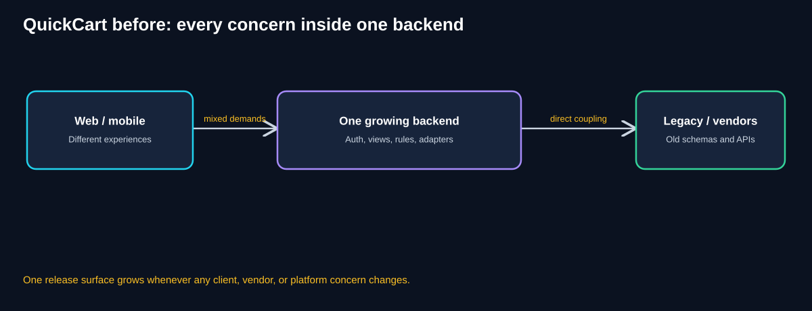
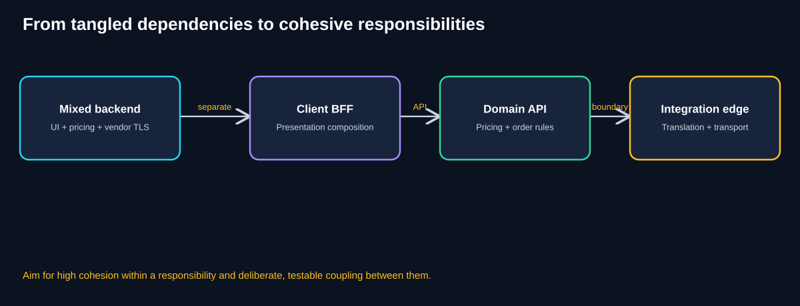
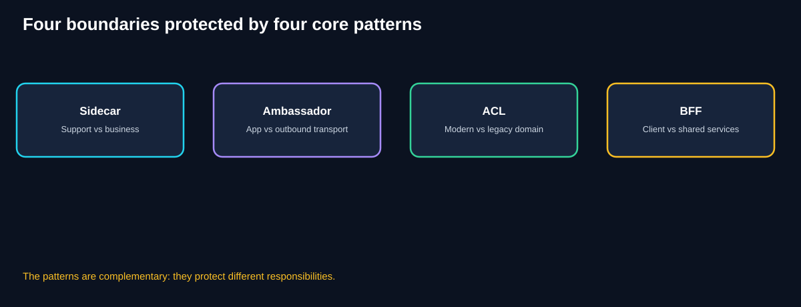
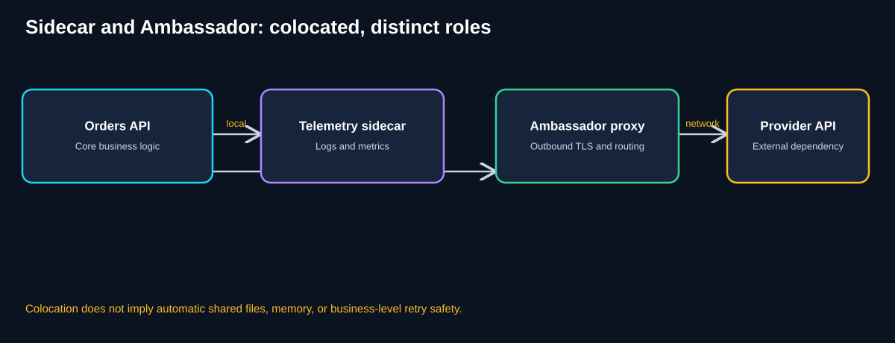
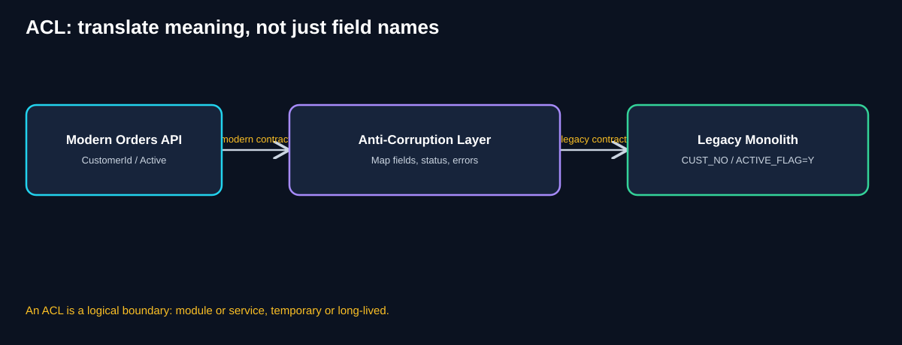
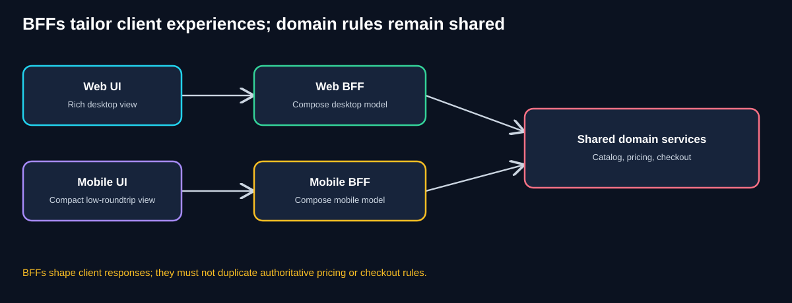
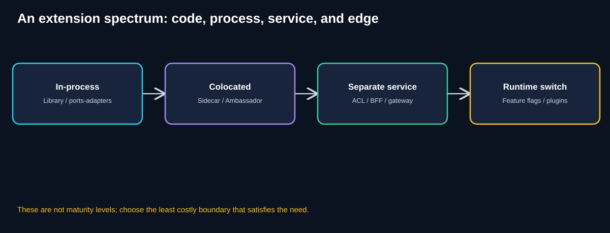
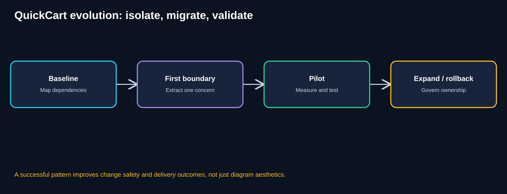

# Chapter 00 — Foundations of Software Extensibility Architecture

> **Software Extensibility Architecture Patterns Study Guide**  
> **Chapter:** 00 · **Level:** Foundations · **Study time:** 75–110 minutes  
> **Running system:** QuickCart, a fictional e-commerce platform  

## Learning objectives

By the end of this chapter, you should be able to:

1. Explain software extensibility in terms of change cost, boundaries, and business outcomes.
2. Distinguish a feature extension from scaling, resilience, and maintainability—while recognizing their interactions.
3. Explain coupling, cohesion, cross-cutting concerns, and the cost of duplicated integration logic.
4. Identify the *different* boundaries protected by Sidecar, Ambassador, Anti-Corruption Layer (ACL), and Backend for Frontend (BFF).
5. Recognize when a library or module is better than a separately deployed component.
6. Sketch an incremental modernization plan with measurable success criteria.
7. Defend an architectural decision using trade-offs, operational readiness, and cost.

## 1. Start with a business problem, not a pattern

QuickCart began with one website and a modest backend. The company now has a mobile app, third-party payment integrations, an aging order-management monolith, and teams working in Java, Python, and Go.

Management asks for four changes:

- Launch mobile-specific product discovery without slowing web releases.
- Standardize outbound security and connection diagnostics for external services.
- Expose legacy customer and order data through modern, understandable APIs.
- Collect telemetry consistently across services written in different languages.

A straightforward approach is to keep adding code to each existing service. That might work for one release. But each new client, language, vendor, or legacy schema change increases the number of places that must be edited, tested, and coordinated.

The central question is **not** “How many microservices can we create?” It is **“Where should a new responsibility live so that future changes have a small, predictable impact?”**

### Diagram 1 — Before: responsibilities accumulate



**Walkthrough**

1. Web and mobile clients request different shapes of information.
2. One backend accumulates client formatting, business rules, telemetry integration, and vendor-specific transport behavior.
3. Legacy systems and external APIs impose additional formats, status codes, and protocols.
4. A small mobile UI change may require touching a backend also used by web.
5. A vendor security update may force changes to application business code.
6. This is a **change-coupling problem**: unrelated reasons for change share the same implementation and release surface.

**Business consequence:** feature lead time rises, regression testing expands, and one team's work can block another's. These are hypotheses to measure, not automatic outcomes of every monolith.

## 2. What does “extensibility” mean?

**Extensibility** is the ability to add, replace, or vary system capabilities without making unrelated parts of the system change unnecessarily.

For QuickCart, extensibility might mean adding a new payment provider, supporting a new mobile experience, replacing an old customer system, or introducing distributed tracing across several languages.

A system is not “extensible” merely because it uses interfaces, containers, plugins, or microservices. It is extensible when those mechanisms make **expected changes easier and safer**.

### Extensibility versus neighboring qualities

| Quality | Central question | QuickCart illustration |
|---|---|---|
| Extensibility | How easily can we add or replace behavior? | Add a new payment provider with limited code changes |
| Scalability | Can useful capacity grow with demand? | Support more checkouts per second |
| Reliability | Will operations remain correct despite faults? | Avoid duplicate orders after retries |
| Availability | Can users reach the intended capability? | Checkout remains available during a node failure |
| Maintainability | How safely can we understand and change existing code? | Fix a pricing bug without breaking search |
| Deployability | Can changes be released safely and independently? | Release mobile response changes without web downtime |
| Portability | Can components move across environments? | Run the integration adapter on another platform |

**Important connection to the earlier scalability guide:** Extensibility patterns do not automatically increase throughput. A new ACL or BFF can even add latency. Their primary value is controlling change and responsibilities; performance must still be measured.

## 3. The foundations: cohesion, coupling, and boundaries

### 3.1 Cohesion: keep related responsibilities together

A component has **high cohesion** when its responsibilities belong together for a clear reason.

A Pricing service that owns price calculations, promotions, and pricing validation has a coherent purpose. A “UtilityService” that formats mobile screens, calculates prices, renews TLS certificates, and translates legacy customer codes does not.

**Practical test:** Can the team explain the component's purpose in one sentence without saying “and also” several times?

### 3.2 Coupling: understand what changes together

**Coupling** is the degree to which one part of a system depends on another. All useful systems have dependencies; the goal is to make them **explicit, stable, and appropriately narrow**.

Examples:

- **Implementation coupling:** Several services import one rapidly changing internal library.
- **Schema coupling:** Modern code directly refers to `CUST_NO` and `ACTIVE_FLAG`.
- **Release coupling:** Android cannot ship until a shared backend release is approved.
- **Operational coupling:** Every outbound call fails if a colocated proxy is unavailable.
- **Semantic coupling:** A client assumes that “paid” means the same thing across two domains when it does not.

Low coupling is not zero coupling. Moving logic into another network service trades code-level coupling for API, latency, availability, and ownership dependencies.

### 3.3 Cross-cutting concerns

A **cross-cutting concern** appears in many business components without being their primary purpose: telemetry, TLS configuration, logging collection, policy enforcement, or common networking behavior.

The course motivates Sidecar with the difficulty of maintaining supporting libraries across multiple languages. This is a real design pressure, but it does **not** imply that every cross-cutting concern must become a sidecar.

For example, instrumentation that requires detailed application-level spans may still need an in-process SDK, even when a sidecar collects or exports telemetry.

### Diagram 2 — From mixed responsibilities to clearer boundaries



**Walkthrough**

1. A mixed backend changes for many unrelated reasons.
2. A BFF can own client-specific composition.
3. Domain services retain authoritative pricing, checkout, and inventory rules.
4. Integration boundaries handle translation and transport-specific concerns.
5. Each boundary introduces an interface that needs ownership and tests.
6. The target is not the greatest number of components; it is a **better match between responsibilities and reasons for change**.

### 3.4 The dependency inversion idea

**Additional foundation beyond the course:** High-level business policy should not depend directly on replaceable infrastructure details when a stable abstraction is practical.

Instead of writing checkout logic that directly knows the external provider's JSON schema, QuickCart can define a payment port such as `authorizePayment(request)`. An adapter implements that contract for a provider.

This is the intuition behind Ports & Adapters, covered later. It also helps explain why an ACL is more than a data-field converter: the modern domain should speak its own language.

## 4. The four core patterns from the course

The presentation identifies four architectural boundaries. They can look alike in diagrams because each inserts or colocates another component, but their responsibilities are different.

### Diagram 3 — Four patterns, four questions



**Walkthrough**

1. **Sidecar:** Can a supporting capability run beside an application instead of being reimplemented inside it?
2. **Ambassador:** Can a colocated outbound proxy handle common network transport concerns?
3. **ACL:** Can modern domain code avoid adopting legacy vocabulary and semantics?
4. **BFF:** Can a client experience have a tailored API without duplicating core business rules?
5. A single QuickCart flow may use several of these at once.
6. Choose based on the boundary being protected, not the presence of an extra box.

| Pattern | Primary responsibility | Not its job |
|---|---|---|
| Sidecar | Colocated supporting capability | Owning core order business rules |
| Ambassador | Outbound transport proxy | Deciding whether a payment should happen twice |
| ACL | Translation between domain models and semantics | Simply renaming JSON fields without considering meaning |
| BFF | Client-specific composition and response shaping | Duplicating authoritative pricing and inventory rules |

## 5. Sidecar: extend the workload without rewriting every service

QuickCart has Java Orders, Python Recommendations, and Go Inventory services. All need logs, metrics, or supporting configuration functionality.

**Before:** Each service imports its own language-specific libraries. The implementations can drift in version, behavior, and operational configuration.

**Sidecar approach:** Run a supporting process or container alongside each service instance. A telemetry sidecar might collect structured logs and export them to a central observability backend.

### Deployment is part of the definition

A sidecar is generally **colocated** with its application, but “colocated” has platform-specific meaning. In a Kubernetes Pod, containers share a network namespace and can communicate over localhost; file sharing requires configured volumes. They do not automatically share process memory. CPU and memory are still consumed and must be budgeted.

Sidecars can simplify shared operations, but they multiply process count. One sidecar for each of 200 replicas means 200 additional processes or containers to manage.

### When a sidecar is a poor choice

- A small, stable library already meets the need.
- The application requires rich in-process instrumentation that a separate process cannot observe.
- The operational team cannot support another component lifecycle.
- Resource overhead outweighs consistency benefits.

## 6. Ambassador: a specialized outbound sidecar

The course treats Ambassador as a network-focused sidecar. For QuickCart, an Orders API might call a payment provider through a local outbound proxy.

### Diagram 4 — Sidecar and Ambassador roles



**Walkthrough**

1. Orders API owns business decisions: whether to authorize a payment, which order it belongs to, and how to interpret a business failure.
2. A telemetry sidecar handles selected supporting signals.
3. An Ambassador handles configured outbound traffic: TLS, destination routing, connection telemetry, and possibly selected retry policies.
4. The provider receives the request over the external network.
5. If the proxy is unavailable or misconfigured, outbound calls may fail.
6. An automatic retry after an uncertain payment outcome can cause harm unless the operation is safe to repeat.

**Critical distinction:** Transport-level retries are not a substitute for business idempotency. If the provider charged the customer but the response was lost, the proxy cannot safely decide whether a second charge is acceptable. That decision belongs to the application and provider contract.

**Sidecar vs Ambassador vs service mesh:** Sidecar describes a colocated deployment role; Ambassador describes outbound networking behavior; a service mesh coordinates service networking policies across workloads and may use sidecars or another data-plane model.

## 7. Anti-Corruption Layer: protect modern business meaning

QuickCart's legacy order monolith exposes:

```json
{
  "CUST_NO": "C-1042",
  "ACTIVE_FLAG": "Y",
  "ERR_CODE": "E104"
}
```

A new Customer service wants a cleaner domain model:

```json
{
  "customerId": "C-1042",
  "accountStatus": "ACTIVE"
}
```

Field renaming alone is not enough. `ACTIVE_FLAG=Y` may have legacy exceptions. Error `E104` might mean “customer not found,” “record archived,” or something else depending on the operation. The ACL must preserve **meaning**.

### Diagram 5 — Translation boundary



**Walkthrough**

1. Modern Orders uses a modern Customer model.
2. It calls an interface expressed in modern concepts.
3. The ACL maps requests, status meanings, and errors to the legacy contract.
4. The monolith continues using its existing schema.
5. Responses are translated back into modern semantics.
6. The modern domain is protected from changes to legacy names and protocol details.

### Two course scenarios

**Temporary migration:** The ACL remains while QuickCart incrementally replaces monolith capabilities.

**Long-term coexistence:** The ACL stays because a valuable legacy capability is retained.

**Design nuance:** An ACL is a **logical boundary**, not necessarily a standalone microservice. An in-process module can be the better choice when only one service needs it. A separate service can be justified by multiple consumers, ownership, deployment independence, or scaling requirements.

### ACL versus Strangler Fig

The **Strangler Fig** pattern gradually reroutes and replaces old functionality. The **ACL** translates between models and semantics. They frequently appear together but solve different problems.

For example, QuickCart may route new order creation to a modern service while retaining legacy returns processing. An ACL protects the modern model whenever it must call the remaining legacy capability.

## 8. Backends for Frontends: specialize the client boundary

QuickCart's desktop site shows rich product comparisons and many filters. The mobile app emphasizes fewer network round trips, compact product cards, and location-aware inventory.

If one backend handles every client's specialized presentation, it can become hard to change and coordinate.

### Diagram 6 — Web and mobile BFFs



**Walkthrough**

1. The web client requests a rich product page.
2. The Web BFF composes catalog, reviews, and recommendation data into a desktop-oriented response.
3. The mobile client requests a compact product card.
4. The Mobile BFF can combine several calls into one smaller response.
5. Both BFFs use shared domain services.
6. Pricing and checkout validation remain authoritative in those domain services, not duplicated across BFFs.

### Do we need one BFF per device?

No. One mobile BFF may serve both Android and iOS if their backend requirements and team ownership are similar. Separate them only when meaningful differences justify the operational cost.

### BFF versus API Gateway versus GraphQL

- **API Gateway:** Common entry point, routing, authentication integration, and cross-client policies.
- **BFF:** Client-specific composition, orchestration, and presentation contract.
- **GraphQL:** An API query technology that may be used with a BFF or gateway; it is not itself the same architectural responsibility.

### When not to add a BFF

If web and mobile need nearly identical APIs and release together, a shared backend may be simpler. Do not add BFFs solely because multiple clients exist.

## 9. The wider extensibility toolkit

**The following topics expand beyond the four primary course patterns.** They are included to make the study guide useful for architectural design rather than limited to the lecture's examples.

| Additional pattern or practice | Primary question | QuickCart example |
|---|---|---|
| Strangler Fig | How do we replace legacy capabilities gradually? | Route returns from monolith to new service |
| API Gateway | How do we centralize external API entry policies? | Route `/mobile` and `/web` explicitly |
| Plugin architecture | How do we add optional capabilities through stable extension points? | Install a new promotion rule plugin |
| Ports & Adapters | How do we keep domain logic independent of external technology? | Replace one payment provider adapter |
| Feature flags | How do we enable behavior selectively and roll it back quickly? | Release new recommendations to 5% of users |

These are not interchangeable. A plugin system is about defined extension points. A feature flag controls exposure of behavior; it does not by itself create a clean architectural boundary. An API gateway and BFF may coexist. Ports & Adapters can be implemented inside a monolith.

### Diagram 7 — Choose an extension mechanism, not a fashionable deployment shape



**Walkthrough**

1. An in-process library or adapter is often the simplest boundary.
2. A sidecar adds process isolation while staying close to the workload.
3. A separate ACL, BFF, or gateway introduces a networked service boundary.
4. Plugins and feature flags address different aspects of runtime extensibility.
5. There is no universal progression from “less mature” to “more mature.”
6. Select based on change frequency, failure isolation, ownership, performance, and operational capacity.

## 10. What does a good boundary look like?

A useful architectural boundary has five characteristics:

1. **Clear purpose:** One primary reason to change.
2. **Explicit contract:** Defined request, response, errors, and versioning behavior.
3. **Clear ownership:** A team is responsible for changes and incidents.
4. **Failure policy:** Timeouts, retries, degradation, and recovery are documented.
5. **Measurable value:** We can test whether the boundary reduced change effort or improved the intended experience.

### Contract example: QuickCart customer lookup

A modern service should depend on a stable contract such as:

```text
CustomerDirectory.findCustomer(customerId)
  -> Customer { customerId, accountStatus }
  -> CustomerNotFound | CustomerUnavailable
```

The ACL can map this to old HTTP endpoints, database procedures, or vendor-specific errors without exposing them to the caller.

**Contract-testing question:** If the legacy system starts returning a new status code, how will QuickCart discover the change *before* production customers see incorrect account states?

## 11. Business and technical requirements for the QuickCart program

### Business objectives

- Reduce lead time for mobile-only features.
- Avoid delaying modern feature delivery because of legacy integration changes.
- Reduce duplicated telemetry and networking maintenance.
- Support additional providers or clients with predictable change scope.
- Preserve checkout correctness and customer trust.

### Technical requirements

- Stable, versioned interfaces across boundaries.
- Traceable requests through BFFs, domain services, ACLs, and proxies.
- Defined availability and latency budgets for every extra hop.
- Safe handling of retries and non-idempotent operations.
- Secure identity, secrets, and authorization across components.
- Explicit ownership and rollback plans.

### Assumptions for this study guide

These are **illustrative assumptions**, not facts from the course:

- QuickCart has web and mobile applications.
- Its modern services are written in several languages.
- A legacy monolith retains customer and returns data.
- Checkout uses a third-party payment provider.
- The team has baseline latency, incident, and delivery metrics to compare against after changes.

## 12. Technical feasibility: what must we check first?

Before introducing any new process or service, validate:

| Question | Why it matters | Evidence |
|---|---|---|
| Can the concern be handled by a library? | Avoid unnecessary runtime complexity | Prototype and maintenance cost |
| Does colocation provide enough isolation? | Sidecars share fate and resource budgets with apps | Resource and failure tests |
| Can outbound traffic be reliably intercepted? | Ambassador behavior depends on actual routing configuration | End-to-end network tests |
| Are legacy semantics documented? | ACL mappings can otherwise be incorrect | Domain interviews and contract tests |
| Do client needs differ materially? | BFFs may not justify their overhead | Payload, round trips, release dependencies |
| Can teams own and operate new components? | Every boundary needs support | On-call and deployment readiness |

**A successful proof of concept should compare the proposed pattern with the simplest viable alternative.**

## 13. Performance and capacity: extension boundaries are not free

Suppose a QuickCart product page currently takes **180 ms** at p95. A new BFF adds composition logic and two downstream calls.

It is incorrect to assume that the BFF adds exactly 20 ms or always makes the request faster. Total latency depends on network hops, parallelism, cache behavior, payload size, and downstream tail latency.

A simplified sequential path:

```text
Client → BFF (12 ms) → Catalog (85 ms) → Reviews (70 ms)
Approximate server-side sequential work = 167 ms
```

If Catalog and Reviews can be called concurrently, the idealized downstream wait becomes roughly the slower call:

```text
12 ms + max(85 ms, 70 ms) = 97 ms
```

These are illustrative timings excluding other network and processing overhead. Real measurements are necessary. Also, parallel calls can increase fan-out load and amplify tail-latency risks.

### Resource cost of sidecars

If 80 application replicas each use a telemetry sidecar consuming **0.08 vCPU** and **120 MiB** of memory at steady state:

- CPU reserved or consumed across sidecars: `80 × 0.08 = 6.4 vCPU`.
- Memory across sidecars: `80 × 120 = 9,600 MiB ≈ 9.38 GiB`.

The figures are assumptions for practice, not a recommendation or measured platform overhead. Actual resource consumption varies by workload and implementation.

### What should be measured?

For BFFs: payload bytes, client round trips, screen-ready latency, error rate.

For ACLs: translation latency, mapping errors, legacy dependency availability.

For sidecars: per-replica CPU/memory, telemetry completeness, sidecar restart rate.

For Ambassadors: outbound p95/p99, connection failures, TLS errors, retry amplification.

## 14. Reliability: what can fail after we add a boundary?

An architectural pattern may simplify source code while adding runtime dependencies.

### Failure mode A — Sidecar unavailable

A telemetry sidecar crashes. Should the Orders API continue accepting orders?

Usually telemetry failure should not silently stop revenue-critical operations, but the answer depends on compliance and policy. Define buffering, loss tolerance, and failure behavior explicitly.

### Failure mode B — Ambassador misconfiguration

A proxy routes payment traffic to the wrong destination or presents an invalid certificate.

Mitigation includes configuration validation, staged rollout, clear ownership, and fail-closed handling for sensitive outbound connections.

### Failure mode C — ACL translates a status incorrectly

The legacy system adds `ACTIVE_FLAG=P` for “pending review,” but the ACL maps every non-`N` value to ACTIVE.

This is a **semantic correctness bug**, not merely a network error. Contract tests, unknown-value handling, and domain review are essential.

### Failure mode D — BFF duplicates business logic

Mobile BFF computes a discount differently from Web BFF. Two customers see inconsistent totals.

Keep authoritative pricing in the shared Pricing domain service. BFFs should compose and shape data, not invent a second source of business truth.

### Failure mode E — Dependency becomes slow

A BFF calls three services, one of which hangs. Without timeouts and a deadline, the client experience degrades.

Define bounded timeouts, cancellation, concurrency limits, and a truthful partial-data policy where appropriate.

## 15. Security and governance

### Authentication and authorization

A gateway or BFF may validate an incoming token, but domain services must still enforce authorization appropriate to their trust boundary. Never assume a user is allowed to view another customer's order because the request passed through a BFF.

### Secrets and outbound connections

Ambassadors can centralize aspects of TLS and transport credentials, but secrets need controlled distribution, rotation, access restrictions, and auditability. A proxy is not a universal substitute for application-level authorization.

### Data privacy

ACLs may handle legacy personally identifiable information. Minimize fields, avoid logging sensitive payloads, and define retention and deletion responsibilities across old and new systems.

### Change governance

For every new boundary, record:

- Owner and on-call responsibility.
- Interface and compatibility policy.
- Threat model and required permissions.
- Observability, alerting, and recovery procedure.
- Retirement or review criteria.

## 16. Observability and success metrics

| Goal | Leading signal | Outcome metric |
|---|---|---|
| Faster mobile releases | Fewer shared-backend dependencies | Lead time for mobile-only changes |
| Consistent telemetry | Standardized coverage across languages | Percentage of requests traceable end to end |
| Safer legacy integration | Contract test coverage and unknown mappings | Legacy-caused incidents in modern services |
| Safer outbound networking | TLS errors and proxy config drift | Provider-call failure rate |
| Better mobile performance | Round trips and payload bytes | p95 screen-ready time |
| Controlled operational cost | Added CPU/memory and service count | Total cost per successful customer journey |

**Observability plan:** Correlate a user journey from the client through the BFF, domain API, ACL or Ambassador, and external dependency. Distinguish time spent in translation, proxying, waiting, and business processing.

**Warning:** A green proxy dashboard does not prove a correct payment outcome. Include business-level signals such as successful checkouts, duplicate-payment investigations, and order reconciliation.

## 17. Illustrative ROI: what improvement would justify the pattern?

Suppose QuickCart's mobile team delivers 12 substantial features per year. Shared-backend coordination costs an estimated **18 engineering hours per feature**, at an illustrative fully loaded cost of **$90/hour**.

Annual coordination effort:

`12 × 18 × $90 = $19,440`

A BFF pilot is expected to remove **60%** of that coordination:

`$19,440 × 0.60 = $11,664` annual labor capacity freed.

But suppose the BFF costs **$4,000/year** in infrastructure and ongoing operations, plus **$12,000** one-time implementation effort.

Illustrative first-year net:

`$11,664 − $4,000 − $12,000 = −$4,336`

The first-year financial result is negative under these assumptions. Benefits might still justify the investment if mobile experience, delivery speed, and long-term autonomy improve, but those benefits must be measured rather than assumed.

**Business lesson:** An extra architectural component is not automatically an ROI win. Measure baseline coordination, incident rates, latency, cloud cost, and change failure rate.

## 18. Pattern selection: a practical decision tree

Start with the *reason a change is difficult*:

1. **Same supporting capability repeated across language runtimes?** Compare a library, agent, and **Sidecar**.
2. **Outbound network policies repeated across applications?** Compare client libraries and managed proxies with **Ambassador**.
3. **Modern code polluted by legacy vocabulary and meaning?** Consider an **ACL**.
4. **Different clients need significantly different API experiences or release cadence?** Consider **BFF**.
5. **Replacing a legacy system gradually?** Consider **Strangler Fig**, often with an ACL.
6. **Need an interchangeable infrastructure provider?** Consider **Ports & Adapters**.
7. **Need optional runtime extensions?** Consider **Plugin architecture**.
8. **Need controlled rollout or kill switches?** Consider **Feature flags**.

### Choosing not to use a pattern

A useful architectural decision can be “keep the existing module and improve its tests.” Patterns are tools, not milestones.

**Prefer the smallest boundary that satisfies the requirement**, provided it does not create unacceptable coupling or correctness risk.

## 19. An incremental implementation roadmap

### Diagram 8 — Evolution, not big-bang rewrite



**Walkthrough**

1. Inventory the current responsibilities, dependencies, and failure modes.
2. Choose one high-friction boundary, such as mobile response composition.
3. Build a narrow pilot with explicit ownership and a stable contract.
4. Run performance, correctness, and failure tests.
5. Compare results with the baseline.
6. Expand, revise, or roll back based on measured outcomes.

### Phase 0 — Baseline and ownership

Record change lead time, number of coordinated releases, p95 client latency, incident count, and the cost of current supporting integrations.

### Phase 1 — Pilot one boundary

A practical pilot is a Mobile Product Details BFF that composes Catalog and Inventory responses while leaving pricing authoritative.

**Exit criteria:** demonstrably fewer client round trips, no pricing duplication, and acceptable latency and error rate.

### Phase 2 — Operational hardening

Add tracing, contract tests, timeouts, authorization checks, canary rollout, and rollback procedures.

### Phase 3 — Broaden only where justified

Use the same evidence-driven approach for legacy ACLs and outbound proxy standardization. Avoid simultaneously introducing all patterns; that would make the source of improvements or regressions difficult to identify.

## 20. Architecture Decision Record (ADR) example

**ADR-001: Introduce a Mobile Product Details BFF**

**Context:** Mobile screens need a compact combined product response; shared backend changes are delaying mobile delivery.

**Decision:** Create one mobile-oriented BFF for product presentation and orchestration. Keep pricing, inventory truth, and checkout rules in shared domain services.

**Alternatives:** Continue shared backend; use a gateway-only approach; let the mobile client call services directly.

**Expected benefits:** Fewer client round trips, smaller payloads, more independent mobile releases.

**Costs and risks:** New deployment and on-call responsibility, extra network hop, potential business-logic duplication.

**Validation:** Measure screen-ready p95, request count, payload size, error rate, and release lead time before and after rollout.

**Rollback:** Route the mobile product endpoint back to the existing API while preserving client compatibility.

## 21. Common misconceptions

| Misconception | Correction |
|---|---|
| “Extensibility means microservices.” | Good extension boundaries can exist within a monolith. |
| “Every cross-cutting concern needs a sidecar.” | Libraries, agents, and platform capabilities may be simpler. |
| “A sidecar shares all application memory and files.” | Sharing depends on the runtime; Kubernetes volumes must be configured. |
| “An Ambassador can safely retry any failed call.” | Business-level idempotency and uncertain outcomes must be addressed. |
| “An ACL is just a field-name converter.” | It protects business meaning, error semantics, and model boundaries. |
| “An ACL must be a separate service.” | It may be an internal module. |
| “A BFF should own pricing rules.” | Shared domain services should own authoritative business rules. |
| “Every device requires its own BFF.” | Split only for meaningful needs or ownership differences. |
| “Adding services always reduces cost.” | New runtime, network, testing, and support costs may exceed savings. |
| “Patterns solve performance automatically.” | Measure latency, fan-out, resource usage, and bottlenecks. |

## 22. Knowledge check — eight expandable questions

### Q1. What is the main purpose of extensibility patterns?

<details><summary>Reveal answer and reasoning</summary>

To make expected changes easier and safer by placing responsibilities behind suitable boundaries. The goal is not to maximize component count or automatically increase throughput.

</details>

### Q2. QuickCart's Java, Go, and Python services duplicate telemetry collection. What pattern is worth evaluating?

<details><summary>Reveal answer and reasoning</summary>

**Sidecar**, alongside library and platform-agent alternatives. A colocated telemetry component can reduce language-specific support logic, but application-level instrumentation may still be needed.

</details>

### Q3. An Orders API needs standardized outbound TLS and connection diagnostics. Which pattern fits?

<details><summary>Reveal answer and reasoning</summary>

**Ambassador**, a specialized outbound proxy sidecar. It handles transport concerns; the application still owns payment correctness and idempotency.

</details>

### Q4. The new Customer service directly uses `ACTIVE_FLAG` and `CUST_NO`. What is wrong?

<details><summary>Reveal answer and reasoning</summary>

Legacy schema and semantics have leaked into the modern domain. An **ACL** can translate those concepts at a defined boundary.

</details>

### Q5. Mobile requires a compact product view, while desktop needs a richer composition. Which pattern might help?

<details><summary>Reveal answer and reasoning</summary>

**BFF**, if the difference in API behavior, performance, or team ownership justifies separate backend responsibilities.

</details>

### Q6. Does an ACL need a separate deployment?

<details><summary>Reveal answer and reasoning</summary>

No. It is a logical domain translation boundary. An in-process module may be simpler; a separate service may be useful when reuse or ownership warrants it.

</details>

### Q7. Why should a BFF not calculate the final checkout total independently?

<details><summary>Reveal answer and reasoning</summary>

Duplicating authoritative pricing logic can cause different clients to compute different totals. The shared domain service should own the business rule.

</details>

### Q8. Which pattern gradually replaces a legacy monolith, and which protects domain models during the transition?

<details><summary>Reveal answer and reasoning</summary>

**Strangler Fig** governs gradual replacement and routing; **ACL** protects model and semantic boundaries. They can be combined.

</details>

## 23. Worked architecture challenge: four changes, one platform

### Scenario

QuickCart is planning a six-month modernization program:

- The mobile app needs a one-call product details endpoint.
- A legacy order monolith exposes old customer codes and statuses.
- Orders API calls two payment providers with inconsistent TLS configuration.
- Java, Python, and Go services each maintain separate log-export code.
- The company cannot pause feature development for a full rewrite.

**Your task:** Choose appropriate boundaries, explain where each responsibility lives, name the biggest failure risk, and propose a phased rollout.

<details><summary>Reveal a worked solution</summary>

**Step 1 — Mobile experience:** Introduce a narrowly scoped Mobile BFF for product-details composition. It calls Catalog, Inventory, and Pricing domain services; it does not calculate authoritative prices.

**Step 2 — Legacy domain:** Define a Customer interface in modern terminology and implement an ACL that translates legacy status codes, data shapes, and errors. Begin as a module if only one service uses it; extract a separate service only if ownership or reuse warrants it.

**Step 3 — Outbound networking:** Evaluate an Ambassador for common TLS, routing, and connection diagnostics. Configure payment destinations explicitly and avoid automatic unsafe retries. Maintain idempotency and reconciliation in Orders/Payments business logic.

**Step 4 — Telemetry:** Pilot a sidecar or managed agent for consistent log collection across languages. Preserve in-process instrumentation where necessary. Measure overhead per replica.

**Step 5 — Migration strategy:** Use a Strangler Fig approach to replace monolith capabilities incrementally. Keep the ACL until remaining legacy functionality is removed or intentionally retained.

**Biggest risks:** Incorrect payment retries, bad legacy semantic mappings, duplicated pricing, and sidecar/proxy failures. The rollout must include contract tests, traceability, canaries, and rollback.

**Phasing:** Baseline → mobile BFF pilot → ACL contract validation → outbound proxy pilot → telemetry standardization → expand based on measured outcomes.

**Success measures:** Mobile screen-ready p95, client request count, legacy mapping errors, outbound TLS errors, trace coverage, lead time, and total operational cost.

</details>

### Why this solution is better than “split everything into microservices”

Each boundary is justified by a specific source of change. The design preserves shared business rules, acknowledges new failure modes, and avoids a high-risk big-bang migration.

## 24. Self-review rubric

Score each area from **0 (not addressed)** to **2 (well justified)**.

| Dimension | What a strong answer contains |
|---|---|
| Problem diagnosis | Identifies the reason changes are difficult |
| Boundary choice | Maps each problem to a suitable pattern or simpler alternative |
| Responsibility ownership | Separates presentation, business, translation, and transport |
| Correctness | Covers payments, retries, semantics, and authorization |
| Operations | Defines monitoring, testing, rollback, and ownership |
| Economics | Accounts for implementation and ongoing costs |
| Evolution | Proposes incremental delivery rather than a rewrite |

**Interpretation:** 12–14 indicates a strong foundation; 8–11 suggests reviewing the weakest areas; below 8 suggests repeating the pattern-selection exercise.

## 25. Quick revision

- **Extensibility:** Add or vary capabilities without unnecessarily changing unrelated parts.
- **Cohesion:** Keep responsibilities with the same reason to change together.
- **Coupling:** Make dependencies explicit, narrow, and stable.
- **Sidecar:** Colocated supporting capability.
- **Ambassador:** Colocated outbound network proxy.
- **ACL:** Translation boundary that protects modern domain semantics.
- **BFF:** Client-specific API composition and response shaping.
- **Strangler Fig:** Incremental replacement of legacy functionality.
- **Ports & Adapters:** Business logic depends on stable ports, not vendor details.
- **Feature flags:** Controlled exposure and rollback of behavior.

### Five questions to ask before drawing a new component

1. What specific change is difficult today?
2. Which responsibility causes that difficulty?
3. Could a module, library, or configuration change solve it more simply?
4. What new latency, failure, security, and ownership risks would this boundary create?
5. How will we know whether the change actually helped?

## 26. Chapter conclusion and next step

**Next:** [Chapter 01 — Sidecar Pattern](01-sidecar.md). We will examine before/after deployments, Kubernetes Pod semantics, telemetry pipelines, configuration choices, lifecycle coupling, failure testing, resource budgeting, and a production-ready QuickCart implementation plan.


