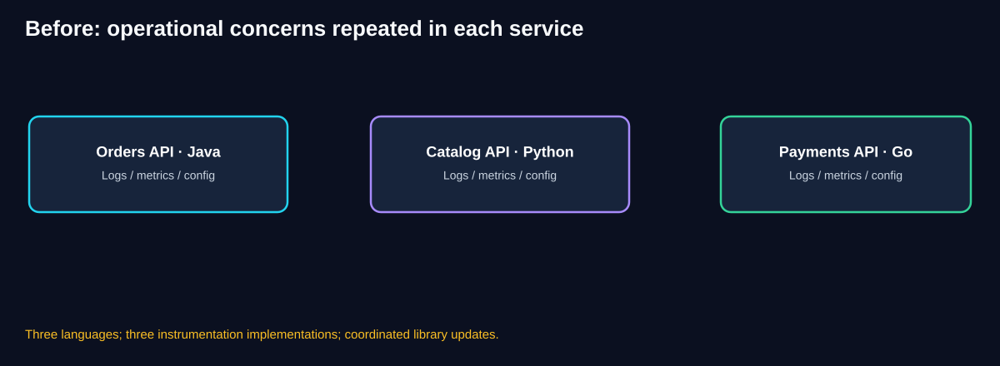
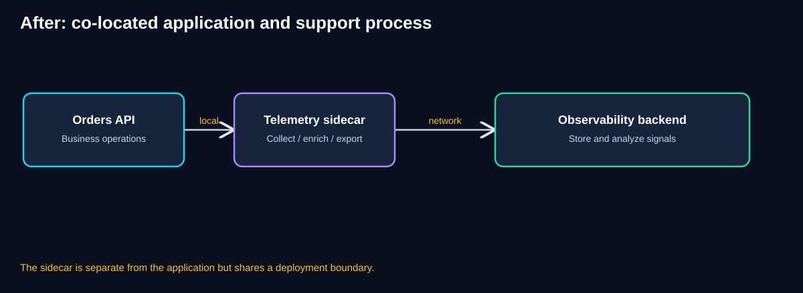
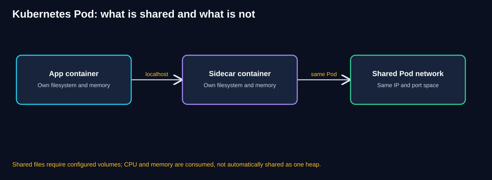
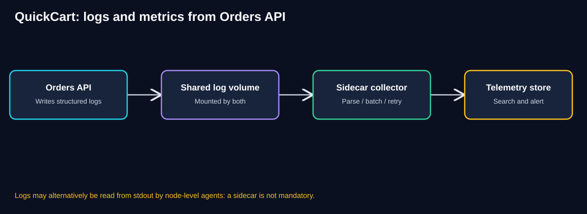
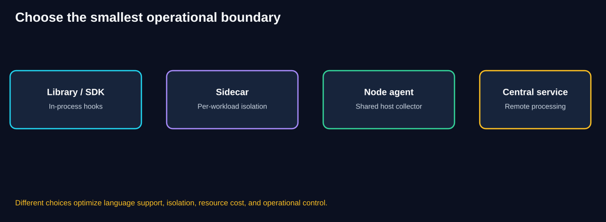
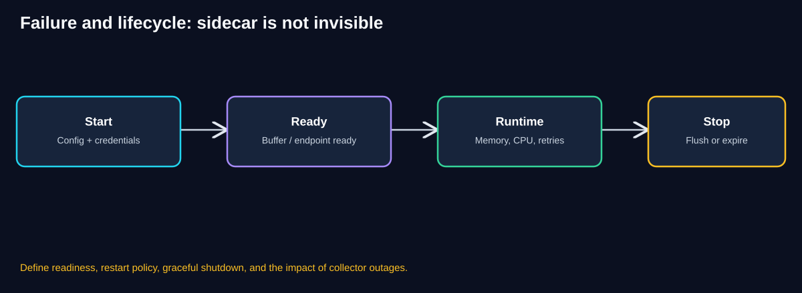
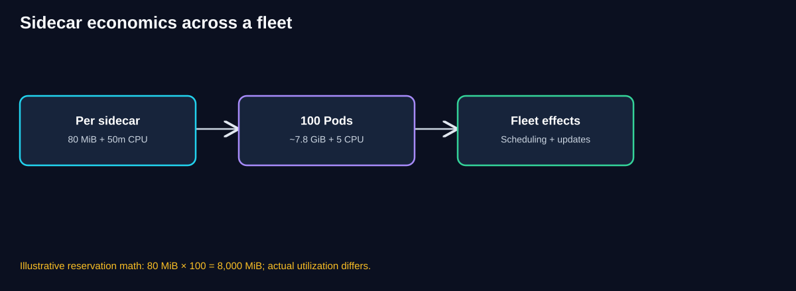
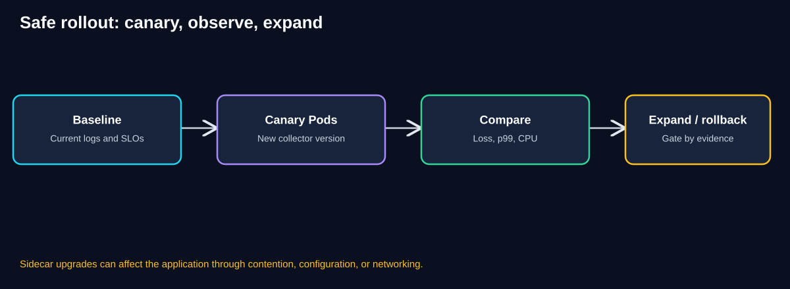

# Chapter 01 — Sidecar Pattern

> **Software Extensibility Architecture Patterns · QuickCart self-study guide**
>
> **Estimated study time:** 70–100 minutes, including the worked exercises.
>

[← Chapter 00: Foundations](00-foundations.md) · [Next: Chapter 02 — Ambassador](02-ambassador.md)

## 1. Learning objectives

By the end of this chapter, you should be able to:

1. Explain why cross-cutting operational features create duplicated work in a polyglot microservice system.
2. Describe the Sidecar pattern without assuming that Kubernetes is required.
3. Distinguish what containers share inside a Kubernetes Pod from what they do **not** share.
4. Trace telemetry from QuickCart's Orders API to a monitoring backend.
5. Compare a sidecar with an in-process SDK, node-level agent, and centralized service.
6. Design startup, readiness, failure, shutdown, security, and update behavior.
7. Calculate illustrative fleet-wide CPU and memory overhead.
8. Defend a pattern decision using operational and business evidence.

## 2. QuickCart's starting problem

QuickCart operates several services:

- **Orders API** written in Java, which validates orders and records order state.
- **Catalog API** written in Python, which serves product information.
- **Payments API** written in Go, which integrates with payment providers.
- **Media API** written in Node.js, which coordinates product video uploads.

Each service must perform its business task. Yet each also needs logging, metrics, trace propagation, configuration, and possibly certificate handling. Some of those capabilities are best implemented in the application itself; others are candidates for a reusable supporting process.

At first, each team imports a telemetry library. After a year, QuickCart has different logging conventions, incompatible exporter versions, and inconsistent retry behavior. The Python team emits `customer_id`; Java emits `customerId`; Go omits correlation identifiers entirely. Operations staff must learn several configuration mechanisms and investigate missing telemetry whenever a library upgrade is delayed.



**Diagram walkthrough**

1. The three boxes represent independent business services written in different languages.
2. Each service carries its own implementation of logging, metrics, and configuration handling.
3. The duplication is not only source-code duplication: it includes release coordination, policy differences, and inconsistent diagnostics.
4. The diagram does **not** imply that application libraries are always wrong. Many metrics and traces require application instrumentation.
5. The architectural question is which responsibilities genuinely benefit from being moved outside the application's codebase.

### 2.1 Why a common library is not automatically enough

A Java library cannot simply be imported into a Go process. Teams can use language-specific implementations of a common telemetry standard, but they still need compatible releases, configuration, and integration testing. A shared library can be an excellent choice when it is small, stable, and language-appropriate; it becomes painful when it embeds rapidly changing infrastructure behavior into many application releases.

### 2.2 Why a remote service is not automatically better

A central telemetry service avoids repeated code, but applications must still produce and send data. A central endpoint can also introduce network dependencies, rate limits, and ownership questions. The Sidecar pattern provides an intermediate option: a supporting process runs close to the application, while centralized backends remain responsible for aggregation and analysis.

## 3. What is a sidecar?

A **sidecar** is a supporting process or container deployed alongside a primary application instance, normally within a shared deployment or lifecycle boundary, to provide a capability that is not the application's main business responsibility.

The name comes from the sidecar attached to a motorcycle: it adds capability without changing the motorcycle's core purpose.

In QuickCart, the Orders API owns order validation and persistence. A telemetry sidecar can collect, batch, enrich, and export logs. Orders API does not need to implement the exporter itself, although it must still emit useful log events.



**Diagram walkthrough**

1. The Orders API performs business operations and emits telemetry.
2. A separate sidecar process collects the telemetry locally.
3. The sidecar handles operational concerns such as buffering, export configuration, and transport to the observability backend.
4. The central backend stores, indexes, and analyzes data across the fleet.
5. The business API and sidecar can be written in different languages.
6. Co-location reduces some communication overhead, but it does not make either process immune to failure or resource contention.

### 3.1 The architectural boundary

The key boundary is **business logic versus supporting infrastructure**.

A useful rule: if the capability should remain essentially the same when Orders API is replaced by another implementation, it may belong outside the core business code. If the capability depends on order-specific semantics, it may still belong inside the domain service.

For example, an agent can export a log entry, but it cannot reliably infer that an order was *financially settled* merely from an HTTP 200 response. Domain events and business metrics must be deliberately emitted by the application.

## 4. Sidecar versus an ordinary helper process

Not every extra process is automatically a well-designed sidecar. A meaningful sidecar usually has a clear supporting responsibility, a defined interface to the main application, co-location for a reason, and a deliberate deployment and operational lifecycle.

Sidecars are not exclusive to Kubernetes. They can run as separate processes on a virtual machine, as containers managed by a scheduler, or in other co-located environments. Kubernetes simply makes the deployment model especially visible.

A sidecar may provide log forwarding, certificate rotation, local caching, secret delivery, protocol adaptation, or outbound proxying. An **Ambassador** is a networking-focused sidecar; it will receive its own chapter.

## 5. Kubernetes Pod semantics: precision matters

A common Sidecar explanation says the application and sidecar share the same host resources. This is useful as a high-level analogy, but Kubernetes has important details.



**Diagram walkthrough**

1. Both containers run inside one Kubernetes Pod.
2. Containers in the Pod share the Pod's network namespace: they typically use the same Pod IP and can reach one another through `localhost`.
3. They share a port space, so two containers cannot both bind the same IP and port combination.
4. Each container has its own filesystem view, except for volumes explicitly mounted into both.
5. Containers do **not** share a single application heap or ordinary process memory.
6. CPU and memory consumption affect the Pod's resource footprint, but resource requests and limits can be configured per container.

### 5.1 Networking

The application can call a local sidecar endpoint such as `http://127.0.0.1:4318` when the collector exposes the relevant port. This avoids a remote service hop between the two containers. The sidecar still needs network access to export telemetry.

### 5.2 Files and volumes

Suppose Orders API writes a file to `/var/log/quickcart/orders.jsonl`. A sidecar cannot read that path merely because it is in the same Pod. Both containers need a configured shared volume mounted at appropriate paths, with suitable filesystem permissions.

In many Kubernetes setups, a simpler alternative is for the application to write structured logs to standard output and let a node-level log collector read container logs. That often eliminates the need for a per-Pod log sidecar.

### 5.3 Process and lifecycle behavior

A Pod groups containers, but that does not mean they start at exactly the same instant or always restart together. Kubernetes supports sidecar-specific lifecycle behavior, including sidecar containers expressed through restartable init containers in supported versions. The exact startup, termination, and readiness semantics depend on the workload specification and platform version.

For this chapter, we use a conceptual two-container Pod and make dependencies explicit rather than assuming perfect startup ordering.

## 6. Detailed QuickCart implementation: telemetry sidecar

The Orders API writes structured JSON logs. A co-located collector reads the logs from a shared volume and exports them to a central telemetry service.



**Diagram walkthrough**

1. Orders API writes an event containing timestamp, level, operation name, order ID, and trace ID.
2. The shared volume exposes that file to the collector.
3. The sidecar parses records, attaches service metadata, batches events, and exports them.
4. The backend receives telemetry from all Orders API replicas.
5. If the backend is slow, buffering may temporarily absorb the disruption; buffering is bounded and must have an overflow policy.
6. The application must never block a critical order transaction indefinitely merely because log export is delayed.

### 6.1 Example application log

```json
{
  "timestamp": "2026-10-17T09:00:00Z",
  "level": "INFO",
  "service": "orders-api",
  "event": "order.created",
  "orderId": "ord-1042",
  "traceId": "trace-example-91",
  "durationMs": 37
}
```

The example identifiers and timestamp are illustrative. Sensitive payment information, credentials, or full customer records must not be logged.

### 6.2 Illustrative Kubernetes Pod fragment

This example demonstrates the **shared-volume concept**. It is not a production-complete manifest: actual images, image digests, collector configuration, RBAC, resource policies, security contexts, and deployment health checks must be supplied.

```yaml
apiVersion: v1
kind: Pod
metadata:
  name: quickcart-orders-example
spec:
  containers:
    - name: orders-api
      image: example.invalid/quickcart/orders:1.0
      volumeMounts:
        - name: order-logs
          mountPath: /var/log/quickcart
    - name: telemetry-sidecar
      image: example.invalid/quickcart/collector:1.0
      volumeMounts:
        - name: order-logs
          mountPath: /input/orders
          readOnly: true
  volumes:
    - name: order-logs
      emptyDir: {}
```

`emptyDir` survives individual container restarts while the Pod exists but is not durable across Pod removal. It is therefore unsuitable as the only store for audit-critical events. In a real deployment, a collector must also be configured to read the file path and export to a backend.

### 6.3 What belongs in the app and what belongs in the sidecar?

| Concern | Usually owned by |
|---|---|
| Deciding whether an order is valid | Orders API |
| Producing `order.created` as a meaningful event | Orders API |
| Assigning business-safe fields to a log | Orders API |
| Parsing and batching emitted logs | Collector sidecar |
| Exporting logs to a telemetry backend | Collector sidecar or node agent |
| Sampling or propagating trace context in business code | Application instrumentation, sometimes with proxy assistance |
| Storing and querying fleet telemetry | Central observability backend |
| Keeping payment credentials safe | Appropriate identity/secret controls; never assume a sidecar alone solves this |

## 7. Sidecar communication patterns

The primary application and sidecar may communicate in several ways.

**Local HTTP or gRPC:** The application sends telemetry or requests to `localhost`. This is simple when both expose stable local endpoints, but creates a runtime dependency if calls are synchronous.

**Shared file volume:** The application writes files and the sidecar reads them. This separates producer and consumer timing, but requires rotation, permissions, file-offset tracking, and bounded disk usage.

**Unix domain socket:** A local IPC channel can reduce exposure and avoid a TCP listener. The socket path must be shared through an appropriate filesystem mount and permissions.

**Interception/proxying:** A networking sidecar can transparently or explicitly mediate traffic. This adds routing, certificate, and failure-mode complexity and is explored in the Ambassador chapter.

**Configuration or secret delivery:** A sidecar may fetch or refresh material and write it to a shared volume. Applications must support safe reload, permissions, and credential rotation.

## 8. Alternatives: do not default to a sidecar



**Diagram walkthrough**

1. An SDK or library provides in-process integration and may expose the richest application context.
2. A sidecar isolates supporting functionality per workload and is often language-neutral.
3. A node-level agent can collect data from multiple Pods, reducing per-Pod overhead.
4. A centralized service offers shared processing but adds a remote dependency.
5. These approaches can be combined: an app SDK generates spans, a node agent exports them, and a central backend analyzes them.
6. The correct choice depends on functionality, scale, failure isolation, ownership, and operating cost.

| Option | Strengths | Limitations | Good QuickCart fit |
|---|---|---|---|
| Application SDK | Rich domain context, low process count | Language-specific code and upgrades | Tracing and business metrics |
| Sidecar | Local, isolated, reusable across languages | Per-instance CPU/memory and lifecycle | Special collector or per-workload proxy |
| Node-level agent | Amortized resource cost across workloads | Shared failure/ownership boundary | Standard container log collection |
| Central service | Shared capability and centralized control | Network hop and central bottleneck | Telemetry storage and analytics |
| Platform-native capability | Less custom code | Platform coupling and feature limits | Managed log ingestion |

### 8.1 When to avoid Sidecar

Do not introduce a sidecar when a well-supported SDK already meets the need, when the workload has extremely tight memory budgets, when a node-level collector already provides the required capability, or when the team cannot operate and patch another process.

A sidecar is not an automatic performance improvement. A sidecar may lower duplication while increasing operational complexity.

## 9. Startup, readiness, failure, and shutdown



**Diagram walkthrough**

1. Startup loads configuration and obtains the permissions required for the sidecar's job.
2. Readiness determines when the supporting capability is able to receive or process work.
3. During normal operation, both containers compete for finite node resources.
4. When export fails, the sidecar needs bounded buffers and retry policies.
5. Shutdown should allow a controlled flush where feasible, without hanging forever.
6. The application must define whether a sidecar outage should block business requests or merely reduce telemetry quality.

### 9.1 Fail-open versus fail-closed

For routine log export, QuickCart may prefer **fail-open**: checkout continues while the collector is unavailable, with alerts about lost observability and bounded buffering. This avoids converting a monitoring outage into a sales outage.

For a sidecar enforcing a mandatory security control, **fail-closed** may be necessary: traffic is rejected rather than bypassing policy. This is a business and risk decision, not a universal Sidecar property.

### 9.2 Failure matrix

| Failure | Potential effect | Mitigation |
|---|---|---|
| Sidecar crashes | Missing telemetry or broken local endpoint | Restart policy, alerting, app behavior policy |
| Export backend unavailable | Growing buffer and delayed visibility | Bounded queue, backoff, drop policy, alert |
| Sidecar uses excessive memory | Pod eviction or app pressure | Resource requests/limits, load test |
| App starts before sidecar ready | Local calls fail | Retry with backoff or explicit readiness design |
| Pod is terminated | Buffered logs may be lost | Flush deadline, durable export where needed |
| Malformed log event | Parser failure or dropped record | Schema validation, dead-letter/error counters |
| Shared volume fills | Application or sidecar write failure | Rotation, quotas, disk alerts |
| Collector update changes parsing | Missing fields in dashboards | Contract tests and canary rollout |

## 10. Resource capacity and cost calculations



**Diagram walkthrough**

1. Assume a sidecar requests 80 MiB memory and 50 millicores of CPU.
2. Across 100 Pods, that is 8,000 MiB, approximately 7.8 GiB, of requested memory.
3. CPU requests sum to 5 cores (100 × 0.05).
4. These figures describe **requested capacity**, not guaranteed actual utilization or directly billable cost.
5. Scheduler placement, node sizing, cluster autoscaling, and headroom determine the real cost impact.
6. Fleet-wide upgrades, CVE patching, and troubleshooting add engineering costs not captured by resource math.

### 10.1 A worked calculation

Assumptions:

- 100 QuickCart application Pods.
- Sidecar request: 80 MiB memory and 50m CPU per Pod.
- 10% additional Pods during rollout overlap.

At steady state: `100 × 80 MiB = 8,000 MiB`, or about **7.81 GiB**. CPU requests: `100 × 0.05 = 5 vCPU`.

With 110 Pods during rollout: memory requests rise to `8,800 MiB` (about 8.59 GiB), and CPU requests to `5.5 vCPU`.

This does not mean the cloud bill increases by exactly 5.5 vCPU. Existing nodes may have spare capacity, or the extra requests may require new nodes. Use actual cluster bin-packing and cost reports.

### 10.2 Illustrative ROI

Suppose a shared sidecar implementation saves 20 engineering hours per month across teams at an assumed fully loaded cost of $60/hour. That is **$1,200/month** in labor value.

Suppose the sidecar adds an estimated $350/month in infrastructure and $250/month in maintenance overhead. Illustrative net monthly benefit is `1,200 − 350 − 250 = $600`.

If initial design and rollout cost $6,000, simple payback is `6,000 / 600 = 10 months`.

These are **hypothetical assumptions**, not observed QuickCart results. ROI can be negative when a node-level collector already solves the problem cheaply.

## 11. Security and governance

A sidecar runs near the application and may see valuable information. Treat it as a privileged integration point, not as inherently trusted.

- **Least privilege:** Give the collector read access only to required log files and write access only to its buffers.
- **Identity:** Use workload identity or appropriately scoped credentials rather than embedding secrets in images.
- **Data minimization:** Avoid payment card data, passwords, authentication tokens, and unnecessary personal data in logs.
- **Network egress:** Restrict where the sidecar can send data.
- **Supply-chain controls:** Pin and scan images, track vulnerabilities, and maintain an update owner.
- **Retention:** Set retention and deletion rules for exported telemetry and local buffers.
- **Auditability:** Record sidecar configuration changes and deployments.
- **Tenant boundaries:** Avoid inadvertently mixing data across QuickCart tenants or services.

### 11.1 Who owns the sidecar?

A platform team might own the collector image, base configuration, and security patches. The Orders team owns the business events and their meaning. The observability team owns backend retention, dashboards, and alert standards. Document these responsibilities to avoid a gap where everyone assumes someone else will fix dropped telemetry.

## 12. Monitoring and observability plan

The sidecar itself must be observable.

| Signal | Why it matters | Example response |
|---|---|---|
| Export success rate | Are signals reaching the backend? | Alert and inspect egress/backend |
| Dropped record count | Is telemetry being lost? | Increase capacity or reduce volume |
| Buffer depth and age | Is export lag growing? | Investigate downstream slowness |
| Sidecar CPU and RSS memory | Is it starving the app? | Tune limits, sampling, or batching |
| Container restarts | Is collector unstable? | Inspect crash and config |
| Parse error rate | Are application formats changing? | Run contract tests |
| Orders API p95/p99 | Is sidecar affecting customers? | Compare canary with baseline |
| Missing trace/span rate | Is end-to-end visibility degraded? | Validate propagation/instrumentation |
| Per-Pod overhead | Is fleet cost justified? | Compare agent/SDK alternatives |

A dashboard showing “sidecar running” is insufficient. It should show **telemetry delivered, telemetry dropped, and customer impact**.

## 13. Deployment and upgrade roadmap



**Diagram walkthrough**

1. Record baseline order latency, error rates, log completeness, and resource usage.
2. Deploy the sidecar to a small subset of Orders API Pods.
3. Compare those Pods against the baseline under similar traffic.
4. Validate telemetry fields, export rates, application p99, and resource overhead.
5. Expand gradually if success criteria hold.
6. Roll back if application latency, error rates, or data loss exceed agreed thresholds.

### Phase 1 — Proof of concept

Choose one service and one capability, such as log collection. Define the output contract and data-retention rules. Measure CPU, memory, and export lag. Confirm behavior when the backend is unavailable.

### Phase 2 — Limited production rollout

Enable on a small canary set. Compare with control Pods. Test malformed events, container restart, Pod termination, and volume exhaustion.

### Phase 3 — Reusable platform component

Publish a versioned collector image and configuration template. Add CI checks, deployment policy, image scanning, and clear ownership.

### Phase 4 — Fleet adoption and optimization

Roll out to other language stacks only where useful. Compare against node-level agents or SDKs. Remove redundant collectors rather than adding every sidecar everywhere.

## 14. Decision record: should QuickCart adopt a telemetry sidecar?

**Context:** Four services in different languages emit inconsistent operational logs, and each team maintains exporter code.

**Decision under consideration:** A per-Pod collector sidecar for services needing custom per-workload processing.

**Alternatives:** Keep language-specific SDKs, adopt standardized OpenTelemetry instrumentation, use a node-level collector, or send directly to a central backend.

**Benefits expected:** Common export behavior, more consistent metadata, faster rollout of collector fixes, and reduced language-specific exporter maintenance.

**Risks:** Resource multiplication, more containers to patch, accidental sensitive-data collection, and loss of telemetry during collector outages.

**Proposed validation:** A two-week canary comparing log completeness, application p99, collector memory, incident diagnosis time, and operational effort.

**Decision gate:** Adopt only if the additional local capability is necessary and measurable; otherwise prefer the simpler SDK-plus-node-agent architecture.

This is an **example architecture decision record**, not a declaration that every QuickCart service should use a sidecar.

## 15. Sidecar versus Ambassador

An Ambassador is a specialized sidecar whose primary responsibility is **outbound networking**. It may manage TLS connections, routing, connection pooling, telemetry, and carefully chosen transport-level retries.

A telemetry sidecar and an Ambassador share the idea of co-location but differ in responsibility. The application still owns business-level semantics. For example, a network proxy cannot safely assume that retrying a payment POST is harmless.

The next chapter will examine this boundary in detail, including explicit versus transparent proxying, retry safety, TLS termination, and the relationship to service meshes.

## 16. Common misunderstandings

**“Sidecar means Kubernetes.”** No. Kubernetes is a common implementation environment, not the definition of the pattern.

**“The sidecar automatically sees the application's files.”** No. Explicit shared volumes or other interfaces are required.

**“Sidecar and application share memory.”** They may share node resources but do not ordinarily share a single process heap.

**“A sidecar can produce all business metrics.”** It can export or enrich them, but business meaning must come from appropriate application instrumentation.

**“Sidecar is always cheaper than a central service.”** No. Per-Pod costs multiply.

**“Sidecar failure is isolated from the application.”** Process separation helps, but CPU pressure, disk exhaustion, networking interception, and hard dependencies can still affect the app.

**“A sidecar makes the service stateless.”** No. Statelessness is a separate application-state design concern.

**“Sidecar upgrades never require app testing.”** No. Shared deployment, interfaces, resource contention, and proxy behavior require integration tests.

## 17. Eight expandable knowledge checks

### Quiz 1 — Identify the boundary

QuickCart has Java, Python, and Go services, each maintaining custom log export code. Which pattern might help?

<details><summary>Reveal answer</summary>

**Sidecar**, if a co-located reusable exporter solves a real need. Also compare with standardized SDKs and node-level agents before deciding.

</details>

### Quiz 2 — Shared Pod filesystem

A sidecar cannot read `/var/log/quickcart/orders.jsonl` from the application container. Why?

<details><summary>Reveal answer</summary>

Containers do not automatically share their filesystem views. Configure a volume mounted into both containers with appropriate paths and permissions.

</details>

### Quiz 3 — Resource footprint

A sidecar requests 100 MiB and 100m CPU. What do 80 replicas request in total?

<details><summary>Reveal answer</summary>

`80 × 100 MiB = 8,000 MiB` (about 7.81 GiB) and `80 × 0.1 CPU = 8 CPU cores` of requests.

</details>

### Quiz 4 — Telemetry backend failure

The collector cannot reach the backend for five minutes. Should checkout necessarily stop?

<details><summary>Reveal answer</summary>

Not necessarily. Routine telemetry often uses a fail-open policy with bounded buffering, drop accounting, and alerts. Mandatory security enforcement may require a different policy.

</details>

### Quiz 5 — Business semantics

Can a generic collector determine whether a refunded order was financially settled?

<details><summary>Reveal answer</summary>

Not reliably from transport metadata alone. The application must emit authoritative domain events or metrics.

</details>

### Quiz 6 — Sidecar versus Ambassador

Which is the better label for a co-located proxy that manages outbound TLS and connection handling?

<details><summary>Reveal answer</summary>

**Ambassador**, a specialized networking-focused form of the Sidecar pattern.

</details>

### Quiz 7 — Better alternative

All QuickCart services already emit structured logs to stdout, and a node-level agent reliably exports them. Do you add a log sidecar?

<details><summary>Reveal answer</summary>

Probably not without a specific unmet requirement. The node-level agent already provides shared collection with less per-Pod overhead.

</details>

### Quiz 8 — Upgrade safety

A new collector version parses logs differently. What should QuickCart test?

<details><summary>Reveal answer</summary>

Parsing contracts, log completeness, dropped events, sidecar CPU/memory, Orders API latency/errors, backend export, and rollback behavior in a canary.

</details>

## 18. Worked architecture challenge: design the Orders telemetry boundary

**Scenario**

QuickCart has 60 Orders API Pods across two regions. The API writes structured JSON logs to stdout and emits application traces through an SDK. Operations wants consistent resource labels and exporter retry policies. The platform already has a node-level log agent in both regions. During a recent outage, 3% of trace exports were dropped, but customer checkouts succeeded.

**Your task**

1. Decide whether to deploy a new per-Pod telemetry sidecar.
2. Identify which capabilities belong in the application, collector, and backend.
3. Define failure behavior when the telemetry backend is unavailable.
4. Choose at least five rollout and monitoring metrics.
5. Explain how to verify ROI.

<details><summary>Reveal a worked solution</summary>

**1. Pattern selection:** Do **not** automatically add a log sidecar. Existing stdout logs and node agents already cover collection. Investigate the 3% trace loss and the existing SDK/export path first. A per-Pod collector is justified only if it provides required buffering, isolation, or transformation not achievable economically through the current setup.

**2. Responsibility boundaries:** Orders API owns trace spans and business attributes. The agent or collector owns batching, retry policy, and export metadata. The backend owns indexing, storage, querying, and alerting. Ensure trace IDs connect logs and spans.

**3. Failure policy:** Continue successful checkouts during ordinary telemetry backend outages. Bound buffers and retries, count dropped signals, and alert on data loss. Keep separate controls for mandatory audit records, which may require a more durable path than general telemetry.

**4. Metrics:** Trace export success, dropped spans, queue/buffer age, Orders API p99, Orders API error rate, collector CPU/RSS, and cost per Pod. Compare by region and workload.

**5. ROI:** Measure reduced incident diagnosis time and maintenance effort against added CPU, memory, operational work, and deployment complexity. Reject the sidecar if the node-level collector solves the requirement at lower total cost.

**Conclusion:** The best answer is a justified boundary choice, not a mandatory Sidecar deployment.

</details>

## 19. Production readiness checklist

- [ ] Supporting capability has a clear owner and bounded responsibility.
- [ ] We documented why an SDK or node agent is insufficient.
- [ ] Pod networking, shared volumes, and permissions are explicitly configured.
- [ ] The application does not assume the sidecar is always available.
- [ ] Startup, readiness, termination, and retry behavior are tested.
- [ ] Buffers and disk usage are bounded.
- [ ] Sensitive data is excluded from telemetry.
- [ ] Sidecar images and configurations are versioned and scanned.
- [ ] Collector failure is observable through export/drop metrics.
- [ ] Per-Pod resource requests and limits have been measured.
- [ ] A canary and rollback procedure exist.
- [ ] Business SLOs are compared before and after adoption.
- [ ] Ongoing operational costs are included in ROI.

## 20. Rapid revision

**Problem:** Supporting infrastructure logic is repeated across services and languages.

**Pattern:** Run a reusable supporting process alongside the main application.

**Boundary:** Core business behavior versus cross-cutting operational capability.

**Best fit:** Local processing or isolation offers meaningful value that libraries or shared agents cannot provide as simply.

**Main risks:** Per-instance overhead, lifecycle coupling, resource contention, permissions, and missing telemetry during failures.

**Not the same as:** An Ambassador (outbound network specialization), an API gateway (edge entry point), or a centralized observability backend.

**Architect's rule:** Co-locate a supporting capability only when the benefits of locality and isolation exceed the costs of another process per workload.

## 21. Next chapter

[Chapter 02 — Ambassador](02-ambassador.md) will follow an outbound QuickCart payment request through a local proxy. It will explain routing, TLS, connection pooling, safe retry policies, failure handling, service meshes, and when an application library is simpler.

---

