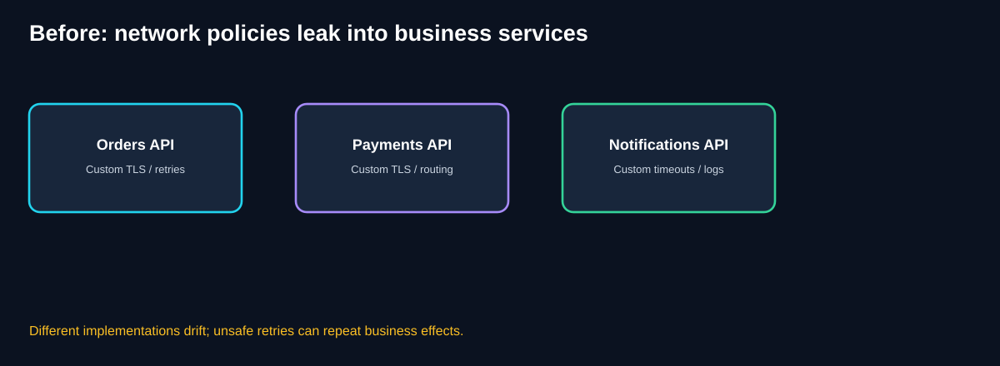
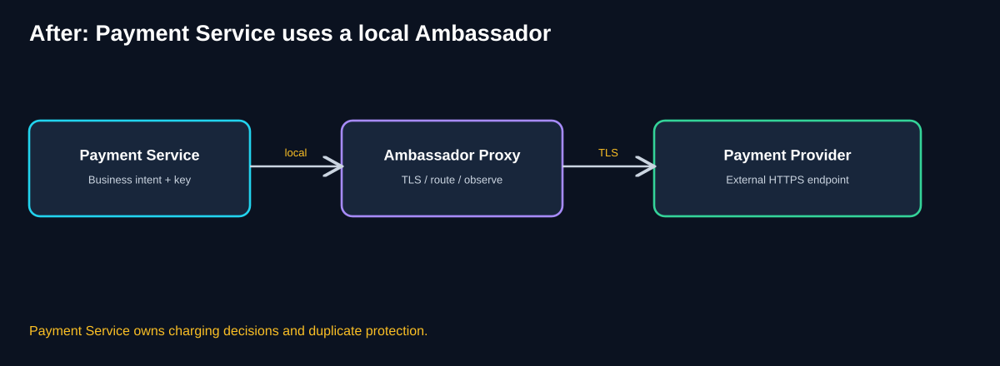
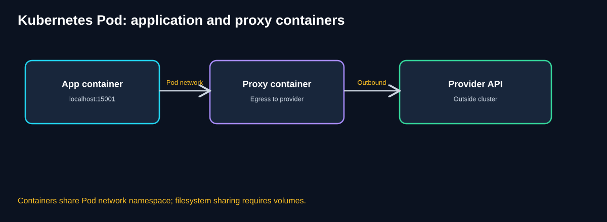
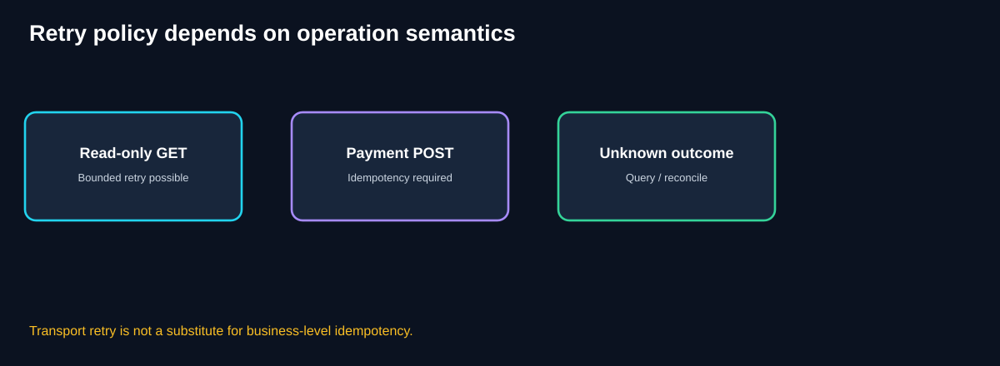
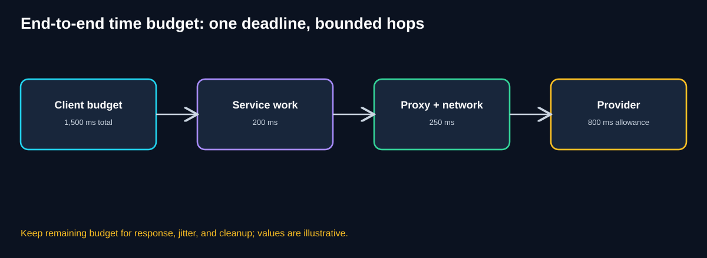
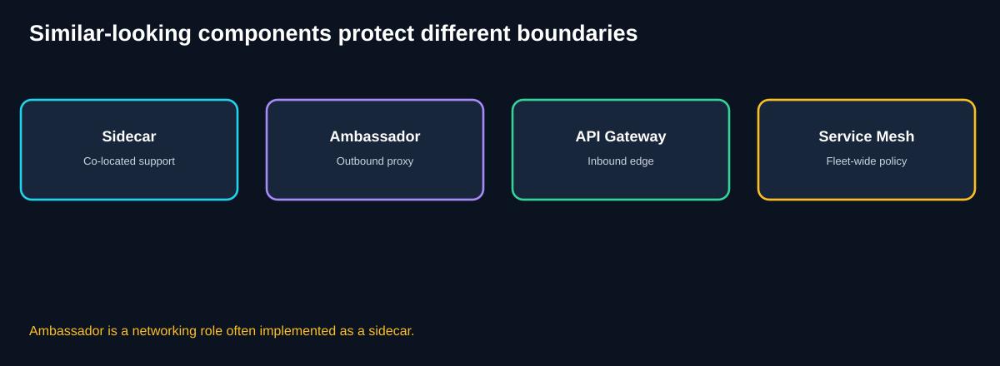
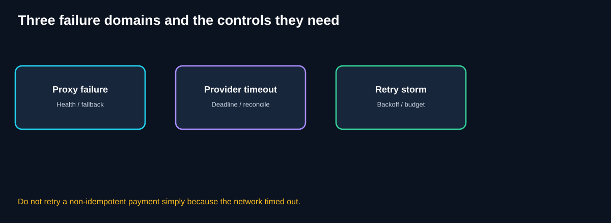
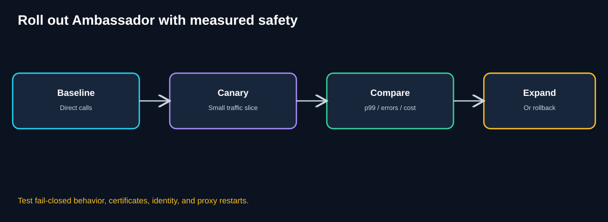

# Chapter 02 — Ambassador Pattern

> **Software Extensibility Architecture Patterns · QuickCart self-study guide**
>
> **Prerequisite:** [Chapter 01 — Sidecar](01-sidecar.md). **Next:** [Chapter 03 — Anti-Corruption Layer](03-anti-corruption-layer.md).
>


## 1. Learning objectives

By the end of this chapter, you should be able to explain why an Ambassador exists, trace a request through a local outbound proxy, separate transport retries from business correctness, compare Ambassador with other architectural components, design a Kubernetes deployment, estimate capacity and cost, and propose observability and rollout plans.

**Central question:** *Which responsibilities belong to the application, and which can safely be delegated to a reusable outbound communication component?*

## 2. Begin with the problem, not the proxy

QuickCart has an Orders API written in Java, a Payment Service written in Go, and a Notification Service written in Python. Each integrates with external systems. Over time, their developers independently implement HTTPS clients, TLS configuration, proxy settings, connection pooling, endpoint discovery, timeout handling, retry logic, and outbound telemetry.

Initially, this appears reasonable: each team wants to ship features. Eventually, differences become costly. One service still trusts an old certificate chain; another has unlimited retries; a third reports errors without request correlation. An outage at a payment provider causes retry amplification because each replica retries aggressively.



**Diagram walkthrough:** Each service owns a separate copy of network policy. The duplicated code is not necessarily identical, and this inconsistency is the real problem. Standardizing policies across languages becomes a release-coordination exercise. Note that *some* application-level behavior, such as choosing when to charge a card, must remain application-specific.

### 2.1 Business requirements

QuickCart needs predictable payment behavior, secure connectivity, measurable provider latency, controlled failure recovery, and fewer cross-team changes when transport configuration changes. Its architects must **not** accidentally duplicate charges, conceal provider outages, or make a local proxy a mysterious new single point of failure.

### 2.2 Functional and nonfunctional requirements

| Dimension | Example requirement | Evidence |
|---|---|---|
| Connectivity | Reach approved payment endpoints over TLS | Successful handshake and routing tests |
| Identity | Use appropriate client/service credentials | Auditable identity and rotation records |
| Resilience | Enforce bounded timeouts and safe retries | Failure-injection tests |
| Correctness | One logical payment per checkout | Idempotency and reconciliation records |
| Performance | Small, measured proxy overhead | Before/after p95 and p99 |
| Observability | Attribute latency to app, proxy, network, provider | Traces and proxy metrics |
| Operability | Update proxy policy safely | Canary, rollback, and version records |
| Governance | Restrict allowed outbound destinations | Egress policies and audit logs |

## 3. Pattern definition

The **Ambassador pattern** places a specialized networking component alongside an application. The application communicates through that component, which handles selected **outbound** transport concerns on its behalf.

An Ambassador commonly provides TLS handling, endpoint routing, connection management, protocol adaptation where supported, and telemetry. It may implement carefully scoped timeouts, circuit breaking, and retry policies. The pattern does **not** grant a proxy knowledge of all business rules.

The course describes Ambassador as a specialized Sidecar. That is the most useful starting mental model. The general Sidecar pattern means a supporting process runs near the application; the Ambassador's specific responsibility is outbound networking.



**Diagram walkthrough:** The Payment Service creates a payment request and decides what operation is intended. It sends the request to a locally accessible proxy or transparently intercepted egress path. The Ambassador selects the external destination, establishes a secure connection, records transport telemetry, and forwards the response. The Payment Service interprets success, decline, and uncertain outcomes. The proxy must not silently turn an ambiguous network failure into a second charge.

### 3.1 Why the boundary matters

A good boundary reduces repeated technical work without moving domain knowledge to the wrong place. An Ambassador can know that an HTTPS connection timed out. It generally cannot know whether the remote provider committed a payment before the connection failed. That distinction is foundational.

### 3.2 Typical responsibilities

| Usually suitable for Ambassador | Usually belongs to Payment Service |
|---|---|
| TLS handshake and certificate verification | Whether payment should be attempted |
| Connection pooling and keep-alive | Checkout validation and order state |
| Approved outbound destination routing | Business provider-selection rules where domain-specific |
| Transport-level metrics and traces | Payment lifecycle and reconciliation |
| Network deadlines and selected retries | Idempotency keys and duplicate-charge protection |
| Connection-level circuit breaking | Customer-visible failure meaning |
| Protocol-level authentication plumbing, when designed securely | Authorization to charge a particular amount |

The boundary is configurable rather than absolute. Some platforms delegate more policy to the proxy; others keep it in SDKs. The design must explicitly document which layer owns each rule.

## 4. From direct calls to Ambassador-mediated calls

**Before:** Payment Service opens HTTPS connections directly to a payment provider. Every application replica carries connection and retry configuration.

**After:** Payment Service sends through a local Ambassador. A shared policy package controls transport behavior, while application code retains payment semantics. This can improve consistency across Go, Java, and Python without requiring a language-specific network library for every policy.

However, the system now has another executable component, configuration surface, resource consumer, and failure mode. The objective is not *zero complexity*; it is complexity placed at the correct boundary.

### 4.1 Explicit proxy versus transparent interception

**Explicit proxy:** Application is configured to call a local endpoint, or uses standard HTTP proxy settings. The dependency is visible and often easier to reason about, but clients must be configured correctly.

**Transparent interception:** Network rules route selected outbound traffic through the proxy without each application calling it directly. This can simplify adoption but increases debugging complexity, and interception must not be assumed to cover every protocol or traffic path.

A useful operational requirement is a diagram of the **actual** network path, including DNS resolution, service identity, TLS termination/origination, and what happens when the proxy is down.

## 5. Kubernetes implementation and deployment boundary



**Diagram walkthrough:** The app and Ambassador run as separate containers in one Pod and share its network namespace, allowing localhost communication when configured. Their process memory and filesystems are isolated; file sharing requires an explicitly mounted volume. The outbound call reaches the external provider through the proxy. Kubernetes does not automatically redirect traffic merely because a second container exists.

### 5.1 Conceptual Kubernetes manifest

This example illustrates **explicit local proxy use**, not a production-ready payment deployment. The image names are placeholders; the proxy configuration and policy are intentionally omitted because they depend on the chosen implementation.

```yaml
apiVersion: apps/v1
kind: Deployment
metadata:
  name: quickcart-payment
spec:
  replicas: 3
  selector:
    matchLabels:
      app: quickcart-payment
  template:
    metadata:
      labels:
        app: quickcart-payment
    spec:
      containers:
        - name: payment-app
          image: registry.example/quickcart-payment:v1
          env:
            - name: PAYMENT_PROXY_URL
              value: "http://127.0.0.1:15001"
          ports:
            - containerPort: 8080
          resources:
            requests:
              cpu: "250m"
              memory: "256Mi"
        - name: outbound-ambassador
          image: registry.example/egress-proxy:v1
          ports:
            - containerPort: 15001
          resources:
            requests:
              cpu: "100m"
              memory: "128Mi"
```

**Important caveat:** The payment application must actually use `PAYMENT_PROXY_URL`, and the proxy must be configured to forward only to approved provider endpoints with correct TLS verification. An environment variable alone does not create routing. Add readiness, liveness, graceful shutdown, service accounts, network policies, certificates, and resource limits based on the platform's behavior.

### 5.2 Startup and shutdown ordering

A running container is not necessarily ready. The application may start before the proxy has loaded certificates or routes. If all outbound calls depend on the proxy, app readiness should reflect whether critical connectivity is available—without turning a transient provider outage into uncontrolled cluster-wide restarts.

During shutdown, drain or finish in-flight calls when safe. A proxy restart can terminate open connections, so test the combined Pod lifecycle. Container restarts and application retries may interact in surprising ways.

### 5.3 What is shared?

Within a Kubernetes Pod, containers share networking and certain Pod-level resources. They do **not** automatically share application memory or arbitrary files. CPU and memory are consumed by both containers and may be independently constrained. Shared volumes must be configured. This corrects a common oversimplification in introductory explanations.

## 6. Retries: the most important correctness trap

Consider a checkout payment:

1. QuickCart sends `POST /charge` to the provider.
2. The provider commits the charge.
3. The network connection breaks before QuickCart receives the response.
4. The proxy sees a timeout.

Should the Ambassador automatically retry? **Not unless the end-to-end operation is designed to tolerate it.** The first attempt may have succeeded. A second attempt could create a duplicate charge.



**Diagram walkthrough:** Read-only, idempotent operations may be candidates for bounded transport retries. A payment mutation requires stable idempotency semantics agreed with the provider, not merely a generic retry setting. When the outcome is unknown, query provider status or reconcile using the same logical operation identifier. The retry decision must consider the full business contract.

### 6.1 An illustrative payment state machine

```text
CREATED
   |
   v
SUBMITTED ----> CONFIRMED
   |
   +----------> DECLINED
   |
   +----------> UNKNOWN_OUTCOME
                     |
                     v
              STATUS_QUERY / RECONCILIATION
                     |
                     +--> CONFIRMED
                     +--> DECLINED
                     +--> MANUAL_REVIEW
```

`UNKNOWN_OUTCOME` is not the same as `FAILED`. This distinction prevents duplicate side effects and inaccurate customer messaging.

### 6.2 Retry policy checklist

- Is the operation idempotent according to the provider's contract?
- Is there a stable idempotency key for the logical business operation?
- Can the provider retain and recognize that key long enough?
- Is the failure definitely before the request was sent, or is the outcome uncertain?
- Is there remaining deadline budget for a retry?
- Are retries bounded with backoff and jitter?
- Are retries controlled at **one documented layer**, rather than multiplied across app, proxy, and SDK?
- Is there a reconciliation path when certainty is impossible?

For example, if an SDK retries three times and the Ambassador retries three times, a single logical request may cause up to nine network attempts, depending on policy semantics. Avoid stacked retries unless the combined budget is explicitly designed and tested.

## 7. Deadlines, timeouts, and latency budgets

A timeout is a limit on a particular wait. A deadline is the total time by which a business operation must finish or stop waiting. A proxy should respect the remaining end-to-end budget rather than independently granting each hop a full new timeout.



**Diagram walkthrough:** Suppose the client has a 1,500 ms total budget. QuickCart might reserve 200 ms for application processing, 250 ms for proxy/network overhead, and up to 800 ms for the provider, leaving 250 ms for response handling and variability. These numbers are teaching assumptions, not measured QuickCart performance. A retry must fit inside the remaining budget.

### 7.1 Tail latency and proxies

The proxy adds a hop and may add TLS handshakes, queueing, or CPU contention. Its benefit is consistency, not free performance. Measure p50, p95, and p99 **before and after** rollout, under similar loads. A proxy can reduce overall latency through connection pooling, but this is a hypothesis to test, not a guarantee.

### 7.2 Circuit breakers and bulkheads

A circuit breaker can temporarily stop attempts to a repeatedly failing destination. A bulkhead can reserve separate connection pools or concurrency budgets for different providers so one outage does not consume every outbound slot. These controls belong to an explicit resilience policy and must be coordinated with application-level fallbacks.

## 8. Ambassador versus related concepts



**Diagram walkthrough:** Sidecar describes a co-located supporting process. Ambassador is an outbound networking role often implemented as a sidecar. API Gateway primarily governs incoming client traffic at an entry boundary. Service Mesh is a wider architecture for workload networking policies; some meshes use sidecars, while others use different data-plane models.

| Concept | Primary concern | Typical location | Key distinction |
|---|---|---|---|
| Sidecar | Any co-located supporting capability | Beside application | General deployment pattern |
| Ambassador | Outbound network communication | Beside application | Specialized proxy role |
| API Gateway | Incoming API traffic and edge policy | At API entry | Client-facing boundary |
| Service Mesh | Networking policy across workloads | Fleet-wide control/data plane | Broader architecture, not a synonym for sidecar |
| Application SDK | Language-level networking and domain integration | Inside application process | No extra process, but language coupling |
| Anti-Corruption Layer | Translation of business models and semantics | Logical domain boundary | Understands domain meaning, not just transport |

### 8.1 Does a Service Mesh replace an Ambassador?

Sometimes a mesh's egress capabilities cover the same transport requirements. In other cases, specialized outbound adapters remain useful. Do not add a second proxy merely because the pattern has a name. Compare actual capabilities, policy ownership, latency, and operational complexity.

### 8.2 Does Ambassador replace an Anti-Corruption Layer?

No. If a legacy payment API uses old customer codes, ambiguous status meanings, or incompatible domain concepts, the ACL translates those semantics. The Ambassador may secure and route the connection carrying the translated request. These are complementary boundaries.

## 9. QuickCart payment flow: detailed walkthrough

Assume a customer submits checkout order `QC-8241` for ₹2,400. These identifiers and values are illustrative.

1. **Frontend → Checkout:** Customer confirms the order.
2. **Checkout → Payment Service:** Business service validates order state and creates a stable payment-operation ID.
3. **Payment Service → Ambassador:** Sends a request containing the provider-supported idempotency key.
4. **Ambassador → Provider:** Uses approved endpoint, TLS, connection policy, and telemetry.
5. **Provider → Ambassador:** Returns confirmation, decline, or transport uncertainty.
6. **Ambassador → Payment Service:** Passes response or transport status with trace correlation.
7. **Payment Service:** Commits a domain-level outcome or marks it pending reconciliation.
8. **Checkout:** Shows accurate status to the customer.

**Architecture rule:** The Payment Service owns the authoritative mapping between QuickCart's payment ID and the provider's operation ID. The proxy does not decide whether to create a second payment.

## 10. Failure modes and recovery



**Diagram walkthrough:** A failed proxy can block egress even if the app is healthy. A provider timeout creates an uncertain business outcome. Aggressive retries can amplify provider failure into a fleet-wide incident. Each failure requires a different response: local health and rollback, reconciliation, and bounded retry budgets.

| Failure | What customers may see | Preferred control |
|---|---|---|
| Proxy unavailable | Payment initiation cannot proceed | Readiness, alert, controlled rollback |
| TLS certificate invalid | Connection failures | Trust-chain tests, certificate rotation |
| DNS/route misconfiguration | Provider unreachable | Config validation, canary probes |
| Provider 429 / rate limit | Delayed or rejected attempts | Shared budget, backoff, clear status |
| Provider timeout after charge | Pending payment | Idempotency and reconciliation |
| Proxy CPU saturation | Increased p99 | Resource sizing and autoscaling |
| Misconfigured retry | Duplicate provider attempts | Retry policy review and tests |
| Trace propagation broken | Hard-to-debug failures | End-to-end tracing contract |

### 10.1 Failure-injection tests

Simulate a provider timeout **after** a request is accepted; kill the proxy during an in-flight request; rotate certificates; block DNS; trigger HTTP 429 responses; and intentionally misconfigure an endpoint in a canary. Verify both customer outcomes and operational signals. A test passes only if the business state remains correct.

## 11. Observability and service objectives

Measure the *business journey*, not only proxy health.

| Signal | Where to observe | Why it matters |
|---|---|---|
| Successful payments / attempts | Payment domain | Business outcome |
| Unknown-outcome payment count | Payment domain | Reconciliation workload |
| Proxy outbound request rate | Ambassador | Traffic and capacity |
| TLS handshake failures | Ambassador | Certificate/identity problems |
| Connection pool utilization | Ambassador | Saturation |
| p95/p99 outbound latency | Ambassador + app traces | Tail behavior |
| Retry count by cause | Proxy and SDK | Retry amplification |
| Provider 429 / 5xx | Proxy | Downstream stress |
| Proxy CPU, memory, restarts | Container platform | Local availability |
| Trace continuity | All services | Root-cause analysis |

An illustrative SLO might be: “99.9% of valid payment submissions receive a confirmed, declined, or explicitly pending response within the published deadline over 30 days.” This is a **sample target**, not a claim about QuickCart's existing service levels.

**Alert on impact:** rising unknown outcomes, elevated p99, or sustained failure rates should matter more than a single brief proxy restart that has no customer effect.

## 12. Security and governance

Outbound proxying can strengthen security **only when the configuration enforces it**.

- **Egress allowlists:** restrict provider destinations; avoid turning the proxy into an open relay.
- **TLS validation:** verify hostname and trust roots; never disable certificate verification as a workaround.
- **Credentials:** use short-lived identities or managed secrets where possible; define rotation ownership.
- **Least privilege:** give the proxy only the permissions needed to reach approved endpoints.
- **Sensitive data:** avoid recording card details, tokens, or personal information in proxy access logs.
- **Auditability:** record policy versions, destination changes, certificate rotation, and administrative actions.
- **Segmentation:** use platform network policies or equivalent controls to limit lateral movement.

Payment environments may have additional regulatory and contractual requirements. The Ambassador pattern itself does not establish compliance.

## 13. Capacity planning and sizing

Suppose QuickCart's Payment Service has **12 replicas**, each processing **50 payment calls per second** at peak. The theoretical combined peak is 600 outbound calls/s, assuming balanced demand. Each replica gets one Ambassador.

Assume a proxy uses **0.08 vCPU** and **100 MiB** of memory at this operating point. The fleet overhead is:

- CPU: `12 × 0.08 = 0.96 vCPU`.
- Memory: `12 × 100 MiB = 1,200 MiB` (about 1.17 GiB).
- Proxy instances: 12.

These are **illustrative assumptions**; actual proxy usage depends on protocol, encryption, telemetry, connection counts, and request sizes.

If a provider only allows **400 calls/s**, adding more Payment Service replicas does not increase successful provider throughput beyond that cap. Enforce a fleet-wide budget and determine what happens to excess demand (bounded queue, explicit rejection, or delayed processing according to business requirements).

### 13.1 Why local proxy capacity matters

At 50 calls/s and 200 ms average proxy-handled elapsed time, Little's Law suggests about `50 × 0.2 = 10` average in-flight calls per replica, under stable conditions. Size connection pools and concurrency controls for bursts and tails, not just the mean.

### 13.2 Cost and ROI illustration

Assume 12 proxy instances run 730 hours/month and an *illustrative fully loaded incremental compute cost* is ₹1.50 per proxy-hour. Monthly compute overhead is `12 × 730 × ₹1.50 = ₹13,140`, before engineering, monitoring, storage, and other costs.

Suppose standardizing transport saves **20 engineer-hours per month**, valued for planning at **₹2,000/hour**, or ₹40,000/month. A simplified net monthly benefit is `₹40,000 − ₹13,140 = ₹26,860`, **before** rollout, support, and risk costs. This is not a measured ROI; it is a template for evaluating whether the pattern is justified.

Measure actual effort avoided, incident reduction, and additional operating cost after deployment. A standard library may deliver most of the benefit more cheaply for a small fleet.

## 14. Deployment and migration roadmap



**Diagram walkthrough:** Establish a baseline before adding a proxy. Canary a small set of instances with equivalent workloads. Compare latency, business success, unknown outcomes, CPU, and error attribution. Expand only if the evidence supports the change; retain an explicitly tested rollback path.

**Phase 1 — Discover:** Inventory outbound calls, endpoints, SDKs, TLS settings, retry policies, and domain idempotency contracts.

**Phase 2 — Design:** Decide which concerns move to Ambassador, select explicit versus transparent routing, define health behavior and policy ownership.

**Phase 3 — Prototype:** Test a noncritical read-only integration first. Validate network path, traces, security, and latency overhead.

**Phase 4 — Payment canary:** Add strict retry budgets and stable idempotency keys. Run ambiguous-outcome failure tests.

**Phase 5 — Production rollout:** Expand incrementally, compare SLOs, and document rollback.

**Phase 6 — Operate:** Review proxy versions, certificates, policy drift, incident lessons, and whether the complexity remains justified.

## 15. Alternatives and when not to use Ambassador

**Application networking library:** Best when the fleet is small, services share a language, and transport behavior is straightforward. Lower process overhead; application teams must manage upgrades.

**Node-level egress agent:** Useful for shared network functions across workloads, but isolation and routing semantics differ from per-Pod proxies.

**Managed networking / service mesh:** May provide fleet-wide policies with existing operational support. Avoid duplicate proxy layers unless each has a distinct purpose.

**Direct provider SDK:** Often necessary for provider-specific signing, request models, and domain semantics even when an Ambassador exists.

Avoid Ambassador if there is no significant repeated outbound networking problem, if added latency breaks the SLO, if the team cannot safely operate another process, or if a simpler library solves the requirement.

## 16. Common design mistakes

1. **Assuming all retries are safe.** Payment mutations may already have committed remotely.
2. **Putting domain rules into proxy configuration.** This creates hidden business logic.
3. **Using unlimited retries.** They amplify failures and violate deadlines.
4. **Confusing proxy availability with provider success.** A healthy proxy can reach an unhealthy provider.
5. **Forgetting certificate rotation.** A once-working connection can fail suddenly.
6. **Assuming a sidecar automatically intercepts traffic.** Routing must be configured and tested.
7. **Ignoring stacked SDK and proxy retries.** Total attempts can multiply.
8. **Treating a Service Mesh as identical to Ambassador.** One is a broader architecture.
9. **Using proxy logs as the only audit trail.** Payment state needs authoritative domain records.
10. **Claiming cost savings without measurement.** Every proxy consumes resources and engineering effort.

## 17. Eight knowledge checks

### Q1. What makes Ambassador different from a general Sidecar?

<details><summary>Reveal answer</summary>

Ambassador specializes in outbound networking. Sidecar is the broader co-located supporting-process pattern.

</details>

### Q2. Can a proxy safely retry any failed payment POST?

<details><summary>Reveal answer</summary>

No. The provider may have committed the first attempt. Safe repetition requires a supported idempotency contract, stable operation key, bounded retries, and reconciliation for uncertain outcomes.

</details>

### Q3. Does placing two containers in a Pod automatically make one a proxy?

<details><summary>Reveal answer</summary>

No. Application proxy settings or network interception rules must explicitly route the relevant traffic through the Ambassador.

</details>

### Q4. Which component decides whether QuickCart should charge a customer?

<details><summary>Reveal answer</summary>

The Payment Service or owning domain workflow, not the transport proxy.

</details>

### Q5. What is the difference between Ambassador and API Gateway?

<details><summary>Reveal answer</summary>

Ambassador is primarily an outbound proxy near a workload. API Gateway is primarily an inbound API entry and policy boundary.

</details>

### Q6. Why should retry attempts share one deadline?

<details><summary>Reveal answer</summary>

Independent full-length timeouts can exceed the caller's budget and prolong failures. All attempts must fit within the remaining operation budget.

</details>

### Q7. What should an alert prioritize?

<details><summary>Reveal answer</summary>

Customer-visible payment failure, unresolved outcomes, and latency budget breaches rather than only isolated proxy-process events.

</details>

### Q8. What evidence justifies adopting Ambassador?

<details><summary>Reveal answer</summary>

Measured reduction in duplicated networking work, more consistent policy enforcement, better observability, acceptable latency overhead, and total benefit exceeding operational cost.

</details>

## 18. Worked architecture challenge: payment-provider outage

**Scenario:** QuickCart handles 600 payment attempts/s across 12 replicas. The provider permits 400/s and starts returning HTTP 429. The application SDK retries twice after the initial call, and the proxy also retries twice after its initial call. Checkout p99 doubles.

**Tasks:** Identify the risks, design a safer path, select metrics, and explain whether adding replicas helps.

<details><summary>Reveal worked solution</summary>

**Risk:** The combined configuration can create up to nine network attempts per logical payment in some failure paths (three SDK attempts times three proxy attempts). The fleet can amplify provider overload. A timeout may also conceal a committed payment.

**Safer design:** Enforce a shared 400/s provider budget with headroom; choose one clearly owned retry layer; limit attempts with exponential backoff, jitter, and a common deadline; require stable provider-supported idempotency keys; mark uncertain outcomes for status lookup and reconciliation; use an explicit overload policy for excess checkout demand.

**Metrics:** Successful logical payments/s, attempted outbound calls/s, retries per logical payment, provider 429 rate, p99 checkout latency, unknown-outcome count, and reconciliation age.

**Scaling decision:** More application replicas do not raise the provider's 400/s cap. They may increase attempted load and worsen the incident.

**Validation:** Inject provider 429 and post-commit timeout failures; verify that one logical checkout cannot create two charges and that customers receive an accurate pending or completed status.

</details>

## 19. Production review checklist

- [ ] Outbound endpoints and data flows documented
- [ ] Business ownership versus proxy policy explicitly assigned
- [ ] Provider idempotency and reconciliation contracts tested
- [ ] Retry policy bounded and not accidentally stacked
- [ ] Deadline propagation and timeout budgets validated
- [ ] Certificate validation, rotation, and egress restrictions tested
- [ ] Proxy startup, readiness, restart, and shutdown behavior tested
- [ ] App and proxy resource budgets measured
- [ ] Traces connect business calls to proxy and provider spans
- [ ] SLOs include customer-visible outcomes
- [ ] Canary and rollback procedures rehearsed
- [ ] Incremental cost and ownership reviewed

## 20. Quick revision: one-minute explanation

**Problem:** Many services duplicate complex outbound networking code.

**Pattern:** Run a specialized proxy alongside each service so transport policies can be managed consistently.

**Benefit:** Simpler application networking code, consistent TLS/routing/telemetry, and potential reduction in duplicated implementation.

**Cost:** More processes, more resource consumption, more operational configuration, and another failure point.

**Critical rule:** The proxy understands transport; the business service owns payment correctness. Never assume a network timeout means a payment failed.

**Selection question:** Do repeated outbound networking requirements justify a co-located proxy instead of an SDK, managed mesh, or simpler library?

## 21. Bridge to Chapter 03 — Anti-Corruption Layer

An Ambassador can securely connect QuickCart's modern service to a legacy system, but it does not translate legacy business concepts into modern domain meaning. If the old system calls customers `CUST_NO`, encodes statuses as `Y/N`, or exposes error `E104`, QuickCart needs a **semantic translation boundary**.

That is the subject of **[Chapter 03 — Anti-Corruption Layer](03-anti-corruption-layer.md)**.


