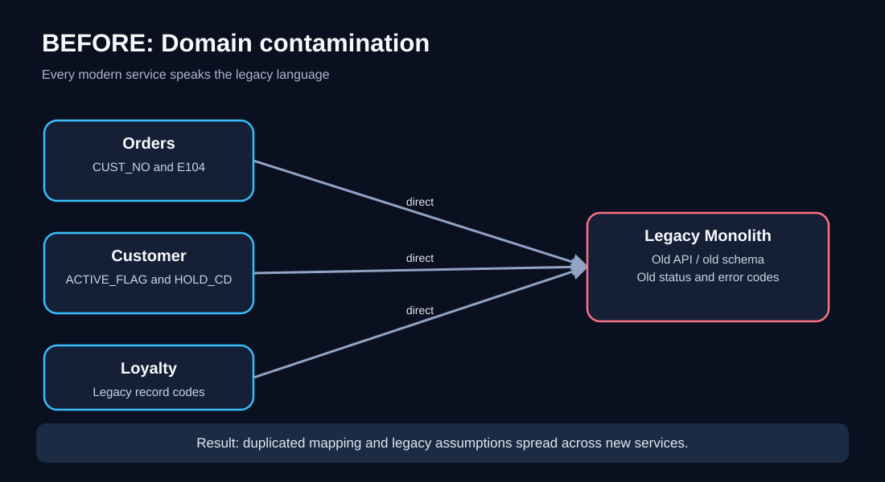
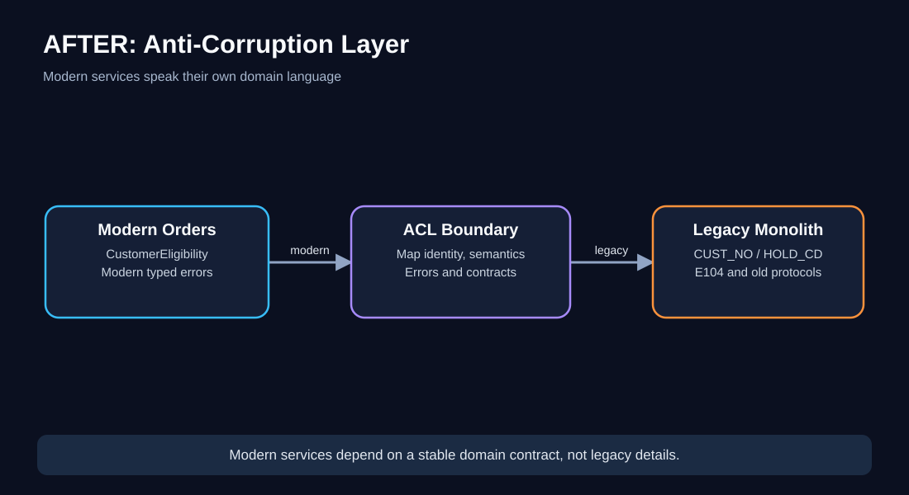
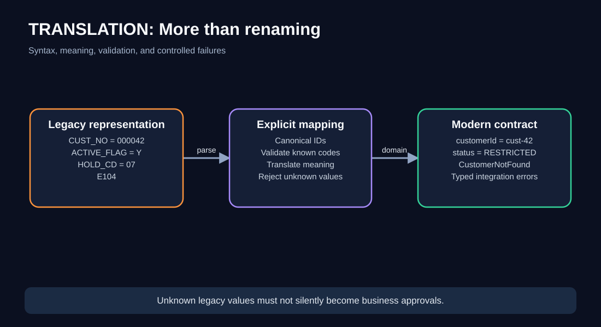
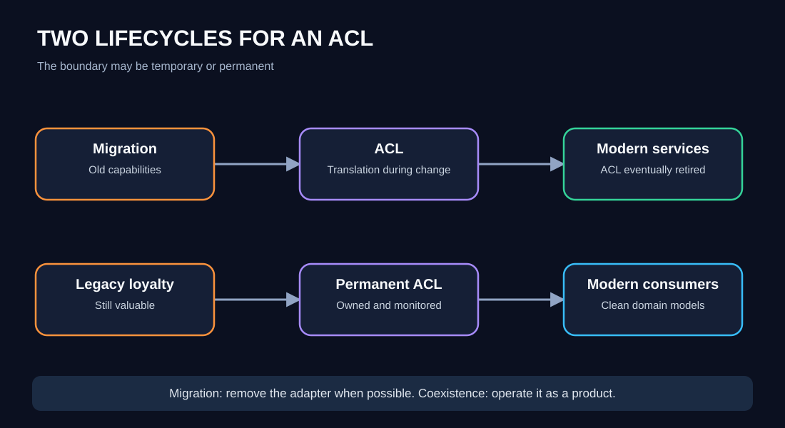
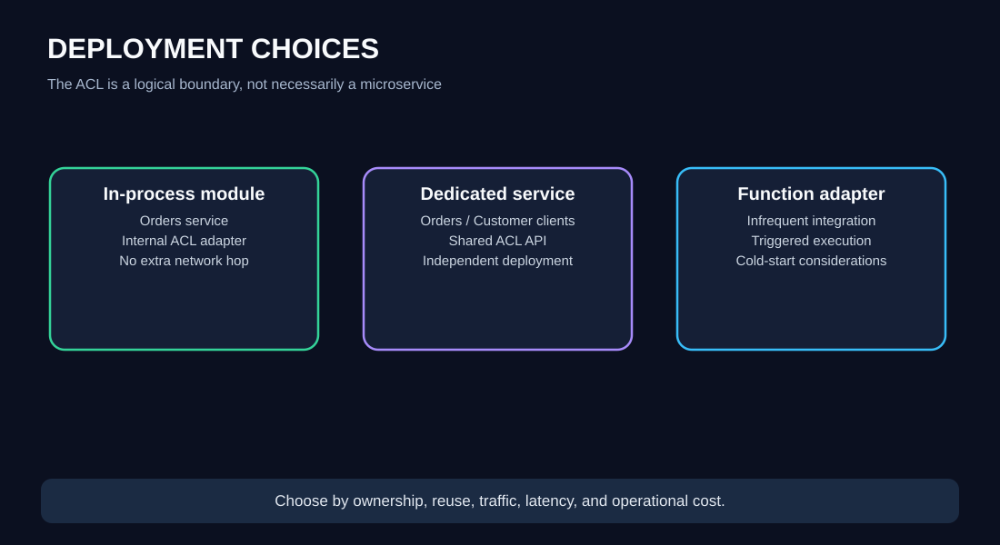
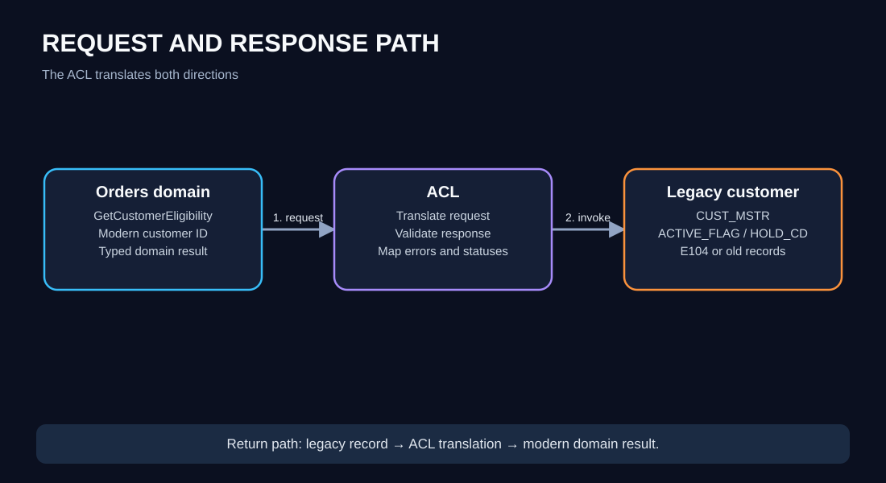
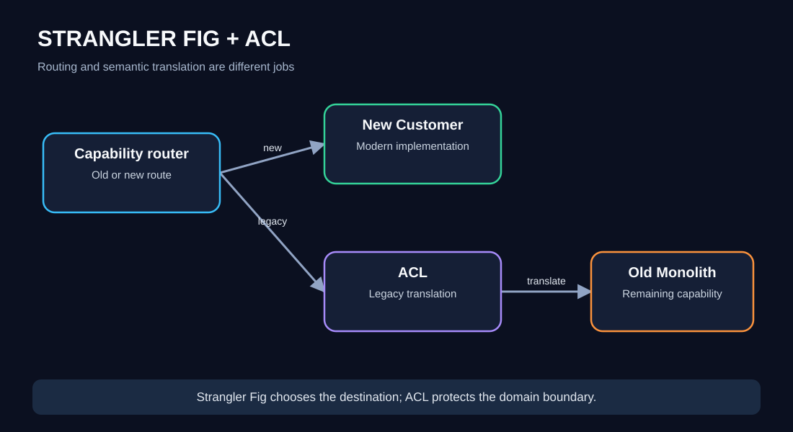
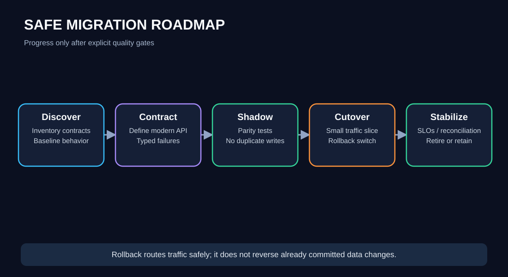

# Chapter 03 — Anti-Corruption Layer (ACL) Pattern

> **Software Extensibility Architecture Patterns · QuickCart self-study series**  
> **Prerequisites:** [00 Foundations](00-foundations.md), [01 Sidecar](01-sidecar.md), [02 Ambassador](02-ambassador.md)  
> **Suggested study time:** 90–120 minutes, plus 30–45 minutes for the exercises.  


---

## 1. Learning objectives

After completing this chapter, you should be able to:

1. Recognize *domain-model contamination*: when old system concepts leak into new business code.
2. Explain the ACL's responsibility using both request and response paths.
3. Separate **syntactic mapping** from **semantic translation**.
4. Choose an in-process adapter or a separately deployed ACL based on ownership, reuse, and operational needs.
5. Distinguish the ACL from the Strangler Fig pattern, Ambassador, BFF, API Gateway, and a generic mapper.
6. Design timeouts, idempotency, security, observability, and contract tests at the boundary.
7. Plan a staged legacy migration with reconciliation and rollback.
8. Evaluate latency, costs, risk reduction, and long-term ownership.

**One-sentence definition:** An **Anti-Corruption Layer** is a translation boundary that prevents an external or legacy domain model from dictating the language and rules of the domain you are building.

> **Important:** "Corruption" here means *contamination of the domain model*, not data theft or malicious corruption.

## 2. The problem: QuickCart has two generations of software

QuickCart began as a monolithic online store. Ten years later, the monolith still manages customer profiles, loyalty credits, and historical orders. New teams are introducing modern Orders, Catalog, and Customer services.

The modern Orders service wants to ask a simple question:

> "Is customer `cust-42` eligible to place this order?"

But the monolith exposes a legacy interface such as:

```http
GET /legacy/v1/CUST_MSTR?CUST_NO=000042
```

```json
{
  "CUST_NO": "000042",
  "ACTIVE_FLAG": "Y",
  "HOLD_CD": "00",
  "SEGMENT": "R",
  "CREDIT_ST": "G"
}
```

Those fields are not necessarily wrong. They are simply the language of a different system. The new domain should not need to know that `"Y"` means active, `"00"` means no account hold, or that customer identifiers require zero-padding.

**Without an ACL**, every modern consumer becomes responsible for these conversions. Soon the new architecture has a modern deployment model but an old mental model.



**Diagram walkthrough**

1. Three modern QuickCart services call the monolith directly.
2. Each service implements its own interpretation of `ACTIVE_FLAG`, `HOLD_CD`, and legacy errors.
3. Different teams can interpret the same value differently, and a legacy change triggers coordinated updates.
4. The issue is not only duplicate code: the *domain language* has crossed a boundary.

### Why a shared mapping library is not always enough

A shared library removes some duplication but does not necessarily prevent coupling. Every consuming service may still depend on the legacy schema, its versioning, and its deployment-specific behavior. A library can be sufficient for a narrow, stable integration; it is not automatically a full ACL.

## 3. The solution: a deliberate translation boundary

Place a boundary between the modern QuickCart domain and the legacy system.

The modern service speaks in **modern domain concepts**. The ACL accepts that contract, translates to the legacy protocol and vocabulary, invokes the legacy system, then translates the result back.



**Diagram walkthrough**

1. Orders sends `GetCustomerEligibility(customerId)` to the ACL-facing interface.
2. The ACL resolves the identifier and maps the request to the monolith's expected format.
3. The monolith returns its legacy record and status codes.
4. The ACL translates the record into a domain-oriented `CustomerEligibility` result.
5. Orders never imports legacy DTOs, error codes, or field names.

A clean result could look like:

```json
{
  "customerId": "cust-42",
  "status": "ACTIVE",
  "canPlaceOrder": true,
  "reasons": []
}
```

This is more than changing `CUST_NO` to `customerId`. The ACL interprets *meaning*.

### A crucial design boundary

The ACL should translate existing legacy meaning; it should not silently invent business policy. If "eligible to order" requires a new fraud rule owned by Orders, keep that rule in the appropriate modern domain service. Otherwise the ACL becomes a hidden business-rules engine.

## 4. Syntax translation versus semantic translation

| Dimension | Example | Why it matters |
|---|---|---|
| Field names | `CUST_NO` → `customerId` | Removes legacy naming |
| Data types | `"000042"` → canonical customer ID | Avoids format assumptions |
| Enumerations | `"Y"` → `ACTIVE` | Makes values understandable |
| Error codes | `E104` → `CustomerNotFound` | Gives callers domain-oriented failures |
| Units | integer cents → money with currency | Prevents financial mistakes |
| Time | local timestamp → offset-aware instant | Avoids timezone errors |
| Structure | three old records → one customer view | Hides legacy storage layout |
| Semantics | `HOLD_CD=07` → `ORDER_BLOCKED` | Protects business meaning |

**Semantic translation is the differentiator.** A generic serialization adapter might change JSON into XML. An ACL translates one domain's assumptions into another's.



**Diagram walkthrough:** The left column shows legacy representations; the middle column shows explicit mapping and validation rules; the right column shows a stable modern contract. Unknown codes are routed to a controlled error path rather than guessed.

### What if the legacy meaning is ambiguous?

Do not assume. Document the ambiguity with the legacy owner, add characterization tests against known cases, and expose an explicit `UNKNOWN` or integration failure where necessary. Silent fallbacks can create incorrect orders or account decisions.

## 5. Two course scenarios: migration and coexistence

The supplied course describes two primary reasons to use an ACL.

**Scenario A — Temporary migration boundary.** QuickCart is progressively replacing the monolith. The ACL exists while modern services still depend on legacy functionality. As the legacy dependencies disappear, the ACL can shrink and eventually be removed.

**Scenario B — Long-term coexistence.** QuickCart retains its historical loyalty engine because replacing it would be expensive and risky. The ACL remains as a permanent, owned interface that protects modern services from the old system.

Neither scenario requires that the ACL be a separate microservice.



**Diagram walkthrough:** The upper lane gradually routes capabilities from the monolith to modern services and eventually removes the boundary. The lower lane retains a valuable legacy engine behind a stable translation contract.

## 6. Implementation choices: module or service?

| Option | Good fit | Main advantage | Main cost |
|---|---|---|---|
| **In-process ACL module** | One modern service owns the integration | No extra network hop; simple deployment | Mapping is packaged with that service |
| **Dedicated ACL service** | Multiple consumers need one shared translation contract | Central ownership and consistent semantics | Additional latency, scaling, deployment and availability |
| **Function-based ACL** | Low or bursty traffic; simple, stateless mapping | Usage-based execution may be economical | Cold starts, platform limits, integration complexity |
| **Library-based adapter** | Small, stable mappings with aligned consumers | Simple and fast | Version coupling across callers |

Start with the **smallest boundary that genuinely protects the domain**. The introductory course illustrates a separate service, but the architectural pattern is a *logical* boundary, not a deployment mandate.



**Diagram walkthrough:** The left design places the ACL inside Orders. The center deploys a shared ACL service. The right illustrates an event/function-based adapter for an infrequent integration. All three can protect a domain boundary, but they have different operational characteristics.

### A practical rule

If only Orders uses the old customer interface, begin with a well-tested internal adapter. Extract a shared service only when several teams truly need the same translation contract or independent scaling and ownership provide measurable value.

## 7. Worked request path: customer eligibility

Assume the modern Orders service receives:

```http
POST /orders
Authorization: Bearer <customer-token>
Content-Type: application/json

{"items":[{"sku":"SKU-88","quantity":1}]}
```

**Request path**

1. Orders authenticates the caller and establishes the trusted customer identity.
2. Orders asks its customer-eligibility port for the eligibility result.
3. The ACL maps the canonical identity to the legacy customer number.
4. The ACL sends the request using an approved service identity and bounded timeout.
5. The legacy system returns a record or known error.
6. The ACL validates and translates the result.
7. Orders applies its own order-creation policy and continues.

**Response path**

- `E104` → `CustomerNotFound`
- `HOLD_CD=07` → `CustomerRestricted(reason=ACCOUNT_HOLD)`
- Legacy timeout → `CustomerEligibilityUnavailable` (not "eligible")
- Unknown status → controlled integration error, alert, and investigation



**Diagram walkthrough:** Follow the solid arrows from Orders through the ACL to the monolith; then follow the return arrows. The ACL is responsible for the translation on *both* paths. The diagram highlights why an unavailable dependency must not become a false business approval.

## 8. Code design: ports, adapters, and explicit mapping

This Python-style example is intentionally small. It illustrates **separating a modern port from a legacy adapter**; it is not a complete production client.

```python
from dataclasses import dataclass
from enum import Enum

class AccountStatus(Enum):
    ACTIVE = "ACTIVE"
    INACTIVE = "INACTIVE"
    RESTRICTED = "RESTRICTED"

@dataclass(frozen=True)
class CustomerEligibility:
    customer_id: str
    status: AccountStatus
    can_place_order: bool

class LegacyContractError(Exception):
    pass

def translate_customer(customer_id: str, legacy: dict) -> CustomerEligibility:
    active = legacy.get("ACTIVE_FLAG")
    hold = legacy.get("HOLD_CD")

    if active not in {"Y", "N"}:
        raise LegacyContractError("Unknown ACTIVE_FLAG")
    if hold not in {"00", "07"}:
        raise LegacyContractError("Unknown HOLD_CD")

    if hold == "07":
        status = AccountStatus.RESTRICTED
    elif active == "Y":
        status = AccountStatus.ACTIVE
    else:
        status = AccountStatus.INACTIVE

    return CustomerEligibility(
        customer_id=customer_id,
        status=status,
        can_place_order=(status == AccountStatus.ACTIVE),
    )
```

The actual integration layer should also validate record identity, enforce timeouts, authenticate to the legacy system, and translate errors without leaking credentials or sensitive details.

### Interface ownership

The modern domain defines what it needs, for example:

```python
class CustomerEligibilityPort:
    def get_eligibility(self, customer_id: str) -> CustomerEligibility:
        ...
```

The ACL implements that port. This follows the **Dependency Inversion** principle: the modern domain depends on an abstraction expressed in its own language, not on legacy HTTP models.

### Should the ACL call modern services too?

Sometimes integration is bidirectional. In that case, define ownership and source-of-truth rules explicitly. Avoid circular calls in which old and new systems repeatedly translate the same request through each other.

## 9. ACL versus Strangler Fig

These patterns are complementary, not synonyms.

- **Strangler Fig** decides *which implementation receives a capability request* as functionality is gradually replaced.
- **ACL** decides *how concepts are translated across the old/new boundary*.

QuickCart might route `/customers/loyalty` to the legacy loyalty engine while `/customers/profile` goes to a modern Customer service. The router participates in Strangler Fig migration; the translation adapter protecting modern consumers is the ACL.



**Diagram walkthrough:** An edge router chooses the old or new implementation for a capability. The ACL sits at the semantic boundary when the modern side must call the old side. Routing and translation solve different problems.

A future dedicated chapter, [05 Strangler Fig](05-strangler-fig.md), develops migration routing and cutover strategies.

## 10. ACL versus other patterns

| Pattern | Boundary protected | Primary responsibility |
|---|---|---|
| **ACL** | Modern domain ↔ legacy/external domain | Translate models and semantics |
| **Ambassador** | Application ↔ outbound network | Transport policy, TLS, routing, telemetry |
| **BFF** | Client experience ↔ shared backend | Client-specific aggregation and response shaping |
| **API Gateway** | External traffic ↔ internal APIs | Entry routing, authentication policies, rate limiting |
| **Sidecar** | Business process ↔ supporting capability | Co-located cross-cutting functionality |
| **Strangler Fig** | Legacy capability ↔ replacement capability | Gradual traffic and ownership migration |

An ACL can call through an Ambassador proxy. The Ambassador handles the secure connection; the ACL handles `HOLD_CD` meaning. They do not replace one another.

## 11. Data consistency and source of truth

An ACL cannot make two databases magically consistent.

Suppose QuickCart starts storing customer addresses in the modern Customer service while the monolith still stores the historical master record. You must decide:

1. Which system is authoritative for each field?
2. Can both systems accept writes?
3. How are changes propagated?
4. How are conflicts detected and resolved?
5. What happens if synchronization fails?

**Prefer one authoritative writer per capability** during a migration whenever possible. If dual writes are unavoidable, design for partial failure, reconciliation, and idempotency. A simple "write to old, then write to new" sequence can leave one side updated and the other stale.

### Migration consistency example

If QuickCart receives 50,000 customer updates per day and 0.2% fail to replicate, that is:

\[
50{,}000 \times 0.002 = 100 \text{ updates/day requiring reconciliation}
\]

A successful ACL deployment therefore needs more than translation correctness: it may need a reconciliation queue, audit trail, retry policy, and clear operational ownership.

## 12. Failure modes and safe defaults

| Failure | Risk | Recommended behavior |
|---|---|---|
| Legacy timeout | Orders waits indefinitely | Bounded timeout; explicit unavailable result |
| Unknown legacy code | Incorrect business decision | Reject unknown mapping; alert and investigate |
| Legacy schema change | Incorrect parsing | Contract tests and version compatibility checks |
| ACL outage | Modern flow cannot reach old capability | Redundant replicas if needed; graceful degradation only where safe |
| Duplicate retry | Repeated write or charge | Idempotency keys and operation-aware retry policy |
| Partial dual write | Divergent data | Reconciliation and single-writer design |
| Sensitive data in logs | Privacy/security exposure | Redaction, least privilege, retention controls |
| ACL becomes bottleneck | Increased p95/p99 latency | Profile, scale, cache selectively, reduce synchronous calls |

**Never default a failed eligibility lookup to "approved" merely to keep checkout available.** Failure behavior must match business risk.

## 13. Timeouts, retries, and latency budgets

Assume QuickCart targets a p95 order API response of **800 ms**. An illustrative internal budget might be:

| Step | Budget |
|---|---:|
| Authentication and validation | 80 ms |
| ACL + legacy eligibility call | 250 ms |
| Inventory reservation | 200 ms |
| Order persistence | 170 ms |
| Network and safety margin | 100 ms |
| **Total** | **800 ms** |

This is a planning budget, not a claim that individual p95 latencies add up to end-to-end p95. Real tail behavior must be measured using distributed traces and load tests.

A 250 ms ACL budget might include 15 ms mapping, 200 ms legacy dependency, and 35 ms transport/contingency. If the legacy service frequently exceeds this budget, optimize the dependency path or redesign the user journey rather than masking it with unlimited retries.

**Retry rule:** retry only when the operation is safe, the failure is transient, and the remaining deadline permits it. Writes to legacy payment, inventory, or loyalty systems may require idempotency support and reconciliation.

## 14. Security and governance at the boundary

The ACL is a valuable security choke point, but it is not a substitute for authorization in the owning domain.

- Authenticate callers and authorize requested operations.
- Use dedicated service credentials to call the legacy system.
- Do not trust caller-supplied customer identifiers without ownership checks.
- Validate inbound and outbound schemas, sizes, and allowed values.
- Mask PII in logs and traces; avoid copying full legacy payloads to telemetry.
- Document data classification, retention, and access-control responsibilities.
- Audit sensitive reads and mutations with correlation identifiers.
- Rotate secrets and define a response plan for compromised credentials.

**Governance question:** Who owns the meaning of a legacy field? Assign a domain owner and record mapping decisions; otherwise "temporary" translations become undocumented business policy.

## 15. Observability and production SLOs

Instrument the ACL as an integration boundary, not merely another HTTP endpoint.

**Core signals**

- Request volume by modern operation and legacy dependency.
- Success rate and errors by **semantic category**: not found, restricted, unknown mapping, timeout, transport failure.
- p50/p95/p99 total ACL latency and downstream latency.
- Contract mapping failures and unknown-code counts.
- Retry counts, retry amplification, and timeout rates.
- Reconciliation backlog and age, if data is synchronized.
- Legacy API version and ACL mapping version.

**Example illustrative objectives**

- 99.9% successful ACL processing for *valid, supported* requests, excluding documented business denials.
- p95 ACL-added translation time below 20 ms, measured separately from legacy network time.
- Zero silent acceptance of unknown status codes.
- Reconciliation backlog older than 15 minutes triggers investigation.

These are **example targets**; QuickCart must baseline actual traffic and business criticality before committing to SLOs.

### Trace example

```text
POST /orders                 610 ms
  ├─ auth                    45 ms
  ├─ customer_eligibility   220 ms
  │   ├─ acl_translate_in     3 ms
  │   ├─ legacy_customer    211 ms
  │   └─ acl_translate_out    6 ms
  ├─ reserve_inventory      180 ms
  └─ persist_order          120 ms
```

This makes it clear whether a slowdown is caused by translation, the network, or the monolith.

## 16. Testing strategy: protect both contracts

**Unit tests:** Test each mapping rule and unknown value, including nulls, malformed identifiers, timezone boundaries, and money units.

**Consumer contract tests:** Verify that modern services receive stable domain-oriented responses and typed failures.

**Legacy characterization tests:** Record and validate how the legacy system *actually behaves*, including undocumented error codes and surprising edge cases. Use sanitized fixtures.

**Integration tests:** Exercise the real adapter against a safe test instance or representative stub.

**Failure injection:** Test timeouts, malformed responses, unavailable dependencies, slow responses, and duplicate delivery.

**Migration parity tests:** For capabilities being replaced, compare old and new results on a controlled sample, with documented acceptable differences.

### Example contract matrix

| Legacy input | Expected modern result |
|---|---|
| `ACTIVE_FLAG=Y`, `HOLD_CD=00` | Active and eligible |
| `ACTIVE_FLAG=N`, `HOLD_CD=00` | Inactive and ineligible |
| `ACTIVE_FLAG=Y`, `HOLD_CD=07` | Restricted and ineligible |
| `E104` | CustomerNotFound |
| `ACTIVE_FLAG=?` | LegacyContractError, alert |
| Timeout | EligibilityUnavailable |

The mapping is **illustrative**. Real mappings must be verified against QuickCart's hypothetical legacy domain owner or, in a real organization, authoritative specifications.

## 17. Deployment and migration roadmap

**Phase 0 — Discover.** Inventory legacy APIs, callers, data contracts, ownership, traffic, and failure behavior. Capture baseline metrics.

**Phase 1 — Define modern contracts.** Design the domain-facing port and typed errors before implementing legacy transport.

**Phase 2 — Build the ACL.** Implement mappings, authentication, timeouts, observability, and contract tests.

**Phase 3 — Shadow validation.** Compare translated results with existing behavior where safe; do not execute duplicate writes.

**Phase 4 — Incremental cutover.** Route a controlled subset of read traffic, then progressively migrate supported operations with rollback switches.

**Phase 5 — Stabilize.** Monitor mapping failures, legacy load, latency, and reconciliation. Expand only after meeting acceptance criteria.

**Phase 6 — Retire or retain.** Remove mappings when legacy capabilities are gone, or formalize the ACL as a long-lived owned product.



**Diagram walkthrough:** A sequence of discovery, contract definition, shadow checks, controlled cutover, and stabilization is connected by explicit go/no-go gates. Rollback returns traffic to the previous safe route; it does not magically reverse data mutations.

## 18. Capacity planning and ROI example

These numbers are **illustrative assumptions**, not measured QuickCart performance.

Assume:

- 300 eligibility lookups/second at peak.
- Dedicated ACL instances sustainably handle 120 requests/second each.
- Plan 30% extra headroom.
- Each instance costs $90/month for compute and supporting resources.
- Initial development requires 5 engineer-weeks at $2,000/week.
- Without the ACL, three teams spend a combined 12 engineer-hours/week maintaining duplicate legacy mappings.
- With the ACL, shared maintenance takes 4 engineer-hours/week.
- Loaded engineering cost is $75/hour.

**Capacity**

\[
\text{Required capacity} = 300 \times 1.30 = 390 \text{ requests/second}
\]

\[
\text{Instances} = \lceil 390 / 120 \rceil = 4
\]

Compute estimate: **4 × $90 = $360/month**, excluding networking, storage, monitoring, and other platform costs.

**Maintenance benefit**

\[
(12 - 4) \times \$75 \times 52 = \$31{,}200/\text{year}
\]

Annual compute: **$4,320**. Initial implementation: **$10,000**.

Illustrative first-year net value, counting only these items:

\[
\$31{,}200 - \$4{,}320 - \$10{,}000 = \$16{,}880
\]

This simplified estimate excludes downtime, cloud egress, on-call burden, testing, and migration risk. The largest benefit may instead be **faster modernization and lower change risk**, which should be measured with lead time, defect rates, and legacy dependency counts.

**ROI warning:** An ACL is not justified merely because a spreadsheet shows savings. If a single stable adapter module meets the need, a dedicated service may cost more than it returns.

## 19. Common mistakes and corrections

1. **Mistake: "ACL means a microservice."** Correction: it is a logical boundary; an internal module can qualify.
2. **Mistake: "Changing field names is sufficient."** Correction: translate domain semantics and failures.
3. **Mistake: "ACL and Strangler Fig are identical."** Correction: translation versus gradual replacement/routing.
4. **Mistake: "The ACL should own all new business rules."** Correction: modern domain rules remain in the owning domain.
5. **Mistake: "All retries are safe."** Correction: verify idempotency and remaining time budget.
6. **Mistake: "The adapter guarantees consistency."** Correction: synchronization and reconciliation require separate designs.
7. **Mistake: "Serverless is always cheaper."** Correction: model traffic, cold starts, concurrency, and per-request pricing.
8. **Mistake: "The ACL disappears after migration."** Correction: some ACLs remain as permanent integration boundaries.

## 20. Knowledge checks — expand to reveal answers

<details>
<summary><strong>Q1. Why is direct use of CUST_NO in Orders a design smell?</strong></summary>

Because the modern Orders domain now depends on a legacy representation. A future legacy change can ripple through Orders, and the meaning of the field may be interpreted inconsistently.
</details>

<details>
<summary><strong>Q2. Does every ACL require a new network service?</strong></summary>

No. An ACL is a logical translation boundary. A module or adapter inside one service may be simpler when only that service uses it.
</details>

<details>
<summary><strong>Q3. A legacy service returns E104. Who should interpret it?</strong></summary>

The ACL should translate E104 into a stable modern error such as CustomerNotFound. Modern callers should not contain E104-specific branching.
</details>

<details>
<summary><strong>Q4. Which pattern gradually moves traffic away from the monolith?</strong></summary>

Strangler Fig. An ACL can accompany it to protect the modern domain from legacy semantics.
</details>

<details>
<summary><strong>Q5. A legacy eligibility request times out. Should Orders treat the customer as eligible?</strong></summary>

No. That would turn an integration failure into a potentially unsafe approval. Return an explicit unavailable outcome and apply an approved business fallback, if one exists.
</details>

<details>
<summary><strong>Q6. Can an Ambassador replace the ACL?</strong></summary>

No. The Ambassador handles outbound transport concerns; the ACL translates business models and meaning. They may be used together.
</details>

<details>
<summary><strong>Q7. Two systems both update customer addresses. What concern is not solved by the ACL alone?</strong></summary>

Source-of-truth ownership and data consistency. The architecture needs conflict handling, synchronization, and reconciliation or, preferably, one authoritative writer.
</details>

<details>
<summary><strong>Q8. What metric most directly detects undocumented legacy status changes?</strong></summary>

Unknown-code or contract-mapping failure counts, segmented by operation and legacy API version.
</details>

<details>
<summary><strong>Q9. When might a dedicated ACL service be justified?</strong></summary>

When several consumers need one consistent translation contract, a separate team owns the integration, or independent scaling and release management produce real value.
</details>

<details>
<summary><strong>Q10. Why can a successful ACL still be a migration failure?</strong></summary>

It may translate perfectly but become a permanent bottleneck, hide dual-write inconsistencies, lack ownership, or prevent retirement of legacy dependencies.
</details>

## 21. Worked architecture challenge — legacy loyalty integration

**Scenario:** QuickCart launches a new mobile loyalty experience. Its loyalty engine is an old mainframe-style application that accepts a numeric member number, returns balances in integer points, and exposes a `REDEEM` operation that may time out after processing. Web and mobile experiences both need loyalty information.

**Constraints**

- Modern clients must not know the legacy protocol.
- Redemptions must not be duplicated.
- Existing legacy loyalty records remain authoritative.
- Peak traffic is 500 balance reads/s and 30 redemption writes/s.
- Mobile screens need a concise loyalty summary.

**Your task:** Choose the boundaries, design a safe redemption flow, and define success metrics.

<details>
<summary><strong>Reveal worked solution</strong></summary>

**Boundary design**

- A modern Loyalty domain service owns the domain API and authorization rules.
- A Loyalty ACL translates canonical member identity and modern operations to the legacy protocol.
- A Mobile BFF shapes the mobile response; it does not perform legacy mapping.
- An Ambassador may handle outbound TLS, connection routing, and telemetry if the infrastructure complexity warrants it.

**Balance reads**

1. Mobile BFF calls Loyalty domain service.
2. Loyalty service checks authorization and requests balance through ACL.
3. ACL maps the member identifier, queries the legacy engine, and translates points to a stable modern response.
4. Cache only if balance staleness is acceptable and clearly specified.

**Redemption writes**

1. Client supplies or receives a unique idempotency key.
2. Loyalty domain service records the redemption intent and its idempotency state.
3. ACL sends the mapped command with a stable correlation identifier.
4. If the legacy call times out, the service treats the outcome as **unknown**, not automatically failed.
5. Query the legacy transaction status or reconcile before attempting another write. If the legacy engine cannot support deduplication or status queries, design a controlled manual reconciliation path; do not promise exactly-once behavior.

**Operational metrics**

- Balance-read p95 latency and failure rate.
- Redemption outcome categories: confirmed, rejected, unknown, reconciled.
- Duplicate-prevention effectiveness.
- Legacy timeout rate.
- Reconciliation backlog age.
- Unknown legacy code count.

**Capacity**

If an ACL replica supports 200 reads/s at safe utilization, 500 reads/s with 20% headroom needs:

\[
\lceil 500 \times 1.2 / 200 \rceil = 3 \text{ replicas}
\]

This is an illustrative sizing exercise; write throughput and legacy connection limits need separate capacity checks.

**Trade-off**

A dedicated Loyalty ACL is reasonable if web, mobile, and future services share the same legacy translation, but avoid placing mobile presentation logic in it.
</details>

## 22. Second challenge — when NOT to use an ACL service

QuickCart has one Catalog service calling a stable vendor API. The vendor uses JSON and well-defined HTTP errors. Only one class performs a trivial two-field rename.

**Question:** Would a dedicated ACL microservice be appropriate?

<details>
<summary><strong>Reveal reasoning</strong></summary>

Probably not. Start with an in-process adapter and a small contract test suite. If the vendor model later diverges significantly from QuickCart's domain, or several services independently need complex translation, strengthen the ACL boundary or consider a shared service. The pattern should solve a real coupling problem, not create infrastructure for its own sake.
</details>

## 23. Quick revision sheet

**Trigger:** Modern code starts importing legacy DTOs, statuses, protocols, or error codes.

**Move:** Define a modern-domain interface; implement explicit translation behind it.

**Own:** Mapping rules, compatibility tests, dependency timeouts, security, and operational alerts.

**Avoid:** Silent unknown-code defaults, unbounded retries, duplicate writes, and undocumented dual ownership.

**Compare:** ACL translates meaning; Strangler Fig changes routing and ownership; Ambassador handles outbound transport; BFF shapes client responses.

**Measure:** Legacy concepts in modern code, mapping failures, change lead time, p95/p99 integration latency, reconciliation age, and total operating cost.

## 24. Chapter completion checklist

- [ ] I can explain the problem without naming the pattern.
- [ ] I can draw both directions of the ACL request/response path.
- [ ] I can distinguish renaming fields from translating semantics.
- [ ] I know when a module is preferable to a separate service.
- [ ] I can explain why an ACL does not solve dual-write consistency.
- [ ] I can distinguish ACL from Strangler Fig, Ambassador, and BFF.
- [ ] I can describe safe behavior for unknown status codes and timeouts.
- [ ] I can propose contract tests, metrics, and a rollback plan.
- [ ] I can justify the pattern with measurable benefits and costs.

## 25. Where to go next

- **Previous:** [02 Ambassador](02-ambassador.md) — outbound networking, TLS, telemetry, and retry safety.
- **Next:** [04 Backends for Frontends](04-backends-for-frontends.md) — tailoring API composition to QuickCart's web and mobile experiences.
- **Later:** [05 Strangler Fig](05-strangler-fig.md) — phased legacy replacement and routing.
- **Later:** [08 Ports and Adapters](08-ports-and-adapters.md) — domain-facing interfaces and replaceable integration adapters.
- **Later:** [10 Pattern Comparison](10-pattern-comparison.md) — choosing the correct boundary.
- **Later:** [11 Integrated Case Study](11-integrated-case-study.md) — combining patterns in one QuickCart architecture.

---


