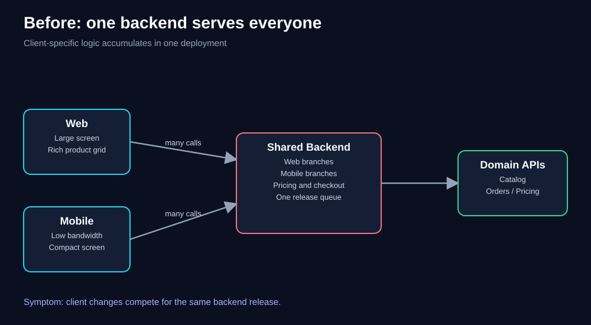
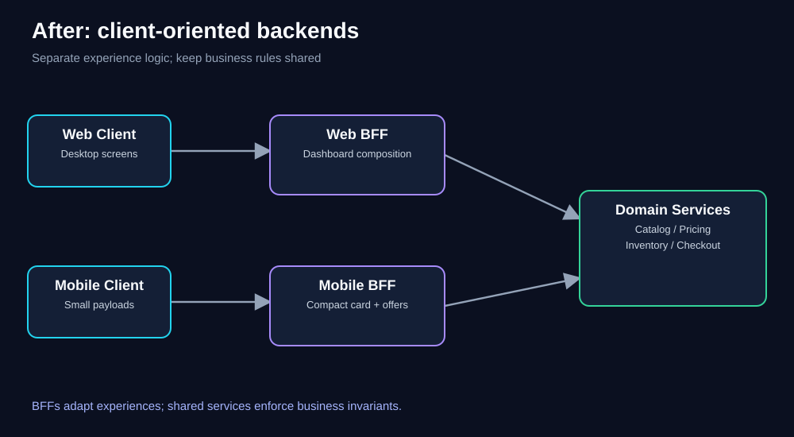
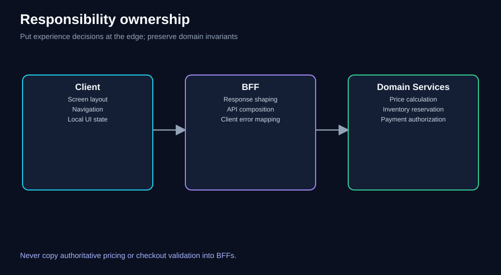
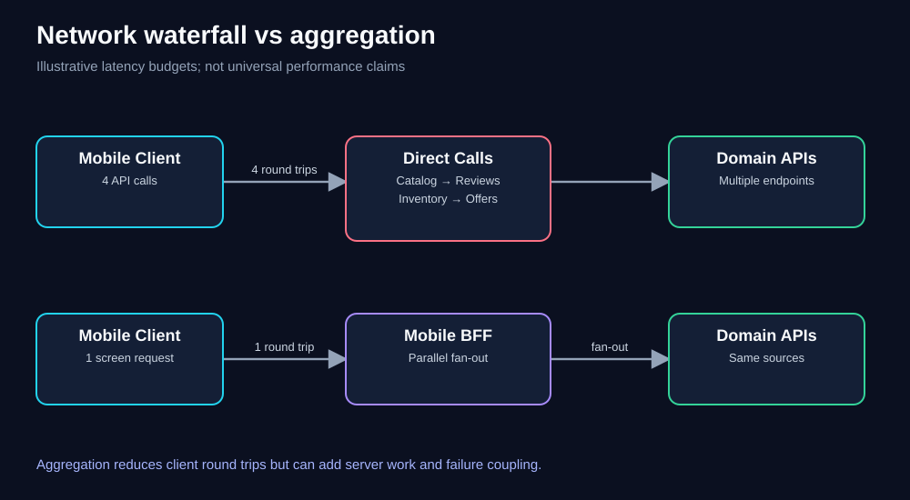
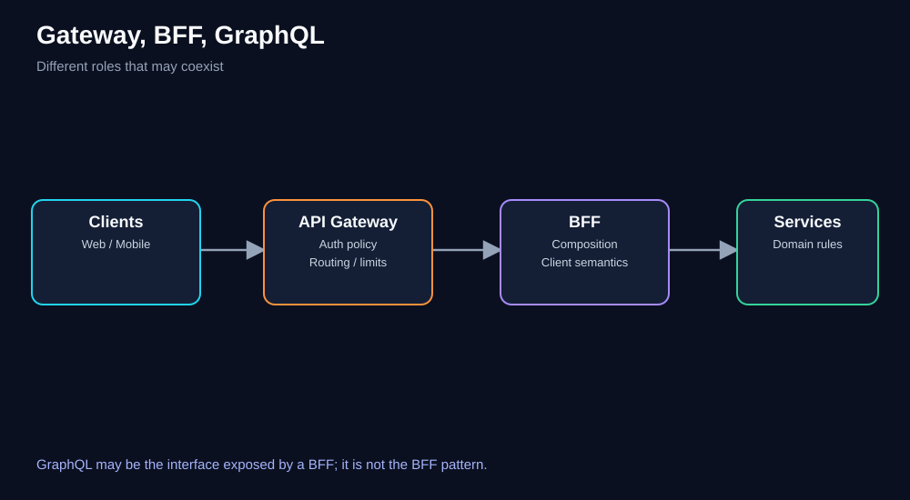
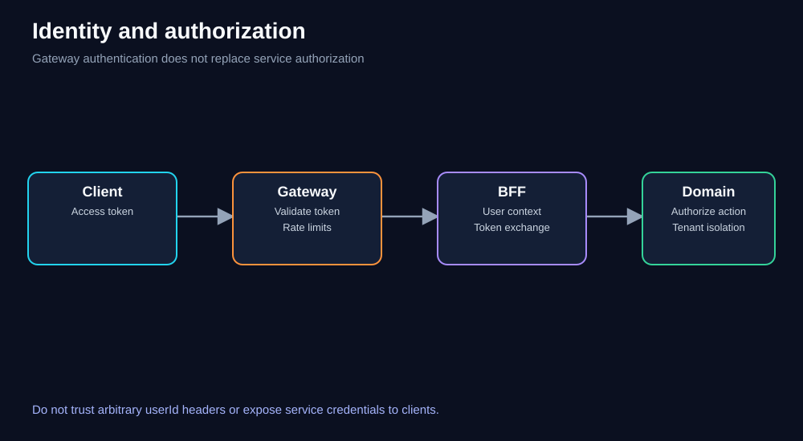
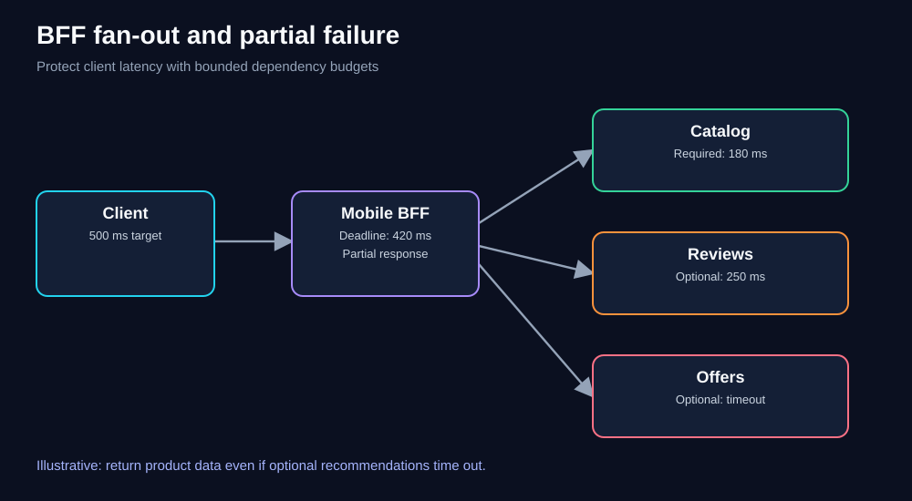
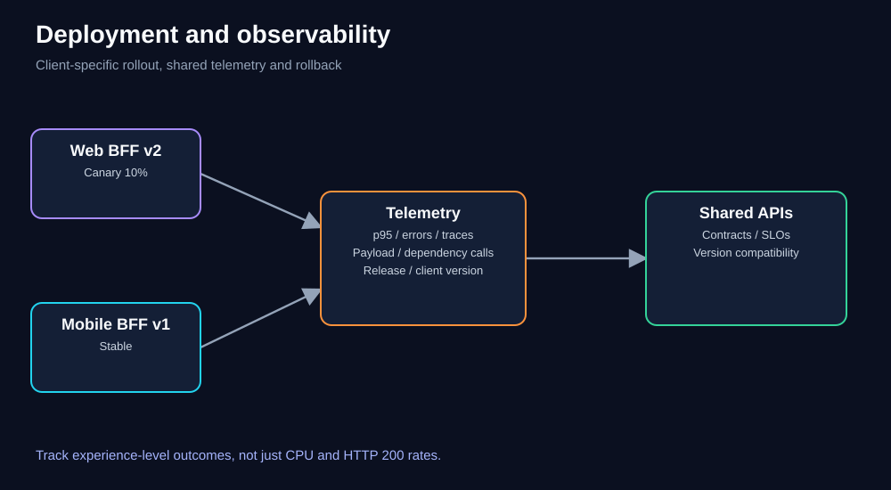

# Chapter 04 — Backends for Frontends (BFF) Pattern

> **Software Extensibility Architecture Patterns · QuickCart self-study series**  
> **Prerequisites:** [Foundations](00-foundations.md), [Sidecar](01-sidecar.md), [Ambassador](02-ambassador.md), [Anti-Corruption Layer](03-anti-corruption-layer.md)  
> **Learning time:** 90–120 minutes including exercises  


## 1. The question this chapter answers

QuickCart began as a browser-only store. Its backend exposed product listings, customer accounts, checkout, and order history. After success, QuickCart launched Android and iOS applications. The same backend now has to serve rich desktop dashboards, compact mobile cards, barcode scanning, location-aware stock lookup, and slower mobile networks.

**How can QuickCart add distinct client experiences without turning its shared backend into a maze of platform-specific conditions?**

The **Backends for Frontends (BFF)** pattern places a client-oriented backend between a frontend experience and shared domain capabilities. A Web BFF can compose rich product views; a Mobile BFF can minimize network round trips. The domain services continue to own authoritative prices, inventory, payment, and checkout rules.

This is an **extensibility** choice: it gives a new client experience an explicit place to evolve without forcing every other client to change.

### Learning objectives

After completing this chapter, you should be able to:

1. Explain the specific boundary protected by BFF.
2. Recognize when a shared backend becomes a delivery bottleneck.
3. Design Web and Mobile BFFs without duplicating domain rules.
4. Distinguish BFF, API Gateway, GraphQL, and client SDKs.
5. Choose the right number of BFFs using meaningful client differences.
6. Calculate illustrative latency, fan-out, capacity, and cost effects.
7. Handle authentication, partial failures, contracts, rollout, and observability.
8. Defend a BFF design against simpler alternatives.

---

## 2. QuickCart before BFF: the growing shared backend



**Diagram walkthrough.** Read from left to right. Desktop web and mobile applications enter the same shared backend. That backend contains conditions for desktop product grids, mobile product cards, location-based offers, checkout, and pricing. Both teams wait on the same deployment and prioritization queue. The diagram is conceptual: the problem is mixed responsibilities, not a claim that a single deployment is inherently bad.

A product page may involve:

- **Desktop web:** many images, reviews, product comparisons, recommendations, and a dense inventory panel.
- **Mobile:** a small product summary, one primary image, price, availability near a selected store, and a single prominent action.
- **In-store mobile experience:** camera barcode scanning and store-specific inventory.
- **Partner SDK:** stable, documented data contracts rather than a screen-shaped response.

The common mistake is to equate *same product* with *same API experience*. Different clients often need different shapes and different call sequences.

### Symptoms that suggest a boundary problem

A single backend is not automatically wrong. Investigate BFF when there is evidence of repeated platform checks (`if mobile ...`), too many client round trips, frontend teams blocked by backend release queues, conflicting caching strategies, or changes for one client frequently breaking another.

**Diagnostic question:** Is the shared backend primarily implementing *business rules*, or is it also accumulating *experience-specific composition and presentation decisions*?

---

## 3. The BFF solution: separate experience logic, not business truth



**Diagram walkthrough.** The web application calls the Web BFF; mobile applications call the Mobile BFF. Both BFFs reach shared domain services. The split is at the **client-experience boundary**. Catalog, Pricing, Inventory, Accounts, and Checkout are not copied into each BFF.

A BFF may:

- Combine catalog, review, and stock results into one screen response.
- Select fields appropriate to a screen and client version.
- Translate technical errors into client-friendly response codes.
- Coordinate independent read requests and apply client-specific caching.
- Return a partial view when a nonessential widget fails.

A BFF should generally **not** independently calculate authoritative prices, reserve stock, enforce payment rules, or become the system of record for orders. It may orchestrate domain operations, but each domain service remains responsible for its invariants.

### Example response contracts

**Web product view** — illustrative JSON:

```json
{
  "productId": "SKU-431",
  "title": "Trail Running Shoes",
  "price": {"amount": 4999, "currency": "INR"},
  "gallery": ["front.webp", "side.webp", "sole.webp"],
  "reviews": {"average": 4.6, "count": 280},
  "comparisonAttributes": {"weightGrams": 240, "waterproof": false},
  "inventoryByStore": [{"storeId": "DEL-01", "available": true}]
}
```

**Mobile product card** — same domain product, different experience contract:

```json
{
  "id": "SKU-431",
  "title": "Trail Running Shoes",
  "priceLabel": "₹4,999",
  "thumbnail": "front-small.webp",
  "pickupAvailable": true,
  "primaryAction": "ADD_TO_CART"
}
```

These are *screen-oriented projections*, not competing sources of product truth. A BFF must not invent prices or treat `pickupAvailable` as a substitute for an authoritative inventory check at checkout.

---

## 4. What actually belongs where?



**Diagram walkthrough.** The three boxes separate UI state, experience composition, and domain invariants. The boundaries should remain clear even if everything initially lives in a modular monolith.

| Responsibility | Preferred owner | Why |
|---|---|---|
| Screen layout, interaction, local navigation | Frontend | Directly tied to UI behavior |
| Mobile product-card projection | Mobile BFF | Experience-specific API contract |
| Desktop comparison response | Web BFF | Experience-specific composition |
| Fetch catalog + reviews concurrently | BFF | Read orchestration for one screen |
| Price after discount rules | Pricing domain | One authoritative business decision |
| Inventory reservation | Inventory domain | Consistency and concurrency |
| Payment authorization | Payments domain | Correctness, compliance, audit |
| Shared login policy | Identity service / gateway | Cross-client security control |
| Device-specific feature visibility | Frontend/BFF policy | Client experience, not payment truth |

**Design test:** If Web BFF and Mobile BFF disagree on the final payable amount for the same cart, the architecture has a correctness defect, not a personalization feature.

---

## 5. Walkthrough: opening a mobile product screen

Without a BFF, a mobile client may separately request:

1. Product details from Catalog.
2. Current price from Pricing.
3. Availability from Inventory.
4. Reviews from Reviews.

This may create several network round trips over a high-latency connection. A Mobile BFF can expose `GET /mobile/v1/product-screens/SKU-431` and perform bounded downstream fan-out.



**Diagram walkthrough.** The upper path shows multiple client-to-service calls. The lower path shows one client-to-BFF call followed by parallel downstream reads. The reduction is in *client network trips*, not necessarily in total server-side requests.

### Illustrative latency calculation

Assume four dependent sequential client calls, each with 90 ms mobile network overhead and 60 ms server processing:

\[
T_{\text{sequential}} = 4(90+60) = 600\text{ ms}
\]

With a BFF, assume one mobile round trip of 90 ms, 25 ms BFF processing, and four **independent** backend reads that complete in parallel, the slowest taking 80 ms:

\[
T_{\text{BFF}} \approx 90+25+\max(50,65,80,55)=195\text{ ms}
\]

Illustrative reduction: **405 ms**, or **67.5%**.

**Caveats:** These numbers are teaching assumptions, not measured QuickCart performance. Real latency depends on dependency graphs, TLS reuse, caching, client parallelism, network conditions, tail latency, and the overhead of the BFF. A browser that already fetches the four resources in parallel may see a smaller gain. BFF fan-out can also increase backend pressure.

### Pseudocode: bounded parallel composition

```python
async def mobile_product_screen(product_id, user_context):
    # Authenticated identity comes from validated request context.
    deadline_ms = 420

    product = await catalog.get_product(product_id, timeout_ms=180)
    if product is None:
        raise NotFound("PRODUCT_NOT_FOUND")

    price_task = pricing.get_current_price(product_id, timeout_ms=150)
    stock_task = inventory.get_summary(product_id, timeout_ms=150)
    review_task = reviews.get_summary(product_id, timeout_ms=100)

    # Illustrative helper; production code needs cancellation, budgets,
    # correlation IDs, typed exceptions and circuit breaking.
    price, stock, review = await gather_with_optional_fallbacks(
        required=[price_task, stock_task],
        optional=[review_task],
        deadline_ms=deadline_ms
    )
    return project_mobile_card(product, price, stock, review)
```

**Important:** Do not assume an asynchronous call is automatically safe to retry. Reads may be retryable within budgets; checkout writes need explicit idempotency and domain ownership.

---

## 6. How many BFFs does QuickCart need?

The original course asks whether Android and iOS require separate backends. The answer is **not automatically**.

A reasonable starting design is:

- **Web BFF:** desktop-oriented composition and dashboard needs.
- **Mobile BFF:** shared Android/iOS needs, including compact responses and low-round-trip screens.

Split Mobile BFF into Android and iOS BFFs only if their contracts, release cadence, platform capabilities, ownership, or operational needs diverge enough to justify another service. A watch app might reuse Mobile BFF or merit a separate thin adapter, depending on its needs.

### Granularity decision table

| Question | Shared Mobile BFF is favored when… | Separate platform BFFs are favored when… |
|---|---|---|
| API shapes | Mostly identical | Substantially different |
| Team ownership | One cross-platform team | Independent platform teams |
| Release cadence | Similar | Repeatedly conflicting |
| Backend orchestration | Same dependency calls | Different composition flows |
| Operational needs | Similar SLOs and scaling | Materially different SLOs or load |
| Complexity | Split would duplicate code | Shared code is full of platform branches |

**Avoid** creating one BFF per device model. BFF boundaries should follow meaningful experience and ownership differences, not a catalog of hardware.

---

## 7. BFF versus API Gateway versus GraphQL



**Diagram walkthrough.** The API Gateway handles common edge entry concerns. The BFF adapts requests and responses to a client experience. Domain services own business behavior. GraphQL can be an interface exposed by a BFF or another API layer; it is not itself a deployment pattern.

| Concept | Primary purpose | Typical concerns |
|---|---|---|
| API Gateway | Common entry and routing | TLS termination, authentication policy, rate limits, routing |
| BFF | Client-specific behavior | Aggregation, screen-shaped APIs, client-specific errors |
| GraphQL | Query interface | Client-selected fields, schema and resolver execution |
| SDK | Client integration convenience | Typed calls, local retries, serialization |
| ACL | Domain-model protection | Translate legacy semantics into modern domain language |
| Ambassador | Outbound transport | Egress proxying, TLS, routing, connection telemetry |

They can coexist: `Mobile App → Gateway → Mobile BFF → Catalog`. GraphQL can sit at the BFF boundary. But GraphQL's flexible selection does not eliminate authorization, N+1 resolver queries, response-size control, caching design, or team ownership.

### Why User-Agent routing is fragile

The transcript mentions routing based on headers such as User-Agent. It can be useful as a hint, but it is not a strong identity or routing guarantee: clients can alter it, proxies may rewrite it, and new devices appear constantly. Prefer explicit paths such as `/api/mobile/v1/...`, dedicated hostnames, or deliberate client negotiation. Never authorize sensitive access based on User-Agent.

---

## 8. Authentication, identity, and authorization



**Diagram walkthrough.** A client presents credentials to the gateway or identity boundary. The BFF receives verified identity context through a trusted mechanism. The domain service **still authorizes** actions involving accounts, carts, and payments. Authentication at the edge is not permission to bypass downstream authorization.

Recommended practices:

1. Use standards-based authentication; validate issuer, audience, expiry, signature, and required claims.
2. Propagate identity via trusted tokens or explicit token exchange, not arbitrary user-controlled `X-User-ID`.
3. Enforce object-level authorization in the owning service: customer A must not read customer B's cart.
4. Use least-privilege service credentials, secret rotation, and encrypted transport.
5. Avoid logging access tokens, card details, personal addresses, or other sensitive fields.
6. Apply rate limits and abuse protection to expensive fan-out endpoints.

A BFF often has broad access to several services. That makes its identity handling and blast radius especially important.

---

## 9. Failure modes and timeout budgets

A BFF can turn multiple dependencies into one convenient API—but can also turn one failing dependency into a broken screen.



**Diagram walkthrough.** The client has an illustrative 500 ms experience target. The BFF must finish within a smaller internal budget to allow network and rendering overhead. Catalog and price are essential; reviews and recommendations are optional. If an optional dependency times out, a reduced response may still be useful.

### Failure policy by dependency

| Dependency | Importance | Possible policy |
|---|---|---|
| Product identity and title | Essential | Fail with meaningful error if unavailable |
| Current authoritative price | Essential to purchase | Fail closed for purchase flow; avoid stale payable amounts |
| Inventory summary | Context-dependent | Show “availability unavailable”; revalidate at checkout |
| Reviews | Optional | Omit widget and report partial data |
| Recommendations | Optional | Return empty recommendations with telemetry |
| Payment submission | Critical write | Do not blindly retry; require idempotency and reconciliation |

### A deadline is a budget, not a timeout per hop

If the client target is 500 ms and 80 ms is reserved for network overhead, rendering margin, and jitter, the BFF should target completion within roughly 420 ms. Giving each of five downstream calls a separate 420 ms timeout is unsafe if they run sequentially. Propagate a single remaining deadline and cancel work when the request is no longer useful.

Additional protections: bulkheads, bounded concurrency, connection pooling, circuit breakers, response-size limits, and request coalescing where appropriate. Cache only data whose staleness is acceptable.

---

## 10. API contracts and versioning

Client apps are not always upgraded promptly. An older Android release may continue calling the BFF after the backend changes.

Use explicit contract discipline:

- Define OpenAPI or equivalent machine-readable schemas.
- Prefer additive changes; avoid silently renaming or removing fields.
- Document nullability, partial-data behavior, error codes, and cache semantics.
- Test supported client versions with consumer-driven contract tests.
- Maintain a deprecation policy and observe real version usage.
- Treat client-specific API versions separately from domain-service internal versions.

**Example:** A mobile response can add `pickupEtaMinutes` as an optional field without breaking old clients. Changing `priceLabel` from a string to an object without versioning could break them.

### Avoid the distributed monolith

A BFF is meant to reduce coupling. If each client release requires simultaneous changes to six domain services and a gateway, the new architecture may simply distribute the old coordination problem. Stabilize domain contracts and keep the BFF's scope focused.

---

## 11. Team ownership and delivery model

The course emphasizes a key organizational benefit: frontend and BFF code can be owned by a product-experience team, allowing it to change its screen contracts without waiting in a central backend release queue.

A practical ownership split:

| Team | Owns | Must coordinate on |
|---|---|---|
| Web experience | Web client + Web BFF | Domain API contracts |
| Mobile experience | Android/iOS + Mobile BFF | Domain API contracts |
| Catalog | Product domain | Product data semantics |
| Pricing | Authoritative price rules | Promotions and checkout consistency |
| Platform | Gateway, telemetry standards | Shared security and reliability policies |

The BFF team can independently add a compact mobile product card **as long as it uses stable, supported domain APIs**. Independence is conditional on good contracts, not guaranteed by deployment boundaries alone.

---

## 12. Deployment choices

BFF does **not** mandate Kubernetes, microservices, or even separate physical infrastructure.

**Option A — Modules in a modular backend:** `/web` and `/mobile` handlers within one deployment. Lowest operational cost; still separates responsibilities logically.

**Option B — Independently deployed Web and Mobile BFFs:** Independent scaling, releases, and ownership. More deployment and observability overhead.

**Option C — Managed functions or edge runtime:** Suitable for small, bounded composition logic, subject to runtime limits, cold starts, networking, secret handling, and pricing.

Choose based on measured needs. A low-traffic startup may be better served by one modular service than three independently operated services.

### Conceptual deployment flow

```text
app.quickcart.example ──> gateway ──> /web/*    ──> Web BFF
m.quickcart.example   ──> gateway ──> /mobile/* ──> Mobile BFF
                                         │
                            Catalog / Pricing / Inventory
```

The hostnames are fictional examples. Gateway and BFF may be combined for a small system, provided responsibilities remain understandable.

---

## 13. Capacity planning: fan-out is not free

Assume QuickCart sees **600 mobile screen requests per second**. Each request calls Catalog once, Pricing once, Inventory once, and Reviews once.

Without caching, approximate downstream request rate is:

\[
600 \times 4 = 2{,}400\ \text{downstream requests/second}
\]

Suppose the Mobile BFF handles **150 requests/second per healthy replica** under its target p95 latency:

\[
N_{\min}=\left\lceil\frac{600}{150}\right\rceil=4\text{ replicas}
\]

For an illustrative **25% spare-capacity policy measured against required steady-state capacity**, provision five replicas. That does not guarantee tolerance of a replica failure under all load conditions; test N−1 capacity and autoscaling behavior separately.

### What if product screens add two more dependencies?

Six calls per screen would produce **3,600 downstream requests/second**, even if the mobile app still sends only 600 BFF requests/second. This is why an API that looks simpler to clients can be more expensive internally.

Possible mitigations include parallel calls with bounded concurrency, server-side caching of safe read models, batching, removing unnecessary widgets, and precomputed product projections. Verify cache invalidation and freshness requirements.

---

## 14. Cost and ROI: an illustrative decision

Suppose introducing a Mobile BFF has the following *hypothetical* monthly effects:

| Item | Estimate |
|---|---:|
| BFF compute, networking, telemetry | +₹45,000/month |
| Reduced mobile data transfer / duplicate edge calls | −₹12,000/month |
| Saved engineering coordination and rework | 30 hours/month |
| Fully loaded engineering cost | ₹2,000/hour |

Engineering value = `30 × ₹2,000 = ₹60,000/month`.

Illustrative net monthly benefit = `₹60,000 + ₹12,000 − ₹45,000 = ₹27,000`.

If one-time implementation and migration cost is ₹2,70,000, simple payback is `₹2,70,000 / ₹27,000 = 10 months`.

**Interpretation:** This is a scenario model, not a forecast. Engineering hours are not necessarily cash savings, and customer experience benefits are not included. Measure actual lead time, defect escape rate, mobile p95 latency, conversion, infrastructure usage, and on-call burden before making an investment decision.

### When the ROI is negative

If QuickCart has one small frontend team, modest traffic, nearly identical mobile and web API needs, and no release contention, a dedicated BFF may cost more than it helps. A single well-structured backend or GraphQL endpoint may be enough.

---

## 15. Observability and service-level objectives



**Diagram walkthrough.** Web and Mobile BFFs can release independently while emitting consistent telemetry. Shared domain services maintain stable contracts. A Web BFF canary should be assessed using web experience metrics; mobile should not be destabilized by that rollout.

Measure at three levels:

**Client experience**
- Screen load time, p95/p99 API latency, client version, network type, payload bytes.
- Checkout abandonment, crash rate, retry rate, and user-visible partial responses.

**BFF health**
- Request volume, 4xx/5xx rates, saturation, CPU/memory, connection pools, deployment version.
- Downstream fan-out count, per-dependency latency and errors, timeout/circuit-breaker rates.
- Trace IDs propagated through gateway → BFF → domain services.

**Domain correctness**
- Pricing consistency, authorization denials, inventory reservation failures, payment idempotency conflicts.

### Example SLO

“Over a rolling 28-day period, 99% of eligible Mobile BFF product-screen requests complete in under 500 ms, excluding client-side rendering time.”

This is only an example; define eligibility, measurement points, error treatment, and user impact precisely. A fast but incomplete response should not be counted as a success if essential price data is missing.

---

## 16. Security, privacy, and governance

BFFs may aggregate customer addresses, order histories, store location, and account details. That creates a **data minimization** obligation: send only what the client experience requires.

Production controls should include:

- Object-level authorization and tenant isolation at domain boundaries.
- No secrets or privileged service tokens in frontend bundles.
- Audit trails for sensitive reads and checkout writes.
- Sensitive-field redaction in logs, traces, and error responses.
- Dependency and container scanning, configuration review, and secret rotation.
- API ownership, contract documentation, and incident escalation paths.
- Explicit retention and privacy rules for client analytics and location data.

A BFF should not become an ungoverned shortcut around domain authorization simply because it sits close to the frontend.

---

## 17. Common anti-patterns

**1. Duplicating domain rules.** Web and Mobile BFFs each implement discount logic; prices diverge. Fix: central Pricing authority.

**2. One BFF per device.** Many near-identical deployments create cost without autonomy. Fix: group by meaningful experience and team boundaries.

**3. Turning BFF into a new monolith.** The Mobile BFF starts owning orders, inventory, payments, and customer records. Fix: preserve composition-only responsibilities.

**4. Unbounded fan-out.** One mobile request triggers dozens of backend calls. Fix: budgets, batching, caching, and dependency limits.

**5. Blind retrying of writes.** BFF retries a timed-out charge and risks a duplicate. Fix: idempotency keys, clear write semantics, and reconciliation.

**6. Hiding failures behind HTTP 200.** Essential price lookup fails but BFF returns a success response with stale price. Fix: define required versus optional dependencies.

**7. User-Agent-based security.** Treating a claimed device type as authorization. Fix: trusted identity and explicit policy.

**8. Releasing without client compatibility tests.** Old mobile versions break. Fix: supported-version contracts and staged rollout.

---

## 18. When *not* to use BFF

Prefer a simpler architecture when clients have essentially identical needs; one team owns all clients and backend; a gateway can handle routing and minor response transformations; GraphQL already addresses field selection without a meaningful ownership bottleneck; or traffic is too low to justify additional services.

The design goal is **less harmful coupling**, not the highest possible microservice count.

### Decision sequence

1. Identify the actual problem: latency, release contention, response shape, or domain complexity.
2. Measure it with traces, release metrics, and client analytics.
3. Try low-cost fixes: field selection, batching, caching, modular handlers, better contracts.
4. Introduce a BFF boundary if client specialization remains substantial.
5. Prove improvement using explicit success metrics and rollback criteria.

---

## 19. Worked design challenge: QuickCart's in-store mobile experience

**Scenario.** QuickCart adds barcode scanning to its mobile app. Scanning a product must show its name, price, availability in the selected store, and one review summary. The desktop web experience remains unchanged. Inventory is eventually consistent for browsing but must be revalidated before checkout.

**Proposed architecture**

```text
Mobile app (barcode, selected store)
  → API Gateway
  → Mobile BFF /mobile/v1/scans/{barcode}?storeId=DEL-01
      ├── Catalog: resolve barcode → product
      ├── Pricing: current display price
      ├── Inventory: store-level availability estimate
      └── Reviews: optional summary
  → mobile-friendly response
```

**Step-by-step reasoning**

1. Barcode scanning is a mobile-experience concern; it belongs in the mobile client and BFF contract.
2. Product lookup and store availability remain domain responsibilities.
3. BFF may run independent reads concurrently after resolving the barcode.
4. If Reviews fails, omit the review widget; if product lookup fails, return a typed not-found error.
5. If Inventory fails, show “check availability” rather than an invented stock count.
6. Checkout calls Inventory to reserve stock and Pricing to validate the final amount.
7. Trace the scan across services and measure p95 screen response time and partial-response rate.
8. Keep Web BFF untouched unless the desktop experience needs the same feature.

**Why not add barcode rules to the shared backend?** That is possible, but if the shared backend is already overloaded with platform-specific branching and releases, the BFF offers clearer ownership. If the feature is tiny and isolated, a modular endpoint may be simpler.

---

## 20. Knowledge checks — try before expanding

<details>
<summary>Q1. Why is BFF an extensibility pattern rather than just a performance trick?</summary>

**Answer:** It creates an explicit boundary where a client experience can evolve independently. Performance may improve through aggregation, but client-specific contracts and team autonomy are the primary architectural motivations.
</details>

<details>
<summary>Q2. QuickCart mobile needs a different response shape but identical pricing rules. Where does each responsibility belong?</summary>

**Answer:** Mobile response shaping belongs in the Mobile BFF. Authoritative pricing remains in the shared Pricing domain service.
</details>

<details>
<summary>Q3. Must Android and iOS have separate BFFs?</summary>

**Answer:** No. One Mobile BFF is sensible when their API needs and ownership are substantially similar. Split only when differences justify added operational cost.
</details>

<details>
<summary>Q4. Can a BFF sit behind an API Gateway?</summary>

**Answer:** Yes. The gateway handles common entry policies; the BFF handles client-specific composition. The two roles complement each other.
</details>

<details>
<summary>Q5. Does GraphQL replace BFF?</summary>

**Answer:** Not necessarily. GraphQL is an API query mechanism; BFF is an architectural ownership and specialization boundary. A BFF may expose GraphQL.
</details>

<details>
<summary>Q6. Why might one BFF request increase backend load?</summary>

**Answer:** A BFF may fan out to multiple domain services. One client request can cause four or more internal requests, so dependency capacity must be planned.
</details>

<details>
<summary>Q7. Reviews times out but catalog and price succeed. Should the product screen fail?</summary>

**Answer:** Usually not, if reviews are explicitly optional. Return the essential product information with a documented partial-data response and record the failure.
</details>

<details>
<summary>Q8. Pricing times out during checkout. Should the BFF reuse a cached displayed price?</summary>

**Answer:** Not as the authoritative payable amount. Checkout must validate the current price under domain policy; fail safely or retry according to a bounded, correct workflow.
</details>

<details>
<summary>Q9. Can a BFF authorize access to another customer's order based only on a client-supplied userId?</summary>

**Answer:** No. Validate authenticated identity and enforce object-level authorization in the owning domain service.
</details>

<details>
<summary>Q10. A BFF rollout improves median latency but worsens p99. What should you investigate?</summary>

**Answer:** Tail amplification from fan-out, slow dependencies, pool saturation, retry storms, cold starts, and partial failures. Compare traces by version and client cohort.
</details>

<details>
<summary>Q11. What is the danger of putting checkout business rules in each BFF?</summary>

**Answer:** Different clients may produce different totals, validation, or payment behavior. It also multiplies the number of places that must change for one business policy.
</details>

<details>
<summary>Q12. What would justify *not* introducing BFF at QuickCart?</summary>

**Answer:** Similar client needs, little coordination friction, adequate latency, and a maintainable shared backend. Extra services are not free.
</details>

---

## 21. Numerical exercises — worked solutions

<details>
<summary>Exercise A: Mobile fan-out capacity</summary>

QuickCart receives 900 mobile screen requests/s. Each BFF call fans out to three domain reads. With no caching, the system sees **2,700 downstream reads/s**. If a BFF replica sustains 180 screen requests/s at the required SLO, the theoretical steady-state minimum is `ceil(900/180)=5` replicas. Add redundancy based on failure testing and desired headroom; do not treat five as production-ready by itself.
</details>

<details>
<summary>Exercise B: Monthly ROI</summary>

A BFF costs ₹70,000/month and reduces measurable coordination work by 20 hours/month at ₹2,500/hour. Network cost falls by ₹8,000/month. Monthly modeled benefit = `20×2,500 + 8,000 − 70,000 = −₹12,000`. Under these assumptions the direct monthly ROI is negative. A customer-conversion improvement might justify the investment, but it must be measured rather than assumed.
</details>

<details>
<summary>Exercise C: Timeout design</summary>

The client target is 600 ms. Reserve 100 ms for client/network and 40 ms for BFF serialization. Maximum downstream budget is approximately `600−100−40=460 ms`. If Catalog takes 120 ms before Pricing can begin, Pricing and optional calls must share the **remaining** budget; assigning 460 ms to every sequential call violates the end-to-end deadline.
</details>

---

## 22. Architecture review checklist

Before approving a BFF, confirm:

- [ ] There is a documented client-specific problem with a measured baseline.
- [ ] Web and Mobile BFF contracts are explicit and owned.
- [ ] Pricing, inventory, payments, and authorization remain authoritative in domain services.
- [ ] The team has justified why one or multiple BFFs are needed.
- [ ] Fan-out counts and downstream capacity are estimated.
- [ ] Timeouts, cancellations, optional-data fallbacks, and safe retry rules are defined.
- [ ] Authentication, object-level authorization, and sensitive-data handling are reviewed.
- [ ] Old client versions have contract coverage and a deprecation plan.
- [ ] Client-experience SLOs and distributed traces are instrumented.
- [ ] Canary, rollback, and incident ownership are documented.
- [ ] Incremental operating cost and expected delivery benefit are measured.

---

## 23. Quick revision: explain it in one minute

**Problem:** One shared backend is full of client-specific branches and creates delivery friction.

**Pattern:** Give meaningfully different frontend experiences tailored backend interfaces.

**Boundary:** Client-specific API composition versus shared domain rules.

**Benefit:** Better client contracts, potentially fewer client round trips, and more independent releases.

**Cost:** More deployments, fan-out, contract management, monitoring, and security responsibilities.

**Most important rule:** **BFFs may tailor the experience; they must not fork business truth.**

**Interview question:** “Why not one BFF for Android and another for iOS?”  
**Answer:** Because the right boundary follows meaningful differences in API behavior, ownership, and operational needs—not the number of operating systems.

---

## 24. Further study and navigation

- Previous: [Chapter 03 — Anti-Corruption Layer](03-anti-corruption-layer.md)
- Next: **Chapter 05 — Strangler Fig** (`05-strangler-fig.md`, planned)
- Related later chapters: API Gateway, Ports and Adapters, Pattern Comparison, Integrated Case Study, and Architecture Challenges.
- Revisit [Chapter 00 — Foundations](00-foundations.md) for coupling, cohesion, and architectural boundaries.


