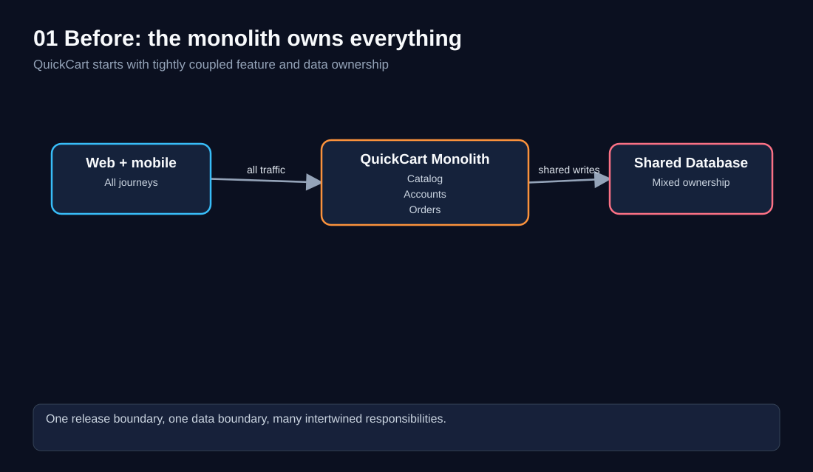
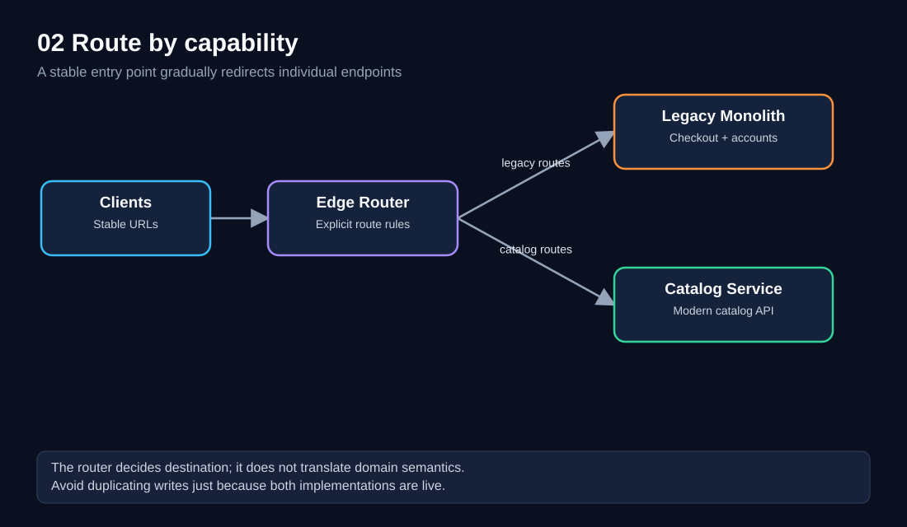
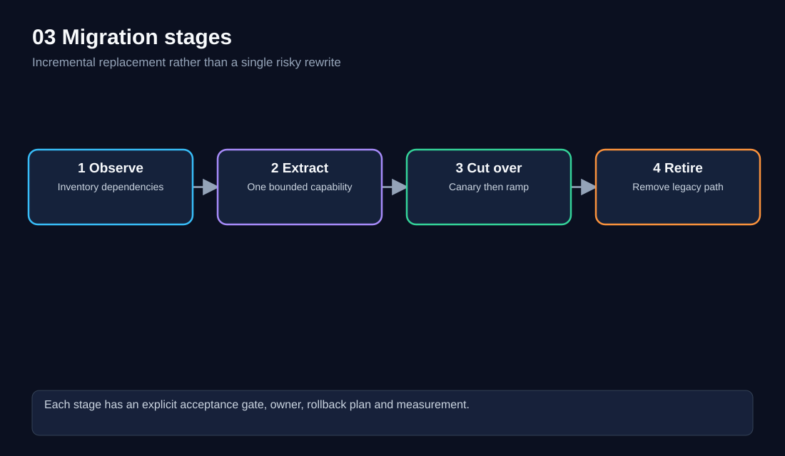
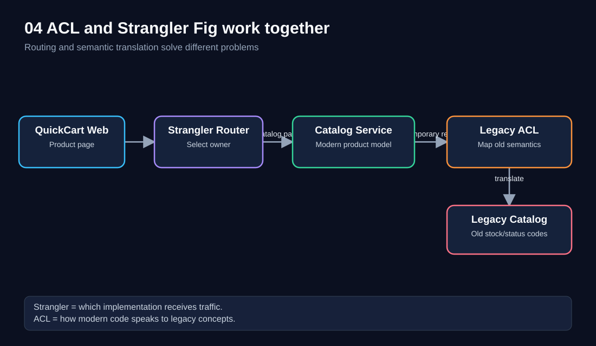
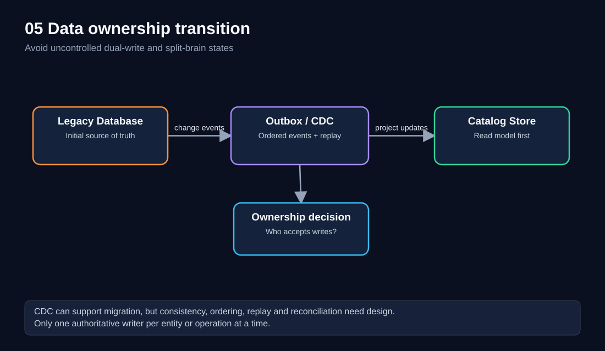
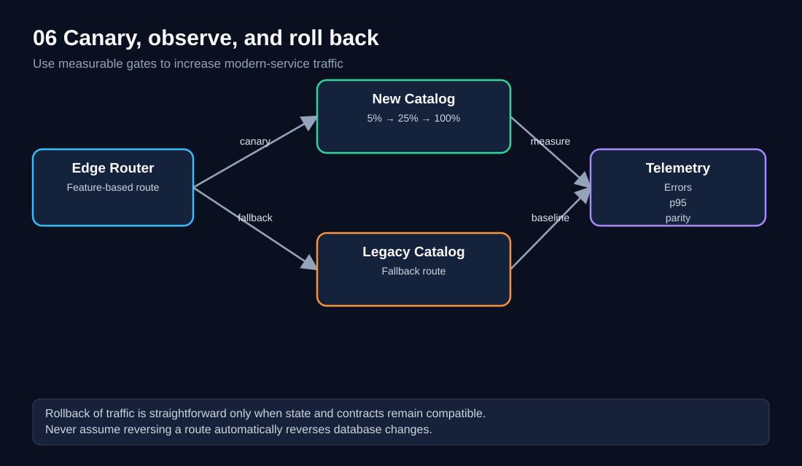
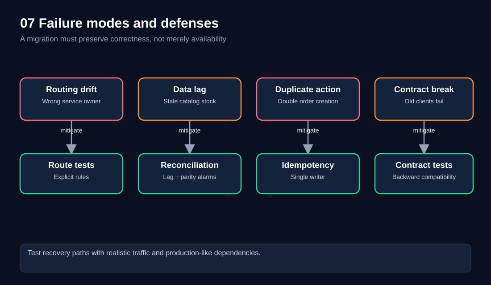
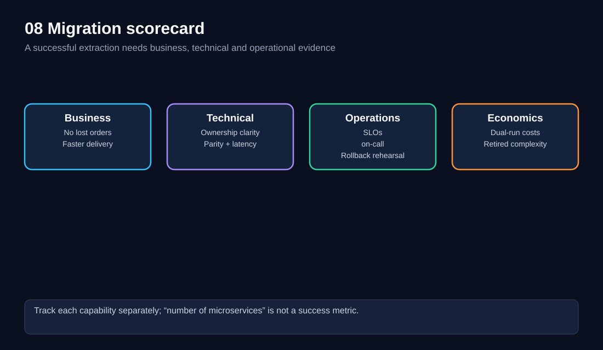

# 05 — Strangler Fig Pattern: Modernize Without a Big-Bang Rewrite

> **Software Extensibility Architecture Patterns · QuickCart case study · Chapter 05 of 15**  


**Prerequisites:** [00 Foundations](00-foundations.md), [03 Anti-Corruption Layer](03-anti-corruption-layer.md), and optionally [04 Backends for Frontends](04-backends-for-frontends.md).  
**Estimated study time:** 90–120 minutes, plus exercises.  
**Core question:** How can QuickCart replace an aging monolith a capability at a time, while keeping existing customers and integrations working?

## 1. Learning objectives

By the end, you should be able to:

1. Explain why a big-bang rewrite is dangerous and how incremental replacement reduces migration risk.
2. Identify a suitable *seam* (an independently routable capability) in a legacy application.
3. Design traffic routing, ACL boundaries, data ownership, and safe cutover.
4. Distinguish **traffic rollback** from **data rollback**.
5. Evaluate migration success using business outcomes, correctness, performance, and operating costs.
6. Explain when *not* to use Strangler Fig.

## 2. The QuickCart problem: a successful monolith becomes hard to change

QuickCart began with one application handling catalog browsing, customer accounts, checkout, payments, and order history. This was a reasonable choice when the business was small. Over time, the application accumulated hundreds of routes, shared database tables, scheduled jobs, and undocumented dependencies.

Imagine that the catalog team wants to add localized product descriptions and a new search experience. A small change to catalog logic now requires a full monolith release. Checkout regression testing slows down the change even though checkout functionality was not intentionally modified. Meanwhile, the mobile team wants a lighter catalog response, and the operations team wants independent scaling for product browsing during campaigns.

The obvious temptation is to build an entirely new platform, switch every user on a launch date, and shut down the old system. But that creates a dangerous all-or-nothing release. The old system embodies business rules, edge cases, integrations, and data history that may not be completely understood.



**Diagram walkthrough — 01:** Follow the request from the client to the monolith and then to the shared database. Catalog and checkout share a deployment and often a data boundary. Even when one feature is the immediate problem, changes can affect unrelated features. The bottleneck is not simply code size; it is intertwined *ownership and change risk*.

### The migration goal

QuickCart wants to modernize without requiring customers to know which implementation serves a feature. That means preserving stable external contracts while changing internal ownership progressively.

**Business objective:** Deliver catalog improvements more frequently while preserving checkout correctness and customer experience.

**Technical objective:** Extract one bounded capability at a time, establish explicit routing and data ownership, and retire legacy code after verification.

## 3. The pattern in one sentence

**Strangler Fig** is an incremental modernization approach in which new implementations gradually take over selected functionality from an existing system until the old functionality can be retired.

The name is an analogy: a new system grows around an old one rather than replacing it in a single step.

It is primarily a **migration and routing strategy**, not a specific framework, deployment type, or requirement to use microservices. A modular monolith, a new service, or a managed capability could be the replacement.

A useful mental model:

> Keep the customer-facing entrance stable. Change which implementation owns each capability behind that entrance.

## 4. What the architecture looks like



**Diagram walkthrough — 02:** All clients use the same public API entry point. The edge router directs catalog endpoints to the new Catalog Service while accounts and checkout remain on the monolith. Routing is based on explicit capabilities or routes, not random assignment of business operations. The router should remain thin: it selects the destination; it does not become a second domain layer.

Example routing policy:

| External route | Current owner | Planned owner | Migration state |
|---|---|---|---|
| `GET /api/products/{id}` | Monolith | Catalog Service | Canary |
| `GET /api/categories` | Monolith | Catalog Service | Ready for cutover |
| `POST /api/orders` | Monolith | Order Service | Not started |
| `GET /api/account` | Monolith | Account Service | Discovery |
| `POST /api/payments` | Monolith | Payment Service | High-risk, deferred |

**Important:** Routes alone do not define ownership. The new catalog may still call legacy inventory logic through an ACL. That is acceptable temporarily if it is explicit and measurable.

## 5. The migration is a series of controlled changes



**Diagram walkthrough — 03:** The flow moves from dependency discovery to extraction, controlled traffic cutover, and legacy retirement. Each transition requires evidence. In particular, a successful canary is not the same as retirement: old jobs, consumers, writes, and unused code paths may remain.

### Stage 1 — Discover and establish a baseline

Before touching routing, inventory:

- Public APIs, internal callers, scheduled jobs, and event consumers.
- Database tables, read/write paths, transactions, and cross-feature joins.
- External integrations, hidden business rules, and operational runbooks.
- Baseline p50/p95/p99 latency, errors, throughput, and customer-impacting defects.
- Team ownership, release frequency, and incident history.

For QuickCart, catalog seems read-heavy and comparatively lower risk than payment settlement. It is therefore a plausible first extraction **only after confirming** its dependencies.

### Stage 2 — Create a replacement capability

Define a narrow contract such as `GET /api/products/{id}` and implement it in a new Catalog Service. Decide which data it reads, who owns writes, how updates propagate, and what happens when a dependency fails.

The service should own a coherent capability, not just an arbitrary controller class. Extracting a thin façade while retaining all business logic in the monolith may add network hops without meaningful independence.

### Stage 3 — Shift traffic with measurable gates

Start with internal test traffic, then a small percentage of eligible read requests, then increase gradually if results remain healthy. Prefer deterministic routing for a given cohort so experiments are comparable. For state-changing requests, route by operation ownership and idempotency strategy rather than casually splitting writes across two implementations.

### Stage 4 — Retire the legacy implementation

Remove obsolete routes, background jobs, tables, credentials, feature flags, and dependencies after confirming no consumers remain. Update disaster-recovery procedures and operational ownership. **A migration that never retires old complexity may create a more expensive permanent hybrid system.**

## 6. Strangler Fig versus Anti-Corruption Layer

The previous ACL chapter covered how a modern domain can communicate with a legacy domain without adopting old concepts. Strangler Fig answers a different question: *which implementation should receive a capability's traffic?*



**Diagram walkthrough — 04:** The router sends product traffic to the new Catalog Service. That service may temporarily need information from the legacy catalog. The ACL translates modern concepts into legacy protocols and maps responses back. Routing and translation are complementary boundaries; neither replaces the other.

| Concern | Strangler Fig | ACL |
|---|---|---|
| Main purpose | Incremental replacement | Protect a domain model |
| Primary decision | Which implementation owns the request? | How do different models communicate? |
| Typical location | Edge router, façade, gateway, routing layer | Adapter module or service |
| Can be temporary? | Usually migration-oriented | Temporary or permanent |
| Key risk | Incorrect ownership or cutover | Semantic mismatch or translation failure |

For example, a legacy `STOCK_FLG = "Y"` may mean *physically available* but not *reservable*. An ACL must preserve that semantic distinction. Merely renaming it to `available: true` may cause overselling.

## 7. Choosing the first capability

Use a weighted decision rather than extracting whichever feature is easiest to demonstrate.

| Criterion | Catalog reads | Checkout | Payment settlement |
|---|---|---|---|
| Clear API boundary | High | Medium | Medium |
| Customer harm from incorrect behavior | Moderate | High | Very high |
| Read/write complexity | Mostly reads | Transactional writes | External side effects |
| Data dependency complexity | Medium | High | High |
| Rollback difficulty | Often manageable | Significant | Potentially severe |
| Recommended order | Early candidate | Later | Later, with strong controls |

A capability with fewer hidden dependencies and a measurable customer benefit is a good starting point. A “simple” feature with dozens of undocumented shared-table writes is not.

### A useful discovery exercise

For each candidate, draw a dependency map: inbound requests, outbound calls, database reads, database writes, asynchronous messages, and scheduled jobs. Mark every dependency that crosses the proposed boundary. The goal is not zero dependencies immediately; it is **known, owned, and progressively reducible dependencies**.

## 8. Routing design: stable public contracts

The entry point might be an API gateway, reverse proxy, edge router, or an application façade. It should preserve authentication, authorization, request identity, tracing, and compatibility while routing.

Conceptual route configuration:

```yaml
routes:
  - match:
      path_prefix: /api/products
    destination: catalog-service
    rollout:
      cohort: internal-users
  - match:
      path_prefix: /api/orders
    destination: legacy-monolith
  - match:
      path_prefix: /api/
    destination: legacy-monolith
```

This is **illustrative pseudoconfiguration**, not a deployable specification for a particular gateway. Real implementations must define route priority, path matching, authentication policy, health checks, retries, and failover.

A safe default is explicit route ownership. Avoid relying on `User-Agent` sniffing to infer which backend should own a business operation. Also avoid silently falling back from the new implementation to the old one if their write semantics differ.

## 9. Data ownership is the hardest part

Traffic routing is visible. Data coupling is often hidden.

Initially, QuickCart's monolith may own the `PRODUCT`, `STOCK`, and `PRICE_RULE` tables. A new Catalog Service that reads those tables directly can ship quickly, but it remains coupled to the old schema and release process.

There are several migration approaches:

1. **Read through an ACL:** Fast to begin, but dependency remains.
2. **Replicate into a new read model:** Useful for catalog queries; introduces propagation delay.
3. **Move authoritative writes:** Enables independence but requires a careful cutover.
4. **Use a transitional interface:** Monolith calls a new owner through a stable API during coexistence.



**Diagram walkthrough — 05:** Legacy data changes flow through an outbox or change-data-capture (CDC) pipeline to the new catalog store. Initially, the new store is a read model. The diagram also emphasizes a separate ownership decision: replication does not automatically transfer authority to accept writes.

### Single-writer principle

For a given product record or order operation, identify **one authoritative writer** at each migration stage. Dual writes from old and new services create ambiguity if one succeeds and the other fails.

A transactional outbox can atomically record a business change and its event in one database transaction. A relay publishes the event later. Consumers should tolerate duplicates and replay. CDC is another option, but it requires careful schema, ordering, and failure handling.

### Eventual consistency example

Suppose product stock changes at 12:00:00 and the catalog read model updates at 12:00:03. During that interval, browsing may show a stale count. Checkout must still validate inventory with the authoritative inventory owner. **Do not rely on a stale catalog projection to guarantee stock reservation.**

## 10. Request and data migration are different milestones

A catalog GET request might be served by the new service while all product updates still originate in the monolith. That is a valid transitional state. But it must be documented:

| Milestone | Public request owner | Authoritative writer | Read source |
|---|---|---|---|
| M0 | Monolith | Monolith | Legacy DB |
| M1 | New service for internal users | Monolith | ACL to legacy |
| M2 | New service for all reads | Monolith | Replicated read model |
| M3 | New service for reads and writes | New service | New DB |
| M4 | New service | New service | New DB; legacy code removed |

Moving from M2 to M3 is often the highest-risk transition because it changes data authority. It needs a separate cutover plan, not just a routing change.

## 11. Shadow traffic, canary traffic, and parity testing

**Shadow traffic** sends a copy of a read request to the new implementation while the legacy response remains authoritative. Compare outputs asynchronously. Never replay payment charges or order creation as shadow requests unless a safe, isolated test environment and side-effect controls exist.

**Canary traffic** serves real customers from the new implementation. Start with an explicit cohort and increase only when metrics and semantic comparisons pass.

**Parity testing** compares behavior, not just JSON equality. Two catalog implementations may return different ordering while still meeting a contract, but price or availability mismatches may be critical.

Examples of parity checks:

- Product ID and currency must match exactly.
- Price differences require explicit business approval; do not hide them in a tolerance.
- Availability must obey the same customer-visible rules.
- Missing products and authorization errors must map consistently.
- Response latency must remain within the allocated budget.

## 12. Cutover and rollback



**Diagram walkthrough — 06:** The edge router can serve a small cohort from the new catalog while most users remain on the legacy implementation. Both are measured. If a gate fails, traffic can be redirected, but only if contracts and data are compatible. This is why rollback readiness is assessed before shifting traffic.

Suggested gates for a catalog read cutover (illustrative targets):

| Gate | Example criterion | Why it matters |
|---|---|---|
| Availability | ≥99.9% successful eligible requests | Customer access |
| p95 latency | ≤250 ms at agreed load | Experience |
| Critical parity | 100% price/currency correctness in test set | Business trust |
| Data lag | p99 projection lag ≤5 seconds | Freshness |
| Trace coverage | ≥95% of sampled requests traceable | Diagnosis |
| Rollback | Route switch rehearsed in staging | Recovery |

These are **example engineering targets**, not numbers stated by the course or promises about QuickCart.

### Three different rollback questions

1. **Traffic rollback:** Can we send requests back to the monolith?
2. **Code rollback:** Can we deploy the previous version safely?
3. **Data rollback:** Can we restore prior authoritative state without losing valid customer actions?

The third is usually hardest. After new code has accepted writes, reversing a route may not restore old-system data. Plan forward recovery, event replay, or reconciliation instead of assuming a database rollback is safe.

## 13. Failure modes and correctness controls



**Diagram walkthrough — 07:** Four recurring migration hazards are paired with defenses: routing mistakes, stale data, duplicate side effects, and contract breaks. Notice that monitoring alone is insufficient. Correctness requires explicit ownership, tests, and idempotency.

| Failure | What customers see | Defense |
|---|---|---|
| Route precedence mistake | Wrong version serves endpoint | Route test matrix and staged rollout |
| Replication lag | Stale stock or product details | Lag SLO, reconciliation, authoritative checkout validation |
| Dual writes | Divergent records | Single writer, outbox, controlled handoff |
| Duplicate order submission | Duplicate charges or orders | Idempotency key and business-level deduplication |
| Incompatible response | Old mobile app crashes | Consumer-driven contracts and compatibility windows |
| Hidden background job | Old process overwrites new data | Job inventory, ownership transfer, decommission checks |
| Partial rollback | Requests return to old code but data is missing | Reconciliation and explicit rollback eligibility |
| Shared database coupling | New service breaks after legacy schema change | ACL/owned storage, schema contract tests |

For high-impact writes such as checkout and payment capture, treat a migration as a business-correctness exercise, not just a performance exercise.

## 14. Security and governance

A migration temporarily increases attack surface and ambiguity. Make the security model explicit:

- Authenticate at the edge where appropriate; authorize again at the service that owns the operation.
- Preserve identity and tenant context through trusted headers or verified tokens; do not trust arbitrary caller-supplied identity.
- Use least-privilege credentials for old and new databases.
- Avoid exposing legacy endpoints directly when they were previously internal.
- Audit access to personal data and preserve retention/deletion requirements in replicated stores.
- Remove credentials, routes, firewall exceptions, and orphaned storage after retirement.
- Assign a named owner to each migration capability and its rollback decision.

**Governance gate:** No production cutover without approved API contracts, data ownership, SLOs, on-call ownership, security review, and a tested recovery procedure.

## 15. Observability and migration dashboards

A migration dashboard should show *which implementation* served a request. Useful dimensions include `route_owner`, `capability`, `client_version`, `rollout_cohort`, and `migration_stage`. Avoid high-cardinality identifiers such as raw customer IDs in metric labels.

Minimum signals:

| Layer | Metrics and evidence |
|---|---|
| Router | Route distribution, 4xx/5xx, policy errors, fallback counts |
| New service | Request rate, p50/p95/p99, error rate, saturation |
| Legacy system | Residual traffic, dependency load, error rate |
| Data pipeline | Event lag, replay count, dead-letter backlog, parity failures |
| Business | Cart-to-checkout conversion, incorrect price incidents, order loss |
| Delivery | Deployment lead time, change failure rate, mean recovery time |

Use distributed tracing to connect the edge, new service, ACL, legacy dependency, and data-access spans. Correlate canary cohorts with business outcomes; a fast API that returns wrong prices is not a successful migration.

## 16. Capacity and latency example

Assume QuickCart receives **1,200 catalog requests/second** at peak. Each new Catalog Service replica sustains **200 requests/second** at the desired latency, and the team reserves **25% headroom** relative to expected load.

Required capacity:

\[
1{,}200 \times 1.25 = 1{,}500\ \text{requests/second}
\]

\[
\text{Replicas}=\left\lceil \frac{1{,}500}{200}\right\rceil=8
\]

This is a planning estimate, not a substitute for load testing. Database throughput, cache hit rate, connection limits, and autoscaling delay may determine the actual requirement.

Now assume the new catalog adds **15 ms** for ACL translation and **20 ms** for an extra legacy network call. If the previous p95 response was **180 ms**, a naïve additive estimate is **215 ms**. Real p95 latency cannot generally be calculated by summing p95 values, because latency distributions and correlations matter. Use end-to-end measurements to validate the budget.

## 17. Cost and ROI: dual-running is a real expense



**Diagram walkthrough — 08:** The scorecard deliberately balances business outcomes, technical correctness, operational readiness, and economics. A migration that improves deployment speed but increases lost orders or permanent infrastructure cost has not met the overall goal.


Migration costs include building the new capability, operating both implementations, replication infrastructure, ACL maintenance, testing, observability, and decommissioning work.

**Illustrative monthly scenario, not a vendor quote:**

| Cost or benefit | Monthly estimate |
|---|---:|
| New Catalog Service compute and storage | $1,800 |
| Replication, monitoring, and migration overhead | $900 |
| Extra dual-run operational effort | $1,500 |
| Total temporary incremental cost | **$4,200** |
| Engineering time saved after retirement | $5,500 |
| Reduced incident response and release overhead | $1,500 |
| Potential steady-state benefit | **$7,000/month** |

If the post-migration incremental steady-state operating cost is $2,000/month, illustrative net recurring benefit is **$5,000/month**. If migration delivery costs $60,000 and six months of dual-running adds $25,200, total investment is **$85,200**, giving a simple payback of about **17 months** after benefits begin:

\[
85{,}200 / 5{,}000 \approx 17.0\text{ months}
\]

This excludes discounting, uncertainty, taxes, and benefits not yet validated. Replace assumptions with actual labor rates, cloud bills, deployment data, and incident history before making a business decision.

## 18. Pattern selection and alternatives

Strangler Fig is useful when the legacy system must remain available, capabilities can be separated incrementally, and a full rewrite would create unacceptable risk.

It may be a poor choice when:

- The application is small and a direct refactor is safer.
- The existing platform has only a short remaining life.
- Every feature depends on inseparable global transactions with no feasible seam.
- The organization cannot sustain two implementations or migration operations.
- The migration has no credible decommissioning path or owner.

Alternatives include an in-place modular refactor, replacing a bounded subsystem directly, buying a managed capability, or retaining a stable legacy system behind a permanent ACL. These are not failures; they may offer better economics.

### How the extensibility patterns combine

- **Sidecar:** Attach reusable logging/telemetry capability to new services.
- **Ambassador:** Standardize selected outbound transport behavior.
- **ACL:** Translate legacy domain concepts for new services.
- **BFF:** Shape client-specific APIs while keeping business rules in domain services.
- **Strangler Fig:** Gradually change which implementation owns each capability.
- **API Gateway (Chapter 06):** May provide the external routing mechanism.
- **Ports and Adapters (Chapter 08):** Can keep legacy integration behind replaceable interfaces.
- **Feature Flags (Chapter 09):** Can control selected cohorts, but are not a substitute for data ownership.

## 19. A practical 12-week proof of concept

This is a **sample roadmap**, contingent on QuickCart's actual dependencies.

| Period | Work | Exit criterion |
|---|---|---|
| Weeks 1–2 | Dependency inventory, baseline, catalog contract | Ownership map and agreed metrics |
| Weeks 3–4 | New catalog read API, ACL, automated contracts | Representative parity tests pass |
| Weeks 5–6 | Read model and replay/reconciliation tooling | Lag and consistency measured |
| Weeks 7–8 | Internal traffic, shadow reads, failure injection | No critical mismatches |
| Weeks 9–10 | 5% then 25% canary, dashboard and rollback drill | SLO and business gates pass |
| Weeks 11–12 | Gradual full read cutover, retirement plan | Owner signs off on remaining dependencies |

Do **not** promise legacy catalog retirement at week 12 if authoritative writes, background jobs, or other consumers still depend on it. Make that a separately gated milestone.

## 20. Production-readiness checklist

- [ ] Every affected endpoint has an explicit route owner.
- [ ] All background jobs and integration consumers are inventoried.
- [ ] Every data entity has a documented authoritative writer.
- [ ] Read-model lag and reconciliation are measurable.
- [ ] Contract tests cover old clients and failure responses.
- [ ] Business-critical actions use appropriate idempotency controls.
- [ ] Canary thresholds and stop conditions are written down.
- [ ] Traffic rollback is rehearsed and data rollback limitations documented.
- [ ] On-call, runbooks, traces, and alerts cover both implementations.
- [ ] Security, privacy, and retention obligations cover replicated data.
- [ ] Legacy retirement criteria and cost owner are agreed.

## 21. Knowledge checks

Try each question before expanding the answer.

<details><summary>1. Why is a Strangler Fig migration different from a big-bang rewrite?</summary>

**Answer:** The replacement is introduced by capability and traffic is moved in controlled steps. The legacy system continues serving functionality that has not yet migrated. This reduces the blast radius and makes feedback available earlier, although dual-running introduces complexity.
</details>

<details><summary>2. Does Strangler Fig require microservices?</summary>

**Answer:** No. The replacement can be a module, a service, or another independently owned implementation. The essence is incremental transfer of functionality and ownership.
</details>

<details><summary>3. What is the difference between Strangler Fig and ACL?</summary>

**Answer:** Strangler Fig determines which implementation owns a capability or route. ACL translates concepts and protocols across a domain boundary. They often work together.
</details>

<details><summary>4. A new Catalog Service reads directly from the monolith database. Is migration complete?</summary>

**Answer:** No. Routing may have moved, but data/schema ownership is still coupled. This may be an intentional interim stage, not an independent end state.
</details>

<details><summary>5. Why is shadow traffic unsafe for payment capture?</summary>

**Answer:** Shadowing a state-changing request could trigger a second real charge. Use isolated tests, dry-run interfaces, or other controls that guarantee no external side effect.
</details>

<details><summary>6. What is the risk of two authoritative writers?</summary>

**Answer:** Concurrent or partially failed writes can produce conflicting records, duplicate operations, and hard-to-reconcile states. Assign one authoritative writer and use controlled synchronization.
</details>

<details><summary>7. The router can redirect traffic to legacy. Does that guarantee rollback?</summary>

**Answer:** No. New writes may exist only in the new database, schemas may have changed, and old clients may not understand new data. Traffic rollback and data recovery are different plans.
</details>

<details><summary>8. What should a canary gate measure beyond HTTP 200 responses?</summary>

**Answer:** p95/p99 latency, semantic parity, data freshness, business conversion, error classes, and operational saturation. A fast but incorrect response is a failure.
</details>

<details><summary>9. When can the legacy catalog be decommissioned?</summary>

**Answer:** After verifying that no required routes, jobs, integrations, or authoritative data operations depend on it, and after security, retention, and recovery requirements are satisfied.
</details>

<details><summary>10. When might in-place refactoring be better?</summary>

**Answer:** When the application is small or tightly integrated, the target benefit is modest, and the operational cost of two implementations outweighs incremental migration advantages.
</details>

## 22. Worked architecture challenge — catalog extraction

**Scenario:** QuickCart has 1,200 catalog reads/s at peak. Product updates occur at 20/s. Checkout must never reserve stock based only on a stale catalog projection. The team wants to move catalog reads first without disrupting order creation.

**Your task:** Propose routing, data flow, failure behavior, and rollout gates. Pause and design before opening the solution.

<details><summary>Worked solution</summary>

**1. Boundary:** Route `GET /api/products` and `GET /api/products/{id}` to a new Catalog Service for selected cohorts. Leave `POST /api/orders` and authoritative inventory reservation with the existing owner.

**2. Data:** Replicate product descriptions and display attributes from the legacy database into a catalog read model using an outbox or CDC. Keep the monolith authoritative for product updates initially.

**3. Consistency:** Display catalog freshness metadata where appropriate. At checkout, call the authoritative inventory/reservation component; do not treat catalog stock as a guarantee.

**4. Capacity:** At 200 RPS per replica and 25% headroom, start planning around 8 replicas at 1,200 RPS peak, then load test.

**5. Correctness:** Compare product identity, price, currency, visibility, and error semantics in shadow reads. Use contract tests for supported client versions.

**6. Rollout:** Internal cohort → 5% → 25% → 100% of eligible reads, with explicit SLOs and stop conditions. Do not use random canary routing for writes.

**7. Recovery:** Maintain a route rollback for reads while the monolith remains authoritative. Rehearse failure of the catalog read model and replication pipeline.

**8. Retirement:** Do not remove legacy catalog writes or background jobs until their ownership is transferred and verified.

**Why this works:** It delivers independent read scaling and faster catalog releases while postponing the riskier authoritative-write migration.
</details>

## 23. Worked numerical challenge — migration economics

**Scenario:** A project costs $45,000 to build, incurs $3,000/month in extra dual-run costs for four months, and then produces $4,000/month in verified net benefit. Estimate simple payback after the benefit begins.

<details><summary>Worked solution</summary>

Total investment = $45,000 + 4 × $3,000 = **$57,000**.

Simple payback after steady-state benefits begin = $57,000 / $4,000 = **14.25 months**.

This excludes time value of money and uncertainty. Do not claim the ROI is realized until the savings are verified and legacy resources are actually retired.
</details>

## 24. Architecture review exercise — identify the hidden risk

**Proposal:** “We will send half of all `POST /api/orders` requests to the new Order Service and half to the monolith. Both will write their own databases. If something fails, we will change the gateway back.”

<details><summary>Why this proposal is unsafe, and how to improve it</summary>

**Problem 1:** Split order ownership can create inconsistent order histories and divergent inventory/payment behavior.

**Problem 2:** The gateway cannot undo successful new-database writes or external charges.

**Problem 3:** The same customer might see different state on successive requests.

**Improvement:** Define one authoritative owner for order creation at a time, use idempotency keys, preserve a coherent customer/order routing strategy if staged ownership is unavoidable, reconcile data, and establish a forward-recovery plan. Validate with controlled cohorts and non-production fault tests before transferring production write authority.
</details>

## 25. Revision: seven things to remember

1. **Strangler Fig is about gradual replacement, not automatic decomposition.**
2. **A stable entry point hides internal migration from clients.**
3. **A route can move before data ownership moves—but that coupling must be explicit.**
4. **ACL protects semantics; Strangler Fig transfers ownership.**
5. **Shadow reads and canary reads are safer starting points than splitting high-impact writes.**
6. **Traffic rollback does not imply data rollback.**
7. **Legacy retirement and measurable outcomes determine whether migration delivered value.**

### Final self-assessment

Can you draw a QuickCart architecture with a router, new Catalog Service, legacy monolith, ACL, and authoritative inventory owner? Can you identify the single writer for every critical entity? Can you describe a rollback that does not lose valid orders? Can you explain how you would measure success?

If any answer is unclear, revisit sections 6, 9, 12, and 15 before moving on.

## 26. Next chapters and navigation

- **Previous:** [04 — Backends for Frontends](04-backends-for-frontends.md)
- **Next:** [06 — API Gateway](06-api-gateway.md)
- **Related:** [03 — Anti-Corruption Layer](03-anti-corruption-layer.md), [02 — Ambassador](02-ambassador.md)
- **Later:** 08 Ports and Adapters, 09 Feature Flags, 10 Pattern Comparison, 11 Integrated Case Study.

### Further reading


**Further reading topics:** Martin Fowler's *Strangler Fig Application*; Microsoft Azure Architecture Center's *Strangler Fig pattern* and *Anti-Corruption Layer pattern*; transactional outbox and change-data-capture patterns; consumer-driven contract testing. These are suggested research directions, not claims that the course covered them.

---

*End of Chapter 05 — Strangler Fig Pattern.*
