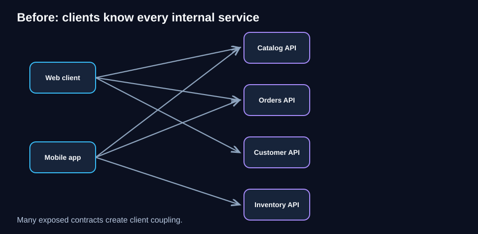
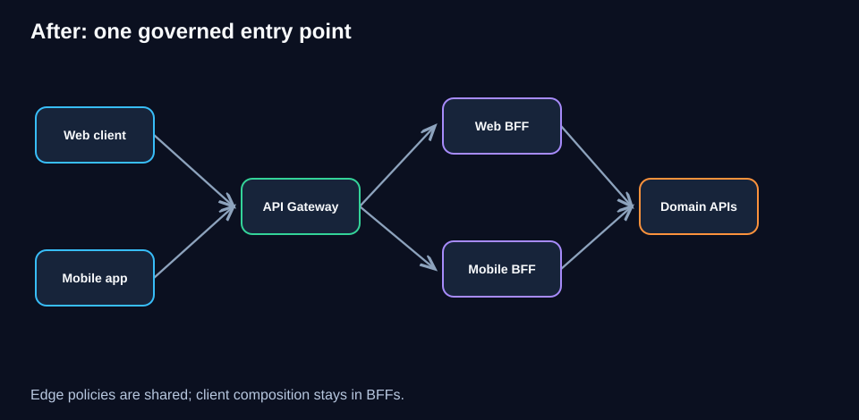
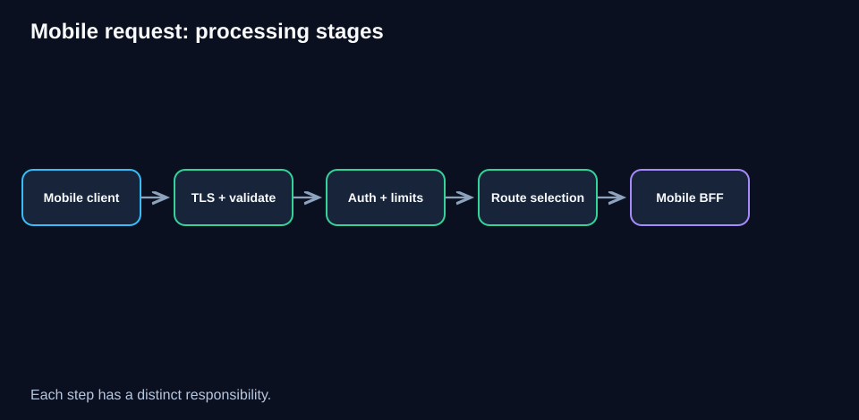
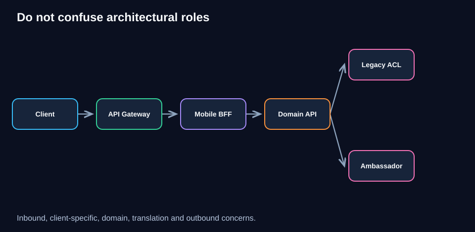
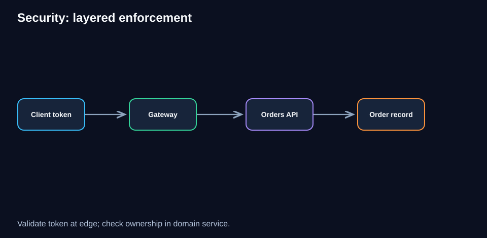
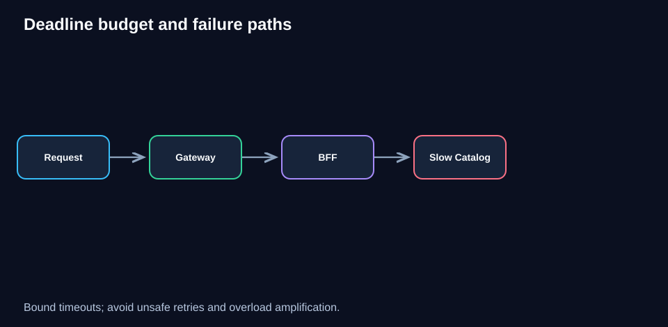
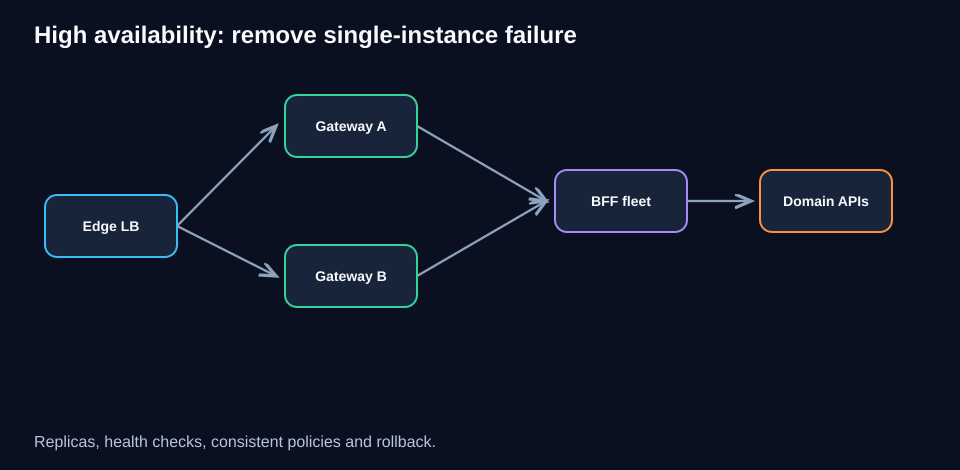
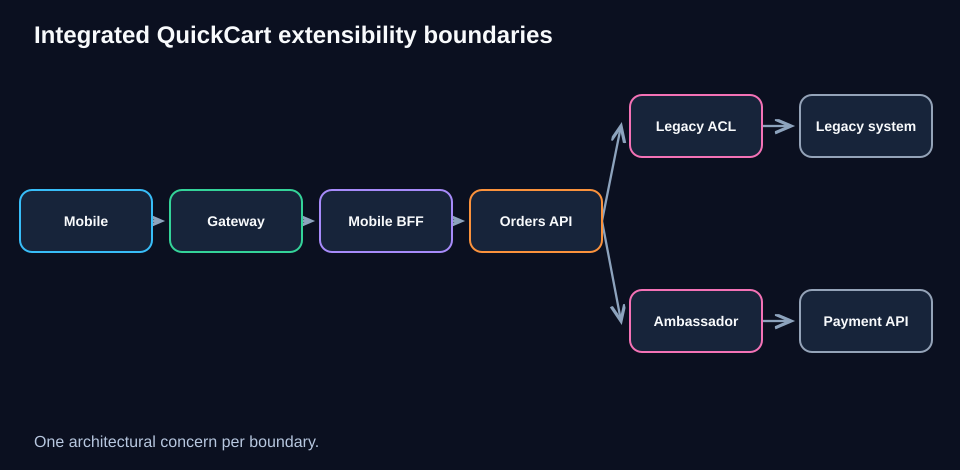

# Chapter 06 — API Gateway Pattern

> **Software Extensibility Architecture Patterns · QuickCart case study**  
> **Estimated study time:** 90–120 minutes · **Level:** Intermediate  


## Learning objectives

By the end, you should be able to explain why an API gateway is useful, distinguish it from adjacent patterns, sketch an end-to-end request path, place authentication and authorization correctly, design safe traffic policies, calculate approximate capacity, and justify when **not** to add a gateway.

## 1. The problem: QuickCart exposes too many service details

QuickCart began with a single web backend. As its business grew, it introduced Catalog, Orders, Customer, Inventory, and Payments services. Mobile and web clients started calling these services independently. Each client needed to know internal hostnames, service-specific authentication behavior, and evolving endpoint versions.

This is a form of **client-to-service coupling**: changing an internal service address or decomposing a service can force client updates. It also creates inconsistent security and rate-limit policies. A client can easily make five network round trips to assemble one screen.



**Diagram walkthrough.** Start with the two clients on the left. Follow their separate arrows to the service boxes. Every arrow is an exposed integration contract. The more independent contracts clients depend on, the harder it becomes to change the internals safely.

### What the gateway should solve—and what it should not

The goal is to establish a **stable, governed entry boundary**. It is not to move all business rules into one giant edge application. Price calculation still belongs to Pricing, stock reservation to Inventory, and payment decisions to Payments.

A gateway is often valuable when multiple clients consume multiple services, but a small application with one backend may not need one.

## 2. Pattern definition

An **API Gateway** is an entry point that receives API requests and applies cross-cutting edge policies before forwarding them to appropriate backends. Common responsibilities include route selection, TLS termination, authentication checks, coarse access policies, request-size limits, rate limiting, telemetry, and sometimes protocol adaptation.

A gateway is a **logical role**, not a mandate for a specific product or an extra physical hop. It may be implemented with a managed cloud gateway, a reverse proxy, an ingress gateway, or a custom service where justified.



**Diagram walkthrough.** Client traffic first reaches the gateway. The gateway applies common controls and chooses a route. Web and Mobile BFFs compose client-specific responses, while domain services remain responsible for business decisions. Notice that the gateway does not become the owner of product pricing or order state.

### Example routing contract

| Public endpoint | Destination | Ownership |
|---|---|---|
| `GET /web/v1/home` | Web BFF | Web experience team |
| `GET /mobile/v1/home` | Mobile BFF | Mobile experience team |
| `GET /v1/products/{id}` | Catalog API, if direct exposure is intended | Catalog team |
| `POST /v1/orders` | Orders API or checkout BFF | Orders / checkout team |
| `GET /v1/me` | Customer API or client BFF | Customer team |

The table is illustrative: QuickCart should decide whether clients reach domain APIs directly through the gateway or only through BFFs. Both are possible, but the contract must be explicit.

## 3. Follow one request, step by step

A customer opens the mobile QuickCart home screen:

1. The app calls `GET https://api.quickcart.example/mobile/v1/home` with an access token.
2. DNS and the edge load balancer direct the connection to a healthy gateway instance.
3. The gateway negotiates TLS, validates basic request constraints, and verifies the token using the configured identity mechanism.
4. A rate-limit policy checks the appropriate identity and route.
5. Route selection forwards the request to the Mobile BFF.
6. The BFF requests data from Catalog and Recommendations; domain services enforce their own authorization and data-access rules.
7. The BFF returns a compact mobile response through the gateway.
8. Logs, metrics, and traces allow operators to follow the journey.



**Diagram walkthrough.** Read left to right. The gateway's stages are policies on the *incoming* request. The BFF's stages are client-specific composition. The domain services' stages are business behavior. Keeping these boundaries separate makes changes safer.

### Example HTTP request

```http
GET /mobile/v1/home HTTP/1.1
Host: api.quickcart.example
Authorization: Bearer <access-token>
Accept: application/json
X-Request-ID: 8a62b1c9
```

A real gateway must validate signatures, issuer, audience, expiry, and other relevant claims. **Never** treat a user-supplied `X-User-ID` header as authenticated identity. Strip or overwrite untrusted identity headers at the trust boundary.

## 4. Gateway versus BFF, Ambassador, load balancer, and service mesh

These patterns can coexist, but their primary responsibilities differ.

| Component | Main question it answers | Typical scope |
|---|---|---|
| API Gateway | How should external API requests enter the platform? | Inbound API boundary |
| BFF | What response and orchestration does this client need? | Client experience |
| Ambassador | How should this workload make outbound network calls? | Outbound transport |
| Load balancer | Which healthy backend instance receives traffic? | Traffic distribution |
| Service mesh | How are workload-to-workload policies managed consistently? | Internal service network |
| ACL | How are incompatible domain concepts translated? | Domain boundary |

An API gateway can perform load balancing, and a service mesh ingress can perform gateway functions. Overlapping implementations do not make the *architectural intents* identical.



**Diagram walkthrough.** Follow the request from the client through the inbound gateway and BFF. The BFF calls domain services; an optional Ambassador or mesh data plane may manage outbound transport. An ACL is only introduced if a domain service must interact with incompatible legacy semantics.

**Important design rule:** Keep domain logic out of the gateway. For example, the gateway can reject an oversized order payload, but it should not decide whether a promotional discount is valid.

## 5. Authentication is not the same as authorization

Authentication answers **who is making the request?** Authorization answers **may this identity perform this operation on this resource?**

A gateway may validate a token and reject anonymous requests to protected routes. It may also enforce broad scopes such as `orders:read`. However, the Orders service must still check whether order `ORD-908` belongs to the requesting customer. Gateway-only authorization is insufficient when access depends on resource ownership or business state.



**Diagram walkthrough.** The gateway is the outer enforcement point; domain authorization is the inner enforcement point. Both are necessary for different reasons. Identity propagated inward should be verifiable and constrained, not blindly copied from client-controlled headers.

Recommended practices include short-lived credentials, TLS everywhere appropriate, workload identity for internal calls, secret rotation, audit logging for sensitive actions, and explicit handling of CORS and CSRF depending on client authentication style.

## 6. Rate limiting, quotas, and abuse prevention

QuickCart wants to protect Orders from bursts and prevent a single client from monopolizing shared capacity.

- **Rate limit:** Controls how quickly requests are accepted, e.g. 100 requests per minute per authenticated customer.
- **Quota:** Controls total usage over a larger window, e.g. 50,000 partner requests per day.
- **Concurrency limit:** Restricts how many in-flight requests are admitted.
- **Payload limit:** Restricts request body size or other request dimensions.

A token-bucket policy allows controlled bursts: tokens refill at a configured rate, and requests consume tokens. When no tokens remain, the gateway returns `429 Too Many Requests`, ideally with meaningful retry guidance.

**Avoid simplistic policies.** Per-IP limits can punish customers behind shared NAT addresses. Per-user limits require a trustworthy authenticated identity. Distributed gateway replicas need consistent enforcement if a global limit is promised.

### Worked example: admission capacity

Suppose a QuickCart promotion creates **12,000 requests/minute** and the Orders backend can safely handle **150 requests/second**.

Convert the arrival rate: `12,000 / 60 = 200 requests/second`. The backend's sustainable rate is `150 requests/second`, leaving an overload of `50 requests/second`.

If the gateway caps admitted order traffic at 150 RPS, excess traffic must be **rejected, deferred, or handled by a deliberately designed queue-based workflow**. A gateway rate limit alone does **not** queue requests durably. It protects the backend by declining work.

## 7. Routing, versions, and contract evolution

Routing should use explicit hostnames, paths, and well-defined headers where appropriate. For example, `/mobile/v1/` can reach the Mobile BFF and `/web/v1/` the Web BFF. Do not rely solely on a spoofable or ambiguous `User-Agent` string to select critical backend behavior.

Versioning options include URL versions (`/v1/`), headers, and compatible schema evolution. The best choice depends on client release cadence and operational constraints.

**Safe API evolution:**
1. Add backward-compatible response fields when possible.
2. Publish and test consumer-facing contracts.
3. Deprecate old behavior with clear timelines.
4. Measure active clients on old versions.
5. Remove an old route only after an explicit migration decision.

A gateway can route versions but cannot make an incompatible backend contract safe by itself.

## 8. Resilience: timeouts, retries, and failure isolation

A gateway is now on the critical path. Its failure can affect many services simultaneously, so high availability matters.

For a request with a **1,000 ms end-to-end deadline**, an illustrative budget might reserve 100 ms for network/edge overhead, 150 ms for gateway and BFF processing, 650 ms for downstream work, and 100 ms of contingency. These are planning assumptions, not universal targets.



**Diagram walkthrough.** A slow Catalog dependency consumes the downstream budget. Once the deadline expires, the gateway or BFF must return a controlled error rather than wait indefinitely. A retry may worsen overload if not bounded and justified.

Use bounded timeouts, sensible connection pools, health checks, and load shedding. Retries must be constrained by deadlines and idempotency. **Never automatically retry a payment or order-creation operation without a correctness design** (such as idempotency keys and an appropriate downstream contract).

An error budget for the gateway should account for gateway failures separately from backend failures so ownership is clear.

## 9. Deployment and high availability

A production design commonly includes multiple gateway replicas or a managed multi-zone gateway, health-aware routing, configuration validation, and safe rollbacks.



**Diagram walkthrough.** The edge distributes traffic across gateway instances. Each instance applies the same versioned policies. The BFFs and domain services scale independently. A shared dependency for distributed rate limiting can itself become a bottleneck, so its availability and failure behavior must be designed.

### Illustrative route configuration

```yaml
# Conceptual pseudoconfiguration: not a vendor-specific deployable manifest
routes:
  - match: { path_prefix: "/mobile/v1/" }
    destination: mobile-bff
    policies: [verify-jwt, mobile-rate-limit, request-size-limit]
  - match: { path_prefix: "/web/v1/" }
    destination: web-bff
    policies: [verify-jwt, web-rate-limit, request-size-limit]
defaults:
  request_timeout_ms: 1000
  reject_unknown_routes: true
  strip_untrusted_identity_headers: true
```

The example communicates intent. Real syntax and security capabilities vary across gateway products. Test the actual configuration in staging.

## 10. Capacity planning: gateway replicas

Assume peak traffic is **2,400 RPS** and load testing shows one gateway replica sustains **600 RPS** at the required latency and CPU thresholds.

Minimum replicas at tested capacity: `ceil(2400 / 600) = 4`.

If the operating target is **70% utilization**, effective planning capacity is `600 × 0.70 = 420 RPS/replica`, so `ceil(2400 / 420) = 6 replicas`.

But six replicas may not survive losing an availability zone or a node. If a three-zone deployment must tolerate losing one zone while staying below 70%, capacity remaining in two zones must support 2,400 RPS: `ceil(2400 / (420 × 2/3)) = 9 total replicas`, assuming even distribution.

These calculations are illustrative; real testing must include TLS cost, payload size, authentication overhead, route complexity, and downstream connection behavior.

## 11. Observability and SLOs

Define the gateway as its own observable service. Minimum useful signals:

| Signal | Why it matters |
|---|---|
| Request rate by route/client | Reveals demand and unexpected shifts |
| p50/p95/p99 gateway-added latency | Measures gateway overhead |
| 4xx/5xx rates by cause | Separates client rejection from platform failure |
| Authentication and authorization failures | Detects configuration issues and attacks |
| Rate-limit rejections | Shows throttling pressure |
| Upstream connection errors and timeouts | Detects dependency trouble |
| CPU, memory, connections, saturation | Supports scaling decisions |
| Configuration version and rollout events | Correlates failures with changes |

An illustrative SLO could be **99.95% successful gateway handling of valid requests per 30 days**, excluding explicitly defined client-caused errors. Define exactly what counts as valid and whether upstream failures are excluded; otherwise the SLO cannot guide decisions.

Use distributed tracing with consistent request IDs, but avoid logging access tokens, passwords, or personal information. Sampling and retention policies should be explicit.

## 12. Security, governance, and ownership

Treat gateway policy as versioned infrastructure. Require code review for route changes, automated configuration linting, contract tests, and an emergency rollback path. Restrict administrative APIs and control-plane credentials. Maintain an inventory of public routes, owners, authentication requirements, data classifications, and deprecation dates.

**Governance trap:** If every team adds bespoke transformations and business rules to the gateway, it becomes a new monolith. Establish a rule that edge policies are shared and generic; client composition belongs in BFFs; business invariants belong in domain services.

## 13. Cost and ROI: a simple business case

A gateway adds compute, traffic-processing fees, observability cost, and operational work. It can also reduce duplicated edge logic, improve security consistency, and lower client integration effort.

Illustrative monthly estimates:

| Item | Without gateway | With gateway |
|---|---:|---:|
| Duplicated edge-policy engineering/maintenance | $6,000 | $1,500 |
| Gateway infrastructure and managed fees | $0 | $2,000 |
| Gateway operations and monitoring | $0 | $700 |
| **Total estimated monthly cost** | **$6,000** | **$4,200** |

Under these **assumed** numbers, monthly savings are `$1,800`, or `$21,600/year`. If implementation costs `$18,000`, simple payback is `18,000 / 1,800 = 10 months`. This is **not a forecast**: the real result depends on team structure, gateway pricing, usage, and avoided incidents. Measure baseline engineering time and incident rates before claiming ROI.

## 14. When *not* to use an API Gateway

Avoid adding one solely because a diagram looks more modern. A single small backend behind a standard load balancer may already meet requirements. A managed platform may provide the necessary gateway functions without another self-operated service. If an API gateway becomes a mandatory orchestrator for every internal request, it may add unnecessary latency and coupling.

**Decision test:** Identify at least one concrete need—central API entry, consistent edge security, independent backend routing, public API governance, or client contract stability—and show why simpler alternatives are insufficient.

## 15. QuickCart design decision record

**Context:** QuickCart supports browser and mobile clients with independently evolving BFFs and multiple domain services.

**Decision:** Introduce a managed or highly available API gateway at the public API boundary. Route explicitly to BFFs and selected public APIs. Enforce common authentication validation, request limits, coarse policy, and telemetry. Keep resource-level authorization in domain services.

**Consequences:** More stable public contracts and consistent controls, at the cost of another critical dependency, gateway policy ownership, and additional fees.

**Revisit when:** Gateway-added p95 latency exceeds the agreed budget, the policy set becomes business-specific, or operational cost outweighs measurable value.

## 16. Integrated architecture with earlier chapters

QuickCart's current design can combine patterns without confusing responsibilities:

- **Gateway:** receives and governs external API traffic.
- **BFF:** composes a mobile or web experience.
- **Domain service:** owns business behavior.
- **ACL:** translates modern domain concepts when accessing the legacy monolith.
- **Ambassador:** optionally handles outbound transport policies for a workload.
- **Sidecar:** provides co-located supporting capability such as log forwarding.



**Diagram walkthrough.** Start at the client and trace inward through Gateway → BFF → Domain API. From the domain service, one branch reaches a legacy system through an ACL, and another reaches an external provider through an outbound Ambassador. Each component exists for a distinct architectural reason.

## 17. Failure-mode review

| Failure | Likely impact | First mitigation |
|---|---|---|
| Gateway replica crashes | Some requests fail or reroute | Multiple replicas and health checks |
| Bad route deployment | Widespread 404/502 errors | Versioned config, canary, rollback |
| Identity provider unavailable | Token validation/refresh affected | Defined cache/fail-closed strategy |
| Shared rate-limit store fails | Limits may be inconsistent or unavailable | Explicit fail-open/fail-closed policy by route |
| Backend overloaded | Increased timeouts and 5xx | Load shedding, bounded timeouts |
| TLS certificate expires | Client connection failures | Automated renewal and expiry alerts |
| Gateway logs sensitive headers | Privacy/security incident | Redaction and log-policy tests |

## 18. Expandable knowledge checks

<details><summary><strong>Q1. Is an API gateway just a load balancer?</strong></summary>

No. A load balancer distributes traffic among healthy targets. A gateway commonly adds API-aware routing, authentication checks, quotas, policy enforcement, and governance. Products can implement both roles.

</details>

<details><summary><strong>Q2. Should the gateway decide whether a customer owns an order?</strong></summary>

No. It may verify identity and broad scopes, but order ownership is resource-level authorization and belongs in the Orders domain service.

</details>

<details><summary><strong>Q3. QuickCart needs a smaller mobile product payload. Gateway or BFF?</strong></summary>

Usually BFF. Tailoring screen data and composing client-specific responses are BFF responsibilities; the gateway should mainly route and enforce shared edge policies.

</details>

<details><summary><strong>Q4. A payment POST times out. Should the gateway retry it automatically?</strong></summary>

Not by default. The payment may have succeeded despite a timeout. Safe retry requires an idempotency and reconciliation design, not merely a transport policy.

</details>

<details><summary><strong>Q5. Can a gateway replace an ACL?</strong></summary>

Not generally. An ACL translates domain semantics and protects a model boundary; gateway transformations are not a substitute for deep domain translation.

</details>

<details><summary><strong>Q6. Why might per-IP rate limiting be unfair?</strong></summary>

Many users can share one public IP through NAT. Authenticated user, tenant, API key, or route-based limits may better match the intended policy.

</details>

<details><summary><strong>Q7. Is the gateway always an extra microservice?</strong></summary>

No. It is a logical role and may be provided by a managed platform, reverse proxy, or ingress solution.

</details>

<details><summary><strong>Q8. What does a 429 mean?</strong></summary>

Too Many Requests. It commonly indicates a rate or quota policy rejected the request; clients should respect appropriate retry guidance.

</details>

<details><summary><strong>Q9. Why does gateway configuration need tests?</strong></summary>

A route, authentication, or timeout mistake can affect many APIs simultaneously. Test both allowed and denied behavior before rollout.

</details>

<details><summary><strong>Q10. When might no gateway be the better choice?</strong></summary>

When there is one simple backend and existing infrastructure already supplies required routing and security, adding a new gateway may create cost without enough benefit.

</details>

## 19. Worked architecture challenge: flash-sale traffic

**Scenario.** QuickCart's mobile app experiences a flash sale. Public API demand reaches 3,000 RPS. The Catalog service can sustain 2,000 RPS and Orders only 250 RPS. The team wants consistent authentication and protection against overload.

**Your task:** Propose routing, throttling, scaling, and observability. Do not assume the gateway can create backend capacity.

<details><summary><strong>Worked solution</strong></summary>

1. Route `/mobile/*` to the Mobile BFF; keep Catalog and Orders as domain owners.
2. Authenticate requests at the edge and re-check domain authorization downstream.
3. Set separate policies per route and identity. Protect order creation based on its tested 250-RPS capacity; do not apply a blanket 3,000-RPS limit to all traffic.
4. Use cacheable catalog reads where valid; measure cache hit ratio and avoid stale stock promises.
5. If a gateway replica handles 500 RPS at acceptable utilization and the target is 75%, planning capacity is 375 RPS/replica. For 3,000 RPS, `ceil(3000/375) = 8` replicas before zone-failure reserve.
6. Return controlled `429` or `503` responses when admission fails. Do not invent a durable queue for order placement without explicit asynchronous workflow design.
7. Observe per-route p95 latency, 429s, 5xx, backend saturation, token-validation errors, and gateway config versions.
8. Run a canary and load test; verify that rejected traffic does not continue overwhelming Orders.

**Key insight:** A gateway governs *admission*; it does not magically increase Orders throughput.

</details>

## 20. Numerical practice

<details><summary><strong>Exercise A — Replica count</strong></summary>

Peak = 1,800 RPS; tested capacity = 450 RPS/replica; target utilization = 60%.

Effective capacity = 270 RPS/replica. Required replicas = `ceil(1800/270) = 7`.

</details>

<details><summary><strong>Exercise B — Monthly cost</strong></summary>

Assume 5 gateway replicas at $80/month each, plus $350 managed/telemetry fees.

Monthly total = `5 × $80 + $350 = $750`. Excludes bandwidth, labor, and other provider charges.

</details>

<details><summary><strong>Exercise C — Rate conversion</strong></summary>

A campaign generates 27,000 requests over 90 seconds.

Average arrival rate = `27,000 / 90 = 300 RPS`. A 250-RPS backend has a 50-RPS mismatch during the window; an explicit reject/defer/queue strategy is required.

</details>

## 21. Production readiness checklist

- [ ] Public routes, owners, and authentication policies documented.
- [ ] Gateway and domain authorization responsibilities separated.
- [ ] Request headers and identity propagation hardened.
- [ ] Rate limits tested for fairness and global consistency.
- [ ] Timeouts, retries, and idempotency policies reviewed per route.
- [ ] High availability and zone-failure capacity tested.
- [ ] Config validation, canary deployment, and rollback practiced.
- [ ] p95/p99 latency, 4xx/5xx, and saturation dashboards available.
- [ ] Secrets, certificates, and admin interfaces secured.
- [ ] Gateway costs and measurable benefits reviewed.

## 22. Rapid revision

**One sentence:** An API gateway is the governed front door to a collection of APIs, not the place to implement every service's business rules.

**Five distinctions:** Gateway ≠ BFF; gateway ≠ ACL; gateway ≠ Ambassador; authentication ≠ resource authorization; rate limiting ≠ durable queuing.

**Remember the sequence:** Client → edge gateway → BFF or public API → domain services → optional ACL / outbound proxy.

**Capacity formula:** `required replicas = ceil(peak RPS / (tested RPS per replica × target utilization))`. Add failure reserve separately.

**Exam clue:** If a scenario emphasizes *inbound API routing and common edge policies*, think **API Gateway**. If it emphasizes *client-specific response composition*, think **BFF**.

## 23. Links to the learning journey

- [Chapter 00 — Foundations](00-foundations.md)
- [Chapter 01 — Sidecar](01-sidecar.md)
- [Chapter 02 — Ambassador](02-ambassador.md)
- [Chapter 03 — Anti-Corruption Layer](03-anti-corruption-layer.md)
- [Chapter 04 — Backends for Frontends](04-backends-for-frontends.md)
- [Chapter 05 — Strangler Fig](05-strangler-fig.md)
- **Next:** Chapter 07 — Plugin Architecture: adding features through explicit extension points without modifying core code.

---

*End of Chapter 06. This is a learning guide, not a vendor-specific gateway deployment manual. All QuickCart traffic and financial figures are illustrative assumptions.*
