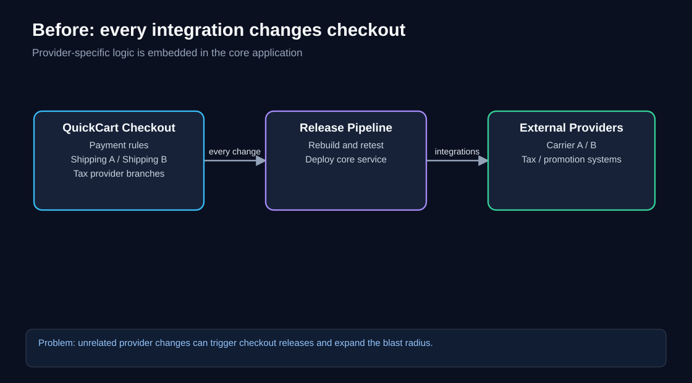
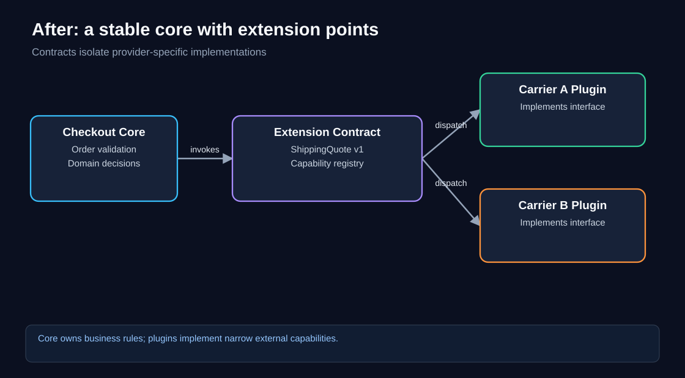
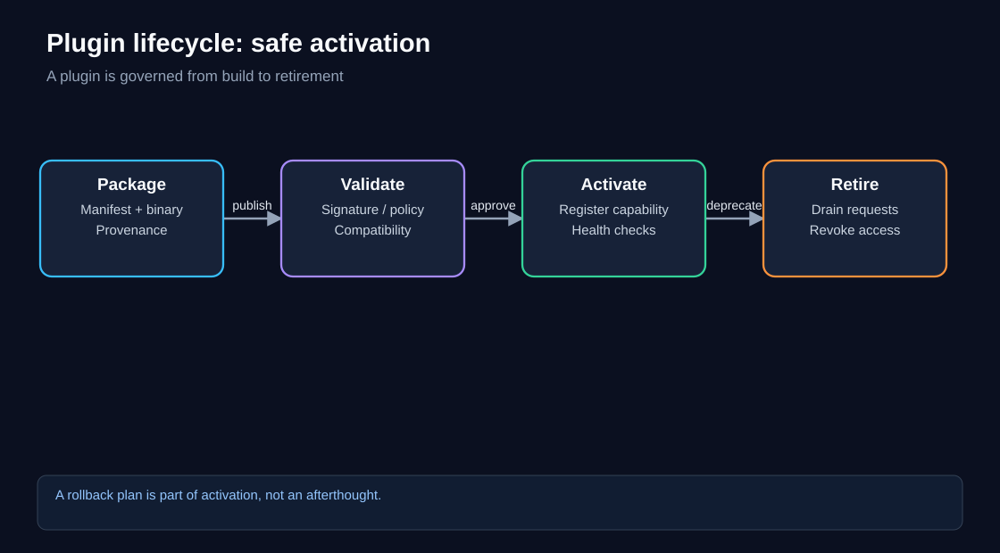
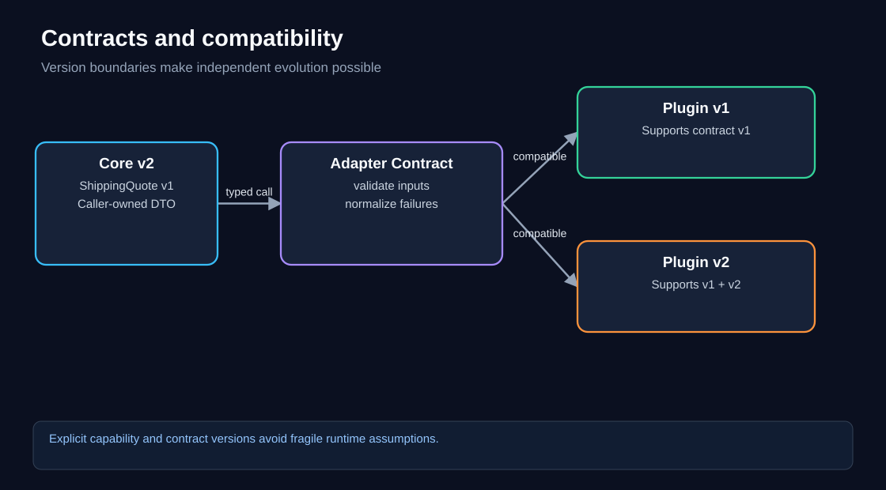
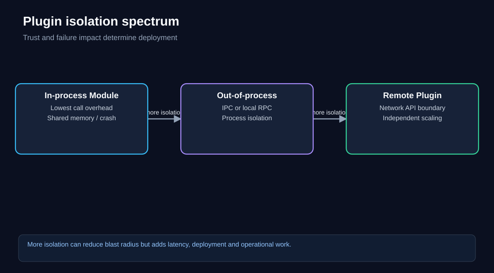
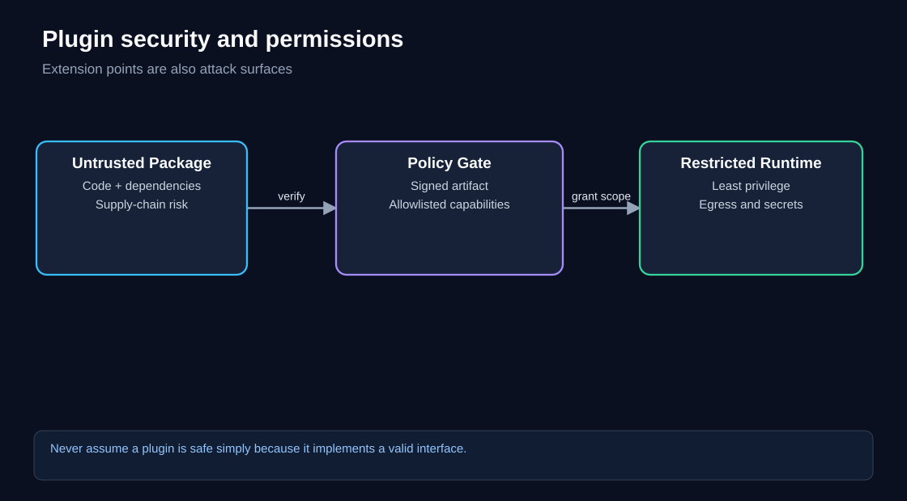
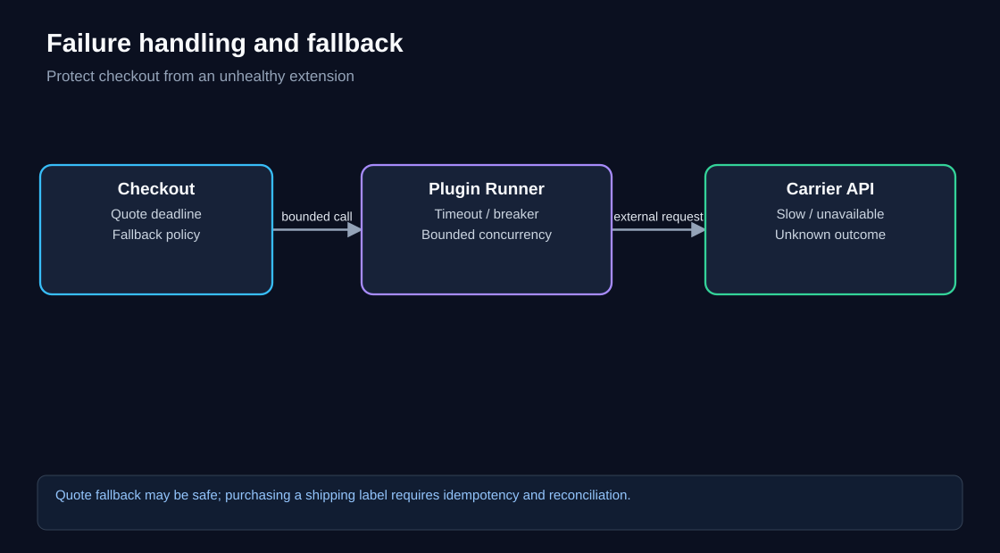
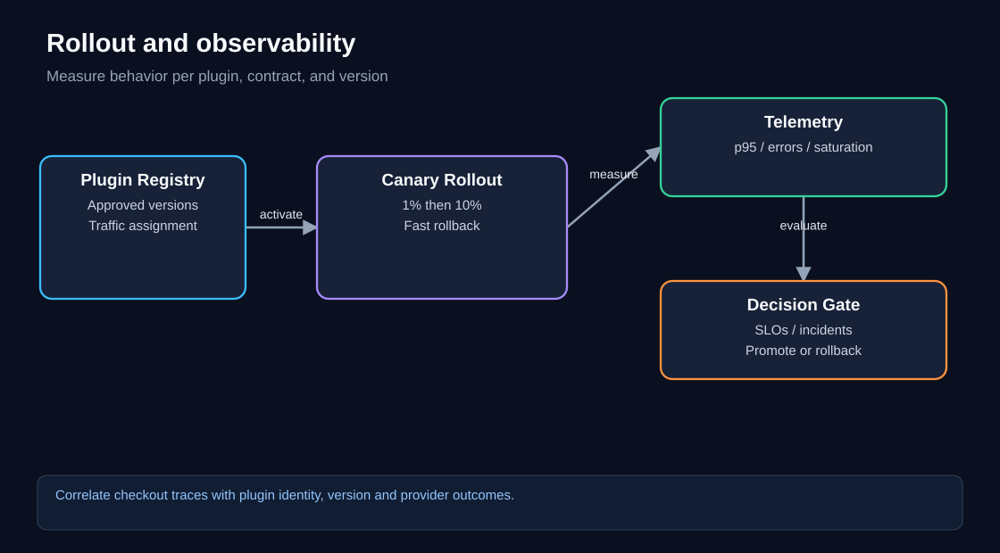

# Chapter 07 — Plugin Architecture Pattern

> **Software Extensibility Architecture Patterns · QuickCart self-study series**  
> **Status:** Expanded-curriculum pattern (not one of the four primary patterns in the source course).  
> **Prerequisites:** [Foundations](00-foundations.md), [Sidecar](01-sidecar.md), [Anti-Corruption Layer](03-anti-corruption-layer.md), and [API Gateway](06-api-gateway.md).  
> **Estimated study time:** 90–120 minutes, plus the implementation challenge.

## 1. Learning objectives

By the end, you should be able to:

1. Explain why **extension points and stable contracts** reduce changes to an application's core.
2. Design a plugin host, registry, capability contract, and provider adapter.
3. Decide whether an extension belongs **in-process**, in an isolated process, or behind a network API.
4. Distinguish plugins from shared libraries, Sidecars, ACLs, BFFs, and microservices.
5. Plan compatibility, security, testing, failure handling, rollout, observability, and retirement.
6. Evaluate the value of plugins using measured change effort and operational costs.
7. Recognize when a simple conditional or ordinary interface is preferable.

**Core mental model:** the application defines *what can be extended*; plugins supply *one implementation of that capability*. Extensibility is not permission to bypass the application's business invariants.

---

## 2. Start with the problem: QuickCart keeps adding integrations

QuickCart began with one shipping carrier. Its Checkout service contained a `getShippingQuote()` function that called Carrier A. Later, the business wanted Carrier B for a new region, a specialist cold-chain carrier, and a store-pickup option. Each addition created another branch in the same checkout code.

The same problem appeared elsewhere:

- Tax calculation depended on jurisdiction and provider.
- Promotion evaluation acquired seasonal and partner-specific rules.
- Fulfillment required region-specific labels and tracking protocols.
- Merchants wanted optional integrations that most customers never used.

The Checkout team now owned provider-specific HTTP payloads, secrets, SDK versions, retry behavior, and vendor error codes. A carrier change could require a checkout release, even when the core order-validation rules had not changed.



**Diagram walkthrough:** Read left to right. Checkout contains both order decisions and vendor branches. Even a small vendor integration change passes through the core release pipeline. The provider system on the right is external, but its assumptions have leaked into the core. The architectural problem is not simply the number of `if` statements; it is the *direction of dependency* and the release coupling.

### Symptoms worth measuring

- Provider onboarding takes weeks because it requires core checkout changes.
- Integration code is mixed with pricing and order-validation code.
- A vendor SDK upgrade causes broad regression testing.
- Optional integrations increase the size and risk of every deployment.
- Different teams cannot independently deliver their integrations.
- A failing integration can consume all checkout worker threads.

**Important:** Plugins are not the automatic answer. If QuickCart has two stable carriers and changes twice a year, two ordinary adapters behind an interface may be simpler.

## 3. The architectural move: define extension points

QuickCart moves provider-specific behavior behind a **ShippingQuoteProvider** contract. The core defines what a shipping quote means, which fields are required, and which outcomes are acceptable. Each carrier plugin implements that contract.



**Diagram walkthrough:** The Checkout Core on the left retains order rules. The Extension Contract in the center is the boundary: a narrow interface and stable request/response model. Carrier A and Carrier B on the right implement the same contract. The core chooses a suitable provider based on business policy, then calls its implementation. The plugins must not decide whether an order is legally purchasable or how QuickCart calculates the authoritative order total.

A minimal conceptual interface:

```python
from dataclasses import dataclass
from decimal import Decimal
from typing import Protocol

@dataclass(frozen=True)
class QuoteRequest:
    destination_country: str
    postal_code: str
    package_weight_grams: int
    currency: str

@dataclass(frozen=True)
class ShippingQuote:
    provider_id: str
    service_code: str
    amount: Decimal
    currency: str
    estimated_days: int

class ShippingQuoteProvider(Protocol):
    provider_id: str

    async def quote(self, request: QuoteRequest) -> ShippingQuote:
        ...
```

The contract expresses QuickCart concepts, not Carrier A's JSON keys. This makes the core more stable, but it does **not** guarantee that all carrier features fit one interface. If one carrier supports refrigeration and another does not, the host needs explicit capability discovery or separate contracts—not dozens of optional fields with ambiguous meanings.

### Who owns what?

| Responsibility | Checkout core / host | Plugin |
|---|---|---|
| Determine whether checkout is permitted | **Yes** | No |
| Validate order total and inventory | **Yes** | No |
| Select an eligible carrier | **Yes**, based on policy | Reports capabilities |
| Translate vendor payloads | No | **Yes** |
| Manage provider-specific credentials | Through controlled secret access | Uses scoped credentials |
| Normalize a carrier quote | Defines output contract | Produces conforming result |
| Enforce timeouts and concurrency limits | **Yes** | Cooperates |
| Provide carrier-specific telemetry | Requires standard dimensions | Emits detailed signals |

This ownership table is the most important design artifact. A plugin should extend an implementation point, not become an uncontrolled second business-rule engine.

## 4. Plugin architecture building blocks

A production-ready system usually contains several logical parts. They may run inside one process or across multiple services:

1. **Host:** QuickCart's application that invokes extensions and enforces invariants.
2. **Extension point:** A named capability, such as `shipping.quote`.
3. **Contract:** Typed inputs, outputs, errors, time limits, and semantic expectations.
4. **Plugin implementation:** Carrier-specific logic satisfying the contract.
5. **Manifest:** Metadata describing identity, version, capabilities, permissions, and dependencies.
6. **Registry:** The set of plugins approved and available in a particular environment.
7. **Loader or dispatcher:** Resolves which plugin to invoke for a request.
8. **Policy and lifecycle controller:** Validates, activates, drains, disables, and retires plugins.
9. **Observability layer:** Captures outcome, duration, version, provider, and failure reasons.

An illustrative manifest—not a standardized format:

```yaml
plugin_id: quickcart.shipping.carrier-b
plugin_version: 2.4.1
contract:
  name: shipping.quote
  major: 1
capabilities:
  - domestic-standard
  - international-express
permissions:
  outbound_hosts:
    - api.carrier-b.example
  secrets:
    - carrier-b-api-key
limits:
  timeout_ms: 1200
  max_concurrency: 40
```

The manifest is **declarative metadata**. Merely listing permissions does not enforce them. Enforcement requires a trusted runtime, network policy, secret broker, or other security controls.

## 5. Plugin lifecycle: from submission to retirement

A plugin is more than a module that can be imported. It has an operational lifecycle.



**Diagram walkthrough:** The diagram follows Package → Validate → Activate → Retire. A signed package enters validation; compatibility and policy checks occur before activation. Retirement must stop new dispatches and allow in-flight work to finish or terminate safely. In practice, failures can return a plugin to quarantine or rollback rather than moving only forward.

**Suggested lifecycle states:**

`SUBMITTED → VERIFIED → STAGED → ACTIVE → DEPRECATED → DISABLED → REMOVED`

A plugin may move from `STAGED` back to `REJECTED`, or from `ACTIVE` to `DISABLED` immediately after an incident.

**Example activation sequence:**

1. Verify artifact provenance, signature, dependency inventory, and vulnerability policy.
2. Check the declared contract major version and required capabilities.
3. Run unit, conformance, contract, and integration tests.
4. Stage the plugin with synthetic QuickCart requests.
5. Activate for a small, eligible traffic cohort.
6. Observe p95 latency, errors, timeouts, and incorrect quote rates.
7. Promote or roll back based on predeclared thresholds.
8. Record the version, approver, deployment time, and rollback artifact.

**Subtle issue:** A dynamically loaded in-process plugin may not be safely unloadable without restarting the host. Do not promise hot swapping unless the runtime, dependency model, and thread lifecycle actually support it.

## 6. Designing a stable contract

A contract must specify more than function names. Consider the shipping quote operation:

**Inputs:** destination, package weight, dimensions, currency, declared-value band, and any approved fulfillment options.

**Outputs:** provider ID, service code, monetary amount, currency, estimate, expiry timestamp, and an opaque provider quote reference when needed.

**Errors:** `UNSUPPORTED_DESTINATION`, `INVALID_PACKAGE`, `RATE_LIMITED`, `TEMPORARILY_UNAVAILABLE`, and `INTERNAL_PROVIDER_ERROR`.

**Semantics:** The quote is advisory until checkout confirms availability and final pricing. The core decides how long a quote remains valid and what to show if no carrier responds.

**Time budget:** The host might allocate 1,200 ms to a plugin within a 2,000 ms checkout-preview budget. The remaining 800 ms covers application processing, other dependencies, and a safety margin. This is illustrative, not a universal target.

**Idempotency:** Retrieving a quote is usually read-like, but purchasing a shipping label changes external state. Use a separate contract with idempotency keys and reconciliation rather than treating label purchase as an ordinary retryable quote.

### Compatibility rules

- A compatible minor version may add optional capabilities without changing existing semantics.
- Removing a required field, changing currency interpretation, or altering error meaning requires a breaking-contract review.
- The host should explicitly declare supported contract versions.
- A plugin's *package version* and the *contract version* are different things.
- Test both directions: new host with older plugin and older host with newer plugin, where supported.



**Diagram walkthrough:** The core and adapter contract are separated from individual plugin versions. Two plugin implementations may coexist if they satisfy a supported contract. The key compatibility question is not whether both packages can load; it is whether both preserve the promised business semantics.

## 7. Discovery, selection, and dispatch

QuickCart needs deterministic selection rules. A plugin registry could index:

`(capability, contract_major, country, service_level, plugin_id, version, rollout_cohort)`

The host first filters by supported capability and active status, then applies business policy. For example:

1. Exclude carriers that do not serve the destination.
2. Exclude plugins that fail compatibility or security checks.
3. Prefer an approved carrier based on fulfillment policy and availability.
4. Dispatch with a bounded deadline.
5. Normalize the result and validate its invariants.
6. Record the chosen plugin and outcome.

Avoid nondeterministic selection based on whichever plugin registered first. That makes deployments change business behavior unexpectedly.

**Plugin ordering** matters when extensions form a chain, such as promotions. Define whether order is fixed, priority-based, or independent; specify conflict resolution; and keep the final authoritative discount rules in the core.

## 8. Three deployment models



**Diagram walkthrough:** Left to right, isolation generally increases. An in-process module has low call overhead but shares the application's failure domain. A separate process uses IPC or local RPC and can be restarted independently. A remote plugin service has a network boundary and can scale separately, but adds latency and infrastructure. This is a design spectrum, not a rule that every plugin must become a microservice.

| Model | Strength | Main risk | Typical fit |
|---|---|---|---|
| In-process plugin | Low latency, simple call model | Crash, memory corruption, dependency conflicts, broad privileges | Trusted internal extensions |
| Out-of-process local worker | Better fault and resource isolation | IPC, lifecycle, packaging complexity | Less-trusted or failure-prone extensions |
| Remote plugin service | Independent scaling and ownership | Network latency, availability, authentication | Partner integrations or separately operated providers |
| Build-time adapter module | Simple and explicit | Core release required | Few stable integrations |

**Terminology note:** A remote service may implement an extension contract, but not everyone would call it a “plugin.” The architectural benefit comes from the stable extension boundary, not the label.

## 9. Plugins versus neighboring patterns

| Pattern | Primary boundary | QuickCart example |
|---|---|---|
| **Plugin architecture** | Stable core vs replaceable capability implementations | Add Carrier C without redesigning checkout |
| **Sidecar** | Business process vs supporting co-located process | Collect checkout logs |
| **Ambassador** | Application vs outbound transport complexity | TLS and routing to carrier APIs |
| **Anti-Corruption Layer** | Modern domain vs legacy domain semantics | Translate old fulfillment codes |
| **API Gateway** | External clients vs internal API surface | Route and protect public checkout APIs |
| **BFF** | Client experience vs shared domain services | Shape mobile checkout response |
| **Ports and Adapters** | Domain core vs infrastructure implementations | Define a shipping port with carrier adapters |

**Plugin architecture and Ports and Adapters overlap significantly.** Ports and Adapters describes dependency direction and replaceable infrastructure. A plugin system adds explicit discovery, lifecycle, packaging, and potentially runtime installation. A hexagonal architecture does not automatically require dynamic plugins.

## 10. Security: the extension point is a trust boundary

Plugins can introduce executable code, dependencies, network calls, and secret access. Treat them as supply-chain and runtime risks.



**Diagram walkthrough:** A plugin package is not trusted merely because it declares an interface. A policy gate checks origin, compatibility, and allowed behavior before a restricted runtime grants only the needed capabilities. The final boundary is enforceable access, not documentation.

Security controls should include:

- Artifact signatures, provenance, dependency scanning, and an approved publisher list.
- Permission allowlists for outbound hosts, filesystem paths, and secret scopes.
- No unrestricted access to QuickCart's order database or payment credentials.
- Input validation at the host boundary and output validation before business use.
- Resource ceilings: CPU, memory, open files, concurrency, and request time.
- Audit records for install, activate, disable, version change, and permission grants.
- Tenant isolation where merchants can install extensions; never assume in-process code is safely sandboxed.
- A kill switch for a compromised or malfunctioning plugin.

**Key warning:** A Python or Java plugin loaded into the same process normally executes with substantial host privileges. An interface or dependency-injection container is not a security sandbox. Strong isolation may require separate processes, containers, or purpose-built runtimes with explicit restrictions.

## 11. Failure handling: a plugin must not take down checkout

Suppose Carrier B's quote API stalls. QuickCart must distinguish optional quote discovery from irreversible fulfillment actions.



**Diagram walkthrough:** Checkout invokes a bounded plugin runner, which contacts an external carrier. The host sets the deadline and concurrency cap. If the carrier is slow, the host must decide whether to offer another shipping method, display an unavailable state, or fail checkout. The correct fallback is a **business decision**, not something a generic plugin should invent.

Recommended defenses:

1. **Timeout:** Bound each invocation within the overall request deadline.
2. **Bulkhead:** Limit concurrency per plugin so one carrier cannot exhaust all workers.
3. **Circuit breaker:** Temporarily avoid repeated calls to a failing dependency.
4. **Retry policy:** Retry only operations proven safe and within a total budget.
5. **Fallback:** Offer a verified alternative only when business rules permit.
6. **Reconciliation:** For uncertain external side effects, query authoritative state before repeating.
7. **Kill switch:** Disable a problematic version without waiting for a full core release.

### Two failure scenarios

**Scenario A — Quote timeout:** Carrier B fails to respond in 1.2 seconds. QuickCart may offer Carrier A if it is eligible and the user accepts its terms. No shipping label was purchased, so fallback is comparatively safe.

**Scenario B — Label purchase timeout:** Carrier B may have purchased a label before the response was lost. Blindly retrying can create duplicate charges or labels. Use an idempotency key, provider status lookup, and a reconciliation process.

These are not interchangeable retry policies.

## 12. Performance and capacity planning

Plugin isolation creates measurable costs. Work through a deliberately simplified QuickCart example.

**Assumptions:**

- Peak checkout-preview traffic: 600 requests/second.
- Each preview requests one shipping quote.
- Carrier B handles 40% of quotes.
- Average Carrier B call duration: 200 ms.
- Carrier B p95 call duration: 800 ms.
- Runner concurrency limit: 60.
- Target plugin timeout: 1.2 seconds.

**Carrier B arrival rate:** `600 × 0.40 = 240 calls/second`.

**Approximate average in-flight calls (Little's Law):** `240 × 0.20 = 48`.

With a limit of 60, the *average* concurrency appears acceptable, but this does not prove p95 safety. Bursts, slow-tail amplification, queueing, and uneven traffic can push active calls above the limit.

**Stress scenario:** If average duration rises to 400 ms, estimated concurrency becomes `240 × 0.40 = 96`, exceeding the 60-call limit. The system must queue briefly, shed load, redirect eligible traffic, or scale the runner if the provider allows it.

**Latency budget example:**

| Component | Illustrative allocation |
|---|---:|
| Gateway + BFF | 150 ms |
| Checkout business logic | 250 ms |
| Plugin dispatch + serialization | 50 ms |
| Carrier quote deadline | 1,200 ms |
| Remaining margin | 350 ms |
| **Total** | **2,000 ms** |

The table is a planning budget, not an assertion that latency components always add linearly. Parallel calls, network variability, and correlated tails matter.

### Capacity questions before production

- How many plugins can execute concurrently per host and per tenant?
- Can one merchant consume the entire plugin pool?
- Are plugin and provider rate limits separate?
- What happens when plugin calls outlive client cancellation?
- Does hot loading increase memory or dependency duplication?
- Can a rollout trigger a connection storm to the provider?

## 13. Observability: measure by plugin identity

The core should produce a common trace and metric vocabulary:

- `plugin_invocations_total{plugin_id,version,outcome}`
- `plugin_duration_seconds{plugin_id,version}`
- `plugin_inflight{plugin_id}`
- `plugin_timeouts_total{plugin_id}`
- `plugin_fallback_total{reason}`
- `plugin_activation_events_total{action,result}`

Keep labels bounded: **do not** place customer IDs, order IDs, arbitrary error messages, or full URLs into metric labels. Use trace attributes and structured logs for high-cardinality details, with privacy controls.

A distributed trace should link:

`Client → Gateway → BFF → Checkout → Plugin Runner → Carrier API`

Correlate plugin version with rollout events, latency, error rate, and customer impact. Track correctness too: a fast plugin returning wrong prices is worse than a slow plugin returning a valid error.

### Suggested SLOs

- 99.9% of eligible shipping quote requests return a valid quote or approved alternative, measured over 30 days.
- p95 shipping quote orchestration completes within a chosen budget under expected load.
- No unapproved plugin version can receive production traffic.
- All plugin activations and permission changes are auditable.

Choose actual thresholds after measuring QuickCart's baseline and business requirements.

## 14. Testing strategy

A plugin framework needs more than individual unit tests.

**Contract conformance:** Run the same suite against every implementation. Validate field semantics, currencies, time zones, error mapping, and unsupported-capability behavior.

**Compatibility matrix:** Test host versions against supported plugin contract versions. Keep test fixtures for older releases.

**Failure injection:** Simulate provider timeouts, malformed responses, rate limiting, TLS errors, and process crashes.

**Security tests:** Verify that a plugin cannot read another plugin's secrets, contact unauthorized hosts, or access forbidden storage.

**Load tests:** Check per-plugin saturation, cancellation, memory leaks, and high-tail latency.

**Rollback tests:** Ensure a disabled version stops receiving *new* work while in-flight requests are drained or safely terminated.

**Business correctness:** Check that final order totals and inventory decisions are not overwritten by plugin output.

## 15. Deployment and rollout



**Diagram walkthrough:** The registry holds approved versions. A canary rollout assigns a small portion of eligible traffic to a new version. Telemetry is evaluated before promotion. If the decision gate fails, traffic returns to the prior version. The diagram separates *artifact availability* from *production activation*.

An example rollout policy:

1. Publish `carrier-b` version 2.4.1; verify its signature.
2. Run conformance and staging tests.
3. Route 1% of eligible quote requests to the new version.
4. Compare error rate, p95, quote accuracy, and provider rejection rates.
5. Expand to 10%, then 50%, then 100% only after agreed observation windows.
6. Keep version 2.4.0 available for immediate rollback.
7. Remove the older version after retention and dependency checks.

Avoid rollout cohorts that change between retries of the same side-effecting operation. Pin operation identity to a stable provider and version when correctness requires it.

## 16. Governance and ownership

**Platform team:** owns host runtime, contract evolution, registry, policy enforcement, conformance tooling, and common telemetry.

**Checkout domain team:** owns the extension points, provider-selection rules, order invariants, and customer-facing fallback behavior.

**Integration team or partner:** owns a plugin's provider mapping, tests, release notes, and operational runbook.

**Security team:** defines minimum provenance, permissions, incident response, and review requirements.

Every plugin should have an accountable owner, support tier, approved data-access scope, dependency inventory, deprecation date where applicable, and a tested disable procedure.

### Governance questions

- Who can publish and activate a plugin?
- Can one merchant install code that affects other merchants?
- Who owns customer data sent to third parties?
- What contract changes require migration support?
- How long will deprecated versions remain supported?
- Who is paged when the plugin succeeds technically but violates a business rule?

## 17. Business case and ROI

A plugin platform costs engineering effort up front. Its return depends on how frequently new integrations arrive and how much repeated core work it eliminates.

**Illustrative baseline assumptions, not QuickCart measurements:**

| Driver | Before plugins | After plugins |
|---|---:|---:|
| Integrations added or updated per year | 12 | 12 |
| Average engineering effort per integration | 15 days | 7 days |
| Annual integration engineering days | 180 | 84 |
| Annual platform maintenance | 0 additional | 35 days |
| One-time platform build | — | 100 days |

**Steady-state annual effort saved:** `180 − (84 + 35) = 61 engineering days`.

At an illustrative fully loaded cost of **$600 per engineering day**, gross annual savings are `61 × $600 = $36,600`.

**One-time implementation cost:** `100 × $600 = $60,000`.

**Simple payback:** `$60,000 / $36,600 ≈ 1.64 years`, *before* infrastructure, security-review, and support costs.

This is not a guaranteed ROI. If QuickCart has only two integrations per year, the same platform may never pay back. The strongest justification may be safer changes and independent ownership rather than direct compute savings.

**Measure actual results:** integration lead time, core releases per integration, escaped defects, rollback frequency, plugin-related incidents, and onboarding cost.

## 18. When not to use Plugin Architecture

Avoid a full plugin platform when:

- Only one or two implementations exist and rarely change.
- Extensions cannot be given a coherent, stable contract.
- Third-party code would require unsafe privileges that cannot be isolated.
- Business invariants are so entangled that every plugin needs unrestricted core access.
- A configuration table or strategy object solves the variation.
- The team lacks capacity to maintain a registry, security reviews, versioning, and compatibility tests.
- Runtime installation is not required and build-time adapters are sufficient.

**A good incremental path:** first extract an interface; second add multiple adapters; third add configuration-based selection; only then introduce dynamic discovery, packaging, and activation if real demand exists.

## 19. Common mistakes and corrections

| Mistake | Why it fails | Better approach |
|---|---|---|
| Give plugins access to the whole order object | Hidden coupling and unsafe mutations | Minimal immutable DTOs |
| Treat all plugin failures as retryable | Duplicates external side effects | Operation-specific idempotency |
| Put pricing authority in a shipping plugin | Business invariants diverge | Core validates final amounts |
| Load arbitrary packages in-process | Supply-chain and privilege risk | Trusted publisher or stronger isolation |
| Change contracts without compatibility tests | Runtime breakage | Explicit versions and conformance suite |
| One global concurrency pool | One slow plugin blocks all others | Per-plugin bulkheads |
| Log all plugin payloads | PII and secret leakage | Structured, redacted telemetry |
| Assume plugins always reduce cost | Framework has ongoing maintenance | Baseline and measured ROI |

## 20. Worked architecture exercise: add a cold-chain carrier

**Scenario:** QuickCart expands grocery delivery. Some orders require cold-chain shipping. Carrier C offers temperature-controlled delivery in selected postal codes, but its API is slow and rate limited. Product, checkout, and inventory services must remain stable.

**Proposed solution:**

1. Introduce a `cold_chain` capability on the shipping quote contract, with explicit eligibility data.
2. Keep the *requirement* for cold-chain delivery in QuickCart's fulfillment domain, not in the plugin.
3. Build a Carrier C adapter implementing the same quote contract where semantics fit; use a separate contract if temperature-control guarantees require fundamentally different outputs.
4. Run Carrier C out-of-process because its SDK has unstable dependencies.
5. Grant only Carrier C credentials and outbound access to its approved host.
6. Set a 900 ms provider deadline and a concurrency limit based on measured load and provider quota.
7. When Carrier C is unavailable, **do not** silently offer standard shipping for temperature-sensitive goods. Show an unavailable fulfillment option or a verified alternative.
8. Canary by eligible geography, measure successful quotes, accuracy, p95, and customer checkout abandonment.
9. Add a reconciliation workflow for any later label-purchase operation.
10. Document ownership and rollback.

**Why this works:** It extends QuickCart's provider coverage while preserving the core's safety rules. The extension cannot redefine what counts as acceptable delivery for temperature-sensitive products.

## 21. Knowledge checks

Try each question before opening the answer.

<details>
<summary>Q1. Is a plugin just a shared library?</summary>

**Answer:** Not necessarily. A plugin typically implements a host-defined extension contract and may participate in discovery, versioning, activation, and permission control. A shared library can be an implementation mechanism, but ordinary library reuse does not automatically create a plugin architecture.
</details>

<details>
<summary>Q2. Why shouldn't a shipping plugin calculate the final order total?</summary>

**Answer:** The core checkout domain must enforce authoritative pricing, taxes, discounts, and inventory rules. A plugin may return a shipping charge under a defined contract; the core validates and incorporates it.
</details>

<details>
<summary>Q3. Does an interface make third-party plugin code safe?</summary>

**Answer:** No. Interfaces describe behavior; they do not enforce runtime privileges. Untrusted code may need process isolation, scoped secrets, network restrictions, and supply-chain verification.
</details>

<details>
<summary>Q4. When is an in-process plugin a reasonable choice?</summary>

**Answer:** For trusted, low-risk, low-latency extensions with compatible dependencies and an acceptable shared failure domain. It is less suitable for arbitrary third-party code.
</details>

<details>
<summary>Q5. Why separate plugin package version from contract version?</summary>

**Answer:** The implementation may change without changing the public contract. Different package versions can implement the same stable contract, and one package may support several contract versions.
</details>

<details>
<summary>Q6. Carrier B times out during quote retrieval. Can QuickCart try Carrier A?</summary>

**Answer:** Potentially, if Carrier A is eligible and business rules permit the alternative. The fallback must be visible and valid, not a silent change that violates fulfillment requirements.
</details>

<details>
<summary>Q7. Carrier B times out after a shipping-label purchase request. Should QuickCart immediately retry?</summary>

**Answer:** Not blindly. The first request may have succeeded. Use an idempotency key, query the provider's authoritative state, and reconcile uncertain outcomes.
</details>

<details>
<summary>Q8. What is the main difference between a plugin and a Sidecar?</summary>

**Answer:** A plugin implements a capability defined by a host contract. A Sidecar is a co-located supporting process or container. A plugin can be in-process or remote; a Sidecar is defined primarily by deployment relationship.
</details>

<details>
<summary>Q9. What does Little's Law estimate in the Carrier B example?</summary>

**Answer:** Average in-flight calls: arrival rate × average duration. With 240 calls/s and 0.2 s average duration, approximately 48 calls are in flight. It does not guarantee p95 behavior or account for every burst.
</details>

<details>
<summary>Q10. Why is a plugin registry not the same as a plugin security boundary?</summary>

**Answer:** A registry records what is approved and available. Runtime restrictions must separately enforce filesystem, network, secret, resource, and execution permissions.
</details>

<details>
<summary>Q11. When would a plain strategy object be better than a plugin framework?</summary>

**Answer:** When variations are few, trusted, stable, and released together. Avoid paying for discovery, dynamic loading, governance, and isolation without a clear need.
</details>

<details>
<summary>Q12. What metric could reveal a regression hidden by a low error rate?</summary>

**Answer:** Quote correctness or customer-visible mismatch rate. A plugin might return HTTP 200 quickly while producing invalid amounts, service levels, or delivery estimates.
</details>

## 22. Numerical practice

<details>
<summary>Exercise A — Concurrency under slower provider response</summary>

QuickCart sends 500 quote requests/s. Carrier C receives 30%; average latency increases from 150 ms to 500 ms. Estimate average concurrency before and after.

**Solution:** Carrier C rate = `500 × 0.30 = 150/s`. Before = `150 × 0.15 = 22.5` concurrent calls on average. After = `150 × 0.50 = 75`. A limit of 40 would be insufficient under sustained slower responses without queueing, shedding, or provider/rate changes.
</details>

<details>
<summary>Exercise B — Break-even integration volume</summary>

A plugin platform costs 30 engineering days/year to maintain and saves 5 engineering days per integration. How many integrations per year are needed to cover annual maintenance, ignoring build cost?

**Solution:** `30 / 5 = 6` integrations/year. More than six yields positive annual engineering-day savings under the assumptions. One-time build cost extends payback.
</details>

<details>
<summary>Exercise C — Latency budget</summary>

The checkout-preview deadline is 1,800 ms. Gateway/BFF and core processing use 300 ms; plugin dispatch uses 75 ms; reserve 225 ms margin. What maximum plugin deadline remains?

**Solution:** `1,800 − 300 − 75 − 225 = 1,200 ms`. Real implementation must account for parallelism and variable latency.
</details>

## 23. Design challenge — QuickCart marketplace plugins

**Prompt:** QuickCart opens its platform to third-party merchants. Merchants want optional tax, shipping, and promotion extensions. A malicious or broken merchant extension must not read other merchants' data or block checkout for everyone.

Before revealing the solution, sketch:

- The host-to-plugin contract and minimum data passed.
- Isolation model and permission enforcement.
- Tenant-specific activation and version pinning.
- Timeout, quota, and failure behavior.
- Audit trail and incident rollback.
- How the final order total remains authoritative.

<details>
<summary>Worked solution and evaluation rubric</summary>

**Architecture:** Keep core order and pricing authority in domain services. Publish narrow versioned capability contracts. Use an isolated worker or remote service for untrusted merchant extensions. Pass only tenant-scoped, minimized data. Validate outputs and require explicit allowed operations.

**Security:** Use separate execution identities, scoped credentials, outbound allowlists, memory/CPU limits, and tenant-aware quotas. Do not treat ordinary in-process language isolation as sufficient for untrusted code.

**Lifecycle:** Signed artifacts → security review → conformance tests → staging → tenant-scoped canary → activation. Pin a transaction to a stable extension version where needed.

**Resilience:** Bound latency and concurrency per plugin and tenant. Define failure behavior per capability. A promotion plugin failure may cause an explicit promotion-unavailable state; it must not arbitrarily alter an already-authorized payment.

**Observability:** Trace plugin ID, version, tenant-safe identifier, contract version, and outcome. Audit activation, disable, and permission changes. Keep sensitive data out of metric labels.

**Scoring (10 points):** contract clarity (2), isolation/security (2), correctness and fallback (2), lifecycle/versioning (2), telemetry/operations (2). A solution that lets arbitrary merchant code run with core database privileges fails the security criterion regardless of other strengths.
</details>

## 24. Revision checklist

- [ ] I can explain why a stable extension contract reduces core change.
- [ ] I can identify which QuickCart business decisions must remain in the core.
- [ ] I can distinguish plugins, adapters, Sidecars, and remote services.
- [ ] I can describe plugin discovery, activation, compatibility, and retirement.
- [ ] I understand why untrusted in-process code is unsafe without a real sandbox.
- [ ] I can design safe timeouts, bulkheads, fallback, and idempotent side effects.
- [ ] I can compute approximate concurrency using arrival rate × duration.
- [ ] I can explain the assumptions behind a plugin platform ROI estimate.
- [ ] I can argue when *not* to build a plugin framework.

## 25. Chapter takeaway and what's next

The **Plugin Architecture pattern** lets QuickCart add replaceable capabilities through explicit extension points. Its real value is a stable boundary between core responsibilities and variable implementations. The engineering challenge is not loading modules; it is governing contracts, privileges, versions, failures, and ownership.

**One-sentence recall:** *A plugin extends what the application can do without being allowed to redefine what the application must guarantee.*

**Next:** [Chapter 08 — Ports and Adapters](08-ports-and-adapters.md), which explains the dependency-inversion architecture underlying many good plugin systems.

**Related chapters:** [00 Foundations](00-foundations.md) · [01 Sidecar](01-sidecar.md) · [02 Ambassador](02-ambassador.md) · [03 Anti-Corruption Layer](03-anti-corruption-layer.md) · [04 BFF](04-backends-for-frontends.md) · [05 Strangler Fig](05-strangler-fig.md) · [06 API Gateway](06-api-gateway.md)

---
