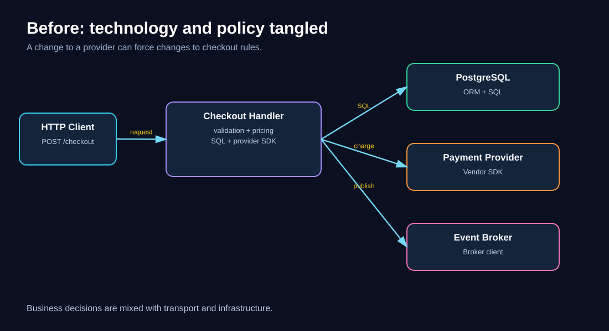
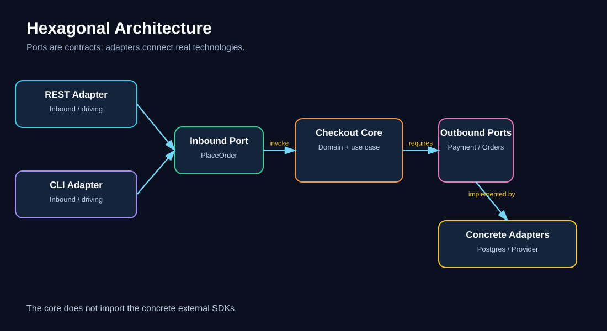
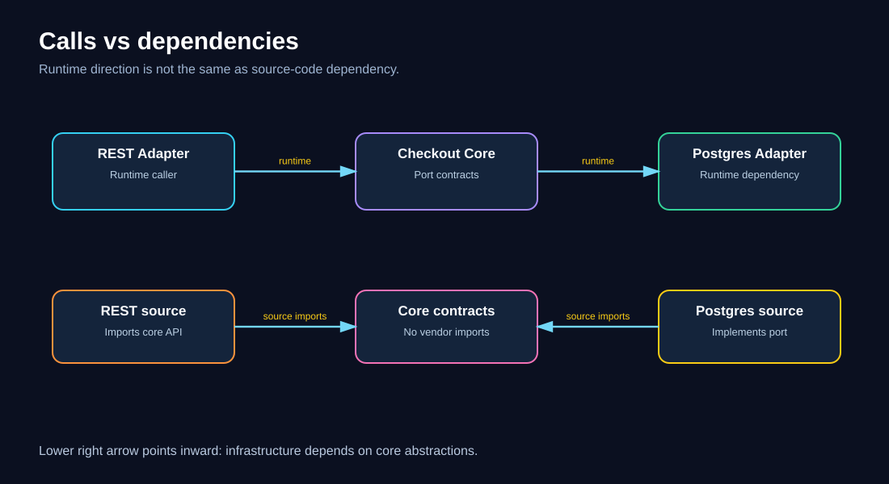
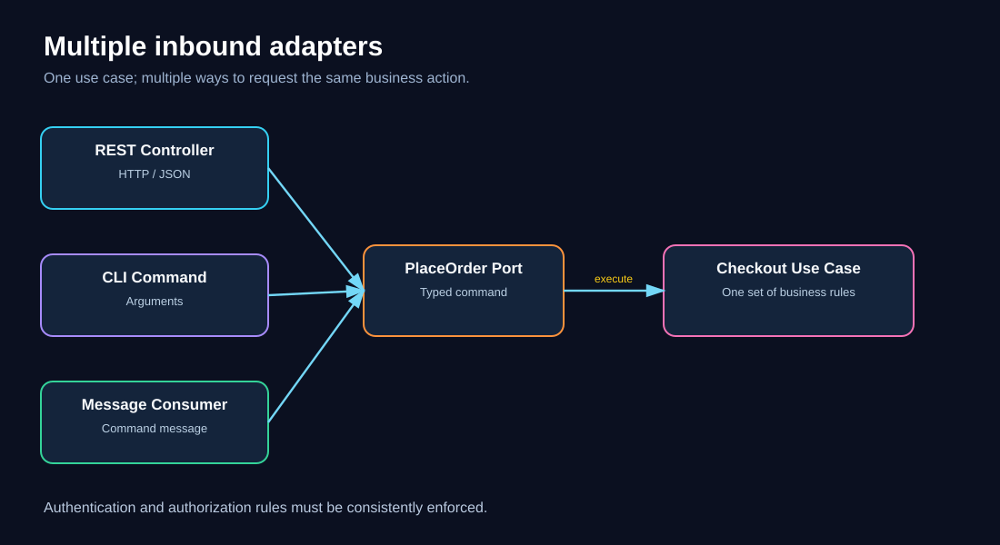
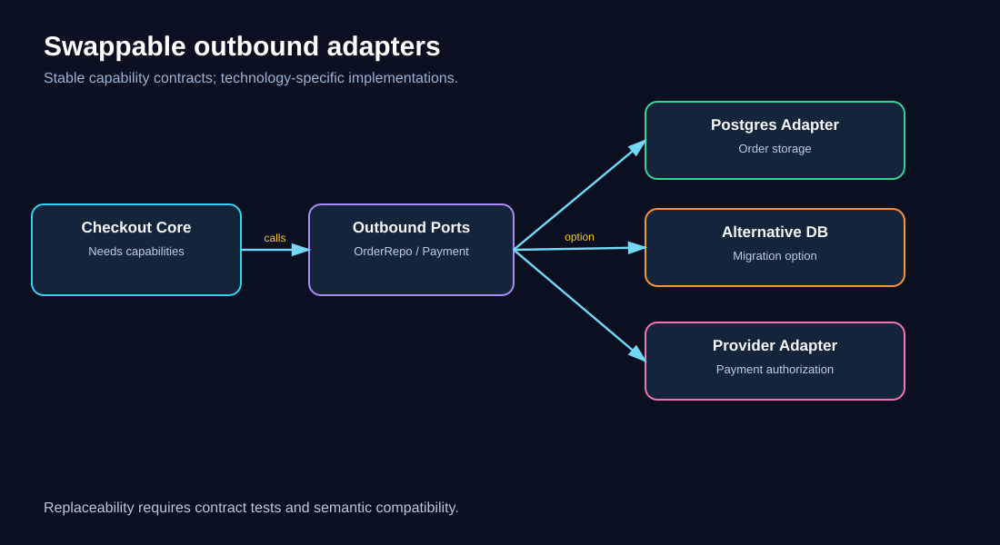
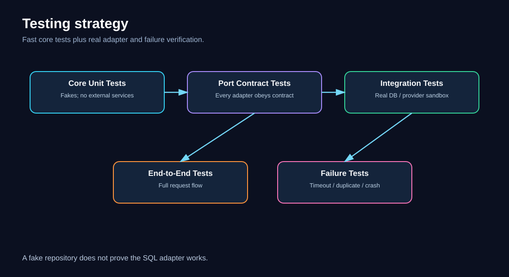
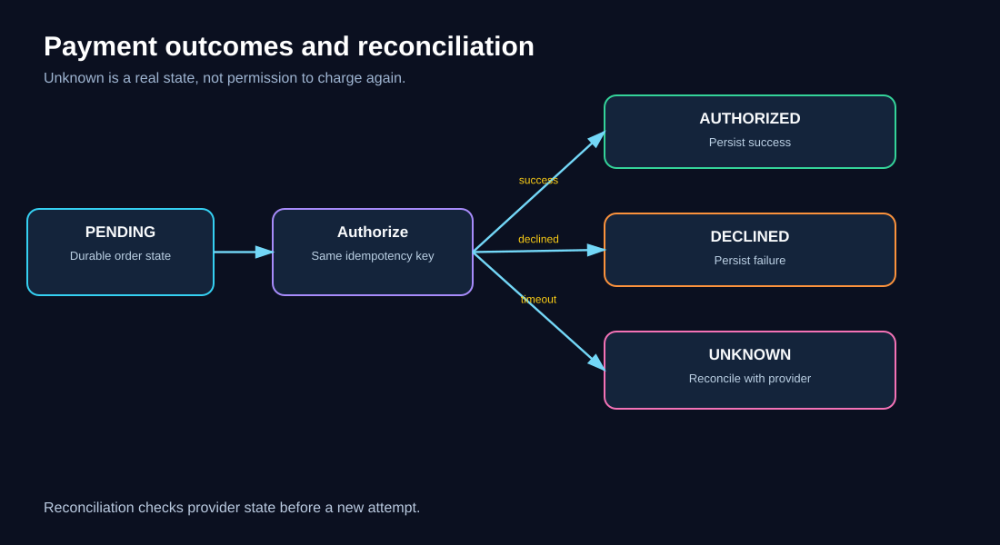
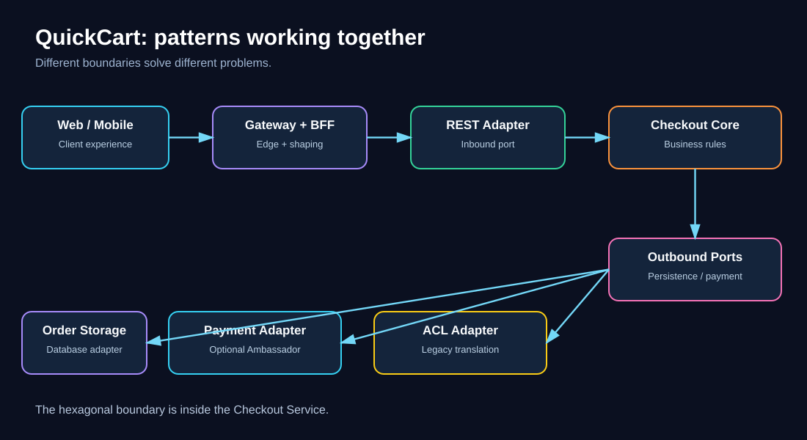

# 08 — Ports and Adapters (Hexagonal Architecture)

> **Software Extensibility Architecture Patterns · QuickCart self-study guide**  
>
> **Prerequisites:** [Foundations](00-foundations.md), [Anti-Corruption Layer](03-anti-corruption-layer.md), and [Plugin Architecture](07-plugin-architecture.md).  
> **Estimated study time:** 90–120 minutes, plus the worked exercises.

## 1. Learning objectives

By the end of this chapter, you should be able to:

1. Identify technology coupling in a service and explain why it makes change expensive.
2. Distinguish the **domain core**, **application use cases**, **inbound ports**, **outbound ports**, and **adapters**.
3. Draw the direction of dependencies and the direction of runtime calls without confusing the two.
4. Implement a small QuickCart checkout use case with injected adapters.
5. Decide when to use a direct integration, a port, an ACL, or a plugin extension point.
6. Test business logic without a live database, network, or web framework.
7. Design a gradual migration with production-grade reliability, security, and observability.
8. Evaluate whether the added abstraction delivers measurable value.

## 2. QuickCart: the problem before the pattern

QuickCart has a Checkout Service written in Python. It started small: a route handler reads a shopping cart, calculates the total, saves an order in PostgreSQL, and calls a payment provider. Over time, it also sends email and publishes events.

The implementation works, but it has acquired hidden architectural costs:

- The checkout calculation imports a particular ORM model.
- Business decisions are intertwined with HTTP status codes and request parsing.
- Payment-provider error codes leak into the checkout use case.
- Tests require a database and mock an HTTP client at a low level.
- Switching payment providers forces changes in code that should only express checkout policy.
- A new CLI or batch checkout workflow would have to duplicate the web handler.

**The core issue is not that PostgreSQL or HTTP is bad. It is that business policy is coupled to these technologies.**



### Diagram walkthrough

Start at the left with the HTTP request. Follow it into the large Checkout Handler. Notice that the handler owns business decisions *and* technology-specific interactions. The bottom row shows its direct dependencies on database, payment, and messaging implementations. A technology change now touches the same code that decides whether an order may be placed.

### A concrete example of undesirable coupling

```python
# Illustrative anti-example — not production code.
@app.post("/checkout")
def checkout(request):
    cart = db.query(CartRow).filter_by(user_id=request.user_id).one()
    total_cents = sum(line.price_cents * line.qty for line in cart.lines)
    if total_cents <= 0:
        return {"error": "BAD_CART"}, 400

    payment = payment_sdk.charge(
        card_token=request.card_token, amount_cents=total_cents
    )
    if payment["provider_code"] != "00":
        return {"error": payment["provider_code"]}, 502

    db.add(OrderRow(user_id=request.user_id, total_cents=total_cents))
    db.commit()
    return {"status": "placed"}, 201
```

This example is intentionally simplified. It also contains a **correctness defect**: payment may succeed while the database commit fails. Ports and Adapters alone does **not** fix that defect; we will address it in the reliability section.

## 3. The central idea: business policy at the center

**Ports and Adapters**—often called **Hexagonal Architecture**—organizes a system so its core application behavior is expressed independently of the mechanisms used to invoke it or communicate with external systems.

- A **port** is an interface or contract that describes an interaction the application supports or requires.
- An **adapter** implements or translates that interaction for a particular technology.
- The **core** contains domain rules and application use cases.
- Dependencies in source code should point toward the core's abstractions, rather than making the core import concrete external technologies.



### Diagram walkthrough

Read the center first: QuickCart Checkout Core. On the left are inbound adapters such as REST, CLI, and tests. They invoke the core through an inbound port. On the right, the core depends on outbound port contracts for orders, payments, and event publication. Concrete adapters implement those contracts using PostgreSQL, a payment API, or a message broker. The drawing is a **logical architecture**, not a requirement for six separate microservices.

## 4. Terminology that must not be mixed up

| Term | Plain-English meaning | QuickCart example |
|---|---|---|
| Domain model | Business concepts and invariants | Order, Money, CartLine |
| Application use case | Coordinates one business operation | PlaceOrder |
| Inbound / driving port | How callers ask the application to act | `place_order(command)` |
| Inbound / driving adapter | Translates a caller's format into the port | REST controller |
| Outbound / driven port | Capability the core needs from outside | `OrderRepository` |
| Outbound / driven adapter | Concrete implementation of that capability | PostgreSQL repository |
| Composition root | Place where implementations are wired together | Startup configuration |
| Dependency inversion | High-level policy depends on abstractions, not concrete low-level mechanisms | Checkout depends on `PaymentPort` |

A port is not necessarily an HTTP endpoint or TCP port. In this pattern, **port means a software contract**.

The term *hexagonal* is a visual metaphor. It does not require exactly six ports or adapters.

## 5. Runtime flow versus source-code dependency direction

This is the most common conceptual trap.

**Runtime call direction:** REST controller → checkout use case → repository/payment implementation.

**Source-code dependency direction:** REST adapter imports the use case contract; concrete repository/payment adapters implement core-defined interfaces; the core does not import PostgreSQL or a payment SDK.



### Diagram walkthrough

The top lane depicts the runtime request from the Web Adapter to the Checkout Core to the PostgreSQL Adapter. The lower lane depicts compile-time or import dependencies. Both outer adapters depend on the core's contracts. This inversion is what allows the core to remain unchanged when an implementation is swapped.

The core may call a `PaymentPort` method at runtime. That does **not** mean its source code must import the Stripe/Adyen/other vendor SDK.

## 6. A practical Python design

The following is deliberately small enough to understand in one sitting. It illustrates the separation of responsibilities; production checkout additionally needs authentication, durable payment state, transactional coordination, and reconciliation.

### 6.1 Define business types and contracts

```python
from dataclasses import dataclass
from typing import Protocol

@dataclass(frozen=True)
class PlaceOrderCommand:
    customer_id: str
    cart_id: str
    idempotency_key: str

@dataclass(frozen=True)
class Cart:
    cart_id: str
    customer_id: str
    total_cents: int

@dataclass(frozen=True)
class OrderReceipt:
    order_id: str
    status: str

class CartReader(Protocol):
    def get_for_customer(self, cart_id: str, customer_id: str) -> Cart: ...

class OrderRepository(Protocol):
    def reserve_order(
        self, customer_id: str, cart: Cart, idempotency_key: str
    ) -> str: ...

class PaymentPort(Protocol):
    def authorize(
        self, order_id: str, amount_cents: int, idempotency_key: str
    ) -> str: ...
```

The core contracts describe **business capabilities**. They do not mention SQL queries, HTTP response objects, or vendor-specific error codes.

### 6.2 Implement the use case

```python
class PlaceOrder:
    def __init__(
        self,
        carts: CartReader,
        orders: OrderRepository,
        payments: PaymentPort,
    ):
        self.carts = carts
        self.orders = orders
        self.payments = payments

    def execute(self, command: PlaceOrderCommand) -> OrderReceipt:
        cart = self.carts.get_for_customer(
            command.cart_id, command.customer_id
        )
        if cart.total_cents <= 0:
            raise ValueError("Cart total must be positive")

        order_id = self.orders.reserve_order(
            command.customer_id, cart, command.idempotency_key
        )
        authorization_id = self.payments.authorize(
            order_id, cart.total_cents, command.idempotency_key
        )
        # Real systems must durably record the authorization outcome
        # and reconcile uncertain outcomes; see Section 11.
        return OrderReceipt(order_id=order_id, status="payment_authorized")
```

Notice what is missing: `psycopg`, SQLAlchemy, `requests`, vendor payment SDKs, and web-framework decorators.

**Important:** `reserve_order` and `authorize` above are conceptual interfaces, not a complete distributed transaction design. Do not deploy this sample as a real payment workflow.

### 6.3 Add concrete adapters

```python
class PostgresOrderRepository:
    def __init__(self, db):
        self.db = db

    def reserve_order(self, customer_id, cart, idempotency_key):
        # Implement durable unique idempotency-key handling here.
        return self.db.reserve_order(customer_id, cart, idempotency_key)

class ProviderPaymentAdapter:
    def __init__(self, client):
        self.client = client

    def authorize(self, order_id, amount_cents, idempotency_key):
        response = self.client.authorize_payment(
            amount_cents=amount_cents,
            reference=order_id,
            idempotency_key=idempotency_key,
        )
        # Map provider-specific responses to domain-level outcomes.
        return response.authorization_id
```

A provider adapter is responsible for converting vendor-specific details into the semantics promised by `PaymentPort`. It should not decide whether QuickCart gives a loyalty discount; that is business policy.

### 6.4 Wire the application at startup

```python
def build_checkout(db, payment_client):
    return PlaceOrder(
        carts=PostgresCartReader(db),
        orders=PostgresOrderRepository(db),
        payments=ProviderPaymentAdapter(payment_client),
    )
```

This is the **composition root**. The concrete classes can be changed without rewriting `PlaceOrder`. In larger systems, a dependency injection framework may assist, but it is not mandatory.

## 7. Inbound adapters: multiple ways to invoke the same use case

A REST controller can validate JSON, authenticate the caller, build a `PlaceOrderCommand`, invoke `PlaceOrder.execute`, and map the result to HTTP. A command-line adapter can invoke the same use case from a support tool. A message-consumer adapter can invoke it from a command event if the business workflow permits.



### Diagram walkthrough

The three entry points at the left converge on one use case. The business rule is implemented once, not once per channel. Each adapter handles its channel's transport-specific concerns. For instance, a REST adapter maps `InvalidCart` to a 4xx response, whereas a queue consumer may record a rejected message.

**Boundary warning:** An adapter must not trust `customer_id` from an unverified request body. It should derive identity from authenticated context and check that the caller may access the cart.

## 8. Outbound adapters: replace technologies, preserve intent

Imagine QuickCart migrates from PostgreSQL to another persistence platform. If the core only depends on `OrderRepository`, the new adapter can satisfy the same contract.

Similarly, QuickCart might introduce a backup payment provider. Both adapters can implement `PaymentPort`, while selection policy is configured in the composition root or a dedicated routing component.



### Diagram walkthrough

The outbound ports sit directly next to the core. Each port connects to one or more possible adapters. The dotted alternative adapters indicate **replaceability**, not automatic runtime failover. Switching providers safely requires data migration, compatibility tests, operational controls, and often business approval.

**Important limitation:** Swapping a database is rarely trivial. Transaction semantics, consistency guarantees, query capabilities, and schema design can leak through a poorly chosen port. The goal is to contain coupling, not pretend different technologies are identical.

## 9. How Ports and Adapters relates to other patterns

| Pattern | Main question | Relationship to Ports and Adapters |
|---|---|---|
| Plugin Architecture | How do we load optional or third-party capabilities? | Plugins may implement outbound ports, but require lifecycle/version/security rules |
| Anti-Corruption Layer | How do we protect a modern domain from legacy semantics? | An ACL can be an outbound adapter or a deeper translation layer |
| Ambassador | Who handles outbound transport concerns? | A network proxy can sit behind an adapter; it does not define domain contracts |
| API Gateway | Who controls incoming traffic at the edge? | Gateway routes traffic; inbound adapter translates a specific API call |
| BFF | How do we tailor responses for client experiences? | BFF can be a caller of an inbound port, or have its own hexagonal design |
| Strangler Fig | How do we replace a system incrementally? | New capabilities can be built behind ports while routing migrates |
| Clean Architecture | How should dependencies point inward? | Shares the principle of policy independence; layering conventions differ |
| Dependency Injection | How do we provide implementations? | A mechanism that helps wire adapters to ports, not the architecture itself |

### Ports and Adapters versus ACL

A `LegacyCustomerAdapter` may implement a modern `CustomerReader` port. If the old system has complicated semantics—such as account status codes that represent several business states—the adapter may contain an explicit ACL translation module. **The adapter is the integration mechanism; the ACL is the protection of domain meaning.**

### Ports and Adapters versus Plugin Architecture

A port is a stable capability contract. A plugin architecture adds a system for discovering, loading, enabling, versioning, and possibly sandboxing interchangeable implementations. Not every adapter needs to be a dynamically loaded plugin.

## 10. Testing: where the pattern pays off quickly

The easiest test to write is often a unit test of the use case with in-memory fakes:

```python
class FakeCarts:
    def get_for_customer(self, cart_id, customer_id):
        return Cart(cart_id, customer_id, 2500)

class FakeOrders:
    def reserve_order(self, customer_id, cart, idempotency_key):
        return "ord-123"

class FakePayments:
    def __init__(self):
        self.calls = []

    def authorize(self, order_id, amount_cents, idempotency_key):
        self.calls.append((order_id, amount_cents, idempotency_key))
        return "auth-456"

def test_checkout_authorizes_correct_amount():
    payments = FakePayments()
    use_case = PlaceOrder(FakeCarts(), FakeOrders(), payments)
    receipt = use_case.execute(
        PlaceOrderCommand("cust-1", "cart-1", "key-1")
    )
    assert receipt.status == "payment_authorized"
    assert payments.calls == [("ord-123", 2500, "key-1")]
```

This test checks the business interaction without a running PostgreSQL instance or payment sandbox.

But **fakes are not enough**. A production test portfolio should include:

1. **Domain unit tests:** pricing invariants, cart validation, authorization policies.
2. **Port contract tests:** every adapter meets the same behavioral contract.
3. **Adapter integration tests:** real SQL schema, real HTTP serialization, vendor sandbox.
4. **End-to-end tests:** request through API, database, payment integration, and observability.
5. **Failure tests:** timeouts, partial writes, duplicate requests, uncertain payment outcomes.



### Diagram walkthrough

The base represents fast core tests, the middle represents contract and adapter integration tests, and the top represents fewer full-system tests. The separate failure-test arrow highlights a frequent gap: an implementation may pass happy-path tests while failing under partial network or database failure.

## 11. Reliability: architecture boundaries do not create transactions

A key QuickCart failure scenario:

1. An order reservation is written.
2. The payment provider authorizes the charge.
3. QuickCart crashes before recording the authorization result.
4. A retry arrives and might authorize the charge again.

A clean `PaymentPort` does not eliminate this risk. The **application workflow** must explicitly handle it.

A safer production design generally includes:

- A durable order state machine such as `PENDING_PAYMENT`, `AUTHORIZED`, `FAILED`, `UNKNOWN`.
- A unique idempotency key persisted with the order and forwarded to the provider where supported.
- Bounded timeouts and carefully chosen retry policies.
- A reconciliation job for ambiguous outcomes.
- A transactional outbox for publishing events consistently with local database updates.
- Compensation or refund procedures when a multi-step operation cannot be completed atomically.



### Diagram walkthrough

The diagram shows an order in `PENDING_PAYMENT`, a provider authorization attempt, and three possible outcomes. The uncertain branch leads to reconciliation rather than blindly retrying a non-idempotent operation. The domain use case owns the workflow decision; the payment adapter translates provider responses and supports safe status queries.

### Timeouts and retry budgets

Assume an end-to-end checkout response budget of **1,500 ms** (illustrative, not a recommended universal SLO):

| Stage | Budget |
|---|---:|
| Inbound parsing/authentication | 100 ms |
| Cart and order storage | 250 ms |
| Payment authorization | 900 ms |
| Response processing + reserve | 250 ms |
| **Total** | **1,500 ms** |

If a payment attempt consumes 900 ms, a second full attempt cannot fit inside this synchronous budget. The system should not simply stack retries because the adapter abstraction makes them convenient. Instead, return an appropriate pending/unknown outcome and reconcile when needed.

## 12. Security and trust boundaries

Hexagonal Architecture is a **code organization pattern**, not a security perimeter. The following controls still matter:

- Validate tokens and derive user identity at the inbound edge; authorize access within application/domain policy.
- Validate and normalize all inbound data before creating trusted commands.
- Keep payment credentials in secret management, not in core entities or source files.
- Use least-privilege database credentials and outbound network allowlists.
- Sanitize external error messages before presenting them to customers.
- Avoid logging tokens, card details, or other sensitive information.
- Treat third-party adapters as supply-chain dependencies: pin versions, scan packages, and test upgrades.
- Enforce tenant isolation in repositories, not only in HTTP controllers.

**Architecture review question:** Can a batch adapter bypass a security check that the REST adapter performs? If yes, move the essential authorization rule into the shared application/domain boundary.

## 13. Observability and operational ownership

Instrument at both boundaries:

**Inbound adapter metrics:** request count, authentication failures, payload-validation failures, response status, p50/p95/p99 latency.

**Use-case metrics:** checkout attempts, accepted/rejected commands, payment-pending duration, domain validation failures, orders stuck in uncertain states.

**Outbound adapter metrics:** provider latency, timeouts, retry count, connection failures, contract-mapping errors, circuit-breaker status.

**Cross-cutting telemetry:** a correlation or trace ID should propagate from the inbound adapter through the use case and outbound calls. The adapter should add relevant spans without embedding a vendor-specific tracing SDK into the core.

Example service-level objectives (illustrative):

- 99.9% of eligible checkout requests accepted for processing in a rolling 30-day period.
- 99% of synchronous responses under the agreed latency target.
- 99.99% of payment attempts eventually resolved to a known state within a defined reconciliation window.

A high availability percentage is not evidence that payments are correct. Track **financial reconciliation and duplicate-charge incidents** separately.

## 14. Capacity and cost: a worked QuickCart example

Assume QuickCart processes **120 checkout requests/second** at peak. The use case spends an average of **15 ms** of CPU per request, excluding waiting on databases or payment APIs.

Compute required CPU cores for core processing:

\[
120\ \text{requests/s}\times 0.015\ \text{CPU-s/request}=1.8\ \text{cores}
\]

At a target **60% CPU utilization**:

\[
1.8 / 0.60 = 3.0\ \text{cores}
\]

This is a simplified lower bound for the modeled CPU work, not a full production sizing result. Add room for adapters, serialization, background work, variance, and resilience.

**Important:** Ports and Adapters does not automatically reduce CPU usage or latency. An in-process interface call is usually cheap, but extra remote services are not required by the pattern and may add substantial overhead.

### Illustrative ROI calculation

Suppose QuickCart makes six integration-related changes each quarter. Before refactoring, each change requires 24 engineer-hours of coordinated work; afterward, 14 hours. Assume a fully loaded engineering cost of $80/hour.

- Quarterly time saved: \(6 \times (24-14)=60\) hours.
- Quarterly labor value: \(60\times \$80=\$4,800\).
- Annualized labor value: \(\$19,200\).
- One-time refactoring investment: 180 hours × $80 = **$14,400**.
- Illustrative first-year net labor value: **$4,800**, before ongoing maintenance, regression risk, or any additional benefits.

These numbers are **assumptions**, not claims about a real company. Measure actual lead time, defect rates, test setup time, and integration change effort before claiming ROI.

## 15. When *not* to use this pattern

Avoid turning every method call into an interface. The abstraction is useful when it protects a meaningful boundary or supports testing and replacement.

Consider a simpler design when:

- A small, stable application has no credible alternative adapters.
- The team creates generic repositories that obscure useful database semantics.
- The interface merely mirrors every method of a vendor SDK.
- The team spends more time maintaining abstractions than shipping changes.
- A tiny helper is misrepresented as an architectural port.

A useful heuristic: **create ports around capabilities that the application needs, not around every library class it happens to use**.

## 16. Migration roadmap: from tightly coupled checkout to ports

| Phase | Change | Acceptance evidence |
|---|---|---|
| 1. Baseline | Measure change lead time, tests, failure rate | Baseline dashboard and architecture map |
| 2. Extract use case | Move checkout policy out of HTTP handler | Unit tests pass without HTTP server |
| 3. Introduce one port | Wrap payment provider with `PaymentPort` | Contract tests cover payment outcomes |
| 4. Introduce persistence ports | Separate order/cart operations | Repository integration tests |
| 5. Add composition root | Wire adapters at startup | Same use case runs with fakes and production adapters |
| 6. Harden workflow | Idempotency, durable states, reconciliation | Fault-injection tests and runbooks |
| 7. Roll out safely | Canary by internal cohort or small traffic share | SLO and business correctness gates |
| 8. Review abstraction | Remove unnecessary indirection | Reduced maintenance effort |

**Do not refactor and replace every external dependency at once.** Preserve the existing runtime behavior first, then migrate one boundary at a time.

## 17. Architecture decision record (ADR) example

**Decision:** Introduce `PaymentPort` and `OrderRepository` contracts inside the Checkout application layer.

**Context:** Provider changes and checkout tests currently require modifications to HTTP handler code.

**Alternatives:** Keep direct SDK calls; use a helper library; introduce ports and adapters; create a remote integration microservice.

**Chosen option:** In-process ports and adapters, with explicit payment reconciliation workflow.

**Consequences:** Additional interfaces and contract tests; less direct vendor coupling; easier use-case testing; no automatic improvement to provider reliability.

**Review trigger:** Revisit after two provider changes or 90 days, whichever occurs first, using actual change lead time and incident data.

## 18. Diagram-based synthesis: where this fits in QuickCart



### Diagram walkthrough

Start at the Web/Mobile BFFs and API Gateway, which handle client-facing concerns. The REST adapter receives checkout requests and invokes the Checkout Core. The core owns business policy and calls ports. One adapter persists orders, another integrates with a payment provider, and an ACL-backed adapter reads the legacy customer system. An Ambassador may handle outbound TLS and telemetry behind the payment adapter. These patterns **coexist because they protect different boundaries**.

Notice that Ports and Adapters is an **internal service architecture**, whereas API Gateway, BFF, and Ambassador often describe boundaries between processes or network components.

## 19. Common mistakes and corrections

| Mistake | Correction |
|---|---|
| “Hexagonal means six layers.” | The hexagon is illustrative; the number of ports is arbitrary. |
| “Every adapter must be a microservice.” | Most adapters are in-process modules. |
| “A port is a REST endpoint.” | A port is an application contract; REST is one possible adapter. |
| “The core can import SQLAlchemy because the repository is an interface.” | Keep concrete persistence dependencies outside the core. |
| “Dependency inversion reverses runtime calls.” | It changes source-code dependencies, not necessarily call direction. |
| “A fake repository proves PostgreSQL works.” | You still need real adapter integration tests. |
| “Swapping providers is free.” | Semantic differences, migration, testing, and operations still cost money. |
| “A payment adapter guarantees exactly-once charging.” | Use idempotency, durable workflow states, and reconciliation. |
| “A BFF is the same as an inbound adapter.” | A BFF is a client-tailored backend; an inbound adapter translates a specific invocation mechanism. |
| “Every dependency deserves a port.” | Abstract stable capabilities at meaningful boundaries. |

## 20. Knowledge checks

Try to answer before expanding the explanation.

<details>
<summary><strong>Q1. What does the word “port” mean here?</strong></summary>

A port is an interface or contract describing how the application can be invoked or what capability it requires. It is not necessarily a network port.
</details>

<details>
<summary><strong>Q2. Which component should know the payment provider's error code `P-409`?</strong></summary>

The payment adapter (or ACL-style translation layer) should interpret the provider code and return a meaningful application-level result. The domain should not depend on that vendor code.
</details>

<details>
<summary><strong>Q3. The REST adapter calls `PlaceOrder.execute`. Does that violate dependency inversion?</strong></summary>

No. Runtime calls flow inward. Source-code dependencies should point toward the core's abstractions.
</details>

<details>
<summary><strong>Q4. Is an in-memory fake enough to verify a repository adapter?</strong></summary>

No. Fakes validate core behavior. The concrete repository needs integration and contract tests against its real persistence technology.
</details>

<details>
<summary><strong>Q5. Why not define `execute_sql(query)` as the order repository port?</strong></summary>

That exposes database mechanics to the core. A capability-oriented port such as `reserve_order` better protects business policy.
</details>

<details>
<summary><strong>Q6. Can the ACL from Chapter 03 be implemented as an adapter?</strong></summary>

Yes. An outbound adapter can translate modern domain concepts to a legacy API, often using a dedicated ACL mapping module.
</details>

<details>
<summary><strong>Q7. Does Ports and Adapters require a dependency injection framework?</strong></summary>

No. Manual construction in a composition root is sufficient for many services.
</details>

<details>
<summary><strong>Q8. A payment provider times out after possibly charging the card. Should the adapter retry automatically?</strong></summary>

Not blindly. Preserve the idempotency key, represent an uncertain outcome, and query or reconcile provider state according to the provider contract.
</details>

<details>
<summary><strong>Q9. What is the main benefit of adding a CLI inbound adapter?</strong></summary>

The CLI can reuse the same application use case without duplicating checkout policy or depending on the HTTP framework.
</details>

<details>
<summary><strong>Q10. Which metrics demonstrate extensibility benefits?</strong></summary>

Examples include integration change lead time, test setup duration, regression defects, time to support a new provider, and maintenance effort.
</details>

<details>
<summary><strong>Q11. What should remain inside QuickCart's core: tax policy or SQL connection pooling?</strong></summary>

Tax policy belongs in domain/application logic. SQL connection pooling belongs in the persistence adapter/infrastructure.
</details>

<details>
<summary><strong>Q12. Is a separate network service required for an adapter?</strong></summary>

No. Most adapters are ordinary in-process classes or modules. A remote service is an independent deployment decision.
</details>

## 21. Worked architecture challenge: add a second payment provider

**Scenario:** QuickCart uses Provider A. It must add Provider B for selected regions, keep a single checkout business workflow, and ensure retries do not duplicate charges.

**Constraints:** 120 peak checkout requests/s; a 1.5-second synchronous response budget; provider errors differ; region selection must be auditable.

<details>
<summary><strong>Reveal a worked solution</strong></summary>

**Step 1 — Preserve one use case.** Keep `PlaceOrder` responsible for validating the cart, creating the order attempt, and coordinating payment state.

**Step 2 — Define semantic port operations.** Prefer `authorize`, `lookup_authorization`, and (if supported) `void_authorization`, with domain-level outcomes such as authorized, declined, and unknown. Do not expose vendor status strings.

**Step 3 — Implement two adapters.** `ProviderAPaymentAdapter` and `ProviderBPaymentAdapter` each translate provider protocols and errors. Both must pass the same port contract suite.

**Step 4 — Select an adapter intentionally.** A configuration-driven `PaymentRouter` chooses a provider based on approved region and merchant-account policy. Log the chosen provider and policy version. Do not retry an uncertain payment on the *other* provider without explicit business safeguards.

**Step 5 — Persist state.** Create an order attempt with a unique idempotency key. Record pending/authorized/declined/unknown outcomes. Reconcile uncertain outcomes before a new charge attempt.

**Step 6 — Budget latency.** Reserve enough of the 1,500 ms for authentication, database work, and response handling. Avoid retries that exceed the remaining budget.

**Step 7 — Observe and roll out.** Canary Provider B to an internal cohort, then small eligible traffic. Monitor authorization success by provider and region, unknown-state age, duplicate-charge incidents, p95 latency, and provider error mapping.

**Step 8 — Roll back safely.** Disable new routing to Provider B while retaining its reconciliation and refund capabilities for in-flight transactions.

**Why this works:** The checkout core uses a stable business contract; each adapter contains provider-specific behavior; the routing decision is explicit; correctness is handled by a durable workflow rather than assumed from the interface.
</details>

## 22. Worked numerical exercises

<details>
<summary><strong>Exercise A — CPU sizing</strong></summary>

At 120 requests/s and 15 ms CPU/request, CPU demand is \(120 \times 0.015=1.8\) cores. At 60% target utilization, the simplified required capacity is \(1.8/0.6=3.0\) cores. This excludes adapter CPU, overhead, and redundancy.
</details>

<details>
<summary><strong>Exercise B — Portability effort</strong></summary>

A payment provider migration previously required 100 engineering hours. With a stable port and good tests, suppose it takes 65 hours. Savings are 35 hours, or 35%. This is an illustrative assumption; a provider's different semantics can still require core changes.
</details>

<details>
<summary><strong>Exercise C — Reconciliation backlog</strong></summary>

Suppose 0.2% of 120 payment attempts/s enter `UNKNOWN` during a five-minute provider incident. Expected unknown attempts are \(120 \times 300 \times 0.002 = 72\). A reconciler handling 6 checks/s could clear 72 checks in a minimum of 12 seconds if the provider is healthy, all checks are immediately eligible, and there are no new arrivals or rate limits. Real reconciliation may take longer due to provider consistency windows.
</details>

## 23. Quick revision card

**Problem:** Business logic is entangled with technology-specific code.

**Solution:** Put use cases and domain policy at the center. Define capability-oriented ports. Implement adapters at the edges. Wire them at startup.

**Primary benefit:** Easier testing and controlled replacement of external integrations.

**Main cost:** More abstractions, contract tests, and design discipline.

**Do not confuse:** Runtime call flow with source-code dependency direction.

**Do not assume:** The pattern solves distributed transactions, payment idempotency, or vendor semantic differences automatically.

## 24. Self-assessment checklist

- [ ] I can explain why a database-specific import in the checkout core is problematic.
- [ ] I can identify an inbound port, outbound port, and two adapters in QuickCart.
- [ ] I can draw runtime calls and code dependencies as separate arrows.
- [ ] I can write a core unit test using fakes.
- [ ] I know why concrete adapters still need integration tests.
- [ ] I can distinguish an ACL from a generic adapter.
- [ ] I can describe payment uncertainty and a safe reconciliation path.
- [ ] I can justify when **not** to add an interface.
- [ ] I can define an operational metric and a business outcome for the refactor.

## 25. Further reading and next steps

- Revisit [Chapter 03 — Anti-Corruption Layer](03-anti-corruption-layer.md) for semantic translation.
- Revisit [Chapter 04 — Backends for Frontends](04-backends-for-frontends.md) for client-specific API behavior.
- Revisit [Chapter 07 — Plugin Architecture](07-plugin-architecture.md) for runtime extension contracts.
- Continue to **Chapter 09 — Feature Flags**, where QuickCart will separate feature rollout decisions from deployments.


