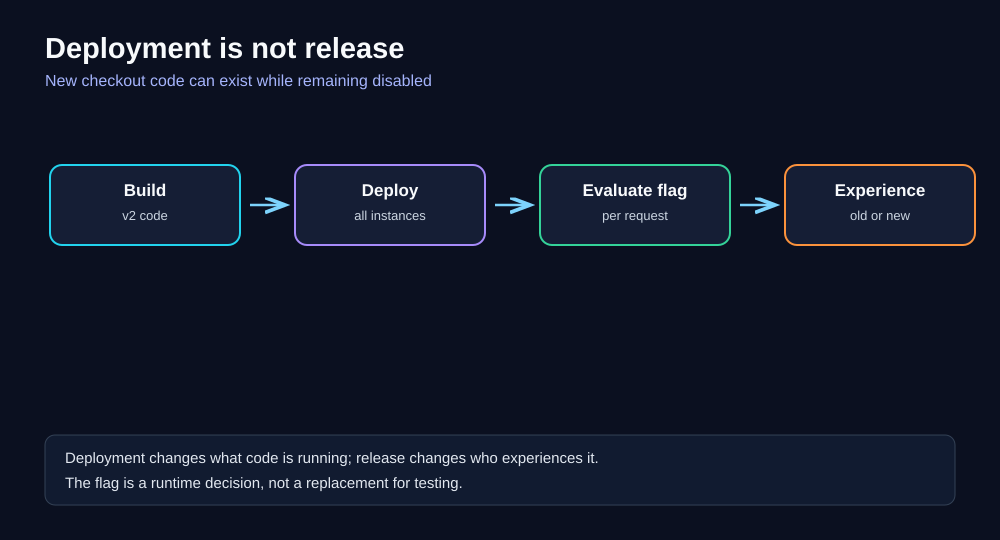
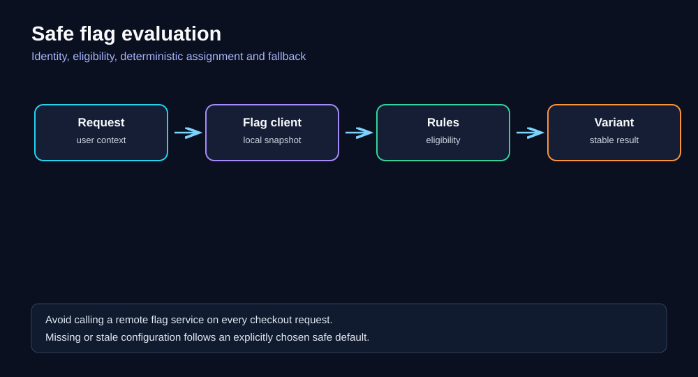
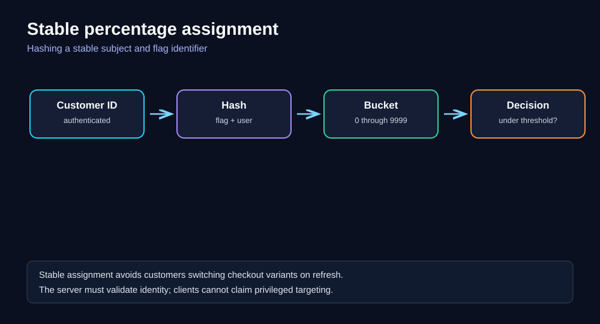
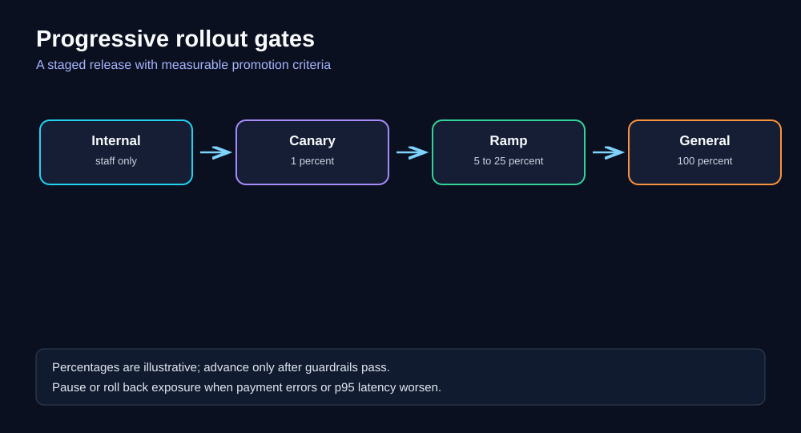
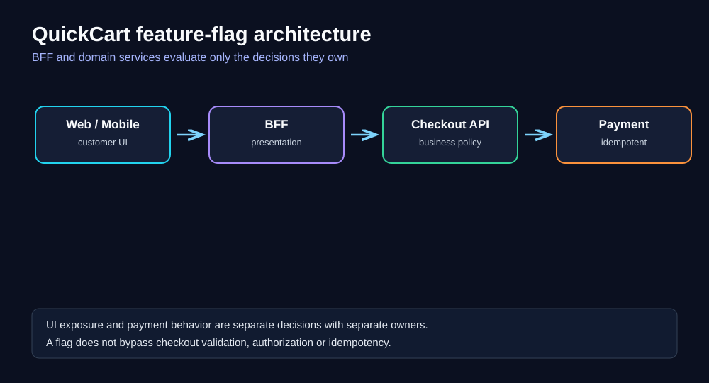
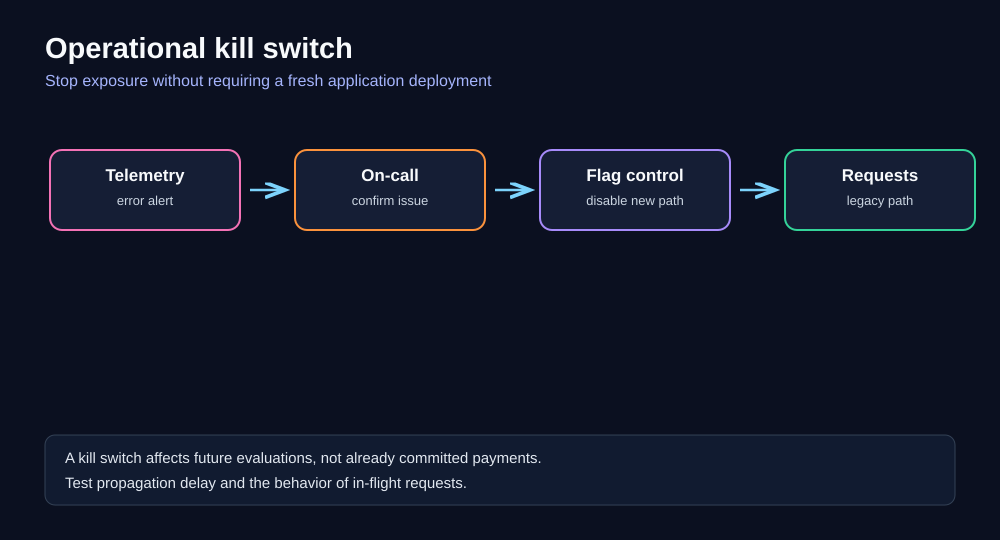
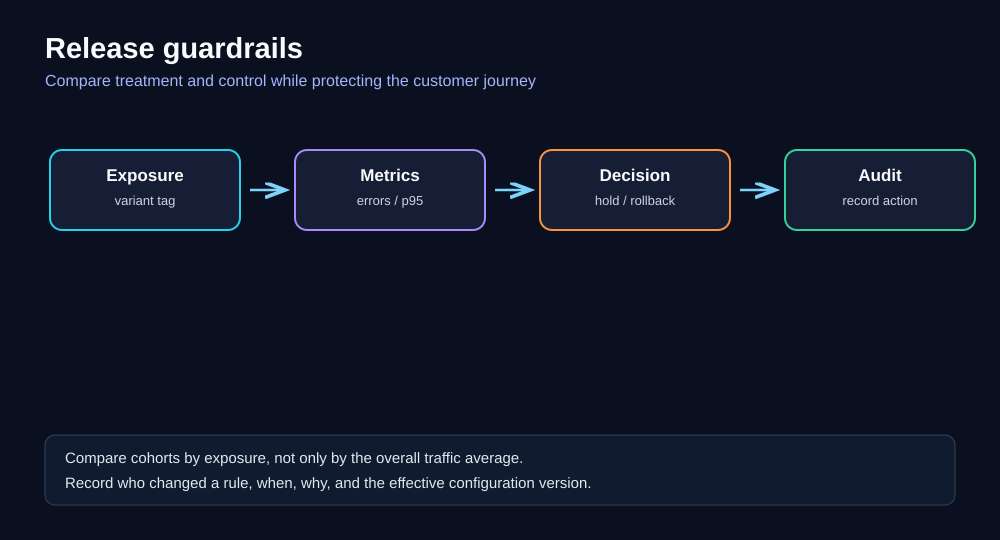
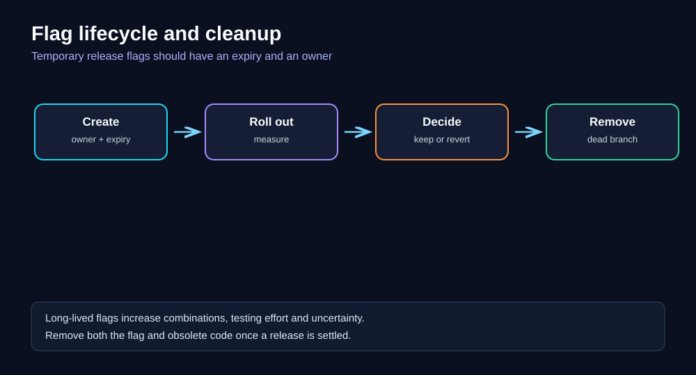

# Chapter 09 — Feature Flags and Progressive Delivery

> **Software Extensibility Architecture Patterns · QuickCart self-study series**  
> **Prerequisites:** [Foundations](00-foundations.md), [Backends for Frontends](04-backends-for-frontends.md), [API Gateway](06-api-gateway.md), [Ports and Adapters](08-ports-and-adapters.md)  
> **Suggested study time:** 90–120 minutes, plus the design exercises.

## Learning objectives

After this chapter you should be able to:

1. Distinguish **deployment**, **release**, **rollout**, **experiment**, and **operational control**.
2. Explain why feature flags are an extensibility mechanism rather than a substitute for sound modular design.
3. Design stable, secure flag evaluation for QuickCart's web and mobile clients.
4. Choose safe defaults, rollout guardrails, and a reliable kill-switch mechanism.
5. Explain how canary deployments, feature flags, and A/B experiments complement rather than replace one another.
6. Calculate exposure, estimate configuration staleness, and assess operating costs.
7. Design monitoring, auditability, ownership, and eventual flag removal.
8. Recognize cases where **not** using a feature flag is the better decision.

---

## 1. The QuickCart problem: releasing a new checkout is risky

QuickCart operates a Web BFF, Mobile BFF, Checkout API, Pricing Service, Inventory Service, and Payment Service. The product team wants to introduce **Checkout v2**: a streamlined address and payment flow. The new code passes automated tests, but the team is uncertain how it will behave under real customer traffic.

Without an independent release control, deployment and customer exposure are coupled: once the new checkout is deployed, everyone may see it. A fault affecting 1% of requests can quickly become a fault affecting 100% of orders.

A full rollback is sometimes slow or undesirable. The same release may contain an urgent security fix and the new checkout implementation. Rolling back the entire binary would also undo the security fix.

A feature flag separates the two decisions:

- **Deploy:** make the implementation available in production.
- **Release:** choose which customers or requests are allowed to use it.

This distinction does **not** make an unsafe implementation safe. Both paths must be tested; the flag gives operators an additional control over exposure.



### Diagram walkthrough

Read left to right. QuickCart builds a binary containing both the existing checkout and the new implementation, deploys it to the fleet, and evaluates a release rule when an eligible request arrives. A customer may still receive the old experience even though the new code is present on the server.

**Key takeaway:** deployment is a software-distribution event; release is an experience-selection decision.

### Before / after

| Before | After |
|---|---|
| New deployment automatically exposes new checkout | New code can remain disabled |
| Rollback requires another deployment | Exposure can be disabled through controlled configuration |
| Difficult to restrict initial blast radius | Start with internal users or a small cohort |
| Few direct comparisons between versions | Measure results by exposure variant |
| One binary version assumed to imply one experience | The same binary can serve different variants |

**Architectural caution:** the "after" state has *more runtime states*. It needs explicit ownership and disciplined cleanup.

## 2. The core pattern

A **feature flag** (feature toggle) is a controlled decision point that selects behavior based on a configuration value and, optionally, trusted request context.

Conceptually:

```python
if flags.enabled("checkout_v2", context):
    return checkout_v2.handle(request)
return checkout_v1.handle(request)
```

That is the simplest form. Production-grade design adds eligibility rules, stable assignments, telemetry, fallback behavior, and governance.

### Four distinct kinds of flags

| Kind | Purpose | Typical lifespan | QuickCart example |
|---|---|---|---|
| Release flag | Introduce unfinished or newly completed functionality gradually | Days to weeks | `checkout_v2` |
| Experiment flag | Compare measurable alternatives using controlled assignment | Duration of experiment | `checkout_layout_experiment` |
| Operational / kill switch | Disable risky or optional behavior rapidly | Potentially long-lived | `recommendations_enabled` |
| Entitlement / permission flag | Decide which customer plan or contract permits a capability | Long-lived | `bulk_ordering_enabled` |

These categories differ in correctness requirements. An entitlement flag must not become a client-controlled authorization bypass. A release flag should normally be removed after the decision is complete. An experiment needs statistically sound assignment and analysis.

**Terminology:** "feature flag" describes the conditional mechanism. "Progressive delivery" describes the broader practice of gradually exposing changes with feedback and control.

## 3. What a flag does not do

A flag does not automatically:

- validate the new implementation;
- roll back database schema changes;
- reverse an already completed payment;
- guarantee consistent behavior across all regions;
- provide secure authorization;
- produce an unbiased A/B experiment;
- eliminate the need for application deployment;
- justify indefinite branching in the code.

A strong design begins by defining what *must remain true* even if the flag system fails.

For QuickCart, core invariants include: the customer cannot pay a negative amount, inventory cannot be reserved for an unauthorized cart, and the same order must not be charged twice. These checks belong in the domain services and remain enforced for **both** variants.

## 4. Request context and evaluation

A decision may use:

- a flag identifier and rule version;
- authenticated customer ID or stable anonymous visitor ID;
- account entitlement or tenant;
- country or region, if relevant and reliable;
- application version;
- a deterministic rollout bucket.

Avoid using sensitive attributes unnecessarily. Avoid making security-critical decisions from untrusted client-supplied values.



### Diagram walkthrough

The request supplies trusted context to a local flag client. The client uses a cached, versioned configuration snapshot to apply targeting rules and return a variant. A local evaluation generally avoids a network call to the flag provider on every checkout request.

**Why local evaluation?** If each checkout request synchronously calls a remote configuration service, the new dependency can add latency and create a failure mode on the critical checkout path.

### Example: server-side evaluation

```python
from dataclasses import dataclass
from typing import Literal

Variant = Literal["old", "new"]

@dataclass(frozen=True)
class CheckoutContext:
    customer_id: str
    country: str
    app_version: str

def select_checkout(ctx: CheckoutContext, flags) -> Variant:
    # The customer ID must come from verified authentication context.
    if not flags.is_healthy():
        return "old"  # Documented safe fallback for this release flag.

    return (
        "new"
        if flags.enabled("checkout_v2", subject=ctx.customer_id,
                         attributes={"country": ctx.country,
                                     "app_version": ctx.app_version})
        else "old"
    )
```

This is conceptual pseudocode: actual SDK APIs differ. The safe fallback is a **product-specific policy**, not a universal rule. For example, an emergency *disable* flag for a dangerous payment integration might require fail-closed behavior when configuration is unavailable.

## 5. Stable percentage rollouts

A naive implementation such as `random() < 0.05` on every request is usually wrong for user-facing experiences. The same customer may bounce between old and new checkout screens, producing inconsistent state and confusing measurements.

Instead, use a deterministic assignment derived from a stable subject and the flag identifier:

```python
import hashlib

def bucket(flag_key: str, subject_id: str) -> int:
    raw = f"{flag_key}:{subject_id}".encode("utf-8")
    digest = hashlib.sha256(raw).digest()
    return int.from_bytes(digest[:8], "big") % 10_000

def enabled_for_percent(flag_key: str, subject_id: str, percent: float) -> bool:
    assert 0 <= percent <= 100
    return bucket(flag_key, subject_id) < round(percent * 100)
```

At 5%, the threshold is 500 out of 10,000 buckets. **Expected** exposure is approximately 5% across a sufficiently large and varied population; an individual small cohort can differ.



### Diagram walkthrough

A verified customer identity and flag key produce a stable hash bucket. Comparing that bucket with a configured threshold yields the same assignment on repeated requests, assuming the algorithm and identifiers remain unchanged.

### Subtleties that matter

1. **Anonymous to authenticated transition:** a visitor may change buckets after signing in. Decide whether to preserve the initial assignment in a server-validated session or accept a transition.
2. **Cross-service consistency:** BFF and Checkout API must not independently interpret incompatible rules. Prefer one authoritative decision, or share an explicitly versioned assignment contract.
3. **Hash changes:** changing the bucketing algorithm can reshuffle cohorts. Treat the algorithm as a compatibility-sensitive contract.
4. **Percent increase:** threshold-based stable bucketing generally retains earlier included users as the percentage grows, provided targeting conditions do not change.
5. **Security:** deterministic hashing is for consistent assignment, not for authentication or secret storage.

## 6. Designing a progressive rollout

A possible QuickCart sequence:

| Stage | Exposure | Gate before progressing |
|---|---:|---|
| Internal | Staff/test accounts | End-to-end tests and support readiness |
| Canary | 1% | No payment correctness regressions; stable p95 |
| Early ramp | 5% | Error rate and conversion guardrails hold |
| Broader ramp | 25% | Regional/device cohorts show no major regression |
| Full rollout | 100% | Owner signs off; monitoring remains active |
| Cleanup | No flag | Old branch removed after confidence window |

Percentages are **illustrative**, not recommended universal thresholds. The correct ramp depends on traffic, risk, sample size, customer impact, and reversibility.



### Diagram walkthrough

Each stage increases exposure only after objective gates pass. A failed gate means **hold**, investigate, or reduce exposure—not automatically proceed because the clock has advanced.

### What to measure

For Checkout v2, define metrics *before* the release:

- checkout attempt success rate;
- payment authorization error rate;
- duplicate-charge incidents (**zero tolerance**);
- p95/p99 checkout latency;
- inventory reservation failures;
- cart abandonment and completed-order conversion;
- support contacts per 1,000 exposed customers.

Compare the treatment group with a suitable control. Overall system averages can conceal a failure affecting a small canary cohort.

## 7. Feature flags versus canary deployments

They are related but different.

| Dimension | Feature flag | Canary deployment |
|---|---|---|
| Unit of control | Behavior inside running code | Traffic directed to software version or deployment |
| Can one binary serve both variants? | Yes | Not necessarily |
| Useful for | User cohorts, entitlements, feature exposure | Infrastructure/runtime changes, binary validation |
| Main rollback | Change evaluation rule | Shift traffic back to prior deployment |
| Database compatibility | Still required | Still required |
| Key risk | Branching and inconsistent flag evaluation | Routing, version skew, rollout orchestration |

QuickCart may **combine** them: first deploy a new Checkout API binary to 5% of pods, verify that the binary is healthy, then enable the new checkout behavior for 1% of eligible customers. These percentages refer to different populations and should not be conflated.

### Blue/green and dark launches

- **Blue/green deployment:** two environments or versions, with traffic switched between them.
- **Dark launch:** deploy and sometimes exercise a new path without exposing its user-visible outcome. Shadow requests must avoid duplicate writes or charges.
- **Feature flag:** select runtime behavior.
- **A/B experiment:** randomized comparison designed to estimate an outcome, with attention to sample size, assignment, interference, and statistical analysis.

These are tools in a delivery strategy, not interchangeable synonyms.

## 8. The QuickCart architecture



### Diagram walkthrough

The Web and Mobile clients talk to their BFFs. A BFF may decide which presentation model to return. The Checkout API independently enforces payment and order correctness. The Payment Service remains idempotent regardless of which UI is shown.

### Ownership boundaries

**BFF-owned flag:** `checkout_new_layout` — changes UI response composition and optional fields.

**Checkout-domain-owned flag:** `checkout_v2_flow` — changes a workflow implementation, with equivalent invariants.

**Operations-owned kill switch:** `optional_fraud_enrichment_enabled` — disables a nonessential enrichment call when the vendor is unavailable, subject to documented risk policy.

Do not let the Web BFF use a client-provided `X-New-Checkout: true` header to bypass backend validation. A client may request an experience, but the server decides what is permitted.

### Flag evaluation placement

- **Frontend:** appropriate for cosmetic UI changes; never a trusted authorization boundary.
- **BFF:** useful for presentation and client-specific orchestration.
- **Domain service:** appropriate for business workflow selection, where invariants are enforced.
- **Edge/gateway:** appropriate for certain routing or traffic policies, not for duplicating domain rules.

Prefer the **closest responsible owner** rather than scattering the same conditional across every layer.

## 9. Kill switches: operational control, not magical rollback

Suppose a new optional shipping-estimate provider starts timing out. QuickCart needs to disable the integration quickly without redeploying the Checkout API.



### Diagram walkthrough

Monitoring detects elevated timeout errors. An authorized on-call engineer confirms the issue and disables the optional path. New requests use a safe fallback. The change and its rationale are recorded in an audit log.

### Kill-switch design questions

1. **What exactly stops?** Future evaluations, new outbound calls, or a background job?
2. **What is the propagation delay?** A 60-second refresh interval means some replicas can continue using old configuration.
3. **What about in-flight work?** A flag cannot cancel a payment already accepted by the provider.
4. **What is the fallback?** Return a degraded estimate, queue work, or reject the operation?
5. **Who may change it?** Define permissions, break-glass access, and audit records.
6. **How is it tested?** Exercise the switch in staging and controlled production drills.

A critical security control should not be implemented as a casually mutable feature flag. Controls such as authorization must remain fail-safe and subject to security governance.

## 10. Consistency, configuration delivery, and failure modes

Flag configuration can be delivered by polling, streaming, environment configuration, or deployment-time files. Each has different propagation and availability properties.

| Failure | User impact | Mitigation |
|---|---|---|
| Flag provider unavailable | New configuration cannot be fetched | Cached last-known-good snapshot and documented fallback |
| Config refresh delayed | Different replicas apply different versions | Versioned snapshots, staleness metrics, controlled rollout |
| Malformed rule | Incorrect targeting or evaluation failure | Schema validation, staged publication, last-known-good rollback |
| Subject identity changes | User switches variant | Stable identity strategy and session transition policy |
| Flag removed before code | Runtime error or wrong default | Compatibility-first removal sequence |
| Old code removed before flag | Flag points to missing behavior | Deploy cleanup in stages |
| Dependency call fails | Checkout path degrades | Timeouts, fallback, idempotency, circuit breaking where appropriate |

### Snapshot approach

An application can maintain a local, immutable configuration snapshot. Updates are validated, then swapped atomically so a single evaluation never mixes half of one version with half of another.

Track: snapshot version, age, last successful refresh, evaluation errors, and fallback count.

### Safe defaults are context-dependent

For `checkout_v2`, returning to v1 might be appropriate **only if** both implementations remain compatible with the data already written.

For `payments_enabled`, "default true" during a configuration outage could be dangerous.

For `admin_export_allowed`, an unknown decision must not grant access.

Define defaults per flag, review them, and test provider outages.

## 11. Database and state compatibility

The hardest part of rollback is often **state**, not code.

Imagine Checkout v2 writes a new order status, `PENDING_VERIFICATION`, that Checkout v1 cannot read. Turning off `checkout_v2` does not repair records already written.

Use an **expand–migrate–contract** strategy:

1. **Expand:** introduce additive schema changes and readers tolerant of new optional fields.
2. **Migrate:** gradually write the new representation, backfill, and validate parity.
3. **Contract:** remove old fields only after all consumers are compatible and rollback requirements are satisfied.

### Payment safety

A rollout must preserve idempotency keys across retries and across both checkout implementations. If v1 and v2 generate different keys for the same logical order, a rollback can accidentally create duplicate payment attempts.

A useful invariant is: **one logical order + one payment operation identifier → at most one successful charge**, enforced using durable application records and payment-provider idempotency support where available.

Flag state should never be used as the sole mechanism for transaction deduplication.

## 12. A/B experiments: not the same as release control

Suppose QuickCart wants to learn whether Checkout v2 increases conversion.

A progressive rollout primarily asks: **Is the change safe to expose more widely?**

An A/B experiment asks: **Does the new experience improve a defined outcome compared with a control?**

An experiment requires:

- a predeclared primary metric;
- a clearly defined unit of randomization (usually customer or account);
- stable assignment and accurate exposure logging;
- consideration of sample size and duration;
- protection against sample-ratio mismatch and instrumentation bias;
- guardrail metrics for payment safety and performance;
- an analysis plan that avoids repeatedly declaring victory based on noisy interim results.

**Example:** conversion may improve among customers who load the new page, but that observation can be biased if the new page fails before exposure logging. Record exposure at a meaningful, consistently implemented decision point.

Feature flags can implement assignment; they do not automatically provide valid causal inference.

## 13. Security and privacy

A flag platform is part of the production control plane. Treat it accordingly.

- Authenticate administrators and use role-based access control.
- Separate production and nonproduction environments.
- Require approval for high-risk flag changes.
- Audit who changed rules, before/after values, timestamp, and ticket/incident.
- Do not put secrets into client-visible flag payloads.
- Minimize personal data used for targeting and avoid exposing customer lists.
- Verify signed or authenticated configuration transport where supported.
- Rate-limit administrative operations and protect service credentials.
- Ensure the server enforces entitlements and authorization independent of UI flags.
- Review flag configuration for geographic, accessibility, and fairness impacts.

### Important distinction

A customer who sees a disabled "Bulk Orders" button is **not** necessarily prohibited from calling the bulk-order API. The API must enforce authorization and account entitlement independently.

## 14. Observability and release decision-making



### Diagram walkthrough

QuickCart records variant exposure, measures outcomes and system health by cohort, decides whether to advance or halt, and records the decision in an auditable history.

### Minimum dashboard

| Signal | Why it matters |
|---|---|
| Exposure count by variant, app version, region | Confirm targeting and rollout percentage |
| Checkout success and abandonment by variant | Detect business impact |
| Payment errors and duplicate-charge incidents | Protect correctness |
| p50/p95/p99 latency by variant | Detect slow paths |
| Flag evaluation errors | Detect bad rules and SDK issues |
| Config snapshot age/version | Detect stale or inconsistent rollout |
| Fallback count | Detect provider or rule failures |
| Recent flag changes | Correlate incidents with control-plane changes |

### Alerting example

An illustrative guardrail could be: *pause ramp-up if the new checkout's payment error rate exceeds the control by 0.5 percentage points over a sufficiently large observation window.* This is a **design example**, not a universal production threshold. Critical correctness failures should trigger immediate investigation even with low sample counts.

Use tracing attributes carefully. Record flag name and variant only when cardinality, privacy, and telemetry cost are controlled; avoid embedding customer IDs in metric labels.

## 15. Capacity and numerical reasoning

### Example A — expected exposure

QuickCart receives **120,000 checkout starts per day**. The release flag exposes **5%** of eligible starts.

Expected new-checkout starts:

\[
120{,}000 \times 0.05 = 6{,}000 \text{ starts/day}
\]

If only 80% of starts are eligible, expected exposure is:

\[
120{,}000 \times 0.80 \times 0.05 = 4{,}800 \text{ starts/day}
\]

This is an expectation. Deterministic assignment, repeated customers, and unequal traffic volumes per customer can change the observed fraction of **requests**.

### Example B — polling load

Suppose **400 API replicas** poll the configuration service every **30 seconds**.

\[
400 / 30 \approx 13.3 \text{ polls/second}
\]

Over one day:

\[
400 \times (86{,}400 / 30) = 1{,}152{,}000 \text{ polls/day}
\]

Caching, streaming updates, jitter, and efficient conditional fetches can reduce the impact. The right delivery mechanism depends on fleet size and freshness requirements.

### Example C — maximum expected staleness

With a 30-second polling interval, assuming healthy networking and successful refreshes, a change may take **up to roughly 30 seconds** to reach a replica, plus scheduling and propagation overhead. It is **not** a hard guarantee: provider outages can extend staleness indefinitely.

For an emergency kill switch, define a measured propagation SLO and a secondary mitigation (for example, gateway traffic controls) when the required response time is shorter.

## 16. Cost and ROI: illustrative calculation

Feature-flag systems introduce subscription, SDK, network, configuration, audit, support, and testing costs. They can also reduce incident blast radius and release coordination.

Assume QuickCart estimates:

- 4 avoided emergency rollback events annually;
- each avoided event saves 12 engineer-hours;
- blended engineering cost: **$70/hour**;
- operating and vendor cost: **$2,000/year**;
- initial implementation effort: **60 hours**.

Annual engineering savings:

\[
4 \times 12 \times \$70 = \$3{,}360
\]

Initial implementation cost:

\[
60 \times \$70 = \$4{,}200
\]

Illustrative first-year net:

\[
\$3{,}360 - \$2{,}000 - \$4{,}200 = -\$2{,}840
\]

This example is intentionally conservative: **first-year financial ROI is negative** if only engineering hours are counted. Avoided revenue loss, faster experiments, customer trust, and reduced incident severity may improve the business case, but those benefits require credible baseline data and should not be invented.

A sound adoption decision weighs measurable delivery and reliability improvements against persistent operational complexity.

## 17. Ownership and flag lifecycle

A feature flag should be managed like a small production feature with a clear lifecycle.



### Diagram walkthrough

A team creates the flag with an owner and planned expiry, measures it during rollout, decides to keep or revert the change, and removes the temporary flag and obsolete branch.

### Example registry record

```yaml
key: checkout_v2
type: release
owner: checkout-team
created: 2026-10-17
review_by: 2026-11-17
default: false
environments:
  production: false
risk: high
rollback_action: "Disable exposure; verify order schema compatibility"
metrics:
  - checkout_success_rate
  - payment_error_rate
  - checkout_p95_latency
cleanup_ticket: "CHECKOUT-482"
```

The dates and identifiers are **illustrative**.

### Why stale flags hurt

With \(n\) independent binary flags, there can be up to \(2^n\) combinations. For ten flags, that is **1,024 theoretical combinations**. Not all are reachable or require exhaustive testing, but the number illustrates why uncontrolled flags can create combinatorial complexity.

Practical cleanup sequence:

1. Confirm a winning or permanent behavior.
2. Verify compatibility and rollback requirements.
3. Make the chosen behavior the normal code path.
4. Remove obsolete branches and targeting rules.
5. Delete the flag configuration after all consumers stop referencing it.
6. Update tests, runbooks, dashboards, and documentation.

## 18. Alternatives and when not to use flags

Use a flag when you need independent control over exposure, a bounded experiment, or a rapid operational switch.

Prefer simpler mechanisms when:

- a small, low-risk change can be deployed and rolled back normally;
- an environment variable set at deployment is sufficient;
- the variation is a permanent customer entitlement better modeled as domain data;
- the change is a pure configuration value rather than alternate behavior;
- two implementations cannot safely coexist;
- the team cannot observe variants or clean up flags.

### Comparison

| Approach | Best suited for | Main limitation |
|---|---|---|
| Feature flag | Runtime exposure decisions | Branching and governance |
| Configuration setting | Stable tunable behavior | May not support cohort targeting |
| Canary deployment | Binary/runtime risk | Less granular user targeting |
| Plugin Architecture | Replaceable capability implementations | Contract and isolation complexity |
| BFF | Client-specific API composition | Additional service ownership |
| API Gateway routing | Edge traffic management | Not a substitute for domain correctness |
| Entitlement service | Contractual access rights | Requires strong authorization integration |

Feature flags often **coordinate** other patterns rather than replace them. For example, a flag can select a new adapter behind a port, or a new response shape inside a BFF.

## 19. Production implementation roadmap

### Phase 1 — Establish invariants

Document payment, inventory, and authorization invariants. Determine whether v1 and v2 can safely read each other's data. Define rollback limits.

### Phase 2 — Build the flag control plane

Choose a managed platform or a simple internal mechanism based on needs. Define owners, permissions, environments, audit logs, SDK behavior, cache policy, and failover.

### Phase 3 — Instrument exposure and outcomes

Add variant-aware metrics, traces, and business events. Verify that exposures are attributed consistently and that telemetry avoids sensitive identifiers.

### Phase 4 — Test the failure modes

Simulate provider outage, stale snapshots, malformed rules, simultaneous flag updates, replica restarts, region isolation, and rollback with in-flight checkout operations.

### Phase 5 — Run the progressive rollout

Start with internal accounts, then a small canary. Advance only when agreed guardrails pass. Keep a named incident owner and explicit stop conditions.

### Phase 6 — Remove temporary complexity

After the release stabilizes and the rollback window closes, remove old branches, delete obsolete rules, and archive the decision record.

## 20. Failure scenario walkthrough: a payment regression

At 5% exposure, QuickCart observes a sudden increase in payment timeouts for Checkout v2.

**Incorrect response:** blindly retry all payments from the BFF, increase rollout to gather more data, or assume disabling the flag reverses previous charges.

**Better response:**

1. Halt rollout and disable new exposure.
2. Check the measured configuration propagation delay.
3. Identify already-started v2 workflows and preserve their idempotency keys.
4. Inspect traces, provider responses, and payment records.
5. Reconcile uncertain payment outcomes before retrying.
6. Confirm v1 can read all order states created by v2.
7. Record the incident, customer impact, and corrective action.
8. Resume only after a reviewed fix and a new staged plan.

The most important lesson is that **release control and transaction correctness are separate responsibilities**.

## 21. Worked architecture challenge: introduce Checkout v2 safely

**Scenario:** QuickCart has Web and Mobile BFFs, a Checkout API, and an external payment provider. Product wants Checkout v2 available to 10% of eligible customers within a week. Operations needs an emergency disable switch. Compliance requires an audit trail. The team must avoid duplicate charges.

<details>
<summary><strong>Reveal the proposed solution</strong></summary>

**Architecture**

1. Keep checkout v1 and v2 behind one domain-owned selection boundary.
2. Use a versioned, locally cached flag snapshot in the Checkout API.
3. Derive rollout assignment from verified customer identity and a stable hash.
4. Let BFFs shape the user interface but not override domain authorization.
5. Preserve the same logical order ID and payment idempotency key across variants.
6. Instrument exposure, order success, provider errors, and latency by variant.
7. Configure a named operator role with audited flag changes.
8. Define fail-safe fallback, propagation SLO, and an in-flight reconciliation runbook.

**Rollout**

Internal → 1% → 5% → 10%, gated on correctness and performance.

**Data**

Use additive schema changes; confirm both paths can interpret records written by the other.

**Failure plan**

Disable new exposure; reconcile in-flight payment states; roll back code only if the schema and data are compatible.

**Acceptance criteria**

No duplicate-charge regression; stable checkout success and p95 latency; measured config propagation; documented audit trail; owner and cleanup date.

</details>

## 22. Numerical practice

### Problem 1 — Exposure

QuickCart has 90,000 daily checkout attempts. 60% are eligible. The rollout is 20%. How many new-checkout attempts do you expect?

<details>
<summary><strong>Show solution</strong></summary>

\(90{,}000 \times 0.60 \times 0.20 = 10{,}800\) expected attempts/day.

This assumes eligible traffic is evenly represented by the assignment method; actual request-level exposure can differ.

</details>

### Problem 2 — Configuration polling

A fleet of 240 replicas polls every 20 seconds. Calculate average polls/second and polls/day.

<details>
<summary><strong>Show solution</strong></summary>

\(240/20 = 12\) polls/second.

\(240 \times 86{,}400 / 20 = 1{,}036{,}800\) polls/day.

This excludes retries and other control-plane traffic.

</details>

### Problem 3 — Branch combinations

How many theoretical on/off configurations are possible for eight independent binary flags?

<details>
<summary><strong>Show solution</strong></summary>

\(2^8 = 256\) combinations. This is an upper bound on logical combinations, not a claim that every one is reachable or requires a separate test.

</details>

## 23. Knowledge checks

Try answering before expanding each solution.

<details><summary><strong>1. Does deployment automatically mean release?</strong></summary>

No. A deployed binary may contain functionality that remains disabled or restricted by a flag.

</details>

<details><summary><strong>2. Why is random selection on every request problematic?</strong></summary>

A customer may switch variants between requests, harming consistency and invalidating experiments. Prefer stable subject-level assignment.

</details>

<details><summary><strong>3. Can a frontend flag enforce a paid entitlement?</strong></summary>

No. The backend must authorize the capability independently of the client UI.

</details>

<details><summary><strong>4. Is a feature flag equivalent to a canary deployment?</strong></summary>

No. A flag selects behavior, while a canary deployment gradually routes traffic to a software version. They can be combined.

</details>

<details><summary><strong>5. What should happen if flag configuration cannot be refreshed?</strong></summary>

Follow a documented per-flag fallback policy, often using a validated last-known-good snapshot. Critical controls may require fail-closed behavior.

</details>

<details><summary><strong>6. Why can disabling a flag fail to roll back a database change?</strong></summary>

The flag changes future behavior; it does not reverse previously committed writes or restore schema compatibility.

</details>

<details><summary><strong>7. What is the purpose of an exposure event?</strong></summary>

It records which variant was actually assigned or shown, enabling cohort-specific measurement and more trustworthy experiments.

</details>

<details><summary><strong>8. Should payment retries be controlled only by a feature flag?</strong></summary>

No. Idempotency, reconciliation, and domain correctness must remain enforced regardless of flag state.

</details>

<details><summary><strong>9. When should a release flag be removed?</strong></summary>

Once the chosen behavior is stable, compatibility and rollback requirements are met, and the obsolete branch can be safely deleted.

</details>

<details><summary><strong>10. Why is a configuration control plane security-sensitive?</strong></summary>

An unauthorized change could expose untested code or disable important behavior. Apply authentication, RBAC, approval, and auditing.

</details>

<details><summary><strong>11. What is the difference between an A/B experiment and a progressive rollout?</strong></summary>

An experiment is designed to estimate comparative outcomes; a progressive rollout primarily manages exposure risk. Both can use flags.

</details>

<details><summary><strong>12. Why compare metrics by variant rather than only globally?</strong></summary>

A small canary's severe regression can be hidden inside healthy overall averages.

</details>

## 24. Revision sheet

**Core definition:** a feature flag is a controlled runtime decision that enables or selects behavior without requiring a separate code deployment for each exposure change.

**Remember the boundaries:**

- Deployment is not release.
- Exposure is not authorization.
- A kill switch is not transaction rollback.
- A/B experimentation is not the same as safety ramp-up.
- Configuration availability is not guaranteed.
- Flags add temporary complexity and need owners and cleanup.

**QuickCart reference architecture:** Web/Mobile → BFF → Checkout API → Payment. Presentation flags belong near the client composition layer; checkout workflow flags belong in the domain service; payment idempotency remains unconditional.

**Production checklist:** owner, purpose, type, default, expiry, identity model, rollout rules, telemetry, security, audit, propagation, rollback, data compatibility, and deletion plan.

## 25. Further study and chapter connections

- [Foundations](00-foundations.md): why extensibility requires controlled boundaries.
- [Sidecar](01-sidecar.md): distributing telemetry/configuration helpers alongside workloads.
- [Ambassador](02-ambassador.md): outbound traffic policies; flags cannot replace safe retries.
- [Anti-Corruption Layer](03-anti-corruption-layer.md): translation during coexistence.
- [Backends for Frontends](04-backends-for-frontends.md): client-specific experience flags.
- [Strangler Fig](05-strangler-fig.md): flags can help manage migration exposure, but not data ownership.
- [API Gateway](06-api-gateway.md): edge routing and traffic controls.
- [Plugin Architecture](07-plugin-architecture.md): flags may select installed plugin implementations.
- [Ports and Adapters](08-ports-and-adapters.md): place implementation alternatives behind stable interfaces.
- **Next:** [Pattern Comparison and Selection](10-pattern-comparison.md): choosing the right extensibility boundary.

---

*End of Chapter 09 — Feature Flags and Progressive Delivery.*
