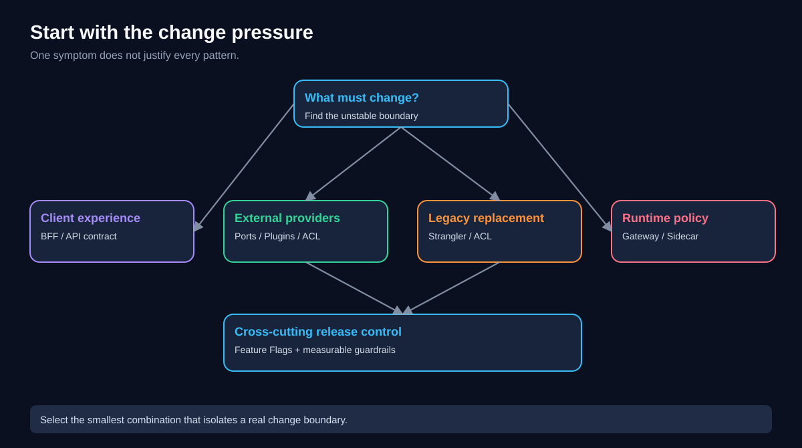
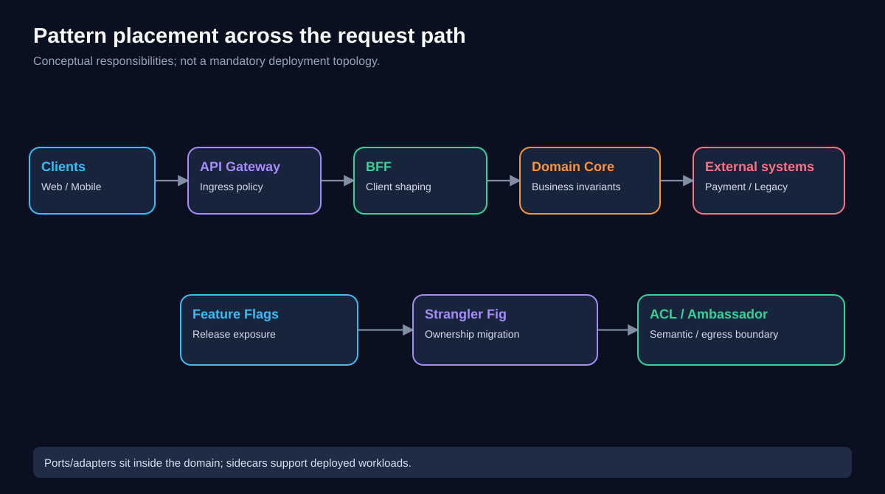
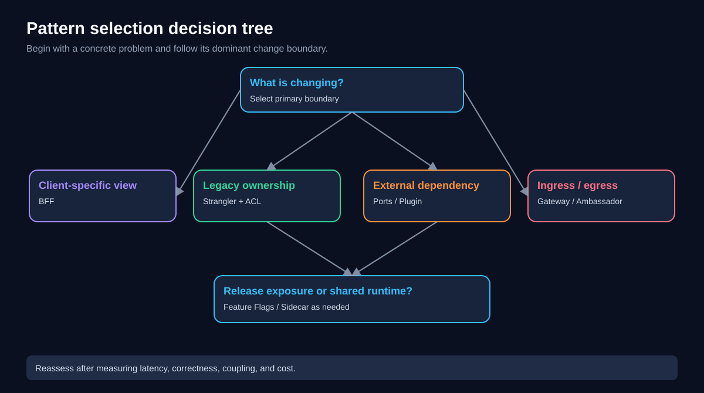
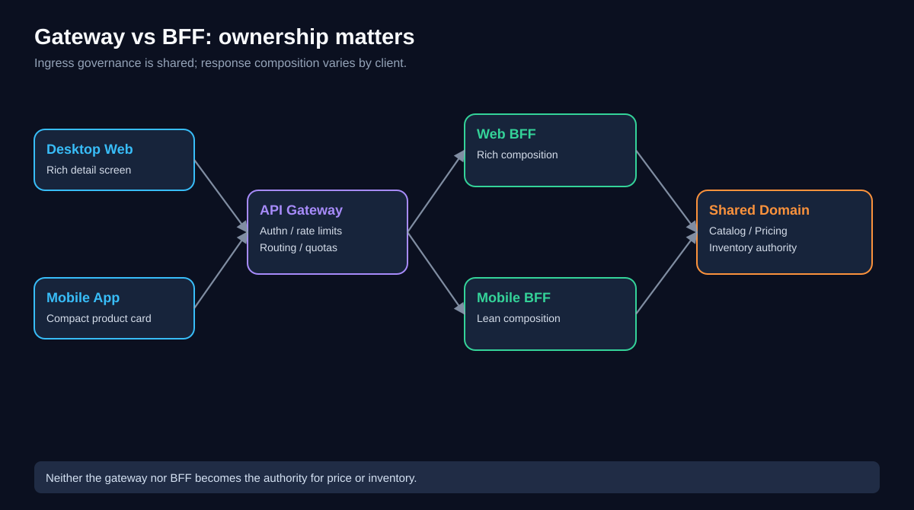
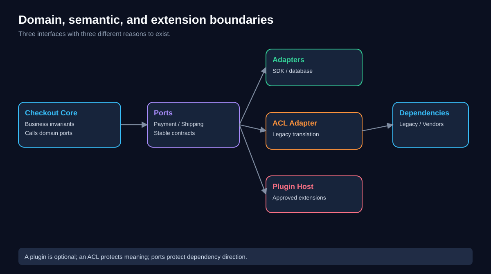
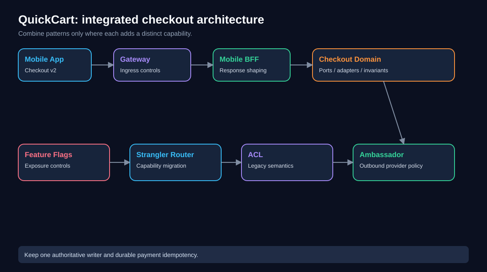
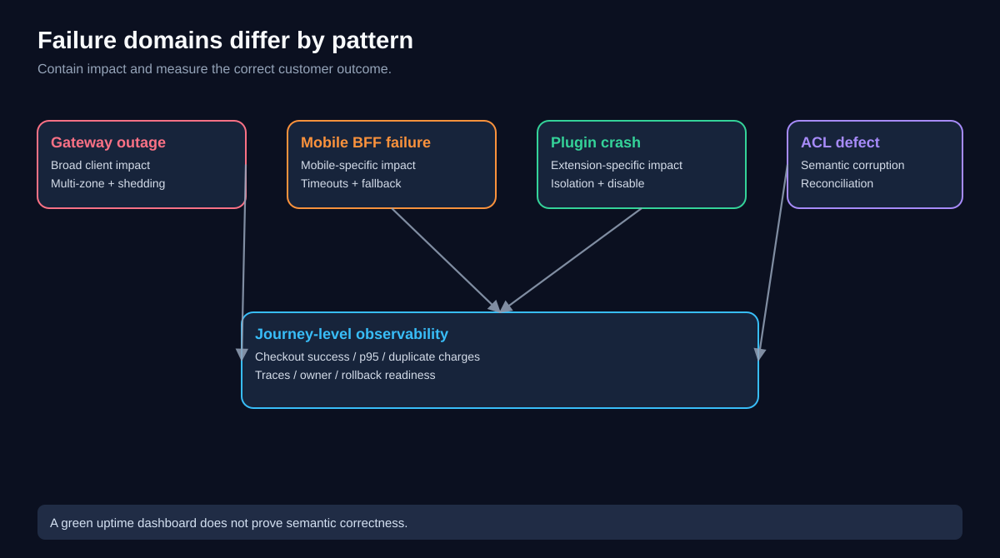
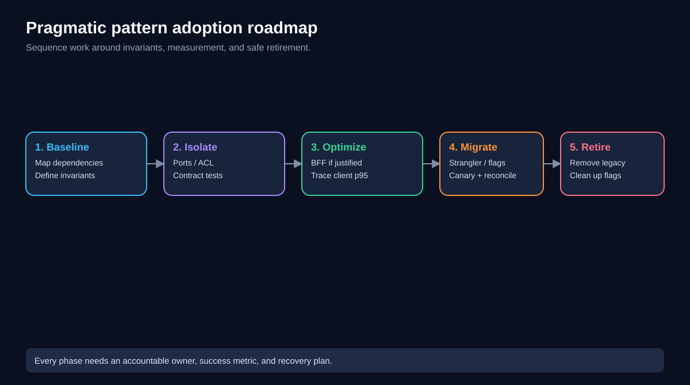

# Chapter 10 — Extensibility Architecture Pattern Comparison and Selection

> **QuickCart architecture field guide** · Level: intermediate–advanced · Estimated study time: 100–130 minutes  
> **Scope:** Sidecar, Ambassador, Anti-Corruption Layer (ACL), Backends for Frontends (BFF), Strangler Fig, API Gateway, Plugin Architecture, Ports and Adapters, and Feature Flags.

## 1. Why this chapter exists

A pattern is not an architectural objective. QuickCart does not benefit from “using an API Gateway” in isolation; it benefits when customer traffic becomes safer, simpler to govern, and easier to change. Similarly, adopting a sidecar is not automatically a scalability improvement, and creating a BFF is not automatically a latency improvement.

Earlier chapters taught nine patterns individually. Real systems combine them. A mobile checkout request might pass through a gateway, enter a mobile BFF, invoke a checkout service structured with ports and adapters, reach a payment provider through an outbound ambassador, and use a feature flag to select a new checkout experience. Meanwhile a Strangler Fig migration route moves legacy functionality to that service, and an ACL translates legacy order semantics. These patterns can coexist because they address **different change boundaries**.

This chapter supplies a practical selection method, comparison matrices, diagrams, implementation sequencing, measurable outcomes, and exercises. The goal is to choose the *smallest useful combination*, not maximize the number of patterns.

### Learning outcomes

After completing the chapter you should be able to:

1. Identify the architectural problem before naming a pattern.
2. Explain the primary responsibility and placement of all nine patterns.
3. Separate inbound traffic concerns, outbound integration concerns, domain boundaries, and release controls.
4. Distinguish frequently confused pairs such as Gateway/BFF and Sidecar/Ambassador.
5. Choose a defensible pattern combination for a QuickCart modernization scenario.
6. Estimate costs and benefits with explicit assumptions.
7. Design rollout, rollback, security, ownership, and observability for the chosen architecture.

### Prerequisites

Read Chapters 00–09 or be comfortable with HTTP APIs, distributed services, dependency inversion, identity, telemetry, and incremental migration. No vendor-specific platform is required.

## 2. Start with the change pressure, not the tool

QuickCart operates desktop web, Android, and iOS storefronts; a legacy order monolith; independently deployed catalog and inventory services; and several payment and delivery integrations. Leadership asks the platform team to improve mobile checkout speed, add delivery partners faster, reduce migration risk, and enforce consistent edge security.

Those are **four different problems**:

- **Client experience:** mobile users need fewer round trips and smaller responses.
- **Integration extensibility:** delivery partners must be replaceable without changing core order rules.
- **Modernization:** legacy order capabilities must migrate without a risky one-day cutover.
- **Ingress governance:** public traffic needs centralized identity validation, throttling, and routing.

A single “microservices pattern” cannot responsibly solve all four. The first design task is to label the change pressure and identify who owns the affected boundary.



**Diagram walkthrough:** Client needs, external integrations, legacy migration, and operational control are separate entry points into the decision. Each points toward a different family of patterns. The map deliberately avoids a single mandatory architecture.

### Four diagnostic questions

Ask: **What varies?** (client presentation, provider contract, legacy semantics, runtime policy, or release exposure); **who owns the variation?** (frontend, domain team, platform, or partner integration team); **where must it be isolated?** (edge, client-facing API, application core, outbound boundary, or deployment pipeline); and **how will success be measured?** (p95 latency, change lead time, rollback time, defect rate, or partner onboarding effort).

If those questions cannot be answered, write a problem statement and measure a baseline before committing to a pattern.

## 3. The nine patterns at a glance

| Pattern | Core intent | Typical placement | Owns | Must not silently become |
|---|---|---|---|---|
| **Sidecar** | Attach supporting runtime capability to an application instance | Same deployment unit / pod | Local proxying, telemetry, auxiliary processing | Shared business logic |
| **Ambassador** | Mediate an application's **outbound** calls | Outbound proxy, often sidecar | Destination routing, TLS, connection policy | Payment correctness or idempotency authority |
| **ACL** | Translate and protect a domain from foreign semantics | Domain integration boundary | Vocabulary and model translation | Universal pass-through mapper with no semantic design |
| **BFF** | Shape APIs for a specific client experience | Client-facing application backend | Aggregation, response shaping, client orchestration | Duplicated pricing, stock, or checkout rules |
| **Strangler Fig** | Replace an existing system incrementally | Migration routing + capability ownership | Progressive traffic/capability migration | Permanent dual ownership of mutable data |
| **API Gateway** | Govern public/API ingress | Edge or internal ingress | Authn enforcement, routing, throttling, policy | Giant business-orchestration service |
| **Plugin Architecture** | Add bounded capabilities through extension contracts | Host application and plugin runtime | Extension points, loading, lifecycle, isolation | Unreviewed arbitrary code execution |
| **Ports and Adapters** | Keep business core independent of external technology | Inside application/service | Stable domain-facing interfaces | A requirement to create a microservice per adapter |
| **Feature Flags** | Separate deployment from feature exposure | Application decision + config/control plane | Targeting, rollout, kill switches | Permanent branching and authorization |

A pattern's deployment form is not always its definition. An ACL can be a module, library, or service. An Ambassador is frequently implemented as a sidecar, but the two names describe different ideas: **sidecar describes placement; ambassador describes outbound responsibility**. Feature flags are a release control rather than a network component.

## 4. Architecture boundary map



**Diagram walkthrough:** The gateway protects the ingress boundary; BFFs shape client responses; domain services own business rules; ports/adapters isolate dependencies; ACLs translate legacy semantics; ambassadors govern outbound calls; sidecars can support multiple services. Flags and Strangler migration cut across this request path as control and transition mechanisms.

The diagram is conceptual. A production system may use fewer services, and some capabilities may run in the same process. Architecture is about **responsibility and coupling**, not maximizing boxes.

## 5. Comparison by problem and success metric

| Symptom | Strong first candidate | Primary metric | Key alternative / caveat |
|---|---|---|---|
| Every service reimplements telemetry or outbound TLS | Sidecar | Adoption coverage, overhead, error rate | SDK or shared platform capability may be simpler |
| Third-party outbound endpoints and certificates vary | Ambassador | Connection errors, rotation time | Application client may suffice for one provider |
| Legacy `SALE_POSTED` means something different from a modern `Order` | ACL | Semantic defects, translation test coverage | Simple adapter if semantics truly align |
| Mobile page requires seven sequential backend requests | BFF | Mobile p95, bytes transferred, request count | Fix frontend parallelism or API first |
| Replacing a monolith in one cutover is too risky | Strangler Fig | Capability migrated, rollback success | Modular monolith refactor may be cheaper |
| Public APIs lack consistent authn and throttling | API Gateway | Unauthorized blocks, policy coverage | Load balancer alone is insufficient |
| Each new carrier requires edits to checkout core | Plugin Architecture | Onboarding lead time, core churn | Ports/adapters without dynamic plugins may be enough |
| Payment provider SDK types leak into checkout domain | Ports and Adapters | Domain test speed, provider replacement effort | Keep interfaces pragmatic; avoid abstraction for its own sake |
| New checkout must reach 5% of customers first | Feature Flags | Exposure accuracy, guardrail SLOs | Canary deployment changes code traffic, not necessarily feature eligibility |

**Interpretation:** Select a primary pattern based on the dominant failure or change pressure. Add secondary patterns only when they solve another demonstrable problem.

## 6. Decision tree: choosing a primary pattern



**Diagram walkthrough:** Start with the symptom, then choose the first relevant boundary. The branches do not imply mutual exclusivity: a checkout modernization can use Strangler Fig for migration, ACL for semantics, and Feature Flags for controlled exposure.

A useful selection procedure:

1. Write one sentence: “We need to change ___ without forcing ___ to change.”
2. Identify the dependency or rollout boundary.
3. Pick the minimum pattern that isolates it.
4. Define the invariant that must remain true (for example, no duplicate charge).
5. Establish baseline measurements and a rollback plan.
6. Test whether a simpler library, module, or configuration change would achieve the same result.
7. Add patterns only after proving a second independent need.

### Example decision statement

“We need to replace QuickCart's legacy discount calculations **without forcing mobile and web clients to coordinate releases**.” The main issue is a domain migration, not just client response shape. A likely approach is Strangler Fig plus ACL, with existing BFF contracts remaining stable. A new BFF alone would not solve the semantic migration.

## 7. Commonly confused patterns: Gateway versus BFF

An API Gateway manages **cross-client ingress policy**: routing, authentication enforcement, quotas, request limits, and sometimes coarse API version routing. A BFF manages **client-specific experience composition**: a mobile product card might need five fields and an availability badge; a desktop product detail page might need richer merchandising content.

Both may route and aggregate in some implementations. The distinction is **ownership and reason for change**. If a change is driven by a mobile screen, the mobile BFF is the natural owner. If it is driven by enterprise-wide abuse protection, the gateway or security platform is the natural owner.

Do not place authoritative price calculation in either component. Domain services must still enforce resource-level authorization even if the gateway has authenticated the caller.



**Diagram walkthrough:** One gateway handles shared ingress controls and routes to Web and Mobile BFFs. Both BFFs reuse the same pricing and inventory services, preventing business-rule divergence.

### When not to add a BFF

If all clients use essentially the same data contract, their latency is acceptable, and frontend teams can release independently, a single stable API may be sufficient. BFFs create deployment units, on-call ownership, tests, and network hops. A BFF should earn that cost through measurable client-specific needs.

## 8. Sidecar versus Ambassador versus service mesh

**Sidecar:** a companion runtime that shares a deployment lifecycle with an application. In Kubernetes, containers in one Pod share a network namespace, but **not automatically the filesystem or memory**. Files are shared through explicitly configured volumes.

**Ambassador:** an outbound proxy that can be deployed as a sidecar. It centralizes egress concerns such as destination selection, TLS, retries, and connection management. Retrying payment creation blindly can create duplicate charges; application-level idempotency keys, provider guarantees, and reconciliation remain necessary.

**Service mesh:** a broader set of infrastructure capabilities and control-plane conventions that can govern traffic between services. It may use sidecars, node proxies, or ambient modes. A mesh does not replace domain ownership or business authorization.

Use a sidecar when companion placement is useful; use an ambassador when outbound mediation is the primary requirement; adopt a mesh when service-to-service policy and observability needs justify fleet-wide operational complexity.

## 9. ACL versus Ports and Adapters versus Plugin Architecture

These three patterns all introduce interfaces but protect different kinds of change.

- **ACL protects meaning.** A legacy `InvoiceFinalized` event may not correspond one-to-one with QuickCart's modern `OrderPaid` event. Translation must preserve invariants and explicitly handle missing, ambiguous, or contradictory states.
- **Ports and Adapters protects dependency direction.** The checkout core depends on a `PaymentPort`, not a vendor SDK. A Stripe-like adapter or test fake implements that port.
- **Plugin Architecture protects extension and lifecycle.** A carrier plugin conforms to a documented extension contract and may be discovered, validated, enabled, disabled, and upgraded independently.

They can be combined. An external carrier plugin may implement a shipping port. An ACL may sit inside an adapter when legacy semantics require translation. Avoid making every adapter a dynamically loaded plugin; dynamic loading adds compatibility, trust, isolation, and governance concerns.



**Diagram walkthrough:** The domain core calls stable ports. Standard adapters reach infrastructure, ACL adapters translate legacy semantics, and a plugin host loads optional shipping integrations under a governed contract.

## 10. Strangler Fig versus Feature Flags

Strangler Fig is a **migration strategy** for changing system ownership over time. Feature flags are a **release/exposure mechanism**. A feature flag can assist a strangler migration, but it does not by itself solve data migration, authoritative writes, or semantic compatibility.

A safe migration might route 1% of eligible catalog reads to a new service while the monolith remains authoritative. Before moving writes, QuickCart must define ownership, consistency, replay, reconciliation, and rollback. Once new writes cannot be losslessly replayed to the old model, “flip the flag back” may no longer be a safe rollback.

Use feature flags to limit exposure and implement kill switches; use Strangler Fig to plan the progressive transfer of capabilities and data ownership.

## 11. QuickCart end-to-end example: one checkout request

Assume QuickCart is modernizing checkout while preserving mobile performance and supporting multiple payment providers.

1. **Mobile app → Gateway:** gateway validates a token, enforces request-size limits, and applies customer/API quotas.
2. **Gateway → Mobile BFF:** BFF accepts a mobile-specific checkout command, enriches presentation context, and forwards a canonical checkout request.
3. **Mobile BFF → Checkout service:** domain service enforces cart, inventory, tax, and payment invariants. The BFF cannot bypass them.
4. **Checkout core → PaymentPort:** core invokes an abstract payment contract. A provider adapter performs the external call.
5. **Checkout service → Ambassador (optional):** outbound policy governs TLS, routing, and connection limits; retries respect idempotency.
6. **Checkout service → ACL (during migration):** a translation boundary maps modern orders to the legacy order model when needed.
7. **Strangler route:** migration policy determines whether legacy or modern checkout owns a capability; there must be one authoritative write path.
8. **Feature flag:** eligible cohorts see Checkout v2. Exposure and migration routing are distinct controls, even if coordinated.
9. **Sidecar (optional):** local proxy/telemetry agent supports runtime capabilities without owning order rules.



**Diagram walkthrough:** The end-to-end path separates client shaping, ingress policy, domain logic, outbound integration, and legacy translation. Migration routing and feature exposure are shown as separate control concerns.

### The most important invariant

**One customer checkout attempt must not cause two settled charges.** This requires durable idempotency and reconciliation, not merely gateway throttling, a proxy retry policy, or a feature flag.

## 12. A compact reference implementation

Below is illustrative Python-style pseudocode. The code shows dependency direction and responsibility; it is not a complete payment implementation.

```python
from typing import Protocol

class PaymentPort(Protocol):
    async def authorize(self, order_id: str, amount_minor: int,
                        idempotency_key: str) -> str: ...

class CheckoutService:
    def __init__(self, payment: PaymentPort, orders):
        self.payment = payment
        self.orders = orders

    async def checkout(self, command):
        # Validate cart, inventory, pricing, and permissions here.
        order = await self.orders.create_or_get(
            command.checkout_attempt_id, command.items
        )
        authorization = await self.payment.authorize(
            order.id, order.total_minor, command.checkout_attempt_id
        )
        return {"order_id": order.id, "payment_status": authorization}

class MobileBFF:
    def __init__(self, checkout: CheckoutService):
        self.checkout = checkout

    async def submit(self, mobile_request):
        result = await self.checkout.checkout(
            normalize_mobile_request(mobile_request)
        )
        return {
            "orderId": result["order_id"],
            "statusLabel": display_status(result["payment_status"])
        }
```

In a real system, use a durable transaction/attempt record, provider-specific idempotency guarantees, authorization checks, and reconciliation. `create_or_get` must be atomic under concurrent requests. BFF `display_status` is presentation formatting, not authority over payment state.

## 13. Pattern selection as an architecture decision record

An Architecture Decision Record (ADR) should capture **context, options, decision, consequences, measurements, and rollback**. For QuickCart mobile checkout:

**Context:** Mobile product-to-checkout journey has high p95 latency and multiple sequential requests; legacy order service is being replaced.

**Options:** (A) optimize existing APIs; (B) add Mobile BFF; (C) add BFF plus strangler migration; (D) rewrite everything simultaneously.

**Decision:** Start with API measurement and targeted aggregation; add Mobile BFF only where client-specific composition is justified. Migrate order capability separately using Strangler Fig and ACL.

**Consequences:** New BFF service and contract tests; stronger mobile autonomy; potential extra hop; increased operational ownership.

**Success criteria:** Reduce client request count and p95 latency without increasing checkout errors or duplicate charges. Measure before and after with comparable traffic cohorts.

**Rollback:** Restore prior mobile API route while preserving one authoritative checkout write path; document cases where irreversible new writes prevent simple reversal.

## 14. Trade-off matrix: complexity, coupling, and operational cost

| Pattern | Implementation effort | Runtime overhead | Governance burden | Primary risk |
|---|---|---|---|---|
| Sidecar | Medium | Per-instance CPU/memory | Fleet rollout/version skew | Proxy or agent failure affects app |
| Ambassador | Medium | Extra network processing | TLS/retry policy | Retry amplification |
| ACL | Medium–high | Translation hop if remote | Semantic mapping ownership | Incorrect business meaning |
| BFF | Medium | Extra service/hop | Client contracts and teams | Duplicated domain logic |
| Strangler Fig | High over migration | Temporary dual running | Data ownership and cutover | Split-brain writes |
| API Gateway | Medium–high | Central ingress hop | Shared policy/change control | Bottleneck or blast radius |
| Plugin Architecture | High for dynamic plugins | Isolation/loading cost | Contract/security lifecycle | Unsafe or incompatible plugins |
| Ports and Adapters | Low–medium | Usually negligible in-process | Interface discipline | Over-abstraction |
| Feature Flags | Low to start, ongoing | Evaluation/config overhead | Cleanup, ownership, audit | Stale flags and inconsistent state |

These are **relative heuristics**, not universal rankings. A managed gateway may reduce implementation effort while adding vendor cost. An in-process ACL may be cheaper than a networked service. A feature-flag system can be inexpensive initially but costly when hundreds of stale flags accumulate.

## 15. Capacity exercise: estimate the combined cost

All numbers in this section are **illustrative assumptions**, not QuickCart production data.

Assume 1,200 client requests/second at peak. Of these, 65% are mobile and 35% web. Each request enters a gateway. Mobile BFF requests fan out to an average of 2.4 downstream calls; web BFF requests average 1.7. Ignore cache hits for the first pass.

- Mobile ingress: `1,200 × 0.65 = 780 requests/s`.
- Web ingress: `1,200 × 0.35 = 420 requests/s`.
- Mobile downstream traffic: `780 × 2.4 = 1,872 calls/s`.
- Web downstream traffic: `420 × 1.7 = 714 calls/s`.
- Total expected BFF downstream calls: **2,586 calls/s**.

A gateway that handles 1,200 incoming requests/s does not mean downstream services only handle 1,200 calls/s. **Fan-out changes capacity planning.** Retries and cache misses may further increase load.

Suppose a gateway instance can sustain 500 requests/s at the target latency and utilization is capped at 60%. Effective planning capacity is `500 × 0.60 = 300 requests/s`. Four instances meet the average peak (`1,200 / 300 = 4`), but that is not enough for a one-instance failure while maintaining the same utilization. Plan **five** as a minimum under this simplified model: four remaining instances provide `4 × 300 = 1,200 requests/s`. Real deployments must also account for zone failures, burstiness, request complexity, and autoscaling lag.

### Latency budgeting

If gateway processing adds 8 ms, BFF processing adds 12 ms, and two parallel downstream calls take 70 ms and 110 ms, idealized critical-path latency is approximately `8 + 12 + max(70, 110) = 130 ms`, excluding network overhead and other steps. It is **not** `8 + 12 + 70 + 110 = 200 ms` when calls truly run concurrently.

If one call is dependent on the other, their latencies may add. Measure actual traces rather than assuming parallelism from an architecture diagram.

## 16. ROI and business case: avoid false precision

Suppose a BFF reduces mobile integration effort by 18 engineer-hours per release across 20 releases/year. At a fully loaded illustrative rate of $90/hour, annual gross labor value is `18 × 20 × $90 = $32,400`. Suppose the new BFF costs $1,500/month in infrastructure, tooling, and on-call allocation: `$18,000/year`. The illustrative **net annual value is $14,400**, before implementation cost and before considering conversion effects.

If implementation costs $28,800, simple payback at that run rate is `28,800 / (14,400/12) = 24 months`. This is not a forecast: actual savings depend on whether hours become realized capacity, whether latency improvements affect conversion, and whether operations costs were fully captured.

For Strangler Fig, value may arise from lower incident risk, faster release cycles, or retirement of costly legacy infrastructure—but dual-running and data migration often produce **negative short-term cash flow**. A credible business case explicitly includes the overlap period and the cost of retiring the old system.

### ROI measurement plan

Record baseline change lead time, incidents, p95 latency, engineering effort, cloud spend, and partner onboarding time. Compare matched periods or cohorts after rollout. Attribute benefits carefully: if gateway, BFF, and caching all change together, the improvement cannot automatically be credited to BFF alone.

## 17. Security and trust-boundary checklist

The patterns introduce different trust boundaries. A gateway can authenticate tokens, but domain services must still enforce **object-level authorization** (for example, whether customer A can read order B). A BFF must not treat a user-supplied account ID as proof of ownership.

An ACL must validate and sanitize legacy data, not merely rename fields. Plugins must run under least privilege with signed/approved artifacts, bounded resource access, and explicit egress permissions. An ambassador should use verified TLS identities and approved destinations. Feature flags must not substitute for authorization checks: hiding an admin action in the UI does not protect the underlying endpoint.

For payment paths, log trace IDs and safe status metadata, not raw card data or secrets. Use scoped credentials, rotate keys, and define ownership of security controls across platform and product teams.

## 18. Reliability and failure containment



**Diagram walkthrough:** A gateway outage can affect every client, while a mobile BFF outage may be limited to mobile. A plugin crash should ideally be isolated from checkout core; an ACL semantic defect can corrupt migrated data even if availability looks healthy. Different patterns require different guardrails.

| Failure | Early signal | Mitigation | Unsafe shortcut |
|---|---|---|---|
| Gateway overload | Rising 429/5xx, queueing | Capacity, quotas, shedding, multi-zone replicas | Infinite retries |
| BFF fan-out timeout | Client p95, downstream saturation | Parallel calls, time budgets, bounded concurrency | Retry every dependency |
| Ambassador egress failure | Connection/TLS errors | Circuit breaking, safe fallback, credential rotation | Retry non-idempotent charge |
| ACL semantic mismatch | Reconciliation differences | Golden test cases, quarantine, manual review | Silent default mapping |
| Plugin crash | Per-plugin errors, resource spikes | Isolation, timeouts, disable switch | Trust all plugin code |
| Migration split-brain | Conflicting writes | One writer, ownership ledger, reconciliation | Dual writes with no recovery plan |
| Flag inconsistency | Cohort mismatch, stale config | Stable bucketing, safe defaults, audit | Flags as security boundary |

A strong architecture explicitly states which failures are allowed to degrade a noncritical feature and which must stop checkout safely.

## 19. Observability: trace boundaries, not just services

Track user outcomes first: successful checkout rate, p95/p99 end-to-end latency, duplicate-charge incidents, and customer-visible error rate. Then attribute symptoms to components.

Recommended dimensions:

- **Gateway:** inbound RPS, rejected requests by reason, upstream latency, per-route 4xx/5xx, rate-limit hits.
- **BFF:** per-client latency, response bytes, fan-out count, partial-result rate, client contract failures.
- **Sidecar/Ambassador:** egress connection failures, TLS handshake errors, proxy overhead, retry amplification.
- **ACL:** unmapped states, semantic mismatches, reconciliation backlog, translation version.
- **Ports/Adapters/Plugins:** adapter error rate, dependency latency, plugin version and isolation events.
- **Strangler:** percent of capability traffic migrated, writer ownership, shadow parity, rollback readiness.
- **Flags:** exposure counts by variant, configuration freshness, guardrail metrics, owner and expiry.

Propagate a trace context through gateway, BFF, domain service, and external integrations where possible. Use structured logs with redaction. Create dashboards by **customer journey and business capability**, not only by pod name.

## 20. Ownership and governance

The platform team should own shared gateway and proxy standards; client teams should own BFF contracts; domain teams should own checkout invariants, ports, and ACL semantic mappings; a plugin platform owner should govern plugin contracts and trust; release owners should maintain flag expiry and kill-switch runbooks.

Use an ownership table in each ADR:

| Boundary | Accountable owner | Change approval | Key evidence |
|---|---|---|---|
| Public ingress policy | Platform/security | Security + platform | Policy tests, audit logs |
| Mobile response contract | Mobile experience team | Client/API owners | Consumer-driven contract tests |
| Checkout business invariant | Checkout domain team | Domain owner | Domain and integration tests |
| Legacy translation | Migration + domain teams | Both domain owners | Golden semantic fixtures |
| Payment plugin/provider | Payments team | Security + payments | Sandbox certification, idempotency tests |
| Rollout flag | Feature owner | Release owner | Exposure report, expiry date |

Without explicit ownership, patterns meant to improve extensibility can instead create change queues and cross-team bottlenecks.

## 21. Migration sequencing: build only what you need

A practical QuickCart sequence is:

**Phase A — Baseline and contracts (weeks 1–2, illustrative):** Map traffic, latency, dependencies, identity, and data ownership. Record invariants. Create dashboards and contract tests before moving traffic.

**Phase B — Boundary extraction (weeks 3–5):** Introduce domain ports where vendor dependencies leak. Add an ACL around legacy order semantics. Keep the legacy system authoritative until reconciliation is reliable.

**Phase C — Client optimization (weeks 4–7):** If traces justify it, introduce Mobile BFF aggregation behind existing ingress routes. Preserve API compatibility and measure mobile response size and p95.

**Phase D — Controlled migration (weeks 6–12):** Use Strangler routing and feature flags for bounded cohorts. Shadow reads where safe; do not shadow real payment writes. Use explicit canary gates and owner sign-off.

**Phase E — Retirement:** Transfer authoritative ownership only after data correctness is proven. Remove stale routes, unused ACL mappings, temporary flags, and legacy infrastructure. Update incident runbooks.

These time windows are illustrative and can overlap; real scheduling depends on data complexity, teams, and regulatory constraints.



**Diagram walkthrough:** Baselines and invariants precede boundary extraction; client optimization can proceed alongside controlled migration; retirement is a deliberate phase rather than an automatic result of routing most traffic to new code.

## 22. Pattern anti-patterns and red flags

**“One gateway to rule them all.”** A gateway accumulating pricing, checkout, and merchandising logic becomes a tightly coupled monolith at the edge.

**“One BFF per app build.”** Splitting Android and iOS BFFs without materially different requirements multiplies services and release coordination. Start with shared mobile where appropriate.

**“Everything is a plugin.”** Plugin runtimes are valuable for governed extensibility, but normal dependency injection may be safer and simpler for internal adapters.

**“An ACL is just field mapping.”** Renaming `grossTotal` to `total` does not establish equivalence if taxes, refunds, or settlement semantics differ.

**“Feature flags make migrations reversible.”** Data written in a new format may not be compatible with the legacy writer. Reversibility must be engineered and tested.

**“Sidecars eliminate application concerns.”** Proxies cannot know whether retrying a payment is safe without domain context and idempotency support.

**“More patterns means better architecture.”** Each added boundary has lifecycle, testing, observability, and incident costs. Choose patterns according to a measured change pressure.

## 23. Worked challenge A — Slow mobile product screen

**Scenario:** QuickCart's mobile product screen performs six API calls, three of which are sequential due to data dependencies. p95 is 900 ms. Desktop performance is acceptable. The team proposes a gateway rewrite, a new Mobile BFF, and a service mesh.

**Analysis:** The problem is client-specific composition. First trace the calls, eliminate unnecessary dependencies, and check caching. A Mobile BFF is a strong candidate to aggregate and reshape responses. A gateway rewrite does not directly solve the screen's data composition, and a service mesh is not justified by this symptom alone.

**Design:** Keep shared catalog, pricing, and inventory services authoritative. Route mobile requests through a Mobile BFF with bounded parallel fan-out and a 600 ms end-to-end budget. Return partial noncritical recommendations when they time out; never invent prices or availability.

**Measurement:** Compare p95, payload bytes, request count, downstream RPS, error rate, and cloud cost for matched mobile cohorts. Roll back the route if checkout or product correctness degrades.

**Decision:** **BFF, conditional on measured need**; no new mesh or gateway rewrite solely for this issue.

## 24. Worked challenge B — Legacy orders and payment providers

**Scenario:** The monolith calls a legacy payment API using `CAPTURED` to mean “funds reserved,” while the modern domain uses `CAPTURED` to mean “funds settled.” QuickCart also wants a second provider and gradual order migration.

**Analysis:** This is both a semantic mismatch and an external dependency problem. Introduce an **ACL** to translate states correctly and reject ambiguous events. Put the modern checkout logic behind a **PaymentPort** with provider adapters. Use **Strangler Fig** to transfer order capability ownership in stages.

**Safety:** Maintain a single authoritative writer per order state; use durable idempotency keys, event correlation, reconciliation, and explicit refund/settlement workflows. An Ambassador may standardize outbound TLS, but cannot repair semantic confusion.

**Decision:** **ACL + Ports and Adapters + Strangler Fig**, with Ambassador only if outbound policy is an independent operational requirement.

## 25. Worked challenge C — Adding five shipping partners

**Scenario:** QuickCart plans five new delivery providers. Today each addition requires a checkout-core deployment. Some providers supply proprietary SDKs; one runs code supplied by an external partner.

**Analysis:** First define a stable `ShippingQuotePort` and separate shipping orchestration from checkout invariants. If provider selection is statically configured and owned internally, ordinary adapters may suffice. If providers must be added or upgraded independently, introduce a governed **Plugin Architecture**.

**Controls:** Contract versioning, allowlisted capabilities, sandboxed external code, per-plugin timeouts, signed artifacts, dependency vulnerability scans, and kill switches. Keep the core authoritative over promised delivery options and pricing policies.

**Decision:** **Ports and Adapters first; plugins only where lifecycle independence earns the added complexity.**

## 26. Numerical challenge D — BFF fan-out and budget

**Question:** Peak mobile traffic is 900 requests/s. A new BFF makes three downstream calls per request. Caching eliminates 25% of calls uniformly. What is the expected downstream call rate? If each downstream service instance sustains 225 calls/s at the planning utilization, how many aggregate instance-equivalents are needed?

**Solution:** Raw fan-out is `900 × 3 = 2,700 calls/s`. After a 25% cache reduction, `2,700 × 0.75 = 2,025 calls/s`. Aggregate capacity is `2,025 / 225 = 9 instance-equivalents`. This does **not** mean nine replicas of every downstream service: distribute the 2,025 calls according to actual per-service fan-out and size each dependency separately, with failure headroom.

## 27. Numerical challenge E — Flag rollout and error budget

**Question:** Checkout v2 is exposed to 10% of 80,000 eligible checkout attempts/day. Its observed error rate is 1.4%, while v1 is 0.5%. Estimate excess failed attempts attributable to the difference in error rates for the exposed cohort.

**Solution:** Exposed attempts = `80,000 × 0.10 = 8,000`. Rate difference = `1.4% − 0.5% = 0.9 percentage points`. Expected excess failures = `8,000 × 0.009 = 72/day`. This is an observational estimate, not causal proof; account for cohort comparability, traffic mix, confidence intervals, and experiment design before attributing the difference.

## 28. Numerical challenge F — Migration overlap cost

**Question:** A legacy system costs $11,000/month and a replacement costs $8,000/month. During a six-month dual-running migration, both remain fully provisioned. What is the gross infrastructure overlap cost versus immediately retiring the legacy system on day one?

**Solution:** Extra legacy spend during overlap = `6 × $11,000 = $66,000`, excluding migration tooling, data transfer, and support. Immediate retirement may be infeasible or unsafe; the $66,000 buys reduced migration risk only if staged testing and rollback are actually used. Compare it with plausible incident and rewrite risk rather than treating overlap as pure waste.

## 29. Final architecture review checklist

Before approving a pattern selection, verify:

- [ ] The business problem and measurable baseline are documented.
- [ ] Each chosen pattern has a named change pressure and accountable owner.
- [ ] A simpler option was evaluated.
- [ ] Client-specific logic is separated from domain invariants.
- [ ] Inbound, outbound, and legacy trust boundaries are explicit.
- [ ] Data ownership and authoritative writers are unambiguous.
- [ ] Payment and order idempotency are durable and tested.
- [ ] Timeouts, retries, fallback behavior, and failure blast radius are documented.
- [ ] Consumer contracts and semantic translation fixtures are automated.
- [ ] Metrics cover customer outcomes and pattern-specific health.
- [ ] Canary, rollback, and irreversible-write scenarios are rehearsed.
- [ ] Capacity planning includes fan-out, retries, bursts, and failure headroom.
- [ ] Plugin permissions, token scopes, and PII handling are reviewed.
- [ ] Feature flags have owners, expiry dates, and removal plans.
- [ ] Retirement of legacy routes, flags, and infrastructure is budgeted.

## 30. Chapter summary and next steps

The nine patterns are complementary, not interchangeable. **Gateway** governs ingress; **BFF** shapes client experiences; **Sidecar** packages auxiliary runtime behavior; **Ambassador** mediates outbound traffic; **ACL** protects domain meaning; **Ports and Adapters** protects dependency direction; **Plugin Architecture** governs extensible capabilities; **Strangler Fig** manages incremental replacement; and **Feature Flags** manage release exposure.

The strongest architecture usually begins with a small number of clearly owned boundaries, tests their value with observable metrics, and adds complexity only when it is justified.

**Next chapter:** [Chapter 11 — Integrated QuickCart Case Study](11-integrated-case-study.md). We will assemble the patterns into a phased modernization architecture with a concrete roadmap, migration controls, governance, and a business case.

<details>
<summary><strong>Knowledge check 1:</strong> A mobile screen needs a smaller response than desktop. Which pattern leads?</summary>

**Answer:** A BFF is a strong candidate because the change is client-specific composition. First confirm that optimizing existing APIs is insufficient.

</details>

<details>
<summary><strong>Knowledge check 2:</strong> Can a gateway replace domain authorization?</summary>

**Answer:** No. The gateway may authenticate and enforce broad policy, but domain services must check access to specific orders, carts, and other resources.

</details>

<details>
<summary><strong>Knowledge check 3:</strong> How are Sidecar and Ambassador different?</summary>

**Answer:** Sidecar describes companion deployment placement; Ambassador describes outbound proxy responsibility. An ambassador may run as a sidecar.

</details>

<details>
<summary><strong>Knowledge check 4:</strong> Does an ACL have to be a standalone microservice?</summary>

**Answer:** No. It is a logical semantic boundary and can be an in-process module, adapter, or separate service.

</details>

<details>
<summary><strong>Knowledge check 5:</strong> Why not put tax rules in a Mobile BFF?</summary>

**Answer:** Shared tax rules belong in authoritative domain services; duplication across clients creates divergence and compliance risk.

</details>

<details>
<summary><strong>Knowledge check 6:</strong> Is Strangler Fig the same as a feature flag?</summary>

**Answer:** No. Strangler Fig transfers capability ownership incrementally; flags govern feature exposure. Flags can assist migration.

</details>

<details>
<summary><strong>Knowledge check 7:</strong> When are ports and adapters sufficient without plugins?</summary>

**Answer:** When providers can be selected and deployed through normal dependency injection without independent runtime loading or governance.

</details>

<details>
<summary><strong>Knowledge check 8:</strong> What is the risk of retrying a payment through an ambassador?</summary>

**Answer:** A non-idempotent operation may execute twice. Use durable idempotency and reconciliation, and configure retries only where safe.

</details>

<details>
<summary><strong>Knowledge check 9:</strong> What does BFF fan-out change in capacity planning?</summary>

**Answer:** One client request can create multiple downstream calls, so dependency load may be much higher than ingress RPS.

</details>

<details>
<summary><strong>Knowledge check 10:</strong> Why might a strangler rollback be unsafe?</summary>

**Answer:** New writes or schema semantics may no longer be understood by the legacy writer; routing back could corrupt or lose data.

</details>

<details>
<summary><strong>Knowledge check 11:</strong> What should be measured to justify a new pattern?</summary>

**Answer:** Customer outcomes plus operational cost: p95 latency, correctness, change lead time, error rate, on-call burden, and infrastructure spend.

</details>

<details>
<summary><strong>Knowledge check 12:</strong> What is the biggest warning sign in a nine-pattern architecture?</summary>

**Answer:** Patterns have been added without distinct problems, owners, invariants, or measurable benefits.

</details>
