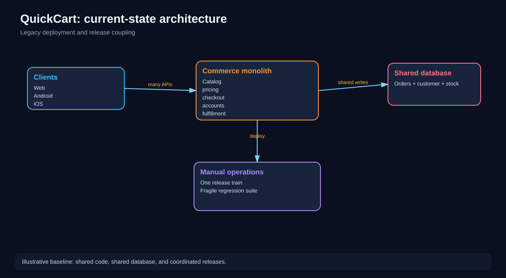
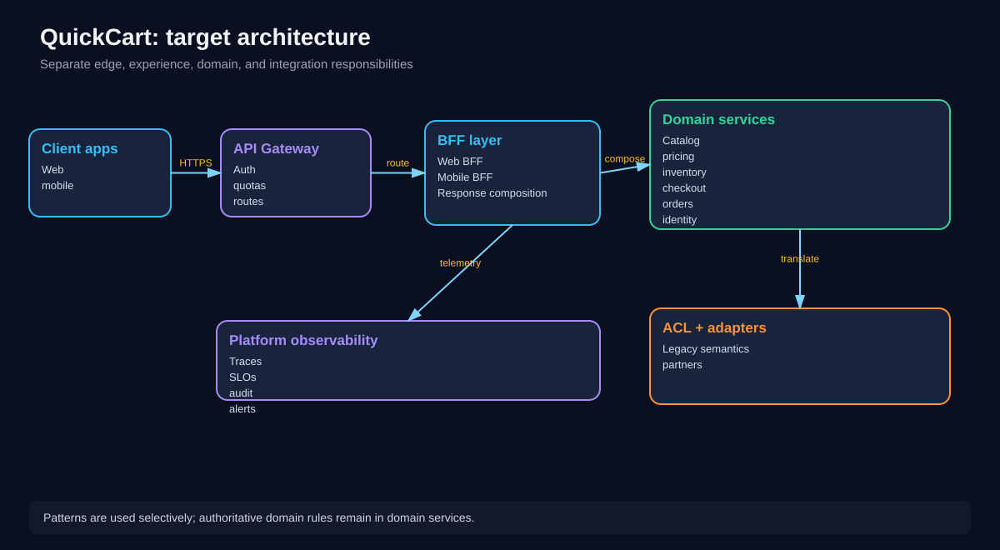
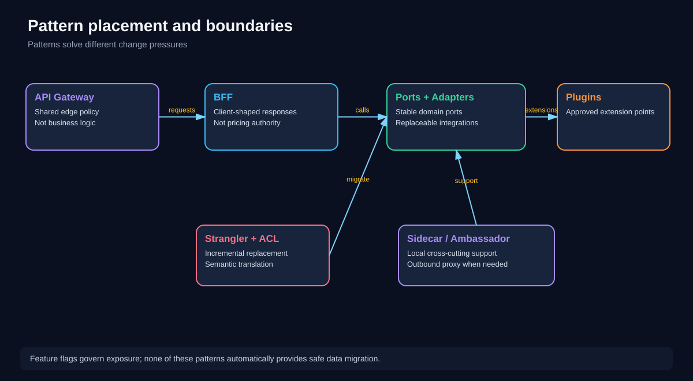
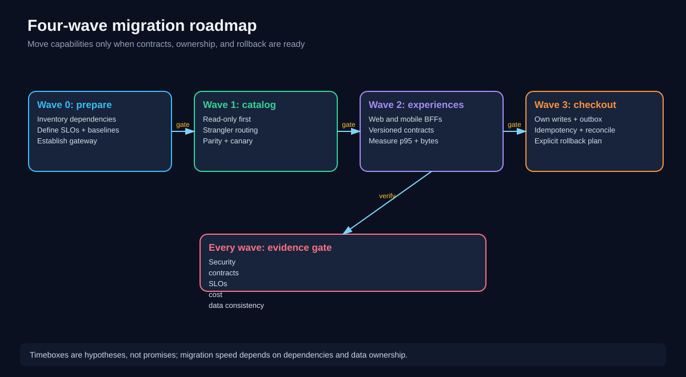
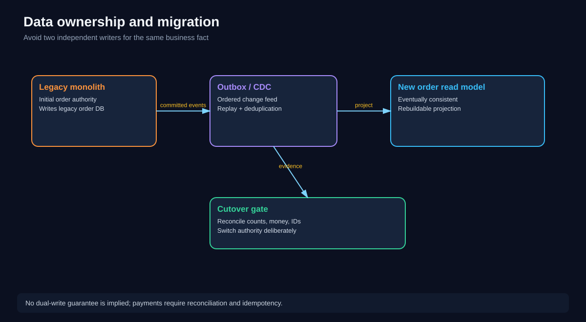
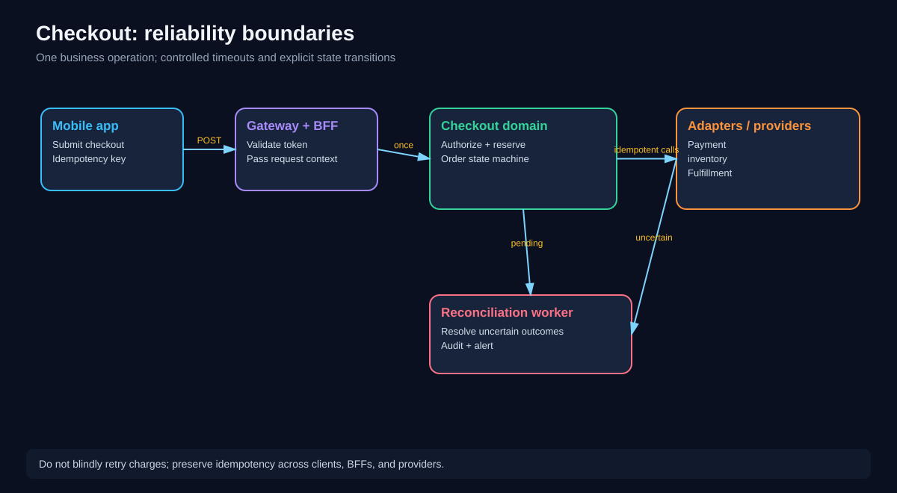
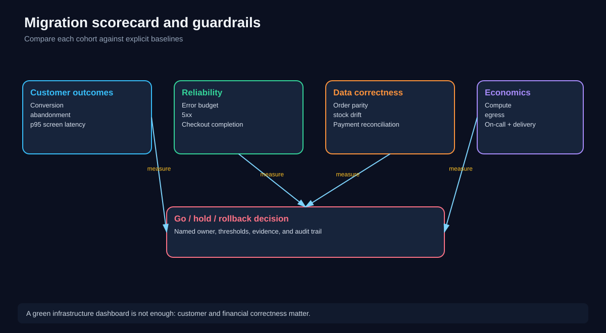
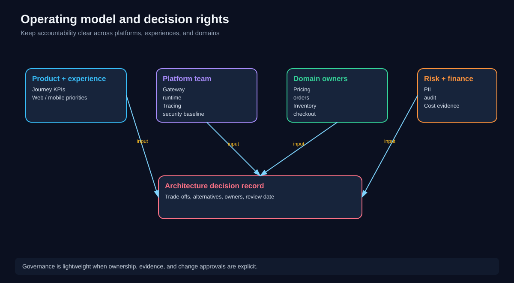

# Chapter 11 — Integrated QuickCart Modernization Case Study

> **Software Extensibility Architecture Patterns — Applied Architecture Lab**  
> **Case study:** QuickCart, a fictional omnichannel e-commerce retailer  
> **Status:** Self-study chapter. All company figures, workloads, budgets, and timelines are **illustrative assumptions**, not measured production facts.

## 1. Why this chapter matters

Previous chapters examined patterns one at a time. Real projects rarely present a clean “choose one pattern” problem. QuickCart needs to improve mobile performance, release features independently, replace legacy integrations, preserve order correctness, and control operating costs at the same time.

The architectural task is therefore **composition and sequencing**: choose the smallest useful set of patterns, define the boundaries between them, and migrate safely. A correct diagram is only the beginning. An executable modernization plan must connect business objectives, contracts, data ownership, deployment, testing, observability, rollback, staffing, and economics.

**Learning outcomes.** By the end you should be able to:

1. Explain QuickCart's business and architectural constraints without jumping to a technology choice.
2. Place API Gateway, BFF, Strangler Fig, ACL, Ports and Adapters, Sidecar, Ambassador, Plugin Architecture, and Feature Flags at appropriate boundaries.
3. Design a migration sequence that avoids uncontrolled dual writes.
4. Define measurable readiness gates and customer-facing service-level indicators.
5. Calculate illustrative capacity, latency, and financial trade-offs.
6. Identify when **not** to introduce an extra service or pattern.
7. Defend a go, hold, or rollback decision using evidence.

**Prerequisites:** Chapters 00–10, especially ACL, BFF, Strangler Fig, API Gateway, Ports and Adapters, and Feature Flags.

---

## 2. Executive brief: the business problem

QuickCart sells through desktop web, Android, and iOS. Its commerce monolith handles product discovery, pricing, promotions, inventory, checkout, orders, customer profiles, and several third-party integrations. Different teams share a release train. Mobile screens often download more fields than needed. A legacy fulfillment system uses product and order status codes that do not align with QuickCart's modern domain model.

Leadership asks for three outcomes:

- **Growth:** reduce product-page latency and checkout friction.
- **Delivery speed:** let teams improve customer experiences without coordinating every release with unrelated functionality.
- **Risk reduction:** modernize old components without disrupting payments, orders, or stock integrity.

Architecture is a means to those outcomes, not the outcome itself. “Adopt microservices” is not a success metric. “Reduce mobile product-page p95 from 1.8 s to 1.2 s while preserving conversion and correctness” is testable.

### 2.1 Working assumptions

| Dimension | Illustrative starting point | Target or guardrail |
|---|---:|---|
| Peak inbound traffic | 2,000 requests/s | Design for 3,000 requests/s plus burst margin |
| Mobile product-page p95 | 1,800 ms | ≤1,200 ms |
| Mobile product response | 420 KB | ≤160 KB for standard screen |
| Customer-visible 5xx | 0.8% | <0.3% during rollout |
| Checkout completion | 96.5% of valid attempts | No material regression |
| Production releases | One coordinated weekly train | Independent releases for eligible teams |
| Order reconciliation | Manual daily checks | Automated exceptions and audit trail |
| Current infra spend | $85,000/month | Budget changes justified by measured outcomes |

These are **planning inputs**. The team must replace them with telemetry, financial records, and product analytics before making commitments.

### 2.2 Scope and exclusions

**In scope:** API boundary, web/mobile experience composition, catalog extraction, order/checkout migration plan, legacy fulfillment translation, payment-provider abstraction, rollout controls, observability, and governance.

**Initially out of scope:** replacing every legacy module, adopting a service mesh by default, rewriting the data warehouse, or creating a plugin marketplace. Each can be revisited when a concrete need appears.

---

## 3. Current-state architecture



**Diagram walkthrough.** Web and mobile clients call a shared commerce monolith. Catalog, checkout, accounts, and fulfillment share code and data. A change in one area can trigger broad regression testing and coordinated deployment.

The monolith itself is **not inherently bad**. Its problem is the current **coupling and change pressure**. A well-structured modular monolith could remain an excellent destination for some capabilities. Decomposition is justified only where independent change, scaling, security, or lifecycle requirements outweigh the additional distributed-system costs.

### 3.1 Diagnostic questions

Before proposing services, interview product, engineering, operations, support, security, and finance. Ask:

- Which customer journeys lose the most revenue or trust?
- Which teams repeatedly block one another?
- Which modules change frequently, and which remain stable?
- Where are the authoritative records for price, stock, orders, and payments?
- Which APIs and event schemas have undocumented consumers?
- What recovery time and data-loss objectives are required?
- Which external systems have weak idempotency or unpredictable latency?
- What is the current cost of release coordination, incidents, and rework?

**Deliverable:** an evidence-backed dependency map, baseline dashboard, and ranked list of business capabilities.

---

## 4. Requirements and nonfunctional constraints

Functional requirements include browsing products, showing localized prices, checking stock, placing orders, taking payments, and viewing order status. The modernization must preserve these behaviors while allowing new experiences.

Nonfunctional requirements need explicit definitions:

| Quality attribute | Requirement | Verification |
|---|---|---|
| Availability | Customer journeys remain usable through component failure | Controlled failure tests and SLO dashboards |
| Latency | Mobile product screen meets p95 objective | Real-user measurements, not only server timings |
| Correctness | No duplicate charge for the same logical checkout attempt | Idempotency and reconciliation tests |
| Security | Least-privilege access; no implicit trust between services | Authorization tests and security review |
| Changeability | Experience changes can ship without domain releases | Deployment history and contract tests |
| Recoverability | Route or flag rollback within defined window | Rehearsed rollback drill |
| Cost transparency | Per-service and per-journey cost is attributable | Tagged billing and workload dashboards |
| Auditability | Order state transitions and privileged changes are traceable | Durable audit records and access controls |

A target architecture that meets latency but introduces duplicate charges is a failure. A design that improves team autonomy but triples operational burden without business benefit may also be a failure.

---

## 5. Target-state architecture



**Diagram walkthrough.** Clients enter through an API Gateway. Web and Mobile BFFs compose experience-specific responses. Shared domain services remain authoritative for pricing, stock, orders, and checkout. ACLs and adapters isolate legacy and partner semantics. Cross-cutting telemetry is standardized without pushing business logic into the platform layer.

This is a **logical architecture**. A box does not mandate a separate deployable service. For example, pricing and promotions might initially be modules inside one domain application. Likewise, an ACL can be an in-process adapter, not a network hop.

### 5.1 Pattern-to-problem mapping

| Pattern | QuickCart use | Do not use it for |
|---|---|---|
| **API Gateway** | Entry routing, authentication enforcement, quotas, TLS policy | Authoritative pricing or order rules |
| **BFF** | Web/mobile response composition and client-specific APIs | Duplicated checkout or inventory logic |
| **Strangler Fig** | Shift one capability at a time from legacy to modern implementation | Automatic database consistency |
| **ACL** | Translate legacy fulfillment statuses and identifiers | Blind field renaming without semantic checks |
| **Ports and Adapters** | Keep checkout core independent of provider SDKs and databases | Making every interface a remote service |
| **Plugin Architecture** | Controlled shipping/tax provider extensions where variability justifies it | Untrusted arbitrary code in the checkout process |
| **Sidecar** | Per-workload telemetry or local support processes when appropriate | Shared memory or filesystem without explicit configuration |
| **Ambassador** | Local outbound proxy for a difficult external dependency when warranted | Business translation or unsafe automatic payment retries |
| **Feature Flags** | Cohort rollout, kill switch, compatibility paths | Schema rollback or undoing already committed orders |

### 5.2 Architecture principle: one authoritative business rule

A Web BFF can decide that desktop needs 12 recommendations; Mobile BFF can return 4. Neither should calculate tax, decide discount eligibility, or invent inventory availability. Those rules live behind shared domain contracts.

A checkout adapter may translate an external provider's response into `PaymentAuthorized`, `PaymentDeclined`, or `PaymentUnknown`; it must not silently reinterpret an unknown result as a decline and charge again.

---

## 6. Pattern placement: a practical map



**Diagram walkthrough.** Edge policy belongs near the gateway; presentation composition belongs in BFFs; domain invariants belong in the core; integration variability belongs behind ports, adapters, or carefully governed plugins. Migration uses routing and semantic boundaries. Feature flags govern exposure across these layers.

A useful selection question is: **“What change are we trying to make cheap?”**

- A new mobile screen: BFF composition.
- A new payment provider: outbound port plus adapter.
- A legacy replacement: Strangler routing, often paired with ACL.
- A new shipping integration from an approved vendor: adapter or plugin depending on extension lifecycle.
- A new traffic policy: gateway or appropriate infrastructure control.
- A risky feature release: flag with owner, expiry, and rollback conditions.

If a pattern does not remove a specific source of change friction or risk, defer it.

---

## 7. Migration strategy: four waves

A modernization roadmap should produce useful intermediate states. The team should be able to stop after any wave and still operate a coherent system.



**Diagram walkthrough.** Wave 0 establishes baselines and controls; Wave 1 extracts a lower-risk read capability; Wave 2 introduces experience-specific BFFs; Wave 3 addresses transactional checkout with stronger correctness and recovery requirements. Every wave has evidence gates.

### Wave 0 — Discover and establish control

**Deliverables:**

1. Dependency and consumer inventory, including undocumented jobs.
2. Baseline dashboards for product-page p95, conversion, checkout completion, 5xx, database load, and deployment frequency.
3. Gateway routing conventions, identity propagation design, trace IDs, and standardized error contracts.
4. Contract-test harness, test environments, and an architecture decision record (ADR).
5. A migration runbook naming owners and rollback triggers.

**Exit gate:** the team can attribute failures to a journey and can roll back a routing change in a rehearsal.

### Wave 1 — Extract product catalog reads

Catalog reads are a useful first candidate because they can often tolerate bounded staleness and have fewer financial side effects than checkout. They are not automatically trivial: availability and prices can change rapidly and must be labeled correctly.

1. Identify catalog-owned data and external consumers.
2. Introduce a stable catalog API with explicit freshness semantics.
3. Build the new read model from a trustworthy feed.
4. Shadow eligible reads and compare semantic output, ignoring expected nondeterministic fields.
5. Route a small cohort to the new catalog implementation.
6. Expand only when error, latency, freshness, and parity guardrails pass.

**Rollback:** restore legacy routing while preserving the ability to replay the read-model feed.

### Wave 2 — Introduce BFFs

Deploy a Web BFF and a Mobile BFF where their experience requirements meaningfully differ. They can initially call legacy endpoints through a controlled facade; full domain extraction is not a prerequisite.

A Mobile BFF may return:

```json
{
  "productId": "SKU-417",
  "title": "Trail Bottle",
  "displayPrice": {"amount": "24.90", "currency": "USD"},
  "availability": "IN_STOCK",
  "heroImage": "/assets/SKU-417-main.webp",
  "deliveryPromise": "Calculated at checkout"
}
```

This is **response shaping**, not the authority for price or stock. A product view should not be mistaken for a reservation.

**Exit gate:** mobile p95 and payload size improve without an unacceptable increase in downstream fan-out, error rate, or compute cost.

### Wave 3 — Migrate orders and checkout deliberately

Checkout is high consequence. Do not begin by simply sending half of all write requests to a new implementation. First define authoritative state, idempotency, external side-effect handling, and reconciliation.

Potential order of work:

1. Define the checkout state machine and invariants.
2. Introduce an idempotency key for each logical checkout attempt.
3. Encapsulate payment and inventory dependencies behind ports.
4. Create durable event publication using an outbox where appropriate.
5. Reconcile new projections against authoritative records.
6. Move a narrow cohort only after end-to-end failure testing.
7. Switch write ownership explicitly; retain an audited recovery procedure.

**Exit gate:** the new checkout path demonstrates correctness, not merely speed.

---

## 8. Data ownership is the hardest boundary



**Diagram walkthrough.** The legacy system initially owns order writes. A committed outbox or reliable change feed supplies a new read model. A separate cutover gate checks money, order counts, IDs, and replay behavior before ownership changes.

### 8.1 The single-writer rule

For each business fact, name the **authoritative writer**. “Both databases are temporarily authoritative” is usually a warning sign. Dual writes to two independent systems can fail after the first commit and before the second, leaving divergent records.

A safer transition often looks like:

- Legacy remains authoritative.
- New consumers read a replicated projection.
- Replayable events update the projection.
- Parity and lag are measured.
- Write authority changes only after the new path is ready.

**Change data capture (CDC)** is a transport mechanism, not a complete semantic contract. A database row update may not express the business meaning that consumers need. Use domain events or an ACL when semantics must be translated.

### 8.2 Event and schema contracts

An illustrative order event:

```json
{
  "eventId": "evt-01JQ",
  "eventType": "OrderAccepted",
  "schemaVersion": 2,
  "occurredAt": "2026-10-17T10:15:00Z",
  "orderId": "ORD-2048",
  "customerRef": "cust-81",
  "total": {"amount": "74.80", "currency": "USD"}
}
```

Consumers should deduplicate by stable event ID, validate schema versions, and tolerate replay. Events should carry only data necessary for the consumer; do not spread sensitive payment details through general-purpose topics.

### 8.3 Semantic translation through ACL

Suppose legacy fulfillment returns `S`, `P`, `X`, and `H` statuses. The ACL must determine whether `X` means customer cancellation, warehouse cancellation, or a terminal failure; blindly mapping `X → CANCELLED` may hide important business differences.

Create a mapping table with product and operations owners. Unknown statuses should produce an explicit unknown or exception path, not an invented success state.

---

## 9. Checkout design: correctness before convenience



**Diagram walkthrough.** The app supplies a stable idempotency key. The gateway and BFF pass it through; checkout owns the business operation. Provider adapters normalize results, and reconciliation handles uncertain outcomes.

### 9.1 Invariants

At minimum:

- One logical checkout attempt cannot create two successful charges.
- An order cannot become `PAID` solely because a network request timed out.
- Inventory reservation and release rules are explicit.
- Customer-visible order status is traceable to durable state.
- Repeated requests with the same idempotency key return the same logical outcome or a defined in-progress status.

A practical state machine might be:

`CREATED → INVENTORY_RESERVED → PAYMENT_PENDING → PAID → CONFIRMED`

with explicit alternatives such as `PAYMENT_DECLINED`, `CANCELLED`, and `RECONCILIATION_REQUIRED`.

Do not assume that one distributed transaction covers inventory, order storage, and an external payment provider. Design compensations and reconciliation based on actual provider guarantees.

### 9.2 Timeout budget example

Assume a checkout API has an 1,800 ms response budget. Allocate illustrative maximums:

| Stage | Budget |
|---|---:|
| Edge + BFF overhead | 100 ms |
| Checkout validation and persistence | 250 ms |
| Inventory operation | 300 ms |
| Payment provider | 850 ms |
| Response and network margin | 300 ms |
| **Total** | **1,800 ms** |

Budgets are not necessarily additive when calls are parallel, but sequential critical-path operations are. Reserve a margin; do not set every downstream timeout equal to the entire request deadline.

**Payment timeout is not proof of failure.** A provider may have completed the charge after the connection dropped. Mark the attempt uncertain and reconcile using the provider's idempotency or transaction reference.

---

## 10. Gateway, BFF, and domain contracts

A common anti-pattern is turning the gateway into a central application with routing, pricing, promotions, order orchestration, and per-client response shaping. That recreates the coupling the modernization intended to remove.

A clearer split:

**Gateway:** TLS, request admission, routing, coarse authentication checks, quotas, basic protection, and request correlation.

**BFF:** authenticated client context, composition, response shaping, client-specific compatibility, and user-experience error handling.

**Domain service:** business invariants, resource-level authorization, state transitions, persistence, and domain events.

A gateway-authenticated request does **not** automatically authorize a customer to view any order. The Orders domain must still verify resource ownership or appropriate administrative permissions.

Example route structure:

```text
api.quickcart.example/web/v2/products/{id}    → Web BFF
api.quickcart.example/mobile/v3/products/{id} → Mobile BFF
api.quickcart.example/orders/v1/{id}          → Orders API (as permitted)
```

Explicit paths or hostnames are easier to test and secure than inferring routing from `User-Agent`.

---

## 11. Ports, adapters, plugins, and legacy integrations

The checkout domain defines interfaces such as `PaymentPort`, `InventoryReservationPort`, and `OrderRepository`. Adapters implement these interfaces using a payment SDK, an inventory API, or a database.

A minimal conceptual interface:

```python
from typing import Protocol

class PaymentPort(Protocol):
    def authorize(
        self, order_id: str, amount_minor: int, currency: str,
        idempotency_key: str
    ) -> str: ...

class CheckoutService:
    def __init__(self, payment: PaymentPort):
        self.payment = payment
```

The important property is **dependency direction**: domain policy depends on its own abstractions, not on a vendor SDK.

A plugin system may become worthwhile when QuickCart needs a documented extension lifecycle for many approved shipping partners. It adds manifest validation, version compatibility, permissions, isolation, and support obligations. For two known integrations, ordinary adapters may be simpler.

An Ambassador may be useful when a workload needs a consistent local outbound proxy for a difficult partner endpoint. It does not own payment policy. Sidecars may provide telemetry or local proxy functionality, but Kubernetes Pods share a network namespace, **not memory or filesystem automatically**; filesystem sharing requires an explicitly mounted shared volume.

---

## 12. Feature flags and progressive delivery

Feature flags are useful at the experience and routing boundaries, but their purpose must be explicit:

- **Release flag:** enable the new Mobile BFF response for a small cohort.
- **Migration flag:** select old versus new catalog read path.
- **Operational kill switch:** disable a noncritical recommendation feature.
- **Experiment flag:** compare two product-screen presentations.

Stable cohort assignment is important. If the same customer alternates between old and new experiences unpredictably, product measurements become noisy and debugging becomes harder.

A staged rollout might progress through internal staff, 1%, 5%, 25%, and 100%, **only after** each stage passes its guardrails. These percentages are examples, not a recommended universal schedule.

**Critical limitation:** turning a flag off cannot reverse a payment already captured or a database schema already destructively changed. Separate *traffic rollback* from *state recovery*.

---

## 13. Observability: follow the customer journey



**Diagram walkthrough.** Four evidence families inform each release gate: customer outcomes, reliability, data correctness, and economics. A deployment is not successful just because pods are healthy.

### 13.1 Golden signals and domain signals

Track latency, traffic, errors, and saturation for the gateway, BFFs, and domain services. Add domain-specific metrics:

| Signal | Example measure | Owner |
|---|---|---|
| Customer experience | Product screen real-user p95 | Experience team |
| Checkout success | Completed valid attempts / valid attempts | Checkout team |
| Payment correctness | Unreconciled payment outcomes | Payments owner |
| Catalog freshness | Source-to-read-model lag p95 | Catalog owner |
| Data parity | Mismatched order totals or statuses | Migration lead |
| Reliability | 5xx and error-budget burn | Service owner |
| Cost | Compute + egress per 1,000 journeys | Platform/finance |
| Delivery | Lead time and change-failure rate | Engineering leads |

Distributed traces should carry a correlation ID through gateway, BFF, domain services, and adapters. Avoid placing full payment details, authentication tokens, or unnecessary personal data in logs and traces.

### 13.2 Example release gate

For the 5% mobile cohort:

- Product-screen p95 ≤1,200 ms over an agreed measurement window.
- Customer-visible 5xx <0.3%, with enough traffic to interpret the result.
- No statistically or operationally concerning conversion regression.
- Catalog freshness within the agreed bound.
- No increase in unresolved payment exceptions.
- A named on-call owner and rehearsed rollback procedure.

Thresholds must be agreed **before** rollout. If a metric is too sparse to be meaningful, extend the observation window or choose a different signal; do not treat missing data as a pass.

---

## 14. Capacity model: from requests to replicas

Assume peak ingress is **2,000 requests/s** and a future planning point is **3,000 requests/s**. Not every request reaches every service. A useful model starts with endpoint mix.

Illustrative mix at 2,000 requests/s:

| Journey | Share | Ingress RPS |
|---|---:|---:|
| Product browsing | 55% | 1,100 |
| Search | 20% | 400 |
| Cart | 15% | 300 |
| Checkout | 5% | 100 |
| Other | 5% | 100 |
| **Total** | **100%** | **2,000** |

If each product-page BFF request fans out to catalog, price, and inventory, its downstream call volume is **3 × 1,100 = 3,300 calls/s**, before retries or caching. A BFF reduces client round trips; it does **not automatically reduce internal calls**.

### 14.1 Replica sizing

Suppose a BFF instance sustains 180 RPS under representative latency and CPU conditions. Plan to use at most 60% of that tested capacity at peak to preserve headroom.

\[
\text{Effective capacity per replica} = 180 \times 0.60 = 108 \text{ RPS}
\]

For 1,100 product requests/s:

\[
\text{Replicas} = \lceil 1100/108 \rceil = 11
\]

At a 3,000 ingress RPS planning point with the same 55% mix, product traffic is 1,650 RPS:

\[
\lceil 1650/108 \rceil = 16 \text{ replicas}
\]

These calculations are **illustrative**. Real capacity tests must include TLS overhead, serialization, downstream concurrency, cache behavior, burst patterns, noisy neighbors, and autoscaler lag.

### 14.2 Payload reduction

Assume the old mobile product response is 420 KB and the BFF response is 150 KB. Savings per response are **270 KB**, or approximately **64.3%**.

At 1,100 product responses/s, theoretical byte reduction is:

\[
1100 \times 270\,000 = 297\,000\,000 \text{ bytes/s}
\]

That is about **297 MB/s** at sustained peak. Peak is not the daily average, so multiplying it by 30 days would dramatically overstate monthly savings unless traffic actually stays at peak. Use observed traffic distribution, compression ratios, CDN cache hit rates, and actual egress pricing.

---

## 15. ROI model: separate benefits from assumptions

ROI is not a reason to invent certainty. Build a transparent range model.

### 15.1 Illustrative annual benefit

| Benefit driver | Assumption | Annual estimate |
|---|---|---:|
| Reduced release coordination | 20 engineer-hours/week × $85/hour × 48 weeks | $81,600 |
| Lower incident/rework effort | 12 hours/week × $85/hour × 48 weeks | $48,960 |
| Reduced mobile egress | Verified net savings after caching/compression | $36,000 |
| Conversion improvement | Excluded until measured through experiment | $0 |
| **Modeled benefit** |  | **$166,560** |

### 15.2 Illustrative costs

| Cost driver | Assumption | Annual estimate |
|---|---|---:|
| Incremental runtime and telemetry | $4,500/month | $54,000 |
| Platform support and on-call overhead | 10 hours/week × $85 × 48 | $40,800 |
| Training, security review, contract testing | Annual allocation | $18,000 |
| **Recurring annual cost** |  | **$112,800** |

Recurring modeled net benefit is **$53,760/year**. If one-time migration investment is **$240,000**, simple payback from recurring net benefit is approximately **4.46 years**. That is not especially compelling on operational savings alone.

The business case may improve if a measured conversion lift creates incremental contribution margin, or worsen if migration and dual-running costs exceed estimates. Do not equate gross revenue with profit. Use contribution margin and account for experiment uncertainty.

**Decision implication:** prioritize the capabilities with measurable customer value, not a broad rewrite justified only by assumed engineering productivity.

---

## 16. Security and governance

Modernization increases the number of boundaries. That can improve isolation, but only if controls follow the data and identities.

**Identity and authorization:** validate tokens at the edge, propagate scoped identity safely, and enforce resource-level authorization in domain services. Internal network location is not proof of authorization.

**Sensitive data:** minimize personal information in BFF responses and event payloads. Keep payment credentials and sensitive provider data within approved boundaries; tokenize where appropriate.

**Secrets and certificates:** use managed secret distribution, rotation, and short-lived credentials where feasible. Do not store provider keys in plugin manifests or application logs.

**Supply chain:** scan dependencies and container images; verify plugin provenance and permissions. A plugin that executes in-process can access host-process memory unless strong isolation is provided.

**Change governance:** require ADRs for authority changes, new externally visible contracts, and new cross-domain dependencies. Record why an alternative was rejected and when to review the decision.

**Retention and audit:** align order records, security logs, and customer data with legal and organizational retention rules. Avoid collecting more than needed.

---

## 17. Ownership and team topology



**Diagram walkthrough.** Experience teams own customer-facing composition; platform owns common runtime and edge capabilities; domain teams own business invariants and data; risk and finance review relevant controls and economics. ADRs connect these responsibilities.

A possible ownership map:

| Component | Primary owner | Required collaboration |
|---|---|---|
| Gateway policies | Platform | Security and domain API owners |
| Web/Mobile BFFs | Experience teams | Domain owners for contracts |
| Catalog | Catalog domain team | Search, merchandising |
| Checkout/Orders | Commerce domain team | Payments, inventory, finance |
| ACL to fulfillment | Fulfillment integration team | Legacy SMEs and operations |
| Flags and rollout tooling | Platform enablement | Feature owners |
| Migration scorecard | Program technical lead | Product, SRE, finance |

Ownership includes runbooks, alerts, support rotation, documentation, and retirement of obsolete paths. A team that can deploy a service but cannot diagnose or roll it back does not have meaningful operational independence.

---

## 18. Testing strategy and evidence pyramid

The integrated design needs multiple test layers:

1. **Domain unit tests:** pricing and checkout invariants with fakes for ports.
2. **Adapter contract tests:** provider response normalization, timeout, idempotency, and error mappings.
3. **Consumer-driven contract tests:** BFF expectations of catalog, pricing, inventory, and orders.
4. **Schema and event compatibility tests:** replay, duplicates, missing fields, and version evolution.
5. **Integration tests:** persistence, message broker, gateway routing, and authentication.
6. **Journey tests:** browse → cart → checkout → order confirmation.
7. **Failure tests:** provider timeout, database unavailability, event lag, and partial degradation.
8. **Performance tests:** representative peak, bursts, fan-out, cache cold starts, and autoscaling.
9. **Migration parity tests:** compare old and new behavior using safe shadowing or offline replay.

Shadowing **writes** to payments or inventory can create real side effects. Never duplicate live checkout operations into an active payment path simply to compare implementations.

---

## 19. Failure scenarios and response playbooks

### Scenario A: Mobile BFF times out on recommendations

**Risk:** optional recommendation service delays product view.  
**Design:** set a short deadline for recommendations, return the core product details, and mark recommendations unavailable.  
**Monitor:** partial-response rate and screen completion latency.  
**Avoid:** retrying all fan-out calls indiscriminately.

### Scenario B: Catalog projection is 15 minutes stale

**Risk:** customers see incorrect availability or product details.  
**Design:** distinguish display freshness from checkout inventory authority. Disable or label stale noncritical data if necessary.  
**Monitor:** projection lag, update backlog, and parity.  
**Recovery:** replay feed, route affected reads back to the authoritative source, and investigate feed health.

### Scenario C: Payment provider times out after authorization

**Risk:** a retry creates duplicate charge.  
**Design:** preserve the idempotency key and unknown outcome; reconcile against provider records.  
**Monitor:** `PAYMENT_UNKNOWN` age, reconciliation backlog, and duplicate-charge alerts.  
**Avoid:** interpreting a network timeout as an authorization failure.

### Scenario D: New order writer corrupts status mapping

**Risk:** downstream fulfillment receives wrong order state.  
**Design:** freeze rollout, isolate affected orders, reconcile and repair with audit trail.  
**Recovery:** routing rollback alone is insufficient; restore correct state before resuming.

### Scenario E: Gateway configuration rejects valid users

**Risk:** broad outage across experiences.  
**Design:** staged configuration deployment, syntax and policy tests, rapid rollback, and break-glass controls.  
**Monitor:** authorization-denied rates by route and cohort.

---

## 20. Deployment, rollback, and decommissioning

A release runbook should answer:

- **What changes?** Code, routing, flags, schema, data authority, provider configuration.
- **Who approves?** Named technical and business owners.
- **What is measured?** SLOs, correctness, customer outcomes, costs.
- **When do we stop?** Threshold breaches and explicit uncertainty conditions.
- **How do we recover?** Traffic rollback, state reconciliation, data replay, or forward repair.
- **What remains after rollback?** Events, charges, schema changes, and external side effects.

Use backward-compatible database migrations where possible: **expand → migrate → verify → contract**. Destructive schema cleanup should follow consumer inventory and evidence that old readers/writers are retired.

A strangled legacy capability is not complete until its routes, consumers, scheduled jobs, credentials, alerts, and support documentation have been removed or intentionally retained. Decommissioning is a deliverable, not an afterthought.

---

## 21. A compact architecture decision record

**ADR-011: Introduce Mobile BFF for product detail experience**

- **Context:** mobile product-page p95 and payload size are above agreed targets; web and mobile have different presentation requirements.
- **Decision:** introduce a Mobile BFF that composes shared catalog, price, and inventory APIs; no authoritative business rules in the BFF.
- **Alternatives:** retain shared API and add field filtering; adopt GraphQL; redesign monolith endpoint.
- **Rationale:** targeted response shaping and independent mobile release cadence; alternatives remain viable if measurements contradict assumptions.
- **Consequences:** extra deployable component, on-call responsibility, fan-out latency, contract-testing requirements.
- **Security:** preserve scoped identity and domain authorization.
- **Success:** mobile p95 and payload targets met without conversion, correctness, or cost regression.
- **Rollback:** explicit route to legacy mobile endpoint.
- **Owner and review:** Mobile Experience Lead; review after first two release cohorts.

This format keeps architectural choices falsifiable.

---

## 22. Worked challenge 1: choose the first extraction

**Question.** QuickCart can extract one of three capabilities:

- Catalog read API: high traffic, moderate coupling, low write risk.
- Checkout: high business impact, complex external side effects.
- Customer profile: moderate traffic, sensitive personal data, undocumented consumers.

Which should move first?

<details>
<summary>Worked answer</summary>

Start with catalog reads **if** the dependency inventory confirms a safe data feed and freshness requirements are manageable. It provides measurable latency and delivery benefits while keeping transactional writes in the existing authority.

Checkout may have greater eventual value but requires idempotency, reconciliation, state ownership, and provider failure semantics before cutover. Customer profile may be viable later, but undocumented consumers and privacy requirements increase discovery cost.

Do not treat “read-only” as risk-free: a stale price or misleading stock label can still harm customers. Establish parity and freshness gates before shifting traffic.
</details>

---

## 23. Worked challenge 2: fan-out and concurrency

**Question.** The Mobile BFF receives 800 product requests/s. Each request makes three downstream calls. Each call takes 80 ms on average, and all three execute concurrently. Estimate downstream call rate and average in-flight downstream calls, ignoring queueing and retries.

<details>
<summary>Worked answer</summary>

Downstream call rate = 800 × 3 = **2,400 calls/s**.

By Little's Law, average in-flight calls ≈ arrival rate × average duration = 2,400 × 0.08 = **192 concurrent calls**.

The three calls are parallel, so the idealized downstream critical-path latency is approximately the slowest call, not 3 × 80 ms. Real p95 is influenced by tail latency, dependency correlation, network overhead, and BFF processing.

Provision connection pools and concurrency limits based on **measured peak and tail behavior**, not just the mean.
</details>

---

## 24. Worked challenge 3: is the investment justified?

**Question.** A focused BFF/catalog project costs $140,000 once and adds $24,000/year of operating cost. Verified annual contribution-margin uplift is $105,000; verified annual engineering savings are $35,000. Estimate annual net benefit and simple payback.

<details>
<summary>Worked answer</summary>

Annual gross benefit = $105,000 + $35,000 = **$140,000**.

Annual net benefit = $140,000 − $24,000 = **$116,000**.

Simple payback = $140,000 / $116,000 = **1.21 years**, or about **14.5 months**.

This is a simplified, undiscounted estimate. Validate whether the contribution-margin uplift is causal, whether engineering savings are truly recoverable, and whether migration, dual-running, and support costs are fully included.
</details>

---

## 25. Knowledge checks

Try each question before opening its answer.

<details><summary>1. Why is “move to microservices” an incomplete business objective?</summary>

It describes a structural choice rather than a measurable outcome. Define latency, conversion, delivery speed, correctness, reliability, and cost objectives first.
</details>

<details><summary>2. Which layer should calculate final checkout tax and discounts?</summary>

The authoritative domain capability. A BFF may display or compose results but should not duplicate domain rules.
</details>

<details><summary>3. What does Strangler Fig provide that an ACL alone does not?</summary>

A gradual routing and replacement strategy. An ACL protects semantic boundaries but does not by itself migrate traffic or retire a legacy system.
</details>

<details><summary>4. Why is dual-writing to old and new order databases dangerous?</summary>

Independent commits can partially succeed, leaving conflicting authoritative records. Prefer a named writer, reliable propagation, reconciliation, and explicit cutover.
</details>

<details><summary>5. Can a gateway authorize access to any customer order simply because a token is valid?</summary>

No. The Orders domain must enforce resource-level ownership or other applicable authorization rules.
</details>

<details><summary>6. Does a BFF necessarily reduce backend traffic?</summary>

No. It may reduce client round trips while increasing internal fan-out. Measure both.
</details>

<details><summary>7. What does a payment timeout mean?</summary>

The outcome is uncertain until verified. Do not assume the provider failed to authorize or capture the payment.
</details>

<details><summary>8. When is Plugin Architecture preferable to a simple adapter?</summary>

When many extensions need a governed lifecycle, versioned contracts, controlled discovery, permissions, and potentially independent distribution. A small fixed set of integrations may need only adapters.
</details>

<details><summary>9. Can a feature flag reverse a committed database migration?</summary>

No. A flag can change exposure or routing but cannot undo irreversible state changes or external side effects.
</details>

<details><summary>10. Which measurements should accompany infrastructure health during rollout?</summary>

Customer-facing latency and conversion, domain correctness, payment reconciliation, freshness, and cost—not only CPU and 5xx.
</details>

<details><summary>11. What is the purpose of an ADR?</summary>

To record context, decision, alternatives, trade-offs, ownership, success criteria, and review conditions so choices can be evaluated later.
</details>

<details><summary>12. When is a migrated legacy capability actually finished?</summary>

When routing and data authority have moved safely, consumers are updated, observability and support are in place, and obsolete code, jobs, credentials, and infrastructure are retired or explicitly retained.
</details>

---

## 26. Architecture workshop: design the next 90 days

**Scenario.** QuickCart has funding for one quarter. The mobile product screen is slow; checkout errors are visible; fulfillment status mapping is poorly understood. The team has eight engineers, one SRE shared part-time, and limited test automation.

Produce a short plan covering:

1. A baseline and dependency-discovery sprint.
2. One high-value, low-risk capability change.
3. A thin end-to-end production slice with telemetry.
4. A rollout and rollback plan.
5. One deferred initiative and why it is deferred.
6. An executive scorecard.

<details>
<summary>Example solution and review criteria</summary>

**Weeks 1–2:** instrument product journey, map catalog consumers, audit fulfillment status codes, and establish contract-test infrastructure. Do not commit to extraction before confirming the authoritative data feed.

**Weeks 3–5:** build a narrow Mobile BFF product-detail endpoint over existing catalog/price/stock contracts. Reduce payload size; measure fan-out and real-user latency. Keep domain rules in shared services.

**Weeks 6–8:** canary the endpoint with stable cohorts, validate authorization, freshness, conversion, and cost. Roll back via explicit route if guardrails fail.

**Weeks 9–12:** if results justify it, extract the catalog read model with a replayable feed and parity checks. Document the ACL needed for fulfillment but defer a checkout writer cutover until idempotency and reconciliation foundations are proven.

**Executive scorecard:** mobile p95, response KB, checkout completion, 5xx, catalog lag, release lead time, incremental operating cost, and incident hours.

**Why defer checkout?** The team lacks sufficient test automation and has unresolved external side-effect semantics. Address those before moving payment authority.

A good answer should name owners, dates as hypotheses, stop conditions, and a measurable result for each wave.
</details>

---

## 27. Production-readiness checklist

Use this checklist as a release gate rather than a ceremonial document.

- [ ] Business objective and success measures are agreed.
- [ ] Existing consumers and dependencies are inventoried.
- [ ] Every critical business fact has an authoritative owner.
- [ ] Contracts and schema evolution rules are documented.
- [ ] Authentication and resource-level authorization are tested.
- [ ] Payment and order idempotency are verified under retries and timeouts.
- [ ] Event replay, deduplication, and reconciliation are exercised.
- [ ] Real-user latency, error rates, and domain correctness are visible.
- [ ] Load and failure tests cover representative traffic.
- [ ] Feature flags have owners, safe defaults, and expiry/review dates.
- [ ] Rollback is rehearsed and state-recovery limitations are understood.
- [ ] Incremental infrastructure, telemetry, and support costs are measured.
- [ ] ADRs and runbooks are published.
- [ ] Legacy retirement tasks are tracked.

---

## 28. Chapter synthesis

The strongest QuickCart design is not the one with the most patterns. It is the one with **clear ownership, explicit contracts, controlled migration, measurable outcomes, and recoverable failure modes**.

Remember the central relationships:

- **API Gateway** controls the shared entry boundary.
- **BFF** adapts interfaces to client experiences.
- **Domain services** own business rules and state.
- **Ports and Adapters** isolate technology and providers.
- **ACL** protects modern semantics from legacy models.
- **Strangler Fig** enables gradual replacement.
- **Sidecar and Ambassador** can support local cross-cutting and outbound infrastructure needs.
- **Plugins** enable governed extension points when justified.
- **Feature Flags** control exposure, not irreversible state.

A disciplined modernization program can stop, learn, and change direction after each wave. That is the real advantage of incremental architecture.

### Further study

- **Chapter 03 — Anti-Corruption Layer:** semantic translation and legacy boundaries.
- **Chapter 04 — Backends for Frontends:** client-oriented composition and performance.
- **Chapter 05 — Strangler Fig:** safe capability migration and ownership transfer.
- **Chapter 06 — API Gateway:** edge policy, security, and traffic control.
- **Chapter 08 — Ports and Adapters:** dependency inversion and testability.
- **Chapter 09 — Feature Flags:** progressive rollout and operational guardrails.
- **Chapter 10 — Pattern Comparison:** selection criteria and trade-offs.
- **Chapter 12 — Architecture Challenges:** apply the full pattern toolkit independently.

**Next chapter:** `12-architecture-challenges.md` — a hands-on workbook with scenario-based design exercises, calculations, answer keys, and architecture review rubrics.
