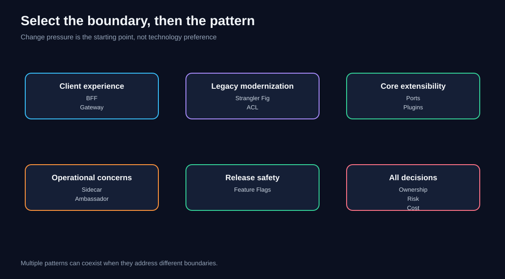
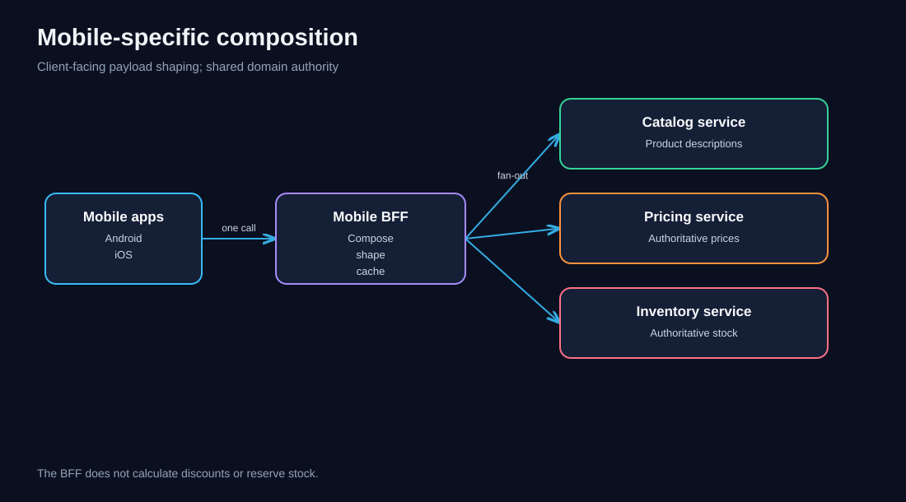
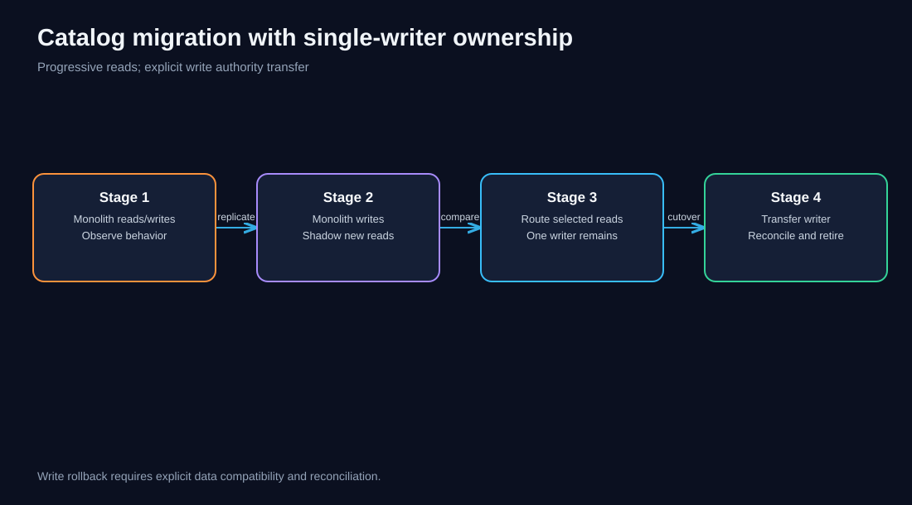
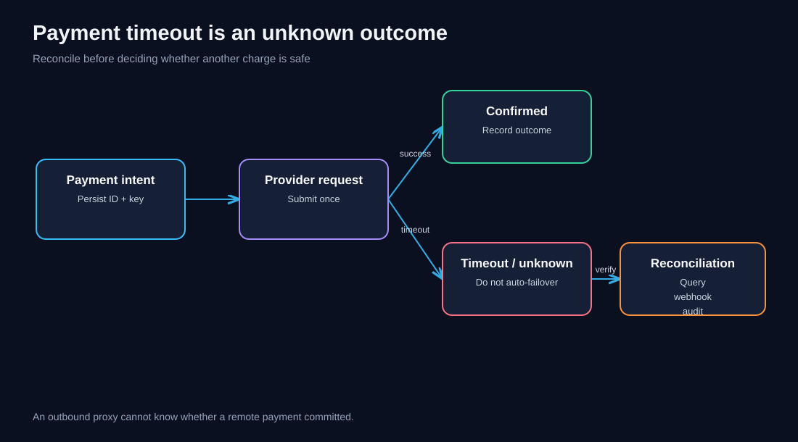
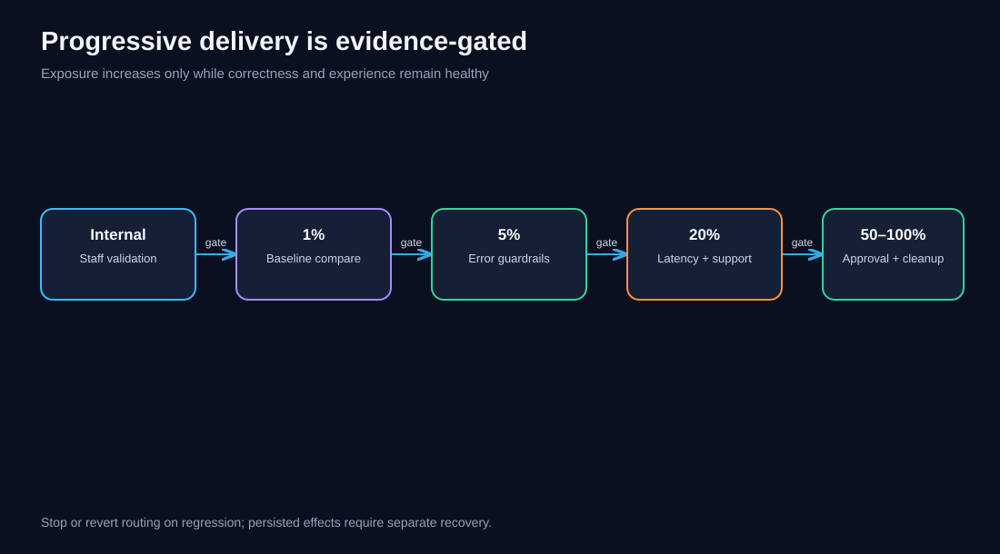
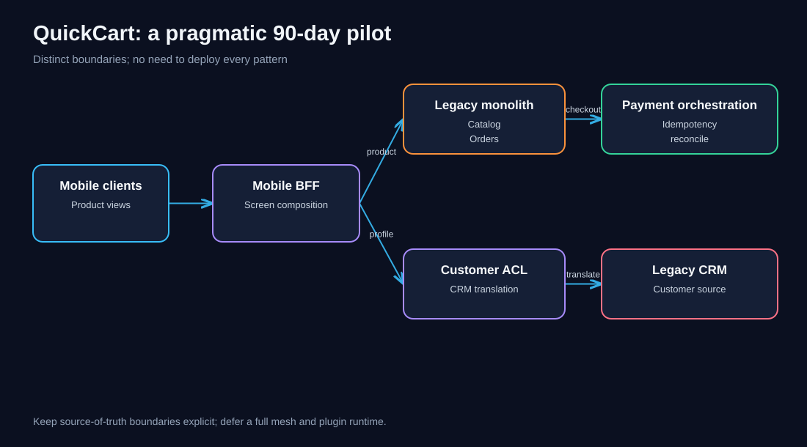
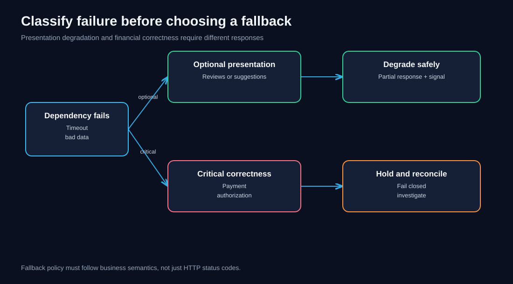
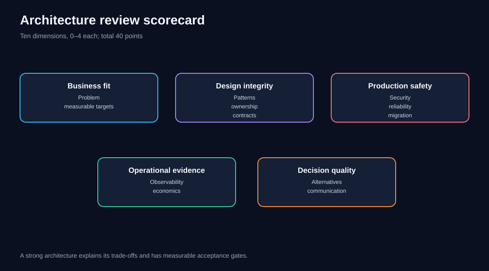

# Chapter 12 — Architecture Challenges Workbook

> **Software Extensibility Architecture Patterns** · QuickCart learning track · Hands-on workbook  
> **Audience:** Software engineers, architects, technical leads, and delivery managers  
> **Estimated study time:** 5–8 hours, including independent design work  
> **Prerequisites:** Chapters 00–11, especially the pattern comparison and integrated QuickCart case study.

## 1. Purpose and learning outcomes

The previous chapters explained individual patterns and showed how QuickCart could combine them. This chapter changes the learning mode: **you make the decisions first**, then compare your reasoning with worked reference solutions. The goal is not to memorize diagrams. It is to recognize change pressure, draw clear responsibility boundaries, identify failure modes, quantify trade-offs, and defend a rollout plan.

By the end, you should be able to (1) select and reject patterns for a stated problem, (2) draw a current and target architecture, (3) define contracts and ownership, (4) calculate simple latency, capacity, and ROI estimates, (5) design migration and rollback, and (6) create an observable, governable implementation plan.

**Case-study convention:** QuickCart is fictional. Every traffic number, price, service level, and staffing estimate in this workbook is an **illustrative assumption**, not measured production data. Replace assumptions with real measurements before making an investment decision.

## 2. How to use the workbook

For each challenge: read only the brief and constraints; spend the suggested time producing a diagram and one-page decision record; then open the reference answer. Reference answers are **defensible examples**, not uniquely correct solutions. If your alternative preserves ownership, security, correctness, and operational safety with fewer moving parts, it may be better.

A strong submission includes a problem statement, context diagram, decision and rejected alternatives, interface/ownership boundaries, normal and failure request flows, rollout/rollback plan, measurable acceptance criteria, and open risks. Use the rubric in Section 19.

### The nine patterns in scope

| Pattern | Primary question it answers | Typical trap |
|---|---|---|
| Sidecar | How do we attach operational capabilities to an app instance? | Assuming containers share files by default |
| Ambassador | How do we standardize an app's outbound calls? | Retrying non-idempotent payments |
| Anti-Corruption Layer (ACL) | How do we shield a modern domain from legacy semantics? | Treating translation as a trivial field rename |
| Backends for Frontends (BFF) | How do clients receive purpose-built interfaces? | Copying pricing or checkout rules into each BFF |
| Strangler Fig | How do we replace a legacy capability incrementally? | Splitting authoritative writers |
| API Gateway | How do we govern and route inbound API traffic? | Putting all domain orchestration at the edge |
| Plugin Architecture | How do we add bounded extensions through contracts? | Running untrusted plugins with unrestricted privileges |
| Ports and Adapters | How do we isolate business rules from technology? | Making the domain import provider SDKs |
| Feature Flags | How do we separate deployment from release? | Leaving flags permanently without ownership |



**Diagram walkthrough:** Start with the change pressure, not a preferred technology. External client differences suggest BFFs; legacy replacement suggests Strangler Fig; legacy semantic mismatch suggests ACL. These can coexist at distinct boundaries.


## 3. Challenge 1 — The slow mobile product page

**Difficulty:** Foundation · **Timebox:** 25 minutes

**Brief:** QuickCart's Android app makes six sequential API calls to render a product screen. The web client uses the same generic endpoint but needs far more information. Product details, price, availability, reviews, promotions, and delivery estimates are supplied by different domain services. The mobile team requests one compact response.

**Constraints:** Pricing and inventory remain owned by domain services. Android and iOS currently need nearly identical payloads. Public API consumers must not depend on internal mobile contracts.

**Tasks:** Draw a before/after architecture. Choose BFF granularity. Define a sample mobile response. State who owns pricing. List two failure modes and three success metrics.

<details><summary><strong>Reference solution — reveal after attempting</strong></summary>

Introduce a **Mobile BFF** shared by Android and iOS, and keep a separate Web BFF only if web-specific composition materially differs. Both call the same Pricing, Catalog, Inventory, and Delivery services. The mobile BFF may request independent data concurrently and return a compact view model; it must never recalculate discounts or stock reservations.

A reasonable contract is `GET /mobile/v1/products/{id}/screen`, returning `id`, `title`, `imageUrl`, `displayPrice`, `availability`, `deliverySummary`, and a `partialData` indicator. A response field such as `displayPrice` is the output of the Pricing service, not a new pricing algorithm.

Handle review-service failure by omitting optional reviews with explicit partial status; handle pricing-service failure by withholding purchase actions rather than inventing a price. Measure mobile screen p95 render time, bytes transferred per screen, and BFF downstream failure rate. Do not split Android and iOS BFFs until their requirements and ownership genuinely diverge.

**Reject:** A new generic gateway that contains mobile view-model logic; duplicating discount calculations in the BFF.

</details>



**Diagram walkthrough:** The client-specific composition boundary sits above domain services. Parallel fan-out reduces waiting time only for independent calls; the slowest dependency and BFF processing still determine the critical path.


## 4. Challenge 2 — Legacy customer identifiers

**Difficulty:** Intermediate · **Timebox:** 30 minutes

**Brief:** QuickCart's old CRM uses `CUST-NNNNN`, marks dormant customers with `status=H`, and treats a missing address as an empty string. The new Customer domain uses UUIDs, an explicit `Suspended` state, and nullable addresses. Checkout needs a reliable modern customer profile while the CRM remains operational.

**Tasks:** Pick a pattern, define a translation contract, identify the source of truth, and propose tests. Explain why simple JSON field mapping is insufficient.

<details><summary><strong>Reference solution</strong></summary>

Place an **ACL** at the Customer-domain boundary. Define a stable mapping from legacy IDs to modern customer IDs in a governed identity map. Translate `H` according to a documented business interpretation approved by the domain owner; do **not** assume `H` means `Suspended` without validating legacy semantics. Translate blank address to a nullable representation only if that reflects the intended domain meaning. Preserve provenance and mapping version for investigation.

The CRM remains authoritative for its owned fields until an explicit migration event transfers ownership. The ACL may be a module or service; choose deployment based on ownership, scaling, and isolation needs. Tests should include unknown statuses, duplicate mappings, absent IDs, malformed records, and backward compatibility.

**Reject:** Importing CRM enums directly into Checkout; permitting both CRM and Customer services to independently edit the same authoritative field.

</details>

## 5. Challenge 3 — Replace the catalog without a big-bang release

**Difficulty:** Intermediate · **Timebox:** 40 minutes

**Brief:** QuickCart's monolith serves catalog pages and also updates product descriptions. A new Catalog service is ready for a limited category. Merchandising insists that no edits disappear during migration.

**Tasks:** Draw a four-stage migration. Specify read and write ownership at every stage. Decide how to compare old and new results. Define rollback conditions.

<details><summary><strong>Reference solution</strong></summary>

Use **Strangler Fig** routing at an ingress boundary, with an ACL where old product semantics differ. Stage 1: instrument monolith behavior and identify authoritative catalog writers. Stage 2: replicate changes to a read-only new catalog using a transactional outbox or carefully governed CDC; compare outputs in shadow mode without customer-visible effects. Stage 3: move one category's reads behind an explicit route and retain a single writer. Stage 4: transfer write authority through a controlled cutover, verify parity and reconciliation, then decommission old routes.

A read rollback may be simple while the monolith remains synchronized. A write rollback is **not automatically safe** after authority changes; it may require reverse replication, a pause, or forward-fix. Define who can authorize cutover and rollback.

**Reject:** Bidirectional writes without conflict resolution; sending shadow requests that mutate inventory or trigger emails.

</details>



**Diagram walkthrough:** Traffic routing and data ownership are separate decisions. The diagram highlights one authoritative writer per stage and a deliberate handover.


## 6. Challenge 4 — Third-party shipping integrations

**Difficulty:** Intermediate · **Timebox:** 35 minutes

**Brief:** QuickCart must support ten regional carriers. Each offers a different label-purchase API. New integrations arrive monthly, and some vendor SDKs are poorly maintained.

**Tasks:** Choose between direct SDK imports, a plugin model, ports/adapters, or both. Design the contract and isolation boundary. Identify operational and supply-chain risks.

<details><summary><strong>Reference solution</strong></summary>

Define a `ShippingLabelPort` in the domain-facing application layer and implement carrier adapters. If independently developed integrations must be installed or upgraded without core releases, add a **Plugin Architecture** around a versioned `CarrierPlugin` contract and a controlled registry. A plugin may implement an outbound port; the patterns complement one another.

A label purchase request should include a stable idempotency key, shipment ID, validated destination, service level, and approved label cost. Return an external label ID, status, and structured error. Restrict network egress and credentials per carrier; verify signatures or provenance of plugin artifacts; run untrusted code in a separate process or service rather than assuming in-process sandboxing. Observe carrier latency, timeout rate, error taxonomy, and reconciliation gaps.

**Reject:** A plugin that can query all customer records or directly alter order totals; unlimited automatic retries of label purchases.

</details>

## 7. Challenge 5 — Payment-provider failover

**Difficulty:** Advanced · **Timebox:** 45 minutes

**Brief:** Payment provider A intermittently times out. An engineer proposes an Ambassador proxy that automatically retries every failed charge against provider B.

**Tasks:** Identify correctness hazards, decide which patterns belong where, and write a safe payment state machine.

<details><summary><strong>Reference solution</strong></summary>

**Do not blindly retry a payment across providers.** A timeout is ambiguous: provider A may have committed the charge. The Checkout domain should own the payment workflow and use a `PaymentPort` with provider adapters. An outbound Ambassador can standardize transport, TLS, telemetry, and bounded connection timeouts, but cannot infer business idempotency across unrelated providers.

Model `Requested → Pending/Unknown → Confirmed | Declined | Reconciled`. Persist a unique payment intent and provider idempotency key before dispatch. On ambiguous timeout, query provider A or reconcile via webhook before attempting a new charge. A failover decision requires business authorization and a guarantee that duplicate charging is prevented. Trace with redacted identifiers; do not log card data.

**Reject:** Network retry policies that treat POST charges as safe by default; letting the proxy choose another payment processor autonomously.

</details>



**Diagram walkthrough:** An unknown outcome is not the same as a failed charge. Reconciliation sits between timeout and any potential alternative payment attempt.


## 8. Challenge 6 — Flash-sale API overload

**Difficulty:** Advanced · **Timebox:** 40 minutes

**Brief:** A promotional event increases requests tenfold. Bots call catalog endpoints aggressively while authenticated customers struggle to complete checkout.

**Tasks:** Allocate responsibilities across API Gateway, BFF, Sidecar/Ambassador, and domain services. Set a priority policy. Identify metrics that prove protection works.

<details><summary><strong>Reference solution</strong></summary>

At the **API Gateway**, validate credentials, apply coarse quotas and per-route rate limits, and distinguish anonymous browsing from authenticated checkout traffic. At BFFs, compose client responses and cache safe read-only views where freshness requirements allow. Service-local sidecars or outbound Ambassadors can enforce transport timeouts and collect telemetry. Catalog may use caching and load shedding. Checkout must enforce its own authorization, idempotency, and inventory consistency.

Protect high-value traffic using separate resource pools and admission limits; avoid promising fairness solely from a single global rate limit. Track accepted/rejected RPS by route, customer checkout success rate, p95 latency, gateway 429s, origin saturation, and bot false positives. Verify that a 429 includes a sensible retry hint when appropriate.

**Reject:** Placing inventory reservation logic in the gateway; unlimited queueing that turns overload into a latency collapse.

</details>

## 9. Challenge 7 — Safe Checkout v2 rollout

**Difficulty:** Intermediate · **Timebox:** 35 minutes

**Brief:** Checkout v2 has passed staging tests. Product wants 1% customer exposure, followed by 5%, 20%, 50%, and 100% if guardrails remain healthy.

**Tasks:** Design deterministic assignment, rollout gates, kill-switch behavior, and database compatibility. Distinguish flag rollback from data rollback.

<details><summary><strong>Reference solution</strong></summary>

Use a server-evaluated **Feature Flag** keyed by a stable, privacy-conscious customer identifier; use deterministic hashing so users stay in the same cohort. Define the flag's owner, expiry date, intended removal plan, and audit trail. Gate increases on checkout conversion, payment error rate, order duplication, p95 latency, and customer support signals. Maintain schema compatibility across both code paths during rollout.

A kill switch can route future requests to Checkout v1, but it does not undo orders already written by v2. If v2 changes persisted semantics, plan reversible migrations or a forward-fix path before launch. Keep assignment consistent across BFF and checkout; avoid independent evaluations that disagree.

**Reject:** Re-randomizing users per request; treating a flag as a substitute for rollback and reconciliation planning.

</details>



**Diagram walkthrough:** Each exposure increase requires explicit evidence. Stop, hold, or rollback is a decision gate, not merely a timer.


## 10. Challenge 8 — Design the public partner API

**Difficulty:** Intermediate · **Timebox:** 30 minutes

**Brief:** Merchants want public order-status APIs. Internal mobile BFF contracts are evolving weekly. The partner API requires multi-year compatibility, quotas, and auditable access.

**Tasks:** Decide whether partners should use the mobile BFF, the API Gateway, or a dedicated partner API. Propose authorization and versioning rules.

<details><summary><strong>Reference solution</strong></summary>

Use an **API Gateway** for public ingress controls and a dedicated partner-facing API/application boundary where partner contracts and long-term lifecycle differ from mobile. Reuse shared Order domain services. Authenticate clients with an appropriate identity mechanism, authorize access to each merchant's orders at the domain boundary, issue least-privilege scopes, and audit sensitive reads. Version contracts deliberately and provide deprecation windows. Rate-limit by merchant and application, with fair-use protections.

**Reject:** Exposing the internal mobile BFF directly; assuming a valid token alone authorizes access to any order.

</details>

## 11. Challenge 9 — A service mesh proposal

**Difficulty:** Advanced · **Timebox:** 30 minutes

**Brief:** Platform engineering wants to add a service mesh because several teams independently implement mTLS, retries, and tracing.

**Tasks:** Distinguish service mesh, Sidecar, and Ambassador. Recommend an adoption sequence and a safety checklist.

<details><summary><strong>Reference solution</strong></summary>

A **Sidecar** is a deployment pattern; an **Ambassador** is an outbound proxy role; a **service mesh** is a broader connectivity and policy system, often but not necessarily implemented using sidecar proxies. Start by inventorying actual duplicated capabilities and identifying service-level reliability gaps. Pilot on low-risk traffic, measure proxy overhead, and define ownership of certificates, policies, and upgrades. Explicitly exclude payment mutations from generic retries and test connection draining, policy misconfiguration, DNS failure, and certificate rotation.

Remember that Kubernetes containers in a Pod share a network namespace but not arbitrary filesystems; mount explicit shared volumes where needed. Prefer mesh adoption when operational benefit exceeds its new control-plane and data-plane complexity.

**Reject:** Deploying a mesh as an automatic solution to bad API contracts or domain coupling.

</details>

## 12. Challenge 10 — Integrated architecture design lab

**Difficulty:** Capstone · **Timebox:** 90–120 minutes

**Brief:** QuickCart operates a monolith containing Catalog, Customer, Orders, Checkout, and shipping integrations. Mobile product pages are slow, the legacy CRM is semantically incompatible with a new Customer model, payment provider failures cause manual reconciliation, and carrier integrations require frequent core releases. A 90-day pilot budget permits only three teams.

**Deliverables:**

1. Current-state context diagram with trust boundaries and bottlenecks.
2. Target architecture with at most six newly introduced runtime components.
3. Pattern-to-problem mapping; name at least two patterns you intentionally **do not** deploy.
4. Data ownership matrix for Catalog, Customer, Orders, Payments, and Shipping.
5. Three-wave delivery roadmap, with release gates and rollback.
6. SLOs, telemetry, threat controls, staffing, and a simple cost-benefit hypothesis.

<details><summary><strong>Reference capstone solution</strong></summary>

**Prioritize risk and value, not pattern count.** One plausible three-team pilot:

- **Team A, experience:** Build a Mobile BFF for product screens; retain Pricing/Inventory domain authority. Route through existing ingress rather than introducing a second gateway product unnecessarily.
- **Team B, modernization:** Introduce a Customer ACL and map legacy CRM semantics; keep legacy CRM authoritative until explicitly transferred.
- **Team C, payments/integrations:** Extract payment orchestration behind ports/adapters, add persistent idempotency and reconciliation, and implement a first shipping carrier adapter. Defer a dynamic plugin marketplace until repeated integration demand validates the need.

**Runtime components:** Mobile BFF, Customer ACL (if deployment isolation is needed), Payment orchestration service, Payment reconciliation worker, Shipping integration service, and a read model if product-screen latency warrants it. An ACL may instead be an in-process module; count and justify actual deployment units. Reuse existing ingress and observability.

**Defer:** A full service mesh and broad plugin runtime in the first 90 days. Also defer wholesale Catalog strangling unless the pilot's critical path demands it. These may be future stages, not failures to adopt patterns.

**Ownership:** Catalog product metadata stays in monolith during pilot; Customer fields stay in CRM; Orders stay in monolith; Payment orchestration owns payment intents and provider status, while order state changes occur through a documented contract; Shipping integration owns external carrier communication but not order totals.

**Three waves:** Days 1–30 baseline SLOs, domain contracts, payment state-machine tests, and CRM semantic mapping. Days 31–60 pilot Mobile BFF and reconciliation behind flags; verify idempotency and read parity. Days 61–90 controlled exposure, performance gates, incident drills, and a go/no-go review. Roll back client routing and flags only where data compatibility is established; payment writes require reconciliation rather than simple reversal.

**Acceptance criteria:** Measurable reduction in mobile p95 and payload, zero observed duplicate payment captures in test/controlled pilot, reconciliation backlog within a documented target, and no cross-tenant order access. Baseline and target values require discovery; do not invent a claimed production improvement.

</details>



**Diagram walkthrough:** Client composition, legacy translation, and payment orchestration occupy distinct boundaries. The pilot deliberately avoids adding a pattern at every possible location.


## 13. Numerical exercise A — Mobile request latency

A product screen currently performs six **sequential** requests with observed p95 times of 80, 95, 110, 70, 125, and 90 ms. The new BFF makes five independent downstream requests in parallel; their times are 80, 95, 110, 70, and 125 ms. Assume 20 ms of BFF overhead and ignore connection setup and correlation effects for this simplified example.

**Questions:** What is the naive sequential total? What is the simplified parallel critical path? What is the approximate reduction?

<details><summary><strong>Worked calculation</strong></summary>

Sequential total = 80 + 95 + 110 + 70 + 125 + 90 = **570 ms**. Simplified parallel critical path = max(80, 95, 110, 70, 125) + 20 = **145 ms**. Approximate reduction = (570 − 145) / 570 = **74.6%**.

**Caveat:** The sum of individual p95s is not generally the p95 of a combined workflow, nor is the maximum of individual p95s necessarily the fan-out p95. This is a pedagogical latency budget. Validate with distributed traces and end-to-end load tests.

</details>

## 14. Numerical exercise B — Gateway capacity

A gateway tier must handle **2,400 peak RPS**. One replica sustains **400 RPS** at the chosen latency target. Plan for **30% headroom** and survive the loss of one replica.

**Questions:** What is the minimum count before failure? How many replicas are needed with N−1 availability?

<details><summary><strong>Worked calculation</strong></summary>

Use at most 70% of tested capacity: 400 × 0.70 = **280 RPS per replica**. Minimum healthy replicas = ceil(2400 / 280) = **9**. To retain nine after one fails, deploy at least **10 replicas**, assuming equal capacity and sufficient node/network resources. Test load balancing, regional failure assumptions, and connection churn separately.

</details>

## 15. Numerical exercise C — Data transfer

QuickCart serves **2 million mobile product views per day**. A generic payload averages **420 KB**, while the BFF payload averages **130 KB**. Use decimal KB for this exercise.

**Questions:** How much traffic is avoided per day and over a 30-day month? What else must be measured before claiming savings?

<details><summary><strong>Worked calculation</strong></summary>

Difference = 290 KB/view. Daily reduction = 2,000,000 × 290 KB = **580 GB/day** (decimal). Thirty-day reduction = **17.4 TB**. This is a reduction in client payload bytes under the stated assumptions, **not automatically a reduction in total infrastructure egress**, because BFF-to-service traffic and caching behavior may change. Validate compression, CDN caching, geography, mobile data costs, and provider pricing.

</details>

## 16. Numerical exercise D — Illustrative ROI

A pilot costs **$140,000** to build and adds **$2,000/month** in ongoing operating costs. It saves **100 engineer-hours/month** valued at **$80/hour**, and avoids **$3,000/month** in incident-response cost. Assume benefits start immediately after launch and ignore discounting.

**Questions:** Calculate monthly net benefit, simple payback period, and first-year net benefit.

<details><summary><strong>Worked calculation</strong></summary>

Gross monthly benefit = 100 × $80 + $3,000 = **$11,000**. Net monthly benefit = $11,000 − $2,000 = **$9,000**. Simple payback = $140,000 / $9,000 ≈ **15.6 months**. First-year net benefit after initial build = 12 × $9,000 − $140,000 = **−$32,000**. This pilot does not pay back within year one under these assumptions. Engineer time savings are economic value only if time is genuinely redeployed or costs are avoided.

</details>

## 17. Numerical exercise E — Canary exposure

A rollout targets 1%, 5%, 20%, and 50% of **80,000 eligible daily users**. Assume stable assignment and uniform eligibility.

**Question:** How many distinct eligible users are expected at each stage?

<details><summary><strong>Worked calculation</strong></summary>

1% = **800**; 5% = **4,000**; 20% = **16,000**; 50% = **40,000**. These are expected cohort sizes, not a guarantee of daily exposure or statistical power. For low-frequency payment failures, even 40,000 users may be insufficient to detect small regressions quickly; use suitable sample-size and risk analysis.

</details>


## 18. Cross-cutting failure-injection lab

Pick any two challenges and run this tabletop exercise. For each event, state the expected customer experience, timeout or recovery behavior, monitoring signal, and incident owner.

| Injected event | Questions the architecture must answer |
|---|---|
| Gateway configuration rejects valid JWTs | Is there a safe rollback of policy and a protected emergency path? |
| BFF's review dependency times out | Is a partial product view acceptable, and is it visibly marked? |
| CRM returns an unknown status | Does ACL fail closed for sensitive actions and preserve evidence? |
| Payment provider returns HTTP 504 after charge submission | Can the workflow reconcile before attempting another charge? |
| Plugin package signature fails | Is activation blocked and the previous plugin retained? |
| Flag service becomes unavailable | Which predeclared default applies, and is it consistent across services? |
| Catalog CDC lags by 15 minutes | Are stale reads exposed, and should migration pause? |
| A sidecar certificate expires | Can the app report the cause without bypassing mTLS policy? |

A good failure design explicitly separates **safe degradation** (e.g., reviews missing) from **correctness-critical failure** (e.g., unknown payment outcome). Define error budgets and escalation paths for both.



**Diagram walkthrough:** First classify whether the failed dependency affects correctness, security, or optional presentation. Only then choose fallback, hold, reconcile, or fail closed.

## 19. Architecture review rubric

Score each dimension from **0 to 4**, for a total of **40 points**. A score of 0 means absent; 1 means mentioned without a mechanism; 2 means plausible but incomplete; 3 means concrete and testable; 4 means concrete, tested, and justified against alternatives.

| Dimension | What earns a 4 |
|---|---|
| Problem framing | Measurable problem, constraints, assumptions, and non-goals |
| Pattern selection | Appropriate patterns plus justified rejections |
| Domain ownership | Single authoritative owner per business fact |
| Interface contracts | Versioned schemas, failure semantics, idempotency |
| Security | Trust boundaries, least privilege, tenant checks, audit |
| Reliability | Timeouts, degradation, reconciliation, overload handling |
| Migration | Small stages, explicit cutover and feasible rollback |
| Observability | End-to-end SLOs, traces, logs, dashboards, alerts |
| Economics | Transparent assumptions, capacity and cost sensitivity |
| Communication | Readable diagrams, ADR, responsibilities and decisions |

**Interpretation:** 34–40 production-review ready subject to real validation; 26–33 strong proposal with targeted gaps; 18–25 needs revision; below 18 revisit problem framing and boundaries. This is a learning rubric, not an external certification standard.



**Diagram walkthrough:** Review business value, boundaries, safety, operational evidence, and communication as a coherent proposal—not as isolated checkboxes.

## 20. Architecture decision record template

Copy and fill in the following for any challenge:

```text
ADR ID / title:
Date / owner / reviewers:
Status: proposed | accepted | superseded
Business problem and measurable target:
Current state and constraints:
Decision:
Pattern(s) selected and placement:
Alternatives considered and rejected:
Domain data ownership:
API / event contracts and compatibility:
Security / privacy / compliance controls:
Failure modes and idempotency:
Rollout, cutover, and rollback:
Telemetry / SLOs / alert thresholds:
Capacity / cost assumptions:
Open questions and revisit trigger:
```

A decision record should explain **why** a boundary exists, not merely show that it exists.

## 21. Knowledge checks

Try answering before expanding the explanation.

<details><summary>1. Does a BFF own the discount calculation for its client?</summary>No. A BFF may shape or aggregate the response, but the shared Pricing domain owns discount rules.</details>

<details><summary>2. Can an ACL be implemented as an in-process module?</summary>Yes. ACL is a logical semantic boundary; deployment form depends on coupling, ownership, scale, and operations.</details>

<details><summary>3. Does Strangler Fig guarantee safe write rollback?</summary>No. Once write authority or data semantics change, rollback may need reverse synchronization, pause, reconciliation, or forward repair.</details>

<details><summary>4. Are API Gateway and BFF interchangeable?</summary>No. Gateways primarily govern inbound access and traffic; BFFs provide client-specific composition and presentation contracts.</details>

<details><summary>5. Does an Ambassador make payment POST retries safe?</summary>No. Transport retries cannot establish whether a timed-out charge committed. Business-level idempotency and reconciliation are required.</details>

<details><summary>6. What does Ports and Adapters protect?</summary>The domain/application logic from direct dependence on frameworks, databases, and provider-specific SDKs.</details>

<details><summary>7. When is a plugin system justified over ordinary adapters?</summary>When extensions require independent discovery, installation, upgrade, or lifecycle management under stable contracts.</details>

<details><summary>8. Is a feature-flag kill switch a database rollback?</summary>No. It can stop future exposure but does not undo persisted effects.</details>

<details><summary>9. Do Kubernetes containers in one Pod automatically share a filesystem?</summary>No. They share networking, but file sharing requires explicitly configured shared volumes.</details>

<details><summary>10. What is a safe response to an unknown CRM status?</summary>Do not invent domain meaning. Reject or quarantine the translation for sensitive flows, record evidence, and obtain a domain-approved mapping.</details>

<details><summary>11. What determines parallel fan-out latency?</summary>The critical path, including slowest required dependency, processing, queuing, and network overhead—not the sum of independent service latencies.</details>

<details><summary>12. Why should a public partner API not simply reuse a mobile BFF?</summary>Partner contracts usually have different compatibility, security, authorization, quota, and lifecycle requirements.</details>

## 22. Suggested workshop format

**Individual study (one day):** Complete Challenges 1–4, Exercises A–C, then the capstone. Review reference answers only after drafting.

**Team workshop (two half-days):** Day 1: assign three teams the experience, migration, and payments challenges; exchange ADRs and use the rubric for peer review. Day 2: combine proposals into the capstone, inject two failures, calculate ROI, and present a go/no-go recommendation.

**Assessment submission:** One context diagram, one target diagram, one migration timeline, one ownership table, two contracts, one reliability tabletop, one numerical calculation, and one ADR.

## 23. Common answer-quality mistakes

1. **Pattern bingo:** deploying every pattern even where a simpler module would suffice.
2. **Confusing deployment with domain boundaries:** a separate service does not automatically establish correct ownership.
3. **Ignoring ambiguous outcomes:** timeout is not always failure, especially for payments.
4. **Assuming rollback is free:** data writes and external side effects may be irreversible.
5. **Optimizing average latency only:** customers experience tail latency and partial failures.
6. **Calling illustrative ROI a forecast:** cost and benefit assumptions require validation.
7. **Ignoring operational ownership:** every new proxy, plugin, or BFF needs support, telemetry, and change governance.
8. **Missing authorization:** authentication at the edge does not prove permission to access a specific resource.

## 24. Final readiness checklist

- [ ] I can identify the change pressure before choosing a pattern.
- [ ] I can state the business rule owner and the authoritative data writer.
- [ ] I can distinguish API Gateway, BFF, Ambassador, and Sidecar.
- [ ] I can design ACL translation for semantic—not just syntactic—differences.
- [ ] I can describe Strangler Fig read and write migration separately.
- [ ] I can design safe idempotency and reconciliation for payment uncertainty.
- [ ] I can decide whether a plugin runtime is justified.
- [ ] I can separate domain ports from infrastructure adapters.
- [ ] I can design progressive rollout gates and flag retirement.
- [ ] I can compute simple capacity, latency, and ROI estimates with caveats.
- [ ] I can name observable failure signals and accountable owners.
- [ ] I can explain why an alternative architecture was rejected.

## 25. Looking ahead

**Chapter 13 — Quick Revision and Assessment** will compress the complete nine-pattern curriculum into high-yield comparisons, memory aids, exam-style scenarios, and a final self-assessment. **Chapter 14 — Glossary** will provide a cross-referenced vocabulary for the entire guide.

---

*End of Chapter 12. All QuickCart values and scenarios are educational examples; validate designs, controls, and costs against actual organizational requirements before production use.*
