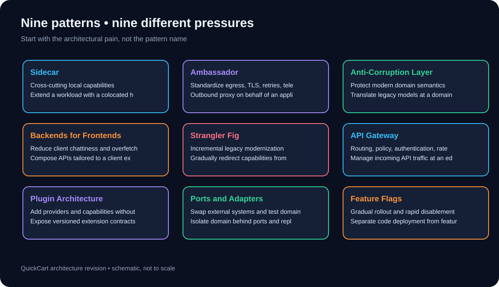
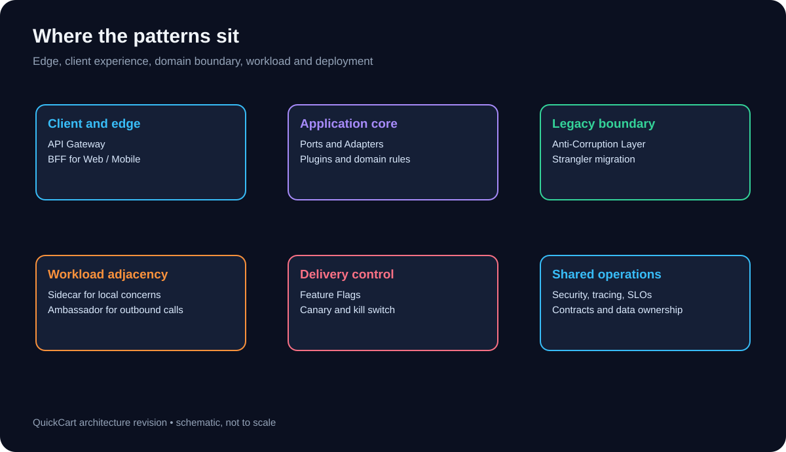
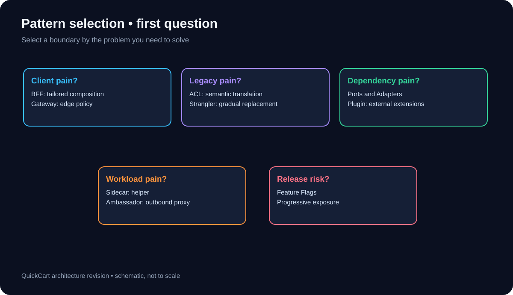
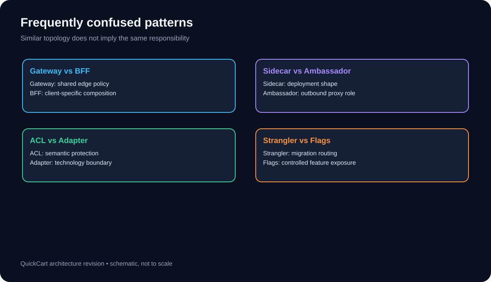
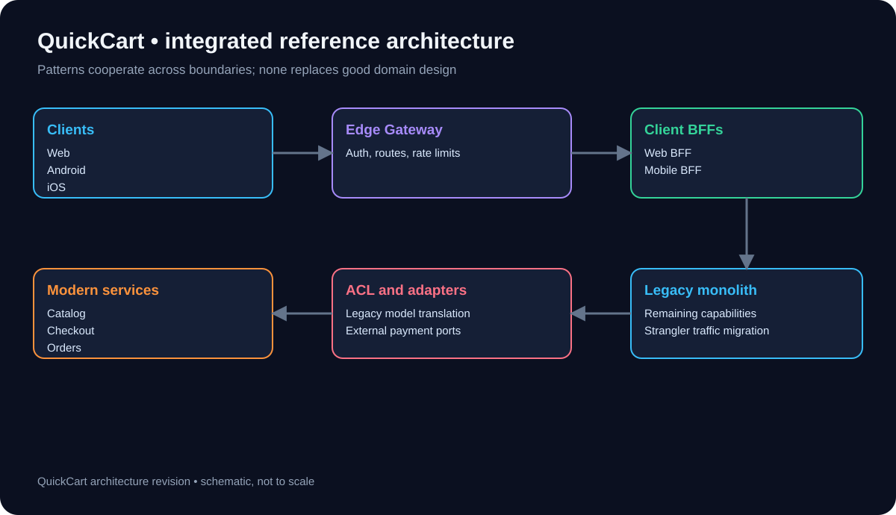
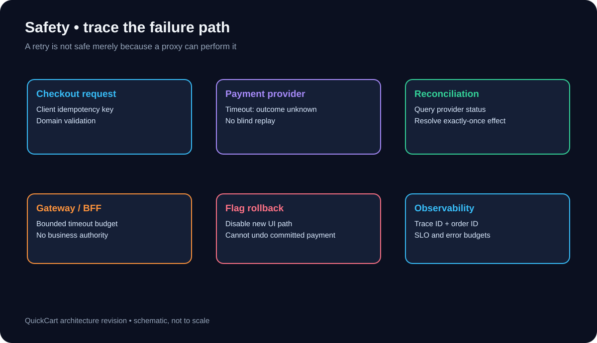
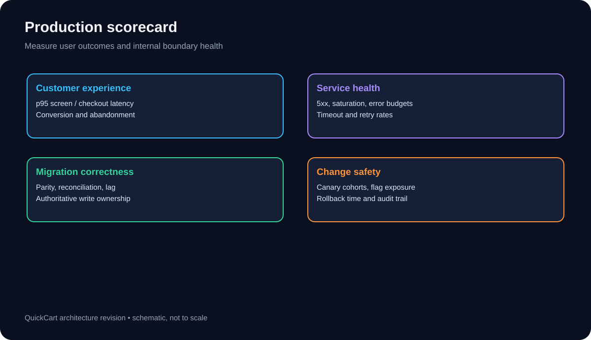
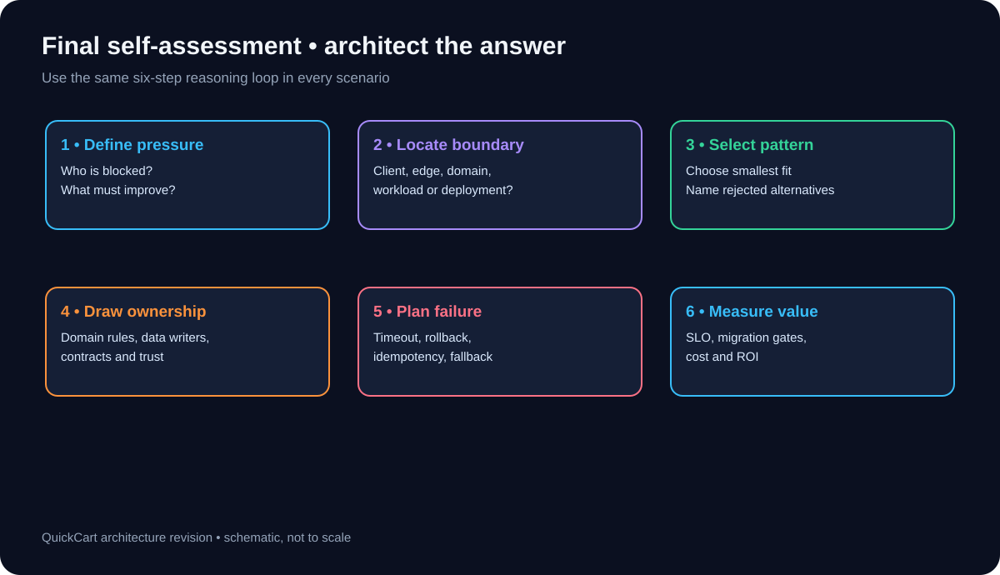

# Chapter 13 — Quick Revision and Final Assessment

> **Software Extensibility Architecture Patterns · QuickCart self-study series**  
> **Purpose:** Convert Chapters 00–12 into a concise-but-substantial architecture revision handbook, decision aid, and closed-book assessment.  
> **Estimated study time:** 2–3 hours for review; 60–90 minutes for the final assessment.  

## 1. Learning outcomes

By the end of this chapter, you should be able to (1) identify the design pressure that motivates each pattern; (2) place it at the right architectural boundary; (3) distinguish commonly confused patterns; (4) combine patterns without overlapping responsibilities; (5) reason about data correctness, resilience, security, observability, and migration; and (6) defend your choices in a short architecture review.

**How to use this guide:** Read Sections 2–8, attempt the closed-book scenarios in Sections 12–14, then open the model answers. For a deeper treatment, revisit the chapter file named in the pattern index. The numerical exercises use **illustrative assumptions**, not measured QuickCart production data.

## 2. One-page pattern index

| Pattern | Primary design pressure | Architectural move | Key danger | Deep dive |
|---|---|---|---|---|

| **Sidecar** | Cross-cutting local capabilities | Extend a workload with a colocated helper | Extra CPU/memory and shared fate | [01](./01-sidecar.md) |

| **Ambassador** | Standardize egress, TLS, retries, telemetry | Outbound proxy on behalf of an application | Unsafe retries and proxy dependencies | [02](./02-ambassador.md) |

| **Anti-Corruption Layer** | Protect modern domain semantics | Translate legacy models at a domain boundary | Translation drift and extra complexity | [03](./03-anti-corruption-layer.md) |

| **Backends for Frontends** | Reduce client chattiness and overfetching | Compose APIs tailored to a client experience | Duplicated domain logic across BFFs | [04](./04-backends-for-frontends.md) |

| **Strangler Fig** | Incremental legacy modernization | Gradually redirect capabilities from old to new | Dual running and data ownership ambiguity | [05](./05-strangler-fig.md) |

| **API Gateway** | Routing, policy, authentication, rate limits | Manage incoming API traffic at an edge | Gateway bottleneck or business-logic creep | [06](./06-api-gateway.md) |

| **Plugin Architecture** | Add providers and capabilities without core edits | Expose versioned extension contracts | Untrusted code and compatibility churn | [07](./07-plugin-architecture.md) |

| **Ports and Adapters** | Swap external systems and test domain logic | Isolate domain behind ports and replaceable adapters | Abstraction proliferation | [08](./08-ports-and-adapters.md) |

| **Feature Flags** | Gradual rollout and rapid disablement | Separate code deployment from feature exposure | Flag debt and inconsistent decisions | [09](./09-feature-flags.md) |

**Diagram walkthrough:** Each card represents a different source of change pressure. The right question is not “Which pattern is most modern?” but “Which boundary is unstable, and who should absorb that instability?”

**Memory rule:** *Sidecar* = beside; *Ambassador* = outbound; *ACL* = translate; *BFF* = tailor; *Strangler* = replace gradually; *Gateway* = front door; *Plugin* = extend; *Ports/Adapters* = invert dependencies; *Flags* = release selectively.

## 3. The boundary-placement test

Architecture patterns are most useful when their boundaries are explicit. A gateway may authenticate a caller and enforce a quota; it should not decide whether a refund is legal. A BFF may aggregate a product view; it should not own the price calculation. An ACL may map `CUST_STATUS=A` into a modern domain concept; it should not leak that legacy code into the modern core.

**Diagram walkthrough:** The top row separates client, application, and legacy concerns. The bottom row captures workload-local helpers, delivery controls, and cross-cutting operational disciplines. A real request crosses several boundaries; that does not make any one pattern responsible for all of them.

| Boundary | Owns | Must not silently own |
|---|---|---|
| API Gateway | Entry routing, edge authentication, throttling, request limits | Checkout business invariants |
| BFF | Client-specific composition and response shapes | Authoritative pricing or inventory |
| Domain core | Orders, payments, inventory, customer rules | Framework or vendor SDK assumptions |
| ACL | Translation between incompatible domain semantics | A permanent second source of truth |
| Adapter | Mapping port calls to external technology | Business policy decisions |
| Sidecar / Ambassador | Workload-local supporting and outbound proxy behavior | Unbounded retry of non-idempotent actions |
| Feature-flag control | Exposure and emergency disablement | Database rollback or payment reversal |

## 4. Rapid decision tree

Start with the symptom. If clients make too many calls to build a screen, consider BFF. If the main need is a shared security and traffic entry point, consider API Gateway. If a legacy system's concepts corrupt a new domain, consider ACL. If capabilities must be extracted gradually, consider Strangler Fig. If a provider SDK is hard-coded in checkout, consider Ports and Adapters; if third-party functionality should be installed through a stable contract, consider Plugin Architecture. If a local helper is needed, consider Sidecar; if outbound calls require standardized proxy policy, Ambassador. If deployment and user exposure must be decoupled, Feature Flags.

**Diagram walkthrough:** The decision starts with five kinds of pain. The same initiative can have several pains, but each pattern should be justified by a distinct one.

**Exam trap:** “We need microservices” is not a requirement. Translate it into a measurable constraint: e.g., “mobile product screens need fewer round trips,” “legacy catalog must be retired without downtime,” or “payment provider changes must not require checkout-domain edits.”

## 5. The four original-course patterns: fast recall

### 5.1 Sidecar

A sidecar is a **deployment and collaboration pattern**: a supporting process/container runs alongside the primary application workload. Typical uses include telemetry collection, local configuration agents, certificate helpers, or proxies. In Kubernetes, containers in one Pod share networking and lifecycle context, but **not automatically their memory or filesystem**; shared volumes must be configured explicitly. Sidecars introduce resource overhead and shared failure fate.

**QuickCart prompt:** Every catalog-service instance needs consistent local telemetry forwarding without changing catalog code. A sidecar is plausible; first verify whether a platform-level collector would be simpler.

### 5.2 Ambassador

An ambassador is an **outbound proxy role**, commonly implemented as a sidecar. It centralizes destination discovery, TLS, policy, metrics, and sometimes bounded retries for calls made by the application. An ambassador is not synonymous with any sidecar, and it does not make payment retries safe. A timed-out charge may already have succeeded; retries require domain idempotency and reconciliation.

**QuickCart prompt:** Checkout integrates with several shipping APIs and wants consistent outbound TLS and metrics. An ambassador can help with transport policy; provider-specific business translation still belongs elsewhere.

### 5.3 Anti-Corruption Layer

An ACL protects a modern domain from incompatible **legacy concepts** by translating semantics at a boundary. It can be a library/module, service, or adapter assembly; it is not necessarily a microservice. Translation must include meaning, not just field renaming. If `P` means “provisional order” in the legacy system, do not automatically map it to “paid” in the modern model.

**QuickCart prompt:** The legacy customer system conflates account suspension with loyalty-tier inactivity. Build explicit translation and test it against business-approved examples.

### 5.4 Backends for Frontends

A BFF is a **client-experience-oriented backend** that aggregates and shapes responses for a particular interface, such as Web or Mobile. It can reduce round trips, payload size, and UI coupling. BFFs should not duplicate pricing, inventory, authorization authority, or checkout rules. Android and iOS can share a Mobile BFF when their needs are similar; split only for a demonstrated divergence.

**QuickCart prompt:** The mobile product page requires six sequential requests and overfetches desktop-only fields. A Mobile BFF can orchestrate calls concurrently and return a compact response.

## 6. The five expanded patterns: fast recall

### 6.1 Strangler Fig

Gradually move **capability ownership and routing** from a legacy system to modern services. First make routes explicit, then establish one authoritative writer for each migrated domain, validate parity, canary traffic, and decommission old paths. A routing switch alone is not a safe migration if both systems independently mutate the same data.

### 6.2 API Gateway

The gateway is the **shared ingress policy point**: routing, authentication, quotas, limits, and API lifecycle controls. Domain services still enforce resource-level authorization. An API Gateway is not a substitute for a BFF or domain service, and it must be deployed for high availability.

### 6.3 Plugin Architecture

A host exposes **stable, versioned extension contracts**. Providers implement those contracts, enabling new capabilities without modifying the host's core. Decide whether plugins are trusted in-process modules or isolated external processes; untrusted plugins require stronger sandboxing, permissions, timeouts, and supply-chain review.

### 6.4 Ports and Adapters

The **domain core defines ports**, and external adapters implement them. Dependency arrows point inward toward business abstractions, not outward to database clients or vendor SDKs. This makes the core easier to test with fakes and change providers without rewriting rules. An ACL may be implemented inside an adapter when semantic translation is necessary.

### 6.5 Feature Flags

Flags separate **deployment from exposure**. Use deterministic targeting, guarded rollout stages, monitoring by cohort, and documented cleanup dates. Flags are not a substitute for backward-compatible schema changes, transaction safety, or reversible data migration. Kill switches can stop new traffic but cannot undo an already committed payment.

## 7. Confusable pairs: precision matters

**Diagram walkthrough:** Each pair can look similar in deployment diagrams, yet serves a different responsibility. Distinguish patterns by *why the boundary exists*, not merely by where a component runs.

| Pair | Critical distinction | QuickCart example |
|---|---|---|
| Gateway vs BFF | Edge-wide policy vs client-specific composition | Gateway verifies token; Mobile BFF shapes product response |
| Sidecar vs Ambassador | Deployment arrangement vs outbound-proxy responsibility | Telemetry sidecar; payment-egress ambassador |
| ACL vs Adapter | Semantic domain translation vs technology integration | Translate legacy loyalty states; implement SQL repository port |
| ACL vs Strangler | Protect model vs migrate capability ownership | ACL maps customer records while Strangler moves customer routes |
| Plugin vs Ports/Adapters | Host extension ecosystem vs domain dependency inversion | Add shipping plugins through a stable shipping port |
| Feature Flags vs Canary | Cohort-based feature exposure vs deployment-traffic exposure | Enable new checkout for 5% vs route 5% to a new service version |
| Gateway vs service mesh | North–south ingress vs primarily east–west service communication | Public edge policy vs internal mTLS and service telemetry |
| BFF vs GraphQL | Architectural ownership vs query interface technology | Mobile BFF can expose REST or GraphQL |

**Important nuance:** These comparisons are not either/or product choices. A gateway may route to a BFF, which invokes a domain service built with Ports and Adapters, whose outbound calls traverse an Ambassador.

## 8. Integrated QuickCart reference architecture

**Diagram walkthrough:** Client requests enter through a Gateway, reach a client-specific BFF, and then domain services. Some domain calls cross ACL/adapter boundaries into legacy capabilities. Strangler routing changes ownership gradually; Feature Flags govern selected exposure paths. Sidecars and ambassadors can support individual workloads without changing domain rules.

**Ownership contract:** Pricing is calculated by Pricing; inventory reservations by Inventory; order state transitions by Orders; payment outcomes by Payments; BFFs only orchestrate client needs. Customer identity comes from the identity authority; edge checks do not replace domain authorization.

**Migration sequence, not a rigid recipe:** (1) baseline traffic and contracts; (2) add gateway visibility; (3) extract low-risk read capability; (4) introduce ACL where semantics diverge; (5) adopt BFF for client pain; (6) modernize write paths with explicit ownership; (7) canary and reconcile; (8) retire legacy paths after measured stability.

## 9. Safety, reliability, and security flashcards

**Diagram walkthrough:** A checkout timeout may conceal a successful charge. Idempotency belongs to the payment/order workflow, not just the proxy; reconciliation resolves ambiguous outcomes. A feature flag can halt new exposure but cannot reverse an irreversible business event.

- **Timeout budgeting:** The caller's deadline must accommodate downstream work, leaving room for serialization and network overhead. Do not let each hop use the entire user deadline.
- **Retry discipline:** Retry transient, safe/idempotent operations with bounded attempts and jitter. Use idempotency keys and reconciliation for payment workflows.
- **Partial failure:** BFFs can omit noncritical recommendations while failing closed for essential checkout totals.
- **Authentication vs authorization:** A valid token identifies a principal; domain services still decide whether that principal may access a specific order.
- **Secrets and trust:** Use least privilege, mTLS where appropriate, secure token exchange/propagation, and avoid logging credentials or personal data.
- **Data ownership:** One authoritative writer per domain during migration. CDC/outbox may distribute changes, but replication does not magically give strong consistency.
- **Rollback:** Rolling back routing is different from reversing schema changes or transactions. Plan forward fixes when rollback is impossible.
- **Failure isolation:** Circuit breakers, bulkheads, bounded queues, and capacity limits should be placed where they actually contain faults.

## 10. Observability and success measures

**Diagram walkthrough:** Measure customer impact, service health, migration correctness, and release safety. A dashboard that only shows CPU and 200 responses cannot prove a migration succeeded.

| Concern | Example metric | Why it matters |
|---|---|---|
| Mobile experience | Product-screen p95 latency, bytes per response | Validates BFF value |
| Edge reliability | Gateway p95, 429 rate, 5xx, saturation | Detects overload and policy errors |
| Payment safety | Duplicate charge count, ambiguous outcomes, reconciliation lag | Protects financial correctness |
| Migration | Route share, parity defects, CDC lag, legacy call volume | Shows whether Strangler cutover is safe |
| Plugin ecosystem | Activation failures, plugin crash rate, contract failures | Exposes extension risk |
| Release quality | Canary error delta, conversion delta, flag cohort sizes | Grounds rollout decisions |
| Cost | Compute, egress, dual-running spend, engineering effort | Prevents “modernization” without benefit |

**Tracing advice:** Propagate correlation context from edge through BFF, domain service, adapter, and external dependency. Record logical business IDs safely (order ID or hashed reference where appropriate), and attach release cohort/version metadata without exposing sensitive user attributes.

## 11. Pattern-selection scorecard

Use a 0–3 rating for each criterion: **0** = no evidence, **1** = weak, **2** = good, **3** = strong. Score candidates on problem fit, boundary clarity, operational burden, team ownership, migration reversibility, security impact, and measurable value. Do **not** choose by total alone: payment correctness, regulatory obligations, and data ownership can be hard constraints.

**Example:** For a slow QuickCart mobile product page, a Mobile BFF scores high on client fit and measurable latency value. A gateway alone scores poorly on response composition. A sidecar may improve telemetry but does not solve the underlying chatty-client problem.

**Architecture Decision Record mini-template:** Context and measured pain → Decision and boundary → Alternatives rejected → Contracts and data ownership → Security/failure/rollback → Metrics and success gates → Owners and review date.

## 12. Closed-book rapid quiz (18 questions)

Try each question before expanding the answer. The goal is to name the *responsibility* and *failure mode*, not memorize slogans.

Q01. Which pattern makes outbound calls through a colocated proxy?

**Answer:** Ambassador. It is often deployed as a sidecar, but the role is outbound traffic mediation.

Q02. Does sharing a Kubernetes Pod automatically share a filesystem?

**Answer:** No. Containers share the Pod network namespace but need explicitly configured volumes to share files.

Q03. Where should a mobile-specific compact product response be composed?

**Answer:** In a Mobile BFF, while price and stock authority remain in domain services.

Q04. Can an API Gateway authorize a customer to refund someone else's order?

**Answer:** Not by token validity alone. The Orders/Refunds domain must enforce resource-level authorization.

Q05. What distinguishes an ACL from a simple DTO mapper?

**Answer:** It protects domain meaning across incompatible models, not just field names.

Q06. Can Strangler routing safely move checkout writes if both old and new services update orders independently?

**Answer:** No. Establish authoritative write ownership and a migration/reconciliation plan.

Q07. Should an ambassador blindly retry a timed-out charge?

**Answer:** No. Payment outcome may be unknown; use idempotency keys, status lookup, and reconciliation.

Q08. Why are plugin contracts versioned?

**Answer:** To manage host/plugin compatibility and allow safe independent extension upgrades.

Q09. What does dependency inversion mean in Ports and Adapters?

**Answer:** Domain abstractions define ports; external adapters depend on those abstractions.

Q10. Are Feature Flags a replacement for database migration compatibility?

**Answer:** No. Both code paths may run; schema and data changes must remain safe.

Q11. What is the difference between BFF and GraphQL?

**Answer:** BFF is an ownership/composition pattern; GraphQL is an API query technology that a BFF may use.

Q12. When might a shared Mobile BFF be preferable to separate Android and iOS BFFs?

**Answer:** When both clients need similar contracts and independent split ownership brings little value.

Q13. What does CDC solve, and what does it not solve?

**Answer:** CDC propagates database changes; it does not settle ownership, semantic parity, or end-to-end transaction correctness.

Q14. What should a canary gate measure?

**Answer:** Customer and service outcomes such as p95 latency, error rate, conversion, payment anomalies, and cohort size.

Q15. Why can a gateway become a bottleneck?

**Answer:** All ingress traffic traverses it; capacity, configuration, and availability need deliberate design.

Q16. What is a valid fallback for a failed recommendations service on checkout?

**Answer:** Omit optional recommendations; do not silently invent totals, prices, or payment status.

Q17. What is a strong signal to retire a feature flag?

**Answer:** Rollout is complete, old path removed, and rollback dependency is no longer required.

Q18. What is the best first step before selecting a pattern?

**Answer:** Describe the measured problem, affected boundary, constraints, and expected outcome.

## 13. Scenario exam: select, justify, reject (8 cases)

For each scenario, write: **primary pattern**, **supporting pattern if needed**, **ownership boundary**, **one failure mode**, and **one metric**. Model answers are intentionally concise; alternative solutions are acceptable if justified.

### Case 1. Six mobile API calls

**Situation:** QuickCart's mobile product screen needs six sequential calls and transfers 450 KB, although it displays 90 KB.

Reveal reference design

Primary: Mobile BFF. Supporting: API Gateway for ingress policy. BFF owns aggregation and compact shape; Catalog/Pricing/Inventory own business truth. Failure: fan-out saturation. Metric: screen p95 and bytes transferred.

**Review prompt:** Explain why at least one other pattern is insufficient by itself.

### Case 2. Legacy loyalty codes

**Situation:** The legacy customer database encodes account state using overloaded codes that modern services misinterpret.

Reveal reference design

Primary: ACL. Supporting: Ports and Adapters for external access. ACL owns semantic translation; Customer domain owns rules. Failure: mapping drift. Metric: contract/parity defect rate.

**Review prompt:** Explain why at least one other pattern is insufficient by itself.

### Case 3. Catalog extraction

**Situation:** The catalog monolith must be replaced without a single all-at-once cutover.

Reveal reference design

Primary: Strangler Fig. Supporting: ACL where semantics differ; flags/canary for exposure. Explicit route and authoritative writer. Failure: split-brain writes. Metric: parity defects and legacy traffic share.

**Review prompt:** Explain why at least one other pattern is insufficient by itself.

### Case 4. New shipping carriers

**Situation:** Operations wants to add carriers every month without redeploying core checkout rules.

Reveal reference design

Primary: Plugin Architecture with a versioned shipping contract; Ports and Adapters can protect checkout domain. Failure: plugin crashes or contract incompatibility. Metric: integration lead time and plugin error rate.

**Review prompt:** Explain why at least one other pattern is insufficient by itself.

### Case 5. Outbound TLS

**Situation:** Several services call external providers with inconsistent certificate and egress configuration.

Reveal reference design

Primary: Ambassador where workload-local outbound policy is appropriate. Failure: proxy outage or unsafe retry. Metric: TLS failures, egress p95, proxy saturation.

**Review prompt:** Explain why at least one other pattern is insufficient by itself.

### Case 6. Checkout launch

**Situation:** QuickCart wants to enable a new checkout UI for staff, then 1%, 5%, 25%, and 100% of users.

Reveal reference design

Primary: Feature Flags and progressive delivery. Supporting: BFF if client composition changes. Failure: inconsistent bucketing or irreversible schema assumptions. Metric: conversion, payment errors, and cohort health.

**Review prompt:** Explain why at least one other pattern is insufficient by itself.

### Case 7. Public partner API

**Situation:** External sellers need a stable public API with quotas, token validation, and routing.

Reveal reference design

Primary: API Gateway. Supporting: dedicated partner adapter/API contract if necessary. Failure: quota bypass or gateway outage. Metric: 429/5xx rate, p95, and abuse detection.

**Review prompt:** Explain why at least one other pattern is insufficient by itself.

### Case 8. Provider SDK churn

**Situation:** Checkout directly imports a payment SDK in business logic, making provider changes difficult.

Reveal reference design

Primary: Ports and Adapters. Payment port defined by domain; provider adapter depends inward. Failure: incorrectly treating ambiguous timeout as failure. Metric: contract-test pass rate and change lead time.

**Review prompt:** Explain why at least one other pattern is insufficient by itself.

## 14. Numerical practice (all assumptions illustrative)

### Exercise A — Mobile payload savings

A mobile product view is requested **600,000 times/day**. The old payload is **450 KB** and the BFF payload is **120 KB**. Assume decimal KB/GB and no compression effects. Estimate daily transferred data saved.

Worked answer

Savings per request = 450 − 120 = **330 KB**. Daily savings = 600,000 × 330 KB = **198,000,000 KB = 198 GB/day**. Over 30 days: **5,940 GB**. This is traffic reduction, **not** automatically an equal reduction in cloud bill; CDN caching, compression, pricing tiers, and backend fan-out affect realized savings.

### Exercise B — Gateway capacity

The gateway receives **3,600 requests/second** at peak. A healthy instance can sustain **900 requests/second** under test. Target **60% maximum utilization** for normal peak, with capacity to survive losing one instance. What is the minimum replica count?

Worked answer

Safe planned load per instance = 900 × 0.60 = **540 RPS**. To handle peak after one replica fails, `(N − 1) × 540 ≥ 3,600`; therefore `N − 1 ≥ 6.667` and **N ≥ 8 replicas**. Confirm autoscaling behavior, zone spread, connection limits, TLS CPU, and upstream constraints; a single throughput number is not a complete capacity model.

### Exercise C — BFF critical path

A product screen needs Catalog **90 ms**, Pricing **120 ms**, and Inventory **70 ms**. BFF overhead is **25 ms**. Ignore network variability. Compare sequential versus parallel fan-out.

Worked answer

Sequential = 90 + 120 + 70 + 25 = **305 ms**. Parallel critical path = max(90,120,70) + 25 = **145 ms**. Improvement = **160 ms**, about **52.5%** of the sequential total. Real p95 depends on tail latency, network, queues, and concurrency; do not claim exact production p95 from this simple average-like example.

### Exercise D — Canary exposure

QuickCart has **2,400,000 eligible checkout sessions/week**. A flag exposes Checkout v2 to **5%**, with stable user bucketing. Estimate exposed sessions and discuss the approximation.

Worked answer

2,400,000 × 0.05 = **120,000 exposed sessions/week** *if session traffic is proportionally distributed*. Stable bucketing operates on user or account identity; heavy users and eligibility rules can make the actual session share differ from 5%. Monitor measured exposures and outcomes rather than assuming exact traffic percentages.

### Exercise E — Illustrative payback

A BFF initiative costs **$140,000** to build, adds **$3,000/month** of ongoing infrastructure/maintenance cost, and saves **$14,000/month** of engineering effort and delivery friction. Estimate simple payback, excluding discounting and uncertain conversion gains.

Worked answer

Net monthly benefit = $14,000 − $3,000 = **$11,000**. Simple payback = $140,000 / $11,000 ≈ **12.7 months**. This is a planning illustration, not a forecast. Validate labor savings as truly redeployable capacity, account for migration overlap, and use sensitivity ranges.

## 15. Final capstone: QuickCart's 90-day modernization decision

**Scenario:** Mobile conversion is falling, the catalog is embedded in a legacy monolith, the payment provider SDK is hard-coded into checkout, and a new checkout experience must be piloted safely. The platform team can deliver only two major changes per quarter.

**Your task (45–60 minutes):** Produce a one-page architecture decision with a before/after diagram, select the first two changes, assign ownership for pricing, inventory, and payments, define a cutover strategy, list two unacceptable failure modes, and propose five measurable success gates. Include one deliberate *non-choice*—a pattern you will not introduce yet and why.

Reference approach and trade-offs

**Priority 1: Mobile BFF** if mobile performance is the most urgent measurable business pain. Aggregate the product view while preserving pricing and inventory authority in existing domain boundaries. Baseline network calls, payloads, p95, and conversion before release.

**Priority 2: Catalog Strangler slice** if the legacy monolith materially slows changes. Extract read capability first; use explicit routing, contract parity checks, a defined source of truth, and rollback gates. Introduce an ACL only if legacy semantics require protection.

**Deferred:** Full payment-provider rewrite, despite a valid Ports and Adapters case, unless it is a current correctness/security risk. Introduce a payment port in a later controlled wave with idempotency and reconciliation. Feature Flags can be a lightweight rollout mechanism supporting either major initiative; they do not automatically constitute a separate major platform program.

**Ownership:** Pricing sets prices; Inventory reserves stock; Payments owns charge attempts and reconciliation; Orders owns order state; BFF shapes responses.

**Unacceptable failures:** duplicate charges; two authoritative writers producing inconsistent catalog/inventory state.

**Five gates:** (1) mobile product p95 improves against baseline, (2) payload bytes fall, (3) no increase in checkout error/duplicate charge rate, (4) catalog semantic parity meets an agreed threshold, (5) rollback tested and achievable within the agreed recovery objective.

**Alternative:** If the payment SDK is causing immediate correctness incidents, prioritize Ports and Adapters before the catalog extraction. Architecture is driven by measured risk and constraints, not a fixed pattern order.

## 16. Production-readiness checklist

- [ ] Business outcome, baseline, and success metric documented.
- [ ] Pattern chosen for a measured problem rather than trend.
- [ ] Ownership of domain rules, data writes, and API contracts explicit.
- [ ] Authentication, resource authorization, secrets, and trust boundaries reviewed.
- [ ] Timeouts, retries, idempotency, fallbacks, and ambiguous outcomes modeled.
- [ ] Compatibility and contract tests cover old and new paths.
- [ ] Canary/shadow/rollback strategy validated; irreversible changes identified.
- [ ] Trace context and user-impact SLOs available before rollout.
- [ ] Team ownership, on-call support, and runbooks assigned.
- [ ] Migration completion criteria and removal of temporary infrastructure defined.
- [ ] Costs include dual running, operations, and ongoing maintenance.
- [ ] Architecture Decision Record reviewed and scheduled for re-evaluation.

## 17. Revision route and exam rubric

**Diagram walkthrough:** A good architecture answer follows six steps: pressure → boundary → pattern → ownership → failure → evidence. If your solution skips data ownership or failure handling, the pattern name alone is not sufficient.

**Suggested scoring (100 points):** 20 for correctly identifying pressure and boundary; 20 for pattern selection and rejected alternatives; 20 for domain/data ownership and contracts; 15 for security and failure handling; 15 for rollout and observability; 10 for cost, ROI, and communication.

**Readiness bands:** 85–100 = ready to defend a design; 70–84 = revisit weak boundaries; 50–69 = rework core comparisons; below 50 = repeat Chapters 01–10 with small architecture sketches.

**Review plan:** Day 1: four original patterns and quiz. Day 2: five expanded patterns and confusable pairs. Day 3: numerical practice. Day 4: capstone with a peer review. Day 7: repeat the closed-book exam and compare answers.

## 18. Chapter-to-chapter navigation

- [00 — Foundations](./00-foundations.md): Extensibility, coupling, boundaries, trade-offs.
- [01 — Sidecar](./01-sidecar.md) and [02 — Ambassador](./02-ambassador.md): Workload-local helpers and outbound proxying.
- [03 — Anti-Corruption Layer](./03-anti-corruption-layer.md): Protecting modern domain semantics.
- [04 — Backends for Frontends](./04-backends-for-frontends.md): Client-specific API composition.
- [05 — Strangler Fig](./05-strangler-fig.md): Gradual replacement of legacy capabilities.
- [06 — API Gateway](./06-api-gateway.md): Shared ingress and traffic policy.
- [07 — Plugin Architecture](./07-plugin-architecture.md): Versioned extension contracts.
- [08 — Ports and Adapters](./08-ports-and-adapters.md): Domain isolation and dependency inversion.
- [09 — Feature Flags](./09-feature-flags.md): Controlled release and progressive exposure.
- [10 — Pattern Comparison](./10-pattern-comparison.md): Deeper decision framework.
- [11 — Integrated Case Study](./11-integrated-case-study.md): Full QuickCart modernization.
- [12 — Architecture Challenges](./12-architecture-challenges.md): Extended workbook.
- **[14 — Glossary](./14-glossary.md):** Terminology and cross-references (next chapter).

## 19. Final takeaways

**The pattern is not the outcome.** Success means that QuickCart can change the intended part of its system more safely, more independently, or more economically—while preserving correctness. Start from the pressure, place the boundary, keep domain authority clear, make failures explicit, and measure real impact.

**End of Chapter 13.** The next and final chapter is the searchable **Glossary of Software Extensibility Architecture Patterns**.

