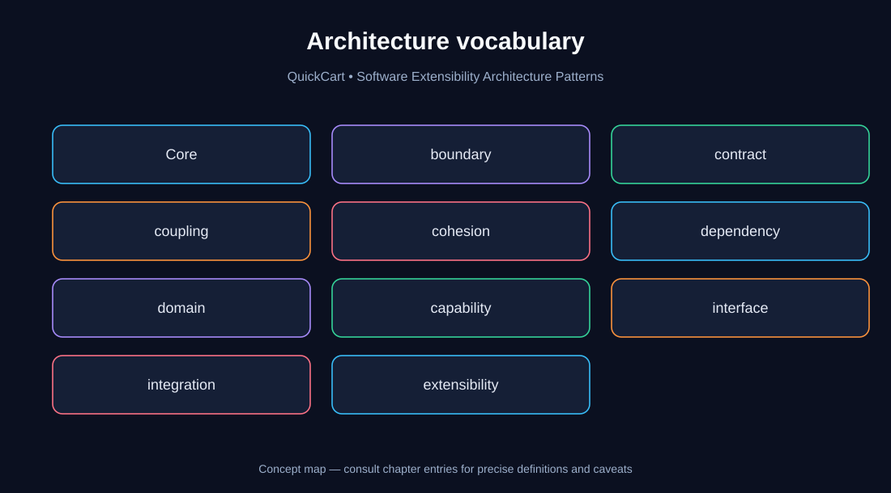
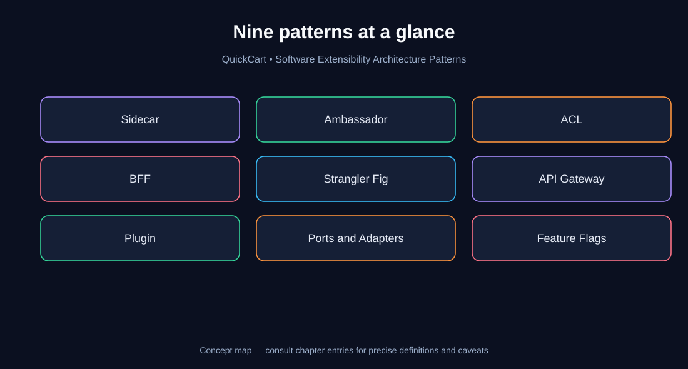
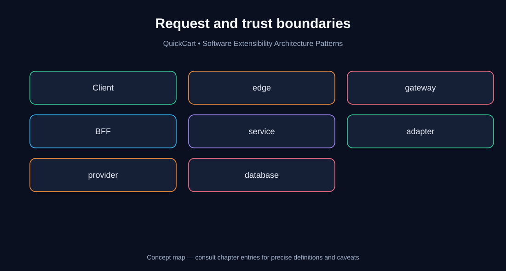
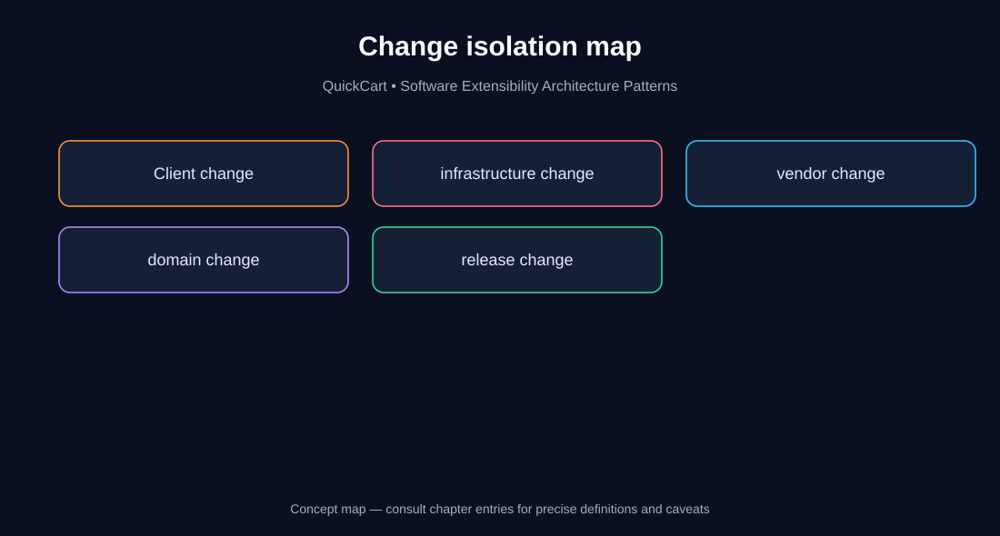
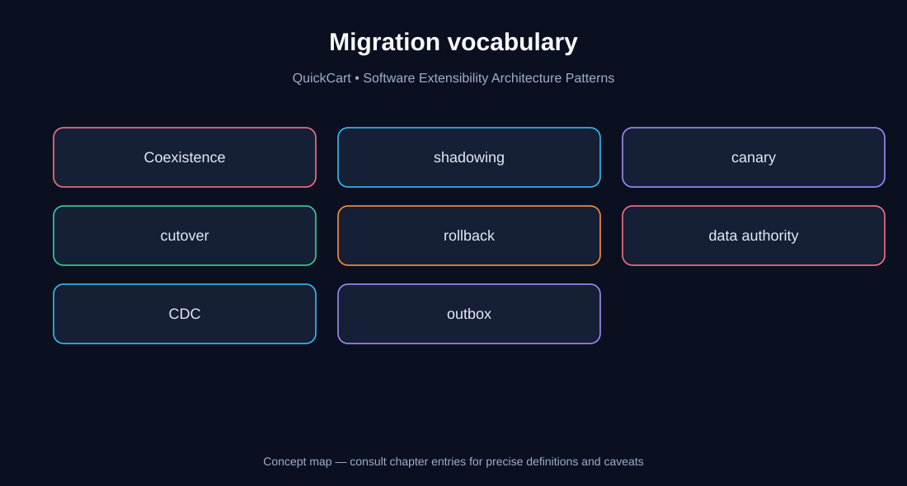
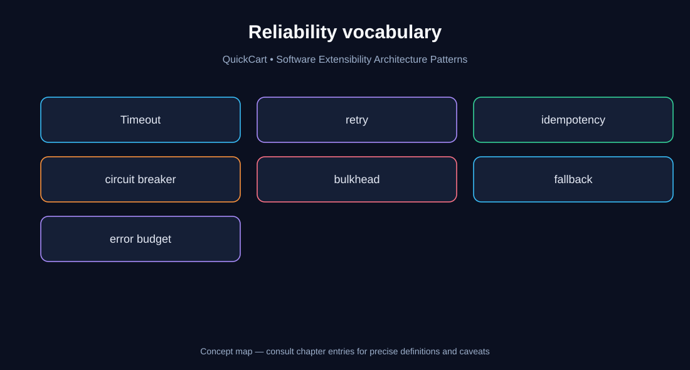
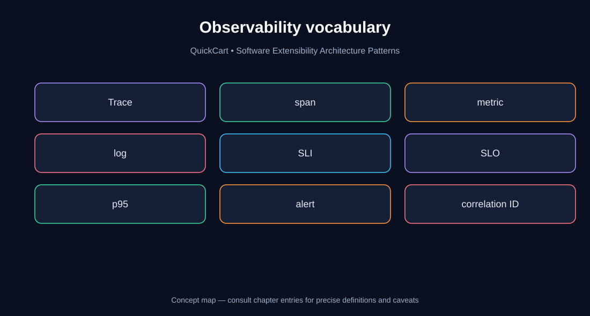
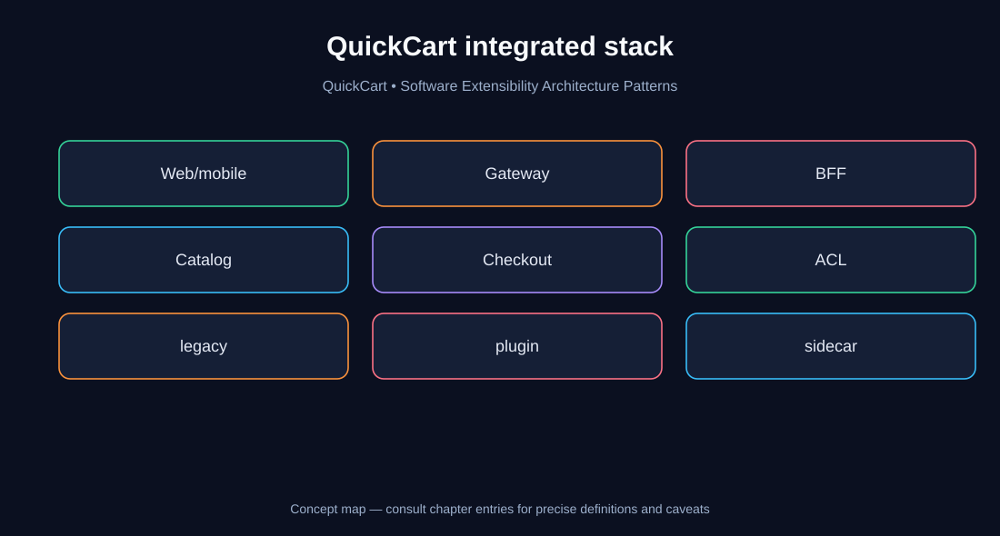

# Chapter 14 — Extensibility Architecture Glossary

> **Software Extensibility Architecture Patterns** · Final chapter · QuickCart case study

## How to use this glossary

This reference closes the 15-chapter course (Chapters 00–14). Terms are alphabetical, with plain-English definitions, concrete QuickCart examples, and cross-references to the chapter where each concept is developed. Definitions distinguish **architectural patterns**, **engineering mechanisms**, and **operational practices**. They are intentionally concise: use the chapter cross-reference for the design reasoning, alternatives, and trade-offs.

**Learning goals:** accurately explain all nine studied patterns; distinguish often-confused boundaries; select terms precisely during design reviews; reason about migration safety, operational risk, and ROI.

## Visual index

### 1. Architecture vocabulary

**How to read:** This concept map groups related vocabulary. The cards are a learning index, not a runtime deployment diagram; consult the entries below for exact responsibilities.

### 2. Nine patterns at a glance

**How to read:** This concept map groups related vocabulary. The cards are a learning index, not a runtime deployment diagram; consult the entries below for exact responsibilities.

### 3. Request and trust boundaries

**How to read:** This concept map groups related vocabulary. The cards are a learning index, not a runtime deployment diagram; consult the entries below for exact responsibilities.

### 4. Change isolation map

**How to read:** This concept map groups related vocabulary. The cards are a learning index, not a runtime deployment diagram; consult the entries below for exact responsibilities.

### 5. Migration vocabulary

**How to read:** This concept map groups related vocabulary. The cards are a learning index, not a runtime deployment diagram; consult the entries below for exact responsibilities.

### 6. Reliability vocabulary

**How to read:** This concept map groups related vocabulary. The cards are a learning index, not a runtime deployment diagram; consult the entries below for exact responsibilities.

### 7. Observability vocabulary

**How to read:** This concept map groups related vocabulary. The cards are a learning index, not a runtime deployment diagram; consult the entries below for exact responsibilities.

### 8. QuickCart integrated stack

**How to read:** This concept map groups related vocabulary. The cards are a learning index, not a runtime deployment diagram; consult the entries below for exact responsibilities.

## A–Z glossary

### A

**Adapter** — A component translating a port or interface into a concrete technology interaction.

*QuickCart example:* A PostgreSQL adapter implements QuickCart's OrderRepository port. **Study:** [Chapter 08](./08-ports-and-adapters.md).

**Ambassador** — An outbound proxy, often deployed beside an application, that standardizes calls to external services.

*QuickCart example:* QuickCart routes shipping-provider requests through a local proxy. **Study:** [Chapter 02](./02-ambassador.md).

**Anti-Corruption Layer (ACL)** — A translation boundary protecting one domain model from another system's semantics.

*QuickCart example:* Translate a legacy customer status into QuickCart's modern customer model. **Study:** [Chapter 03](./03-anti-corruption-layer.md).

**API composition** — Combining results from multiple services into one client-facing response.

*QuickCart example:* Mobile BFF combines catalog, inventory, and pricing responses. **Study:** [Chapter 04](./04-backends-for-frontends.md).

**API Gateway** — An edge entry point for cross-cutting API policies and routing.

*QuickCart example:* QuickCart applies authentication, quotas, and routing at the edge. **Study:** [Chapter 06](./06-api-gateway.md).

**API version** — An explicitly identified API contract revision.

*QuickCart example:* QuickCart maintains v1 mobile responses while rolling out v2. **Study:** [Chapter 06](./06-api-gateway.md).

**Authentication (AuthN)** — Establishing the identity of a caller; not equivalent to permission to perform an action.

*QuickCart example:* Validate a customer's token before accepting a checkout request. **Study:** [Chapter 06](./06-api-gateway.md).

**Authorization (AuthZ)** — Deciding whether a caller may access a particular resource or operation.

*QuickCart example:* Checkout still checks that an order belongs to the customer. **Study:** [Chapter 06](./06-api-gateway.md).

### B

**Backends for Frontends (BFF)** — A backend tailored to a particular client experience, focused on presentation-oriented orchestration.

*QuickCart example:* Web BFF returns rich page data; Mobile BFF returns compact screen data. **Study:** [Chapter 04](./04-backends-for-frontends.md).

**Backward compatibility** — A newer contract or implementation remains usable by older clients.

*QuickCart example:* Existing mobile releases keep working during an API evolution. **Study:** [Chapter 04](./04-backends-for-frontends.md).

**Bulkhead** — Isolation of resource pools so one dependency's failures do not exhaust unrelated work.

*QuickCart example:* Limit shipping quote concurrency separately from checkout processing. **Study:** [Chapter 06](./06-api-gateway.md).

### C

**Cache invalidation** — Keeping cached responses aligned with changes to authoritative data.

*QuickCart example:* Invalidate cached product availability after stock updates. **Study:** [Chapter 04](./04-backends-for-frontends.md).

**Canary release** — Routing a small, controlled portion of traffic to a new version to assess safety.

*QuickCart example:* Enable checkout v2 for 1% of eligible sessions first. **Study:** [Chapter 09](./09-feature-flags.md).

**Capability** — A business function with a coherent responsibility.

*QuickCart example:* Product discovery and payment authorization are different capabilities. **Study:** [Chapter 10](./10-pattern-comparison.md).

**Change Data Capture (CDC)** — Publishing database changes to downstream consumers, often from a transaction log.

*QuickCart example:* Replicate catalog updates during a migration; define ordering and recovery. **Study:** [Chapter 05](./05-strangler-fig.md).

**Circuit breaker** — A mechanism that temporarily stops requests to a persistently failing dependency.

*QuickCart example:* Pause calls to an unavailable tax provider. **Study:** [Chapter 02](./02-ambassador.md).

**Client contract** — The request and response semantics a consumer relies upon.

*QuickCart example:* Mobile app expects stable product IDs and explicit price currency. **Study:** [Chapter 04](./04-backends-for-frontends.md).

**Coexistence** — A migration phase where legacy and modern implementations operate together.

*QuickCart example:* Old and new catalog components run simultaneously. **Study:** [Chapter 05](./05-strangler-fig.md).

**Cohesion** — The degree to which a component's responsibilities belong together.

*QuickCart example:* Keep checkout payment orchestration cohesive, rather than mixing UI rendering. **Study:** [Chapter 08](./08-ports-and-adapters.md).

**Consumer-driven contract** — A contract test capturing assumptions that consumers need providers to satisfy.

*QuickCart example:* Mobile BFF tests the Catalog API fields it depends upon. **Study:** [Chapter 04](./04-backends-for-frontends.md).

**Contract test** — A test verifying that a provider and consumer agree on interface behavior.

*QuickCart example:* Check that a payment adapter honors the PaymentPort contract. **Study:** [Chapter 08](./08-ports-and-adapters.md).

**Correlation ID** — An identifier linking related requests and log records across components.

*QuickCart example:* Track one QuickCart order request through gateway, BFF, and checkout. **Study:** [Chapter 06](./06-api-gateway.md).

**Coupling** — How strongly components depend on each other's details.

*QuickCart example:* Direct SQL dependencies between checkout and catalog increase coupling. **Study:** [Chapter 00](./00-foundations.md).

**Cutover** — Switching production ownership or traffic from an old implementation to a new one.

*QuickCart example:* Route all product reads to the new Catalog service after validation. **Study:** [Chapter 05](./05-strangler-fig.md).

### D

**Data authority** — The system designated as the source of truth for a particular fact.

*QuickCart example:* Inventory service owns available-to-promise quantities. **Study:** [Chapter 05](./05-strangler-fig.md).

**Dependency inversion** — High-level policy depends on abstractions rather than low-level implementation details.

*QuickCart example:* Checkout depends on PaymentPort, not a vendor SDK. **Study:** [Chapter 08](./08-ports-and-adapters.md).

**Deployment** — Making a software build available in an environment; distinct from releasing it to users.

*QuickCart example:* Deploy checkout v2 with its flag disabled. **Study:** [Chapter 09](./09-feature-flags.md).

**Domain model** — Business concepts and rules expressed in a consistent language.

*QuickCart example:* An Order and its payment state belong to QuickCart's checkout domain. **Study:** [Chapter 03](./03-anti-corruption-layer.md).

**Domain service** — A service implementing business policy, not merely formatting client responses.

*QuickCart example:* Pricing calculates discounts and taxes consistently for all clients. **Study:** [Chapter 04](./04-backends-for-frontends.md).

### E

**Error budget** — The allowed amount of unreliability implied by an SLO over a period.

*QuickCart example:* A 99.9% success SLO permits 0.1% unsuccessful requests under its definition. **Study:** [Chapter 11](./11-integrated-case-study.md).

**Eventual consistency** — A guarantee that replicas may temporarily disagree but converge when updates propagate.

*QuickCart example:* Search index may lag behind authoritative catalog updates. **Study:** [Chapter 05](./05-strangler-fig.md).

**Extension point** — A stable place where a system permits alternate implementations.

*QuickCart example:* QuickCart's ShippingQuoteProvider interface. **Study:** [Chapter 07](./07-plugin-architecture.md).

### F

**Failure domain** — A boundary within which a fault can cause impact.

*QuickCart example:* Isolate plugin workers so one crash cannot take down checkout. **Study:** [Chapter 07](./07-plugin-architecture.md).

**Fallback** — A deliberate alternate behavior when a dependency fails; must preserve correctness.

*QuickCart example:* Show cached recommendations, but not an invented checkout success. **Study:** [Chapter 06](./06-api-gateway.md).

**Fan-out** — One request triggers calls to multiple downstream dependencies.

*QuickCart example:* Product page BFF calls catalog, inventory, and pricing. **Study:** [Chapter 04](./04-backends-for-frontends.md).

**Feature flag** — A runtime-controlled decision that enables or disables behavior independently of deployment.

*QuickCart example:* Turn checkout v2 on for selected cohorts. **Study:** [Chapter 09](./09-feature-flags.md).

**Flag debt** — Complexity caused by flags remaining after their intended lifecycle.

*QuickCart example:* Remove checkout v2's rollout branch once the old flow is retired. **Study:** [Chapter 09](./09-feature-flags.md).

### G

**Gateway policy** — A shared rule enforced at the API edge.

*QuickCart example:* Apply a partner-specific request quota. **Study:** [Chapter 06](./06-api-gateway.md).

### H

**Health check** — A probe used to assess whether a component should receive traffic.

*QuickCart example:* Remove an unhealthy gateway replica from rotation. **Study:** [Chapter 06](./06-api-gateway.md).

**Hexagonal Architecture** — An architectural style isolating application/domain logic behind ports and adapters.

*QuickCart example:* QuickCart checkout core is independent of HTTP and database frameworks. **Study:** [Chapter 08](./08-ports-and-adapters.md).

### I

**Idempotency** — Repeated execution with the same logical operation identifier does not duplicate its intended effect.

*QuickCart example:* Reuse an idempotency key when retrying a payment request. **Study:** [Chapter 08](./08-ports-and-adapters.md).

**Immutable identifier** — An identifier whose meaning remains stable through migrations.

*QuickCart example:* Use persistent order IDs for reconciliation. **Study:** [Chapter 05](./05-strangler-fig.md).

**Inbound port** — An interface through which callers invoke application use cases.

*QuickCart example:* PlaceOrder use case exposed to HTTP and messaging adapters. **Study:** [Chapter 08](./08-ports-and-adapters.md).

**Interface segregation** — Keeping interfaces focused so consumers need not depend on unused methods.

*QuickCart example:* Separate ShippingQuotePort from ShipmentPurchasePort. **Study:** [Chapter 08](./08-ports-and-adapters.md).

### K

**Kill switch** — A fast operational control to disable risky behavior.

*QuickCart example:* Disable a new recommendation integration during an incident. **Study:** [Chapter 09](./09-feature-flags.md).

### L

**Latency p95** — A response-time threshold at or below which 95% of measured requests fall.

*QuickCart example:* Monitor the p95 product-page load time for mobile users. **Study:** [Chapter 11](./11-integrated-case-study.md).

**Least privilege** — Granting only the permissions needed for a component's tasks.

*QuickCart example:* Shipping plugin may quote rates but cannot read payment credentials. **Study:** [Chapter 07](./07-plugin-architecture.md).

### M

**Microservice** — An independently deployable service around a coherent responsibility; not required by every pattern.

*QuickCart example:* A standalone catalog service is one possible migration destination. **Study:** [Chapter 05](./05-strangler-fig.md).

### O

**Observability** — Ability to understand system behavior from telemetry and diagnostics.

*QuickCart example:* Trace checkout latency across gateway, BFF, and payment adapter. **Study:** [Chapter 11](./11-integrated-case-study.md).

**Observability cardinality** — The number of distinct label combinations in metrics, affecting cost and performance.

*QuickCart example:* Do not label every request metric with unique order IDs. **Study:** [Chapter 11](./11-integrated-case-study.md).

**OpenTelemetry** — An open instrumentation ecosystem for collecting traces, metrics, and logs.

*QuickCart example:* Instrument QuickCart's BFF-to-checkout spans. **Study:** [Chapter 11](./11-integrated-case-study.md).

**Outbound port** — An abstraction through which the core requests external capabilities.

*QuickCart example:* PaymentPort and InventoryReservationPort. **Study:** [Chapter 08](./08-ports-and-adapters.md).

### P

**Paved road** — A supported, repeatable engineering approach for common tasks.

*QuickCart example:* Offer a standard plugin contract-test harness. **Study:** [Chapter 07](./07-plugin-architecture.md).

**Plugin** — A separately implemented capability loaded or invoked through a defined extension contract.

*QuickCart example:* A shipping carrier integration installed without changing checkout policy. **Study:** [Chapter 07](./07-plugin-architecture.md).

**Policy enforcement point** — A component that enforces a policy decision.

*QuickCart example:* Gateway validates a token, while services enforce object-level permissions. **Study:** [Chapter 06](./06-api-gateway.md).

**Progressive delivery** — Gradually exposing new functionality while using measured guardrails.

*QuickCart example:* Increase checkout v2 exposure from 1% to 10% after passing SLO checks. **Study:** [Chapter 09](./09-feature-flags.md).

### R

**Rate limiting** — Restricting request volume according to a policy.

*QuickCart example:* Gateway limits abusive partner API clients. **Study:** [Chapter 06](./06-api-gateway.md).

**Request shaping** — Transforming responses to fit a client's presentation needs.

*QuickCart example:* Mobile BFF returns thumbnail URLs rather than full desktop image sets. **Study:** [Chapter 04](./04-backends-for-frontends.md).

**Resource ownership** — Clear responsibility for updating and safeguarding data or operations.

*QuickCart example:* Checkout owns order transitions; BFFs do not. **Study:** [Chapter 04](./04-backends-for-frontends.md).

**Retry** — Repeating an operation after failure; safe only when semantics and budgets permit.

*QuickCart example:* Retry idempotent catalog reads, but guard payment retries with keys. **Study:** [Chapter 02](./02-ambassador.md).

**Rollback** — Restoring an earlier safe state; often harder after irreversible data changes.

*QuickCart example:* Revert traffic routes only while the old catalog remains data-compatible. **Study:** [Chapter 05](./05-strangler-fig.md).

### S

**Schema evolution** — Changing data representation while preserving needed compatibility.

*QuickCart example:* Add nullable fields before requiring them in a new service. **Study:** [Chapter 05](./05-strangler-fig.md).

**Semantic translation** — Mapping meaning, not just field names, between systems.

*QuickCart example:* Legacy status 'A' may not map one-to-one to a modern active status. **Study:** [Chapter 03](./03-anti-corruption-layer.md).

**Service mesh** — Infrastructure providing standardized service-to-service communication controls.

*QuickCart example:* QuickCart adopts mesh policies without moving checkout rules into proxies. **Study:** [Chapter 01](./01-sidecar.md).

**Shadow traffic** — Sending a copy of production requests to a candidate implementation without using its response.

*QuickCart example:* Compare new catalog results before serving customers; suppress side effects. **Study:** [Chapter 05](./05-strangler-fig.md).

**Sidecar** — A companion process or container deployed alongside an application for supporting capabilities.

*QuickCart example:* A telemetry agent shares a Kubernetes Pod with a service. **Study:** [Chapter 01](./01-sidecar.md).

**Single writer** — A clear authoritative owner for updates to a particular data entity.

*QuickCart example:* Only one catalog system accepts product mutations during cutover. **Study:** [Chapter 05](./05-strangler-fig.md).

**SLI** — Service Level Indicator: a measured aspect of service behavior.

*QuickCart example:* Successful checkout completion rate. **Study:** [Chapter 11](./11-integrated-case-study.md).

**SLO** — Service Level Objective: a target for an SLI over a stated period.

*QuickCart example:* 99.9% of eligible checkout requests succeed over 30 days. **Study:** [Chapter 11](./11-integrated-case-study.md).

**Strangler Fig** — Gradual replacement of legacy capabilities through controlled routing and migration.

*QuickCart example:* Extract catalog before checkout, keeping old order workflows intact. **Study:** [Chapter 05](./05-strangler-fig.md).

### T

**Timeout budget** — An allocated time limit for a request or downstream operation.

*QuickCart example:* BFF's fan-out requests must fit within the client's total latency budget. **Study:** [Chapter 04](./04-backends-for-frontends.md).

**Trace span** — A timed unit of work within a distributed trace.

*QuickCart example:* A span records the pricing lookup in checkout. **Study:** [Chapter 11](./11-integrated-case-study.md).

**Transactional outbox** — Persisting business state and an event record in the same local transaction, then publishing asynchronously.

*QuickCart example:* Order service writes an OrderPlaced event alongside its order update. **Study:** [Chapter 05](./05-strangler-fig.md).

**Trust boundary** — A point where identity, authority, or data crosses a security zone.

*QuickCart example:* Validate claims when traffic moves from public gateway to internal services. **Study:** [Chapter 06](./06-api-gateway.md).

### V

**Versioning** — Managing compatibility as contracts evolve.

*QuickCart example:* Add a new plugin contract version while older integrations remain supported. **Study:** [Chapter 07](./07-plugin-architecture.md).

## The nine patterns: one-line selection guide

| Problem you need to solve | Prefer | Do not confuse with |
|---|---|---|
| Attach operational support to a workload | Sidecar | Domain logic or a new business service |
| Standardize outbound calls to dependencies | Ambassador | Inbound API Gateway |
| Shield a modern domain from legacy semantics | Anti-Corruption Layer | Mere field renaming |
| Tailor APIs to distinct client experiences | BFF | Duplicating pricing or checkout policy |
| Replace a legacy system incrementally | Strangler Fig | Big-bang rewrite |
| Enforce edge API policies and route traffic | API Gateway | BFF presentation composition |
| Add controlled interchangeable capabilities | Plugin Architecture | Arbitrary dynamic code execution |
| Keep domain policy independent of technology | Ports and Adapters | Mandatory microservices |
| Separate code deployment from user exposure | Feature Flags | Permanent configuration sprawl |

## Frequently confused concepts

**Sidecar versus Ambassador:** Sidecar describes *deployment adjacency*; Ambassador describes an *outbound communication responsibility*. An Ambassador can be implemented as a sidecar, but not every sidecar is an Ambassador.

**Gateway versus BFF:** A gateway normally centralizes ingress policies such as authentication validation, quotas, and routing. A BFF composes or shapes results for a particular client. Both can coexist; avoid duplicating authorization and business policy.

**ACL versus adapter:** An adapter maps a port to an external implementation. An ACL specifically protects domain meaning from a foreign model. A payment adapter may contain ACL-like translation, but the responsibilities should remain explicit.

**Strangler Fig versus feature flags:** Strangler Fig is a system replacement strategy; flags are runtime release controls. A migration may use flags, routing, and canaries as mechanisms.

**Retries versus idempotency:** Retry is a repeated attempt; idempotency is a safety property of the operation. Never assume that retrying a timed-out payment is safe without an idempotency mechanism and reconciliation.

**Canary versus shadow traffic:** A canary serves real user responses to a limited cohort. Shadow requests are copied for comparison; their responses are not served, and side effects must be suppressed.

**Deployment versus release:** Deployment installs code. Release exposes behavior to users. Feature flags can separate these events.

**Authentication versus authorization:** Authentication establishes who the caller is. Authorization establishes what they can do, including ownership of specific resources.

## QuickCart architecture review vocabulary

When reviewing a proposed extension, ask these questions in order:

1. **What change pressure exists?** New client, provider, infrastructure concern, business capability, or legacy migration?
2. **Who owns the business invariant?** Pricing, stock, and payment rules must not drift into BFFs, proxies, or plugins.
3. **What is the stable contract?** Identify the port, API, event, plugin contract, or domain translation.
4. **Where is the trust boundary?** Specify authentication, authorization, secret handling, and data classification.
5. **What can fail independently?** Define timeouts, fallbacks, bulkheads, and whether retries are safe.
6. **Who owns writes and migrations?** Identify the source of truth, consistency model, and cutover rollback limitations.
7. **How will we know it works?** Choose latency, error, correctness, saturation, and business outcome indicators.
8. **When is the added complexity worth it?** Compare ongoing maintenance and operating costs with measurable benefits.

## Knowledge checks

Try answering each prompt before expanding its answer.

Check 1: Why does a BFF not own discounts?

**Answer:** Discount calculation is domain policy and must remain consistent across clients; a BFF may only present or orchestrate it.

Check 2: Can an ACL be a library?

**Answer:** Yes. ACL is a logical translation boundary and does not require a separately deployed service.

Check 3: Does a Kubernetes Pod automatically share a filesystem?

**Answer:** No. Containers share the Pod networking namespace; files require explicitly configured shared volumes.

Check 4: Can a Sidecar also be an Ambassador?

**Answer:** Yes. A local outbound proxy deployed alongside an application is a common Ambassador implementation.

Check 5: Does an API Gateway replace service-level authorization?

**Answer:** No. Services must still enforce resource-level and domain-specific permissions.

Check 6: What is the safe default for a failed checkout flag service?

**Answer:** Use a documented, locally cached or conservative state, and preserve payment correctness; avoid arbitrary inconsistent assignment.

Check 7: What makes a payment retry safe?

**Answer:** An idempotency key with defined server-side semantics, timeout budgets, and reconciliation for ambiguous outcomes.

Check 8: What is the key migration question for catalog writes?

**Answer:** Which system is the authoritative writer at each stage, and how are changes propagated without conflicts?

Check 9: What distinguishes a plugin from a normal library?

**Answer:** An intentional extension contract and lifecycle that permit independently developed implementations, often with versioning and isolation.

Check 10: Why do Ports and Adapters improve testability?

**Answer:** The application core depends on abstractions, allowing test fakes to replace external technologies.

Check 11: Is a canary the same as shadow traffic?

**Answer:** No. Canary serves selected users; shadowing duplicates traffic for comparison and must avoid side effects.

Check 12: Which metric captures slow experiences better than an average?

**Answer:** A percentile such as p95, combined with error rates and user-facing success indicators.

Check 13: Can all nine patterns be used together?

**Answer:** Yes, but only when distinct requirements justify their cost. Avoid adding patterns merely for architectural completeness.

Check 14: When should a migration rollback be considered unsafe?

**Answer:** When data contracts, authoritative writes, or irreversible side effects have changed so the old system cannot safely resume.

Check 15: What is the difference between SLI and SLO?

**Answer:** An SLI is the measurement; an SLO is its target over a defined period.

## Worked design exercise: QuickCart checkout expansion

**Scenario:** QuickCart wants a faster mobile checkout, a second shipping carrier, and a gradual move away from its legacy order system.

**Step 1 — Client change:** Add a Mobile BFF to shape the checkout view; keep price, stock, and order state in domain services.

**Step 2 — Provider change:** Define a ShippingQuotePort and introduce a provider plugin or adapter with a tested contract. Use isolation if the provider code is untrusted.

**Step 3 — Legacy change:** Apply Strangler Fig routing to migrate selected order capabilities. Use an ACL to translate legacy statuses, and define one authoritative writer per entity.

**Step 4 — Release safety:** Use feature flags and a canary for the mobile experience. Do not duplicate live payment side effects during shadow tests.

**Step 5 — Edge and operations:** Gateway handles ingress policies; an Ambassador may standardize outbound carrier calls; a sidecar may provide telemetry. Apply least privilege, tracing, and explicit timeout budgets.

**Step 6 — Business acceptance:** Measure p95 checkout latency, successful orders, duplicate-charge rate, integration incident rate, engineering lead time, and total operating cost. Declare numerical ROI assumptions before estimating payback.

**Common mistake:** Putting payment and pricing rules into the Mobile BFF because it seems closer to the screen. This creates client-specific business behavior and makes reconciliation harder.

## Further study and course completion

- [Chapter 00 — Foundations](./00-foundations.md): Architectural change pressure, coupling, and trade-offs.
- [Chapter 10 — Pattern Comparison](./10-pattern-comparison.md): Selection matrices and boundary distinctions.
- [Chapter 11 — Integrated QuickCart Case Study](./11-integrated-case-study.md): Modernization roadmap, cost, and operational governance.
- [Chapter 12 — Architecture Challenges](./12-architecture-challenges.md): Practice problems and model solutions.
- [Chapter 13 — Quick Revision](./13-quick-revision.md): Final assessment and memory aids.

**Completion checklist:** You can define all nine patterns, draw their boundaries, explain at least three combinations, reason about a safe payment retry, plan a migration cutover, and propose measurable production acceptance criteria.

*End of the 15-chapter Software Extensibility Architecture Patterns guide.*
