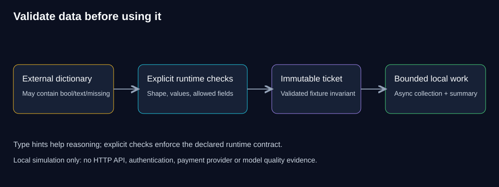

# SG-PY-BRIDGE-01 — Python at an engineering boundary

**What does Python check for you, and what must your application check itself?** Familiar-looking syntax can make an unfamiliar runtime feel safer than it is. This guide links the checks you already expect in backend systems to the places where Python needs you to write them down explicitly.

> **Your goal:** Predict where Python accepts bad data, leaves work running or imports the wrong code, and explain the check that catches each one. 
> **You need:** The [Python route](../../workbooks/python/README.md#the-standard-route) open beside this guide, plus everyday ideas about requests, exceptions and tests. 
> **Effort:** 45–60 minutes of reading (estimate); the hands-on work is in the workbook. 
> **You will produce:** Short explanations of a validation failure, what happens during an async timeout, and what a package install proves.

**QuickCart** is the fictional online shop used throughout the course. Here, its support team processes made-up tickets that carry amounts and category tags. Adding two amounts, 10 and 20, is easy. The real engineering question is what should happen when a value is `True`, a field is missing, a tag repeats or a call to another service never returns. Python makes these operations short to write, but short code does not decide the rules for you.

You do not need every Python feature to build a reliable first application. Focus on the assumptions most likely to break where data comes in, where tasks wait, or where code is packaged, and then test them in the matching workbook exercise.

## How to use this guide

Read the sections that match your chosen workbook units. Make each prediction before opening its explanation, then do the matching exercise. Come back to skipped sections when a failure makes them relevant. Setup commands and code live in the [workbook](../../workbooks/python/README.md).

| If you need to explain… | Read | Then practise |
|---|---|---|
| Why input with type hints still needs validation | Sections 1–2 | The validation notebook in the [unit map](../../workbooks/python/README.md#the-standard-route) |
| Counting, transforming data and shared defaults | Section 3 | The idioms and tests notebook in the unit map |
| Expected failures, async waiting and cancellation | Sections 4–5 | The async and exceptions notebook in the unit map |
| What tests and installed packages prove | Section 6 | The [required package checkpoint](../../workbooks/python/python-bridge/README.md) |

## 1. Intuition and prediction

A type hint is a label describing a contract. It helps your editor or a static checker reason about which values are allowed, but it is not a guard that runs when your code runs. **Predict:** if a function is annotated to take an `int` and simply returns its argument, will it reject the string `"ten"`?

Explain the prediction

No. The type hint alone does not reject the string. To check values at runtime, you need explicit checks or a validation library. A static checker might flag the call, but that happens at a different time, before the program runs. The label analogy has limits: some frameworks and schema tools do read type hints, so check what your tool actually enforces.

If your usual language checks types before the program runs, do not carry that assumption into Python. Equally, do not drop type hints because they do not validate input: they are still useful documentation and help static analysis catch mistakes.

## 2. Explicit runtime contracts

The [workbook](../../workbooks/python/README.md) uses a small, unchangeable `Ticket` model that checks its values when it is created. The input parser rejects missing or unknown fields, text or `True`/`False` amounts and badly shaped tags before the rest of the program touches the data. Amounts are made-up whole-number units, not a real money or refund policy.

**Diagram walkthrough:** start with the raw dictionary data on the left. The parser checks which fields are allowed and their shape and values; the model's own checks keep it valid even if someone creates a ticket directly. The checked ticket then moves on to local totals or to the limited async calls. Arrows show where data flows, not who is logged in. The note at the bottom separates type hints, validation, business policy and deployment; the diagram does not claim that tenant permissions, a model provider or an HTTP service exist here.

A frozen dataclass stops you reassigning its attributes, but it is not fully unchangeable: an object nested inside it could still change. This example keeps things simple by storing tags as tuples of checked strings. Incoming JSON lists become tuples only after their shape has been checked. Never turn a plain string into a tuple of characters and call it a tag list.

In Python, `True` behaves like the integer 1 in many operations. If your rules say amounts cannot be `True` or `False`, a general "is this an integer?" check lets them through. The reference therefore checks for exactly `int`. That is a deliberate choice for this small example; another domain might need `Decimal` or clearly documented parsing rather than silent conversion.

> [!IMPORTANT]
> Keep four questions separate: Is the value the right shape? Is it valid for this business? Is this caller allowed to use it? Did the operation actually succeed? A typed, valid ticket answers only the first two.

### Worked boundary example

Say each amount must be a whole number of zero or more, never `True` or `False`, and the batch holds two different ticket IDs. Amounts 10 and 20 give **10 + 20 = 30 units**. Swap 20 for `True`: the right result is a rejection, not a total of 11. Swap it for `"20"`: under these rules that is rejected too, even though Python could convert it.

The decision is to keep to the rules you declared. If a later requirement allows numbers written as text, write down that parsing rule and its failure cases first, then change the code. A convenient conversion is not a business decision on its own.

### Decide before changing the contract

A teammate wants to accept `"20"` as an amount because an upstream export sends text. Should you just add `int(value)` to the parser?

Compare your decision

First agree exactly what text is allowed: spaces, plus and minus signs, decimal points, empty strings and `True`/`False` all need explicit rules. Validate and test that parsing step before creating the ticket. Converting may be the right choice, but convenience alone does not define which inputs the business accepts.

## 3. Idioms that preserve meaning

A comprehension expresses a transformation in one line. Use an ordinary loop when validation, error handling or intermediate steps make the decision clearer. The reference collects the unique tags, sorts them so the output is always in the same order, and counts how many tickets contain each tag. If one ticket lists `shipping` twice, it still adds just one to that tag's count.

For the two-ticket example, the total is **30 units**, the count is **2**, and `shipping` and `returns` each have a count of **1**. Counting every occurrence of a tag would answer a different question. For a support dashboard, decide first whether you mean "How many tickets mention shipping?" or "How many times does the word appear?", then choose the transformation.

Avoid mutable default arguments for state that belongs to one call. A default object is created once, when the function is defined, and every call then shares it. Create the list or dictionary inside the call, or have the caller pass it in. Your backend instincts about who owns state still apply; Python's syntax does not remove session boundaries.

## 4. Exceptions are part of the boundary

Keep expected bad input apart from unexpected bugs or service failures. The parser raises its own `InputError`; the CLI turns that into a short message and a non-zero exit code without printing the raw input. An unexpected bug should never turn into a believable empty summary.

The most harmful pattern is catching every exception and returning zero. Whoever uses the result can no longer tell a valid empty batch from "every input was rejected" or "the service failed". Keep the error type and enough context to diagnose the problem, without leaking keys or private data.

The workbook CLI reads a local, made-up file. Putting the same parser behind an API adds new jobs: limit the request size before parsing, confirm who the caller is, check what they may do and return safe error messages. Local validation tests do not prove any of those API guarantees.

**Pause and diagnose:** a dashboard shows a total of zero after a malformed batch was processed. Why is that worse than a visible input error?

Explain the failure

Zero is also the correct answer for an empty batch. If an exception handler turns malformed input into zero, nobody downstream can tell a genuinely empty batch from a failed one. Return a failure the caller can handle and operators can diagnose, without exposing the raw input.

## 5. Async controls waiting, not truth

Calling an `async def` function creates a coroutine object; its body only runs when that coroutine is awaited or scheduled. Async helps when work is waiting on input or output, such as a network call. It does not make heavy calculations run in parallel, and it does not make a model's answer correct.

The reference allows at most 20 tickets per batch and 1–10 calls in flight at once, with a configurable shared deadline of no more than 60 seconds. These defaults are for teaching, not production targets. A semaphore limits how much work runs at once; the deadline covers both waiting in line and running. `gather` returns results in the same order as the inputs, even if they finish in a different order.

**Predict:** if a timeout happens while other tasks are still waiting, does returning an error stop those tasks on its own?

Explain cleanup and cancellation

Do not assume so. The reference explicitly cancels any unfinished child tasks in a `finally` block and waits for them to finish before it returns or raises. If the caller cancels, that cancellation is passed on after the cleanup. This only works if the code cooperates: a service call that blocks, or code that swallows cancellation, can defeat a simple timeout. Cancelling also does not undo an action that an external system has already completed; protecting against duplicates needs a stored idempotency record, which is a separate job.

A normal command-line program calls `asyncio.run` once, at program start. A notebook already has an event loop running, so its exercise uses top-level `await` instead. Copying the CLI's start-up code into a notebook can cause a "loop is already running" error; the fix is to use the right pattern for each environment, not to nest one event loop inside another.

To explain the timeout, sketch this sequence: **deadline reached → unfinished tasks are cancelled → cleanup runs → those tasks are awaited until they finish → the error (or the caller's cancellation) is passed on**. That describes the reference's cooperative cleanup, not a guarantee for every service. One question remains open: did an external action complete before the cancellation? Local cleanup alone cannot tell you.

## 6. Tests and packaging establish different evidence

A meaningful test checks a declared behaviour and where it fails: `True` amounts rejected, a duplicate tag counted once, the number of concurrent calls limited, unfinished tasks cleaned up after a timeout, cancellation passed on. Printing an expected sentence proves none of these. Break the behaviour on purpose, watch the test fail, then fix the code and rerun the same test. Never change the test data to hide a failure.

Tests that pass while importing from your source folder do not prove the built wheel contains your package. A `src/` folder layout and a clean install of the wheel expose missing-package and import mistakes. Runtime dependencies and build dependencies are also different: the example needs no third-party packages to run, but pins the tool used to build it.

A **wheel** is a Python package file you can install. A **lockfile** records the exact dependency versions a project used. Keep the build settings and your real install and import results: another environment must be able to install the package without your project folder. Installing a local wheel is a packaging check, not a service deployment.

## 7. Decision, practice and reflection

### Check your understanding

Try these without looking back. Explain the boundary, not just the answer.

1. **Calculate:** ticket A has the tags `shipping, shipping`; ticket B has `shipping, returns`. Under this module's rule, how many tickets belong to each category?
2. **Diagnose:** tests pass in your project folder, but the installed wheel fails to import from another folder. What did the original test run fail to prove?
3. **Decide:** a timeout happens after a pretend external refund has already gone through. Does cancelling the task successfully make it safe to retry the refund without a stored operation record?

Compare answers and reasoning

1. **Shipping: 2; returns: 1.** Each ticket counts at most once per category. Counting three shipping mentions would answer a different question. These are new example inputs, separate from the two-ticket reference example above.
2. It proved the code it imported works, but not that the wheel contains a usable package. Inspect the wheel and repeat the import from a fresh environment outside the source folder.
3. **No.** Cancelling can stop local work that cooperates and free its resources, but it cannot undo an action that already happened. Safe retries need a stored idempotency record and a way to check with the external system.

### Transfer the reasoning

Use notebooks for small experiments with predictions, validation and async. Use the normal project for repeatable imports, tests, CLI behaviour and checking the wheel. A notebook run is never deployment evidence.

**Your own challenge:** list the IDs of priority tickets whose amount is at or above a threshold, sorted by amount from highest to lowest and then by ID for ties, without changing the input. Reject a threshold that is `True`/`False`, text or negative. Then handle a new requirement: duplicate ticket IDs anywhere in the batch must be rejected, even if every ticket is valid on its own. Explain where that whole-batch check belongs and why type hints on single items cannot enforce it.

Hints and worked reasoning

Start by writing tests you can see pass or fail: normal, tie, boundary and invalid cases. For example tickets `B: 30`, `A: 30` and `C: 20` with a threshold of 20, the expected IDs are `A, B, C`; C equals the threshold, so it is included. Then sort with a key that matches the declared order, and take care not to reverse the ID tie-break by accident. A set helps you spot duplicate IDs, but quietly removing duplicates changes what you accept instead of rejecting the conflict. Keep shape checks, whole-batch business rules and permission rules separate.

**Reflect:** which familiar engineering assumption did Python make you spell out? Which test failed before your fix? What is still unverified outside this local process? Keep these notes with your workbook evidence. Complete the required package checkpoint before moving on to the tested [W-PY-API-01 API project](../../workbooks/python/quickcart-api/README.md).

## Completion checkpoint

**You can now:** explain what Python checks at runtime and what type hints leave to you, trace async cleanup after a timeout or cancellation, and say what tests and a wheel install each prove.

**Show it:** your section 7 answers and reflection.

**Next:** go back to the [Python route](../../workbooks/python/README.md#the-standard-route) and test the boundary you just explained in the matching unit.

## Sources and navigation

All sources below are **Reference** reading: free public documentation, checked 2026-10-14, with no account needed. What to read and how long: [Python 3.11 typing](https://docs.python.org/3.11/library/typing.html) for what type hints do at runtime, 5 minutes; [asyncio tasks](https://docs.python.org/3.11/library/asyncio-task.html) for cancellation and timeouts, 10 minutes; [unittest](https://docs.python.org/3.11/library/unittest.html) for test discovery and assertions, 5 minutes; [PyPA packaging tutorial](https://packaging.python.org/en/latest/tutorials/packaging-projects/) for source layout, build settings and wheels, 10 minutes. Each one builds on the matching section above. These links are optional; the explanations here and the workbook exercises cover the core route.

[Workbook and notebooks](../../workbooks/python/README.md) · [Start here](../../START-HERE.md) · [Course map](../../README.md)
