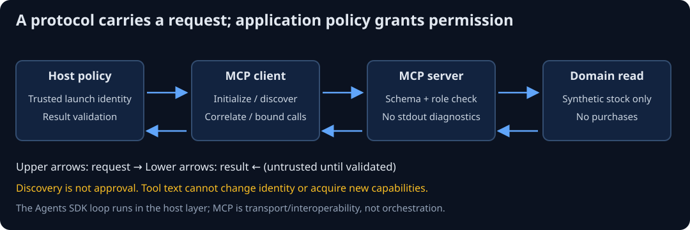

# SG-INTERFACE-00 — A tool interface is not permission

Where does tool protocol end and application authority begin?

> **Your goal:** Compare SDK orchestration and MCP client/server responsibilities against explicit trusted boundaries. 
> **You need:** [SG-RAG-01 — permissions and grounding](../retrieval-foundations/permissions-and-grounding.md) and [SG-GRAPH-00 — stateful orchestration](../stateful-orchestration/README.md). 
> **Estimated effort:** 40–55 min reading, estimated 
> **You will produce:** An interface decision with authorization, execution and evidence limits.

**Status: Draft.** Detailed starting-state, environment and verification limits remain below.

**QuickCart context:** the fictional shop's stock lookup is read-only, but a requested quantity still needs trusted caller scope and input/result checks. This guide compares responsibilities before introducing another runtime or protocol.

**Study route:** trace direct code, runner, state machine and client/server boundaries, then choose the smallest mechanism for each case. No account, provider call or external tool mutation is needed to read this guide. Run the linked exercises in their own environments afterwards.

Unit details, prerequisites and verification record

> **Capability:** AI-INTERFACE-01 | **Status:** Draft, unpiloted 
> **Prerequisites:** [trusted controls](../retrieval-foundations/permissions-and-grounding.md), [stateful orchestration](../stateful-orchestration/README.md) 
> **Effort:** 40–55 min reading, estimated 
> **Question:** Which component may request a tool, and which component decides whether it runs? 
> **Outcomes/artifact:** Explain model/runner/client/server boundaries; compare direct code, Agents SDK and LangGraph; defend authorization and untrusted-result checks.

## Begin with the request slip

QuickCart's assistant wants to inspect stock. A tool call says quantity=2. A request slip does not prove the requester may inspect the product or buy it. The model proposes an action; trusted application code decides whether and how to execute it.

Think of a restaurant order slip. Standard fields help the kitchen understand a request, but do not authorize a refund or open a locked storeroom. The analogy has limits: executable interfaces also need input bounds, timeouts, correlation, cancellation and explicit handling of untrusted returned text.

**Predict:** If a tool's argument schema contains tenant='B', should the server switch the caller's identity to tenant B?

Reasoning

No. Resolve identity from trusted application context or an authenticated connection, outside model arguments. Validation only establishes that a value has the expected shape. Authorization decides whether the requester may perform the operation on the resource.

## Four different responsibilities

**Direct code** calls a function after validation and authorization. It is often enough for a fixed lookup. An **agent runner** repeatedly gives a model context, interprets its proposed tool calls, executes registered tools and returns results until completion or a bound. **Stateful orchestration** adds explicit transitions, durable checkpoints and recovery across waits/failures. A **tool protocol** standardizes communication between a client and a server. These responsibilities can coexist without being interchangeable.

The Agents SDK exercise uses one actual Agent/Runner and a custom scripted Model. Its first response requests stock; its second ends the loop. That proves orchestration interfaces, not a real model's tool choice. Trusted Principal data enters through application context and is absent from the tool schema. A strictly typed quantity still needs a role/tenant check before the domain function records entry.

Local tracing records trace/span lifecycle labels using a custom processor. It replaces the remote exporter before execution and records no arguments, results or private context. A completed span is an execution observation, not proof that a business answer is correct. A trace can contain sensitive data in another configuration; define retention/access and test redaction before enabling hosted tracing.

## MCP crosses a process boundary

**Diagram walkthrough:** Follow the upper arrows from host policy through initialization/discovery to the server's checked domain read. Lower arrows carry results back; validation happens before the host credits them as useful output. The local server gets fixture identity from host-owned launch configuration, not a model field. The agent loop, when used, belongs in the host layer; a protocol response is not an agent decision.

Model Context Protocol (MCP) standardizes client/server exchanges for tools and other capabilities such as resources and prompts. The host owns application policy and chooses a trusted server. A client initializes a session, discovers a schema, sends a tool request and receives a result. Discovery is not approval to run every listed tool.

The local lab launches a pinned server as a child process using stdio, performs actual initialization/list_tools/call_tool, then closes it. Keep stdout for protocol messages; diagnostic logging belongs on stderr. This is not an HTTP or OAuth example. The server's role is host-owned launch configuration; it cannot be supplied by a model argument. Anyone who can freely relaunch this local teaching server controls its fixture identity, so this is not a production login boundary.

Treat descriptions, annotations, returned text and result dictionaries as untrusted data. The client checks the exact result fields, expected product, requested quantity and bounded output text. Additional instructions or a substituted quantity must not be treated as authority. Shape validation still does not establish that a remote stock service told the truth; source trust and business verification remain separate.

## Failure belongs to the correct boundary

A malformed argument should fail before domain work. A valid request with a denied role should never enter the domain operation. A tool failure is not a successful lookup merely because the agent returns friendly prose. An unavailable process fails before a usable session exists. A hanging tool/model must stop under a deadline, and an agent repeatedly requesting tools must stop under a turn limit.

The MCP client uses a ten-second cooperative overall timeout and a five-second session read timeout. Its result bound applies after SDK decoding, not as a wire-level memory cap. The agent exercise uses a cooperative deadline and maximum turns; these do not guarantee cancellation of arbitrary blocking code or cap charges from a real provider. Default tests use no provider and read-only synthetic data.

## Choose the smallest mechanism

> [!IMPORTANT]
> Discovery and schema validation describe what can be requested. Trusted policy decides what may execute; validated results still need evidence appropriate to the business claim.

| Requirement | Starting choice | What it does not supply |
|---|---|---|
| Fixed authorized stock lookup | Direct function | A model/tool loop or transport |
| Model chooses among registered tools | Agents SDK | Business authorization or automatic correctness |
| Approval waits across worker restarts | LangGraph/state machine | External effect idempotency or real identity |
| Share a tool across processes/hosts | MCP | OAuth merely by using stdio, resource ACLs or trustworthy tool text |

The comparison is about responsibilities, not which framework wins. A direct service can implement a durable queue; an agent can call an MCP tool; a graph can contain an agent node. Add those layers only for an observed requirement. Multi-agent systems remain selective extensions; neither exercise requires them.

## Practice, decision and reflection

**Decision check:** a fixed stock lookup needs no model-selected branching, approval wait or cross-process reuse. Which additional framework or protocol is required?

Compare the simplest choice

None follows from those requirements alone. A direct authorized function is sufficient. Add a runner for model-selected tool use, durable orchestration for a wait/recovery requirement, or a protocol for interoperability only when the requirement justifies it. Each added boundary still needs its own validation and authority checks.

Run [W-AGENTS-01](../../workbooks/agents-sdk/tool-loop/README.md) and [W-MCP-01](../../workbooks/mcp/stock-server/README.md). Predict the denied/malformed/failure behavior first. Independently add a host allowlist so a newly discovered purchase tool stays unavailable, and explain why server-side authorization still matters.

For defense, choose an architecture for an immediate read-only lookup and one for a durable approval workflow. Identify the exact enforcement points, bounded execution, result validation and ownership. A reasonable answer uses direct code for the fixed lookup, a graph only for the durable wait, and MCP only if cross-process interoperability is needed.

Revision: a schema describes shape; context establishes trusted identity; policy authorizes; a runner orchestrates; a protocol transports; a trace observes. None makes untrusted content an instruction. Next constraint: selective integration and delivery, rather than adding more agents.

## Source record

Checked 2026-10-14. Optional **Reference**, free, Python prerequisite, 10–15 min per relevant section:

- OpenAI, [Agents SDK migration guide](https://developers.openai.com/cookbook/examples/agents_sdk/migrate-from-claude-agent-sdk/readme), custom tools and runner/trusted-runtime sections. Used to verify responsibilities; no third-party application copied.
- MCP, [build a server](https://modelcontextprotocol.io/docs/2026-07-28/develop/build-server), stdio and server tools; [build a client](https://modelcontextprotocol.io/docs/2026-07-28/develop/build-client), initialization/discovery/invocation. Implemented against Python SDK 2.3.0, not old 1.x examples.

The explanation above is sufficient for the exercises. Exact installed SDK signatures and local verification are recorded in the workbook evidence; no hosted-model capabilities or model-quality benchmark is inferred.

## Completion checkpoint

**You can now:** distinguish orchestration, tool protocol and application authorization with explicit evidence limits. Support that explanation with this module's actual acceptance checks and disclose any unexecuted route.

**Next:** [inspect the actual SDK loop](../../workbooks/agents-sdk/tool-loop/README.md). Use the root capability prerequisites when deciding whether to proceed.
