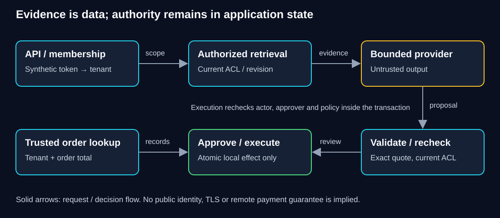

# W-CAP-01.2 — Build one bounded, permissioned application

**Where does trusted authority enter the application, and where must it be checked again?**

> **Your goal:** Reconstruct bounded application boundaries and verify failure behavior.<br>
> **You need:** [Discovery/acceptance](01-discovery-and-acceptance.md), the personal capstone copy and sibling retrieval dependency.<br>
> **Effort:** 8 hours across `cap-1-grounded` and `cap-2-approved`, estimated.<br>
> **You will produce:** Reconstructed boundary functions, risk-based tests and a requirement-to-check map. **Status:** Draft; synthetic reference and independently reviewed delivery are separate.

Start from the supplied reference-0.1.0 and preserve a personal copy with the retrieval dependency's relative layout. [Setup commands](README.md#first-local-run) run from `workbooks/capstone/merchant-support`. Read `src/merchant_support/core.py` in stages rather than copying it into a notebook. You will replace two functions in your copy, compare only after testing, and add a new failure test. The provided code is the worked solution; your modification/explanation is the learning artifact.

**Before changing code:** use this project's locked Python 3.11/uv environment and keep a recoverable baseline. The guided tests use synthetic identities, curated evidence and local simulated refunds; they require no paid provider or real transaction. Restore only deliberate fault edits, retaining your independent changes and failed evidence.

**Study route:** trace identity and publication, explain admission bounds, reconstruct order/approval functions, then test atomic local effects and revocation. For each stage write the expected denial or failure before running its test.

## 1. Trace the boundaries before changing them



**Diagram walkthrough:** Solid arrows show the request/decision flow. The API obtains a synthetic token mapping; trusted membership scopes retrieval before provider evidence leaves the application. The provider's output returns as data and is validated. An independent order lookup supplies business records. Approval and execution are separate actions; current membership and cited policy are rechecked inside the local effect transaction. The invariant is that model text never supplies identity or approval. The figure omits network TLS and production identity because this lab implements neither. SQLite is a single-host trust boundary; the simulated refund row is not an external payment API.

Read the existing [RAG mechanism](../../langchain/02-rag-capstone-workbook/02-architecture.md) and [safe-action mechanism](../../llm/safe-actions/README.md) only where needed. This short flow does not require an autonomous agent or graph. Tools are explicit read-only order lookup and an operator-requested simulated action; model generation never calls them.

## 2. Connect identity, retrieval and answer publication

In your copy of `src/merchant_support/core.py`, replace the complete `order(token, order_id)` function. Resolve `session(token)`, fetch the trusted principal and compare the requested order's tenant before returning only order ID/total cents. Return the same denial for absent and foreign orders. Do not accept a tenant argument. Verify:

```powershell
uv run --locked python -m unittest discover -s tests -p test_integration.py -v
```

Expected: isolation/order tests pass. In an ordinary Python REPL, compare foreign-order denial with missing-order denial. Do not print bearer values in logs. The synthetic mapping is an authentication stub; production needs an approved identity integration, expiry/revocation, protected transport and credential management.

Now inspect `ask`: the initial `answer` call scopes candidates and captures evidence; the provider receives only curated reviewed claims. After awaiting the provider, `current` checks the original citation revisions/hashes/permission, and a second validator rejects unsupported quotes. Prediction: what if the member is revoked or the document deleted while generation waits? Run the tests for `test_revocation_during_provider` and `test_delete_during_provider_and_restart`; expect denied/abstained with no returned snippets. Add a test changing ACLs during generation; preserve that failure and repair output.

The reference never sends full document instructions to the provider. It therefore limits the injection surface but does not establish resistance to arbitrary free-form retrieved pages. Explain why exact reviewed claims are useful for a narrow internal assistant and unsuitable for broad open-ended support advice.

## 3. Bound execution at the application boundary

Read `Engine.reserve`, the semaphore, deadline and provider adapter. No await occurs between single-process budget check and insertion; calls are charged to the local reservation ledger before provider work. Unknown topics do not make a model call. Busy work is rejected rather than queued without bound. Ambiguous/failed calls do not refund admission. One attempt avoids nested retry amplification; final program spending still needs approved real prices and infrastructure bounds.

The API body is bounded at 8192 bytes and two seconds of streaming; schema bounds individual fields. Uvicorn limits admitted connections; it is not a replacement for rate limiting at a real deployment boundary. All database operations occur on the one event-loop thread. **One process/worker is required**: multiple workers would have independent semaphores and non-atomic cross-process reservation checks. SQLite writes are short and local; CPU-heavy ingestion is not in the request path. The corpus is fixed at startup.

Verify the deadline, concurrency and durable-budget tests. The live provider uses a child process, no SDK retry and cancellation that kills/reaps that local child. A dedicated test substitutes a sleeping Python child, so no AWS request occurs. Explain why killing a local child cannot promise cancellation/refund of remote work.

## 4. Propose and approve the action

`propose` accepts typed cents and previously validated citations, then independently checks current permissions, topic, claim/hash/revision and order limits. It keys the canonical payload by tenant/order/amount/evidence. Repeated identical proposals share an action; different amounts are distinct requests still constrained by aggregate remaining total. This is deliberately a conservative teaching identity: two intentionally identical separate refunds cannot be represented as new business events. A real business system needs a trusted unique request/event ID and explicit cumulative rules; do not key on a fresh model call ID.

In your copy replace the complete `approve(token, key)` function. Require a current same-tenant supervisor who differs from the recorded actor, only for pending actions. Record the approver, not a boolean supplied by the model. Run the no-execution-without-current-approval test. Compare with the supplied reference after attempting. Every amount needs approval in reference-v1; the independent task changes that to a quorum above a threshold without weakening any existing rule.

## 5. Make effect and completion atomic, then break it

Follow `execute` from tenant-scoped action lookup to `BEGIN IMMEDIATE`. It rechecks halt, actor, approver and cited evidence before inserting a local simulated effect once and marking done in the same transaction. Crash-before-commit rolls back both. Restart and duplicate execution leave one effect. This is stronger than “write done, then send” for this **local** effect, but cannot atomically wrap an external payment service. For an external effect, retain the earlier durable outbox, idempotent downstream service and ambiguous-outcome reconciliation pattern.

Run crash/restart and order-total tests. Then deliberately break your copy: omit `current` evidence validation at execution. The changed-policy-revision test must fail. Restore it and rerun. Next omit the approver's active membership lookup; revoked-approver test must fail. Never fix either test by allowing stale evidence. Keep before/after evidence and explain where the trust check belongs.

## Completion checkpoint

**You can now:** trace each trusted decision and show where changed identity, evidence or order state prevents an effect. **Show it:** map CAP-AUTH/GROUND/ORDER/ACT/APPROVE/IDEM/BOUND to an exact check, your reconstructed code, actual failure/repair evidence and the residual limit.

**Transfer diagnosis:** “The API is healthy, but a pending action fails after policy deletion.” Explain why denial is expected and why restoring the deleted policy from an old backup would be unsafe.

**Next:** [evaluation](03-evaluation-and-failures.md), carrying the same source, fixture and acceptance versions. [Route](README.md)
